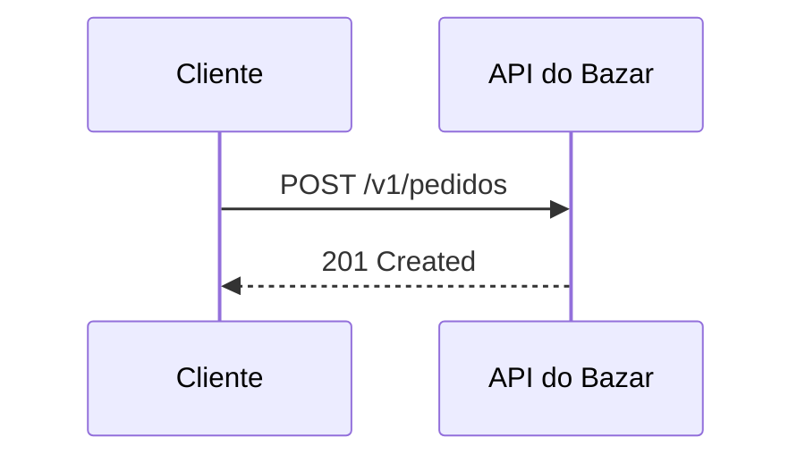

# Guia de escrita (fase 3)

> Como escrever cada página do site. Leia junto com `CURRICULO.md` (o que cada página cobre), `PROJETO-FINAL.md` (o domínio Bazar), `VERSOES.md` (versões) e `PROGRESSO.md` (status).
> A página **/componentes** do site mostra cada componente renderizado. O código-fonte dela está em `src/pages/componentes.mdx` e serve de exemplo para copiar.

## 1. Onde ficam as coisas

| O quê | Onde |
|---|---|
| Conteúdo das páginas | `src/content/<NN-parte>/<MM-PP>-<slug>.mdx` |
| Navegação (títulos, nível, prioridade, pré-requisitos) | `src/content/navigation.ts` (fonte única) |
| Glossário | `src/content/glossario.ts` |
| Status de cada página | `planejamento/PROGRESSO.md` e o campo `status` do frontmatter |
| Componentes MDX | `src/components/mdx/` |

### Frontmatter

Cada MDX começa assim (gerado na fase 2; mantenha os campos):

```yaml
---
id: "02.03"
titulo: "Status codes em profundidade"
descricao: "Uma ou duas frases: por que a página importa."
status: esqueleto        # esqueleto | rascunho | revisao | pronta
referencias:
  - titulo: "RFC 9110 §15"
    url: "https://www.rfc-editor.org/rfc/rfc9110#section-15"
---
```

- `titulo` e `descricao` aparecem no topo da página. **Não** escreva `# Título` no MDX.
- `referencias` alimenta o `<References />` da página e a página `/referencias`. Toda fonte citada no texto entra aqui.
- Se mudar o título de uma página, atualize também `navigation.ts` (a sidebar, o "Anterior/Próximo" e a busca de títulos leem de lá) e o `CURRICULO.md`.
- `status`: o site mostra um aviso em toda página que não está `pronta`.

### Fluxo de trabalho por página

1. Mude `status` para `rascunho` no frontmatter e no `PROGRESSO.md`.
2. Escreva seção por seção, **substituindo** cada `<Draft>` pelo texto final. A página pronta não tem nenhum `<Draft>`.
3. Remova as seções opcionais que não fizerem sentido (7 e 8).
4. Rode `npm run build` (erros de MDX aparecem aqui) e confira a página em `npm run dev`, nos temas claro e escuro.
5. Mude o status para `revisao` e, depois da revisão, para `pronta`. Atualize a linha de totais do `PROGRESSO.md`.

Para achar o que falta: `grep -rl "<Draft" src/content`.

## 2. Estrutura obrigatória de cada página

Os títulos de seção (`##`) abaixo já vêm no esqueleto. Mantenha a ordem; use `###` para subdivisões. O índice "Nesta página" é montado a partir dos `##` e `###`.

| # | Seção (`##`) | O que entra | Componentes típicos |
|---|---|---|---|
| 1 | **O problema** | O problema que o conceito resolve, com uma **analogia do mundo real** curta. Termine com a pergunta que a página responde. | `<Callout>` |
| 2 | **O conceito** | A explicação, cobrindo todos os tópicos do currículo. Defina os termos novos e marque-os com `<Term>`. | `<Term>`, `<Comparison>`, `<StatusCodeTable>`, tabelas |
| 3 | **Diagrama** | Os diagramas previstos no currículo. Fluxo de mensagens → sequência Mermaid; algo que acontece em etapas → `<AnimatedFlow>`; decisões → fluxograma. | Mermaid, `<AnimatedFlow>` |
| 4 | **Na prática** | Requisições HTTP reais **e** código Spring Boot do Bazar. Mostre a requisição antes do código que a atende. | `<HttpExchange>`, `<Endpoint>`, `<CodeTabs>`, `<Steps>`, `<FileTree>` |
| 5 | **Erros comuns** | Design ruim × bom e os erros mais frequentes, cada um com a correção. | `<BadVsGood>`, `<Callout type="warning">` |
| 6 | **Boas práticas** | Lista curta e acionável (5 a 8 itens), cada item começando por um verbo. | lista ou `<Checklist>` |
| 7 | **Por baixo dos panos** *(opcional)* | Como o Spring/HTTP faz isso internamente. Só quando ajuda a depurar ou a decidir. | `<DeepDive>` |
| 8 | **No projeto Bazar** *(quando houver)* | A etapa do projeto final construída nesta página (ver colunas "Introduzido em" do `PROJETO-FINAL.md`). | `<ProjectStep>` |
| 9 | **Resumo** | 3 a 6 itens com o essencial, um exercício e um quiz (2 a 4 perguntas). | `<Exercise>`, `<Quiz>` |
| 10 | **Referências** | Só `<References />`; as fontes ficam no frontmatter. | `<References />` |

**Regra didática (do currículo):** nenhuma página usa um conceito que ainda não foi explicado. Para mencionar algo que vem depois, use:

```mdx
<Callout type="info" title="Visto em detalhes adiante">
  ETags são o assunto da página [20.02](/padroes-avancados-de-http/etag-e-requisicoes-condicionais). Aqui basta saber que…
</Callout>
```

**Tamanho:** páginas essenciais costumam ter de 1.500 a 3.000 palavras. O tempo de leitura é calculado sozinho (200 palavras/min).

## 3. Convenções

### Tom de voz

- Português do Brasil, segunda pessoa ("você"), direto e sem floreio. Frases curtas.
- Explique o **porquê** antes do **como**. Toda regra vem com o motivo.
- Nada de "simplesmente", "basta", "é fácil" ou "obviamente".
- Seja concreto: em vez de "melhora a performance", diga "evita uma consulta por item da lista".
- Use o Bazar em todos os exemplos (`PROJETO-FINAL.md`). Nada de `foo`, `bar` ou `User`/`Product` genéricos.
- Quando o exemplo simplifica algo que o projeto final faz de outro jeito, avise: "No projeto final isso evolui para… (página X)".

### Termos em inglês

- Termos técnicos sem tradução consagrada ficam em inglês e em itálico **na primeira ocorrência** da página: *retry*, *timeout*, *keyset*, *lost update*. Depois, sem itálico.
- Nomes de headers, métodos, status, classes, anotações e propriedades vão como código: `If-Match`, `PATCH`, `@RestController`, `spring.mvc.apiversion.use.header`.
- Use a tradução quando ela é corrente: "requisição", "resposta", "cabeçalho" (ou "header"), "corpo", "recurso", "representação", "idempotência", "paginação".
- "API" é feminino ("a API"); "endpoint" é masculino ("o endpoint").
- Status sempre com número e nome na primeira vez: `422 Unprocessable Content`. Depois, só o número.

### Código

- **Versões:** sempre as de `VERSOES.md` (Java 25, Spring Boot 4.1.2, Jackson 3, JUnit 6...). Nada de APIs depreciadas sem aviso (ex.: `RestTemplate`).
- **Pacotes:** base `com.bazar`, organizado **por módulo**: `com.bazar.catalogo`, `com.bazar.estoque`, `com.bazar.clientes`, `com.bazar.pedidos`, `com.bazar.pagamentos`, `com.bazar.frete`, `com.bazar.integracoes`, `com.bazar.relatorios`, `com.bazar.compartilhado`.
- **Nomes:** domínio em português e termos técnicos consagrados em inglês: `ProdutoController`, `CriarProdutoRequest`, `ProdutoResponse`, `ProdutoRepository`, `PedidoService`. Use exatamente os nomes de entidades e campos do `PROJETO-FINAL.md` (`precoEmCentavos`, `PagaFácil`, `Idempotency-Key`...).
- **Rotas:** `https://api.bazar.example/v1/...`; em exemplos curtos, só o caminho (`/v1/produtos`).
- **IDs:** UUID v7 de exemplo com aparência real (`0192f3a1-9999-7000-8000-000000000123`); número do pedido `BZR-2026-000123`.
- **Datas:** RFC 3339 em UTC (`2026-10-24T17:30:00Z`). **Dinheiro:** `{ "valor": "129.90", "moeda": "BRL" }` (na v1 do produto, `precoEmCentavos`).
- **Erros:** sempre `application/problem+json` com `type` em `https://api.bazar.example/problemas/<codigo>` e as extensões `codigo`, `erros[]` e `traceId`.
- Mostre só o trecho relevante; use `// ...` para o que foi omitido. Imports só quando o pacote importa (ex.: Jackson 3 em `tools.jackson`).
- Todo bloco Java ou YAML que corresponde a um arquivo do projeto leva `title="caminho/Arquivo.java"`.
- Linguagens de bloco: `java`, `bash` (comandos e curl), `http` (mensagens HTTP cruas), `json`, `yaml`, `properties`, `sql`, `xml`, `javascript`, `dockerfile`, `diff`.
- Comandos `curl` usam `-i` quando o status e os headers importam.

### Links

- Entre páginas, use a URL do site: `/<slug-da-parte>/<slug-da-página>` (veja os slugs em `navigation.ts`), com o ID no texto: `[08.01](/construindo-apis-com-spring-boot/problem-details-rfc-9457)`.
- Links externos abrem em nova aba sozinhos. Prefira fontes oficiais (RFCs, docs do Spring, guias de Zalando, Microsoft e Google). Toda fonte externa entra no frontmatter.
- A segurança aprofundada fica na outra documentação: use 🔒 e um `<Callout type="info">` apontando para ela.

### Diagramas

- Sem imagens de terceiros. Use Mermaid, `<AnimatedFlow>`, `<FileTree>` ou SVG próprio.
- Mermaid: participantes e nós com nomes do Bazar (`Cliente`, `API do Bazar`, `PagaFácil`, `PostgreSQL`). Prefira `sequenceDiagram` para trocas HTTP, `stateDiagram-v2` para estados, `flowchart LR` para decisões curtas (o `TD` cresce muito na vertical).
- Não force cores no Mermaid: o tema claro/escuro é aplicado sozinho.
- Todo diagrama tem `title="..."`.

## 4. Componentes: como e quando usar

Todos estão disponíveis sem import. Props em inglês, conteúdo em português.

### Blocos de código (Markdown)

Quando: todo código. Recursos: nome do arquivo, linhas destacadas, diff, foco e botão de copiar (automático).

````mdx
```java title="src/main/java/com/bazar/catalogo/ProdutoController.java" {3-5}
@GetMapping("/{id}")
ProdutoResponse detalhar(@PathVariable UUID id) {
    return service.detalhar(id);
}
```

```java
return repository.findById(id).orElse(null); // [!code --]
return service.detalhar(id); // [!code ++]
var x = importante(); // [!code focus]
var y = destaque(); // [!code highlight]
```
````

Use `noCopy` no meta (` ```text noCopy `) para saídas que não faz sentido copiar.

### `<Callout>`

Quando: avisos curtos fora do fluxo principal. `info` para contexto ou referência adiante, `tip` para atalhos, `warning` para armadilhas, `danger` para erros que causam bugs ou falhas de segurança. No máximo 3 ou 4 por página.

```mdx
<Callout type="warning" title="Open Session in View">
  `spring.jpa.open-in-view` vem ligado por padrão. Desligue em APIs.
</Callout>
```

### `<CodeTabs>`

Quando: o mesmo exemplo em várias formas (curl, HTTPie, fetch, Java) ou em várias versões (Maven/Gradle, `application.yml`/`.properties`). O rótulo da aba vem do `title`.

````mdx
<CodeTabs title="Listar categorias">

```bash title="curl"
curl -i https://api.bazar.example/v1/categorias
```

```bash title="HTTPie"
http https://api.bazar.example/v1/categorias
```

</CodeTabs>
````

Deixe uma linha em branco depois de `<CodeTabs>` e antes de `</CodeTabs>`.

### `<HttpExchange>`

Quando: sempre que mostrar o que trafega na rede. É o componente mais usado nas Partes 1, 2, 6 e 9. `body` pode ser objeto (formatado como JSON) ou string. Os filhos são uma explicação opcional, mostrada abaixo.

```mdx
<HttpExchange
  title="Atualização com ETag desatualizada"
  request={{ method: 'PUT', url: '/v1/produtos/0192f39f-…/estoque', headers: { 'If-Match': '"v6"' }, body: { quantidadeDisponivel: 10 } }}
  response={{ status: 412, headers: { 'Content-Type': 'application/problem+json' }, body: { type: 'https://api.bazar.example/problemas/versao-desatualizada', title: 'Versão desatualizada', status: 412 } }}
>
  O cliente precisa ler de novo o recurso e reaplicar a mudança.
</HttpExchange>
```

`response` é opcional (para mostrar só a requisição).

### `<Endpoint>`

Quando: ao apresentar um endpoint do Bazar como referência (parâmetros e respostas possíveis). Use uma vez por endpoint, normalmente na seção "Na prática" ou "No projeto Bazar". Exemplos vão como filhos.

```mdx
<Endpoint
  method="POST"
  path="/v1/pedidos/{id}/cancelamento"
  summary="Cancela um pedido que ainda não foi enviado."
  params={[
    { name: 'id', in: 'path', type: 'UUID', required: true, description: 'Id do pedido.' },
    { name: 'motivo', in: 'body', type: 'string', description: 'Motivo do cancelamento.' },
  ]}
  responses={[{ status: 200 }, { status: 404 }, { status: 409, description: 'O pedido já foi enviado.' }]}
/>
```

`in` aceita `path`, `query`, `header` e `body`. Use `deprecated` para endpoints depreciados.

### `<BadVsGood>`, `<Bad>`, `<Good>`

Quando: na seção "Erros comuns", para comparar duas abordagens. `why` explica a diferença em uma ou duas frases.

````mdx
<BadVsGood title="Status de erro" why="Clientes e gateways decidem pelo status, não pelo corpo.">
<Bad title="200 com erro no corpo">

```http
HTTP/1.1 200 OK

{ "sucesso": false, "erro": "Produto não encontrado" }
```

</Bad>
<Good title="Status correto + Problem Details">

```http
HTTP/1.1 404 Not Found
Content-Type: application/problem+json
```

</Good>
</BadVsGood>
````

### `<Steps>` e `<Step>`

Quando: procedimentos que o leitor executa em ordem (criar projeto, configurar, rodar). Não use para explicar conceitos.

```mdx
<Steps>
<Step title="Suba o PostgreSQL">
Rode `docker compose up -d postgres`.
</Step>
<Step title="Rode a aplicação">
Execute `./mvnw spring-boot:run`.
</Step>
</Steps>
```

### Mermaid (`<Mermaid>`)

Quando: sequências, estados, fluxogramas e arquiteturas estáticas. Escreva como bloco de código; o `<Mermaid chart={...}>` existe, mas o bloco é mais legível.

````mdx

````

### `<AnimatedFlow>`

Quando: processos em etapas em que o **caminho** importa: a requisição pelo `DispatcherServlet`, o *retry* com *backoff*, o circuito do *circuit breaker*, o polling de uma operação 202. No máximo um ou dois por página; para sequências simples, Mermaid basta.

```mdx
<AnimatedFlow
  title="Polling de uma operação longa"
  nodes={[
    { id: 'cliente', label: 'Cliente' },
    { id: 'api', label: 'API do Bazar', sublabel: 'OperacaoController' },
    { id: 'worker', label: 'Worker', sublabel: '@Async' },
  ]}
  steps={[
    { from: 'cliente', to: 'api', label: 'POST /reembolsos', title: 'Pedido aceito', description: 'A API responde 202 com Location: /v1/operacoes/{id}.' },
    { from: 'api', to: 'worker', title: 'Processamento em segundo plano' },
    { from: 'api', to: 'cliente', label: '303 See Other', response: true, title: 'Operação concluída' },
  ]}
/>
```

Omita `to` para um passo de processamento dentro do próprio nó. `response: true` muda a cor do pacote. Até 6 nós para caber no desktop.

### `<FileTree>`

Quando: mostrar onde ficam os arquivos (criação do projeto, novo módulo, etapa do Bazar). Pastas terminam com `/`, indentação de 2 espaços, marcas `(novo)`, `(alterado)`, `(removido)` e comentários depois de ` #`.

```mdx
<FileTree title="Módulo de pedidos" tree={`
src/main/java/com/bazar/pedidos/
  Pedido.java
  PedidoController.java (alterado)
  CancelamentoService.java (novo) # regra de transição
`} />
```

### `<Comparison>`

Quando: comparar 2 a 4 alternativas em vários critérios (PUT × PATCH, offset × cursor, REST × gRPC). `true`/`false`/`null` viram ✓/✗/—. `highlight` destaca a coluna recomendada (índice a partir de 0).

```mdx
<Comparison
  title="Offset × cursor"
  columns={['Offset', 'Cursor (keyset)']}
  highlight={1}
  rows={[
    { label: 'Pular para a página N', values: [true, false] },
    { label: 'Estável com inserções', values: [false, true] },
  ]}
/>
```

Para tabelas simples sem destaque, use tabela Markdown.

### `<StatusCodeTable>`

Quando: listar status relevantes para um assunto. Números usam a explicação padrão; objetos aceitam `when` (substitui a explicação), `example` (caso no Bazar) e `retry` (pode repetir). `filter={false}` esconde os filtros por classe.

```mdx
<StatusCodeTable codes={[200, 201, { code: 409, example: 'Cancelar pedido ENVIADO' }, { code: 503, retry: true }]} />
```

### `<DeepDive>`

Quando: seção 7, "Por baixo dos panos". Conteúdo que o leitor pode pular sem perder o fio: código-fonte do Spring, detalhes do protocolo. Pode aparecer também no meio do texto, para um aprofundamento pontual.

```mdx
<DeepDive title="Como o HandlerMapping escolhe o método">
…
</DeepDive>
```

### `<ProjectStep>`

Quando: seção 8, se a página introduz um endpoint ou parte do Bazar (colunas "Introduzido em" do `PROJETO-FINAL.md`) e em todas as páginas da Parte 16. `tag` é a tag do repositório de exemplos: `pagina-MM.PP`. `change` aceita `novo`, `alterado` e `removido`.

```mdx
<ProjectStep title="Cancelamento de pedido com 409" module="pedidos" tag="pagina-12.04" files={[
  { path: 'src/main/java/com/bazar/pedidos/PedidoController.java', change: 'alterado' },
  { path: 'src/main/java/com/bazar/pedidos/TransicaoInvalidaException.java', change: 'novo' },
]}>
O que foi construído e como testar.
</ProjectStep>
```

### `<Checklist>`

Quando: listas de verificação acionáveis (revisão de endpoint, preparação para produção, Apêndice A). As marcações ficam no navegador do leitor. Use `id` diferente se houver dois na página. Itens podem ser strings ou `{ label, hint }`.

```mdx
<Checklist id="antes-do-deploy" title="Antes do deploy" items={['Probes configurados', { label: 'Graceful shutdown', hint: 'server.shutdown=graceful' }]} />
```

### `<Quiz>`

Quando: na seção 9, com 2 a 4 perguntas que testam **entendimento**, não memorização. Sempre com `explanation`, explicando também por que as outras opções estão erradas. `answer` é o índice a partir de 0. Varie a posição da resposta certa.

```mdx
<Quiz questions={[
  { question: 'PUT é idempotente porque…', options: ['…devolve sempre 200', '…o efeito de repetir é o mesmo'], answer: 1, explanation: 'Idempotência fala do efeito no servidor.' },
]} />
```

### `<Exercise>`, `<Hint>`, `<Solution>`

Quando: na seção 9, um exercício prático feito no Bazar. `difficulty`: `facil`, `medio` ou `dificil`. A solução traz código completo e explica as decisões.

````mdx
<Exercise title="Devolva 201 com Location" difficulty="facil">
Enunciado.

<Hint>Dica.</Hint>

<Solution>

```java
// solução
```

</Solution>
</Exercise>
````

### `<Term>`

Quando: na primeira vez que um termo do glossário aparece na página (só na primeira). Se o termo não existir, adicione-o em `src/content/glossario.ts` com a página onde ele é explicado.

```mdx
Um PUT é <Term id="idempotencia">idempotente</Term>. Sem texto, mostra o próprio termo: <Term id="etag" />.
```

### `<References>`

Sempre no fim, na seção "Referências", sem props. Lê o frontmatter.

### `<Draft>`

Só nas páginas esqueleto. A fase 3 remove todos.

## 5. Checklist de cada página

- [ ] As 10 seções na ordem, sem `<Draft>`; seções 7 e 8 removidas se não se aplicam
- [ ] Todos os tópicos do currículo cobertos
- [ ] Nenhum conceito usado antes de ser explicado (ou com aviso "visto em detalhes adiante")
- [ ] Analogia na seção 1
- [ ] Pelo menos um `<HttpExchange>` ou requisição HTTP real e código Spring Boot do Bazar
- [ ] Nomes, pacotes e versões conforme `PROJETO-FINAL.md` e `VERSOES.md`
- [ ] Diagramas do currículo, com título
- [ ] `<Term>` na primeira ocorrência dos termos do glossário
- [ ] Exercício e quiz com explicações
- [ ] Todas as fontes no frontmatter
- [ ] `npm run build` sem erros; página conferida nos temas claro e escuro
- [ ] `status` atualizado no frontmatter e no `PROGRESSO.md`
