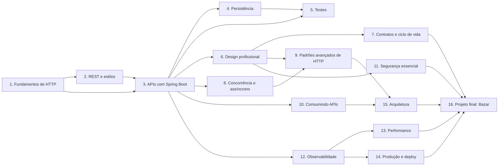
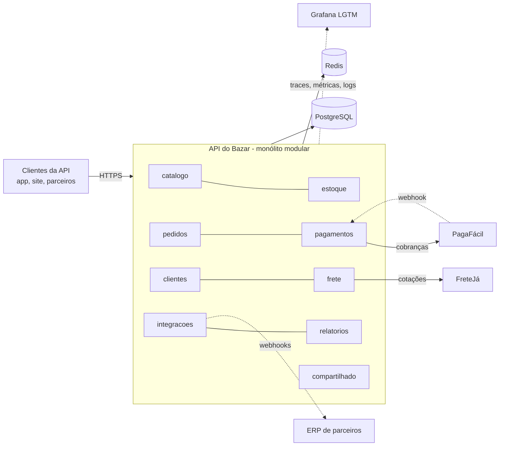

## O problema

Você já sabe criar um `@RestController` que devolve uma lista em JSON. Mesmo assim, ainda não tem resposta para perguntas que aparecem no primeiro mês de qualquer API em produção: o cliente repetiu um `POST` depois de um *timeout* e o pedido foi criado duas vezes; o app móvel quebrou porque um campo novo apareceu num enum; o gateway reiniciou todos os pods porque o banco ficou lento por dez segundos.

Esses problemas não são de Spring. São de **HTTP**, de **design de contrato** e de **operação**. O Spring é a ferramenta que você usa para resolvê-los, mas só depois de entender o que está sendo resolvido.

Pense em aprender a dirigir. Saber onde ficam o volante e os pedais (o equivalente a saber anotar um método com `@GetMapping`) é o começo. Dirigir bem na estrada, à noite e com chuva exige entender as regras de trânsito, a física da frenagem e como os outros motoristas se comportam. Esta documentação cobre as regras de trânsito (HTTP), a física (concorrência, falhas, latência) e o comportamento dos outros motoristas (clientes, proxies, gateways), sempre com o volante na mão (Spring Boot).

São mais de 140 páginas. Sem um mapa, é fácil se perder ou pular justamente a parte que faltava.

> **A pergunta desta página:** como esta documentação está organizada, por onde você deve começar e que projeto acompanha os exemplos?

## O conceito

### Para quem é esta documentação

Ela foi escrita para quem programa em Java, já criou pelo menos um projeto com Spring Boot e quer passar de "faço um CRUD" para "projeto e opero APIs de nível profissional". Você não precisa conhecer os conceitos de antemão: cada um é explicado antes de ser usado, com o **porquê** antes do **como**.

Ao final, a expectativa é que você consiga:

- ler e depurar qualquer troca HTTP, inclusive as que passam por proxies e gateways;
- projetar um contrato de <Term id="api">API</Term> que evolui sem quebrar clientes;
- implementar no Spring Boot 4 os padrões que separam um CRUD de uma API séria: erros padronizados, paginação por cursor, concorrência otimista, idempotência, operações assíncronas, webhooks;
- consumir APIs de terceiros que falham, demoram e mudam;
- colocar a API em produção com observabilidade, testes de carga e *deploy* sem derrubar requisições.

### Partes, módulos e páginas

O conteúdo tem três níveis de organização:

| Nível | O que é | Exemplo |
|---|---|---|
| **Parte** | Um grande tema, do básico ao avançado | Parte 1: Começando e fundamentos de HTTP |
| **Módulo** | Um grupo de páginas sobre o mesmo assunto, com ID `Mxx` | M02: HTTP essencial |
| **Página** | Uma unidade de estudo, com ID `MM.PP` (módulo.página) | 02.03: Status codes em profundidade |

O ID aparece no topo de cada página e é usado nos pré-requisitos e nos links ("veja [02.03](/comecando-e-fundamentos-de-http/status-codes-em-profundidade)"). Quando uma página precisa mencionar algo que só é explicado depois, ela avisa com um bloco "Visto em detalhes adiante" e não depende desse conteúdo para funcionar.

### Níveis e prioridades

Cada página tem dois selos, visíveis no topo e na barra lateral:

| Selo | Valores | O que significa |
|---|---|---|
| **Nível** | Básico | Precisa saber para fazer qualquer API. |
| | Intermediário | Separa um CRUD de uma API profissional. |
| | Avançado | É o que se espera de quem projeta e opera APIs em produção. |
| **Prioridade** | Essencial | Não pule. Outras páginas dependem dela. |
| | Importante | Pule só se estiver com pressa e volte depois. |
| | Complementar | Pode pular sem perder a sequência; nenhuma página essencial depende dela. |

Nível e prioridade são independentes. A página 02.08 (HTTP/2 e HTTP/3) é intermediária e importante; a 21.01 (*idempotency keys*) é avançada e essencial.

### Trilhas sugeridas

<Comparison
  title="Escolha sua trilha"
  columns={['Trilha mínima', 'Trilha completa', 'Já faço CRUD']}
  highlight={1}
  rows={[
    { label: 'Páginas', values: ['Só as essenciais (cerca de 60%)', 'Todas, na ordem', '02.02, 02.03, 08.01, Parte 6 e Parte 9 primeiro'] },
    { label: 'Para quem', values: ['Precisa entregar uma API profissional logo', 'Quer dominar o assunto', 'Tem experiência e quer preencher lacunas'] },
    { label: 'Cobre o projeto final inteiro', values: [true, true, false] },
    { label: 'Inclui arquitetura e alternativas (gRPC, GraphQL)', values: [false, true, false] },
  ]}
  caption="Em qualquer trilha, a barra lateral mostra o que você já leu. O progresso fica salvo no navegador."
/>

### O que não está aqui

Esta documentação trata de segurança só no que todo desenvolvedor de API precisa aplicar no próprio código: <Term id="bola">BOLA</Term>, exposição excessiva de dados, CORS, validação de entrada, SSRF, o essencial de um *resource server* com JWT. Isso fica na Parte 11.

Autenticação a fundo, OAuth 2.1, OpenID Connect e a configuração detalhada do Spring Security ficam na **[documentação de segurança](https://security-doc-beta.vercel.app/)**, que é separada. Sempre que um assunto for aprofundado lá, você vai ver o cadeado 🔒 ao lado dele.

<Callout type="info" title="Por que separar">
  Segurança merece uma trilha própria, com seus próprios pré-requisitos. Misturar tudo aqui deixaria as páginas de HTTP e design longas demais e daria uma visão rasa dos dois assuntos.
</Callout>

### O Bazar: o projeto que acompanha todos os exemplos

Exemplos com `foo`, `bar` e `User` não ensinam design, porque não têm regras de negócio. Por isso todos os exemplos usam o mesmo domínio: o **Bazar**, uma loja online fictícia de pequeno porte. Você vai reconhecer as entidades de uma página para outra, e cada conceito novo aparece onde ele resolve um problema real da loja.

| O que você precisa aprender | Onde o Bazar oferece |
|---|---|
| Um CRUD simples para começar | Categorias |
| Coleções grandes, filtros, busca e paginação | Catálogo de produtos |
| Atualização parcial e concorrência | Produto (`PATCH`) e estoque (`If-Match`) |
| Ações que não são CRUD e máquina de estados | Ciclo de vida do pedido (cancelar, pagar, enviar) |
| Idempotência com dinheiro envolvido | Criação de pedido e de pagamento |
| Consumo de APIs externas que falham | Gateway de pagamento **PagaFácil** e cotação de frete **FreteJá** |
| Operações demoradas | Reembolso e relatório de vendas |
| Notificação de terceiros e tempo real | Webhooks para parceiros e acompanhamento do pedido |
| Arquivos | Imagens de produto e exportação CSV |
| Dados sensíveis | Cliente (CPF, e-mail, endereço) e LGPD |
| Evolução de contrato | Produto v2 (preço em várias moedas) e depreciação da v1 |

O Bazar é um **monólito modular**: uma única aplicação Spring Boot, dividida em módulos com fronteiras claras. Os módulos são `catalogo`, `estoque`, `clientes`, `pedidos`, `pagamentos`, `frete`, `integracoes`, `relatorios` e `compartilhado`. Ele conversa com dois sistemas externos fictícios, a PagaFácil e a FreteJá, simulados com WireMock para que você possa reproduzir lentidão, erros 503 e limites de requisição sem depender de ninguém.

<Callout type="info" title="Visto em detalhes adiante">
  Monólito modular é o assunto da página [30.01](/arquitetura/monolito-modular-com-spring-modulith), e WireMock aparece em [24.05](/consumindo-outras-apis/testando-clientes-http). Por enquanto, basta saber que o código do Bazar é separado em pacotes por assunto e que os sistemas externos são simulados.
</Callout>

### Como os exemplos estão organizados

O código do Bazar é um projeto Spring Boot real, que **compila e passa nos testes**. Ele fica na pasta `projeto-final/` do repositório desta documentação e cresce conforme as páginas avançam: a página 05.02 cria o projeto, a 05.04 acrescenta o primeiro CRUD, a Parte 4 liga o banco de dados, e assim por diante.

Quando uma página altera o projeto, ela termina com um bloco **No projeto Bazar**, que lista os arquivos criados ou alterados e a *tag* correspondente, no formato `pagina-MM.PP`. Com a *tag*, você pode ver o projeto exatamente como ele estava ao final daquela página e comparar com o seu código:

```bash
git checkout pagina-05.04          # o projeto ao final da página 05.04
git diff pagina-05.03 pagina-05.04 # o que a página 05.04 mudou
```

Nos trechos de código das páginas, o comentário `// ...` indica que parte do arquivo foi omitida. O caminho do arquivo aparece no título do bloco, como em `src/main/java/com/bazar/catalogo/CategoriaController.java`.

### Convenções de nomes

O código mistura português e inglês de propósito, com uma regra simples:

- **Domínio em português:** classes, campos, rotas e valores de negócio. `Produto`, `Pedido`, `precoEmCentavos`, `/v1/pedidos/{id}/cancelamento`, status `PAGAMENTO_PENDENTE`.
- **Termos técnicos consagrados em inglês:** `Controller`, `Service`, `Repository`, e os sufixos `Request` e `Response` nos objetos de entrada e saída.

O resultado são nomes como `ProdutoController`, `CriarProdutoRequest`, `ProdutoResponse` e `PedidoService`. O pacote base é `com.bazar`, organizado por módulo: `com.bazar.catalogo`, `com.bazar.pedidos` etc.

Outras convenções que você vai ver em todos os exemplos:

| Item | Convenção | Exemplo |
|---|---|---|
| URL base | `https://api.bazar.example/v1` | `GET https://api.bazar.example/v1/produtos` |
| Identificadores | UUID v7 | `0192f3a1-9999-7000-8000-000000000123` |
| Número do pedido | Legível por humanos | `BZR-2026-000123` |
| Datas | RFC 3339 em UTC | `2026-10-24T17:30:00Z` |
| Dinheiro | Valor decimal em string + moeda | `{ "valor": "129.90", "moeda": "BRL" }` |
| Erros | `application/problem+json` | `type: https://api.bazar.example/problemas/produto-nao-encontrado` |

Cada uma dessas escolhas tem um motivo, explicado na página correspondente (Partes 3 e 6). O domínio `api.bazar.example` usa o sufixo `.example`, reservado pela RFC 2606 para documentação: ele nunca vai pertencer a ninguém.

### Como cada página é estruturada

Todas as páginas seguem a mesma ordem, para que você saiba onde procurar:

1. **O problema**: o que dá errado sem o conceito, com uma analogia.
2. **O conceito**: a explicação completa.
3. **Diagrama**: o fluxo ou a estrutura em forma visual.
4. **Na prática**: requisições HTTP reais e o código do Bazar.
5. **Erros comuns**: design ruim × bom.
6. **Boas práticas**: uma lista curta e acionável.
7. **Por baixo dos panos** (quando ajuda): como o Spring ou o protocolo fazem aquilo internamente.
8. **No projeto Bazar** (quando a página altera o projeto).
9. **Resumo**, com exercício e quiz.
10. **Referências**: as fontes oficiais.

Termos com sublinhado pontilhado, como <Term id="idempotencia">idempotência</Term>, estão no glossário: passe o mouse (ou toque) para ver a definição e o link para a página que os explica.

## Diagrama

O mapa abaixo mostra as partes e as dependências mais fortes entre elas. Uma seta de A para B significa "leia A antes de B".



E esta é a visão geral do Bazar: os módulos dentro da aplicação e os sistemas com que ela conversa.



## Na prática

Esta página não tem código para rodar ainda: o ambiente é preparado na próxima página e o projeto é criado em [05.02](/construindo-apis-com-spring-boot/criando-o-projeto-bazar). Mas vale ver, desde já, o tipo de troca HTTP que você vai saber projetar, implementar e explicar ao final.

<HttpExchange
  title="Criação de um pedido no Bazar"
  request={{
    method: 'POST',
    url: '/v1/pedidos',
    headers: { 'Content-Type': 'application/json', 'Idempotency-Key': '0192f3a1-7c4e-7b2a-9d1e-3f5a6b7c8d9e' },
    body: { clienteId: '0192f3a0-1111-7000-8000-000000000001', itens: [{ produtoId: '0192f39f-2222-7000-8000-000000000042', quantidade: 2 }] },
  }}
  response={{
    status: 201,
    headers: { 'Content-Type': 'application/json', Location: '/v1/pedidos/0192f3a1-9999-7000-8000-000000000123' },
    body: { id: '0192f3a1-9999-7000-8000-000000000123', numero: 'BZR-2026-000123', status: 'CRIADO', valorTotal: { valor: '259.80', moeda: 'BRL' }, criadoEm: '2026-10-24T17:30:00Z' },
  }}
>
  Cada detalhe desta troca tem uma página: o método `POST` e o status `201` (Parte 1), o header `Location` (02.04), o UUID v7 (15.03), o dinheiro como string decimal (15.02), a data em RFC 3339 (15.01) e o header `Idempotency-Key`, que impede pedidos duplicados quando o cliente repete a requisição (21.01).
</HttpExchange>

E este é o tipo de erro que o Bazar devolve, sempre no mesmo formato:

<HttpExchange
  title="Tentativa de cancelar um pedido já enviado"
  request={{ method: 'POST', url: '/v1/pedidos/0192f3a1-9999-7000-8000-000000000123/cancelamento', headers: { 'Content-Type': 'application/json' }, body: { motivo: 'CLIENTE_DESISTIU' } }}
  response={{
    status: 409,
    headers: { 'Content-Type': 'application/problem+json' },
    body: {
      type: 'https://api.bazar.example/problemas/transicao-invalida',
      title: 'Transição de estado inválida',
      status: 409,
      detail: 'O pedido BZR-2026-000123 já foi enviado e não pode ser cancelado.',
      codigo: 'PEDIDO_TRANSICAO_INVALIDA',
      traceId: '4bf92f3577b34da6a3ce929d0e0e4736',
    },
  }}
/>

## Erros comuns

<BadVsGood title="Como estudar" why="As páginas avançadas assumem os fundamentos. Quem pula a Parte 1 costuma implementar idempotência ou cache sem entender o que o HTTP já garante, e acaba reinventando (mal) o que o protocolo oferece.">
<Bad title="Ir direto ao código">

Abrir a página de *idempotency keys* (21.01), copiar o código e seguir em frente sem saber o que é um método idempotente nem por que o `POST` não é.

</Bad>
<Good title="Seguir os pré-requisitos">

Conferir os pré-requisitos no topo da página. Se 02.02 ainda não foi lida, ler antes: são 15 minutos que evitam horas de depuração depois.

</Good>
</BadVsGood>

Outros erros frequentes de quem começa uma documentação longa:

- **Ler sem executar.** Os exemplos foram feitos para rodar. Rode os comandos `curl`, altere o código, quebre e conserte. O que você executa, você lembra.
- **Pular os exercícios e quizzes.** Eles testam entendimento, não memória. Se errar uma pergunta, releia a seção antes de seguir.
- **Ignorar o "Por baixo dos panos".** Essas seções são opcionais na primeira leitura, mas são as que salvam você quando algo dá errado em produção. Volte a elas depois.
- **Tratar páginas complementares como obrigatórias.** Se o tempo é curto, siga a trilha mínima. As complementares podem esperar.

## Boas práticas

- **Leia** a Parte 1 inteira, mesmo que já use HTTP há anos: ela fixa o vocabulário que todo o resto usa.
- **Confira** os pré-requisitos no topo de cada página antes de começar.
- **Execute** cada `curl` e cada trecho de código no seu ambiente.
- **Compare** seu código com a *tag* `pagina-MM.PP` quando algo não funcionar.
- **Faça** o exercício antes de abrir a solução.
- **Marque** as páginas como lidas para acompanhar o progresso na barra lateral e na página inicial.
- **Use** a busca (Ctrl+K) e o glossário quando esquecer um termo, em vez de seguir em frente sem entender.

## Resumo

- A documentação é organizada em **partes → módulos → páginas**, com IDs `MM.PP` usados nos pré-requisitos.
- Cada página tem um **nível** (básico, intermediário, avançado) e uma **prioridade** (essencial, importante, complementar). A trilha mínima cobre só as essenciais.
- Segurança a fundo fica na documentação de segurança; aqui você encontra o essencial, marcado com 🔒 quando há aprofundamento lá.
- Todos os exemplos usam o **Bazar**, uma loja online com catálogo, estoque, clientes, pedidos, pagamentos, frete, webhooks e relatórios.
- O código do Bazar é real, fica em `projeto-final/` e tem uma *tag* `pagina-MM.PP` para cada página que o altera.
- Domínio em português, termos técnicos em inglês: `ProdutoController`, `CriarProdutoRequest`, `PedidoService`.

<Exercise title="Monte o seu plano de estudo" difficulty="facil">
Escolha uma trilha (mínima, completa ou "já faço CRUD") e, usando a barra lateral, liste as dez primeiras páginas que você vai ler. Para cada uma, anote o nível e a prioridade. Em seguida, responda: qual é a primeira página **avançada e essencial** da sua lista, e quais são os pré-requisitos dela?

<Hint>
O nível e a prioridade aparecem como selos na barra lateral e no topo de cada página. Os pré-requisitos ficam logo abaixo do título.
</Hint>

<Solution>

Não existe resposta única, mas um plano coerente para a trilha completa começa assim:

| Ordem | Página | Nível | Prioridade |
|---|---|---|---|
| 1 | 01.01 Como usar esta documentação | Básico | Essencial |
| 2 | 01.02 Preparando o ambiente | Básico | Essencial |
| 3 | 02.01 Anatomia de uma mensagem HTTP | Básico | Essencial |
| 4 | 02.02 Métodos HTTP | Básico | Essencial |
| 5 | 02.03 Status codes em profundidade | Básico | Essencial |
| 6 | 02.04 Headers essenciais | Básico | Essencial |
| 7 | 02.05 Content negotiation e media types | Básico | Essencial |
| 8 | 02.06 JSON para APIs | Básico | Essencial |
| 9 | 02.07 Cookies, estado e sessões | Intermediário | Importante |
| 10 | 02.08 HTTP/1.1, HTTP/2 e HTTP/3 | Intermediário | Importante |

Nas dez primeiras páginas não há nenhuma avançada: os fundamentos vêm antes. Se você escolheu a trilha "já faço CRUD", a primeira avançada e essencial provavelmente é da Parte 9, como a 21.01 (*idempotency keys*), que depende de 02.02 e das páginas de escrita da Parte 6. O objetivo do exercício é perceber que até as páginas avançadas dependem dos fundamentos.

</Solution>
</Exercise>

<Quiz
  questions={[
    {
      question: 'Uma página é marcada como "Avançado" e "Complementar". O que isso significa para quem está na trilha mínima?',
      options: [
        'Ela é obrigatória, porque páginas avançadas são as mais importantes',
        'Ela pode ser pulada sem perder a sequência, porque nenhuma página essencial depende dela',
        'Ela deve ser lida antes das páginas básicas',
      ],
      answer: 1,
      explanation: 'Nível e prioridade são independentes. O nível diz a profundidade do assunto; a prioridade diz se você pode pular. Complementar significa que nenhuma página essencial depende dela, então a trilha mínima a deixa de fora. Ler avançadas antes das básicas inverte a ordem dos pré-requisitos.',
    },
    {
      question: 'Qual destes nomes segue a convenção dos exemplos do Bazar?',
      options: ['ProductController', 'ControladorDeProduto', 'ProdutoController'],
      answer: 2,
      explanation: 'O domínio fica em português (Produto) e o termo técnico consagrado fica em inglês (Controller). ProductController traduz o domínio, e ControladorDeProduto traduz o termo técnico, que todo desenvolvedor Spring reconhece em inglês.',
    },
    {
      question: 'Seu código da página 05.04 não funciona e você não sabe o que está diferente. Qual é o caminho mais rápido?',
      options: [
        'Comparar com a tag pagina-05.04 do projeto final',
        'Recomeçar o projeto do zero',
        'Pular para a página seguinte e esperar que o problema se resolva',
      ],
      answer: 0,
      explanation: 'Cada página que altera o projeto tem uma tag com o código exato ao final dela. Comparar (git diff) mostra a diferença em segundos. Recomeçar desperdiça tempo, e pular deixa o problema crescer, porque as próximas páginas constroem em cima desta.',
    },
  ]}
/>

## Referências

<References />
