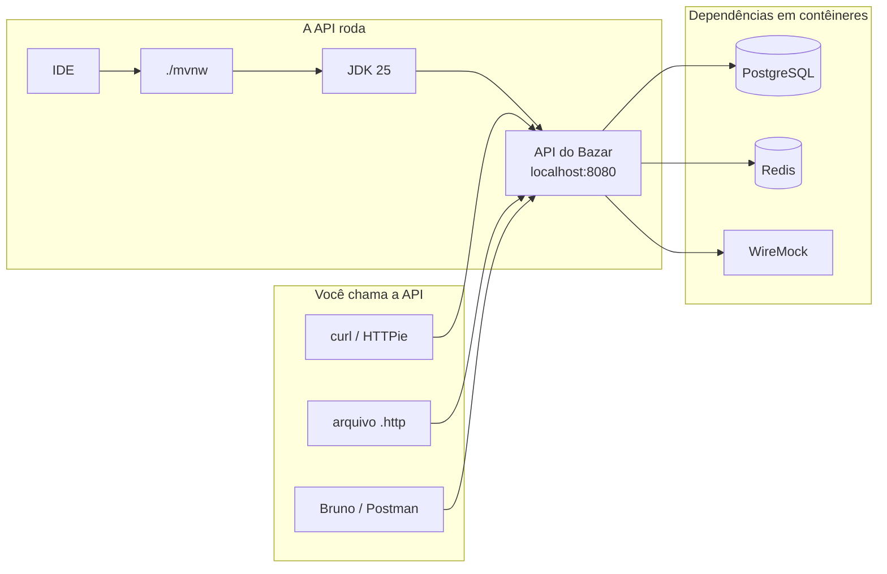

## O problema

"Na minha máquina funciona" é a frase mais cara do desenvolvimento de software. Um exemplo desta documentação que roda com Java 25 pode não compilar com Java 21; um comando que funciona com Maven 3.10 pode falhar com uma versão antiga instalada pelo gerenciador de pacotes do sistema; um teste que sobe um PostgreSQL em contêiner não roda sem Docker.

É como seguir uma receita: se a receita pede forno a 180 °C e o seu forno não tem termostato, o bolo vai sair diferente, por mais fiel que você seja aos ingredientes. Antes de cozinhar, você confere o equipamento.

> **A pergunta desta página:** quais ferramentas você precisa instalar, em que versão, e como verificar que está tudo pronto para rodar os exemplos do Bazar?

## O conceito

### O que você vai instalar

| Ferramenta | Para quê | Necessária a partir de |
|---|---|---|
| **JDK 25** | Compilar e rodar o Bazar | Parte 3 |
| **Maven Wrapper** | Build reprodutível, sem instalar Maven | Parte 3 (vem com o projeto) |
| **IDE** (IntelliJ IDEA ou VS Code) | Editar, depurar e rodar testes | Parte 3 |
| **Docker e Docker Compose** | PostgreSQL, Redis, WireMock e observabilidade locais | Parte 4 |
| **curl** e **HTTPie** | Chamar a API pelo terminal | Parte 1 (agora) |
| **jq** | Ler e filtrar JSON no terminal | Parte 1 (agora) |
| Cliente gráfico (Bruno, Insomnia ou Postman) | Explorar a API visualmente | Opcional |

### JDK 25

O JDK (*Java Development Kit*) traz o compilador `javac`, a JVM e as ferramentas de diagnóstico. A documentação usa o **Java 25**, a versão LTS (*Long-Term Support*) atual. O Spring Boot 4.1 exige no mínimo o Java 17 e funciona até o 27, mas alguns exemplos usam recursos que só existem a partir do 25, como os *scoped values* (página [19.06](/concorrencia-e-execucao-assincrona/scoped-values-e-concorrencia-estruturada)).

Existem várias **distribuições** do mesmo OpenJDK, compiladas e mantidas por empresas diferentes. Para os exemplos, qualquer uma serve:

| Distribuição | Mantida por | Observação |
|---|---|---|
| **Eclipse Temurin** | Adoptium (Eclipse Foundation) | Gratuita, neutra, a escolha padrão desta documentação |
| **BellSoft Liberica** | BellSoft | Recomendada pelo Spring Initializr e pelos buildpacks do Spring Boot |
| Amazon Corretto | Amazon | Comum em quem roda na AWS |
| Oracle OpenJDK / Oracle JDK | Oracle | O Oracle JDK tem termos de licença próprios; leia antes de usar em produção |

<Callout type="tip" title="Use um gerenciador de versões">
  Você vai precisar de mais de um JDK ao longo da carreira: o projeto legado em Java 17, o novo em Java 25. O **SDKMAN!** (Linux, macOS e WSL) instala e troca versões com um comando. No Windows sem WSL, use o instalador da Adoptium ou o `winget`.
</Callout>

### Maven Wrapper

O Bazar usa Maven como ferramenta de build. Em vez de pedir que você instale o Maven na versão certa, o projeto traz o **Maven Wrapper**: os scripts `mvnw` (Linux e macOS) e `mvnw.cmd` (Windows), mais o arquivo `.mvn/wrapper/maven-wrapper.properties`, que fixa a versão do Maven. Na primeira execução, o *wrapper* baixa essa versão e a guarda em `~/.m2/wrapper`. Todo mundo que clona o projeto usa exatamente o mesmo Maven.

Por isso, nos exemplos você vai ver `./mvnw verify` em vez de `mvn verify`. O projeto gerado pelo Spring Initializr já vem com o *wrapper*.

### IDE

Qualquer uma das duas funciona bem com Spring Boot:

- **IntelliJ IDEA**: a versão gratuita é suficiente para escrever, rodar e depurar os exemplos. A versão paga (Ultimate) acrescenta o suporte específico a Spring (navegação entre beans, autocompletar de propriedades) e o cliente HTTP embutido que executa arquivos `.http`. Sem ela, os mesmos arquivos rodam no VS Code com a extensão REST Client ou pelo terminal, com o `ijhttp`, o cliente de linha de comando da JetBrains.
- **VS Code**: instale o *Extension Pack for Java* (Microsoft) e o *Spring Boot Extension Pack* (Broadcom/VMware). Para arquivos `.http`, a extensão *REST Client* lê o mesmo formato.

### Docker e Docker Compose

A partir da Parte 4, o Bazar precisa de um PostgreSQL. Depois vêm Redis, WireMock (para simular a PagaFácil e a FreteJá) e a pilha de observabilidade. Instalar tudo isso na máquina seria trabalhoso e difícil de reproduzir. Com Docker, cada dependência roda em um contêiner, e o **Docker Compose** descreve todas elas em um arquivo `compose.yaml`.

O Spring Boot tem integração com os dois: ele sobe os serviços do `compose.yaml` sozinho ao iniciar a aplicação (página [05.02](/construindo-apis-com-spring-boot/criando-o-projeto-bazar)) e usa Testcontainers nos testes de integração (página [11.04](/testes-de-api/testes-de-integracao-com-springboottest-e-testcontainers)).

No Linux, instale o Docker Engine com o plugin Compose. No macOS e no Windows, use o Docker Desktop ou uma alternativa compatível (Rancher Desktop, OrbStack, Podman com a camada de compatibilidade).

<Callout type="warning" title="docker-compose × docker compose">
  O comando antigo `docker-compose` (com hífen, escrito em Python) foi descontinuado. Use o plugin `docker compose` (com espaço). Todos os exemplos usam essa forma.
</Callout>

### Ferramentas para chamar APIs

Você vai fazer centenas de requisições ao longo da documentação. Cada ferramenta tem seu papel:

| Ferramenta | Tipo | Quando usar |
|---|---|---|
| **curl** | Terminal | Ver a mensagem HTTP exata, montar scripts, compartilhar um comando que qualquer um reproduz. Vem instalado em quase todo sistema. |
| **HTTPie** (`http`) | Terminal | Exploração do dia a dia: sintaxe curta, JSON formatado e colorido. |
| **Arquivos `.http`** | IDE | Requisições versionadas junto com o código, com variáveis por ambiente. |
| **Bruno**, **Insomnia**, **Postman** | Interface gráfica | Explorar visualmente, organizar coleções. O Bruno guarda as coleções como arquivos de texto no repositório, o que facilita versionar. |

A documentação usa **curl** como padrão nos exemplos, porque ele mostra tudo o que trafega e não esconde nada. Quando um exemplo fica mais legível em HTTPie, ele aparece numa aba ao lado.

Três opções do curl aparecem o tempo todo:

| Opção | O que faz |
|---|---|
| `-i` | Mostra a linha de status e os headers da resposta antes do corpo |
| `-v` | Modo detalhado: mostra também a requisição enviada, a conexão e o TLS |
| `-s` | Silencioso: esconde a barra de progresso (útil com `jq`) |

### jq

Respostas JSON reais são longas. O `jq` formata, filtra e transforma JSON no terminal. Com ele, `curl ... | jq '.itens[0].nome'` mostra só o nome do primeiro item. Você vai usá-lo para conferir respostas sem rolar a tela.

## Diagrama

As ferramentas se encaixam em camadas: o que você usa para chamar a API, o que roda a API e o que roda as dependências dela.



## Na prática

<Steps>
<Step title="Instale o SDKMAN! e o JDK 25">

No Linux, macOS ou WSL:

```bash
curl -s "https://get.sdkman.io" | bash
source "$HOME/.sdkman/bin/sdkman-init.sh"

sdk list java | grep -E "25\..*-(tem|librca)"   # veja as versões disponíveis
sdk install java 25.0.4.1-tem                  # Temurin 25 (use a versão mais recente da lista)
```

Os identificadores mudam a cada atualização trimestral do JDK. Use o que aparecer na lista: o sufixo `-tem` é Temurin, `-librca` é Liberica.

Confirme a versão:

```bash
java -version
```

```text noCopy
openjdk version "25.0.4.1" 2026-08-18 LTS
OpenJDK Runtime Environment Temurin-25.0.4.1+1 (build 25.0.4.1+1-LTS)
OpenJDK 64-Bit Server VM Temurin-25.0.4.1+1 (build 25.0.4.1+1-LTS, mixed mode, sharing)
```

O que importa é o `25` no início e o `LTS`. Se aparecer outra versão, confira com `sdk current java` qual está ativa e troque com `sdk default java <identificador>`.

</Step>
<Step title="Confirme que o Maven Wrapper funciona (quando tiver o projeto)">

Você ainda não tem o projeto, que é criado na página 05.02. Quando tiver, dentro da pasta dele:

```bash
./mvnw --version
```

Na primeira vez o *wrapper* baixa o Maven; nas seguintes, a resposta é imediata e mostra a versão do Maven e o JDK que ele está usando. Se o JDK mostrado não for o 25, a variável `JAVA_HOME` aponta para outro lugar.

</Step>
<Step title="Instale o Docker e confira o Compose">

Siga o guia oficial para o seu sistema e depois confirme:

```bash
docker --version
docker compose version
docker run --rm hello-world
```

O último comando baixa uma imagem mínima e imprime uma mensagem de boas-vindas. Se ele funcionar, o Docker está pronto. No Linux, se precisar de `sudo` para rodar `docker`, adicione seu usuário ao grupo `docker` (e saia e entre de novo na sessão).

</Step>
<Step title="Instale HTTPie e jq">

```bash
# macOS
brew install httpie jq

# Debian/Ubuntu
sudo apt install httpie jq

# Windows (winget)
winget install jqlang.jq
pip install httpie
```

</Step>
</Steps>

### Primeira chamada com curl

A API do Bazar ainda não existe: você vai construí-la na Parte 3. Para testar as ferramentas, use uma API pública real, a do GitHub, que responde sem autenticação para consultas simples:

```bash
curl -i https://api.github.com/repos/spring-projects/spring-boot
```

```http noCopy
HTTP/2 200
content-type: application/json; charset=utf-8
cache-control: public, max-age=60, s-maxage=60
etag: W/"39b85027d41d13eccc9576079d90e28178e6d223753aab69c2906f08d44a5df2"
x-ratelimit-limit: 60
x-ratelimit-remaining: 59

{
  "id": 6296790,
  "name": "spring-boot",
  "full_name": "spring-projects/spring-boot",
  ...
}
```

Repare no que o `-i` revelou: a linha de status (`HTTP/2 200`), o tipo do conteúdo (`content-type`), as regras de cache (`cache-control`), uma versão do recurso (`etag`) e o limite de requisições restante. Cada um desses headers tem uma página nesta documentação. Os valores exatos (o `etag`, os limites) mudam a cada chamada.

Combine com `jq` para extrair só o que interessa:

```bash
curl -s https://api.github.com/repos/spring-projects/spring-boot | jq '{nome: .name, estrelas: .stargazers_count, licenca: .license.spdx_id}'
```

```json noCopy
{
  "nome": "spring-boot",
  "estrelas": 81775,
  "licenca": "Apache-2.0"
}
```

### A mesma chamada com HTTPie

<CodeTabs title="Ver a requisição e a resposta completas">

```bash title="HTTPie"
http -v https://api.github.com/repos/spring-projects/spring-boot
```

```bash title="curl"
curl -v https://api.github.com/repos/spring-projects/spring-boot
```

</CodeTabs>

O `-v` do HTTPie mostra a requisição enviada e a resposta, com o JSON formatado e colorido. O `-v` do curl mostra ainda mais: a resolução de DNS, a negociação TLS e o protocolo escolhido. As linhas que começam com `>` são o que o curl enviou; as que começam com `<`, o que recebeu.

### Arquivos `.http`

Um arquivo `.http` guarda requisições como texto, ao lado do código. Ele é versionado no Git, revisado em *pull requests* e executado direto da IDE (no IntelliJ Ultimate, com o botão ▶ ao lado de cada requisição; no VS Code, com o link *Send Request* da extensão REST Client).

Crie uma pasta `http/` na raiz do seu projeto de estudos e, dentro dela, o arquivo abaixo. Cada requisição é separada por `###`, e variáveis são declaradas com `@`:

```http title="http/bazar.http"
@base = http://localhost:8080/v1

### Listar categorias
GET {{base}}/categorias
Accept: application/json

### Criar uma categoria
POST {{base}}/categorias
Content-Type: application/json

{
  "nome": "Livros",
  "slug": "livros"
}

### Testar as ferramentas contra uma API pública
GET https://api.github.com/repos/spring-projects/spring-boot
Accept: application/vnd.github+json
```

As duas primeiras requisições só vão funcionar quando o Bazar estiver rodando (página [05.04](/construindo-apis-com-spring-boot/um-crud-com-status-corretos)). A terceira funciona agora e serve para conferir que a IDE executa o arquivo.

<Callout type="info" title="Variáveis por ambiente">
  O IntelliJ lê variáveis de um arquivo `http-client.env.json` (por exemplo, `dev` com `localhost:8080` e `homologacao` com outra URL) e o VS Code REST Client usa `rest-client.environmentVariables` nas configurações. Assim o mesmo `.http` serve para todos os ambientes. Nunca coloque tokens reais nesses arquivos: use o arquivo privado de ambiente, que fica fora do Git.
</Callout>

## Erros comuns

<BadVsGood title="Rodando o build" why="O wrapper fixa a versão do Maven no repositório. Com o mvn do sistema, cada desenvolvedor e o CI podem estar usando versões diferentes, e o build passa numa máquina e falha na outra.">
<Bad title="Maven instalado no sistema">

```bash
sudo apt install maven
mvn verify   # usa a versão que o apt instalou, seja ela qual for
```

</Bad>
<Good title="Maven Wrapper do projeto">

```bash
./mvnw verify   # usa a versão fixada em .mvn/wrapper/maven-wrapper.properties
```

</Good>
</BadVsGood>

Outros problemas frequentes:

- **`JAVA_HOME` apontando para outro JDK.** `java -version` mostra 25, mas o Maven compila com 21. O *wrapper* usa o `JAVA_HOME` quando ele está definido. Confira com `./mvnw --version` e corrija o `JAVA_HOME` (o SDKMAN! faz isso sozinho ao trocar de versão).
- **`./mvnw: Permission denied`.** O arquivo perdeu a permissão de execução (comum ao copiar de um ZIP ou de uma máquina Windows). Rode `chmod +x mvnw`.
- **Docker instalado, mas o daemon parado.** O erro é `Cannot connect to the Docker daemon`. Inicie o Docker Desktop ou o serviço (`sudo systemctl start docker`).
- **curl sem `-i` ao depurar.** Sem `-i`, você vê só o corpo e não percebe que a resposta foi um `404` com uma página de erro, ou um redirecionamento.
- **Copiar comandos com aspas "inteligentes".** Editores de texto e alguns sites trocam `'` por `’`. O shell não reconhece, e o curl manda um JSON inválido. Cole os comandos direto no terminal ou num editor de código.

## Boas práticas

- **Fixe** a versão do JDK do projeto com um arquivo `.sdkmanrc` (`java=25.0.4.1-tem`) e rode `sdk env` ao entrar na pasta.
- **Use** sempre `./mvnw` em vez de `mvn`, inclusive no CI.
- **Rode** `curl -i` (ou `-v`) sempre que estiver depurando: o status e os headers contam metade da história.
- **Versione** arquivos `.http` com o projeto, como documentação executável dos endpoints.
- **Mantenha** segredos fora dos arquivos `.http` e das coleções compartilhadas.
- **Confira** `docker compose version` antes da Parte 4, para não descobrir o problema no meio de uma página.

## Resumo

- O Bazar usa **Java 25 (LTS)**; qualquer distribuição do OpenJDK serve, e o SDKMAN! facilita instalar e trocar versões.
- O **Maven Wrapper** (`./mvnw`) garante que todos usem a mesma versão do Maven.
- **Docker e Docker Compose** rodam as dependências (PostgreSQL, Redis, WireMock) a partir da Parte 4.
- **curl** mostra a mensagem HTTP exata (`-i`, `-v`); **HTTPie** é mais confortável para explorar; **jq** filtra JSON.
- Arquivos **`.http`** guardam requisições como texto versionado, executáveis da IDE.

<Exercise title="Seu primeiro arquivo .http" difficulty="facil">
Crie um arquivo `http/github.http` com duas requisições à API pública do GitHub:

1. Os dados do repositório `spring-projects/spring-framework`.
2. A lista das cinco *releases* mais recentes desse repositório (o endpoint é `/repos/{dono}/{repo}/releases` e aceita o parâmetro `per_page`).

Use uma variável para a URL base. Execute as duas na IDE e, para a segunda, repita no terminal com curl e jq, mostrando só o nome (`name`) e a data de publicação (`published_at`) de cada *release*.

<Hint>
No `jq`, `.[]` percorre os itens de um array e `{nome: .name}` monta um objeto novo com os campos que você escolher.
</Hint>

<Solution>

```http title="http/github.http"
@github = https://api.github.com

### Repositório do Spring Framework
GET {{github}}/repos/spring-projects/spring-framework
Accept: application/vnd.github+json

### Cinco releases mais recentes
GET {{github}}/repos/spring-projects/spring-framework/releases?per_page=5
Accept: application/vnd.github+json
```

No terminal:

```bash
curl -s "https://api.github.com/repos/spring-projects/spring-framework/releases?per_page=5" \
  | jq '.[] | {nome: .name, publicadaEm: .published_at}'
```

Duas decisões merecem nota. A URL vai entre aspas porque o `?` e o `&` têm significado especial no shell: sem aspas, o zsh tenta interpretar o `?` como curinga de arquivos. E o header `Accept: application/vnd.github+json` pede explicitamente o formato que a API do GitHub documenta, um *vendor media type*, assunto da página 02.05.

</Solution>
</Exercise>

<Quiz
  questions={[
    {
      question: 'Por que os exemplos usam ./mvnw em vez de mvn?',
      options: [
        'Porque o mvnw é mais rápido que o Maven',
        'Porque o wrapper baixa e usa a versão do Maven fixada no projeto, igual para todos',
        'Porque o Spring Boot 4 não funciona com o Maven instalado no sistema',
      ],
      answer: 1,
      explanation: 'O wrapper é um script que garante a mesma versão do Maven em qualquer máquina e no CI. Ele não é mais rápido (na primeira vez é até mais lento, porque baixa o Maven), e o Spring Boot funciona com qualquer Maven a partir da 3.6.3.',
    },
    {
      question: 'Você roda curl https://api.bazar.example/v1/produtos/123 e vê uma página HTML. Qual opção do curl ajuda a entender o que aconteceu?',
      options: ['-s', '-o resposta.html', '-i'],
      answer: 2,
      explanation: 'O -i mostra a linha de status e os headers. Você descobriria, por exemplo, que a resposta foi um 404 de um proxy ou um 302 para uma página de login. O -s só esconde a barra de progresso, e o -o salva o corpo em arquivo, sem mostrar o status.',
    },
    {
      question: 'java -version mostra 25, mas ./mvnw --version mostra que o Maven está usando o Java 21. O que provavelmente está errado?',
      options: [
        'A variável JAVA_HOME aponta para o JDK 21',
        'O Maven Wrapper não suporta o Java 25',
        'O projeto precisa ser recriado no Spring Initializr',
      ],
      answer: 0,
      explanation: 'O comando java vem do PATH, mas o Maven usa o JAVA_HOME quando ele está definido. Os dois podem apontar para JDKs diferentes. O wrapper funciona com qualquer JDK suportado, e recriar o projeto não muda a configuração da máquina.',
    },
  ]}
/>

## Referências

<References />
