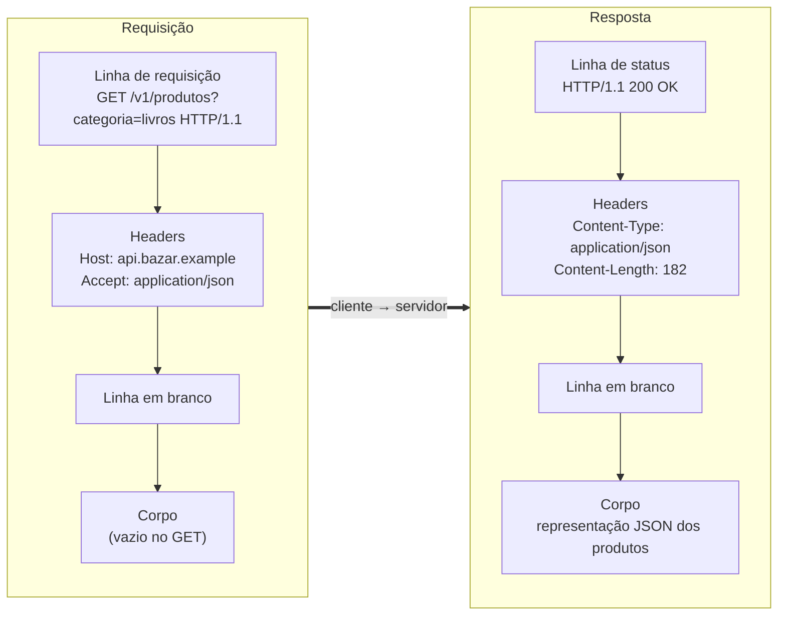
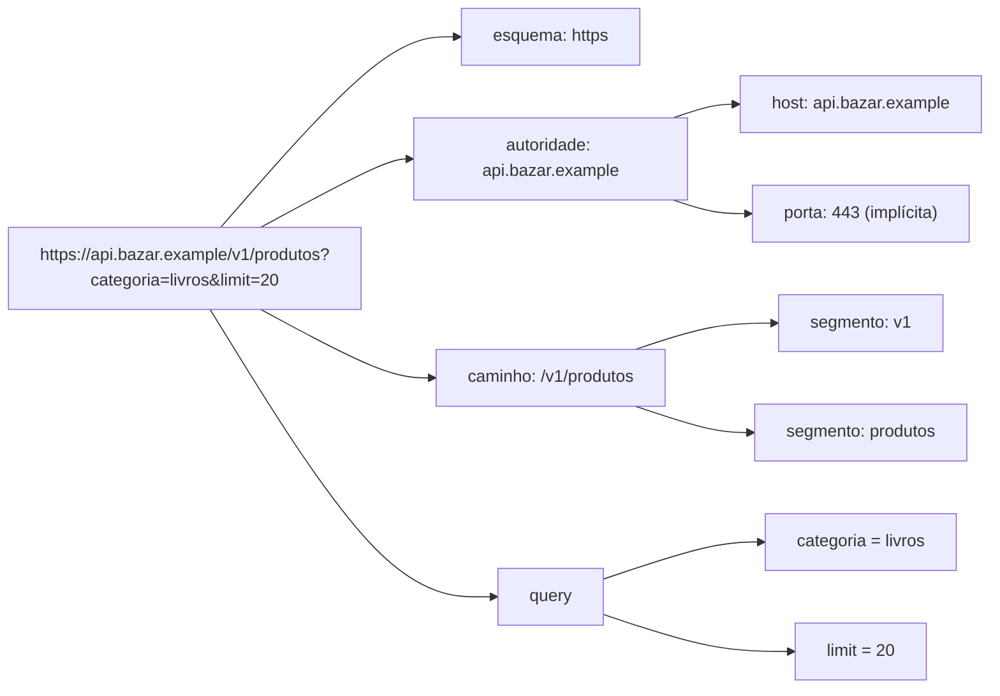

## O problema

O app do Bazar mostra "Erro ao carregar produtos". O desenvolvedor do front-end diz que a API está quebrada; o do back-end diz que o endpoint funciona no Postman. Os dois estão olhando para abstrações: um vê uma exceção do `fetch`, o outro vê um teste verde. Nenhum dos dois olhou para o que realmente trafegou na rede.

Quando finalmente alguém roda um `curl -v`, a causa aparece em segundos: o app mandava `categoria=Livros & Papelaria` sem codificar o `&`, e a API recebia dois parâmetros em vez de um.

Uma mensagem HTTP é como uma carta com envelope. O envelope tem o destinatário e instruções de entrega (a linha de requisição e os headers); dentro vai o conteúdo (o corpo). Os Correios leem o envelope e nunca abrem a carta; proxies, gateways e caches fazem o mesmo com as mensagens HTTP. Se o envelope estiver mal escrito, a carta não chega, por melhor que seja o conteúdo.

> **A pergunta desta página:** quais são as partes de uma mensagem HTTP, o que cada uma significa, e como você vê a mensagem real que trafegou?

## O conceito

### Cliente e servidor

O HTTP é um protocolo de **requisição e resposta**. O **cliente** abre a conversa enviando uma requisição; o **servidor** devolve exatamente uma resposta para cada requisição. O servidor nunca começa a conversa por conta própria dentro do HTTP clássico.

"Cliente" e "servidor" são papéis, não máquinas. A API do Bazar é servidor quando o app pede a lista de produtos e é cliente quando ela mesma chama a PagaFácil para cobrar um pagamento. Entre os dois extremos podem existir **intermediários**: *proxies*, *load balancers*, gateways de API e CDNs, que recebem a mensagem, às vezes a modificam, e a repassam.

### URI: o endereço do recurso

Toda requisição aponta para um **<Term id="recurso">recurso</Term>**: algo que a API expõe e que tem identidade própria, como um produto, um pedido ou a coleção de produtos. O recurso é identificado por uma **<Term id="uri">URI</Term>** (*Uniform Resource Identifier*), cuja sintaxe é definida pela RFC 3986.

```text noCopy
https://api.bazar.example:443/v1/produtos?categoria=livros&limit=20#avaliacoes
└─┬─┘   └───────┬───────┘└┬┘└─────┬─────┘└──────────┬─────────┘ └────┬────┘
esquema       host     porta  caminho            query          fragmento
        └──────────┬──────────┘
               autoridade
```

| Parte | No exemplo | Para que serve |
|---|---|---|
| **Esquema** | `https` | Diz como acessar o recurso. `https` é HTTP sobre TLS; `http`, sem criptografia. |
| **Host** | `api.bazar.example` | O nome (ou IP) do servidor. Vai no header `Host` da requisição. |
| **Porta** | `443` | Opcional. O padrão é 443 para `https` e 80 para `http`, por isso quase nunca aparece. |
| **Caminho** (*path*) | `/v1/produtos` | Identifica o recurso dentro do servidor, de forma hierárquica. |
| **Query** | `categoria=livros&limit=20` | Parâmetros não hierárquicos: filtros, paginação, ordenação. Começa depois do `?`. |
| **Fragmento** | `avaliacoes` | Aponta para uma parte da representação. **Nunca é enviado ao servidor**: o cliente o usa localmente. |

O formato `chave=valor&chave=valor` da *query* é uma convenção (vinda dos formulários HTML), não uma exigência da RFC 3986. Mas é a convenção que todo framework entende, inclusive o Spring.

#### Codificação percentual

Alguns caracteres têm função especial na URI: `/` separa segmentos do caminho, `?` inicia a *query*, `&` separa parâmetros, `#` inicia o fragmento. Se um valor precisa conter um desses caracteres (ou espaços, acentos e outros caracteres fora do ASCII), ele é escrito com <Term id="codificacao-percentual">**codificação percentual**</Term> (*percent-encoding*): cada byte vira `%` seguido de dois dígitos hexadecimais. Caracteres não ASCII são primeiro convertidos para bytes em UTF-8.

| Valor desejado | Codificado | Por quê |
|---|---|---|
| `Livros & Papelaria` | `Livros%20%26%20Papelaria` | Espaço vira `%20`; `&` vira `%26` para não separar parâmetros |
| `café` | `caf%C3%A9` | `é` em UTF-8 são os bytes `C3 A9` |
| `50%` | `50%25` | O próprio `%` precisa ser codificado |

<Callout type="warning" title="+ não é espaço em todo lugar">
  Em formulários HTML (`application/x-www-form-urlencoded`), o espaço vira `+`. Na RFC 3986, `+` é um caractere comum. O Spring decodifica `+` como espaço em parâmetros de *query*, mas outros servidores podem não fazer isso. Em clientes de API, prefira `%20`.
</Callout>

### A requisição

No HTTP/1.1, uma requisição é texto, com linhas terminadas por CRLF (`\r\n`). Ela tem quatro partes:

```http noCopy
GET /v1/produtos?categoria=livros&limit=20 HTTP/1.1     ← linha de requisição
Host: api.bazar.example                                  ← campos de cabeçalho
Accept: application/json                                 ←
User-Agent: curl/8.17.0                                  ←
                                                         ← linha em branco
                                                         ← corpo (vazio neste GET)
```

1. **Linha de requisição** (*request line*): o **método** (`GET`), o **alvo** (`/v1/produtos?categoria=livros&limit=20`, o caminho mais a *query*) e a **versão** do protocolo (`HTTP/1.1`).
2. **Campos de cabeçalho** (*header fields*, ou só *headers*): pares `Nome: valor` com metadados. O `Host` é obrigatório no HTTP/1.1, porque um mesmo servidor pode hospedar vários domínios.
3. **Linha em branco**: marca o fim dos headers. É ela que diz ao servidor "agora vem o corpo".
4. **Corpo** (*body* ou *content*): os dados enviados. Em um `GET` normalmente não há corpo; em um `POST` de criação, há o JSON do novo recurso.

O método diz **o que** fazer com o recurso. Os métodos e as garantias de cada um são o assunto da próxima página, [02.02](/comecando-e-fundamentos-de-http/metodos-http-semantica-seguranca-e-idempotencia).

### A resposta

A resposta tem a mesma estrutura, trocando a primeira linha:

```http noCopy
HTTP/1.1 200 OK                                          ← linha de status
Content-Type: application/json                           ← campos de cabeçalho
Content-Length: 182                                      ←
Date: Sat, 24 Oct 2026 17:30:00 GMT                      ←
                                                         ← linha em branco
{"itens":[{"id":"0192f39f-2222-7000-8000-000000000042",  ← corpo
"nome":"Clean Code","precoEmCentavos":12990}],"proximoCursor":null}
```

1. **Linha de status** (*status line*): a versão, o **<Term id="status-code">status code</Term>** de três dígitos (`200`) e uma frase de motivo (`OK`). A frase é só para humanos: clientes devem decidir pelo número. No HTTP/2 e no HTTP/3, ela nem existe.
2. **Headers**: `Content-Type` diz o formato do corpo; `Content-Length`, o tamanho em bytes.
3. **Linha em branco.**
4. **Corpo**: a representação do recurso pedido.

Os status codes têm página própria, [02.03](/comecando-e-fundamentos-de-http/status-codes-em-profundidade), e os headers mais importantes estão em [02.04](/comecando-e-fundamentos-de-http/headers-essenciais).

### Recurso × representação

Repare que o corpo da resposta **não é** o produto. O produto vive no banco de dados do Bazar, com colunas, chaves e relacionamentos. O que trafegou foi uma **<Term id="representacao">representação</Term>** dele: um retrato do estado do recurso naquele momento, em um formato concreto (JSON, aqui).

O mesmo recurso pode ter várias representações: JSON para o app, CSV para uma planilha, uma versão resumida para a listagem e uma completa para o detalhe. O header `Content-Type` diz qual representação está no corpo. Essa distinção é a base do REST e volta com profundidade em [03.02](/rest-e-estilos-de-api/recursos-representacoes-e-a-interface-uniforme). Por enquanto, guarde: **a URI identifica o recurso; o corpo carrega uma representação dele**.

### Semântica × sintaxe: HTTP/1.1, HTTP/2 e HTTP/3

Tudo acima é a forma como o HTTP/1.1 escreve as mensagens: texto puro. O HTTP/2 e o HTTP/3 codificam as mesmas mensagens em ***frames* binários**: os headers são comprimidos, a linha de requisição vira pseudo-headers (`:method`, `:path`, `:scheme`, `:authority`) e várias mensagens trafegam ao mesmo tempo na mesma conexão.

Mas o **significado** é idêntico: o mesmo método, os mesmos headers, o mesmo status. Por isso a especificação foi dividida. A RFC 9110 define a **semântica** do HTTP (métodos, status, headers, o que cada um significa), comum a todas as versões. As RFCs 9112, 9113 e 9114 definem a **sintaxe** (como os bytes são escritos) do HTTP/1.1, HTTP/2 e HTTP/3.

Para quem constrói APIs, isso é uma boa notícia: o que você aprende sobre métodos, status e headers vale para qualquer versão. As diferenças de desempenho entre as versões estão em [02.08](/comecando-e-fundamentos-de-http/http-1-1-http-2-e-http-3). Nesta documentação, as mensagens são mostradas no formato de texto do HTTP/1.1, por ser o mais legível.

### Como ver a mensagem real

Duas ferramentas resolvem quase todos os casos:

- **`curl -v`** no terminal: mostra a requisição enviada (linhas com `>`), a resposta recebida (linhas com `<`) e, antes, a conexão e o TLS (linhas com `*`).
- **DevTools do navegador** (F12 → aba *Network* / *Rede*): mostra cada requisição feita pela página, com headers, corpo, status e tempo. Clique numa requisição e use as abas *Headers*, *Payload* e *Response*. O botão direito oferece *Copy as cURL*, que transforma a requisição do navegador num comando `curl` para reproduzir no terminal.

<Callout type="tip" title="Copy as cURL">
  Quando o front-end reportar um erro, peça o *Copy as cURL* da requisição que falhou. Você recebe a mensagem exata, com todos os headers, e reproduz o problema sem adivinhar.
</Callout>

## Diagrama

A requisição e a resposta lado a lado, parte por parte:



E a mesma URI do Bazar decomposta em árvore:



## Na prática

A troca abaixo é a listagem de produtos filtrada por categoria, como a API do Bazar vai responder quando estiver pronta (a listagem com filtros é construída na Parte 6):

<HttpExchange
  title="Listando os livros do catálogo"
  request={{ method: 'GET', url: '/v1/produtos?categoria=livros&limit=2', headers: { Host: 'api.bazar.example', Accept: 'application/json', 'User-Agent': 'curl/8.17.0' } }}
  response={{
    status: 200,
    headers: { 'Content-Type': 'application/json', Date: 'Sat, 24 Oct 2026 17:30:00 GMT' },
    body: {
      itens: [
        { id: '0192f39f-2222-7000-8000-000000000042', sku: 'LIV-0042', nome: 'Clean Code', precoEmCentavos: 12990, status: 'ATIVO' },
        { id: '0192f39f-2222-7000-8000-000000000043', sku: 'LIV-0043', nome: 'Refactoring', precoEmCentavos: 15990, status: 'ATIVO' },
      ],
      proximoCursor: 'eyJpZCI6IjAxOTJmMzlmLTIyMjItNzAwMC04MDAwLTAwMDAwMDAwMDA0MyJ9',
    },
  }}
>
  A *query* filtra (`categoria`) e limita (`limit`) a coleção; o recurso continua sendo `/v1/produtos`. O campo `proximoCursor` permite buscar a próxima página, assunto de [13.04](/design-de-apis-profissional/paginacao-por-cursor-keyset).
</HttpExchange>

### Lendo a saída do `curl -v`

Este é o `curl -v` da mesma requisição contra o Bazar rodando localmente (porta 8080, sem TLS), com comentários:

```bash
curl -v "http://localhost:8080/v1/produtos?categoria=livros&limit=2"
```

```text noCopy
* Host localhost:8080 was resolved.            ← resolução de nome
*   Trying 127.0.0.1:8080...
* Connected to localhost (127.0.0.1) port 8080 ← conexão TCP aberta
> GET /v1/produtos?categoria=livros&limit=2 HTTP/1.1   ← linha de requisição
> Host: localhost:8080                          ← headers enviados pelo curl
> User-Agent: curl/8.17.0
> Accept: */*                                   ← "aceito qualquer formato"
>                                               ← linha em branco: fim da requisição
< HTTP/1.1 200                                  ← linha de status (o Tomcat omite a frase)
< Content-Type: application/json
< Transfer-Encoding: chunked                    ← corpo enviado em pedaços, sem Content-Length
< Date: Sat, 24 Oct 2026 17:30:00 GMT
<                                               ← linha em branco: começa o corpo
{"itens":[{"id":"0192f39f-2222-7000-8000-000000000042", ...}],"proximoCursor":"eyJ..."}
* Connection #0 to host localhost left intact   ← conexão mantida para reuso
```

Três detalhes que confundem quem lê isso pela primeira vez:

- **`HTTP/1.1 200` sem o "OK".** O Tomcat (servidor embutido do Spring Boot) não envia a frase de motivo, que é opcional. Ninguém deve depender dela.
- **`Transfer-Encoding: chunked` em vez de `Content-Length`.** Quando o servidor começa a enviar o corpo antes de saber o tamanho total, ele o divide em pedaços (*chunks*), cada um precedido do próprio tamanho. É comum em respostas JSON geradas na hora.
- **`Accept: */*`.** O curl aceita qualquer formato por padrão. Um navegador manda um `Accept` bem mais longo. Isso explica por que a mesma URL às vezes devolve formatos diferentes no navegador e no terminal (página [02.05](/comecando-e-fundamentos-de-http/content-negotiation-e-media-types)).

### Uma requisição com corpo

Para criar uma categoria, o cliente envia um corpo. Repare nos headers que descrevem esse corpo:

```bash
curl -v -X POST http://localhost:8080/v1/categorias \
  -H 'Content-Type: application/json' \
  -d '{"nome":"Livros","slug":"livros"}'
```

```text noCopy
> POST /v1/categorias HTTP/1.1
> Host: localhost:8080
> User-Agent: curl/8.17.0
> Accept: */*
> Content-Type: application/json               ← formato do corpo enviado
> Content-Length: 33                           ← tamanho do corpo em bytes
>
} [33 bytes data]                              ← o corpo foi enviado
< HTTP/1.1 201
< Location: http://localhost:8080/v1/categorias/0192f3a0-5555-7000-8000-000000000007
< Content-Type: application/json
```

O `Content-Length: 33` é exatamente o número de bytes de `{"nome":"Livros","slug":"livros"}`. Com acentos, a conta muda: `"Papelaria e Escritório"` tem 22 caracteres, mas 23 bytes em UTF-8, porque o `ó` ocupa dois.

### Codificando a query corretamente

O bug do início da página, reproduzido e corrigido:

```bash
# Errado: o & no valor separa os parâmetros, e o espaço quebra o comando
curl "http://localhost:8080/v1/produtos?categoria=Livros & Papelaria"

# Certo: deixe o curl codificar cada parâmetro
curl -G http://localhost:8080/v1/produtos \
  --data-urlencode "categoria=Livros & Papelaria" \
  --data-urlencode "limit=20"
# GET /v1/produtos?categoria=Livros%20%26%20Papelaria&limit=20
```

O `-G` diz ao curl que os dados vão na *query* de um `GET`, e o `--data-urlencode` codifica cada valor. Em Java, o `UriComponentsBuilder` do Spring faz o mesmo:

```java
URI uri = UriComponentsBuilder.fromUriString("https://api.bazar.example/v1/produtos")
        .queryParam("categoria", "Livros & Papelaria")
        .queryParam("limit", 20)
        .encode()   // codifica caracteres especiais e não ASCII
        .build()
        .toUri();
// https://api.bazar.example/v1/produtos?categoria=Livros%20%26%20Papelaria&limit=20
```

### Como o Spring entrega cada parte ao seu código

Você ainda vai criar o primeiro endpoint em [05.03](/construindo-apis-com-spring-boot/primeiro-endpoint), mas já dá para ver que cada parte da mensagem tem um lugar no Spring MVC: o caminho escolhe o método do controller, a *query* vira `@RequestParam`, os headers viram `@RequestHeader`, o corpo vira `@RequestBody`, e o retorno vira a linha de status, os headers e o corpo da resposta.

```java
@GetMapping("/v1/produtos")                                    // método + caminho
ResponseEntity<List<ProdutoResponse>> listar(
        @RequestParam String categoria,                         // query: categoria=livros
        @RequestParam(defaultValue = "20") int limit,           // query: limit=20
        @RequestHeader(value = HttpHeaders.ACCEPT_LANGUAGE, required = false) String idioma) { // header
    var produtos = service.listar(categoria, limit);
    return ResponseEntity.ok()                                  // linha de status: 200
            .header(HttpHeaders.CONTENT_LANGUAGE, "pt-BR")       // header da resposta
            .body(produtos);                                    // corpo (JSON)
}
```

O Spring já entrega os valores decodificados: `categoria` chega como `Livros & Papelaria`, não como `Livros%20%26%20Papelaria`.

## Erros comuns

<BadVsGood title="Valores na query" why="Concatenar strings não codifica nada. Um & ou um # no valor muda o significado da URI, e um acento pode virar lixo dependendo do cliente. Use sempre um construtor de URI que codifique os valores.">
<Bad title="Concatenação de strings">

```java
String url = "https://api.bazar.example/v1/produtos?q=" + termo;
// termo = "camisa #10" → o servidor recebe q=camisa e o "#10" vira fragmento
```

</Bad>
<Good title="Construtor de URI">

```java
URI uri = UriComponentsBuilder.fromUriString("https://api.bazar.example/v1/produtos")
        .queryParam("q", termo)
        .encode()
        .build()
        .toUri();
// ...?q=camisa%20%2310
```

</Good>
</BadVsGood>

Outros erros frequentes:

- **Achar que o fragmento chega ao servidor.** `GET /v1/produtos#novidades` chega ao servidor como `GET /v1/produtos`. Se algo depende do fragmento, precisa estar na *query*.
- **Decidir pela frase de motivo.** Um cliente que compara `"OK"` quebra com o Tomcat (que não manda a frase) e com HTTP/2 (que não tem frase). Compare o número.
- **Calcular `Content-Length` em caracteres.** O tamanho é em **bytes**. Com UTF-8, acentos ocupam mais de um byte. Deixe a biblioteca HTTP calcular.
- **Depurar pela mensagem de erro da biblioteca.** "Failed to fetch" ou `HttpClientErrorException` escondem o essencial. Veja a troca real com `curl -v` ou DevTools.
- **Esquecer o `Content-Type` no `POST`.** Sem ele, o servidor não sabe que o corpo é JSON. O Spring responde `415 Unsupported Media Type`, e o desenvolvedor jura que "mandou o JSON certinho".

## Boas práticas

- **Reproduza** todo problema de integração com `curl -v` ou *Copy as cURL* antes de mexer no código.
- **Codifique** valores de *query* e de caminho com um construtor de URI (`UriComponentsBuilder`, `--data-urlencode`), nunca por concatenação.
- **Decida** pelo status code numérico, nunca pela frase de motivo.
- **Envie** sempre `Content-Type` quando houver corpo e `Accept` quando esperar um formato específico.
- **Coloque** na *query* tudo o que o servidor precisa saber; o fragmento é só do cliente.
- **Pense** na URI como identificador do recurso e no corpo como representação: isso guia o design de todas as páginas seguintes.

## Por baixo dos panos

<DeepDive title="Os bytes exatos de uma requisição HTTP/1.1">

Você pode escrever uma requisição HTTP "na mão" com `nc` (netcat), e ver que é texto puro. A opção `-C` (em algumas versões, `--crlf`) envia CRLF no fim de cada linha, como a RFC 9112 exige:

```bash
printf 'GET /v1/produtos?limit=1 HTTP/1.1\r\nHost: localhost:8080\r\nAccept: application/json\r\nConnection: close\r\n\r\n' \
  | nc localhost 8080
```

Os bytes enviados são exatamente:

```text noCopy
47 45 54 20 2f 76 31 2f ...   G E T   / v 1 / ...
0d 0a                         \r\n  (fim da linha de requisição)
48 6f 73 74 3a 20 ...         H o s t :   ...
0d 0a 0d 0a                   \r\n\r\n  (fim do último header + linha em branco)
```

O `\r\n\r\n` é o que separa headers do corpo. Um servidor HTTP/1.1 lê bytes até encontrar essa sequência, interpreta os headers, e então usa `Content-Length` ou `Transfer-Encoding: chunked` para saber quantos bytes de corpo ler. Se os dois forem inconsistentes, intermediários diferentes podem interpretar a mensagem de formas diferentes: é a origem dos ataques de *request smuggling*, e o motivo pelo qual a RFC 9112 manda rejeitar mensagens ambíguas.

No Spring Boot, quem lê esses bytes é o conector do Tomcat (a classe `Http11Processor`). Ele monta um `HttpServletRequest`, e só então o Spring MVC entra em cena, como você verá em [09.01](/construindo-apis-com-spring-boot/o-caminho-de-uma-requisicao-no-spring-mvc).

</DeepDive>

## Resumo

- O HTTP é requisição e resposta: o cliente pergunta, o servidor responde, e intermediários podem ficar no meio.
- A **URI** (RFC 3986) tem esquema, autoridade (host e porta), caminho, *query* e fragmento. O fragmento não vai ao servidor. Caracteres especiais usam **codificação percentual**.
- Requisição = linha de requisição + headers + linha em branco + corpo. Resposta = linha de status + headers + linha em branco + corpo.
- A URI identifica o **recurso**; o corpo carrega uma **representação** dele.
- HTTP/1.1, HTTP/2 e HTTP/3 têm sintaxes diferentes, mas a mesma **semântica** (RFC 9110).
- `curl -v` e o painel *Network* do navegador mostram a mensagem real.

<Exercise title="Decompondo e montando URIs do Bazar" difficulty="facil">
1. Decomponha a URI `https://api.bazar.example/v1/clientes/0192f3a0-1111-7000-8000-000000000001/enderecos?principal=true#mapa` em esquema, host, porta, caminho (com seus segmentos), *query* e fragmento. O que o servidor recebe na linha de requisição?
2. Monte, com `curl -G` e `--data-urlencode`, a busca de produtos pelo termo `Box "Senhor dos Anéis" 3 volumes` com `limit=5`. Qual é a linha de requisição resultante?

<Hint>
Use `curl -v` para ver a linha de requisição que o curl montou. As aspas duplas dentro do valor ficam mais fáceis se o argumento inteiro estiver entre aspas simples.
</Hint>

<Solution>

**1.** Esquema `https`; host `api.bazar.example`; porta 443 (implícita); caminho `/v1/clientes/0192f3a0-1111-7000-8000-000000000001/enderecos`, com os segmentos `v1`, `clientes`, `0192f3a0-…-000000000001` e `enderecos`; *query* `principal=true`; fragmento `mapa`. O servidor recebe:

```http noCopy
GET /v1/clientes/0192f3a0-1111-7000-8000-000000000001/enderecos?principal=true HTTP/1.1
Host: api.bazar.example
```

Sem o fragmento e sem esquema, host e porta na linha (o host vai no header `Host`).

**2.**

```bash
curl -v -G http://localhost:8080/v1/produtos \
  --data-urlencode 'q=Box "Senhor dos Anéis" 3 volumes' \
  --data-urlencode 'limit=5'
```

```text noCopy
> GET /v1/produtos?q=Box%20%22Senhor%20dos%20An%C3%A9is%22%203%20volumes&limit=5 HTTP/1.1
```

As aspas viram `%22`, os espaços viram `%20` e o `é` vira `%C3%A9` (seus dois bytes em UTF-8). Sem a codificação, o shell e o servidor interpretariam o espaço como fim da URI.

</Solution>
</Exercise>

<Quiz
  questions={[
    {
      question: 'O app chama GET /v1/produtos?q=camisa#10 e a busca devolve todas as camisas, não só a de número 10. Por quê?',
      options: [
        'O Spring ignora parâmetros com números',
        'O # inicia o fragmento, que não é enviado ao servidor; ele recebe só q=camisa',
        'O servidor não suporta buscas com mais de uma palavra',
      ],
      answer: 1,
      explanation: 'Tudo depois do # é fragmento e fica no cliente. Para enviar o #, ele precisa ser codificado como %23. O Spring não ignora números, e buscas com várias palavras funcionam desde que os espaços sejam codificados.',
    },
    {
      question: 'Qual é a diferença entre recurso e representação?',
      options: [
        'O recurso é a coisa identificada pela URI; a representação é o retrato do seu estado num formato, como JSON',
        'São sinônimos: os dois nomes designam o corpo da resposta',
        'O recurso é a tabela no banco; a representação é a entidade JPA',
      ],
      answer: 0,
      explanation: 'A URI identifica o recurso, e o corpo carrega uma representação. Um mesmo recurso pode ter várias representações (JSON, CSV). A terceira opção confunde o recurso com o modo como ele é armazenado, que é um detalhe interno da API.',
    },
    {
      question: 'Um cliente HTTP/2 recebe uma resposta e verifica se a frase de motivo é "Created". O que acontece?',
      options: [
        'Funciona, porque a frase faz parte da semântica do HTTP',
        'Funciona só se o servidor for Tomcat',
        'Falha: o HTTP/2 não transmite a frase de motivo, e o cliente deve decidir pelo número 201',
      ],
      answer: 2,
      explanation: 'A frase de motivo é opcional no HTTP/1.1 e nem existe no HTTP/2 e HTTP/3. A semântica está no número. O Tomcat, aliás, nem envia a frase no HTTP/1.1.',
    },
  ]}
/>

## Referências

<References />
