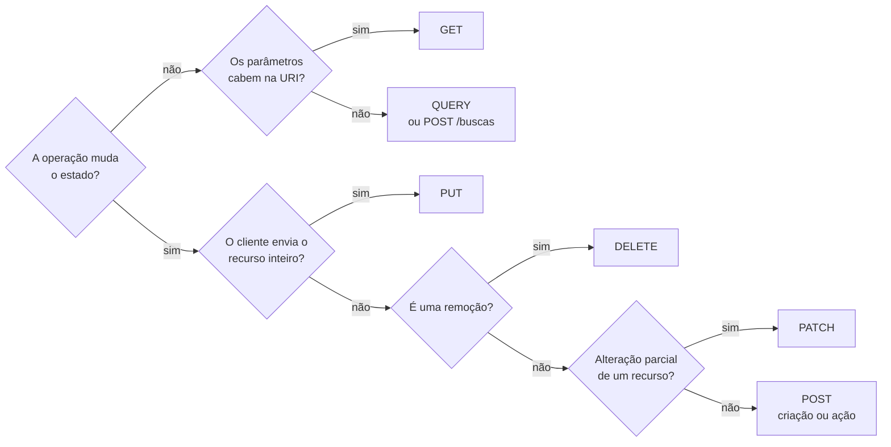

## O problema

Um cliente do Bazar toca em "Finalizar compra". O app envia a requisição de criação do pedido, a rede do celular oscila, e a resposta nunca chega. O app não sabe se o pedido foi criado ou não. Se tentar de novo, pode criar um segundo pedido e cobrar duas vezes. Se não tentar, pode deixar o cliente sem a compra.

Agora troque o cenário: o lojista atualiza o preço de um produto, a resposta se perde, e o app tenta de novo. Aqui não há problema nenhum: atualizar o preço para R$ 129,90 duas vezes deixa o preço em R$ 129,90.

A diferença entre os dois casos não está no código da API. Está no **método HTTP** e na garantia que ele dá. Pense em um elevador: apertar o botão do 5º andar dez vezes leva você ao 5º andar uma vez só. Já colocar dez moedas numa máquina de café, achando que a primeira não entrou, dá dez cafés. O botão do elevador é <Term id="idempotencia">idempotente</Term>; a máquina de café, não.

> **A pergunta desta página:** o que cada método HTTP significa, quais garantias ele oferece (seguro, idempotente, cacheável), e como essas garantias decidem o que clientes, caches e proxies podem fazer sozinhos?

## O conceito

### O método é um contrato, não um detalhe

O método, primeira palavra da linha de requisição, diz **qual operação** o cliente quer fazer sobre o recurso identificado pela URI. A RFC 9110 define o significado (a **semântica**) de cada método, e todo o ecossistema HTTP confia nessa definição:

- O **navegador** repete um `GET` sem perguntar ao usuário, mas pede confirmação antes de reenviar um formulário com `POST`.
- Um ***proxy* ou *load balancer*** pode reenviar uma requisição idempotente para outra instância se a primeira cair no meio do caminho.
- Um **cache** (CDN, navegador) guarda respostas de `GET`, mas não de `DELETE`.
- **Bibliotecas de *retry*** (página [25.02](/consumindo-outras-apis/retry-quando-e-seguro-e-como-fazer)) repetem automaticamente métodos idempotentes e evitam repetir `POST`.
- ***Crawlers*** e ferramentas de pré-carregamento seguem links com `GET`, assumindo que isso não muda nada.

Se a sua API usa `GET /v1/pedidos/123/cancelar` para cancelar um pedido, nada disso sabe que esse `GET` tem efeito colateral. Um *crawler*, um pré-carregamento do navegador ou um *retry* podem cancelar pedidos sem que ninguém peça.

### As três propriedades

| Propriedade | Definição (RFC 9110) | Consequência prática |
|---|---|---|
| <Term id="metodo-seguro">Seguro</Term> (*safe*) | O cliente não pede nem espera nenhuma mudança de estado no servidor. | Pode ser feito por *crawlers*, pré-carregamento e caches, sem risco. |
| **Idempotente** | O efeito pretendido no servidor de N requisições idênticas é o mesmo de uma só. | Pode ser repetido automaticamente após uma falha de rede. |
| <Term id="cacheavel">Cacheável</Term> | A resposta pode ser guardada e reutilizada para requisições futuras. | Caches podem responder sem chegar à API. |

"Seguro" não significa "sem nenhum efeito". O servidor pode registrar um log, incrementar um contador de visualizações ou aquecer um cache ao atender um `GET`. O que importa é que o **cliente não pediu** uma mudança, e não pode ser responsabilizado por ela. Todo método seguro é também idempotente: não mudar nada uma vez ou dez vezes dá no mesmo.

### Os métodos, um a um

#### GET

Pede uma representação do recurso. É o método mais comum, e o único que todo cliente HTTP sabe usar.

- `GET /v1/produtos/0192f39f-…-000000000042`: detalha um produto.
- `GET /v1/produtos?categoria=livros`: lista os produtos de uma categoria.

Seguro, idempotente e cacheável. Os parâmetros vão na URI (caminho e *query*), nunca no corpo.

#### HEAD

Igual ao `GET`, mas o servidor devolve **só a linha de status e os headers**, sem corpo. Serve para saber se um recurso existe, qual o tamanho de um arquivo (`Content-Length`) ou se ele mudou (`ETag`, `Last-Modified`) sem baixá-lo. O Spring MVC atende `HEAD` automaticamente para todo endpoint `GET`.

#### POST

Pede que o recurso alvo **processe** a representação enviada, de acordo com a semântica própria desse recurso. É o método mais genérico. Os usos mais comuns em APIs:

- **Criar** um recurso subordinado a uma coleção, quando o servidor escolhe o id: `POST /v1/pedidos` cria um pedido e responde com o endereço dele.
- **Disparar uma ação** que não se encaixa nos outros métodos: `POST /v1/pedidos/{id}/cancelamento` (página [12.04](/design-de-apis-profissional/acoes-que-nao-sao-crud-e-maquinas-de-estado)).

Não é seguro nem idempotente. Cada `POST /v1/pedidos` pode criar um pedido novo.

#### PUT

Pede que o estado do recurso alvo seja **criado ou substituído** pela representação enviada. O corpo é o recurso **inteiro**, como ele deve ficar.

- `PUT /v1/categorias/{id}` com `{ "nome": "Livros", "slug": "livros" }`: a categoria passa a ser exatamente isso. Um campo omitido não é "mantido": ele deixa de existir (ou volta ao padrão).

Não é seguro, mas é **idempotente**: substituir a categoria pelo mesmo conteúdo duas vezes deixa o mesmo resultado. É por isso que o `PUT` pode ser repetido depois de um *timeout* sem medo.

O `PUT` também pode criar, quando o **cliente** escolhe a URI do recurso (por exemplo, `PUT /v1/produtos/{sku}`). Esse caso aparece em [14.01](/design-de-apis-profissional/criacao-com-post-e-put-com-id-do-cliente).

#### PATCH

Definido na RFC 5789, pede que o servidor aplique um **conjunto de alterações** ao recurso. O corpo não é o recurso inteiro, e sim uma descrição do que mudar.

- `PATCH /v1/produtos/{id}` com `{ "nome": "Clean Code (2ª edição)" }`: muda só o nome; o resto fica como está.

Não é seguro, e **não é necessariamente idempotente**. Depende do formato das alterações: "defina o nome como X" é idempotente; "adicione 5 ao estoque" não é. Os formatos padronizados (JSON Merge Patch e JSON Patch) e essas armadilhas são o assunto de [14.02](/design-de-apis-profissional/put-patch-json-merge-patch-e-json-patch).

#### DELETE

Pede que o servidor remova a associação entre a URI e o recurso. `DELETE /v1/categorias/{id}` remove a categoria.

Não é seguro, mas é idempotente: depois do primeiro `DELETE`, a categoria não existe; depois do segundo, continua não existindo.

#### OPTIONS

Pergunta quais opções de comunicação estão disponíveis para o recurso, normalmente respondendo com o header `Allow` (os métodos aceitos). Seguro e idempotente.

O uso mais comum em APIs é indireto: navegadores enviam um `OPTIONS` antes de certas requisições entre domínios diferentes, o chamado **CORS *preflight***, para perguntar se a requisição real é permitida. Isso é tratado em [26.02](/seguranca-essencial-para-apis/cors); por enquanto, saiba que, se você vir `OPTIONS` nos logs da API sem ter criado nenhum endpoint com esse método, é o navegador fazendo o *preflight*.

#### TRACE e CONNECT

Existem, mas você não vai implementá-los:

- **TRACE** pede que o servidor devolva a própria requisição recebida, para diagnóstico. Costuma ficar desligado por motivos de segurança (pode expor headers como cookies). O Tomcat o recusa por padrão.
- **CONNECT** pede a um *proxy* que abra um túnel até outro servidor. É o que navegadores e o curl usam para acessar HTTPS através de um *proxy* corporativo.

### A matriz método × propriedades

| Método | Seguro | Idempotente | Cacheável | Corpo na requisição | Uso típico no Bazar |
|---|---|---|---|---|---|
| `GET` | ✓ | ✓ | ✓ | Não use | `GET /v1/produtos` |
| `HEAD` | ✓ | ✓ | ✓ | Não use | Verificar se uma imagem mudou |
| `OPTIONS` | ✓ | ✓ | ✗ | Raro | CORS *preflight* (automático) |
| `TRACE` | ✓ | ✓ | ✗ | Proibido | Desligado |
| `QUERY` | ✓ | ✓ | ✓ | Sim (a consulta) | Busca complexa de produtos (veja abaixo) |
| `PUT` | ✗ | ✓ | ✗ | Sim (recurso inteiro) | `PUT /v1/categorias/{id}` |
| `DELETE` | ✗ | ✓ | ✗ | Raro | `DELETE /v1/categorias/{id}` |
| `POST` | ✗ | ✗ | Raramente | Sim | `POST /v1/pedidos` |
| `PATCH` | ✗ | ✗ (pode ser) | Raramente | Sim (as alterações) | `PATCH /v1/produtos/{id}` |
| `CONNECT` | ✗ | ✗ | ✗ | Não | Túnel via *proxy* |

<Callout type="info" title="POST cacheável?">
  A RFC 9110 permite cachear a resposta de um `POST` se ela trouxer informações explícitas de validade e um header `Content-Location` igual à URI alvo. Na prática, quase nenhum cache implementa isso. Para efeitos de design, trate `POST` e `PATCH` como não cacheáveis.
</Callout>

### Idempotência é sobre o efeito, não sobre a resposta

Este é o ponto que mais confunde. Observe dois `DELETE` seguidos na mesma categoria:

1. `DELETE /v1/categorias/7` → `204 No Content`. A categoria foi removida.
2. `DELETE /v1/categorias/7` → `404 Not Found`. Não há o que remover.

As respostas foram diferentes. Mesmo assim, o `DELETE` **é idempotente**, porque o estado do servidor depois das duas requisições é o mesmo que depois de uma só: a categoria 7 não existe. Idempotência fala do **efeito pretendido no servidor**, não do que volta na resposta.

O mesmo vale para efeitos secundários: se cada `DELETE` grava uma linha de auditoria, ele continua idempotente, porque o efeito **pretendido** (remover a categoria) é o mesmo. A RFC deixa isso explícito: o servidor pode ter outros efeitos colaterais, desde que o cliente não os tenha pedido.

### Por que o POST não é idempotente, e o que isso custa

Cada `POST /v1/pedidos` pede um pedido **novo**. Dois `POST` iguais significam, pela semântica do método, dois pedidos. O servidor não tem como saber se a segunda requisição é um pedido legítimo (o cliente realmente quer comprar de novo) ou uma repetição acidental.

Isso tem consequências diretas:

- **Clientes e bibliotecas não devem repetir `POST` automaticamente.** O `HttpClient` do JDK, por exemplo, só reenvia sozinho requisições idempotentes quando a conexão falha; para `POST`, a decisão fica com você.
- **Proxies não reenviam `POST`** para outra instância quando a conexão cai no meio da requisição.
- **Quando a resposta se perde, o cliente fica sem saber** se o pedido foi criado.

A solução não é trocar o método (criar pedidos com `PUT` exigiria que o cliente escolhesse o id, o que tem outros custos). A solução é tornar o `POST` idempotente **por contrato**, com uma chave enviada pelo cliente: o header `Idempotency-Key`, assunto da página [21.01](/padroes-avancados-de-http/idempotency-keys). Toda a Parte 9 se apoia na distinção que você está aprendendo agora.

### GET com corpo: por que não usar

Às vezes uma busca tem filtros demais para caber na *query*: uma lista de 200 SKUs, uma combinação de faixas de preço e atributos. A tentação é mandar um JSON no corpo de um `GET`. A RFC 9110 é clara: um corpo em `GET` **não tem semântica definida**, não pode mudar o significado da requisição e pode fazer algumas implementações rejeitarem a requisição. Na prática:

- muitos *proxies*, CDNs e *load balancers* descartam o corpo ou rejeitam a requisição;
- caches usam só a URI como chave: duas buscas diferentes no corpo receberiam a mesma resposta do cache;
- vários clientes HTTP (o `fetch` do navegador, por exemplo) simplesmente não permitem corpo em `GET`.

Até 2026, a alternativa era usar `POST` para buscas complexas (`POST /v1/produtos/buscas`), perdendo as garantias de segurança e idempotência. Agora existe uma opção melhor.

### O método QUERY (RFC 10008)

Publicado em junho de 2026, o `QUERY` é o primeiro método HTTP novo de uso geral em mais de uma década. Ele resolve exatamente o problema acima: é uma **consulta com corpo**, **segura e idempotente**, e a resposta pode ser cacheada (a chave do cache inclui o corpo).

```http
QUERY /v1/produtos HTTP/1.1
Host: api.bazar.example
Content-Type: application/json
Accept: application/json

{
  "skus": ["LIV-0042", "LIV-0043", "LIV-0107"],
  "precoMaxEmCentavos": 20000,
  "atributos": { "idioma": "pt-BR" }
}
```

Como é seguro e idempotente, clientes podem repeti-lo após uma falha, e caches que o suportam podem guardar o resultado. O servidor pode anunciar os formatos de consulta que aceita com o header `Accept-Query`.

O suporte ainda está chegando ao ecossistema:

| Camada | Situação em out/2026 |
|---|---|
| Spring Framework 7.0 (usado nesta documentação) | Sem constante `HttpMethod.QUERY` nem mapeamento por anotação |
| Spring Framework 7.1 (RC, GA prevista para nov/2026) | Suporte mínimo: a constante `HttpMethod.QUERY` |
| *Proxies*, CDNs e gateways | Variado: alguns rejeitam métodos desconhecidos com `405` ou `501` |
| Clientes (navegadores, bibliotecas) | Em geral aceitam métodos arbitrários, mas caches de navegador ainda não o tratam |

Por isso o Bazar oferece as duas formas: `QUERY /v1/produtos` para quem já suporta e `POST /v1/produtos/buscas` como alternativa compatível com toda a infraestrutura. Os detalhes de implementação estão em [13.01](/design-de-apis-profissional/filtros-e-busca).

## Diagrama

O que acontece quando a resposta se perde e o cliente tenta de novo, com um método idempotente e com um que não é:

```mermaid title="Retry após timeout: PUT (seguro de repetir) × POST (pedido duplicado)"
sequenceDiagram
    autonumber
    participant C as Cliente
    participant B as API do Bazar
    participant DB as PostgreSQL

    Note over C,DB: PUT: idempotente
    C->>B: PUT /v1/categorias/7 {"nome":"Livros"}
    B->>DB: UPDATE categoria SET nome='Livros'
    B--xC: resposta perdida (timeout)
    C->>B: PUT /v1/categorias/7 {"nome":"Livros"} (retry)
    B->>DB: UPDATE categoria SET nome='Livros'
    B-->>C: 200 OK
    Note over DB: Uma categoria chamada "Livros". Resultado correto.

    Note over C,DB: POST: não idempotente
    C->>B: POST /v1/pedidos {itens...}
    B->>DB: INSERT pedido BZR-2026-000123
    B--xC: resposta perdida (timeout)
    C->>B: POST /v1/pedidos {itens...} (retry)
    B->>DB: INSERT pedido BZR-2026-000124
    B-->>C: 201 Created
    Note over DB: Dois pedidos e duas cobranças. Resultado errado.
```

E a decisão de qual método usar, resumida:



## Na prática

A sequência abaixo percorre o ciclo de vida de uma categoria no Bazar com `curl`. Você ainda não tem a API: ela é construída na Parte 3, e a página [05.04](/construindo-apis-com-spring-boot/um-crud-com-status-corretos) implementa exatamente estes endpoints. Leia as trocas agora e rode os comandos quando chegar lá. Os comandos usam `http://localhost:8080`, onde a API vai rodar.

<Steps>
<Step title="Criar com POST">

```bash
curl -i -X POST http://localhost:8080/v1/categorias \
  -H 'Content-Type: application/json' \
  -d '{"nome":"Livros","slug":"livros"}'
```

<HttpExchange
  request={{ method: 'POST', url: '/v1/categorias', headers: { 'Content-Type': 'application/json' }, body: { nome: 'Livros', slug: 'livros' } }}
  response={{ status: 201, headers: { Location: '/v1/categorias/0192f3a0-5555-7000-8000-000000000007', 'Content-Type': 'application/json' }, body: { id: '0192f3a0-5555-7000-8000-000000000007', nome: 'Livros', slug: 'livros', categoriaPaiId: null } }}
>
  O servidor escolheu o id e devolveu o endereço do recurso novo no header `Location`. Rodar o mesmo comando de novo criaria **outra** categoria (ou falharia por `slug` duplicado, se a API validar a unicidade).
</HttpExchange>

</Step>
<Step title="Ler com GET (e HEAD)">

```bash
curl -i http://localhost:8080/v1/categorias/0192f3a0-5555-7000-8000-000000000007
curl -I http://localhost:8080/v1/categorias/0192f3a0-5555-7000-8000-000000000007   # HEAD
```

<HttpExchange
  request={{ method: 'GET', url: '/v1/categorias/0192f3a0-5555-7000-8000-000000000007', headers: { Accept: 'application/json' } }}
  response={{ status: 200, headers: { 'Content-Type': 'application/json' }, body: { id: '0192f3a0-5555-7000-8000-000000000007', nome: 'Livros', slug: 'livros', categoriaPaiId: null } }}
>
  O `curl -I` envia `HEAD`: a resposta tem o mesmo status e os mesmos headers, mas nenhum corpo.
</HttpExchange>

</Step>
<Step title="Substituir com PUT">

```bash
curl -i -X PUT http://localhost:8080/v1/categorias/0192f3a0-5555-7000-8000-000000000007 \
  -H 'Content-Type: application/json' \
  -d '{"nome":"Livros e HQs","slug":"livros-e-hqs"}'
```

<HttpExchange
  request={{ method: 'PUT', url: '/v1/categorias/0192f3a0-5555-7000-8000-000000000007', headers: { 'Content-Type': 'application/json' }, body: { nome: 'Livros e HQs', slug: 'livros-e-hqs' } }}
  response={{ status: 200, headers: { 'Content-Type': 'application/json' }, body: { id: '0192f3a0-5555-7000-8000-000000000007', nome: 'Livros e HQs', slug: 'livros-e-hqs', categoriaPaiId: null } }}
>
  Rode o comando quantas vezes quiser: o resultado é sempre o mesmo. O corpo traz a categoria **inteira**; como `categoriaPaiId` não foi enviado, ele fica nulo.
</HttpExchange>

</Step>
<Step title="Remover com DELETE (duas vezes)">

```bash
curl -i -X DELETE http://localhost:8080/v1/categorias/0192f3a0-5555-7000-8000-000000000007
curl -i -X DELETE http://localhost:8080/v1/categorias/0192f3a0-5555-7000-8000-000000000007
```

<HttpExchange
  title="Primeiro DELETE"
  request={{ method: 'DELETE', url: '/v1/categorias/0192f3a0-5555-7000-8000-000000000007' }}
  response={{ status: 204 }}
/>

<HttpExchange
  title="Segundo DELETE"
  request={{ method: 'DELETE', url: '/v1/categorias/0192f3a0-5555-7000-8000-000000000007' }}
  response={{ status: 404, headers: { 'Content-Type': 'application/problem+json' }, body: { type: 'https://api.bazar.example/problemas/categoria-nao-encontrada', title: 'Categoria não encontrada', status: 404, detail: 'Não existe categoria com id 0192f3a0-5555-7000-8000-000000000007.', codigo: 'CATEGORIA_NAO_ENCONTRADA', traceId: '0af7651916cd43dd8448eb211c80319c' } }}
>
  Respostas diferentes, mesmo efeito: a categoria não existe. O `DELETE` continua idempotente. O formato do erro (`application/problem+json`) é explicado em [08.01](/construindo-apis-com-spring-boot/problem-details-rfc-9457).
</HttpExchange>

</Step>
<Step title="Perguntar o que é permitido com OPTIONS">

```bash
curl -i -X OPTIONS http://localhost:8080/v1/categorias
```

<HttpExchange
  request={{ method: 'OPTIONS', url: '/v1/categorias' }}
  response={{ status: 200, headers: { Allow: 'GET,HEAD,POST,OPTIONS' } }}
>
  O Spring MVC responde `OPTIONS` sozinho, listando no `Allow` os métodos mapeados para aquela URI. A coleção aceita `GET` e `POST`; `PUT` e `DELETE` são da URI de cada categoria.
</HttpExchange>

</Step>
</Steps>

### Como os métodos aparecem no Spring

No Spring MVC, cada método HTTP tem uma anotação de mapeamento. A página 05.04 constrói este controller por completo; aqui, repare só na correspondência entre o método HTTP e a anotação:

```java
@RestController
@RequestMapping("/v1/categorias")
class CategoriaController {

    @GetMapping                 // GET    /v1/categorias
    List<CategoriaResponse> listar() { /* ... */ }

    @PostMapping                // POST   /v1/categorias
    ResponseEntity<CategoriaResponse> criar(@RequestBody CriarCategoriaRequest request) { /* ... */ }

    @GetMapping("/{id}")        // GET    /v1/categorias/{id}  (HEAD vem junto)
    CategoriaResponse detalhar(@PathVariable UUID id) { /* ... */ }

    @PutMapping("/{id}")        // PUT    /v1/categorias/{id}
    CategoriaResponse substituir(@PathVariable UUID id, @RequestBody CriarCategoriaRequest request) { /* ... */ }

    @DeleteMapping("/{id}")     // DELETE /v1/categorias/{id}
    ResponseEntity<Void> remover(@PathVariable UUID id) { /* ... */ }
}
```

A anotação **não garante** a semântica: nada impede você de escrever um `@GetMapping` que apaga dados. Escolher o método certo e implementar o comportamento que ele promete é responsabilidade sua.

## Erros comuns

<BadVsGood title="Ação com efeito colateral" why="GET é seguro por contrato. Crawlers, pré-carregamento do navegador, caches e retries automáticos assumem que ele não muda nada, e podem disparar a ação sem que ninguém peça.">
<Bad title="GET que cancela">

```http
GET /v1/pedidos/0192f3a1-9999-7000-8000-000000000123/cancelar
```

Um link desses num e-mail pode ser "clicado" pelo antivírus que inspeciona links.

</Bad>
<Good title="POST em um sub-recurso de ação">

```http
POST /v1/pedidos/0192f3a1-9999-7000-8000-000000000123/cancelamento
Content-Type: application/json

{ "motivo": "CLIENTE_DESISTIU" }
```

</Good>
</BadVsGood>

<BadVsGood title="Atualização parcial" why="PUT substitui o recurso inteiro. Mandar só um campo com PUT, se o servidor seguir a semântica, apaga os demais. Para mudar só alguns campos, use PATCH.">
<Bad title="PUT com um campo só">

```http
PUT /v1/produtos/0192f39f-2222-7000-8000-000000000042
Content-Type: application/json

{ "precoEmCentavos": 11990 }
```

Pela semântica do `PUT`, o produto fica sem nome, sem SKU e sem categoria.

</Bad>
<Good title="PATCH com o que mudou">

```http
PATCH /v1/produtos/0192f39f-2222-7000-8000-000000000042
Content-Type: application/merge-patch+json

{ "precoEmCentavos": 11990 }
```

</Good>
</BadVsGood>

Outros erros frequentes:

- **Repetir `POST` automaticamente.** Configurar um *retry* genérico para "qualquer erro" num cliente HTTP duplica pedidos e pagamentos. Repita só métodos idempotentes, ou use `Idempotency-Key`.
- **`PUT` não idempotente.** Um `PUT` que incrementa um contador ou acrescenta um item a uma lista viola o contrato. Clientes e proxies vão repeti-lo achando que é seguro.
- **Corpo em `GET`.** Funciona no seu teste local e falha atrás do *proxy* da empresa do cliente. Use *query*, `QUERY` ou `POST /buscas`.
- **Tudo com `POST`.** APIs que usam `POST` para tudo (inclusive leituras) perdem cache, *retries* seguros e a leitura imediata do que cada chamada faz. Esse estilo tem nome (RPC sobre HTTP) e é discutido em [03.03](/rest-e-estilos-de-api/o-modelo-de-maturidade-de-richardson).
- **Achar que idempotente significa "mesma resposta".** Um teste que espera `204` no segundo `DELETE` está testando a coisa errada.

## Boas práticas

- **Use** `GET` para toda leitura e nunca dê a ele efeitos que o cliente possa ter pedido.
- **Use** `PUT` para substituir o recurso inteiro e `PATCH` para alterações parciais.
- **Garanta** que `PUT` e `DELETE` sejam de fato idempotentes na implementação.
- **Proteja** `POST` de criação de recursos importantes (pedidos, pagamentos) com `Idempotency-Key`.
- **Evite** corpo em `GET`; para buscas grandes, ofereça `QUERY` com alternativa `POST /buscas`.
- **Modele** ações que não são CRUD como `POST` em sub-recursos (`/cancelamento`), não como verbos em `GET`.
- **Configure** *retries* automáticos só para métodos idempotentes.

## Resumo

- O método diz qual operação o cliente quer fazer; navegadores, caches, *proxies* e bibliotecas de *retry* confiam na semântica dele.
- **Seguro**: o cliente não pede mudança (`GET`, `HEAD`, `OPTIONS`, `QUERY`). **Idempotente**: repetir tem o mesmo efeito (os seguros + `PUT` e `DELETE`). **Cacheável**: `GET`, `HEAD` e `QUERY` na prática.
- Idempotência fala do **efeito no servidor**, não da resposta: o segundo `DELETE` pode dar `404` e continua idempotente.
- `POST` não é idempotente: repetir pode duplicar. A solução é a `Idempotency-Key` (21.01), não trocar o método.
- `GET` com corpo não tem semântica definida. O novo método **`QUERY`** (RFC 10008) é a consulta segura com corpo; até o suporte amadurecer, ofereça também `POST /buscas`.

<Exercise title="Classifique as operações do Bazar" difficulty="medio">
Para cada operação abaixo, escolha o método HTTP e a URI, e diga se a requisição pode ser repetida automaticamente após um *timeout*. Justifique.

1. Consultar o saldo de estoque de um produto.
2. Definir o saldo de estoque de um produto como 42 unidades.
3. Somar 10 unidades ao estoque de um produto (chegou uma remessa).
4. Remover um endereço de um cliente.
5. Buscar os produtos de uma lista de 300 SKUs.
6. Iniciar o pagamento de um pedido na PagaFácil.

<Hint>
Pergunte, para cada uma: o cliente está pedindo uma mudança? Repetir a mesma requisição muda o resultado final? A diferença entre "definir como 42" e "somar 10" é a chave do exercício.
</Hint>

<Solution>

| # | Método e URI | Repetir após *timeout*? | Por quê |
|---|---|---|---|
| 1 | `GET /v1/produtos/{id}/estoque` | Sim | Seguro: não muda nada. |
| 2 | `PUT /v1/produtos/{id}/estoque` com `{ "quantidadeDisponivel": 42 }` | Sim | Idempotente: definir 42 duas vezes dá 42. |
| 3 | `POST` (por exemplo, `POST /v1/ajustes-estoque/lotes` com o ajuste de +10) | Não, sem proteção | Repetir somaria 20. Para repetir com segurança, é preciso uma `Idempotency-Key` (21.01). |
| 4 | `DELETE /v1/clientes/{id}/enderecos/{enderecoId}` | Sim | Idempotente: o segundo pode dar `404`, mas o efeito é o mesmo. |
| 5 | `QUERY /v1/produtos` com os SKUs no corpo, ou `POST /v1/produtos/buscas` | Com `QUERY`, sim; com `POST`, só se a API documentar a busca como segura | 300 SKUs não cabem bem na *query*. `QUERY` é seguro por definição; o `POST` é só uma convenção da API. |
| 6 | `POST /v1/pedidos/{id}/pagamentos` | Não, sem `Idempotency-Key` | Repetir pode gerar duas cobranças. O Bazar exige a chave nesse endpoint. |

O caso 3 é o mais importante: a mesma regra de negócio ("mexer no estoque") pode ser idempotente ou não, dependendo de como o contrato é desenhado. "Defina o valor" é idempotente; "aplique uma variação" não é.

</Solution>
</Exercise>

<Quiz
  questions={[
    {
      question: 'O primeiro DELETE /v1/categorias/7 devolve 204 e o segundo devolve 404. O DELETE é idempotente nesse caso?',
      options: [
        'Não, porque as respostas foram diferentes',
        'Só seria se as duas respostas fossem 204',
        'Sim, porque o estado do servidor após as duas requisições é o mesmo: a categoria não existe',
      ],
      answer: 2,
      explanation: 'Idempotência é sobre o efeito pretendido no servidor, não sobre a resposta. Exigir 204 nas duas vezes confunde a propriedade com a resposta; o 404 na segunda chamada é correto, porque informa o estado atual.',
    },
    {
      question: 'Um GET /v1/produtos incrementa um contador de visualizações no banco. Ele deixa de ser seguro?',
      options: [
        'Não: o cliente não pediu essa mudança, e o efeito é um detalhe interno do servidor',
        'Sim: qualquer escrita no banco torna o método inseguro',
        'Sim, e por isso deveria ser trocado por POST',
      ],
      answer: 0,
      explanation: 'Seguro significa que o cliente não pede nem espera mudança de estado. Logs, métricas e contadores são efeitos que o servidor escolhe ter. Trocar por POST faria a leitura perder cache e retries seguros sem nenhum ganho.',
    },
    {
      question: 'Por que o QUERY (RFC 10008) é melhor que GET com corpo para uma busca complexa?',
      options: [
        'Porque o QUERY é mais rápido que o GET',
        'Porque o QUERY define a semântica do corpo como a consulta, mantendo segurança e idempotência, enquanto o corpo no GET não tem semântica definida',
        'Porque o QUERY não precisa de Content-Type',
      ],
      answer: 1,
      explanation: 'O corpo de um GET pode ser descartado por proxies e ignorado por caches. O QUERY foi criado justamente para dar significado ao corpo de uma consulta segura. Ele não é mais rápido, e precisa de Content-Type para dizer o formato da consulta.',
    },
    {
      question: 'Um app envia PUT /v1/produtos/{id} só com {"precoEmCentavos": 11990}. Se o servidor seguir a semântica do PUT, o que acontece?',
      options: [
        'Só o preço muda',
        'O produto passa a ter apenas o preço; os campos omitidos são removidos ou voltam ao padrão',
        'O servidor deve responder 405',
      ],
      answer: 1,
      explanation: 'PUT substitui a representação inteira pelo corpo enviado. Para mudar só o preço, o método certo é PATCH. O 405 seria para um método não suportado pela URI, o que não é o caso.',
    },
  ]}
/>

## Referências

<References />
