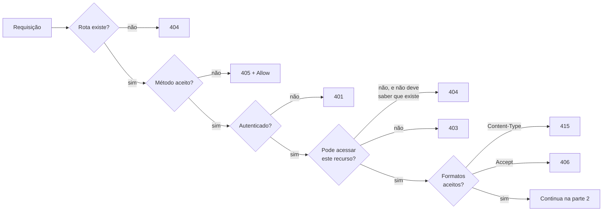
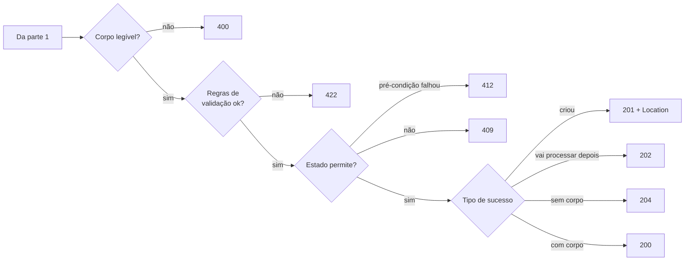
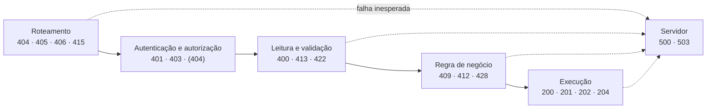

## O problema

A primeira versão da API de um lojista parceiro do Bazar respondia assim quando um produto não existia:

```http
HTTP/1.1 200 OK
Content-Type: application/json

{ "sucesso": false, "erro": "Produto não encontrado" }
```

Para o desenvolvedor, parecia razoável: a mensagem está lá. Mas o painel de monitoramento mostrava 100% de sucesso enquanto metade das chamadas falhava. O cache da CDN guardou a resposta de "não encontrado" por uma hora, porque um `200` é cacheável. A biblioteca de *retry* do cliente nunca tentou de novo nos erros temporários, porque para ela tudo tinha dado certo. E cada consumidor precisou escrever código para abrir o corpo e procurar o campo `sucesso`.

O <Term id="status-code">status code</Term> é como a cor de um semáforo. Ninguém para o carro para ler uma placa com "atenção, o sinal está vermelho": a cor basta, e todo motorista entende sem ler. O corpo da resposta é a placa com os detalhes, útil para quem precisa deles. Um semáforo verde com uma placa dizendo "pare" causa acidentes.

> **A pergunta desta página:** o que cada status code significa, quando usar cada um numa API, e como escolher o status certo para cada situação?

## O conceito

### As cinco classes

O status é um número de três dígitos. O **primeiro dígito** define a classe, e qualquer cliente que não conheça um código específico deve tratá-lo como o código `x00` da sua classe. Um cliente que recebe um `422` e não o conhece trata como `400`: já sabe que o erro foi dele.

| Classe | Significado | Quem deve agir |
|---|---|---|
| **1xx** Informativo | A requisição foi recebida e o processamento continua. | Ninguém (é tratado pela biblioteca HTTP) |
| **2xx** Sucesso | A requisição foi recebida, entendida e aceita. | Ninguém: deu certo |
| **3xx** Redirecionamento | O cliente precisa fazer algo a mais para completar a requisição. | O cliente (normalmente seguir outra URI) |
| **4xx** Erro do cliente | A requisição tem algum problema. Repetir igual vai falhar igual. | O cliente: corrigir a requisição |
| **5xx** Erro do servidor | O servidor falhou ao atender uma requisição aparentemente válida. | O servidor; o cliente pode tentar de novo mais tarde |

A divisão entre 4xx e 5xx é a mais importante para uma API: ela diz **de quem é a culpa** e, portanto, se vale a pena tentar de novo. Monitoramento, alertas e SLOs (página [27.01](/observabilidade/fundamentos-de-observabilidade)) costumam contar 5xx como falha da API e 4xx como uso incorreto.

Os 1xx quase nunca aparecem no código de uma API. O `100 Continue`, por exemplo, permite ao cliente mandar só os headers de um upload grande e esperar o servidor confirmar antes de enviar o corpo; o Tomcat e as bibliotecas HTTP cuidam disso sozinhos.

### 2xx: sucesso

<StatusCodeTable
  filter={false}
  codes={[
    { code: 200, example: 'GET /v1/produtos/{id} devolve o produto; PUT devolve a categoria atualizada' },
    { code: 201, example: 'POST /v1/categorias criou a categoria; Location: /v1/categorias/{id}' },
    { code: 202, example: 'POST /v1/pagamentos/{id}/reembolsos: o reembolso será processado em segundo plano' },
    { code: 204, example: 'DELETE /v1/categorias/{id} removeu a categoria' },
    { code: 206, example: 'GET /v1/relatorios/{id}/arquivo com Range: bytes=0-1048575' },
  ]}
/>

- **`200 OK`** é o sucesso genérico com corpo. Numa leitura, o corpo é a representação pedida; num `PUT` ou `POST` de ação, é o resultado.
- **`201 Created`** diz que um recurso novo foi criado. Ele deve vir com o header **`Location`** apontando para a URI do recurso criado. Sem o `Location`, o cliente precisa adivinhar onde está o que acabou de criar.
- **`202 Accepted`** diz "recebi e vou processar depois". Não promete que vai dar certo. A resposta normalmente aponta para um recurso onde o cliente acompanha o andamento (página [21.02](/padroes-avancados-de-http/operacoes-assincronas-e-de-longa-duracao-202-polling)).
- **`204 No Content`** é sucesso **sem corpo**. A resposta termina nos headers. Use quando não há nada útil a devolver, como num `DELETE`.
- **`206 Partial Content`** responde a uma requisição com o header `Range`, que pede só um trecho do conteúdo. Serve para retomar downloads (página [22.02](/padroes-avancados-de-http/download-streaming-e-range)).

### 3xx: redirecionamento

<StatusCodeTable
  filter={false}
  codes={[
    { code: 301, example: 'Evite em APIs: clientes podem trocar POST por GET' },
    { code: 302, example: 'Evite em APIs: semântica ambígua' },
    { code: 303, example: 'GET /v1/operacoes/{id} concluída aponta para o reembolso criado' },
    { code: 304, example: 'GET /v1/produtos/{id} com If-None-Match e produto inalterado' },
    { code: 307, example: 'Manutenção temporária de uma rota, preservando POST e corpo' },
    { code: 308, example: 'Uma rota mudou de endereço para sempre, preservando o método' },
  ]}
/>

Os redirecionamentos têm uma história confusa, e entendê-la evita bugs:

| Código | Permanente? | O cliente pode trocar o método para `GET`? |
|---|---|---|
| `301 Moved Permanently` | Sim | Sim, por razões históricas |
| `302 Found` | Não | Sim, por razões históricas |
| `303 See Other` | Não | **Deve** usar `GET` na nova URI |
| `307 Temporary Redirect` | Não | **Não**: repete o mesmo método e o mesmo corpo |
| `308 Permanent Redirect` | Sim | **Não**: repete o mesmo método e o mesmo corpo |

O `302` foi definido originalmente para preservar o método, mas os navegadores passaram a transformar `POST` em `GET` ao segui-lo. Em vez de "consertar" os navegadores, a especificação criou dois códigos com significados inequívocos: o **`303`** ("vá buscar o resultado em outro lugar, com `GET`") e o **`307`** ("repita exatamente a mesma requisição em outro lugar"). Depois, o **`308`** fez o mesmo papel do `307` para mudanças permanentes.

Em APIs, a regra prática é:

- **Mudou de endereço?** Use `308` (permanente) ou `307` (temporário), que preservam método e corpo. Um `POST` redirecionado com `301` pode chegar ao destino como `GET`, sem corpo.
- **Terminou uma operação e o resultado está em outro recurso?** Use `303`. É o caso das operações assíncronas do Bazar: o cliente consulta `GET /v1/operacoes/{id}`, e quando o reembolso termina, a API responde `303 See Other` com `Location: /v1/reembolsos/{id}`. O cliente segue com `GET`, que é exatamente o que ele quer.
- **`304 Not Modified`** não é bem um redirecionamento: é a resposta a uma requisição condicional dizendo "a cópia que você tem continua válida". Não tem corpo. É a base do cache HTTP ([20.02](/padroes-avancados-de-http/etag-e-requisicoes-condicionais)).

### 4xx: erro do cliente

Esta é a classe com mais decisões de design. Os códigos abaixo são os que uma API realmente usa:

<StatusCodeTable
  filter={false}
  codes={[
    { code: 400, example: 'JSON malformado; quantidade="dois" quando se espera número' },
    { code: 401, example: 'Requisição sem token ou com token expirado' },
    { code: 403, example: 'Cliente autenticado tentando acessar o painel de administração' },
    { code: 404, example: 'GET /v1/produtos/{id} com id inexistente' },
    { code: 405, example: 'DELETE /v1/produtos (a coleção não aceita DELETE); Allow: GET, POST' },
    { code: 406, example: 'Accept: application/xml em uma API que só fala JSON' },
    { code: 409, example: 'DELETE de uma categoria que ainda tem produtos' },
    { code: 410, example: 'Chamada a /v1/produtos depois que a v1 foi desligada' },
    { code: 412, example: 'PUT /v1/produtos/{id}/estoque com If-Match desatualizado' },
    { code: 413, example: 'Upload de imagem maior que 5 MB' },
    { code: 415, example: 'POST /v1/categorias com Content-Type: text/plain' },
    { code: 422, example: 'Pedido com quantidade 0 em um item' },
    { code: 428, example: 'PUT /v1/produtos/{id}/estoque sem If-Match' },
    { code: 429, retry: true, example: 'Mais requisições por minuto que o plano do parceiro permite' },
  ]}
/>

Alguns pares merecem atenção especial.

#### 400 × 422: malformado ou inválido?

- **`400 Bad Request`**: o servidor **não conseguiu entender** a requisição. O JSON tem uma vírgula sobrando, um campo numérico veio como texto, um UUID na URI tem 10 caracteres.
- **`422 Unprocessable Content`**: o servidor **entendeu** a requisição (o JSON é válido, os tipos estão certos), mas o conteúdo viola uma regra: quantidade 0, e-mail sem `@`, data de entrega no passado.

O `422` nasceu no WebDAV com o nome "Unprocessable Entity" e foi incorporado ao HTTP geral pela RFC 9110, que o renomeou para **"Unprocessable Content"**. Você ainda vai ver o nome antigo em muitos lugares, inclusive no Spring: a constante `HttpStatus.UNPROCESSABLE_ENTITY` continua existindo, mas está depreciada em favor de `HttpStatus.UNPROCESSABLE_CONTENT` (o mesmo vale para `PAYLOAD_TOO_LARGE`, substituída por `CONTENT_TOO_LARGE`).

Muitas APIs usam `400` para tudo, e isso não é um erro grave. O importante é **ser consistente** e documentar a escolha. O Bazar usa `400` para requisições que não puderam ser lidas e `422` para violações de validação. O critério completo, com os casos difíceis, está em [16.01](/design-de-apis-profissional/projetando-erros-catalogo-codigos-e-decisoes-dificeis).

#### 401 × 403: quem é você × o que você pode

- **`401 Unauthorized`**: o servidor não sabe **quem** é o cliente. Faltou a credencial, ou ela é inválida ou expirou. O nome é infeliz (deveria ser "*Unauthenticated*"). A resposta deve trazer o header `WWW-Authenticate`, dizendo como se autenticar.
- **`403 Forbidden`**: o servidor sabe quem é o cliente, e ele **não tem permissão** para aquela ação. Mandar a credencial de novo não adianta.

A autenticação de APIs é aprofundada na [documentação de segurança](https://security-doc-beta.vercel.app/) 🔒; a Parte 11 cobre o essencial para quem constrói a API.

#### 404 × 403: esconder que o recurso existe

Imagine `GET /v1/pedidos/0192f3a1-9999-7000-8000-000000000123` feito por um cliente que **não é o dono** do pedido. A resposta "correta" seria `403`: o pedido existe, mas você não pode vê-lo. Só que o `403` **confirma que o pedido existe**, e isso já é informação para um atacante que está testando ids.

Por isso, para recursos que pertencem a alguém, é comum responder **`404`** quando o cliente não tem acesso, como se o recurso não existisse. A RFC 9110 permite isso explicitamente. O GitHub faz exatamente isso com repositórios privados. O Bazar adota a mesma regra para pedidos, pagamentos e dados de clientes (página [26.03](/seguranca-essencial-para-apis/autorizacao-por-objeto-exposicao-de-dados-e-validacao)).

#### 409 × 412 × 428: conflitos de estado

- **`409 Conflict`**: a requisição conflita com o **estado atual** do recurso. Cancelar um pedido que já foi enviado; remover uma categoria que ainda tem produtos; criar uma categoria com um `slug` que já existe.
- **`412 Precondition Failed`**: o cliente mandou uma **pré-condição** (como `If-Match: "v6"`, "só aplique se o recurso ainda estiver na versão 6") e ela não se confirmou: alguém alterou o recurso no meio do caminho.
- **`428 Precondition Required`**: o servidor **exige** uma pré-condição e o cliente não mandou. É como o Bazar força clientes a usarem `If-Match` ao alterar o estoque, evitando que uma atualização apague outra sem perceber.

`412` e `428` são o assunto de [20.03](/padroes-avancados-de-http/concorrencia-otimista-com-if-match-412-e-428). Aqui basta saber que existem e para que servem.

#### 405, 406, 413, 415: o Spring cuida de boa parte

Estes quatro normalmente são gerados pelo próprio framework, antes de o seu código rodar:

- **`405 Method Not Allowed`**: a URI existe, mas não aceita o método. A resposta **deve** trazer o header `Allow` com os métodos aceitos. O Spring faz isso sozinho.
- **`406 Not Acceptable`**: o cliente pediu (no `Accept`) um formato que a API não sabe produzir.
- **`413 Content Too Large`**: o corpo passou do limite (antes chamado "Payload Too Large").
- **`415 Unsupported Media Type`**: o cliente mandou (no `Content-Type`) um formato que o endpoint não aceita.

`406` e `415` são explicados em detalhe em [02.05](/comecando-e-fundamentos-de-http/content-negotiation-e-media-types).

#### 410 e 429

- **`410 Gone`**: o recurso existia e foi removido **de propósito**, sem endereço novo. Mais informativo que um `404`. O Bazar o usa quando uma versão antiga da API é desligada ([18.04](/contratos-documentacao-e-ciclo-de-vida/depreciacao-e-desligamento-de-apis)).
- **`429 Too Many Requests`** (RFC 6585): o cliente passou do limite de requisições. A resposta pode trazer `Retry-After`, dizendo quanto esperar ([23.01](/padroes-avancados-de-http/rate-limiting-e-quotas)).

### 5xx: erro do servidor

<StatusCodeTable
  filter={false}
  codes={[
    { code: 500, example: 'NullPointerException não tratada no PedidoService' },
    { code: 502, retry: true, example: 'O load balancer recebeu uma resposta corrompida da instância da API' },
    { code: 503, retry: true, example: 'Banco fora do ar; Retry-After: 30' },
    { code: 504, retry: true, example: 'O gateway esperou 30 s e a API não respondeu' },
  ]}
/>

- **`500 Internal Server Error`**: algo inesperado aconteceu. Nunca devolva a *stack trace* no corpo: ela expõe detalhes internos e não ajuda o cliente. Registre-a no log, com um identificador que o cliente possa informar ao suporte.
- **`502 Bad Gateway`** e **`504 Gateway Timeout`**: são emitidos por **intermediários** (gateway, *load balancer*, *proxy*), não pela sua API. O `502` diz que a resposta do serviço de destino foi inválida (ou a conexão caiu); o `504`, que ela não chegou a tempo. Se você vê esses códigos, o problema pode estar entre o gateway e a API.
- **`503 Service Unavailable`**: o servidor está temporariamente incapaz de atender (sobrecarga, manutenção, dependência essencial fora do ar). Envie `Retry-After` quando souber quanto tempo vai demorar.

<Callout type="warning" title="Erro da dependência não é 502">
  Quando a PagaFácil responde `500` para a API do Bazar, a API do Bazar **não** deve repassar `500` nem devolver `502` ao app. O `502` é para *gateways*. A API do Bazar deve tratar a falha (tentar de novo, usar uma alternativa ou devolver `503` com uma mensagem própria). Essa decisão é o assunto da Parte 10.
</Callout>

### Quais status são "retentáveis"

Um cliente que recebe um erro precisa decidir: tento de novo ou desisto? O status responde boa parte da pergunta:

| Status | Tentar de novo? | Condição |
|---|---|---|
| 4xx em geral (`400`, `404`, `409`, `422`...) | **Não** | A mesma requisição vai falhar do mesmo jeito. Corrija antes. |
| `408 Request Timeout` | Sim | O servidor desistiu de esperar a requisição chegar. |
| `429 Too Many Requests` | Sim, **depois** | Respeite o `Retry-After`. |
| `500 Internal Server Error` | Com cautela | Pode ser um bug (vai falhar de novo) ou algo passageiro. Uma ou duas tentativas, no máximo. |
| `502`, `503`, `504` | Sim | Normalmente passageiros. Respeite o `Retry-After` do `503`. |
| Falha de rede (sem resposta) | Depende | Você não sabe se a requisição foi processada. |

Em todos os casos, **só repita automaticamente métodos idempotentes** (ou requisições protegidas por `Idempotency-Key`), pela razão vista em [02.02](/comecando-e-fundamentos-de-http/metodos-http-semantica-seguranca-e-idempotencia). Um `504` num `POST /v1/pedidos` não diz se o pedido foi criado: o gateway desistiu de esperar, mas a API pode ter terminado o trabalho logo depois. As técnicas de *retry* com intervalos crescentes estão em [25.02](/consumindo-outras-apis/retry-quando-e-seguro-e-como-fazer).

## Diagrama

Para escolher o status, siga as perguntas na ordem em que o servidor processa a requisição. Primeiro, as verificações que acontecem antes de olhar o conteúdo:



Depois, as verificações do conteúdo e do estado, até a escolha do sucesso:



O mesmo raciocínio, visto como as fases do processamento dentro da API. Cada fase tem os seus status típicos, e uma falha numa fase impede as seguintes:



Essa ordem explica por que uma requisição sem token para uma rota inexistente recebe `404` e não `401`: o roteamento vem antes. (Com o Spring Security, filtros de autenticação rodam antes do roteamento do Spring MVC, então a ordem pode se inverter; isso é discutido na documentação de segurança 🔒.)

## Na prática

Três respostas cruas do Bazar, como a API vai respondê-las quando estiver pronta.

### Criação com `201` e `Location`

<HttpExchange
  title="Categoria criada"
  request={{ method: 'POST', url: '/v1/categorias', headers: { 'Content-Type': 'application/json' }, body: { nome: 'Papelaria', slug: 'papelaria' } }}
  response={{
    status: 201,
    headers: { Location: 'https://api.bazar.example/v1/categorias/0192f3a0-5555-7000-8000-000000000008', 'Content-Type': 'application/json' },
    body: { id: '0192f3a0-5555-7000-8000-000000000008', nome: 'Papelaria', slug: 'papelaria', categoriaPaiId: null },
  }}
>
  O `Location` aponta para o recurso criado. O corpo traz a representação dele, para que o cliente não precise de um `GET` logo em seguida.
</HttpExchange>

### Conflito com `409`: categoria com produtos

<HttpExchange
  title="Tentativa de remover uma categoria que ainda tem produtos"
  request={{ method: 'DELETE', url: '/v1/categorias/0192f3a0-5555-7000-8000-000000000001' }}
  response={{
    status: 409,
    headers: { 'Content-Type': 'application/problem+json' },
    body: {
      type: 'https://api.bazar.example/problemas/categoria-com-produtos',
      title: 'A categoria possui produtos',
      status: 409,
      detail: 'A categoria "Livros" tem 42 produtos. Mova ou descontinue os produtos antes de removê-la.',
      codigo: 'CATEGORIA_COM_PRODUTOS',
      traceId: '7d3f0b2a9c4e4f1a8b6c5d4e3f2a1b0c',
    },
  }}
>
  A requisição está correta e a categoria existe, mas o **estado atual** não permite a remoção. Por isso é `409`, não `400` nem `422`.
</HttpExchange>

### Validação com `422`: pedido com quantidade 0

<HttpExchange
  title="Pedido com quantidade inválida"
  request={{
    method: 'POST',
    url: '/v1/pedidos',
    headers: { 'Content-Type': 'application/json', 'Idempotency-Key': '0192f3a1-7c4e-7b2a-9d1e-3f5a6b7c8d9f' },
    body: { clienteId: '0192f3a0-1111-7000-8000-000000000001', itens: [{ produtoId: '0192f39f-2222-7000-8000-000000000042', quantidade: 0 }] },
  }}
  response={{
    status: 422,
    headers: { 'Content-Type': 'application/problem+json' },
    body: {
      type: 'https://api.bazar.example/problemas/validacao',
      title: 'Dados inválidos',
      status: 422,
      detail: 'A requisição tem 1 campo inválido.',
      codigo: 'VALIDACAO',
      erros: [{ campo: 'itens[0].quantidade', mensagem: 'deve ser maior ou igual a 1' }],
      traceId: '9a8b7c6d5e4f40312a1b0c9d8e7f6a5b',
    },
  }}
>
  O JSON foi lido sem problemas; o que falhou foi uma regra. O campo `erros` diz exatamente qual campo corrigir, para que o app destaque o campo certo na tela.
</HttpExchange>

Repare que os três erros usam o mesmo formato, `application/problem+json`, com `type`, `title`, `status` e `detail`. Esse é o padrão da RFC 9457, adotado pelo Bazar em todos os erros e explicado em [08.01](/construindo-apis-com-spring-boot/problem-details-rfc-9457). Os campos `codigo`, `erros` e `traceId` são extensões do Bazar.

### Como o Spring define o status

No Spring MVC, o status vem de três lugares. Todos são construídos em detalhe na Parte 3 ([05.04](/construindo-apis-com-spring-boot/um-crud-com-status-corretos) e [08.02](/construindo-apis-com-spring-boot/problemdetail-no-spring-tratamento-global-de-erros)); por enquanto, veja como cada status desta página tem uma forma direta de ser expresso:

```java
// 1. ResponseEntity: controle total sobre status e headers
@PostMapping
ResponseEntity<CategoriaResponse> criar(@RequestBody CriarCategoriaRequest request) {
    var criada = service.criar(request);
    var location = ServletUriComponentsBuilder.fromCurrentRequest()
            .path("/{id}").buildAndExpand(criada.id()).toUri();
    return ResponseEntity.created(location).body(criada);       // 201 + Location
}

// 2. @ResponseStatus: status fixo para um método sem corpo
@DeleteMapping("/{id}")
@ResponseStatus(HttpStatus.NO_CONTENT)                          // 204
void remover(@PathVariable UUID id) {
    service.remover(id);
}

// 3. Exceções traduzidas para status (aqui, de forma simplificada)
throw new ResponseStatusException(HttpStatus.CONFLICT, "A categoria possui produtos");   // 409
```

O retorno simples (sem `ResponseEntity` nem `@ResponseStatus`) resulta em `200 OK`.

## Erros comuns

<BadVsGood title="Erro no corpo, sucesso no status" why="Clientes, gateways, caches, monitoramento e retries decidem pelo status, não pelo corpo. Um 200 com erro é contado como sucesso, pode ser cacheado e nunca é repetido.">
<Bad title="200 com erro no corpo">

```http
HTTP/1.1 200 OK
Content-Type: application/json

{ "sucesso": false, "erro": "Produto não encontrado" }
```

</Bad>
<Good title="Status correto + Problem Details">

```http
HTTP/1.1 404 Not Found
Content-Type: application/problem+json

{
  "type": "https://api.bazar.example/problemas/produto-nao-encontrado",
  "title": "Produto não encontrado",
  "status": 404,
  "codigo": "PRODUTO_NAO_ENCONTRADO"
}
```

</Good>
</BadVsGood>

<BadVsGood title="Erro de validação" why="500 diz que o servidor falhou e que tentar de novo pode funcionar. Para um dado inválido enviado pelo cliente, isso dispara alertas falsos e retries inúteis.">
<Bad title="Exceção vazando como 500">

```http
HTTP/1.1 500 Internal Server Error
Content-Type: application/json

{ "error": "java.lang.IllegalArgumentException: quantidade deve ser positiva",
  "trace": "at com.bazar.pedidos.PedidoService.criar(PedidoService.java:42)..." }
```

</Bad>
<Good title="422 com o campo inválido">

```http
HTTP/1.1 422 Unprocessable Content
Content-Type: application/problem+json

{ "type": "https://api.bazar.example/problemas/validacao", "title": "Dados inválidos", "status": 422,
  "erros": [{ "campo": "itens[0].quantidade", "mensagem": "deve ser maior ou igual a 1" }] }
```

</Good>
</BadVsGood>

Outros erros frequentes:

- **`201` sem `Location`.** O cliente criou o recurso e não sabe o endereço dele. Sempre envie o `Location` (e, de preferência, a representação no corpo).
- **`204` com corpo.** Por definição, um `204` não tem corpo. Clientes vão ignorá-lo, e alguns intermediários podem se confundir com os bytes inesperados.
- **`404` para "lista vazia".** `GET /v1/produtos?categoria=inexistente` deve devolver `200` com uma lista vazia: a coleção existe, ela só não tem itens que atendam ao filtro. `404` é para quando o recurso identificado pela URI não existe.
- **`401` quando o certo é `403`.** O cliente autenticado sem permissão tenta outra credencial, faz login de novo, e nada muda. Use `403` (ou `404`, para esconder a existência).
- **`301`/`302` em APIs.** Um `POST` redirecionado pode virar `GET` e perder o corpo. Use `307`/`308`.
- **Status inventados.** Códigos como `299` ou `460` não são reconhecidos por ninguém; clientes os tratam como `200` ou `400`. Use os códigos registrados na IANA.

## Boas práticas

- **Escolha** o status pela pergunta "de quem é o problema e o cliente pode resolvê-lo?": 4xx se é do cliente, 5xx se é do servidor.
- **Devolva** `201` com `Location` em toda criação e `204` quando não houver corpo.
- **Use** `422` (ou `400`, de forma consistente) para validação e `409` para conflitos com o estado do recurso.
- **Responda** `404` em vez de `403` quando a mera existência do recurso não deve ser revelada.
- **Envie** `Retry-After` com `429` e `503`, e `Allow` com `405`.
- **Nunca** exponha *stack traces* em respostas `500`: registre no log e devolva um identificador de rastreio.
- **Padronize** o corpo de todos os erros com Problem Details (`application/problem+json`).

## Resumo

- O primeiro dígito define a classe: 2xx sucesso, 3xx redirecionamento, 4xx erro do cliente, 5xx erro do servidor. Clientes que não conhecem um código o tratam como o `x00` da classe.
- Sucessos: `200` (com corpo), `201` (criado, com `Location`), `202` (vai processar), `204` (sem corpo), `206` (trecho).
- Redirecionamentos em APIs: `307`/`308` preservam método e corpo; `303` manda buscar o resultado com `GET`; `304` diz que o cache ainda vale.
- Erros do cliente: `400` (ilegível), `422` (inválido), `401` (quem é você?), `403` (não pode), `404` (não existe ou não deve saber), `409` (conflito de estado), `412`/`428` (pré-condições), `429` (limite).
- Erros do servidor: `500` (inesperado), `503` (indisponível, com `Retry-After`); `502` e `504` vêm de intermediários.
- Só repita automaticamente erros passageiros (`429`, `502`, `503`, `504`) e só em métodos idempotentes.

<Exercise title="Escolha o status de cada situação" difficulty="medio">
Para cada situação no Bazar, escolha o status e diga se o cliente deve tentar de novo:

1. `POST /v1/categorias` com o corpo `{"nome": "Livros", "slug": }` (JSON quebrado).
2. `POST /v1/categorias` com um `slug` que já existe.
3. `GET /v1/pedidos/{id}` de um pedido que pertence a outro cliente.
4. `POST /v1/pedidos/{id}/pagamentos` enquanto a PagaFácil está fora do ar e o Bazar decidiu não tentar mais por 30 segundos.
5. `GET /v1/produtos?status=ATIVO&categoria=moveis` quando não há nenhum móvel ativo.
6. `PATCH /v1/produtos` (na coleção, sem id).
7. `POST /v1/pagamentos/{id}/reembolsos`: o reembolso foi aceito e vai ser processado pela PagaFácil nos próximos minutos.

<Hint>
Siga o fluxograma da seção "Diagrama", na ordem: rota, método, autenticação e autorização, formato, leitura, validação, estado.
</Hint>

<Solution>

| # | Status | Tentar de novo? | Motivo |
|---|---|---|---|
| 1 | `400 Bad Request` | Não, corrigir | O servidor não consegue ler o JSON. |
| 2 | `409 Conflict` | Não, corrigir | O corpo é válido, mas conflita com o estado atual (já existe uma categoria com esse `slug`). Algumas APIs usam `422` aqui; o Bazar usa `409` porque a regra depende dos dados existentes, não só da requisição. |
| 3 | `404 Not Found` | Não | O cliente não tem acesso, e o Bazar não revela que o pedido existe. |
| 4 | `503 Service Unavailable` com `Retry-After: 30` | Sim, depois de 30 s, com a mesma `Idempotency-Key` | A indisponibilidade é temporária. Não é `502`, porque a API do Bazar não é um *gateway*. |
| 5 | `200 OK` com lista vazia | — | A coleção existe; o filtro só não encontrou itens. |
| 6 | `405 Method Not Allowed` com `Allow: GET, POST` | Não | A URI existe, mas não aceita `PATCH`. |
| 7 | `202 Accepted` com `Location` para o recurso de acompanhamento | — | O processamento continua depois da resposta. |

O caso 2 é o mais discutível e mostra por que um guia de estilo importa: o que não pode acontecer é a mesma API usar `409` num endpoint e `422` em outro para a mesma situação.

</Solution>
</Exercise>

<Quiz
  questions={[
    {
      question: 'Um cliente envia um JSON válido, mas com quantidade 0 em um item do pedido. Qual status o Bazar devolve?',
      options: ['400 Bad Request', '422 Unprocessable Content', '409 Conflict', '500 Internal Server Error'],
      answer: 1,
      explanation: 'A sintaxe está correta; o que falha é uma regra de validação, o caso do 422. O 400 é para requisições que não podem ser lidas, o 409 para conflitos com o estado atual do recurso, e o 500 culparia o servidor por um erro do cliente.',
    },
    {
      question: 'A operação de reembolso terminou e o cliente consulta GET /v1/operacoes/{id}. Por que o Bazar responde 303, e não 302 ou 307?',
      options: [
        'Porque o 303 indica que o resultado está em outra URI e deve ser buscado com GET',
        'Porque o 303 é permanente e o cliente pode guardar a nova URI',
        'Porque o 307 só funciona com HTTPS',
      ],
      answer: 0,
      explanation: 'O 303 See Other foi criado para "o resultado está ali, busque com GET". O 307 manda repetir o mesmo método na nova URI, e o 302 é ambíguo quanto ao método. O 303 não é permanente, e o 307 não tem relação com HTTPS.',
    },
    {
      question: 'O app recebe 504 Gateway Timeout em um POST /v1/pedidos sem Idempotency-Key. O que é correto afirmar?',
      options: [
        'O pedido certamente não foi criado, então é seguro repetir',
        'O pedido certamente foi criado, então o app deve mostrar sucesso',
        'Não dá para saber se o pedido foi criado: o gateway desistiu de esperar, mas a API pode ter concluído',
      ],
      answer: 2,
      explanation: 'O 504 vem do gateway e só diz que a resposta não chegou a tempo. A API pode ter criado o pedido depois. Por isso POST sem Idempotency-Key não deve ser repetido automaticamente: repetir pode duplicar, e não repetir pode perder a compra.',
    },
    {
      question: 'GET /v1/produtos?categoria=moveis não encontra nenhum produto. Qual resposta é a mais adequada?',
      options: ['404 Not Found', '204 No Content', '200 OK com uma lista vazia'],
      answer: 2,
      explanation: 'O recurso identificado pela URI é a coleção de produtos filtrada, e ela existe: só está vazia. 404 diria que a coleção não existe. 204 obrigaria o cliente a tratar a ausência de corpo como caso especial, em vez de simplesmente exibir uma lista vazia.',
    },
  ]}
/>

## Referências

<References />
