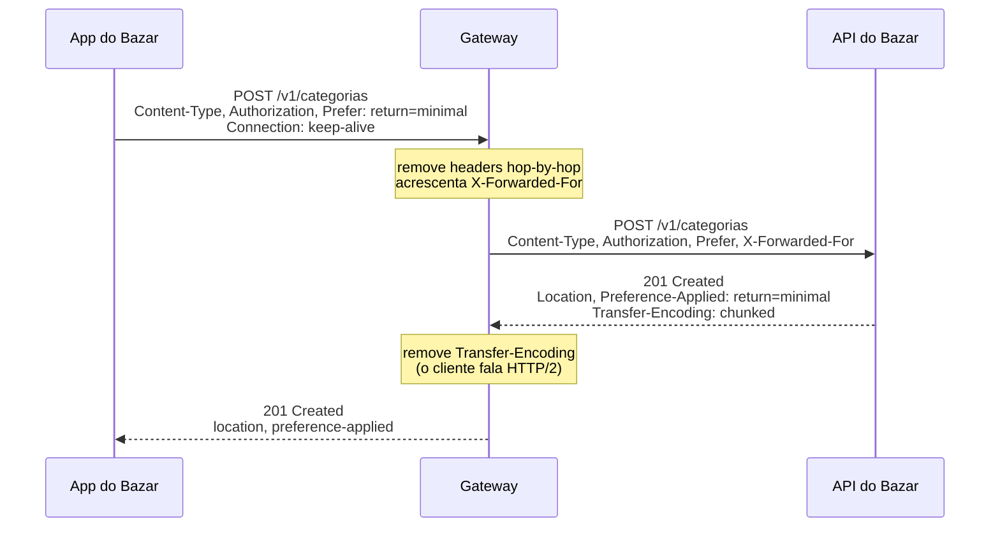

## O problema

Veja esta resposta de uma API de catálogo que um parceiro do Bazar integrou antes de conhecer a nossa:

```json
{
  "status": "created",
  "statusCode": 201,
  "contentType": "json",
  "url": "/produtos/42",
  "pagina": { "atual": 1, "proxima": "/produtos?pagina=2" },
  "tenteNovamenteEm": null,
  "dados": { "id": 42, "nome": "Clean Code" }
}
```

Quase tudo ali já existe no HTTP: o status, o tipo do conteúdo, a localização do recurso criado, o link para a próxima página, o tempo de espera antes de tentar de novo. Ao colocar esses metadados no corpo, a API obrigou cada cliente a escrever código para lê-los, e nenhuma ferramenta genérica (cache, *proxy*, biblioteca de *retry*, navegador) consegue aproveitá-los.

Os <Term id="header">headers</Term> são como as informações no lado de fora de uma caixa de mudança: "frágil", "este lado para cima", "cozinha", "caixa 3 de 7". Quem carrega a caixa (o *proxy*, o cache, o cliente HTTP) decide como tratá-la sem abri-la. Se essas informações estiverem só dentro da caixa, ninguém sabe que ela é frágil até quebrá-la.

> **A pergunta desta página:** quais headers uma API precisa conhecer, quem envia cada um, e como usá-los em vez de reinventar metadados no corpo?

## O conceito

### O que é um header

Um header (ou campo de cabeçalho) é um par `Nome: valor` que carrega **metadados** da mensagem: informações sobre a requisição, a resposta, o corpo ou a conexão. Algumas regras gerais:

- **O nome não diferencia maiúsculas de minúsculas.** `Content-Type`, `content-type` e `CONTENT-TYPE` são o mesmo header. No HTTP/2 e no HTTP/3, os nomes são obrigatoriamente transmitidos em minúsculas, e por isso você vê `content-type` na saída do curl ao falar com servidores HTTP/2. O **valor** pode diferenciar, dependendo do header.
- **Um header pode aparecer mais de uma vez**, e para a maioria deles isso equivale a uma lista separada por vírgulas: `Accept: text/csv` e `Accept: application/json` em duas linhas são o mesmo que `Accept: text/csv, application/json`. A exceção notória é o `Set-Cookie` (página [02.07](/comecando-e-fundamentos-de-http/cookies-estado-e-sessoes)).
- **Headers desconhecidos são ignorados.** Um servidor que recebe um header que não entende não deve falhar por causa dele. É isso que permite ao HTTP evoluir.

A IANA mantém o registro oficial dos nomes de headers. Os que importam para uma API se agrupam por função.

### Headers de representação

Descrevem o **corpo** da mensagem e aparecem em requisições e respostas que têm corpo.

| Header | Exemplo | Significado |
|---|---|---|
| `Content-Type` | `application/json` | O formato do corpo (o *media type*, assunto de [02.05](/comecando-e-fundamentos-de-http/content-negotiation-e-media-types)). Sem ele, quem recebe precisa adivinhar. |
| `Content-Length` | `182` | O tamanho do corpo em **bytes**. Ausente quando o corpo vai em pedaços (`Transfer-Encoding: chunked`). |
| `Content-Encoding` | `gzip` | O corpo foi comprimido e precisa ser descomprimido para ser lido (página [22.03](/padroes-avancados-de-http/compressao)). |
| `Content-Language` | `pt-BR` | O idioma do conteúdo para o público. |

### Headers de requisição

Enviados pelo cliente para dar contexto ao servidor.

| Header | Exemplo | Significado |
|---|---|---|
| `Host` | `api.bazar.example` | O servidor de destino. Obrigatório no HTTP/1.1 (no HTTP/2 e 3, vira o pseudo-header `:authority`). |
| `Accept` | `application/json` | Os formatos que o cliente aceita na resposta. |
| `Accept-Language` | `pt-BR, en;q=0.5` | Os idiomas preferidos. |
| `Accept-Encoding` | `gzip, br` | As compressões que o cliente sabe descomprimir. |
| `Authorization` | `Bearer eyJhbGciOi...` | A credencial do cliente. 🔒 O formato e a validação ficam na [documentação de segurança](https://security-doc-beta.vercel.app/); o essencial está em [26.04](/seguranca-essencial-para-apis/resource-server-com-jwt-o-essencial). |
| `User-Agent` | `bazar-app-android/4.2.0` | Quem é o software cliente. Útil em logs e métricas para saber qual versão do app está chamando. |

A família `Accept-*` é a base da negociação de conteúdo, vista na próxima página.

### Headers de resposta

Enviados pelo servidor com informações que não cabem no status.

| Header | Exemplo | Quando usar |
|---|---|---|
| `Location` | `/v1/categorias/0192f3a0-…` | Com `201 Created`, aponta para o recurso criado. Com `3xx`, para onde ir. Com `202`, para o recurso de acompanhamento. |
| `Retry-After` | `30` ou `Sat, 24 Oct 2026 18:00:00 GMT` | Com `429` e `503`, quanto tempo esperar antes de tentar de novo: em segundos ou em data HTTP. |
| `Allow` | `GET, HEAD, POST` | Com `405`, os métodos aceitos pela URI. Também na resposta a `OPTIONS`. |
| `Vary` | `Accept, Accept-Language` | Quais headers da **requisição** influenciaram a resposta. Caches usam isso para não servir a versão em inglês a quem pediu português (detalhes em [02.05](/comecando-e-fundamentos-de-http/content-negotiation-e-media-types)). |

### `Link` (RFC 8288): relações entre recursos

O header `Link` expressa **relações** entre o recurso atual e outros recursos, cada uma com um tipo de relação (`rel`). O formato é a URI entre `<` e `>`, seguida de parâmetros:

```http
Link: </v1/produtos?cursor=eyJpZCI6NDJ9&limit=20>; rel="next",
      </v1/produtos?limit=20>; rel="first"
```

Os tipos de relação mais comuns são registrados na IANA: `next`, `prev`, `first`, `last` (paginação), `self`, `alternate`, `describedby`, `deprecation`. O uso clássico em APIs é a **paginação**: o cliente segue o `rel="next"` sem montar a URL da próxima página. O GitHub faz exatamente isso. O Bazar usa o `Link` para paginação ([13.03](/design-de-apis-profissional/paginacao-por-offset)) e para apontar a documentação de depreciação ([18.04](/contratos-documentacao-e-ciclo-de-vida/depreciacao-e-desligamento-de-apis)).

A vantagem sobre um campo `"proxima"` no corpo é que qualquer cliente que conhece a RFC 8288 sabe navegar, sem conhecer o formato específico da sua API. O Bazar faz as duas coisas: envia o `Link` e também o cursor no corpo, porque nem todo cliente lê headers com facilidade.

### `Prefer` e `Preference-Applied` (RFC 7240)

O header `Prefer` permite ao cliente **expressar uma preferência** sobre como o servidor deve atender a requisição. É uma preferência, não uma ordem: o servidor pode ignorá-la. Quando a aplica, ele avisa com `Preference-Applied`.

| Preferência | O que o cliente diz | Resposta típica |
|---|---|---|
| `return=minimal` | "Não preciso do recurso de volta." | `204 No Content` (ou só o essencial), economizando banda |
| `return=representation` | "Quero o recurso completo na resposta." | `200`/`201` com o recurso no corpo |
| `respond-async` | "Se for demorar, aceite e me responda depois." | `202 Accepted` com `Location` para acompanhar |
| `wait=10` | "Espero no máximo 10 segundos." | Combinada com `respond-async`: se passar disso, `202` |

Sem o `Prefer`, cada API inventa um parâmetro (`?retornarObjeto=false`, `?async=true`). Com ele, o mecanismo é padrão. O Bazar aceita `return=minimal` nas escritas ([14.01](/design-de-apis-profissional/criacao-com-post-e-put-com-id-do-cliente)) e `respond-async` em operações demoradas ([21.02](/padroes-avancados-de-http/operacoes-assincronas-e-de-longa-duracao-202-polling)).

Quando a preferência muda a resposta, o servidor deve incluir `Prefer` no `Vary`, para que um cache não sirva uma resposta mínima a quem pediu a completa.

### Headers customizados e o fim do prefixo `X-`

Às vezes uma API precisa de um header que não existe no padrão: um identificador de correlação, a versão de um contrato. Durante anos, a convenção foi prefixar esses headers com `X-` (`X-Request-Id`, `X-Api-Version`), para indicar que eram "experimentais" ou "não padronizados".

A RFC 6648 (2012) **depreciou essa convenção**. O motivo: quando um header `X-` se torna popular e vira padrão, ele não pode ser renomeado sem quebrar todo mundo que já o usa. Foi o que aconteceu com `X-Forwarded-For`, que ganhou um sucessor padronizado (`Forwarded`, RFC 7239), mas continua sendo o mais usado, porque milhões de sistemas dependem do nome antigo. O prefixo não protege de nada e cria uma dívida que nunca é paga.

A recomendação atual:

- **Antes de criar um header, procure** no registro da IANA ou numa RFC. `Idempotency-Key`, `RateLimit`, `Deprecation` e `Sunset` já existem ou estão em padronização.
- **Se precisar criar**, dê um nome descritivo sem `X-`. Se houver risco de colisão, use um prefixo da organização: `Bazar-Cliente-Versao`.
- **Headers `X-` herdados** (como `X-Forwarded-For` e `X-Request-Id`) continuam válidos: não vale a pena renomear o que todo mundo já entende.

### Structured Field Values (RFC 9651)

Cada header antigo tem sua própria sintaxe: o `Cache-Control` separa diretivas por vírgula, o `Accept` usa `;q=`, o `Set-Cookie` tem regras próprias, o `Retry-After` aceita número ou data. Escrever um *parser* correto para cada um é trabalhoso, e implementações diferentes discordam nos casos de borda.

A RFC 9651 (que substituiu a RFC 8941) define uma **sintaxe comum** para headers novos: os <Term id="structured-fields">*Structured Field Values*</Term>. Um header estruturado é de um de três tipos:

| Tipo | Exemplo | Uso |
|---|---|---|
| **Item** | `Deprecation: @1798761600` | Um valor único |
| **Lista** | `Exemplo-Lista: "a", "b";peso=2, ?1` | Vários valores em ordem |
| **Dicionário** | `Exemplo-Dic: limite=100, janela=60, ativo` | Pares chave-valor |

E os valores têm tipos bem definidos: inteiro (`42`), decimal (`4.5`), string (`"texto"`), *token* (`gzip`), sequência de bytes (`:cHJldGVuZA==:`), booleano (`?1` e `?0`), data (`@1798761600`, segundos desde 1970) e string de exibição (`%"caf%c3%a9"`). Qualquer item pode ter parâmetros depois de `;`.

Na prática, isso importa por dois motivos:

1. Os headers modernos que você vai usar seguem essa sintaxe. O `Deprecation` (RFC 9745) é uma data estruturada: `Deprecation: @1798761600`, e não uma data no formato HTTP. Os headers `RateLimit` e `RateLimit-Policy` (*draft* da IETF) são estruturados. Se você ler o `@` como um caractere qualquer, vai interpretar errado.
2. Se precisar criar um header próprio, use a sintaxe estruturada. Bibliotecas genéricas sabem lê-la, e você não precisa inventar regras de escape. O Spring Framework não traz um *parser* de Structured Fields; para headers simples, como uma data ou um inteiro, a sintaxe é fácil de ler manualmente.

### *Hop-by-hop* × *end-to-end*

A maioria dos headers é ***end-to-end***: vale para a mensagem inteira e deve chegar intacta do cliente ao servidor, atravessando os intermediários. Alguns, porém, são <Term id="hop-by-hop">*hop-by-hop*</Term>: dizem respeito só à **conexão** entre dois pontos vizinhos e não devem ser repassados por um *proxy*.

```mermaid title="Headers end-to-end atravessam; hop-by-hop morrem em cada salto"
flowchart LR
    C[Cliente] -- "Accept, Authorization<br/>Connection: keep-alive" --> P[Proxy / Gateway]
    P -- "Accept, Authorization<br/>(Connection removido)" --> A[API do Bazar]
```

São *hop-by-hop*: `Connection`, `Keep-Alive`, `Proxy-Connection`, `TE`, `Transfer-Encoding`, `Upgrade` e qualquer header listado no próprio `Connection`. O HTTP/2 e o HTTP/3 **proíbem** esses headers de conexão (a única exceção é `TE: trailers`), porque gerenciam conexões de outra forma. É por isso que um `Transfer-Encoding: chunked` que você vê numa resposta HTTP/1.1 do Tomcat não aparece quando a mesma resposta passa por um gateway que fala HTTP/2 com o cliente.

Para quem constrói APIs, a consequência é: **não use headers de conexão para carregar informação da aplicação**. Eles podem ser removidos por qualquer intermediário.

### Limites de tamanho

Headers não têm limite de tamanho na especificação, mas todo servidor impõe um, para se proteger de abuso e de consumo excessivo de memória:

| Componente | Limite padrão aproximado | Configuração |
|---|---|---|
| Tomcat no Spring Boot | 8 KB para a linha de requisição + todos os headers | `server.max-http-request-header-size` |
| Nginx | Buffers de 8 KB por linha | `large_client_header_buffers` |
| Gateways e CDNs | Varia (muitos aceitam entre 8 KB e 64 KB) | Configuração do provedor |

Ao passar do limite, o servidor responde `431 Request Header Fields Too Large` (RFC 6585) ou, em servidores mais antigos, `400`. Isso costuma acontecer com tokens JWT enormes, cookies acumulados ou URLs gigantes (a linha de requisição entra na conta). A resposta certa quase nunca é aumentar o limite: é diminuir o que vai nos headers. Uma lista de 300 SKUs, por exemplo, deve ir no corpo de um `QUERY` ou de um `POST`, não na *query* da URI.

## Diagrama

Os headers desta página e de toda a documentação, organizados por quem envia, quando, e onde cada um é aprofundado:

| Header | Quem envia | Quando | Página |
|---|---|---|---|
| `Host` | Cliente | Toda requisição | 02.01 |
| `Content-Type` | Quem envia corpo | Toda mensagem com corpo | 02.05 |
| `Content-Length` | Quem envia corpo | Corpo de tamanho conhecido | 02.01 |
| `Accept` | Cliente | Quando espera um formato específico | 02.05 |
| `Accept-Language` | Cliente | Para respostas localizadas | 02.05, 15.05 |
| `Accept-Encoding` / `Content-Encoding` | Cliente / servidor | Compressão | 22.03 |
| `Authorization` | Cliente | Endpoints protegidos 🔒 | 26.04 |
| `User-Agent` | Cliente | Toda requisição (recomendado) | 02.04 |
| `Location` | Servidor | `201`, `202`, `3xx` | 02.03, 05.04 |
| `Allow` | Servidor | `405` e `OPTIONS` | 02.03 |
| `Retry-After` | Servidor | `429`, `503`, polling de `202` | 21.02, 23.01 |
| `Vary` | Servidor | Resposta depende de headers da requisição | 02.05, 20.01 |
| `Link` | Servidor | Paginação, depreciação, relações | 13.03, 18.04 |
| `Prefer` / `Preference-Applied` | Cliente / servidor | Resposta mínima ou assíncrona | 14.01, 21.02 |
| `Cache-Control` | Servidor (e cliente) | Respostas cacheáveis | 20.01 |
| `ETag` / `If-None-Match` / `If-Match` | Servidor / cliente | Cache e concorrência | 20.02, 20.03 |
| `Idempotency-Key` | Cliente | `POST` que não pode duplicar | 21.01 |
| `Range` / `Content-Range` | Cliente / servidor | Downloads parciais | 22.02 |
| `RateLimit` / `RateLimit-Policy` | Servidor | Informar o consumo do limite | 23.01 |
| `Deprecation` / `Sunset` | Servidor | Versão em desligamento | 18.04 |
| `traceparent` | Cliente e servidor | Rastreamento distribuído | 27.06 |

E o caminho de uma requisição com headers *end-to-end* e *hop-by-hop*, passando pelo gateway:



## Na prática

Três respostas do Bazar em que os headers fazem o trabalho pesado.

### `Location` e `Prefer: return=minimal`

<HttpExchange
  title="Criação com resposta mínima"
  request={{
    method: 'POST',
    url: '/v1/categorias',
    headers: { 'Content-Type': 'application/json', Prefer: 'return=minimal' },
    body: { nome: 'Brinquedos', slug: 'brinquedos' },
  }}
  response={{
    status: 201,
    headers: { Location: 'https://api.bazar.example/v1/categorias/0192f3a0-5555-7000-8000-000000000009', 'Preference-Applied': 'return=minimal', Vary: 'Prefer', 'Content-Length': 0 },
  }}
>
  O cliente disse que não precisa do recurso de volta. O servidor respondeu sem corpo e confirmou com `Preference-Applied`. O `Location` continua lá: é a informação essencial de uma criação. Sem o `Prefer`, a resposta traria a categoria no corpo, como na página anterior.
</HttpExchange>

### `Link` de paginação

<HttpExchange
  title="Primeira página de produtos com Link"
  request={{ method: 'GET', url: '/v1/produtos?categoria=livros&limit=2', headers: { Accept: 'application/json' } }}
  response={{
    status: 200,
    headers: {
      'Content-Type': 'application/json',
      Link: '</v1/produtos?categoria=livros&limit=2&cursor=eyJpZCI6IjAxOTJmMzlmLTIyMjItNzAwMC04MDAwLTAwMDAwMDAwMDA0MyJ9>; rel="next"',
    },
    body: {
      itens: [
        { id: '0192f39f-2222-7000-8000-000000000042', nome: 'Clean Code', precoEmCentavos: 12990 },
        { id: '0192f39f-2222-7000-8000-000000000043', nome: 'Refactoring', precoEmCentavos: 15990 },
      ],
      proximoCursor: 'eyJpZCI6IjAxOTJmMzlmLTIyMjItNzAwMC04MDAwLTAwMDAwMDAwMDA0MyJ9',
    },
  }}
>
  O cliente segue o `rel="next"` sem saber como o cursor é montado. Na última página, o `Link` com `rel="next"` não aparece. A implementação está em [13.04](/design-de-apis-profissional/paginacao-por-cursor-keyset).
</HttpExchange>

Lendo o `Link` no terminal, com curl:

```bash
curl -s -D - -o /dev/null "http://localhost:8080/v1/produtos?categoria=livros&limit=2" | grep -i '^link:'
```

O `-D -` imprime os headers na saída padrão, e o `-o /dev/null` descarta o corpo.

### `Retry-After` em uma indisponibilidade

<HttpExchange
  title="Pagamento com o gateway indisponível"
  request={{
    method: 'POST',
    url: '/v1/pedidos/0192f3a1-9999-7000-8000-000000000123/pagamentos',
    headers: { 'Content-Type': 'application/json', 'Idempotency-Key': '0192f3a2-aaaa-7000-8000-000000000001' },
    body: { metodo: 'PIX' },
  }}
  response={{
    status: 503,
    headers: { 'Content-Type': 'application/problem+json', 'Retry-After': 30 },
    body: {
      type: 'https://api.bazar.example/problemas/pagamento-indisponivel',
      title: 'Pagamentos temporariamente indisponíveis',
      status: 503,
      detail: 'Não foi possível falar com o provedor de pagamento. Tente de novo em 30 segundos.',
      codigo: 'PAGAMENTO_INDISPONIVEL',
      traceId: '5c4b3a2918274635a4b3c2d1e0f9a8b7',
    },
  }}
>
  O `Retry-After: 30` diz ao app quanto esperar. Como a requisição tem `Idempotency-Key`, repetir depois de 30 segundos não gera cobrança duplicada.
</HttpExchange>

### Headers no Spring

O Spring MVC tem constantes para os nomes padronizados em `HttpHeaders` e lê headers da requisição com `@RequestHeader`. Este trecho mostra a ideia da criação com `Prefer`; a versão completa, com o tratamento de `return=representation`, está em [14.01](/design-de-apis-profissional/criacao-com-post-e-put-com-id-do-cliente):

```java
@PostMapping
ResponseEntity<CategoriaResponse> criar(
        @RequestBody CriarCategoriaRequest request,
        @RequestHeader(name = "Prefer", required = false) String prefer) {

    var criada = service.criar(request);
    var location = ServletUriComponentsBuilder.fromCurrentRequest()
            .path("/{id}").buildAndExpand(criada.id()).toUri();

    if ("return=minimal".equals(prefer)) {
        return ResponseEntity.created(location)
                .header("Preference-Applied", "return=minimal")
                .header(HttpHeaders.VARY, "Prefer")
                .build();                                     // 201 sem corpo
    }
    return ResponseEntity.created(location)
            .header(HttpHeaders.VARY, "Prefer")
            .body(criada);                                    // 201 com a categoria
}
```

A comparação com `equals` é uma simplificação: o `Prefer` pode trazer várias preferências separadas por vírgula (`Prefer: return=minimal, wait=5`). A versão de 14.01 interpreta o header corretamente.

O limite de tamanho dos headers é configurado no `application.yml`:

```yaml
server:
  max-http-request-header-size: 16KB   # padrão: 8KB
```

## Erros comuns

<BadVsGood title="Metadados no corpo" why="Headers padronizados são entendidos por clientes, caches, proxies e bibliotecas sem código específico. Metadados no corpo obrigam cada consumidor a conhecer o formato da sua API e ficam invisíveis para a infraestrutura.">
<Bad title="Envelope com metadados">

```http
HTTP/1.1 200 OK
Content-Type: application/json

{ "statusCode": 503, "tenteNovamenteEm": 30, "dados": null }
```

</Bad>
<Good title="Status e headers padronizados">

```http
HTTP/1.1 503 Service Unavailable
Retry-After: 30
Content-Type: application/problem+json

{ "type": "https://api.bazar.example/problemas/pagamento-indisponivel", "status": 503, ... }
```

</Good>
</BadVsGood>

<BadVsGood title="Nome de header novo" why="O prefixo X- foi depreciado pela RFC 6648 porque impede a padronização posterior sem quebrar clientes. Procure primeiro um header existente; se precisar criar, use um nome descritivo.">
<Bad title="Prefixo X- inventado">

```http
X-Idempotency-Token: 0192f3a1-7c4e-7b2a-9d1e-3f5a6b7c8d9e
X-Api-Retry-Seconds: 30
```

</Bad>
<Good title="Headers padronizados">

```http
Idempotency-Key: 0192f3a1-7c4e-7b2a-9d1e-3f5a6b7c8d9e
Retry-After: 30
```

</Good>
</BadVsGood>

Outros erros frequentes:

- **Comparar nomes de headers com diferença de maiúsculas.** `headers.get("Content-Type")` num mapa comum falha quando o servidor HTTP/2 manda `content-type`. Use as estruturas da biblioteca, que já ignoram a diferença (o `HttpHeaders` do Spring faz isso).
- **Esquecer o `Vary`.** Se a resposta muda conforme `Accept-Language` ou `Prefer` e o `Vary` não diz isso, um cache pode servir a resposta errada a outro cliente.
- **Ler o `Deprecation` como data HTTP.** Ele é uma data estruturada (`@1798761600`), não `Sat, 24 Oct 2026 ...`. Use a especificação certa para cada header.
- **Colocar dados grandes em headers.** Listas de ids, filtros enormes ou JWTs com dezenas de *claims* estouram o limite e resultam em `431` ou `400` difíceis de diagnosticar.
- **Depender de headers *hop-by-hop*.** Um `Connection: meu-dado` ou um `Keep-Alive` com informação da aplicação vai sumir no primeiro *proxy*.

## Boas práticas

- **Procure** um header padronizado (IANA, RFCs) antes de inventar um campo no corpo ou um header novo.
- **Envie** `Location` em toda criação e `Retry-After` em `429` e `503`.
- **Use** `Link` com relações registradas (`next`, `prev`, `deprecation`) para navegação e paginação.
- **Ofereça** `Prefer: return=minimal` e `respond-async` em vez de parâmetros próprios, e confirme com `Preference-Applied`.
- **Declare** no `Vary` todo header da requisição que muda a resposta.
- **Crie** headers próprios sem `X-`, com nomes descritivos e sintaxe de Structured Fields.
- **Mantenha** os headers pequenos: dados volumosos vão no corpo.

## Resumo

- Headers carregam metadados que clientes e intermediários usam sem abrir o corpo. O nome não diferencia maiúsculas; no HTTP/2 e 3, vai em minúsculas.
- Representação: `Content-Type`, `Content-Length`, `Content-Encoding`, `Content-Language`. Requisição: `Host`, `Accept*`, `Authorization` 🔒, `User-Agent`. Resposta: `Location`, `Retry-After`, `Allow`, `Vary`.
- `Link` (RFC 8288) expressa relações e paginação; `Prefer` (RFC 7240) permite pedir resposta mínima, completa ou assíncrona.
- O prefixo `X-` foi depreciado (RFC 6648). Headers novos usam **Structured Field Values** (RFC 9651), como o `Deprecation`.
- Headers *hop-by-hop* valem só para uma conexão e são removidos por *proxies*. Headers têm limite de tamanho (8 KB no Tomcat, por padrão).

<Exercise title="Tire os metadados do corpo" difficulty="medio">
A resposta abaixo é de um endpoint antigo de exportação de relatórios de um parceiro. Reescreva-a usando status e headers padronizados, deixando no corpo só o que é conteúdo de verdade.

```json
{
  "statusCode": 202,
  "mensagem": "Relatório em processamento",
  "acompanharEm": "/v1/operacoes/0192f3a3-bbbb-7000-8000-000000000010",
  "consulteNovamenteEmSegundos": 5,
  "formatoDoArquivo": "text/csv",
  "idioma": "pt-BR"
}
```

<Hint>
Pense em quais headers você viu nesta página: um deles aponta para outro recurso, outro diz quanto esperar. O formato e o idioma do **arquivo** ainda não existem na resposta, porque o arquivo não foi gerado.
</Hint>

<Solution>

```http
HTTP/1.1 202 Accepted
Location: /v1/operacoes/0192f3a3-bbbb-7000-8000-000000000010
Retry-After: 5
Content-Type: application/json

{
  "id": "0192f3a3-bbbb-7000-8000-000000000010",
  "tipo": "RELATORIO_VENDAS",
  "status": "PENDENTE",
  "progresso": 0
}
```

As decisões:

- `statusCode` → a linha de status (`202 Accepted`).
- `acompanharEm` → `Location`, que é o que um `202` usa para apontar o recurso de acompanhamento.
- `consulteNovamenteEmSegundos` → `Retry-After: 5`.
- `mensagem` some: o status já diz que o pedido foi aceito. O corpo passa a ser a representação da **operação**, com o formato do recurso `Operacao` do Bazar.
- `formatoDoArquivo` e `idioma` descrevem o arquivo final, que ainda não existe. Eles vão aparecer como `Content-Type` e `Content-Language` na resposta do download (`GET /v1/relatorios/{id}/arquivo`), não aqui.

Esse fluxo completo, com a operação passando de `PENDENTE` a `CONCLUIDA` e o `303` no fim, é o assunto de [21.02](/padroes-avancados-de-http/operacoes-assincronas-e-de-longa-duracao-202-polling).

</Solution>
</Exercise>

<Quiz
  questions={[
    {
      question: 'Uma resposta varia conforme o Accept-Language da requisição, mas não declara isso no Vary. Qual é o risco?',
      options: [
        'Nenhum, porque o Accept-Language é só uma sugestão',
        'Um cache pode servir a versão em um idioma para quem pediu outro',
        'O servidor passa a responder 406',
      ],
      answer: 1,
      explanation: 'O Vary diz aos caches quais headers da requisição fazem parte da chave do cache. Sem ele, a primeira resposta guardada (em inglês, por exemplo) é servida a todos. O 406 só aparece quando nenhum formato aceitável existe, o que não tem relação com o Vary.',
    },
    {
      question: 'Por que a RFC 6648 desaconselha o prefixo X- em headers novos?',
      options: [
        'Porque headers com X- são bloqueados pelo HTTP/2',
        'Porque o X- é reservado para headers de segurança',
        'Porque, se o header virar padrão, ele não pode ser renomeado sem quebrar quem já o usa',
      ],
      answer: 2,
      explanation: 'O caso de X-Forwarded-For mostra o problema: o padrão Forwarded existe, mas o nome antigo continua dominante. O HTTP/2 aceita headers com X-, e não existe reserva de prefixo para segurança.',
    },
    {
      question: 'Um cliente envia Prefer: return=minimal em um POST. O servidor ignora a preferência e devolve 201 com o recurso no corpo. Isso está errado?',
      options: [
        'Não: Prefer é uma preferência, e o servidor pode ignorá-la; ele só não deve enviar Preference-Applied',
        'Sim: o servidor é obrigado a respeitar o Prefer',
        'Sim: o servidor deveria responder 400 se não suporta a preferência',
      ],
      answer: 0,
      explanation: 'A RFC 7240 define o Prefer como opcional para o servidor. O Preference-Applied existe justamente para o cliente saber se a preferência foi aplicada. Rejeitar com 400 contraria a regra de ignorar o que não se entende.',
    },
  ]}
/>

## Referências

<References />
