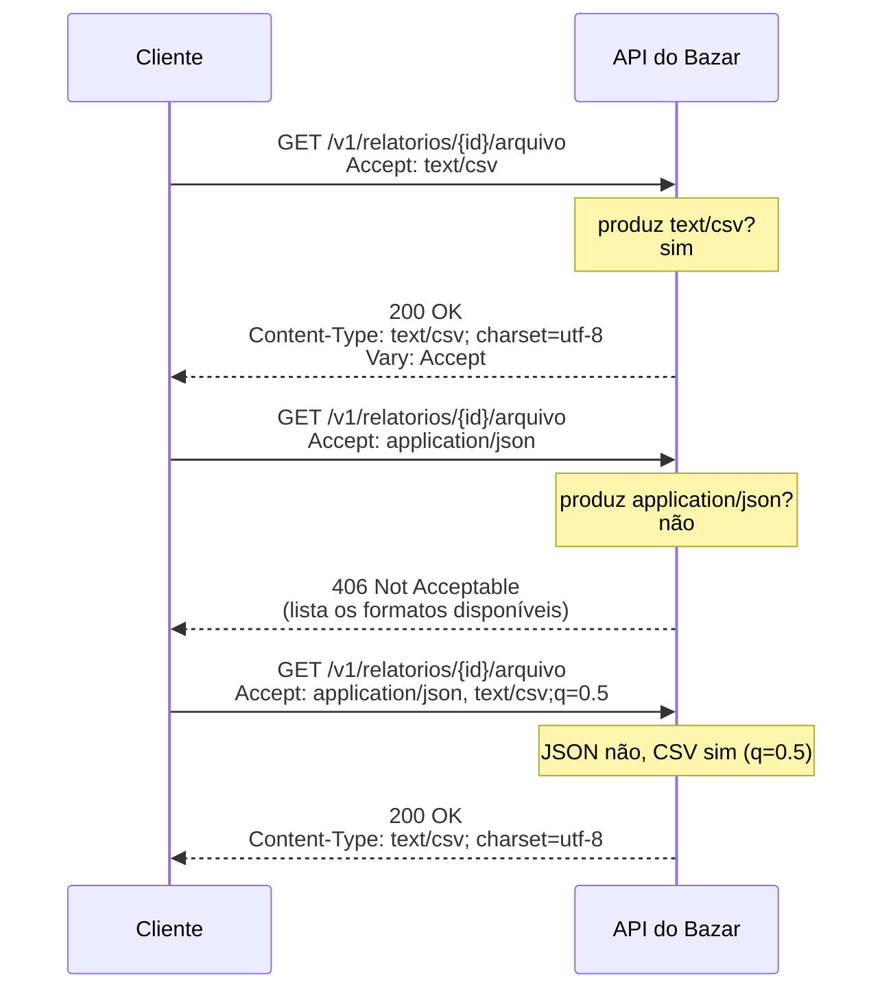
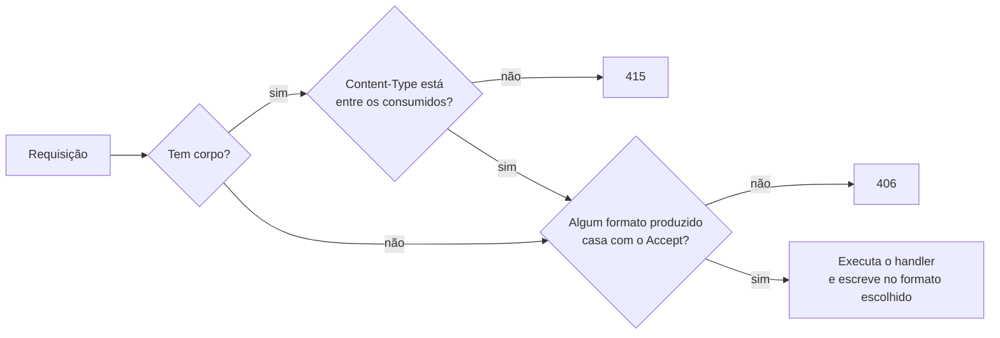

## O problema

O time de dados do Bazar pede o relatório de vendas do mês para abrir no Excel. O desenvolvedor chama a URL do arquivo no navegador e recebe um CSV. O script Python do time de dados chama a mesma URL e recebe `406 Not Acceptable`. Na mesma semana, o app recebe `415 Unsupported Media Type` ao criar uma categoria, embora "o JSON esteja certinho".

Os três casos têm a mesma causa: dois headers que ninguém olhou. O script mandava `Accept: application/json`, pedindo um formato que aquele endpoint não produz. O app mandava o corpo sem `Content-Type`, e o servidor não sabia que era JSON.

Pense num restaurante com cardápio em três idiomas. Você diz ao garçom "prefiro português, mas inglês serve". Se houver cardápio em português, você recebe esse; se não, em inglês; se o restaurante só tiver em japonês, o garçom avisa que não pode atender seu pedido. Esse diálogo é a **negociação de conteúdo**. E quando você entrega ao garçom um bilhete escrito, precisa dizer em que língua ele está, ou ele não vai conseguir ler.

> **A pergunta desta página:** como cliente e servidor combinam o formato de uma representação, e o que significam os erros `406` e `415`?

## O conceito

### Media types

Um <Term id="media-type">media type</Term> (antes chamado *MIME type*) identifica o formato de um conteúdo. Ele tem um **tipo**, um **subtipo** e, opcionalmente, **parâmetros**:

```text noCopy
text/csv; charset=utf-8; header=present
└┬─┘ └┬┘  └─────┬─────┘  └─────┬──────┘
tipo  subtipo  parâmetro       parâmetro
```

| Media type | Formato | Uso no Bazar |
|---|---|---|
| `application/json` | JSON | Quase todas as requisições e respostas |
| `application/problem+json` | Problem Details (RFC 9457) | Todas as respostas de erro |
| `application/merge-patch+json` | JSON Merge Patch (RFC 7396) | `PATCH /v1/produtos/{id}` |
| `text/csv` | CSV | Arquivo do relatório de vendas |
| `text/event-stream` | Server-Sent Events | Acompanhamento do pedido em tempo real |
| `multipart/form-data` | Formulário com arquivos | Upload de imagem de produto |
| `image/png`, `image/jpeg`, `image/webp` | Imagens | Download da imagem do produto |

Tipo, subtipo e nomes de parâmetros não diferenciam maiúsculas de minúsculas. Os tipos oficiais são registrados na IANA, conforme as regras da RFC 6838.

#### O parâmetro `charset`

O parâmetro mais conhecido é o `charset`, que diz a codificação de caracteres de formatos de texto: `text/csv; charset=utf-8`. Mas ele **não se aplica a `application/json`**. A RFC 8259 exige UTF-8 para JSON trocado entre sistemas e não define nenhum parâmetro `charset`. Escrever `application/json; charset=utf-8` não quebra nada (quem recebe ignora o parâmetro), mas é redundante. O Spring, desde a versão 5.2, envia `application/json` sem `charset`.

#### Sufixos estruturados: `+json`

Repare em `application/problem+json` e `application/merge-patch+json`. O sufixo **`+json`** diz: "este é um formato específico, com regras próprias, mas a sintaxe por baixo é JSON". Um cliente que não conhece Problem Details ainda consegue fazer o *parse* do corpo como JSON e mostrar o conteúdo. O mesmo vale para `+xml` e outros sufixos registrados.

É por isso que os erros do Bazar usam `application/problem+json`, e não `application/json`: o tipo diz exatamente o que está no corpo (um objeto com `type`, `title`, `status`...), e o sufixo garante compatibilidade com qualquer leitor de JSON.

#### *Vendor media types*

O prefixo **`vnd.`** é reservado para tipos de um fornecedor específico: `application/vnd.github+json`, `application/vnd.bazar.produto.v2+json`. Algumas APIs usam esse mecanismo para **versionar** representações: o cliente pede `Accept: application/vnd.bazar.produto.v2+json` e recebe a versão 2 do produto na mesma URI. Essa é uma das estratégias de versionamento comparadas em [18.02](/contratos-documentacao-e-ciclo-de-vida/estrategias-de-versionamento). O Bazar não versiona por *media type* (usa o caminho, `/v2`), mas você vai encontrar APIs que fazem isso.

### Negociação de conteúdo

A <Term id="content-negotiation">negociação de conteúdo</Term> é o mecanismo pelo qual um mesmo recurso, na mesma URI, pode ser entregue em representações diferentes. O cliente diz o que aceita; o servidor escolhe.

#### O header `Accept` e os *q-values*

O cliente lista os formatos que aceita no `Accept`, opcionalmente com um **peso** (o parâmetro `q`, de *quality*, chamado de <Term id="q-value">*q-value*</Term>), de 0 a 1. Sem `q`, o peso é 1.

```http
Accept: text/csv, application/json;q=0.8, */*;q=0.1
```

Leia assim: "prefiro CSV (peso 1); JSON serve (0,8); em último caso, qualquer coisa (0,1)". Um peso `q=0` significa "não aceito de jeito nenhum".

Os curingas também têm regras de precedência: o mais específico vence. Em `Accept: text/*;q=0.3, text/csv`, o CSV tem peso 1 (a regra específica) e outros textos têm 0,3.

| `Accept` enviado | Significado |
|---|---|
| (ausente) | Aceito qualquer formato |
| `*/*` | Aceito qualquer formato (o padrão do curl) |
| `application/json` | Só JSON |
| `text/csv, application/json;q=0.5` | Prefiro CSV; JSON serve |
| `application/json, application/problem+json` | JSON nos sucessos, Problem Details nos erros |
| `text/html,application/xhtml+xml,...,*/*;q=0.8` | Típico de navegador: prefere HTML, mas aceita qualquer coisa |

O último exemplo explica por que o navegador "funciona" onde o script falha: ele termina com `*/*`, que aceita o CSV.

#### Negociação proativa × reativa

A RFC 9110 descreve dois modelos:

- **Proativa** (*server-driven*): o cliente envia suas preferências (`Accept`, `Accept-Language`, `Accept-Encoding`) e o **servidor escolhe** a melhor representação. É o modelo usado em praticamente todas as APIs, e o que o Spring implementa.
- **Reativa** (*agent-driven*): o servidor responde com a **lista de alternativas** (por exemplo, `300 Multiple Choices` com links) e o **cliente escolhe** e faz outra requisição. É raro em APIs, porque custa uma ida e volta a mais.

### `406` × `415`: quem não entende quem

Os dois são erros de formato, mas em direções opostas:

<Comparison
  title="406 × 415"
  columns={['406 Not Acceptable', '415 Unsupported Media Type']}
  rows={[
    { label: 'Direção', values: ['Resposta: o servidor não sabe produzir o que o cliente aceita', 'Requisição: o servidor não sabe ler o que o cliente enviou'] },
    { label: 'Header que causa', values: ['Accept', 'Content-Type (ou Content-Encoding)'] },
    { label: 'Exemplo no Bazar', values: ['Accept: application/xml em qualquer endpoint', 'POST /v1/categorias com Content-Type: text/plain'] },
    { label: 'Como o cliente corrige', values: ['Aceitar um formato que a API produz', 'Enviar no formato que o endpoint consome'] },
    { label: 'Header útil na resposta', values: ['Lista dos formatos disponíveis no corpo', 'Accept-Patch (em PATCH) ou documentação'] },
  ]}
/>

Uma forma de lembrar: o `406` é sobre o que o cliente **aceita** (*Accept*), o `415` é sobre o que o cliente **envia**.

Para `PATCH`, a RFC 5789 define o header **`Accept-Patch`**, que o servidor pode mandar junto com o `415` (ou na resposta a `OPTIONS`) para dizer quais formatos de *patch* aceita: `Accept-Patch: application/merge-patch+json, application/json-patch+json`.

<Callout type="tip" title="Muitos 406 são falsos alarmes">
  Um cliente que pede `Accept: application/json` e recebe um erro em `application/problem+json` pode, em tese, receber um `406`, porque `application/problem+json` não é `application/json`. Para evitar isso, clientes devem aceitar os dois tipos, e servidores costumam devolver o Problem Details mesmo assim, já que um erro em formato inesperado é mais útil que outro erro. É o que o Bazar faz.
</Callout>

### `Accept-Language` e `Accept-Encoding`

A negociação não se limita ao formato:

- **`Accept-Language: pt-BR, pt;q=0.9, en;q=0.5`**: o idioma preferido. O servidor responde com `Content-Language: pt-BR`. Em APIs, isso normalmente afeta só textos para humanos, como as mensagens de erro (o `title` e o `detail` de um Problem Details), nunca os nomes de campos ou os valores de enums. O Bazar trata internacionalização em [15.05](/design-de-apis-profissional/internacionalizacao-na-api).
- **`Accept-Encoding: gzip, br`**: as compressões que o cliente sabe desfazer. O servidor responde com `Content-Encoding: gzip`. Bibliotecas HTTP fazem isso sozinhas; os detalhes e cuidados estão em [22.03](/padroes-avancados-de-http/compressao).

### Por que o `Vary` é obrigatório

Se a mesma URI devolve representações diferentes conforme headers da requisição, um cache precisa saber disso. Caso contrário, ele guarda a primeira resposta (digamos, em inglês) e a entrega a todo mundo, inclusive a quem pediu português.

O header **`Vary`** lista os headers da requisição que influenciaram a resposta:

```http
HTTP/1.1 200 OK
Content-Type: application/json
Content-Language: pt-BR
Vary: Accept, Accept-Language
```

O cache passa a usar a URI **mais** os valores de `Accept` e `Accept-Language` como chave. Duas regras práticas:

- Todo header que muda a resposta entra no `Vary`. Se você esquecer, o bug só aparece em produção, atrás de uma CDN.
- `Vary: *` significa "depende de coisas que o cache não consegue ver", e na prática impede o cache. Evite.

O cache HTTP é o assunto de [20.01](/padroes-avancados-de-http/cache-http-rfc-9111).

## Diagrama

A negociação de formato no download do relatório de vendas, que o Bazar oferece em CSV:



E o que o servidor verifica, em ordem, antes de o seu código rodar:



## Na prática

### Pedindo formatos diferentes

O relatório de vendas é solicitado com `POST /v1/relatorios/vendas` e, quando fica pronto, o arquivo é baixado em `/v1/relatorios/{id}/arquivo`. A implementação do download por *streaming* está em [22.02](/padroes-avancados-de-http/download-streaming-e-range), e o formato da resposta em Spring é explicado em [09.03](/construindo-apis-com-spring-boot/httpmessageconverter-e-a-serializacao-por-dentro). Aqui interessa só a negociação.

<CodeTabs title="Download com Accept explícito">

```bash title="CSV"
curl -i http://localhost:8080/v1/relatorios/0192f3a3-cccc-7000-8000-000000000011/arquivo \
  -H 'Accept: text/csv'
```

```bash title="JSON (não suportado)"
curl -i http://localhost:8080/v1/relatorios/0192f3a3-cccc-7000-8000-000000000011/arquivo \
  -H 'Accept: application/json'
```

```bash title="Com preferência"
curl -i http://localhost:8080/v1/relatorios/0192f3a3-cccc-7000-8000-000000000011/arquivo \
  -H 'Accept: application/json, text/csv;q=0.5'
```

</CodeTabs>

<HttpExchange
  title="Accept: text/csv"
  request={{ method: 'GET', url: '/v1/relatorios/0192f3a3-cccc-7000-8000-000000000011/arquivo', headers: { Accept: 'text/csv' } }}
  response={{
    status: 200,
    headers: { 'Content-Type': 'text/csv; charset=utf-8', 'Content-Disposition': 'attachment; filename="vendas-2026-09.csv"', Vary: 'Accept' },
    body: 'numero,data,cliente,valorTotal\nBZR-2026-000101,2026-09-01T10:15:00Z,0192f3a0-1111-7000-8000-000000000001,259.80\nBZR-2026-000102,2026-09-01T11:02:00Z,0192f3a0-1111-7000-8000-000000000002,89.90\n',
  }}
>
  O `Content-Type` confirma o formato e a codificação. O `Content-Disposition` sugere o nome do arquivo ao navegador (detalhes em 22.02).
</HttpExchange>

<HttpExchange
  title="Accept: application/json"
  request={{ method: 'GET', url: '/v1/relatorios/0192f3a3-cccc-7000-8000-000000000011/arquivo', headers: { Accept: 'application/json' } }}
  response={{
    status: 406,
    headers: { 'Content-Type': 'application/problem+json' },
    body: {
      type: 'https://api.bazar.example/problemas/formato-nao-aceito',
      title: 'Formato não aceito',
      status: 406,
      detail: 'Este recurso está disponível em: text/csv.',
      codigo: 'FORMATO_NAO_ACEITO',
      traceId: '1f2e3d4c5b6a47988a7b6c5d4e3f2a1b',
    },
  }}
>
  O cliente pediu só JSON, e o arquivo existe só em CSV. O `detail` lista o que está disponível, para que o cliente corrija o `Accept`. Os metadados do relatório (período, formato, status) estão em JSON em outro recurso, `GET /v1/relatorios/{id}`.
</HttpExchange>

### O `415` mais comum

<HttpExchange
  title="Criação de categoria sem Content-Type correto"
  request={{ method: 'POST', url: '/v1/categorias', headers: { 'Content-Type': 'text/plain' }, body: '{"nome":"Livros","slug":"livros"}' }}
  response={{
    status: 415,
    headers: { 'Content-Type': 'application/problem+json', Accept: 'application/json' },
    body: {
      type: 'https://api.bazar.example/problemas/formato-nao-suportado',
      title: 'Formato não suportado',
      status: 415,
      detail: "O Content-Type 'text/plain' não é suportado. Use application/json.",
      codigo: 'FORMATO_NAO_SUPORTADO',
      traceId: '2a3b4c5d6e7f40819a2b3c4d5e6f7a8b',
    },
  }}
>
  O corpo é um JSON válido, mas o servidor decide pelo `Content-Type`, não pelo conteúdo. Repare no header `Accept` **na resposta**: o Spring o envia em erros 415 para informar os formatos que o endpoint consome. Com `curl -d`, sem `-H 'Content-Type: application/json'`, o curl manda `application/x-www-form-urlencoded`, e o resultado é o mesmo `415`.
</HttpExchange>

### `produces` e `consumes` no Spring

No Spring MVC, cada mapeamento pode declarar o que consome (`consumes`, comparado com o `Content-Type`) e o que produz (`produces`, comparado com o `Accept`). Quando você não declara, o Spring usa os formatos que os conversores registrados sabem ler e escrever (com o Jackson no *classpath*, JSON). É essa checagem que gera o `415` e o `406` antes de o seu método ser chamado:

```java
@GetMapping(path = "/v1/relatorios/{id}/arquivo", produces = "text/csv")
ResponseEntity<StreamingResponseBody> baixar(@PathVariable UUID id) { /* ... 22.02 */ }

@PostMapping(path = "/v1/categorias", consumes = MediaType.APPLICATION_JSON_VALUE)
ResponseEntity<CategoriaResponse> criar(@RequestBody CriarCategoriaRequest request) { /* ... 05.04 */ }

@PatchMapping(path = "/v1/produtos/{id}", consumes = "application/merge-patch+json")
ProdutoResponse atualizar(@PathVariable UUID id, @RequestBody JsonNode patch) { /* ... 14.02 */ }
```

Dois mapeamentos podem ter a mesma URI e o mesmo método, desde que produzam formatos diferentes: o Spring escolhe pelo `Accept`. É assim que uma única URI serve JSON e CSV.

<Callout type="info" title="Negociação por extensão e por parâmetro">
  Em projetos antigos você vai ver URIs como `/v1/relatorios/42.csv` ou `?format=csv`. A negociação por extensão (`.csv`) foi depreciada no Spring 5.3 e removida no Spring 6, por problemas de segurança e ambiguidade. A negociação por parâmetro ainda existe, mas vem desligada (`spring.mvc.contentnegotiation.favor-parameter=false`). Prefira o `Accept`; se precisar de links que abram direto no navegador, um parâmetro explícito é aceitável.
</Callout>

## Erros comuns

<BadVsGood title="Formato na URI" why="O formato é uma característica da representação, não do recurso. Com Accept, a mesma URI identifica o relatório e o cliente escolhe o formato; com uma URI por formato, o recurso se multiplica e caches, links e permissões precisam ser tratados em dobro.">
<Bad title="Uma URI por formato">

```http
GET /v1/relatorios/0192f3a3-.../arquivo.csv
GET /v1/relatorios/0192f3a3-.../arquivo-json
```

</Bad>
<Good title="Uma URI, formato negociado">

```http
GET /v1/relatorios/0192f3a3-.../arquivo
Accept: text/csv
```

</Good>
</BadVsGood>

Outros erros frequentes:

- **Mandar corpo sem `Content-Type`.** O resultado é um `415` que parece misterioso. Bibliotecas como o `RestClient` do Spring definem o header sozinhas quando o corpo é um objeto; com `curl`, você precisa de `-H 'Content-Type: application/json'` (ou da opção `--json`, disponível desde o curl 7.82, que define o `Content-Type` e o `Accept`).
- **Responder `application/json` para erros.** O tipo correto é `application/problem+json`. Clientes que tratam erros genericamente dependem dele.
- **Ignorar o `Accept` e devolver sempre JSON.** Funciona até um cliente pedir outra coisa e receber JSON com `200`, sem saber que o formato está errado. Responda `406` ou, no mínimo, mande o `Content-Type` real.
- **Usar `Accept-Language` para traduzir nomes de campos ou valores de enums.** O contrato deixa de ser estável: o mesmo campo aparece como `status` para um cliente e `estado` para outro. Só textos para humanos devem mudar.
- **Esquecer o `Vary`.** A resposta varia pelo `Accept` e o cache entrega CSV a quem pediu JSON.

## Boas práticas

- **Envie** sempre `Content-Type` quando houver corpo e `Accept` quando o cliente depender de um formato.
- **Aceite** `application/problem+json` nos clientes, junto com `application/json`.
- **Declare** `produces` e `consumes` nos endpoints que fogem do JSON padrão (CSV, *merge patch*, *multipart*).
- **Use** o tipo mais específico: `application/problem+json` para erros, `application/merge-patch+json` para *patches*.
- **Liste** os formatos disponíveis no corpo do `406` e no header `Accept-Patch` quando recusar um `PATCH`.
- **Inclua** no `Vary` todo header de negociação que mude a resposta.
- **Restrinja** o `Accept-Language` a textos para humanos.

## Resumo

- Um **media type** tem tipo, subtipo e parâmetros (`text/csv; charset=utf-8`). JSON não usa `charset`: é sempre UTF-8.
- O sufixo **`+json`** indica um formato específico com sintaxe JSON (`application/problem+json`); o prefixo **`vnd.`** marca tipos de um fornecedor.
- O cliente diz o que aceita no `Accept`, com pesos `q`; o servidor escolhe (negociação **proativa**).
- **`406`**: o servidor não produz nada que o cliente aceite. **`415`**: o servidor não consome o que o cliente enviou.
- `Accept-Language` e `Accept-Encoding` negociam idioma e compressão.
- Toda resposta que depende de headers da requisição precisa de **`Vary`**.

<Exercise title="Diagnostique os erros de formato" difficulty="medio">
Para cada requisição, diga o status que o Bazar devolve e explique como corrigir:

1. `POST /v1/categorias` com `-d '{"nome":"Livros","slug":"livros"}'` e nenhum header.
2. `GET /v1/produtos` com `Accept: application/xml`.
3. `PATCH /v1/produtos/{id}` com `Content-Type: application/json` e o corpo `{"nome":"Clean Code"}`.
4. `GET /v1/relatorios/{id}/arquivo` com `Accept: */*`.
5. `GET /v1/produtos/{id}` com `Accept: application/json;q=0`.

<Hint>
Para cada caso, pergunte: o problema está no que o cliente **envia** (`Content-Type`) ou no que ele **aceita** (`Accept`)? Lembre que `q=0` significa "não aceito".
</Hint>

<Solution>

| # | Status | Por quê | Correção |
|---|---|---|---|
| 1 | `415` | Com `-d` e sem `-H`, o curl envia `Content-Type: application/x-www-form-urlencoded`. | Adicionar `-H 'Content-Type: application/json'` ou usar `--json`. |
| 2 | `406` | O Bazar só produz JSON nesse endpoint. | Pedir `application/json`. |
| 3 | `415` | O endpoint consome `application/merge-patch+json`, que tem semântica própria (por exemplo, `null` remove o campo). A resposta pode trazer `Accept-Patch`. | Enviar `Content-Type: application/merge-patch+json`. |
| 4 | `200` com `text/csv` | `*/*` aceita qualquer formato, e o servidor escolhe o que tem. | Nada a corrigir, mas um cliente que vai processar o CSV deve pedir `text/csv` explicitamente. |
| 5 | `406` | `q=0` diz "não aceito JSON", e é o único formato disponível. | Remover o `q=0`. |

O caso 3 é o mais sutil: o corpo é JSON válido, mas `application/json` e `application/merge-patch+json` não são intercambiáveis. O tipo diz como o servidor deve interpretar o corpo, e é por isso que o Bazar exige o tipo específico.

</Solution>
</Exercise>

<Quiz
  questions={[
    {
      question: 'O app envia um JSON perfeito no POST /v1/categorias e recebe 415. Qual é a causa mais provável?',
      options: [
        'O JSON tem um campo a mais',
        'O Content-Type está ausente ou errado',
        'O Accept da requisição não inclui application/json',
      ],
      answer: 1,
      explanation: 'O 415 é sobre o que o cliente envia: o servidor decide como ler o corpo pelo Content-Type. Um campo a mais seria um problema de validação (ou seria ignorado), e um Accept incompatível causaria 406, não 415.',
    },
    {
      question: 'Uma resposta muda conforme o Accept da requisição. O que o servidor deve incluir para que caches funcionem corretamente?',
      options: ['Vary: Accept', 'Cache-Control: no-store', 'Content-Location'],
      answer: 0,
      explanation: 'O Vary diz ao cache que o Accept faz parte da chave. Cache-Control: no-store resolveria desligando o cache, o que joga fora o benefício. Content-Location identifica a representação, mas não diz ao cache quais headers considerar.',
    },
    {
      question: 'Por que os erros do Bazar usam application/problem+json em vez de application/json?',
      options: [
        'Porque application/json não permite objetos no topo',
        'Porque o Spring não consegue escrever erros como application/json',
        'Porque o tipo diz exatamente qual formato está no corpo, e o sufixo +json garante que qualquer leitor de JSON ainda consiga lê-lo',
      ],
      answer: 2,
      explanation: 'O tipo específico permite que clientes reconheçam um Problem Details sem inspecionar o corpo, e o sufixo +json mantém a compatibilidade. application/json aceita objetos no topo, e o Spring escreveria o erro em qualquer formato que o conversor suporte.',
    },
  ]}
/>

## Referências

<References />
