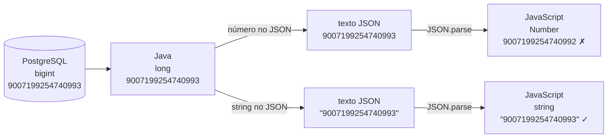

## O problema

O painel administrativo do Bazar, feito em JavaScript, mostrava o pedido errado quando o atendente clicava em "detalhes". Não era sempre: só com pedidos criados depois de uma migração de banco. O id do pedido no banco era `9007199254740993`; o painel pedia `GET /v1/pedidos/9007199254740992`. Um a menos. Nenhum erro, nenhuma exceção, nenhum log. O número tinha sido **arredondado em silêncio** pelo `JSON.parse` do navegador.

Na mesma semana, um parceiro reclamou que, ao atualizar só o telefone de um cliente, o complemento do endereço sumia. O cliente dele mandava `"complemento": null` para "não mexer", e a API entendia "apagar".

JSON é como uma língua franca num porto: todos os navios conseguem se comunicar com algumas centenas de palavras. Mas cada tripulação tem o seu sotaque. Uma palavra que significa "nada" para uns significa "apague" para outros, e números grandes demais simplesmente não existem no vocabulário de alguns. Quem projeta a API precisa escolher palavras que todos entendam do mesmo jeito.

> **A pergunta desta página:** que regras e armadilhas do JSON afetam o contrato de uma API, e quais convenções o Bazar adota para evitá-las?

## O conceito

### O que a RFC 8259 define

JSON (*JavaScript Object Notation*) é um formato de texto com **seis tipos** de valor:

| Tipo | Exemplo | Observação |
|---|---|---|
| Objeto | `{ "nome": "Clean Code" }` | Pares nome/valor. Os nomes são strings entre aspas duplas. |
| Array | `[1, 2, 3]` | Lista ordenada de valores, de qualquer tipo. |
| String | `"Clean Code"` | Sempre entre **aspas duplas**. Escapes com `\` (`\"`, `\n`, `é`). |
| Número | `129.90`, `-3`, `1.5e3` | Sem distinção entre inteiro e decimal. Sem `NaN` nem `Infinity`. |
| Booleano | `true`, `false` | Em minúsculas. |
| Nulo | `null` | Em minúsculas. |

Não existem datas, dinheiro, UUIDs, binários nem enums: tudo isso precisa ser **representado** com os tipos acima, e a escolha da representação é uma decisão de contrato. Datas viram strings em RFC 3339 ([15.01](/design-de-apis-profissional/datas-horas-e-fusos-horarios)), dinheiro vira string decimal ([15.02](/design-de-apis-profissional/dinheiro-e-numeros-decimais)), UUIDs viram strings.

Três regras da RFC que importam para APIs:

- **UTF-8 é obrigatório** para JSON trocado entre sistemas que não fazem parte de um ecossistema fechado. Não envie Latin-1 nem UTF-16. Acentos podem ir direto (`"Papelaria e Escritório"`) ou escapados (`"Escritório"`); os dois são equivalentes.
- **Nomes de campos deveriam ser únicos** dentro de um objeto. Quando se repetem, o comportamento é imprevisível: o `JSON.parse` do JavaScript fica com o último valor, outros *parsers* ficam com o primeiro ou rejeitam o documento. Nunca gere nomes repetidos.
- **A ordem dos campos não tem significado.** `{"a":1,"b":2}` e `{"b":2,"a":1}` são o mesmo objeto. Clientes que dependem da ordem quebram quando ela muda, e ela muda: o Jackson 3, usado no Spring Boot 4, passou a ordenar as propriedades em ordem alfabética por padrão ([06.03](/construindo-apis-com-spring-boot/jackson-3-no-spring-boot-4)).

### Números: a armadilha dos 53 bits

A RFC 8259 não limita o tamanho nem a precisão dos números. Quem limita são as **implementações**. E a mais importante delas, o JavaScript, representa todos os números como *double* IEEE 754, com 53 bits de precisão para a parte inteira. O maior inteiro que ele representa com exatidão é:

```text noCopy
2⁵³ − 1 = 9007199254740991   (Number.MAX_SAFE_INTEGER)
```

Acima disso, inteiros consecutivos deixam de ser distinguíveis. O `JSON.parse` não avisa: ele arredonda para o *double* mais próximo.

```javascript
JSON.parse('{"id": 9007199254740993}').id
// 9007199254740992  ← um a menos, sem erro

JSON.parse('{"id": 9007199254740993}').id === JSON.parse('{"id": 9007199254740992}').id
// true  ← dois ids diferentes viraram o mesmo número
```

Um `long` do Java vai até 2⁶³ − 1, muito acima desse limite. Ids gerados por sequências de banco raramente chegam lá, mas ids gerados por algoritmos distribuídos (como o Snowflake do Twitter, que usa os bits mais altos para o tempo) passam do limite desde o primeiro dia.

A RFC 7493 (I-JSON, um perfil mais restrito de JSON para protocolos) recomenda exatamente isso: números que precisem de mais precisão que um *double* devem ser enviados como **string**. É o que o Twitter fez ao adicionar o campo `id_str` ao lado de `id`, depois de anos de bugs.

Para o Bazar, a consequência é direta:

- **Ids são strings.** O Bazar usa UUID v7 ([15.03](/design-de-apis-profissional/identificadores-sequenciais-uuid-v7-e-ulid)), que já é uma string. Se um sistema seu usar ids `long`, envie-os como string.
- **Dinheiro nunca é número de ponto flutuante.** `0.1 + 0.2` em JavaScript dá `0.30000000000000004`. A v1 do produto usa inteiros em centavos (`precoEmCentavos: 12990`), bem abaixo do limite; a v2 usa string decimal (`"129.90"`). A escolha é discutida em [15.02](/design-de-apis-profissional/dinheiro-e-numeros-decimais).
- **Contagens e quantidades** cabem com folga num número comum.

### `null` × ausente × string vazia

Três formas de "não ter valor", com significados diferentes:

| No JSON | Significado usual | Exemplo no endereço de um cliente |
|---|---|---|
| `"complemento": "Apto 12"` | Tem valor | O complemento é "Apto 12". |
| `"complemento": ""` | Tem valor, e o valor é vazio | Ambíguo. Evite: use `null`. |
| `"complemento": null` | Explicitamente sem valor | O endereço não tem complemento. |
| (campo ausente) | Não informado | Depende do contexto (veja abaixo). |

Nas **respostas**, a diferença entre `null` e ausente é uma decisão de estilo, mas precisa ser consistente. O Bazar **inclui os campos com `null`**: o cliente vê o formato completo do recurso em toda resposta e não precisa adivinhar se um campo ausente significa "nulo" ou "esqueceram de mandar".

Nas **requisições**, a diferença é de semântica, e o lugar onde ela importa é a atualização parcial:

| Corpo do `PATCH /v1/clientes/{id}` (JSON Merge Patch) | Efeito |
|---|---|
| `{ "telefone": "+5511999990000" }` | Muda o telefone; o resto fica como está. |
| `{ "telefone": null }` | **Remove** o telefone. |
| `{}` | Não muda nada. |

O bug do parceiro do início da página é exatamente esse: ele serializava todos os campos do objeto, inclusive os nulos, e cada `PATCH` apagava o que ele não tinha preenchido. Em Java, a dificuldade é que um `record` ou uma classe comum não distingue "campo ausente" de "campo `null`": os dois viram `null`. As soluções (JSON Merge Patch, `JsonNullable`, JSON Patch) estão em [14.02](/design-de-apis-profissional/put-patch-json-merge-patch-e-json-patch).

<Callout type="warning" title="Strings vazias como &quot;sem valor&quot;">
  Usar `""` para dizer "não tem" cria dois jeitos de representar a ausência (`""` e `null`), e todo cliente precisa tratar os dois. Além disso, `""` pode ser um valor legítimo em alguns campos. Reserve `null` para a ausência e valide strings vazias como inválidas quando não fizerem sentido.
</Callout>

### Objeto ou array no topo?

Um documento JSON pode ter qualquer valor no topo, inclusive um array. Para listas, parece natural responder `[ {...}, {...} ]`. O problema aparece na evolução:

```json
[
  { "id": "0192f39f-2222-7000-8000-000000000042", "nome": "Clean Code" },
  { "id": "0192f39f-2222-7000-8000-000000000043", "nome": "Refactoring" }
]
```

No dia em que a listagem precisar de paginação, de um total ou de um aviso, não há onde colocar essas informações sem mudar o tipo do topo, o que quebra todos os clientes. Com um **objeto no topo**, campos novos são só campos novos:

```json
{
  "itens": [
    { "id": "0192f39f-2222-7000-8000-000000000042", "nome": "Clean Code" },
    { "id": "0192f39f-2222-7000-8000-000000000043", "nome": "Refactoring" }
  ],
  "proximoCursor": "eyJpZCI6IjAxOTJmMzlmLTIyMjItNzAwMC04MDAwLTAwMDAwMDAwMDA0MyJ9"
}
```

Por isso o Bazar responde coleções sempre como objeto, com a lista em `itens`. (Havia também um motivo de segurança antigo, o *JSON hijacking* de arrays no topo, que navegadores modernos já corrigiram.)

### camelCase × snake_case

O JSON não impõe convenção de nomes. As duas mais comuns:

| Convenção | Exemplo | Quem usa |
|---|---|---|
| **camelCase** | `precoEmCentavos`, `criadoEm` | Google (AIP), Microsoft, a maioria das APIs em ecossistemas Java e JavaScript |
| **snake_case** | `preco_em_centavos`, `criado_em` | Stripe, GitHub, Twitter, o guia da Zalando |

Nenhuma é tecnicamente melhor. O que importa é a **coerência**: uma API com `criadoEm` num recurso e `atualizado_em` em outro obriga cada cliente a lembrar caso a caso. O Bazar adota **camelCase**, por três motivos: é o padrão dos nomes de atributos em Java (sem configuração extra no Jackson), é o padrão do JavaScript (os clientes web usam os campos direto) e é a convenção que os nomes do `PROJETO-FINAL` já seguem. Siglas seguem a mesma regra: `cpf`, `idExterno`, `urlArmazenamento` (não `URLArmazenamento`).

A mesma coerência vale para valores de enums: o Bazar usa `MAIUSCULAS_COM_SUBLINHADO` (`PAGAMENTO_PENDENTE`, `CARTAO`), o padrão dos enums em Java. A evolução de enums é o assunto de [15.04](/design-de-apis-profissional/enums-evolucao-e-tolerant-reader).

### JSON Schema

O JSON não tem um jeito embutido de dizer "o campo `precoEmCentavos` é um inteiro maior que zero e é obrigatório". Para isso existe o **JSON Schema**, uma especificação para descrever e validar a estrutura de documentos JSON. A versão atual é a **2020-12**, e é a que a OpenAPI 3.1 usa para descrever os corpos de requisição e resposta. Você vai encontrá-lo em [17.01](/contratos-documentacao-e-ciclo-de-vida/a-especificacao-openapi), quando o contrato do Bazar for escrito.

### NDJSON e JSON Lines

Um documento JSON precisa estar completo para ser lido: um *parser* comum só devolve o array depois de ver o `]` final. Para exportar 2 milhões de pedidos, isso significa montar (e o cliente carregar) tudo na memória.

**NDJSON** (*Newline Delimited JSON*) e **JSON Lines** (praticamente o mesmo formato) resolvem isso: cada linha é um documento JSON completo e independente.

```text
{"numero":"BZR-2026-000101","valorTotal":"259.80","criadoEm":"2026-09-01T10:15:00Z"}
{"numero":"BZR-2026-000102","valorTotal":"89.90","criadoEm":"2026-09-01T11:02:00Z"}
{"numero":"BZR-2026-000103","valorTotal":"1299.00","criadoEm":"2026-09-01T11:40:00Z"}
```

O servidor escreve uma linha por vez, e o cliente processa cada linha assim que ela chega, com memória constante. O *media type* mais usado é `application/x-ndjson` (não registrado oficialmente na IANA); o Spring o tem na constante `MediaType.APPLICATION_NDJSON`. É uma opção para exportações e *streaming* ([22.02](/padroes-avancados-de-http/download-streaming-e-range)).

## Diagrama

O caminho de um id grande do banco até a tela do painel, com e sem a representação em string:



O texto JSON carrega o número exato nos dois casos. A perda acontece na leitura, no tipo que o *parser* do cliente escolhe. Por isso o problema não aparece em testes feitos em Java, que lê o número num `long` sem perda.

## Na prática

### JSON ruim × bom para um produto

Compare uma representação de `Produto` com os problemas desta página e a representação que o Bazar usa:

<BadVsGood title="Representação de produto" why="A versão boa usa string para o id, inteiro em centavos para o preço, null explícito para ausência, datas em RFC 3339, nomes em camelCase coerente e enums em maiúsculas. Nenhum valor depende da precisão do parser do cliente.">
<Bad title="Armadilhas de JSON">

```json
{
  "Id": 9007199254740993,
  "nome_produto": "Clean Code",
  "preco": 129.9,
  "descricao": "",
  "Categoria": "livros",
  "status": "ativo",
  "criado": "24/10/2026 14:30"
}
```

</Bad>
<Good title="Produto v1 do Bazar">

```json
{
  "id": "0192f39f-2222-7000-8000-000000000042",
  "sku": "LIV-0042",
  "nome": "Clean Code",
  "descricao": null,
  "precoEmCentavos": 12990,
  "categoriaId": "0192f3a0-5555-7000-8000-000000000001",
  "status": "ATIVO",
  "atributos": { "autor": "Robert C. Martin", "paginas": "464" },
  "versao": 3,
  "criadoEm": "2026-10-24T17:30:00Z",
  "atualizadoEm": "2026-10-24T17:45:12Z"
}
```

</Good>
</BadVsGood>

Os problemas da versão ruim, um a um:

- `"Id": 9007199254740993`: maiúscula fora do padrão e número acima de 2⁵³.
- `"nome_produto"` e `"Categoria"`: três convenções de nome no mesmo objeto.
- `"preco": 129.9`: ponto flutuante para dinheiro, sem moeda.
- `"descricao": ""`: string vazia para dizer "não tem".
- `"status": "ativo"`: enum em minúsculas, inconsistente com os demais.
- `"criado": "24/10/2026 14:30"`: formato local, sem fuso horário. É dia 24 de outubro às 14h30 em que fuso?

### Demonstração do problema de precisão

Rode no console do navegador (F12 → *Console*) ou com Node.js:

```javascript
const resposta = '{"id": 9007199254740993, "idTexto": "9007199254740993"}'
const pedido = JSON.parse(resposta)

console.log(pedido.id)                         // 9007199254740992  ← errado
console.log(pedido.idTexto)                    // "9007199254740993" ← correto
console.log(Number.isSafeInteger(pedido.id))   // false
console.log(Number.MAX_SAFE_INTEGER)           // 9007199254740991

// BigInt representa o número, mas JSON.parse não o usa por padrão
console.log(BigInt(pedido.idTexto))            // 9007199254740993n
```

O `JSON.parse` não tem como saber que você queria precisão total. Se o contrato envia o id como string, o problema não existe.

### Ids `long` como string no Spring

Se a sua API tiver ids `long` (um sistema legado, uma tabela antiga), o Jackson os serializa como número por padrão. Para enviar como string, anote o campo:

```java
import com.fasterxml.jackson.annotation.JsonFormat;

record PedidoLegadoResponse(
        @JsonFormat(shape = JsonFormat.Shape.STRING) long id,   // "9007199254740993"
        String numero) {
}
```

Repare no pacote: as **anotações** do Jackson continuam em `com.fasterxml.jackson.annotation` mesmo no Jackson 3, cujas demais classes mudaram para `tools.jackson`. A configuração do Jackson 3 no Spring Boot 4, inclusive como incluir ou omitir campos nulos, é o assunto de [06.03](/construindo-apis-com-spring-boot/jackson-3-no-spring-boot-4).

### Lendo JSON com `jq`

O `jq`, instalado em [01.02](/comecando-e-fundamentos-de-http/preparando-o-ambiente), lê números com precisão de *double*, como o JavaScript, nas versões anteriores à 1.7. A partir da 1.7, ele preserva a representação literal de números que não são alterados:

```bash
echo '{"id": 9007199254740993}' | jq '.id'        # jq 1.7+: 9007199254740993
echo '{"id": 9007199254740993}' | jq '.id + 0'    # 9007199254740992 (a conta usa double)
```

Mais um motivo para ids como string: nem ferramentas de linha de comando garantem a precisão quando há qualquer operação no meio.

## Erros comuns

<BadVsGood title="Lista no topo" why="Um array no topo não tem onde receber metadados. Paginação, totais ou avisos exigem mudar o tipo da resposta, e isso quebra todos os clientes. Um objeto no topo evolui com campos novos.">
<Bad title="Array no topo">

```json
[
  { "id": "0192f3a0-5555-7000-8000-000000000001", "nome": "Livros" },
  { "id": "0192f3a0-5555-7000-8000-000000000008", "nome": "Papelaria" }
]
```

</Bad>
<Good title="Objeto com itens">

```json
{
  "itens": [
    { "id": "0192f3a0-5555-7000-8000-000000000001", "nome": "Livros" },
    { "id": "0192f3a0-5555-7000-8000-000000000008", "nome": "Papelaria" }
  ]
}
```

</Good>
</BadVsGood>

Outros erros frequentes:

- **Dinheiro em `double`.** `129.9` vira `129.90000000000001` em alguma conta, e a soma dos itens não bate com o total. Use inteiro em centavos ou string decimal.
- **Testar só em Java.** O `long` do Java lê o número grande sem perda, os testes passam, e o bug aparece no front-end. Teste contratos também com o cliente real ou com um *parser* de JavaScript.
- **Depender da ordem dos campos.** *Snapshots* de teste que comparam o JSON como texto quebram na migração para o Jackson 3, que ordena as propriedades alfabeticamente. Compare JSON semanticamente (por exemplo, com JSONAssert ou AssertJ).
- **Gerar JSON concatenando strings.** Uma aspa no nome do produto (`Box "Senhor dos Anéis"`) quebra o documento. Use sempre uma biblioteca (Jackson).
- **Misturar convenções de nome.** `criadoEm` num endpoint e `data_criacao` em outro. Defina no guia de estilo ([16.02](/design-de-apis-profissional/escrevendo-o-guia-de-estilo-da-sua-api)) e verifique automaticamente ([17.04](/contratos-documentacao-e-ciclo-de-vida/governanca-linting-e-deteccao-de-breaking-changes)).

## Boas práticas

- **Envie** ids como string e nunca use números acima de 2⁵³ − 1 no contrato.
- **Represente** dinheiro como inteiro em centavos ou string decimal, nunca como ponto flutuante.
- **Responda** coleções como objeto (`{ "itens": [...] }`), nunca como array no topo.
- **Use** `null` para ausência explícita e mantenha a regra consistente em todas as respostas.
- **Escolha** uma convenção de nomes (camelCase no Bazar) e aplique-a a todos os campos, inclusive siglas.
- **Codifique** sempre em UTF-8 e gere JSON com uma biblioteca, nunca por concatenação.
- **Compare** JSON semanticamente nos testes, sem depender da ordem dos campos.

## Resumo

- JSON tem seis tipos (objeto, array, string, número, booleano, `null`); datas, dinheiro e ids são representações escolhidas pelo contrato. UTF-8 é obrigatório.
- O JavaScript perde precisão em inteiros acima de **2⁵³ − 1** (`9007199254740991`), sem erro. Ids grandes viajam como string.
- **`null`, ausente e `""`** significam coisas diferentes; a diferença é crucial em atualizações parciais (14.02).
- **Objeto no topo** permite evoluir a resposta; array no topo não.
- O Bazar usa **camelCase** nos campos e `MAIUSCULAS` nos enums, de forma coerente.
- **JSON Schema 2020-12** descreve a estrutura (17.01); **NDJSON** permite *streaming* linha a linha.

<Exercise title="Revise o JSON de um pedido" difficulty="medio">
Um colega propôs esta representação para `GET /v1/pedidos/{id}`. Liste todos os problemas e reescreva-a seguindo as convenções do Bazar (dinheiro no formato `{ "valor": "...", "moeda": "BRL" }`, como no restante dos pedidos).

```json
{
  "pedido_id": 1234567890123456789,
  "Numero": "BZR-2026-000123",
  "status": "pago",
  "total": 259.8,
  "frete": "",
  "itens": [
    { "produto": 42, "qtd": 2, "preco_unitario": 129.9 }
  ],
  "data": "2026-10-24 14:30:00"
}
```

<Hint>
Verifique: tipo e tamanho dos números, convenção de nomes, formato do enum, representação de dinheiro e de ausência, e o formato da data. Volte à seção "Números: a armadilha dos 53 bits" e compare `1234567890123456789` com `Number.MAX_SAFE_INTEGER`.
</Hint>

<Solution>

Problemas:

1. `pedido_id` em snake_case e com número acima de 2⁵³ (`1234567890123456789` é cerca de 137 vezes `MAX_SAFE_INTEGER`): o JavaScript leria `1234567890123456800`.
2. `Numero` com maiúscula, fora da convenção.
3. `status: "pago"` em minúsculas; os enums do Bazar são `PAGO`.
4. `total` e `preco_unitario` em ponto flutuante e sem moeda.
5. `frete: ""` usa string vazia para um valor que deveria ser dinheiro (ou `null`).
6. `qtd` abreviado e `produto` como número, sem dizer se é um id.
7. `data` sem fuso horário e fora da RFC 3339.

Versão corrigida:

```json
{
  "id": "0192f3a1-9999-7000-8000-000000000123",
  "numero": "BZR-2026-000123",
  "status": "PAGO",
  "itens": [
    {
      "produtoId": "0192f39f-2222-7000-8000-000000000042",
      "sku": "LIV-0042",
      "nomeProduto": "Clean Code",
      "quantidade": 2,
      "precoUnitario": { "valor": "129.90", "moeda": "BRL" },
      "subtotal": { "valor": "259.80", "moeda": "BRL" }
    }
  ],
  "valorItens": { "valor": "259.80", "moeda": "BRL" },
  "valorFrete": { "valor": "0.00", "moeda": "BRL" },
  "valorTotal": { "valor": "259.80", "moeda": "BRL" },
  "criadoEm": "2026-10-24T17:30:00Z"
}
```

Decisões: o frete grátis é `"0.00"`, não `null` nem `""`, porque o frete existe e vale zero; `null` significaria "ainda não calculado". O item copia `sku` e `nomeProduto`, como prevê o `ItemPedido` do Bazar, para que o pedido continue legível mesmo se o produto for renomeado. A data `14:30` no horário de Brasília (UTC−3) vira `17:30Z`.

</Solution>
</Exercise>

<Quiz
  questions={[
    {
      question: 'Uma API Java envia {"id": 9007199254740993}. O teste em Java passa, mas o front-end mostra 9007199254740992. Por quê?',
      options: [
        'O Jackson arredonda números grandes ao serializar',
        'O JSON.parse do JavaScript lê números como double, que não representa inteiros acima de 2^53 − 1 com exatidão',
        'A RFC 8259 limita números a 53 bits',
      ],
      answer: 1,
      explanation: 'O texto JSON carrega o número exato; a perda acontece no parser do cliente. O Jackson escreve o long sem perda, e a RFC 8259 não limita o tamanho dos números, só alerta para a interoperabilidade.',
    },
    {
      question: 'Num PATCH com JSON Merge Patch, qual é a diferença entre {"telefone": null} e {}?',
      options: [
        'Nenhuma: os dois deixam o telefone como está',
        'O primeiro é inválido, porque null não é permitido em PATCH',
        'O primeiro remove o telefone; o segundo não muda nada',
      ],
      answer: 2,
      explanation: 'No JSON Merge Patch, null significa "remova este campo" e um campo ausente significa "não mexa". Confundir os dois é a origem de PATCHes que apagam dados sem querer. null é válido e tem semântica própria.',
    },
    {
      question: 'Por que o Bazar responde GET /v1/categorias com {"itens": [...]} e não com um array no topo?',
      options: [
        'Porque arrays no topo são inválidos em JSON',
        'Porque um objeto no topo permite acrescentar metadados, como paginação, sem quebrar os clientes',
        'Porque o Spring não consegue serializar listas no topo',
      ],
      answer: 1,
      explanation: 'Arrays no topo são JSON válido, e o Spring os serializa sem problema. O motivo é evolução: com objeto, um campo novo como proximoCursor é só um campo a mais; com array, seria preciso mudar o tipo da resposta.',
    },
  ]}
/>

## Referências

<References />
