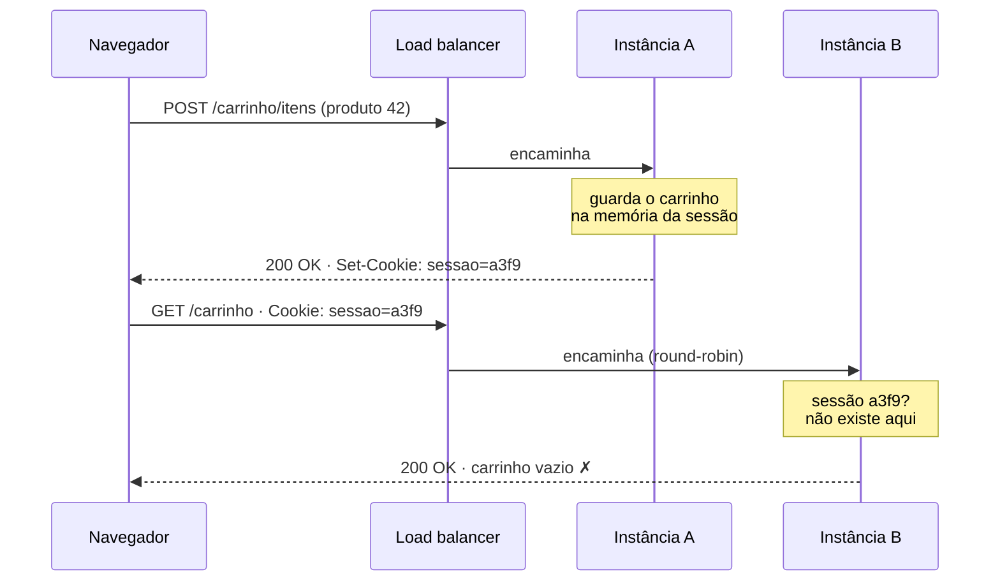
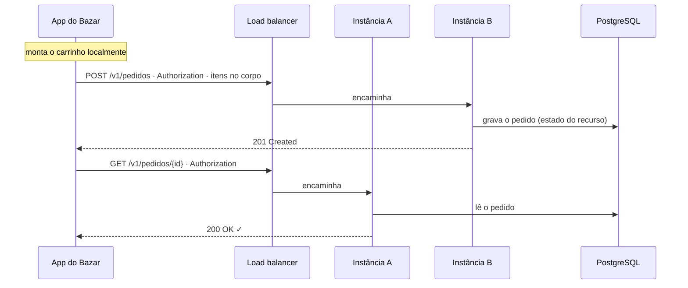
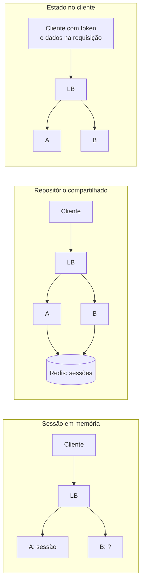

## O problema

A primeira versão do carrinho de compras de uma loja parceira guardava os itens na sessão do servidor, em memória. Funcionou perfeitamente enquanto havia uma instância da aplicação. Na Black Friday, a equipe subiu mais três instâncias atrás de um *load balancer*, e os clientes começaram a ver o carrinho esvaziar: a primeira requisição caía na instância A, que guardava o carrinho; a segunda caía na instância B, que nunca tinha ouvido falar daquele cliente. A "solução" de emergência foi configurar o balanceador para mandar cada cliente sempre para a mesma instância. Quando a instância A caiu, todos os carrinhos dela sumiram de uma vez.

Pense em duas formas de pedir comida num restaurante. Na primeira, o garçom decora seu pedido, e só ele pode atendê-lo: se ele sair para o intervalo, você começa de novo. Na segunda, você escreve o pedido numa comanda e a entrega a qualquer garçom, que lê tudo o que precisa ali. A segunda forma permite trocar garçons, contratar mais na hora do pico e sobreviver a uma falta. É exatamente a diferença entre um servidor que guarda o estado da conversa e um servidor *stateless*.

> **A pergunta desta página:** onde deve morar o estado numa API, o que são cookies e sessões, e por que APIs públicas normalmente não dependem deles?

## O conceito

### Dois tipos de estado

A palavra "estado" é usada para duas coisas bem diferentes, e a confusão entre elas está na origem da maior parte dos mal-entendidos sobre REST:

| | Estado da aplicação | Estado do recurso |
|---|---|---|
| **O que é** | Onde o cliente está na interação: em que passo do checkout, qual página da listagem, o que ele selecionou | Os dados que a API gerencia: produtos, pedidos, estoque |
| **Onde mora** | No **cliente** | No **servidor** (no banco) |
| **Exemplo no Bazar** | O carrinho montado no app antes de fechar a compra; o cursor da página atual | O pedido `BZR-2026-000123` com status `PAGO` |
| **Dura** | Enquanto o cliente precisar | Até alguém mudá-lo |

A restrição <Term id="stateless">***stateless***</Term> do REST (definida por Roy Fielding e vista com detalhes em [03.01](/rest-e-estilos-de-api/as-restricoes-de-fielding)) fala **só do estado da aplicação**: cada requisição deve conter toda a informação necessária para ser entendida, sem depender de algo que o servidor guardou de requisições anteriores daquele cliente. Ela **não** diz que o servidor não pode guardar dados. Um banco cheio de pedidos não viola nada: pedidos são estado do recurso.

O teste prático é: **qualquer instância da API consegue atender qualquer requisição, sem ter visto as anteriores?** Se sim, a API é *stateless*.

### O Bazar não tem carrinho no servidor

O Bazar aplica essa ideia de forma deliberada. Não existe um recurso "carrinho" nem uma sessão com os itens escolhidos. O app monta o carrinho localmente (estado da aplicação) e, ao finalizar, envia tudo de uma vez:

```http
POST /v1/pedidos
Content-Type: application/json
Idempotency-Key: 0192f3a1-7c4e-7b2a-9d1e-3f5a6b7c8d9e

{ "clienteId": "0192f3a0-1111-7000-8000-000000000001",
  "itens": [ { "produtoId": "0192f39f-2222-7000-8000-000000000042", "quantidade": 2 } ] }
```

A requisição é autossuficiente: qualquer instância pode atendê-la. O que o servidor guarda é o **pedido**, que é um recurso. Se o produto precisasse de um carrinho persistente (sincronizado entre celular e computador, por exemplo), o certo seria modelá-lo como um recurso de verdade, com URI própria (`/v1/clientes/{id}/carrinho`) e dados no banco, e não como um objeto escondido na memória de uma instância.

### Cookies

O HTTP é *stateless* por natureza: cada requisição é independente. Os **<Term id="cookie">cookies</Term>** (RFC 6265) foram criados nos anos 1990 para que sites pudessem "lembrar" de um navegador entre requisições. O mecanismo é simples:

1. O servidor envia o header **`Set-Cookie`** numa resposta.
2. O navegador guarda o cookie e o reenvia, no header **`Cookie`**, em toda requisição seguinte para o mesmo site.

```http
HTTP/1.1 200 OK
Set-Cookie: sessao=a3f9c2e1b7d4; Path=/; Secure; HttpOnly; SameSite=Lax; Max-Age=1800
```

```http
GET /minha-conta HTTP/1.1
Host: www.bazar.example
Cookie: sessao=a3f9c2e1b7d4
```

O `Set-Cookie` é o único header que **não pode** ser combinado numa lista separada por vírgulas (as datas do atributo `Expires` contêm vírgulas). Cada cookie vem num `Set-Cookie` próprio.

Os atributos controlam para onde e por quanto tempo o cookie é enviado, e como ele é protegido:

| Atributo | O que faz |
|---|---|
| `Domain` / `Path` | Para quais hosts e caminhos o navegador envia o cookie. Sem `Domain`, só para o host exato que o criou. |
| `Expires` / `Max-Age` | Quando o cookie expira. Sem nenhum dos dois, é um cookie de sessão do navegador, apagado quando ele fecha. |
| `Secure` | Só é enviado por HTTPS. |
| `HttpOnly` | Não pode ser lido por JavaScript (`document.cookie`). Protege contra roubo de sessão por XSS. |
| `SameSite` | Controla o envio em requisições vindas de **outros sites**: `Strict` (nunca), `Lax` (só em navegação de nível superior, como clicar num link) ou `None` (sempre; exige `Secure`). Protege contra CSRF. |

O `SameSite` não está na RFC 6265 original: ele vem da **RFC 6265bis**, a revisão da especificação de cookies, que foi aprovada e está na fila de publicação do RFC Editor (out/2026). Os navegadores já o implementam há anos. O Chrome e os demais navegadores baseados no Chromium tratam cookies sem `SameSite` como `Lax`; outros navegadores não aplicam esse padrão, então declare o atributo sempre.

<Callout type="info" title="Segurança de cookies a fundo">
  CSRF, XSS, prefixos `__Host-` e `__Secure-` e cookies particionados são assuntos da documentação de segurança 🔒. Para quem constrói APIs, o essencial é: um cookie de sessão sempre leva `Secure`, `HttpOnly` e `SameSite`.
</Callout>

### Sessão no servidor × token

Há duas formas principais de "lembrar" quem é o cliente:

<Comparison
  title="Sessão no servidor × token"
  columns={['Sessão no servidor', 'Token (ex.: JWT no Authorization)']}
  highlight={1}
  rows={[
    { label: 'O que o cliente guarda', values: ['Um identificador opaco (no cookie)', 'O token, que carrega ou referencia as informações'] },
    { label: 'O que o servidor guarda', values: ['Os dados da sessão, por cliente', 'Nada por cliente (só a chave para validar)'] },
    { label: 'Qualquer instância atende', values: ['Só com repositório compartilhado', true] },
    { label: 'Como é enviado', values: ['Automaticamente pelo navegador', 'Pelo código do cliente, a cada requisição'] },
    { label: 'Revogar na hora', values: [true, 'Difícil (expiração curta ou lista de revogação)'] },
    { label: 'Clientes que não são navegadores', values: ['Precisam gerenciar cookies', 'Natural: é só um header'] },
  ]}
  caption="Os detalhes de tokens e de autenticação ficam na documentação de segurança 🔒; o essencial para APIs está em 26.04."
/>

A distinção importante aqui não é o formato do token, e sim **onde o estado mora**. Uma sessão no servidor guardada em memória prende o cliente àquela instância. Um token que o cliente envia a cada requisição deixa cada requisição autossuficiente.

### Por que APIs públicas evitam cookies

Uma API pública do Bazar é consumida por apps móveis, pelo ERP de um lojista, por scripts em Python e por servidores de parceiros. Para esses clientes, cookies são um estorvo:

- **Nem todo cliente gerencia cookies.** Um script com `curl` ou um serviço em Go precisa de código extra para guardar e reenviar o cookie. Um header `Authorization` é só um header.
- **Cookies são enviados automaticamente pelo navegador**, inclusive em requisições disparadas por outros sites. Isso é o que torna o CSRF possível, e exige proteções extras.
- **Cookies são amarrados a domínios.** Uma API em `api.bazar.example` chamada por um front-end em `loja.parceiro.example` esbarra em regras de cookies de terceiros, que os navegadores restringem cada vez mais.
- **Sessões no servidor criam estado da aplicação no servidor**, com todos os problemas de escala vistos abaixo.

Por isso a API do Bazar autentica com um token no header `Authorization` e não cria sessão HTTP. 🔒

### Quando cookies fazem sentido

Cookies continuam sendo a melhor opção num cenário específico: um **front-end web no navegador** que conversa com um **back-end do mesmo site**. Um token guardado em `localStorage` pode ser lido por qualquer script injetado na página (XSS); um cookie `HttpOnly` não pode. Os dois arranjos mais comuns:

- **BFF (*Backend for Frontend*)**: um pequeno servidor, no mesmo domínio do front-end, guarda os tokens do usuário e se comunica com o navegador por um cookie de sessão seguro. O navegador nunca vê o token. O BFF é apresentado em [29.05](/producao-e-deploy/api-gateway-e-bff).
- **SPA no mesmo domínio da API**: `www.bazar.example` e `www.bazar.example/api` compartilham o cookie com `SameSite=Strict` ou `Lax`.

Nos dois casos, o cookie é um detalhe da **borda web**, não do contrato da API pública. A escolha entre esses arranjos é assunto da documentação de segurança 🔒.

### Sessões, *sticky sessions* e escala horizontal

Escalar **horizontalmente** é rodar várias instâncias iguais atrás de um *load balancer*, que distribui as requisições entre elas. Funciona muito bem, desde que qualquer instância possa atender qualquer requisição.

Uma sessão guardada na memória de uma instância quebra isso. As saídas são:

| Abordagem | Como funciona | Problemas |
|---|---|---|
| **<Term id="sticky-session">*Sticky sessions*</Term>** | O balanceador manda cada cliente sempre para a mesma instância (por um cookie ou pelo IP). | A carga fica desigual; quando a instância cai ou é substituída num *deploy*, as sessões dela se perdem; escalar para baixo derruba usuários. |
| **Repositório de sessão compartilhado** | As sessões ficam num Redis ou num banco, acessível a todas as instâncias (no Spring, com o Spring Session). | Mais uma dependência, uma consulta a mais por requisição. Funciona bem para aplicações web com sessão. |
| **Estado no cliente** | Cada requisição traz o que é preciso (token, dados do carrinho, cursor). | Nenhum, para APIs. É a abordagem do Bazar. |

*Sticky sessions* parecem uma solução, mas só escondem o problema até a primeira falha ou o primeiro *deploy*. Em plataformas como o Kubernetes, que substituem instâncias o tempo todo ([29.04](/producao-e-deploy/kubernetes-para-apis-probes-graceful-shutdown-e-rollouts)), elas são especialmente frágeis.

## Diagrama

A mesma sequência de duas requisições, com sessão em memória e com o estado no cliente (ou num repositório compartilhado):





E a arquitetura comparada, com as três abordagens:



## Na prática

### Vendo `Set-Cookie` com curl

O curl mostra os cookies recebidos com `-i` e pode guardá-los num arquivo (`-c`) e reenviá-los (`-b`), imitando um navegador:

```bash
# Pede uma página que cria cookies e guarda os cookies recebidos
curl -i -c cookies.txt "https://httpbin.org/cookies/set?tema=escuro"

# Reenvia os cookies guardados
curl -b cookies.txt https://httpbin.org/cookies
```

A primeira resposta traz o `Set-Cookie`:

```http noCopy
HTTP/2 302
location: /cookies
set-cookie: tema=escuro; Path=/
```

E a segunda mostra que o cookie voltou ao servidor:

```json noCopy
{
  "cookies": {
    "tema": "escuro"
  }
}
```

Sem o `-b`, a segunda requisição chegaria sem cookie nenhum: o curl, como qualquer cliente que não é navegador, não guarda estado entre execuções por conta própria. É exatamente por isso que APIs não devem depender de cookies.

### Uma sessão criada sem querer

Um erro comum em aplicações Spring é criar uma sessão HTTP sem perceber. Basta um `request.getSession()` em algum lugar, ou um componente que use o escopo de sessão, e o Tomcat passa a responder com um cookie `JSESSIONID`:

```bash
curl -i http://localhost:8080/v1/categorias
```

```http noCopy
HTTP/1.1 200
Set-Cookie: JSESSIONID=4F1C0A9B2E8D7C6B5A4F3E2D1C0B9A8F; Path=/; HttpOnly
Content-Type: application/json
```

Se você vir `JSESSIONID` numa resposta da sua API, alguma coisa está guardando estado em memória por cliente. Cada sessão ocupa memória até expirar (30 minutos por padrão no Spring Boot, `server.servlet.session.timeout`), e um cliente que não reenvia cookies cria uma sessão nova a cada requisição.

<Callout type="info" title="Spring Security e sessões">
  Com o Spring Security, a política de criação de sessões é configurada explicitamente. APIs com token usam a política `STATELESS`, que impede o Spring Security de criar ou usar a sessão HTTP. A configuração está em [26.04](/seguranca-essencial-para-apis/resource-server-com-jwt-o-essencial) e, em detalhes, na documentação de segurança 🔒.
</Callout>

## Erros comuns

<BadVsGood title="Onde guardar o carrinho" why="A sessão em memória prende o cliente a uma instância e se perde em falhas e deploys. Com o estado no cliente (ou num recurso persistido), qualquer instância atende qualquer requisição.">
<Bad title="Carrinho na sessão HTTP">

```java
@PostMapping("/carrinho/itens")
void adicionar(@RequestBody ItemRequest item, HttpSession sessao) {
    @SuppressWarnings("unchecked")
    var itens = (List<ItemRequest>) sessao.getAttribute("carrinho");
    if (itens == null) {
        itens = new ArrayList<>();
        sessao.setAttribute("carrinho", itens);
    }
    itens.add(item);   // vive só na memória desta instância
}
```

</Bad>
<Good title="Requisição autossuficiente">

```java
@PostMapping("/v1/pedidos")
ResponseEntity<PedidoResponse> criar(@RequestBody CriarPedidoRequest request) {
    // o cliente envia todos os itens; o pedido vai para o banco
    var pedido = service.criar(request);
    // ...
}
```

</Good>
</BadVsGood>

Outros erros frequentes:

- **Achar que *stateless* significa "sem banco".** O banco guarda o estado dos recursos, e isso é exatamente o que uma API faz. *Stateless* proíbe guardar no servidor o estado da **conversa** com um cliente.
- **Usar *sticky sessions* como solução definitiva.** Elas funcionam até a primeira instância cair ou ser substituída num *deploy*.
- **Cookie de sessão sem `Secure`, `HttpOnly` e `SameSite`.** Um cookie sem esses atributos pode ser enviado em HTTP puro, lido por scripts injetados ou enviado por outros sites.
- **Exigir cookies de clientes que não são navegadores.** O ERP do parceiro e o app móvel precisam de um mecanismo explícito (um header), não de um comportamento implícito do navegador.
- **Guardar dados de paginação ou filtros na sessão.** "Página seguinte" deve ser uma URI com o cursor, não "a próxima página daquela busca que eu lembro".

## Boas práticas

- **Mantenha** o estado da aplicação no cliente e o estado dos recursos no banco.
- **Faça** cada requisição autossuficiente: autenticação, filtros, cursor e dados necessários vão nela.
- **Modele** como recurso (com URI e persistência) qualquer estado que precise sobreviver entre dispositivos ou sessões.
- **Autentique** clientes de API com um header (`Authorization`), não com cookies. 🔒
- **Reserve** cookies para a borda web (BFF ou SPA no mesmo domínio), sempre com `Secure`, `HttpOnly` e `SameSite`.
- **Verifique** se a API não está criando `JSESSIONID` sem querer.
- **Evite** *sticky sessions*; se precisar de sessão, use um repositório compartilhado.

## Resumo

- **Estado da aplicação** (onde o cliente está na interação) mora no cliente; **estado do recurso** (os dados) mora no servidor. *Stateless* fala só do primeiro.
- Uma API é *stateless* quando **qualquer instância atende qualquer requisição** sem ter visto as anteriores.
- **Cookies** (RFC 6265) são enviados pelo servidor com `Set-Cookie` e devolvidos pelo navegador no header `Cookie`. `Secure`, `HttpOnly` e `SameSite` (este da RFC 6265bis) os protegem.
- APIs públicas preferem **tokens em headers**: funcionam com qualquer cliente e não guardam estado por cliente no servidor. 🔒
- Cookies fazem sentido na borda web: **BFF** e SPA no mesmo domínio.
- **Sessões em memória** quebram a escala horizontal; *sticky sessions* só adiam o problema.

<Exercise title="Encontre o estado escondido" difficulty="medio">
Uma API de um lojista parceiro tem os endpoints abaixo. Para cada um, diga se ele depende de estado da aplicação guardado no servidor e, se depender, proponha um redesenho *stateless*.

1. `POST /busca` com os filtros no corpo, seguido de `GET /busca/proxima-pagina` para buscar a página seguinte.
2. `POST /checkout/endereco`, depois `POST /checkout/pagamento`, depois `POST /checkout/confirmar`, com os dados de cada passo guardados na sessão.
3. `GET /produtos/{id}`, que grava num contador quantas vezes o produto foi visto.
4. `POST /login`, que cria uma sessão, seguido de chamadas que dependem do cookie `JSESSIONID`.

<Hint>
Use o teste da página: se a segunda requisição cair numa instância nova, que nunca viu a primeira, ela funciona? E lembre que guardar dados de **recursos** no banco não viola o *stateless*.
</Hint>

<Solution>

1. **Depende de estado.** `GET /busca/proxima-pagina` só funciona se a instância lembrar da busca anterior. Redesenho: a resposta da busca traz um cursor, e a próxima página é `GET /produtos?categoria=livros&cursor=eyJ...` (ou um `Link: <...>; rel="next"`), uma URI autossuficiente.
2. **Depende de estado.** Cada passo guarda dados na sessão. Redesenho: o app guarda os dados dos passos localmente e envia tudo em `POST /v1/pedidos`. Se o checkout precisar ser retomado em outro dispositivo, ele vira um recurso de verdade (`POST /v1/checkouts` cria um rascunho com URI própria, persistido no banco, e os passos são `PATCH` nesse recurso).
3. **Não depende.** O contador é estado de um recurso, gravado no banco, e não muda o significado da requisição. Qualquer instância atende o `GET`. O `GET` continua seguro, porque o cliente não pediu a mudança (como visto em 02.02).
4. **Depende de estado**, se a sessão ficar na memória da instância. Redesenho: o cliente obtém um token e o envia no header `Authorization` em cada requisição, e a API não cria sessão HTTP. Se for um front-end web, um BFF pode manter o cookie de sessão com um repositório compartilhado. Os detalhes estão na documentação de segurança 🔒.

</Solution>
</Exercise>

<Quiz
  questions={[
    {
      question: 'A API do Bazar guarda milhões de pedidos no PostgreSQL. Isso viola a restrição stateless do REST?',
      options: [
        'Sim: uma API stateless não pode guardar dados',
        'Não: pedidos são estado do recurso; stateless proíbe guardar no servidor o estado da conversa com cada cliente',
        'Só se os pedidos forem consultados com GET',
      ],
      answer: 1,
      explanation: 'Stateless fala do estado da aplicação: cada requisição precisa ser autossuficiente. Persistir recursos é o papel de qualquer API. O método usado para consultar não muda nada.',
    },
    {
      question: 'Uma API com sessão em memória funciona com uma instância e falha com três. Por que sticky sessions não são uma boa solução definitiva?',
      options: [
        'Porque elas exigem HTTPS',
        'Porque elas impedem o uso de cookies',
        'Porque, quando a instância cai ou é substituída num deploy, as sessões dela se perdem, e a carga fica desigual',
      ],
      answer: 2,
      explanation: 'Sticky sessions prendem cada cliente a uma instância. A falha dessa instância (ou um deploy, ou uma redução de escala) leva as sessões junto. Elas não exigem HTTPS e normalmente usam um cookie justamente para fixar a instância.',
    },
    {
      question: 'Qual atributo impede que um cookie seja lido por JavaScript na página?',
      options: ['HttpOnly', 'Secure', 'SameSite=Strict'],
      answer: 0,
      explanation: 'HttpOnly esconde o cookie de document.cookie, protegendo contra roubo por XSS. Secure só impede o envio por HTTP sem criptografia, e SameSite controla o envio em requisições vindas de outros sites.',
    },
  ]}
/>

## Referências

<References />
