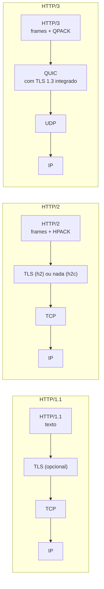

## O problema

A tela inicial do app do Bazar faz 14 chamadas à API: categorias, destaques, banners, recomendações, contagem do carrinho, notificações. Num teste em 4G, a tela demorava quase três segundos para aparecer, embora cada endpoint respondesse em menos de 50 ms no servidor. A primeira ideia da equipe foi criar um endpoint `/tela-inicial` que agregasse tudo numa resposta só.

Antes disso, alguém olhou o painel *Network* do navegador e percebeu que as requisições saíam em fila, poucas de cada vez, cada uma esperando a anterior terminar na mesma conexão. O cliente falava HTTP/1.1. Habilitar HTTP/2 no balanceador reduziu o tempo para menos de um segundo, sem mudar uma linha da API.

Pense numa estrada de pista única com um pedágio. No HTTP/1.1, cada carro (requisição) precisa passar inteiro antes do próximo, e para andar mais rápido você abre mais estradas paralelas (conexões), cada uma com seu próprio pedágio a pagar (o *handshake*). No HTTP/2, a estrada vira uma rodovia de várias faixas: muitos carros andam ao mesmo tempo na mesma estrada, depois de pagar o pedágio uma vez só. O HTTP/3 troca até o asfalto, para que um buraco numa faixa não pare todas as outras.

> **A pergunta desta página:** o que muda entre HTTP/1.1, HTTP/2 e HTTP/3, como isso afeta a latência e o design de uma API, e como habilitar HTTP/2 no Spring Boot?

## O conceito

Como visto em [02.01](/comecando-e-fundamentos-de-http/anatomia-de-uma-mensagem-http), as três versões têm a **mesma semântica** (métodos, status e headers da RFC 9110) e diferem na **forma de transportar** as mensagens. Tudo o que você aprendeu nas páginas anteriores vale para as três. O que muda é o desempenho, o custo das conexões e alguns detalhes operacionais.

### HTTP/1.1 (RFC 9112)

O HTTP/1.1 envia mensagens como texto sobre uma conexão TCP. Três características definem seu desempenho:

- **Conexões persistentes (*keep-alive*).** Uma conexão TCP (e o *handshake* TLS, em HTTPS) custa idas e voltas na rede antes de transmitir qualquer byte da requisição. O HTTP/1.1 mantém a conexão aberta depois da resposta e a reutiliza para as próximas requisições, em vez de abrir uma nova para cada uma. É o comportamento padrão; o header `Connection: close` pede o encerramento.
- **Uma requisição por vez em cada conexão.** Numa conexão, o cliente envia uma requisição e espera a resposta completa antes de enviar a próxima. O ***pipelining*** (enviar várias requisições seguidas sem esperar) existe na especificação, mas as respostas precisam voltar **na mesma ordem**. Problemas de implementação em servidores e *proxies* fizeram os navegadores desligá-lo: na prática, está morto.
- **Bloqueio *head-of-line*.** Como as respostas saem em ordem, uma resposta lenta trava todas as que vêm atrás dela na mesma conexão. Esse problema tem nome: <Term id="head-of-line-blocking">bloqueio *head-of-line*</Term> (HOL).

Para contornar isso, os navegadores abrem **várias conexões paralelas** por host, normalmente até seis. Com 14 requisições e 6 conexões, as requisições saem em "ondas", e cada conexão nova paga o custo do *handshake*. Gerações de técnicas de otimização web (juntar arquivos, *sprites*, espalhar recursos por vários domínios) existiram só para driblar esse limite.

### HTTP/2 (RFC 9113)

O HTTP/2 mantém a semântica e muda o transporte:

- **Frames binários.** Cada mensagem é dividida em *frames* (de headers e de dados), em vez de texto delimitado por linhas. *Parsing* binário é mais simples e mais seguro que interpretar texto.
- **Multiplexação em *streams*.** Uma única conexão TCP carrega muitas trocas ao mesmo tempo. Cada par requisição/resposta é um ***stream*** numerado, e os *frames* de *streams* diferentes se intercalam livremente. Uma resposta lenta não bloqueia as outras: elas vão chegando conforme ficam prontas. Essa <Term id="multiplexacao">multiplexação</Term> elimina a necessidade de várias conexões.
- **Compressão de headers (HPACK, RFC 7541).** Numa API, muitos headers se repetem em toda requisição (`Authorization`, `Accept`, `User-Agent`, `Host`). O HPACK mantém uma tabela dos headers já enviados na conexão e manda só referências a eles. Um token `Authorization` de 1 KB é enviado por inteiro uma vez e depois custa poucos bytes.
- **Nomes de headers em minúsculas**, e a linha de requisição vira pseudo-headers (`:method`, `:path`, `:scheme`, `:authority`). É por isso que o curl mostra `content-type` ao falar HTTP/2.

O ***server push*** (o servidor enviar recursos que o cliente ainda não pediu) também fazia parte do HTTP/2, mas os navegadores o abandonaram por trazer pouco ganho real. Não conte com ele.

#### h2 × h2c

O HTTP/2 tem duas formas de começar:

| Variante | Transporte | Como é negociado | Onde é usado |
|---|---|---|---|
| **h2** | Sobre TLS | Pelo ALPN, uma extensão do *handshake* TLS em que cliente e servidor combinam o protocolo | Navegadores (que **só** aceitam HTTP/2 com TLS) e a internet em geral |
| **h2c** | TCP sem criptografia (*cleartext*) | Por conhecimento prévio (o cliente já sabe que o servidor fala HTTP/2) | Tráfego interno, entre um *load balancer* e a API, ou entre serviços numa rede confiável |

O HTTP/2 resolveu o bloqueio *head-of-line* na camada HTTP, mas não na camada TCP. O TCP entrega bytes estritamente em ordem: se um pacote se perde, todos os *streams* da conexão esperam a retransmissão, mesmo os que não tinham dados naquele pacote. Em redes com perda de pacotes (o 4G do cliente no metrô), uma conexão HTTP/2 pode até ficar pior que várias conexões HTTP/1.1.

### HTTP/3 (RFC 9114)

O HTTP/3 ataca exatamente esse último problema, trocando o transporte: em vez de TCP, ele usa o **<Term id="quic">QUIC</Term>** (RFC 9000), um protocolo que roda sobre **UDP** e já integra o TLS 1.3.

- **Sem bloqueio *head-of-line* no transporte.** O QUIC conhece os *streams*: um pacote perdido atrasa só o *stream* a que pertence.
- ***Handshake* mais curto.** Transporte e criptografia são negociados juntos, numa única ida e volta (o TCP + TLS precisa de pelo menos duas).
- **Migração de conexão.** A conexão QUIC é identificada por um id, não pelo par IP/porta. Quando o celular troca do Wi-Fi para o 4G, a conexão continua.
- **QPACK** (RFC 9204) substitui o HPACK, adaptado à entrega fora de ordem.

Como o cliente descobre que o servidor fala HTTP/3? O servidor anuncia na resposta HTTP/1.1 ou HTTP/2, com o header **`Alt-Svc`** (RFC 7838): `alt-svc: h3=":443"; ma=86400` ("também falo HTTP/3 na porta 443; lembre disso por um dia"). Nas próximas conexões, o cliente tenta o HTTP/3 e volta ao TCP se o UDP estiver bloqueado.

#### 0-RTT e o risco de *replay*

Ao reconectar a um servidor conhecido, o QUIC (assim como o TLS 1.3 sobre TCP) permite enviar dados **junto com o primeiro pacote**, sem esperar o *handshake* terminar: é o **0-RTT** (zero idas e voltas). O ganho de latência é real, mas há um custo: esses dados iniciais podem ser **capturados e reenviados** por um atacante (*replay*), e o servidor não tem como distinguir a cópia do original.

A consequência para APIs é direta e conecta com [02.02](/comecando-e-fundamentos-de-http/metodos-http-semantica-seguranca-e-idempotencia): só requisições **seguras e idempotentes** deveriam ser aceitas em 0-RTT. Um `POST /v1/pedidos` reenviado criaria outro pedido. A RFC 8470 define como o intermediário avisa o servidor que a requisição chegou em 0-RTT (o header `Early-Data: 1`) e o status **`425 Too Early`**, com o qual o servidor pede que o cliente repita a requisição depois do *handshake* completo. CDNs que oferecem 0-RTT normalmente só o aceitam para `GET` e `HEAD`.

### TLS em visão geral

Nas três versões, o TLS garante **confidencialidade** (ninguém no caminho lê a mensagem), **integridade** (ninguém a altera) e **autenticidade do servidor** (o certificado prova que você está falando com `api.bazar.example`). Na prática, HTTPS é obrigatório para qualquer API exposta: o HTTP/2 nos navegadores e o HTTP/3 sempre exigem TLS. Certificados, versões do TLS e mTLS entre serviços são tratados em [26.05](/seguranca-essencial-para-apis/transporte-segredos-headers-de-seguranca-e-ssrf) e na documentação de segurança 🔒.

### Onde cada versão termina

Raramente o cliente fala diretamente com a sua aplicação Spring. Entre os dois há uma **borda**: um CDN, um *load balancer* ou um gateway, onde o TLS normalmente é terminado. Cada salto pode usar uma versão diferente:

| Salto | Versão típica |
|---|---|
| App ou navegador → CDN / *load balancer* | HTTP/3 ou HTTP/2 (com TLS) |
| *Load balancer* → API do Bazar | HTTP/1.1 ou h2c (rede interna), às vezes HTTP/2 com TLS |
| API do Bazar → PagaFácil, FreteJá | HTTP/2 ou HTTP/1.1, conforme o cliente HTTP e o servidor |

O **HTTP/3 quase sempre termina na borda**. O Tomcat, servidor embutido padrão do Spring Boot, não implementa HTTP/3, e não há necessidade: o QUIC brilha na "última milha" até o cliente, com redes móveis instáveis, e não dentro do *data center*. Habilitar HTTP/3 normalmente é uma configuração do CDN ou do *load balancer*, não da aplicação.

### O que isso muda no design de APIs

Com HTTP/2 ou HTTP/3 entre o cliente e a borda, fazer várias requisições pequenas custa muito menos do que no HTTP/1.1: não há fila por conexão, os headers repetidos são comprimidos e não há *handshake* novo. Isso enfraquece um argumento antigo para criar **endpoints agregadores** (como o `/tela-inicial` do início da página) ou ***batch endpoints***: o ganho de latência que eles traziam diminuiu muito.

Mas o custo de cada requisição **no servidor** continua existindo: autenticação, consultas ao banco, logs, métricas. Endpoints agregadores e operações em lote ainda fazem sentido quando:

- o cliente precisa de **consistência** entre os dados (todos lidos no mesmo instante, ou gravados todos ou nenhum);
- o número de itens é grande (500 ajustes de estoque, como em [14.04](/design-de-apis-profissional/operacoes-em-lote));
- a tela precisa de dados de vários serviços e a composição deve ficar fora do app, papel de um BFF ([29.05](/producao-e-deploy/api-gateway-e-bff)).

A regra prática: **não crie um endpoint agregador só por latência antes de medir com HTTP/2 habilitado.**

## Diagrama

A diferença de comportamento, com quatro requisições e uma delas lenta:

```mermaid title="HTTP/1.1 (uma por vez por conexão) × HTTP/2 (multiplexado)"
sequenceDiagram
    participant C as App
    participant S as API do Bazar
    Note over C,S: HTTP/1.1: uma conexão, uma requisição por vez
    C->>S: GET /v1/categorias
    S-->>C: 200 (rápida)
    C->>S: GET /v1/produtos?destaque=true
    Note over S: resposta lenta (800 ms)
    S-->>C: 200 (lenta)
    C->>S: GET /v1/clientes/{id}
    S-->>C: 200 (esperou a lenta)
    C->>S: GET /v1/pedidos?clienteId=...
    S-->>C: 200 (esperou as duas)
    Note over C,S: HTTP/2: uma conexão, quatro streams em paralelo
    par stream 1
        C->>S: GET /v1/categorias
    and stream 3
        C->>S: GET /v1/produtos?destaque=true
    and stream 5
        C->>S: GET /v1/clientes/{id}
    and stream 7
        C->>S: GET /v1/pedidos?clienteId=...
    end
    S-->>C: stream 1: 200
    S-->>C: stream 5: 200
    S-->>C: stream 7: 200
    S-->>C: stream 3: 200 (a lenta não bloqueou ninguém)
```

Os números ímpares dos *streams* não são acaso: no HTTP/2, *streams* iniciados pelo cliente sempre têm id ímpar.

As pilhas de protocolos das três versões:



## Na prática

### Vendo a versão negociada com curl

```bash
curl -sv --http2 -o /dev/null https://api.github.com 2>&1 | grep -E 'ALPN|using HTTP|^< HTTP'
```

```text noCopy
* ALPN: curl offers h2,http/1.1        ← o cliente oferece HTTP/2 e HTTP/1.1 no handshake TLS
* ALPN: server accepted h2             ← o servidor escolheu HTTP/2
* using HTTP/2
< HTTP/2 200                           ← linha de status no formato HTTP/2 (sem frase de motivo)
```

O `--http2` pede HTTP/2 e volta ao HTTP/1.1 se o servidor não suportar. Em HTTPS, versões recentes do curl já tentam HTTP/2 por padrão.

Para HTTP/3, o curl precisa ter sido compilado com suporte a QUIC, o que nem todas as distribuições fazem:

```bash
curl -sv --http3 -o /dev/null https://www.cloudflare.com 2>&1 | grep -E 'HTTP/3|^< HTTP'
```

Se o seu curl não suportar, a resposta é:

```text noCopy
curl: option --http3: the installed libcurl version doesn't support this
```

Mesmo sem HTTP/3, você vê o anúncio do servidor no header `Alt-Svc`:

```bash
curl -sI https://www.cloudflare.com | grep -i alt-svc
```

```text noCopy
alt-svc: h3=":443"; ma=86400
```

No navegador, a aba *Network* do DevTools tem uma coluna *Protocol* (clique com o botão direito nos títulos das colunas para exibi-la), que mostra `http/1.1`, `h2` ou `h3` para cada requisição.

### Habilitando HTTP/2 no Spring Boot

Uma única propriedade liga o HTTP/2 no servidor embutido:

```yaml title="src/main/resources/application.yml"
server:
  http2:
    enabled: true
```

O efeito depende de haver TLS configurado na aplicação:

- **Com TLS** (`server.ssl.*` ou um *SSL bundle*), o Tomcat passa a oferecer **h2** no ALPN, e navegadores e clientes negociam HTTP/2 automaticamente.
- **Sem TLS**, o Tomcat aceita **h2c**, por conhecimento prévio ou pelo mecanismo de *upgrade* do HTTP/1.1. Esse é o caso típico quando o TLS termina no *load balancer* e o tráfego interno vai em texto claro.

Com a aplicação rodando localmente sem TLS, teste o h2c com conhecimento prévio:

```bash
curl -sv --http2-prior-knowledge -o /dev/null http://localhost:8080/v1/categorias 2>&1 | grep -E 'HTTP/2|^< HTTP'
```

```text noCopy
* [HTTP/2] [1] OPENED stream for http://localhost:8080/v1/categorias
< HTTP/2 200
```

O `[1]` é o id do *stream*: o primeiro iniciado pelo cliente.

<Callout type="info" title="Visto em detalhes adiante">
  A aplicação do Bazar é criada em [05.02](/construindo-apis-com-spring-boot/criando-o-projeto-bazar) e o endpoint de categorias em [05.04](/construindo-apis-com-spring-boot/um-crud-com-status-corretos). Volte a este teste quando chegar lá. Se o TLS terminar no balanceador, também é preciso configurar como a aplicação lê os headers `Forwarded`/`X-Forwarded-*`, assunto de [26.05](/seguranca-essencial-para-apis/transporte-segredos-headers-de-seguranca-e-ssrf).
</Callout>

### HTTP/2 nas chamadas que a API faz

O mesmo raciocínio vale quando a API do Bazar é o cliente, ao chamar a PagaFácil ou a FreteJá. O `HttpClient` do JDK, que o `RestClient` do Spring pode usar por baixo, tenta HTTP/2 por padrão e reutiliza a conexão para várias chamadas simultâneas. A configuração dos clientes HTTP é o assunto da Parte 10 ([24.02](/consumindo-outras-apis/restclient-a-fundo)).

## Erros comuns

<BadVsGood title="Lentidão na tela inicial" why="Um endpoint agregador acopla a API a uma tela específica e cresce sem controle. Com HTTP/2, várias requisições pequenas compartilham uma conexão sem fila. Meça antes de agregar; agregue por consistência ou composição, não por um gargalo de protocolo.">
<Bad title="Agregar tudo por causa da latência">

```http
GET /v1/tela-inicial
```

Um endpoint que devolve categorias, destaques, banners e notificações juntos, criado para contornar a fila do HTTP/1.1.

</Bad>
<Good title="HTTP/2 na borda e recursos independentes">

```http
GET /v1/categorias
GET /v1/produtos?destaque=true
GET /v1/pedidos?clienteId=...
```

Todas em paralelo na mesma conexão HTTP/2. Se a composição ainda for necessária, ela fica num BFF, não na API pública.

</Good>
</BadVsGood>

Outros erros frequentes:

- **Aceitar `POST` em 0-RTT.** Um intermediário que aceita *early data* para qualquer método abre a porta para requisições repetidas por *replay*. Restrinja o 0-RTT a métodos seguros, ou responda `425 Too Early`.
- **Esperar HTTP/2 do navegador sem TLS.** Navegadores só falam HTTP/2 sobre TLS (h2). Em `http://localhost`, o navegador vai usar HTTP/1.1 mesmo com `server.http2.enabled=true`; o h2c só funciona com clientes como o curl.
- **Tentar habilitar HTTP/3 na aplicação Spring.** O lugar do HTTP/3 é a borda (CDN, *load balancer*). A aplicação continua falando HTTP/1.1 ou HTTP/2 com a borda.
- **Contar com *server push*.** Os navegadores o removeram. Para o servidor avisar o cliente de algo, use SSE ([19.04](/concorrencia-e-execucao-assincrona/server-sent-events-e-uma-visao-de-websocket)) ou webhooks ([21.03](/padroes-avancados-de-http/webhooks-enviando-e-recebendo)).
- **Comparar versões sem medir na rede real.** Num teste local, sem perda de pacotes nem latência, as diferenças quase desaparecem. Meça com latência e perda simuladas, ou em dispositivos reais.

## Boas práticas

- **Habilite** HTTP/2 (e HTTP/3, se disponível) na borda que fala com os clientes.
- **Use** h2c ou HTTP/1.1 com *keep-alive* entre o *load balancer* e a API, conforme o suporte da sua infraestrutura.
- **Ative** `server.http2.enabled=true` quando a aplicação terminar TLS ou receber h2c da borda.
- **Restrinja** o 0-RTT a requisições seguras e idempotentes.
- **Meça** com HTTP/2 habilitado antes de criar endpoints agregadores por latência.
- **Reutilize** conexões nos clientes HTTP da sua API (um único cliente configurado, não um por chamada).

## Resumo

- As três versões têm a **mesma semântica**; muda o transporte.
- **HTTP/1.1**: texto, conexões persistentes, uma requisição por vez por conexão, bloqueio *head-of-line*; navegadores abrem cerca de seis conexões por host. *Pipelining* está morto.
- **HTTP/2**: *frames* binários, **multiplexação** de *streams* numa única conexão, compressão de headers com HPACK. **h2** (com TLS, navegadores) × **h2c** (sem TLS, tráfego interno). O bloqueio *head-of-line* persiste no TCP.
- **HTTP/3**: QUIC sobre UDP, TLS 1.3 integrado, sem bloqueio no transporte, migração de conexão. Anunciado por `Alt-Svc`. O **0-RTT** pode sofrer *replay*: só para requisições seguras (`425 Too Early`).
- No Spring Boot, `server.http2.enabled=true` liga h2 (com TLS) ou h2c (sem). O HTTP/3 termina na borda.
- Com HTTP/2, endpoints agregadores perdem o argumento de latência; continuam úteis por consistência, volume ou composição.

<Exercise title="Investigue a versão do HTTP" difficulty="facil">
1. Escolha três sites ou APIs públicas que você usa (por exemplo, `api.github.com`, `www.google.com` e o site da sua empresa). Para cada um, descubra com `curl -sv` qual versão do HTTP foi negociada e se o servidor anuncia HTTP/3 no `Alt-Svc`.
2. Abra o DevTools do navegador num desses sites, exiba a coluna *Protocol* e recarregue a página. Há requisições em versões diferentes na mesma página? Por quê?
3. Explique por que uma requisição `POST /v1/pedidos` não deveria ser enviada em 0-RTT, mesmo que isso economize uma ida e volta.

<Hint>
No `curl -sv`, procure as linhas `ALPN` e `using HTTP`. Para o `Alt-Svc`, `curl -sI` mostra só os headers da resposta. Na pergunta 2, pense em quem serve cada recurso da página: o próprio site, CDNs, serviços de terceiros.
</Hint>

<Solution>

1. Um roteiro para cada host:

```bash
for host in api.github.com www.google.com www.cloudflare.com; do
  echo "== $host"
  curl -sv -o /dev/null "https://$host" 2>&1 | grep -E 'ALPN: server accepted|using HTTP'
  curl -sI "https://$host" | grep -i '^alt-svc' || echo "(sem Alt-Svc)"
done
```

Em out/2026, os três negociam HTTP/2; Google e Cloudflare anunciam `h3` no `Alt-Svc`, e a API do GitHub não anuncia.

2. Sim, é comum ver `h3`, `h2` e às vezes `http/1.1` na mesma página. Cada requisição vai a um host (o próprio site, um CDN de imagens, um serviço de análise), e cada host tem sua própria borda e suporte. Além disso, a primeira visita a um host costuma usar `h2`: o navegador só passa a tentar `h3` depois de ver o `Alt-Svc`.

3. Dados enviados em 0-RTT podem ser capturados e reenviados por um atacante, e o servidor não consegue distinguir a cópia. Como o `POST` não é idempotente, cada cópia poderia criar um pedido (e uma cobrança). Para requisições assim, o servidor deve recusar o 0-RTT com `425 Too Early`, e o cliente repete depois do *handshake* completo. Mesmo com `Idempotency-Key`, é melhor não depender disso numa camada que o servidor nem sempre controla.

</Solution>
</Exercise>

<Quiz
  questions={[
    {
      question: 'Com HTTP/2, uma resposta lenta deixa de travar as outras requisições da mesma conexão. Por quê?',
      options: [
        'Porque o HTTP/2 usa UDP em vez de TCP',
        'Porque cada troca é um stream, e os frames de streams diferentes se intercalam na conexão',
        'Porque o HTTP/2 abre uma conexão nova para cada requisição lenta',
      ],
      answer: 1,
      explanation: 'A multiplexação permite que as respostas cheguem conforme ficam prontas. O HTTP/2 continua sobre TCP (quem usa UDP é o HTTP/3, via QUIC), e a vantagem é justamente usar uma única conexão.',
    },
    {
      question: 'Por que o HTTP/3 normalmente não é habilitado na aplicação Spring Boot?',
      options: [
        'Porque o HTTP/3 muda a semântica dos métodos HTTP',
        'Porque ele só funciona com GraphQL',
        'Porque o ganho do QUIC está na última milha até o cliente, e o HTTP/3 costuma terminar no CDN ou no load balancer; o Tomcat embutido nem o implementa',
      ],
      answer: 2,
      explanation: 'A semântica é a mesma nas três versões. O HTTP/3 resolve problemas de redes instáveis entre o cliente e a borda; dentro do data center, HTTP/1.1 ou HTTP/2 bastam. Não há relação com GraphQL.',
    },
    {
      question: 'Uma CDN aceita requisições em 0-RTT. Qual é o cuidado necessário?',
      options: [
        'Aceitar 0-RTT só para requisições seguras e idempotentes, porque esses dados podem ser reenviados por replay',
        'Nenhum: o TLS 1.3 impede qualquer replay',
        'Desligar o HTTP/2 para evitar conflito',
      ],
      answer: 0,
      explanation: 'O 0-RTT troca segurança contra replay por latência. Repetir um GET não causa dano; repetir um POST pode duplicar pedidos. O TLS 1.3 não impede o replay dos dados de 0-RTT, e o HTTP/2 não tem relação com isso.',
    },
  ]}
/>

## Referências

<References />
