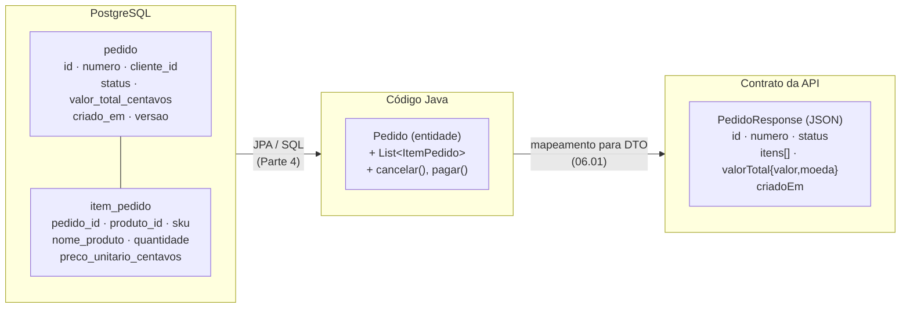
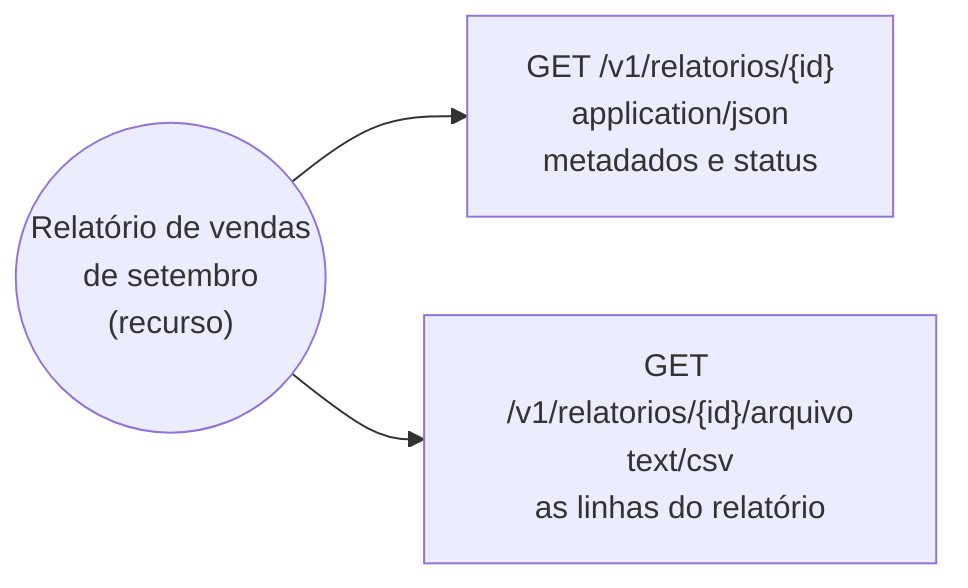

## O problema

A primeira versão da API de pedidos de um sistema legado que o Bazar integrou tinha estes endpoints:

```http
POST /api/pedido/inserir
POST /api/pedido/atualizarStatus
GET  /api/tb_pedido_item?fk_pedido=123
POST /api/pedido/calcularFrete
```

Cada endpoint espelhava alguma coisa do código: um método do `PedidoService`, uma tabela do banco (`tb_pedido_item`), uma coluna (`fk_pedido`). O resultado foi uma API que mudava toda vez que o código mudava. Quando a tabela de itens foi renomeada, os clientes quebraram. Quando o cálculo de frete passou a considerar o CEP, foi preciso criar `calcularFrete2`. E ninguém sabia dizer se `atualizarStatus` para `CANCELADO` era permitido depois do envio.

O erro de base foi desenhar a API a partir da implementação. Pense numa biblioteca pública. O leitor pede "o livro *Clean Code*". Ele não sabe (nem quer saber) em que estante o livro está, se há três exemplares ou se o catálogo é uma planilha ou um sistema. O "livro" é um conceito estável; a forma de guardar é detalhe interno, que a biblioteca pode reorganizar quando quiser. O que o leitor recebe é um exemplar: uma cópia física daquele conceito.

> **A pergunta desta página:** o que é exatamente um recurso, como ele se relaciona com as representações e com o seu código, e como pensar em recursos em vez de tabelas e métodos?

## O conceito

### Recurso: qualquer coisa que mereça um nome

Fielding define um <Term id="recurso">recurso</Term> como **qualquer informação que possa ser nomeada**: um documento, uma imagem, um serviço temporal ("o tempo agora em São Paulo"), uma coleção de outros recursos, uma pessoa. A RFC 9110 é ainda mais ampla: um recurso é o alvo de uma requisição HTTP, seja ele qual for.

O ponto sutil da definição de Fielding é que um recurso é um **mapeamento conceitual**, não um dado específico. O recurso "os pedidos pagos do cliente Ana" (`/v1/pedidos?clienteId=...&status=PAGO`) existe hoje com três pedidos, amanhã com quatro, e é o **mesmo recurso**: o que muda é o seu estado. O recurso "a última versão do contrato OpenAPI" aponta para documentos diferentes ao longo do tempo. O que precisa ser estável é o **significado** do recurso, não o seu conteúdo.

### URI: o identificador

Cada recurso tem um identificador, e no HTTP esse identificador é a <Term id="uri">URI</Term>. A URI **identifica** o recurso; ela não descreve como ele é implementado.

- `/v1/pedidos/0192f3a1-9999-7000-8000-000000000123` identifica um pedido específico.
- `/v1/pedidos` identifica a coleção de pedidos.
- `/v1/produtos/0192f39f-2222-7000-8000-000000000042/estoque` identifica o estoque de um produto.

Uma boa URI continua significando a mesma coisa enquanto o recurso existir, mesmo que o banco, as classes e as tabelas mudem. É por isso que URIs como `/api/tb_pedido_item?fk_pedido=123` envelhecem mal: elas carregam detalhes de implementação que vão mudar. As convenções para desenhar URIs estão em [12.01](/design-de-apis-profissional/modelando-recursos-a-partir-do-dominio) e [12.02](/design-de-apis-profissional/convencoes-de-nomenclatura).

### Representação: a "foto" do estado

O cliente nunca recebe o recurso em si. Ele recebe uma <Term id="representacao">representação</Term>: uma sequência de bytes que retrata o **estado do recurso num momento**, num formato concreto, mais os metadados que descrevem esses bytes (`Content-Type`, `Content-Language`, `ETag`).

A analogia da fotografia funciona bem:

- uma foto mostra a pessoa num instante; amanhã ela pode estar diferente;
- a mesma pessoa pode ser fotografada de vários ângulos, em cores ou em preto e branco;
- rasgar a foto não machuca a pessoa.

Do mesmo jeito, um JSON de pedido mostra o pedido no instante da resposta; o mesmo pedido pode ser representado em JSON, em CSV ou num PDF de nota; e o cliente alterar o JSON que recebeu não muda nada no servidor. Para mudar o recurso, o cliente **envia uma representação** do estado desejado (num `PUT`, num `PATCH`) e o servidor decide como aplicá-la. É a restrição "manipulação por representações" vista em [03.01](/rest-e-estilos-de-api/as-restricoes-de-fielding).

### Um recurso, várias representações

| Recurso | Representação | Para quem |
|---|---|---|
| Pedido `BZR-2026-000123` | `application/json` completo | App e parceiros |
| Pedido `BZR-2026-000123` | `application/pdf` (comprovante) | Cliente final que quer imprimir |
| Relatório de vendas de setembro | `text/csv` | Planilha do time de dados |
| Relatório de vendas de setembro | `application/json` (metadados: período, status, totais) | Painel administrativo |
| Imagem do produto | `image/webp` ou `image/jpeg` | Navegadores com e sem suporte a WebP |

A escolha entre as representações é feita pela negociação de conteúdo, vista em [02.05](/comecando-e-fundamentos-de-http/content-negotiation-e-media-types). No Bazar, os metadados do relatório e o arquivo têm URIs separadas (`/v1/relatorios/{id}` e `/v1/relatorios/{id}/arquivo`), porque são coisas diferentes para o cliente: o primeiro diz se o relatório está pronto, o segundo é o conteúdo. Separar ou não é uma decisão de design: se duas "representações" têm significados diferentes, elas provavelmente são recursos diferentes.

### Três camadas desacopladas

O mesmo pedido existe em três formas no Bazar, cada uma com um dono e um motivo para mudar:

| Camada | Forma | Quem muda | Por quê |
|---|---|---|---|
| Banco de dados | Linhas nas tabelas `pedido` e `item_pedido` | A equipe, com *migrations* | Desempenho, normalização, novos índices |
| Código Java | Objeto `Pedido` com uma lista de `ItemPedido` e regras de transição | A equipe, a cada refatoração | Clareza do domínio, novas regras |
| Contrato da API | Representação JSON de `PedidoResponse` | **Só com cuidado**, porque clientes dependem dela | Necessidade dos consumidores |

As duas primeiras camadas são internas: você pode mudá-las quando quiser. A terceira é um **contrato público**: mudar o nome de um campo quebra o app de quem já está em produção. Manter as três desacopladas é o que permite evoluir o código sem quebrar clientes. Na prática, isso significa nunca expor a entidade JPA diretamente na API e usar objetos próprios para entrada e saída, os <Term id="dto">DTOs</Term>, assunto de [06.01](/construindo-apis-com-spring-boot/dtos-com-records-e-por-que-nao-expor-entidades).

### Recursos não são tabelas

O erro mais comum de quem começa é criar um recurso por tabela e um endpoint por operação de banco. Mas os recursos de uma boa API vêm do **domínio**, do que os clientes precisam manipular, e muitos deles não correspondem a tabela nenhuma:

**Recursos agregados.** O pedido do Bazar é gravado em duas tabelas (`pedido` e `item_pedido`), mas para o cliente ele é **um** recurso: ninguém cria um item de pedido solto. A representação do pedido traz os itens embutidos, e não existe `/v1/itens-pedido`.

**Recursos de processo.** Cancelar um pedido não é "atualizar a coluna `status`": é uma ação com regras (só antes do envio), motivo, data e talvez um reembolso. O Bazar modela isso como um recurso: `POST /v1/pedidos/{id}/cancelamento` cria um cancelamento. O mesmo vale para um reembolso (`POST /v1/pagamentos/{id}/reembolsos`) e para uma operação longa (`/v1/operacoes/{id}`). Transformar uma ação em recurso dá a ela uma URI, um corpo, erros próprios e um histórico. As técnicas estão em [12.04](/design-de-apis-profissional/acoes-que-nao-sao-crud-e-maquinas-de-estado).

**Recursos calculados.** Uma cotação de frete não está guardada em lugar nenhum antes de ser pedida: a API a calcula consultando a FreteJá. Mesmo assim, é um recurso: `POST /v1/fretes/cotacoes` com o CEP e os itens devolve uma cotação com opções, prazos e valores. Outros exemplos: o saldo de estoque disponível (calculado a partir do saldo e das reservas) e um relatório.

**Visões diferentes do mesmo dado.** "Os pedidos de um cliente" e "os pedidos pagos esta semana" são recursos diferentes sobre as mesmas linhas da tabela.

| Pensando em tabelas | Pensando em recursos |
|---|---|
| `POST /api/tb_pedido` + `POST /api/tb_pedido_item` (um por item) | `POST /v1/pedidos` com os itens no corpo |
| `POST /api/pedido/atualizarStatus` com `{"status": "CANCELADO"}` | `POST /v1/pedidos/{id}/cancelamento` com o motivo |
| `GET /api/calcularFrete?cep=...` | `POST /v1/fretes/cotacoes` |
| `GET /api/tb_estoque?produto=42` + conta no cliente | `GET /v1/produtos/{id}/estoque` com o disponível já calculado |

### Mensagens autodescritivas na prática

A terceira restrição da interface uniforme pede que cada mensagem carregue o que é preciso para ser entendida. Em termos concretos, para uma API:

- **`Content-Type` correto em toda mensagem com corpo**: `application/json` para dados, `application/problem+json` para erros, `text/csv` para o relatório. Um corpo JSON rotulado como `text/plain` não é autodescritivo.
- **Status corretos**: o resultado está no status, não escondido num campo do corpo ([02.03](/comecando-e-fundamentos-de-http/status-codes-em-profundidade)).
- **Métodos com a semântica padrão**: um `GET` é seguro, um `PUT` é idempotente ([02.02](/comecando-e-fundamentos-de-http/metodos-http-semantica-seguranca-e-idempotencia)).
- **Headers padronizados para metadados**: `Location`, `Cache-Control`, `ETag`, `Retry-After` ([02.04](/comecando-e-fundamentos-de-http/headers-essenciais)).

O teste: um intermediário que nunca ouviu falar do Bazar consegue saber se a requisição é segura, se a resposta deu certo, em que formato ela está e se pode guardá-la? Se sim, a mensagem é autodescritiva.

## Diagrama

O mesmo pedido nas três camadas. Cada seta é uma tradução explícita, e cada camada pode mudar sem obrigar as outras a mudar:



E um recurso com várias representações, escolhidas pela negociação de conteúdo:



## Na prática

### A representação JSON de um pedido

<HttpExchange
  title="Detalhe de um pedido"
  request={{ method: 'GET', url: '/v1/pedidos/0192f3a1-9999-7000-8000-000000000123', headers: { Accept: 'application/json' } }}
  response={{
    status: 200,
    headers: { 'Content-Type': 'application/json', ETag: '"7"' },
    body: {
      id: '0192f3a1-9999-7000-8000-000000000123',
      numero: 'BZR-2026-000123',
      clienteId: '0192f3a0-1111-7000-8000-000000000001',
      status: 'PAGO',
      itens: [
        { produtoId: '0192f39f-2222-7000-8000-000000000042', sku: 'LIV-0042', nomeProduto: 'Clean Code', quantidade: 2, precoUnitario: { valor: '129.90', moeda: 'BRL' }, subtotal: { valor: '259.80', moeda: 'BRL' } },
      ],
      enderecoEntrega: { cep: '01310-100', logradouro: 'Avenida Paulista', numero: '1000', complemento: 'Conjunto 42', cidade: 'São Paulo', uf: 'SP' },
      valorItens: { valor: '259.80', moeda: 'BRL' },
      valorFrete: { valor: '19.90', moeda: 'BRL' },
      valorTotal: { valor: '279.70', moeda: 'BRL' },
      criadoEm: '2026-10-24T17:30:00Z',
    },
  }}
>
  Um recurso agregado: os itens e o endereço vêm embutidos, porque para o cliente eles fazem parte do pedido. O endereço é uma **cópia** do endereço do cliente no momento da compra; se o cliente se mudar depois, o pedido não muda. Nenhum nome de tabela ou de coluna aparece: `valorTotal` é dinheiro com moeda, mesmo que no banco seja um inteiro em centavos.
</HttpExchange>

### O mesmo relatório em duas representações

<HttpExchange
  title="Metadados do relatório (JSON)"
  request={{ method: 'GET', url: '/v1/relatorios/0192f3a3-cccc-7000-8000-000000000011', headers: { Accept: 'application/json' } }}
  response={{
    status: 200,
    headers: { 'Content-Type': 'application/json' },
    body: {
      id: '0192f3a3-cccc-7000-8000-000000000011',
      periodo: { inicio: '2026-09-01', fim: '2026-09-30' },
      formato: 'text/csv',
      operacaoId: '0192f3a3-bbbb-7000-8000-000000000010',
      arquivo: '/v1/relatorios/0192f3a3-cccc-7000-8000-000000000011/arquivo',
    },
  }}
/>

<HttpExchange
  title="As linhas do relatório (CSV)"
  request={{ method: 'GET', url: '/v1/relatorios/0192f3a3-cccc-7000-8000-000000000011/arquivo', headers: { Accept: 'text/csv' } }}
  response={{
    status: 200,
    headers: { 'Content-Type': 'text/csv; charset=utf-8', 'Content-Disposition': 'attachment; filename="vendas-2026-09.csv"' },
    body: 'numero,data,cliente,valorTotal\nBZR-2026-000101,2026-09-01T10:15:00Z,0192f3a0-1111-7000-8000-000000000001,259.80\nBZR-2026-000102,2026-09-01T11:02:00Z,0192f3a0-1111-7000-8000-000000000002,89.90\nBZR-2026-000103,2026-09-01T11:40:00Z,0192f3a0-1111-7000-8000-000000000007,1299.00\n',
  }}
>
  As duas respostas falam do mesmo relatório. A primeira, para quem quer saber se ele está pronto; a segunda, para quem quer abri-lo numa planilha. Repare no CSV: os valores usam ponto decimal e as datas, RFC 3339. Uma representação para máquinas segue o contrato, não a formatação local.
</HttpExchange>

### Um recurso de processo e um recurso calculado

<HttpExchange
  title="Cancelamento como recurso"
  request={{ method: 'POST', url: '/v1/pedidos/0192f3a1-9999-7000-8000-000000000124/cancelamento', headers: { 'Content-Type': 'application/json' }, body: { motivo: 'CLIENTE_DESISTIU', observacao: 'Comprou em duplicidade.' } }}
  response={{
    status: 200,
    headers: { 'Content-Type': 'application/json' },
    body: { pedidoId: '0192f3a1-9999-7000-8000-000000000124', status: 'CANCELADO', motivo: 'CLIENTE_DESISTIU', canceladoEm: '2026-10-24T18:05:00Z' },
  }}
>
  O cancelamento tem dados próprios (motivo, observação, data) que não caberiam num "atualizar status". O status `200` e a representação devolvida são a escolha do Bazar para esta ação; as alternativas são discutidas em 12.04.
</HttpExchange>

<HttpExchange
  title="Cotação de frete: um recurso calculado"
  request={{ method: 'POST', url: '/v1/fretes/cotacoes', headers: { 'Content-Type': 'application/json' }, body: { cepDestino: '01310-100', itens: [{ produtoId: '0192f39f-2222-7000-8000-000000000042', quantidade: 2 }] } }}
  response={{
    status: 200,
    headers: { 'Content-Type': 'application/json' },
    body: {
      cepDestino: '01310-100',
      opcoes: [
        { transportadora: 'FreteJá Expresso', prazoDiasUteis: 2, valor: { valor: '24.90', moeda: 'BRL' } },
        { transportadora: 'FreteJá Econômico', prazoDiasUteis: 6, valor: { valor: '14.50', moeda: 'BRL' } },
      ],
    },
  }}
>
  Nada estava guardado antes da requisição: a API consultou a FreteJá e devolveu o resultado. A implementação, com *timeouts* e *fallback*, está em [24.03](/consumindo-outras-apis/http-interfaces-httpexchange-e-o-registro-de-clientes).
</HttpExchange>

### Do código para a representação

Em Spring, o desacoplamento entre as camadas aparece como uma tradução explícita no controller (ou num *mapper*). O código completo é construído nas Partes 3 e 4; aqui o que importa é a forma:

```java
@GetMapping("/v1/pedidos/{id}")
PedidoResponse detalhar(@PathVariable UUID id) {
    Pedido pedido = service.buscar(id);   // objeto de domínio (camada Java)
    return PedidoResponse.de(pedido);     // representação (contrato da API)
}
```

```java
record PedidoResponse(
        UUID id,
        String numero,
        StatusPedido status,
        List<ItemPedidoResponse> itens,
        Dinheiro valorTotal,
        Instant criadoEm) {

    static PedidoResponse de(Pedido pedido) {
        return new PedidoResponse(
                pedido.getId(),
                pedido.getNumero(),
                pedido.getStatus(),
                pedido.getItens().stream().map(ItemPedidoResponse::de).toList(),
                Dinheiro.deCentavos(pedido.getValorTotalEmCentavos(), "BRL"),  // centavos → { valor, moeda }
                pedido.getCriadoEm());
    }
}
```

Se amanhã a coluna `valor_total_centavos` virar `NUMERIC(12,2)`, só a tradução muda; o JSON continua igual.

## Erros comuns

<BadVsGood title="Recurso a partir da tabela" why="Endpoints que espelham tabelas e colunas acoplam os clientes ao esquema do banco e espalham a regra de negócio pelos clientes. Recursos do domínio escondem o armazenamento e concentram as regras na API.">
<Bad title="Uma requisição por tabela">

```http
POST /api/tb_pedido
{ "fk_cliente": 1, "st_pedido": "C" }

POST /api/tb_pedido_item
{ "fk_pedido": 123, "fk_produto": 42, "qt_item": 2 }
```

Se a segunda requisição falhar, existe um pedido sem itens.

</Bad>
<Good title="O pedido como um recurso agregado">

```http
POST /v1/pedidos
Content-Type: application/json

{ "clienteId": "0192f3a0-1111-7000-8000-000000000001",
  "itens": [ { "produtoId": "0192f39f-2222-7000-8000-000000000042", "quantidade": 2 } ] }
```

</Good>
</BadVsGood>

Outros erros frequentes:

- **Expor a entidade JPA como resposta.** Todo campo novo na entidade (inclusive internos, como `senhaHash` ou `versao`) vira parte do contrato, e relacionamentos preguiçosos disparam consultas ou erros na serialização. Use DTOs ([06.01](/construindo-apis-com-spring-boot/dtos-com-records-e-por-que-nao-expor-entidades)).
- **Confundir o recurso com a representação.** Achar que "o produto é aquele JSON" leva a criar uma URI por formato (`/produtos/42.json`, `/produtos/42.csv`).
- **Modelar ações como atualização de campo.** `PATCH /v1/pedidos/{id}` com `{"status": "CANCELADO"}` não tem onde receber o motivo e obriga a API a validar transições num `PATCH` genérico.
- **Vazar nomes internos.** `fk_cliente`, `st_pedido`, `dt_criacao` ou nomes de classes Java no contrato.
- **Rotular o corpo errado.** Responder um erro com `Content-Type: application/json` ou um CSV com `text/plain` tira das mensagens a capacidade de se autodescrever.

## Boas práticas

- **Identifique** os recursos a partir do domínio e das necessidades dos clientes, não das tabelas.
- **Agregue** num único recurso o que o cliente sempre manipula junto (pedido e itens).
- **Transforme** ações com regras e dados próprios em recursos de processo (`/cancelamento`, `/reembolsos`).
- **Modele** resultados calculados (cotações, saldos) como recursos, mesmo que não sejam armazenados.
- **Separe** a representação da entidade com DTOs e uma tradução explícita.
- **Rotule** cada corpo com o `Content-Type` exato e use status e headers padronizados.

## Resumo

- Um **recurso** é qualquer informação que mereça um nome; ele é um conceito estável, cujo estado muda com o tempo.
- A **URI** identifica o recurso e não deve carregar detalhes de implementação.
- Uma **representação** é a "foto" do estado do recurso num formato; o mesmo recurso pode ter várias.
- Banco, código e contrato são **três camadas desacopladas**: só a última é pública.
- **Recursos não são tabelas**: há recursos agregados (pedido com itens), de processo (cancelamento) e calculados (cotação).
- **Mensagens autodescritivas** se fazem com `Content-Type`, status, métodos e headers usados pelo significado padrão.

<Exercise title="Redesenhe a API a partir de recursos" difficulty="medio">
Redesenhe os quatro endpoints do sistema legado do início da página usando recursos. Para cada um, dê o método, a URI e um exemplo de corpo (quando houver), e diga que tipo de recurso ele é (comum, agregado, de processo ou calculado).

```http
POST /api/pedido/inserir
POST /api/pedido/atualizarStatus
GET  /api/tb_pedido_item?fk_pedido=123
POST /api/pedido/calcularFrete
```

<Hint>
O `atualizarStatus` provavelmente esconde várias ações diferentes (pagar, cancelar, enviar). Os itens do pedido precisam de URI própria? E o frete: ele é calculado antes ou depois de existir um pedido?
</Hint>

<Solution>

| Legado | Redesenho | Tipo de recurso |
|---|---|---|
| `POST /api/pedido/inserir` | `POST /v1/pedidos` com `clienteId` e `itens` | Agregado (pedido com itens) |
| `POST /api/pedido/atualizarStatus` | Uma ação por transição: `POST /v1/pedidos/{id}/cancelamento` (com `motivo`), `POST /v1/pedidos/{id}/pagamentos` (inicia o pagamento). O envio fica com o sistema de logística. | De processo |
| `GET /api/tb_pedido_item?fk_pedido=123` | Some: os itens vêm embutidos em `GET /v1/pedidos/{id}` | (parte do agregado) |
| `POST /api/pedido/calcularFrete` | `POST /v1/fretes/cotacoes` com `cepDestino` e `itens` | Calculado |

Decisões: o `atualizarStatus` era o pior endpoint, porque um único ponto de entrada recebia transições com regras completamente diferentes; separá-lo permite que cada ação valide o próprio estado e responda `409` quando não for permitida. A cotação de frete não depende de um pedido existente (o cliente quer saber o frete antes de comprar), então ela não fica sob `/v1/pedidos`. E os itens não precisam de URI porque ninguém os manipula isoladamente; se um dia for preciso, por exemplo, para devoluções parciais, eles podem ganhar uma (`/v1/pedidos/{id}/itens/{n}`).

</Solution>
</Exercise>

<Quiz
  questions={[
    {
      question: 'O recurso /v1/pedidos?status=PAGO tinha 3 pedidos ontem e tem 4 hoje. É o mesmo recurso?',
      options: [
        'Não: o conteúdo mudou, então é outro recurso',
        'Sim: um recurso é um mapeamento conceitual estável; o que muda é o seu estado',
        'Só se a URI tiver um id',
      ],
      answer: 1,
      explanation: 'Pela definição de Fielding, o que precisa ser estável é o significado (os pedidos pagos), não o conteúdo. Coleções e consultas são recursos legítimos, mesmo sem id na URI.',
    },
    {
      question: 'Por que o Bazar não expõe /v1/itens-pedido?',
      options: [
        'Porque itens de pedido não são guardados no banco',
        'Porque o Spring não permite hífens em URIs',
        'Porque o pedido é um recurso agregado: o cliente sempre manipula os itens junto com o pedido',
      ],
      answer: 2,
      explanation: 'Os itens estão numa tabela própria, mas isso é detalhe interno. Para o cliente, um item só existe dentro do pedido, então ele vem embutido na representação. Hífens em URIs são permitidos, e o Bazar os usa.',
    },
    {
      question: 'Qual é a vantagem de traduzir a entidade Pedido para um PedidoResponse em vez de devolver a entidade?',
      options: [
        'O banco e o código podem mudar sem mudar o contrato público da API',
        'O JSON fica menor',
        'O Spring só serializa records',
      ],
      answer: 0,
      explanation: 'A tradução explícita desacopla as camadas: a entidade muda por razões internas, o DTO só muda por decisão de contrato. O tamanho do JSON pode até ser o mesmo, e o Spring serializa classes comuns também.',
    },
  ]}
/>

## Referências

<References />
