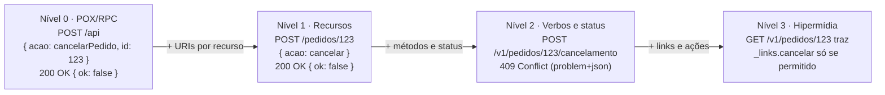

## O problema

Numa reunião de arquitetura, alguém diz que a API de pagamentos de um fornecedor "não é REST de verdade". Outra pessoa responde que é, sim, porque usa JSON e HTTP. Uma terceira diz que "REST de verdade" ninguém faz. A discussão gira em círculos porque cada um usa a palavra com um sentido diferente, e ninguém consegue dizer **o que exatamente** falta na API do fornecedor.

O modelo de maturidade de Richardson resolve esse problema de vocabulário. Ele divide o caminho entre "HTTP usado como túnel" e "REST com hipermídia" em quatro degraus, cada um com uma ideia nova. Em vez de "é ou não é REST", a conversa passa a ser "está no nível 1: usa recursos, mas faz tudo com `POST`".

Pense nas faixas de uma arte marcial. Ninguém discute se um aluno "sabe ou não sabe judô": a faixa diz o que ele já domina e o que vem a seguir. A faixa não é a arte em si, e um faixa-preta pode ter maus hábitos, mas ela dá a todos um jeito rápido de se entender.

> **A pergunta desta página:** quais são os quatro níveis do modelo de Richardson, como reconhecer cada um numa API real, e onde vale a pena chegar?

## O conceito

### Origem

Leonard Richardson apresentou o modelo numa palestra em 2008, depois de analisar dezenas de APIs que se diziam REST. Em 2010, Martin Fowler escreveu o artigo que o popularizou, com o exemplo de um sistema de agendamento de consultas médicas. Desde então, ele virou o vocabulário padrão para descrever "quão REST" uma API é.

Cada nível acrescenta uma ideia do REST, e cada ideia resolve um problema concreto:

| Nível | Ideia nova | Problema que resolve |
|---|---|---|
| **0** | Usar HTTP como transporte | Comunicação entre sistemas pela rede |
| **1** | **Recursos** | Dividir um único ponto de entrada em muitos recursos identificáveis |
| **2** | **Verbos e status HTTP** | Padronizar as operações e os resultados, permitindo *cache*, *retries* e intermediários |
| **3** | **Controles de hipermídia** | Tornar a API descobrível e deixar o servidor guiar o cliente |

### Nível 0: o pântano do POX

No nível 0, o HTTP é só um **túnel**: uma forma de levar uma chamada de procedimento remoto de um lado para o outro. Há um único endpoint (às vezes poucos), quase sempre com `POST`, e a operação desejada vai dentro do corpo. Fowler chama esse nível de *"the swamp of POX"* (o pântano do *Plain Old XML*), porque nos anos 2000 o corpo costumava ser XML, como no SOAP. Hoje é mais comum ver o mesmo padrão com JSON, como no JSON-RPC.

Características:

- uma URI (`/api`, `/rpc`, `/services`);
- um método (`POST`) para tudo, inclusive leituras;
- o nome da operação no corpo;
- quase sempre `200 OK`, com o sucesso ou o erro descrito no corpo.

Nada de errado em usar HTTP como transporte, e há estilos inteiros construídos assim (você vai ver o RPC e o gRPC em [04.01](/rest-e-estilos-de-api/rest-rpc-graphql-grpc-websocket-sse-e-webhooks-quando-usar)). O problema é chamar isso de REST, e perder sem perceber o que o HTTP oferece: nenhum intermediário consegue cachear, repetir com segurança ou entender o resultado.

### Nível 1: recursos

O primeiro passo é parar de mandar tudo para um único endpoint e passar a falar com **recursos individuais**, cada um com sua URI. Em vez de "chame o serviço de pedidos e diga qual pedido", o cliente fala diretamente com o pedido `/pedidos/123`.

Isso é a aplicação da técnica de "dividir para conquistar": um serviço grande vira muitos recursos menores. Mas, no nível 1, as operações continuam no corpo, e o método continua sendo `POST` para quase tudo.

### Nível 2: verbos e status HTTP

No nível 2, a API usa **os métodos HTTP pela semântica** ([02.02](/comecando-e-fundamentos-de-http/metodos-http-semantica-seguranca-e-idempotencia)) e **os status codes pelo significado** ([02.03](/comecando-e-fundamentos-de-http/status-codes-em-profundidade)):

- `GET` para leituras (seguro e cacheável);
- `PUT` e `DELETE` idempotentes;
- `POST` para criar e para ações;
- `201` com `Location` na criação, `404` quando não existe, `409` em conflito de estado.

É aqui que a interface uniforme começa a dar frutos: caches funcionam, *retries* automáticos sabem o que podem repetir, monitoramento conta erros pelo status. A maioria das APIs públicas bem-feitas (inclusive a do Bazar) está neste nível.

### Nível 3: controles de hipermídia

No nível 3, as respostas trazem **links** para os recursos relacionados e para as **ações possíveis no estado atual**. O cliente não precisa saber de antemão que um pedido em `CRIADO` pode ser cancelado: a resposta traz um link para o cancelamento, e o link some quando o pedido é enviado. É o <Term id="hateoas">HATEOAS</Term> da interface uniforme ([03.01](/rest-e-estilos-de-api/as-restricoes-de-fielding)).

A vantagem que Fowler destaca é a **descoberta** e a **evolução**: o servidor pode mudar URIs e acrescentar ações, e clientes que seguem links continuam funcionando. O assunto é aprofundado na próxima página, [03.04](/rest-e-estilos-de-api/hateoas-e-hipermidia).

### Críticas ao modelo

O modelo é útil, mas tem limites que vale conhecer:

- **Fielding não reconhece os níveis 0 a 2 como REST.** Para ele, sem hipermídia não há REST, e o modelo pode passar a impressão de que um nível 2 é "quase REST". Richardson e Fowler apresentam os níveis como passos de aprendizado, não como graus de conformidade.
- **Ele ignora outras restrições.** Uma API de nível 2 pode guardar sessão em memória (violando o *stateless*) ou mandar `Cache-Control: no-store` em tudo (anulando o *cache*). O modelo não diz nada sobre isso.
- **O nível 3 não é binário.** Uma API pode ter links de paginação e nada mais, ou descrever cada ação com formulários. As duas "têm hipermídia", com efeitos muito diferentes.
- **Ele mede a forma, não a qualidade do design.** Uma API de nível 3 com recursos mal escolhidos, nomes inconsistentes e erros sem padrão continua ruim.
- **Subir de nível não é sempre melhor.** Para comunicação interna de alto desempenho, um RPC bem desenhado (nível 0 pela régua) pode ser a escolha certa.

Use o modelo como **vocabulário**, não como certificação.

### Onde o mercado está, e quando subir para o nível 3

A grande maioria das APIs públicas de empresas como Stripe, GitHub, Twilio e dos guias de estilo da Google, da Microsoft e da Zalando fica no **nível 2**, com algumas pitadas de hipermídia (links de paginação, por exemplo). O contrato é descrito por OpenAPI, e os clientes conhecem as URIs pela documentação.

O nível 3 completo compensa quando:

- **as ações disponíveis dependem de regras de negócio complexas**, que você não quer duplicar em cada cliente ("este pedido pode ser cancelado?");
- **você controla os clientes** e eles são feitos para seguir links (um app próprio, uma interface genérica);
- **a API vai viver muito tempo** e precisa mudar URIs ou fluxos sem coordenar com os consumidores.

Ele custa mais quando os clientes são terceiros que vão ignorar os links e codificar as URIs de qualquer jeito, ou quando o desempenho importa mais que a descoberta. O Bazar fica no nível 2 e usa hipermídia de forma pontual: links de paginação, o link de depreciação e, nos pedidos, as ações disponíveis no estado atual ([12.04](/design-de-apis-profissional/acoes-que-nao-sao-crud-e-maquinas-de-estado)).

## Diagrama

A mesma operação, "cancelar o pedido 123", subindo os degraus:



## Na prática

O caso é sempre o mesmo: o cliente quer cancelar o pedido `BZR-2026-000123`, que **já foi enviado** e, portanto, não pode mais ser cancelado. Veja como cada nível expressa a operação e o erro.

### Nível 0

<HttpExchange
  title="Nível 0: um endpoint, a operação no corpo"
  request={{ method: 'POST', url: '/api', headers: { 'Content-Type': 'application/json' }, body: { acao: 'cancelarPedido', parametros: { numero: 'BZR-2026-000123', motivo: 'CLIENTE_DESISTIU' } } }}
  response={{ status: 200, headers: { 'Content-Type': 'application/json' }, body: { sucesso: false, erro: 'PEDIDO_JA_ENVIADO', mensagem: 'O pedido já foi enviado.' } }}
>
  Para o HTTP, deu tudo certo (`200`). Leituras também passam por aqui (`{"acao": "buscarPedido"}`), então nada é cacheável. Um *proxy* não sabe se pode repetir a requisição, e o monitoramento conta o erro como sucesso.
</HttpExchange>

### Nível 1

<HttpExchange
  title="Nível 1: o recurso tem URI, mas a ação continua no corpo"
  request={{ method: 'POST', url: '/pedidos/0192f3a1-9999-7000-8000-000000000123', headers: { 'Content-Type': 'application/json' }, body: { acao: 'cancelar', motivo: 'CLIENTE_DESISTIU' } }}
  response={{ status: 200, headers: { 'Content-Type': 'application/json' }, body: { sucesso: false, erro: 'PEDIDO_JA_ENVIADO' } }}
>
  Agora o alvo é identificável: um log mostra qual pedido foi alvo de cada requisição. Mas a leitura do pedido provavelmente é `POST /pedidos/{id}` com `{"acao": "detalhar"}`, e o status continua sem significado.
</HttpExchange>

### Nível 2

<HttpExchange
  title="Nível 2: método e status pela semântica"
  request={{ method: 'POST', url: '/v1/pedidos/0192f3a1-9999-7000-8000-000000000123/cancelamento', headers: { 'Content-Type': 'application/json' }, body: { motivo: 'CLIENTE_DESISTIU' } }}
  response={{
    status: 409,
    headers: { 'Content-Type': 'application/problem+json' },
    body: {
      type: 'https://api.bazar.example/problemas/transicao-invalida',
      title: 'Transição de estado inválida',
      status: 409,
      detail: 'O pedido BZR-2026-000123 já foi enviado e não pode ser cancelado.',
      codigo: 'TRANSICAO_INVALIDA',
      traceId: '4bf92f3577b34da6a3ce929d0e0e4736',
    },
  }}
>
  O cancelamento é um recurso de processo ([03.02](/rest-e-estilos-de-api/recursos-representacoes-e-a-interface-uniforme)), a leitura do pedido é um `GET` cacheável, e o erro é um `409` que qualquer componente entende. É assim que o Bazar funciona.
</HttpExchange>

### Nível 3

No nível 3, o cliente nem tenta cancelar um pedido enviado: a representação do pedido diz quais ações estão disponíveis.

<HttpExchange
  title="Nível 3: o pedido enviado não oferece o cancelamento"
  request={{ method: 'GET', url: '/v1/pedidos/0192f3a1-9999-7000-8000-000000000123', headers: { Accept: 'application/hal+json' } }}
  response={{
    status: 200,
    headers: { 'Content-Type': 'application/hal+json' },
    body: {
      id: '0192f3a1-9999-7000-8000-000000000123',
      numero: 'BZR-2026-000123',
      status: 'ENVIADO',
      _links: {
        self: { href: '/v1/pedidos/0192f3a1-9999-7000-8000-000000000123' },
        pagamentos: { href: '/v1/pedidos/0192f3a1-9999-7000-8000-000000000123/pagamentos' },
        eventos: { href: '/v1/pedidos/0192f3a1-9999-7000-8000-000000000123/eventos' },
      },
    },
  }}
>
  Não há link `cancelar`, então o app esconde o botão "Cancelar" sem conhecer a regra. Se o pedido estivesse em `CRIADO`, o link estaria lá, e o cliente o seguiria com um `POST`. O formato `_links` é o HAL, explicado em [03.04](/rest-e-estilos-de-api/hateoas-e-hipermidia). O servidor continua respondendo `409` se alguém tentar mesmo assim: os links guiam, não substituem a validação.
</HttpExchange>

### Avaliando uma API rapidamente

Um roteiro para classificar uma API que você precisa integrar:

<Checklist
  id="nivel-richardson"
  title="Em que nível está esta API?"
  items={[
    { label: 'Existe mais de um endpoint, e cada coisa importante tem a sua URI?', hint: 'Se não: nível 0.' },
    { label: 'As leituras usam GET, e as operações usam métodos diferentes conforme a semântica?', hint: 'Se não: nível 1.' },
    { label: 'Os erros chegam com status 4xx/5xx corretos, e não como 200 com erro no corpo?', hint: 'Se não: ainda não é nível 2.' },
    { label: 'As respostas trazem links para recursos relacionados e para as ações disponíveis?', hint: 'Se sim: nível 3 (pelo menos em parte).' },
  ]}
/>

## Erros comuns

<BadVsGood title="Nível 1 disfarçado de nível 2" why="Ter URIs por recurso não basta: se o método não segue a semântica e o status não reflete o resultado, a API perde cache, retries seguros e visibilidade, os ganhos do nível 2.">
<Bad title="Recurso certo, verbo errado">

```http
POST /v1/produtos/0192f39f-2222-7000-8000-000000000042/buscar
```

```http
HTTP/1.1 200 OK

{ "encontrado": false }
```

</Bad>
<Good title="Leitura com GET e status com significado">

```http
GET /v1/produtos/0192f39f-2222-7000-8000-000000000042
```

```http
HTTP/1.1 404 Not Found
Content-Type: application/problem+json
```

</Good>
</BadVsGood>

Outros equívocos frequentes:

- **Usar o nível como nota de qualidade.** Uma API de nível 2 bem desenhada é melhor que uma de nível 3 com recursos confusos.
- **Pular para o nível 3 sem consumidores que sigam links.** Os links engordam a resposta e ninguém os usa; os clientes continuam codificando as URIs.
- **Achar que o nível 2 dispensa as outras restrições.** O modelo não fala de *stateless* nem de *cache*; verifique-os à parte.
- **Classificar a API inteira por um endpoint.** É comum uma API ter recursos de nível 2 e um "endpoint de ações" de nível 0 escondido (`POST /api/executar`).

## Boas práticas

- **Use** os níveis para descrever uma API com precisão ("nível 1: recursos, mas tudo com `POST`").
- **Mire** no nível 2 como mínimo para APIs públicas.
- **Acrescente** hipermídia onde ela evita duplicar regras de negócio nos clientes, como as ações disponíveis de um pedido.
- **Avalie** separadamente as restrições que o modelo não cobre (*stateless*, *cache*, camadas).
- **Documente** o nível escolhido e o porquê no guia de estilo ([16.02](/design-de-apis-profissional/escrevendo-o-guia-de-estilo-da-sua-api)).

## Resumo

- O modelo de Leonard Richardson (popularizado por Martin Fowler) tem quatro níveis: **0** (HTTP como túnel, POX/RPC), **1** (recursos), **2** (verbos e status HTTP) e **3** (controles de hipermídia).
- Cada nível acrescenta uma ideia do REST e resolve um problema: dividir o serviço, padronizar operações, tornar a API descobrível.
- Críticas: Fielding só reconhece o nível 3 como REST; o modelo ignora *stateless* e *cache*; o nível 3 não é binário; ele mede forma, não qualidade.
- O mercado está no **nível 2**, com hipermídia pontual. O nível 3 compensa quando as ações dependem de regras complexas e os clientes seguem links.
- O Bazar é nível 2, com links de paginação, de depreciação e de ações disponíveis nos pedidos.

<Exercise title="Classifique e suba de nível" difficulty="medio">
Uma loja parceira expõe estas operações de estoque:

```http
POST /estoque          { "op": "consultar", "sku": "LIV-0042" }
POST /estoque          { "op": "definir", "sku": "LIV-0042", "quantidade": 42 }
POST /estoque          { "op": "reservar", "sku": "LIV-0042", "quantidade": 2 }
```

Todas respondem `200`, com `{"ok": true}` ou `{"ok": false, "erro": "..."}`.

1. Em que nível do modelo está essa API? Justifique.
2. Reescreva as três operações no nível 2, com os status de sucesso e de erro mais prováveis (por exemplo, SKU inexistente e estoque insuficiente para a reserva).
3. Que link de nível 3 você colocaria na resposta da consulta, e quando ele deveria desaparecer?

<Hint>
O `/estoque` é uma URI por "serviço", não por recurso: há um recurso de estoque para cada produto. A reserva é uma ação com dados próprios. Volte à seção "Recursos não são tabelas" de 03.02.
</Hint>

<Solution>

1. **Nível 0.** Há uma única URI, um único método e a operação no corpo; o status é sempre `200`.

2. No nível 2, cada produto tem o seu estoque, e a reserva vira um recurso de processo:

```http
GET  /v1/produtos/{id}/estoque              → 200 com o saldo · 404 se o produto não existe
PUT  /v1/produtos/{id}/estoque              → 200 · 404 · 422 (quantidade negativa)
     { "quantidadeDisponivel": 42 }
POST /v1/produtos/{id}/estoque/reservas     → 201 + Location · 404 · 409 (estoque insuficiente)
     { "quantidade": 2, "pedidoId": "0192f3a1-..." }
```

A consulta passa a ser um `GET` cacheável, a definição é um `PUT` idempotente e a reserva, um `POST` que cria algo. O estoque insuficiente é `409`, porque a requisição é válida, mas o estado atual não permite. No Bazar, a reserva acontece dentro da criação do pedido (21.01) e o PUT exige `If-Match` (20.03); aqui o objetivo é só o nível.

3. Um link `reservar` (por exemplo, `"reservar": { "href": "/v1/produtos/{id}/estoque/reservas" }`) na resposta do `GET`, presente só quando `quantidadeDisponivel` for maior que zero. Quando o estoque zera, o link some, e o app desabilita o botão "Comprar" sem conhecer a regra. O servidor continua validando e respondendo `409`, porque o estoque pode acabar entre a leitura e a reserva.

</Solution>
</Exercise>

<Quiz
  questions={[
    {
      question: 'Uma API tem URIs como /pedidos/123 e /produtos/42, mas faz tudo com POST e responde sempre 200. Em que nível ela está?',
      options: ['Nível 0', 'Nível 1', 'Nível 2', 'Nível 3'],
      answer: 1,
      explanation: 'Ela já divide o serviço em recursos com URIs próprias (nível 1), mas não usa métodos nem status pela semântica, o que é a ideia do nível 2. O nível 0 teria um único endpoint, e o nível 3 exigiria links.',
    },
    {
      question: 'Qual é a principal crítica de Fielding ao modelo de Richardson?',
      options: [
        'Ele exige XML no nível 0',
        'Ele trata os níveis abaixo do 3 como degraus de REST, quando para Fielding REST exige hipermídia',
        'Ele não permite usar POST',
      ],
      answer: 1,
      explanation: 'Para Fielding, uma API sem hipermídia não é REST, e o modelo pode dar a impressão de que o nível 2 é quase lá. O formato do corpo não importa para o modelo, e POST é usado normalmente em todos os níveis.',
    },
    {
      question: 'No nível 3, o pedido ENVIADO não traz o link "cancelar". Um cliente tenta cancelar mesmo assim. O que o servidor deve fazer?',
      options: [
        'Aceitar, porque o link é só uma sugestão',
        'Responder 404, porque o link não existe',
        'Responder 409, porque os links guiam o cliente mas não substituem a validação da regra no servidor',
      ],
      answer: 2,
      explanation: 'Os links mostram as ações disponíveis, mas o servidor continua sendo a autoridade sobre as regras: o pedido existe e o estado não permite o cancelamento, por isso 409. Aceitar violaria a regra, e 404 diria que o recurso não existe.',
    },
  ]}
/>

## Referências

<References />
