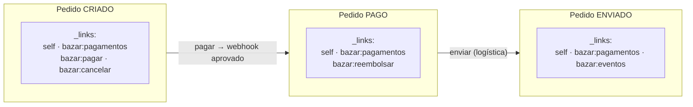
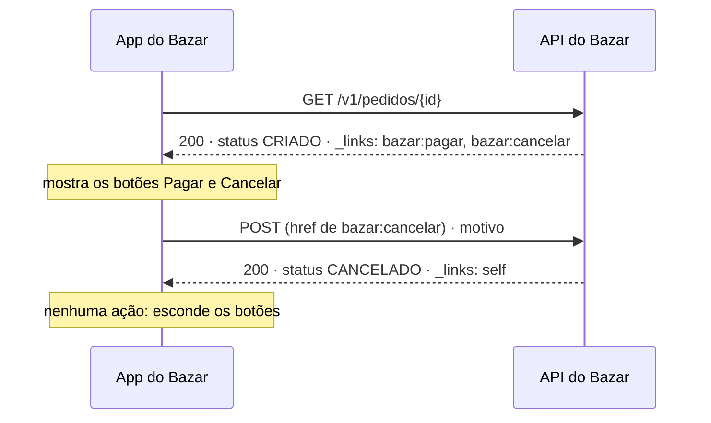

## O problema

O app do Bazar mostra um botão "Cancelar pedido". Para decidir quando exibi-lo, a equipe do app copiou a regra da API: "pode cancelar se o status for `CRIADO` ou `PAGAMENTO_PENDENTE`". Meses depois, o negócio decide que pedidos `PAGO` também podem ser cancelados nas primeiras duas horas, com reembolso automático. A API muda em um dia. O app leva três semanas: a regra está duplicada no Android, no iOS e no site, e cada equipe tem seu ciclo de publicação. Nesse meio-tempo, clientes que poderiam cancelar não veem o botão.

O problema não é a regra mudar: regras de negócio mudam. O problema é a regra estar **em dois lugares**. O cliente precisava saber "posso cancelar agora?", e a única forma que ele tinha de responder era reimplementar a lógica do servidor.

Pense num caixa eletrônico. Ele não mostra o botão "Sacar" quando você só tem conta poupança sem saldo, e não mostra "Transferir para o exterior" se seu perfil não permite. A tela não sabe as regras do banco: ela mostra as opções que o banco devolveu para aquela conta, naquele momento. Se o banco mudar uma regra, todas as telas se ajustam sozinhas.

> **A pergunta desta página:** como a hipermídia permite que o servidor diga ao cliente quais ações são possíveis, quais formatos existem para isso, e quando o custo compensa?

## O conceito

### Hipermídia como motor do estado da aplicação

O <Term id="hateoas">HATEOAS</Term> (*Hypermedia As The Engine Of Application State*) é o quarto elemento da interface uniforme ([03.01](/rest-e-estilos-de-api/as-restricoes-de-fielding)). A ideia é a mesma da Web: você entra num site pela página inicial e navega pelos links que cada página oferece, sem conhecer as URLs de antemão. As transições possíveis (o "estado da aplicação" de que fala o nome) são dirigidas pelos links que o servidor envia.

Numa API, isso significa que a resposta traz, além dos dados:

- **links para recursos relacionados** (os pagamentos deste pedido, o cliente que o fez);
- **links para as ações possíveis no estado atual** (pagar, cancelar, reembolsar).

O cliente decide o que fazer pelos links presentes, não por regras codificadas nele.

### Links e relações

Um link tem duas partes essenciais: o **destino** (a URI) e a **relação** (`rel`), que diz o que o destino significa para o recurso atual. A RFC 8288 (que você viu em [02.04](/comecando-e-fundamentos-de-http/headers-essenciais) com o header `Link`) define o modelo:

```http
Link: </v1/pedidos/0192f3a1-9999-7000-8000-000000000123/pagamentos>; rel="payment"
```

O valor de `rel` não é texto livre. Há dois tipos de relação:

- **Registradas na IANA**: nomes curtos com significado padronizado. Exemplos úteis em APIs: `self` (o próprio recurso), `next`, `prev`, `first`, `last` (paginação), `collection` e `item` (coleção e elemento), `edit` (onde editar), `describedby` (documentação ou *schema*), `payment` (onde pagar), `deprecation` (informações sobre a depreciação) e `related`.
- **Extensões**: relações próprias da sua API. Pela RFC 8288, elas devem ser **URIs** (`https://api.bazar.example/rels/cancelar`), para não colidir com nomes registrados no futuro. Formatos como o HAL oferecem uma abreviação, as *CURIEs* (`bazar:cancelar`), descrita adiante.

O cliente programa contra as **relações**, não contra as URIs. "Para pagar, siga o link `payment`" continua funcionando se a URI de pagamento mudar.

### Formatos de hipermídia

O JSON não tem links nativamente: um campo `"url": "/v1/..."` é só uma string. Vários formatos padronizam como representar links (e, em alguns, ações):

#### HAL

O <Term id="hal">**HAL**</Term> (*Hypertext Application Language*), descrito no *draft* `draft-kelly-json-hal`, é o formato mais simples e o mais usado. Media type: `application/hal+json`. Ele acrescenta duas propriedades reservadas ao JSON:

- `_links`: um objeto em que cada chave é uma relação e cada valor é um link (`{ "href": "..." }`) ou uma lista de links;
- `_embedded`: recursos relacionados embutidos na resposta, cada um com seus próprios `_links`.

```json
{
  "numero": "BZR-2026-000123",
  "status": "CRIADO",
  "_links": {
    "self": { "href": "/v1/pedidos/0192f3a1-9999-7000-8000-000000000123" },
    "curies": [{ "name": "bazar", "href": "https://api.bazar.example/rels/{rel}", "templated": true }],
    "bazar:cancelar": { "href": "/v1/pedidos/0192f3a1-9999-7000-8000-000000000123/cancelamento" }
  }
}
```

As *CURIEs* (`curies`) são a forma do HAL de abreviar relações de extensão: `bazar:cancelar` é lido como `https://api.bazar.example/rels/cancelar`, e essa URI pode apontar para a documentação da relação.

O HAL descreve **para onde** ir, mas não **como**: o link `bazar:cancelar` não diz que o método é `POST` nem quais campos enviar. Isso fica na documentação.

#### HAL-FORMS

O **HAL-FORMS** estende o HAL com `_templates`, que descrevem as ações como formulários: método, destino e campos, com tipos e regras. Media type: `application/prs.hal-forms+json`.

```json
"_templates": {
  "cancelar": {
    "method": "POST",
    "target": "/v1/pedidos/0192f3a1-9999-7000-8000-000000000123/cancelamento",
    "properties": [
      { "name": "motivo", "required": true, "options": { "inline": ["CLIENTE_DESISTIU", "ENDERECO_ERRADO", "OUTRO"] } }
    ]
  }
}
```

Com isso, um cliente genérico consegue montar o formulário de cancelamento sozinho, com a lista de motivos vinda do servidor.

#### Outros formatos

- **JSON:API**: uma especificação completa para APIs JSON, que padroniza não só links, mas a estrutura dos documentos (`data`, `attributes`, `relationships`, `included`), paginação, filtros e erros. Media type `application/vnd.api+json`. Forte em ecossistemas que adotam a especificação inteira (Ember, algumas bibliotecas de front-end).
- **Siren**: representa entidades com `properties`, `links` e `actions`, estas com método e campos, parecido com o HAL-FORMS.

| Formato | Links | Ações (método e campos) | Recursos embutidos | Adoção |
|---|---|---|---|---|
| HAL | ✓ | ✗ | ✓ | A mais ampla; suportado pelo Spring HATEOAS |
| HAL-FORMS | ✓ | ✓ | ✓ | Menor; suportado pelo Spring HATEOAS |
| JSON:API | ✓ | ✗ | ✓ | Comunidades específicas; impõe a estrutura inteira |
| Siren | ✓ | ✓ | ✓ | Pequena |

### *Affordances*: as ações conforme o estado

Uma <Term id="affordance">***affordance***</Term> é uma ação que a representação oferece. O termo vem do design de interfaces: a maçaneta de uma porta "oferece" ser puxada. Em hipermídia, as *affordances* mudam com o estado do recurso, e é aí que mora o valor do HATEOAS para uma API de negócio:

| Status do pedido | Ações oferecidas |
|---|---|
| `CRIADO` | `pagar`, `cancelar` |
| `PAGAMENTO_PENDENTE` | `cancelar` |
| `PAGO` | `reembolsar` |
| `ENVIADO` | (nenhuma ação do cliente; só acompanhar `eventos`) |
| `CANCELADO`, `REEMBOLSADO`, `ENTREGUE` | (nenhuma) |

O app passa a mostrar o botão "Cancelar" se e somente se existir a ação `cancelar`. Quando a regra muda (pedidos `PAGO` podem ser cancelados nas primeiras duas horas), só o servidor muda: a próxima resposta de um pedido pago há uma hora já traz `cancelar`.

<Callout type="warning" title="Links guiam, não autorizam">
  A ausência de um link não substitui a validação. O estado pode mudar entre a leitura e a ação (o pedido foi enviado no meio do caminho), e qualquer cliente pode tentar a URI diretamente. O servidor sempre revalida e responde `409` se a transição não for permitida.
</Callout>

### Spring HATEOAS, em uma visão conceitual

O **Spring HATEOAS** (versão 3.1, a gerenciada pelo Spring Boot 4.1) é o projeto do ecossistema Spring para produzir representações com hipermídia. Ele oferece:

- **modelos de representação**: `RepresentationModel` (a base, com uma lista de links), `EntityModel<T>` (um objeto com links) e `CollectionModel<T>` (uma coleção com links);
- **construção de links a partir dos controllers**, com `WebMvcLinkBuilder`: o link é derivado do mapeamento do método (`linkTo(methodOn(PedidoController.class).detalhar(id))`), em vez de uma string montada à mão que quebra quando a rota muda;
- **serialização** em HAL, HAL-FORMS e outros formatos, escolhida pela negociação de conteúdo;
- ***affordances*** ligadas aos links, que viram `_templates` em HAL-FORMS.

A implementação no Bazar fica para [12.04](/design-de-apis-profissional/acoes-que-nao-sao-crud-e-maquinas-de-estado), quando a máquina de estados do pedido for construída. Lá você vai ver também quando vale usar a biblioteca e quando alguns links montados à mão bastam.

### Os custos

A hipermídia tem preço, e ele explica por que tão poucas APIs públicas a adotam por completo:

- **Tamanho da resposta.** Cada item de uma lista com cinco links pode dobrar o tamanho do JSON. Em listas de 100 produtos, isso pesa.
- **Complexidade no servidor.** Calcular as ações disponíveis exige avaliar regras para cada recurso de cada resposta, às vezes com consultas extras (o cliente pode reembolsar? Depende do pagamento).
- **Clientes que ignoram os links.** Muitos consumidores leem a documentação, codificam as URIs e nunca olham `_links`. Para eles, a hipermídia é só peso.
- **Ferramentas.** Geradores de cliente a partir de OpenAPI tratam `_links` como um campo qualquer; poucos clientes HTTP seguem relações nativamente.
- **Falsa sensação de desacoplamento.** O cliente ainda precisa entender o significado de cada relação e dos dados. A hipermídia elimina o acoplamento às URIs e às regras de transição, não ao domínio.

### A alternativa leve

Entre "nenhum link" e "HAL-FORMS completo" há um meio-termo que pega a maior parte do benefício:

- **O header `Link` para relações de navegação** que valem para toda a resposta: paginação (`next`, `prev`) e depreciação (`deprecation`). Não polui o corpo e é padronizado pela RFC 8288.
- **Links de paginação** no corpo ou no header, para que o cliente nunca monte a URL da próxima página.
- **As ações disponíveis só onde há regras de negócio que mudam**: no Bazar, os pedidos. Produtos e categorias não precisam.

É exatamente o que o Bazar faz: header `Link` na paginação ([13.03](/design-de-apis-profissional/paginacao-por-offset)) e na depreciação ([18.04](/contratos-documentacao-e-ciclo-de-vida/depreciacao-e-desligamento-de-apis)), e `_links` com as ações disponíveis só na representação do pedido.

## Diagrama

As ações oferecidas pelo pedido em cada estado:



E o cliente navegando pelos links, sem conhecer as URIs de antemão:



## Na prática

As respostas abaixo mostram o pedido do Bazar em estados diferentes, em HAL. Ainda não há código Spring: a implementação está em 12.04.

### Pedido criado

<HttpExchange
  title="Pedido CRIADO: pode pagar e cancelar"
  request={{ method: 'GET', url: '/v1/pedidos/0192f3a1-9999-7000-8000-000000000123', headers: { Accept: 'application/hal+json' } }}
  response={{
    status: 200,
    headers: { 'Content-Type': 'application/hal+json' },
    body: {
      id: '0192f3a1-9999-7000-8000-000000000123',
      numero: 'BZR-2026-000123',
      status: 'CRIADO',
      valorTotal: { valor: '279.70', moeda: 'BRL' },
      _links: {
        self: { href: '/v1/pedidos/0192f3a1-9999-7000-8000-000000000123' },
        curies: [{ name: 'bazar', href: 'https://api.bazar.example/rels/{rel}', templated: true }],
        'bazar:cliente': { href: '/v1/clientes/0192f3a0-1111-7000-8000-000000000001' },
        'bazar:pagamentos': { href: '/v1/pedidos/0192f3a1-9999-7000-8000-000000000123/pagamentos' },
        'bazar:pagar': { href: '/v1/pedidos/0192f3a1-9999-7000-8000-000000000123/pagamentos' },
        'bazar:cancelar': { href: '/v1/pedidos/0192f3a1-9999-7000-8000-000000000123/cancelamento' },
      },
    },
  }}
>
  Repare que `bazar:pagamentos` (a lista, com `GET`) e `bazar:pagar` (iniciar um pagamento, com `POST`) apontam para a mesma URI: a relação diz o que fazer, o HAL não diz o método. É a lacuna que o HAL-FORMS preenche.
</HttpExchange>

### Pedido pago

<HttpExchange
  title="Pedido PAGO: só pode ser reembolsado"
  request={{ method: 'GET', url: '/v1/pedidos/0192f3a1-9999-7000-8000-000000000123', headers: { Accept: 'application/hal+json' } }}
  response={{
    status: 200,
    headers: { 'Content-Type': 'application/hal+json' },
    body: {
      id: '0192f3a1-9999-7000-8000-000000000123',
      numero: 'BZR-2026-000123',
      status: 'PAGO',
      valorTotal: { valor: '279.70', moeda: 'BRL' },
      _links: {
        self: { href: '/v1/pedidos/0192f3a1-9999-7000-8000-000000000123' },
        curies: [{ name: 'bazar', href: 'https://api.bazar.example/rels/{rel}', templated: true }],
        'bazar:cliente': { href: '/v1/clientes/0192f3a0-1111-7000-8000-000000000001' },
        'bazar:pagamentos': { href: '/v1/pedidos/0192f3a1-9999-7000-8000-000000000123/pagamentos' },
        'bazar:reembolsar': { href: '/v1/pagamentos/0192f3a2-dddd-7000-8000-000000000031/reembolsos' },
      },
    },
  }}
>
  O link de reembolso aponta para o **pagamento**, não para o pedido: é lá que o reembolso vive (`POST /v1/pagamentos/{id}/reembolsos`). O app não precisa saber disso; ele segue a relação.
</HttpExchange>

### Com HAL-FORMS

Se o Bazar oferecesse HAL-FORMS, o mesmo pedido criado, pedido com `Accept: application/prs.hal-forms+json`, traria as ações descritas como formulários. (O Bazar fica no HAL; a [12.04](/design-de-apis-profissional/acoes-que-nao-sao-crud-e-maquinas-de-estado) mostra o que seria preciso para ligar o HAL-FORMS no Spring HATEOAS.)

```json
{
  "id": "0192f3a1-9999-7000-8000-000000000123",
  "numero": "BZR-2026-000123",
  "status": "CRIADO",
  "_links": {
    "self": { "href": "/v1/pedidos/0192f3a1-9999-7000-8000-000000000123" }
  },
  "_templates": {
    "cancelar": {
      "title": "Cancelar pedido",
      "method": "POST",
      "target": "/v1/pedidos/0192f3a1-9999-7000-8000-000000000123/cancelamento",
      "contentType": "application/json",
      "properties": [
        { "name": "motivo", "prompt": "Motivo", "required": true,
          "options": { "inline": ["CLIENTE_DESISTIU", "ENDERECO_ERRADO", "OUTRO"] } },
        { "name": "observacao", "prompt": "Observação", "maxLength": 500 }
      ]
    },
    "pagar": {
      "title": "Pagar",
      "method": "POST",
      "target": "/v1/pedidos/0192f3a1-9999-7000-8000-000000000123/pagamentos",
      "properties": [
        { "name": "metodo", "required": true, "options": { "inline": ["PIX", "CARTAO", "BOLETO"] } }
      ]
    }
  }
}
```

### A alternativa leve: header `Link`

Para navegação que vale para a resposta inteira, o header `Link` basta e não muda o corpo:

<HttpExchange
  title="Paginação com Link"
  request={{ method: 'GET', url: '/v1/pedidos?clienteId=0192f3a0-1111-7000-8000-000000000001&limit=20', headers: { Accept: 'application/json' } }}
  response={{
    status: 200,
    headers: {
      'Content-Type': 'application/json',
      Link: '</v1/pedidos?clienteId=0192f3a0-1111-7000-8000-000000000001&limit=20&cursor=eyJjcmlhZG9FbSI6IjIwMjYtMTAtMjBUMTI6MDA6MDBaIn0>; rel="next"',
    },
    body: { itens: ['...'], proximoCursor: 'eyJjcmlhZG9FbSI6IjIwMjYtMTAtMjBUMTI6MDA6MDBaIn0' },
  }}
/>

## Erros comuns

<BadVsGood title="Regra de negócio no cliente" why="Com a regra duplicada, cada mudança exige publicar todos os clientes. Com as ações vindas do servidor, a regra fica num lugar só e os clientes se ajustam na próxima resposta.">
<Bad title="O app reimplementa a regra">

```javascript
const podeCancelar = ['CRIADO', 'PAGAMENTO_PENDENTE'].includes(pedido.status)
botaoCancelar.hidden = !podeCancelar
```

</Bad>
<Good title="O app segue a affordance">

```javascript
const linkCancelar = pedido._links['bazar:cancelar']
botaoCancelar.hidden = !linkCancelar
botaoCancelar.onclick = () => fetch(linkCancelar.href, { method: 'POST', /* ... */ })
```

</Good>
</BadVsGood>

Outros erros frequentes:

- **Links que o cliente não pode seguir.** Um link `cancelar` em pedidos já enviados (porque "a regra é verificada depois") destrói a confiança nos links, e os clientes voltam a reimplementar a regra.
- **Relações inventadas com nomes genéricos.** `"acao1"`, `"link"` ou `"url"` não dizem nada. Use relações registradas quando existirem e URIs (ou *CURIEs*) para as suas.
- **Achar que os links dispensam a validação.** O servidor sempre revalida a transição.
- **Hipermídia em tudo, por princípio.** Links em cada item de listas grandes e em recursos sem regras de transição aumentam o tráfego sem benefício.
- **URIs absolutas montadas com o host errado.** Atrás de um *proxy*, links como `http://10.0.3.7:8080/v1/...` vazam o endereço interno. A configuração de `Forwarded` está em [26.05](/seguranca-essencial-para-apis/transporte-segredos-headers-de-seguranca-e-ssrf); links relativos (`/v1/...`) evitam o problema.

## Boas práticas

- **Ofereça** as ações disponíveis onde há regras de transição que mudam (no Bazar, os pedidos).
- **Inclua** um link só se a ação for de fato permitida naquele estado, e revalide sempre no servidor.
- **Use** relações registradas na IANA (`self`, `next`, `payment`, `deprecation`) e URIs ou *CURIEs* para as relações próprias.
- **Documente** cada relação própria: método, corpo e respostas.
- **Prefira** o header `Link` para navegação que vale para a resposta inteira, como a paginação.
- **Meça** o peso dos links em listas grandes antes de incluí-los em cada item.

## Resumo

- **HATEOAS**: as respostas trazem links para recursos relacionados e para as ações possíveis, e o cliente navega por eles, sem conhecer URIs nem regras de antemão.
- Um link tem destino e **relação** (`rel`); as relações são registradas na IANA ou são URIs próprias (*CURIEs* no HAL).
- **HAL** (`_links`, `_embedded`) é o formato mais usado; **HAL-FORMS** acrescenta ações com método e campos (`_templates`); **JSON:API** e **Siren** são alternativas.
- **Affordances** mudam com o estado: o pedido `CRIADO` oferece `pagar` e `cancelar`; o `PAGO`, `reembolsar`. Links guiam, mas o servidor sempre valida.
- Custos: payload maior, complexidade, clientes que ignoram links. A **alternativa leve** (header `Link` e ações só onde importa) é a escolha do Bazar.
- O **Spring HATEOAS** 3.1 produz HAL e HAL-FORMS a partir dos controllers; a implementação está em 12.04.

<Exercise title="As affordances do pagamento" difficulty="medio">
Um `Pagamento` do Bazar tem os status `PENDENTE`, `APROVADO`, `RECUSADO` e `REEMBOLSADO` (o reembolso pode ser total ou parcial; um pagamento parcialmente reembolsado continua `APROVADO`).

1. Monte uma tabela com as ações que a representação de `GET /v1/pagamentos/{id}` deveria oferecer em cada status, considerando as ações "reembolsar" e "tentar de novo" (iniciar um novo pagamento para o mesmo pedido).
2. Escreva a representação HAL de um pagamento `APROVADO` de R$ 279,70 que já teve R$ 100,00 reembolsados.
3. Que validação o servidor precisa fazer mesmo que o cliente só siga links?

<Hint>
A ação "tentar de novo" faz sentido para quem teve o pagamento recusado. O reembolso depende do valor ainda disponível. E pense no que pode mudar entre o `GET` e o `POST`.
</Hint>

<Solution>

1. Ações por status:

| Status | Ações |
|---|---|
| `PENDENTE` | nenhuma (aguarda o webhook da PagaFácil) |
| `APROVADO` | `bazar:reembolsar`, enquanto houver valor não reembolsado |
| `RECUSADO` | `bazar:tentar-novamente` (aponta para `POST /v1/pedidos/{id}/pagamentos`) |
| `REEMBOLSADO` | nenhuma |

2. Representação:

```json
{
  "id": "0192f3a2-dddd-7000-8000-000000000031",
  "pedidoId": "0192f3a1-9999-7000-8000-000000000123",
  "metodo": "PIX",
  "status": "APROVADO",
  "valor": { "valor": "279.70", "moeda": "BRL" },
  "valorReembolsado": { "valor": "100.00", "moeda": "BRL" },
  "_links": {
    "self": { "href": "/v1/pagamentos/0192f3a2-dddd-7000-8000-000000000031" },
    "curies": [{ "name": "bazar", "href": "https://api.bazar.example/rels/{rel}", "templated": true }],
    "pedido": { "href": "/v1/pedidos/0192f3a1-9999-7000-8000-000000000123" },
    "reembolsos": { "href": "/v1/pagamentos/0192f3a2-dddd-7000-8000-000000000031/reembolsos" },
    "bazar:reembolsar": { "href": "/v1/pagamentos/0192f3a2-dddd-7000-8000-000000000031/reembolsos" }
  }
}
```

3. O servidor precisa revalidar tudo no `POST` de reembolso: que o pagamento ainda está `APROVADO`, que o valor pedido não passa do saldo reembolsável (R$ 179,70 neste caso) e que o cliente tem permissão sobre aquele pagamento. Entre o `GET` e o `POST`, outro reembolso pode ter consumido o saldo. Se a regra falhar, a resposta é `409` (estado) ou `422` (valor inválido), com Problem Details.

</Solution>
</Exercise>

<Quiz
  questions={[
    {
      question: 'Qual é o principal benefício de o app decidir mostrar o botão "Cancelar" pela presença do link bazar:cancelar?',
      options: [
        'A resposta fica menor',
        'A regra de quando o cancelamento é permitido fica só no servidor, e os clientes se ajustam quando ela muda',
        'O servidor não precisa mais validar o cancelamento',
      ],
      answer: 1,
      explanation: 'As affordances evitam duplicar regras de negócio nos clientes. A resposta fica maior, não menor, e o servidor continua validando, porque o estado pode mudar e qualquer cliente pode chamar a URI diretamente.',
    },
    {
      question: 'Qual é a diferença essencial entre HAL e HAL-FORMS?',
      options: [
        'HAL usa XML e HAL-FORMS usa JSON',
        'HAL-FORMS descreve as ações com método e campos (_templates); HAL descreve só links',
        'HAL-FORMS não suporta recursos embutidos',
      ],
      answer: 1,
      explanation: 'O HAL diz para onde ir, mas não como; o HAL-FORMS acrescenta os _templates com método, destino e propriedades. Os dois são JSON, e o HAL-FORMS herda _links e _embedded do HAL.',
    },
    {
      question: 'Pela RFC 8288, como deve ser o nome de uma relação própria do Bazar, como "cancelar"?',
      options: [
        'Qualquer palavra, desde que em inglês',
        'Uma URI (como https://api.bazar.example/rels/cancelar), que no HAL pode ser abreviada com uma CURIE',
        'Um número registrado na IANA',
      ],
      answer: 1,
      explanation: 'Relações não registradas devem ser URIs, para não colidir com nomes que a IANA possa registrar depois. O HAL permite abreviá-las com CURIEs (bazar:cancelar). A língua não importa, e a IANA registra nomes, não números.',
    },
  ]}
/>

## Referências

<References />
