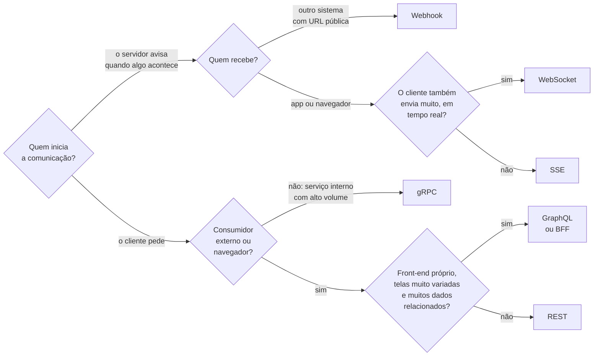
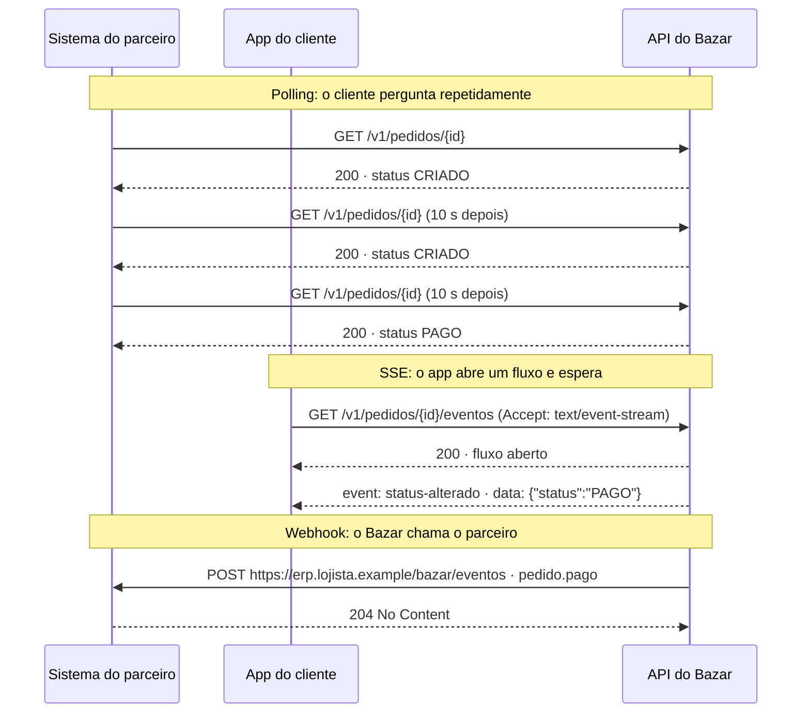

## O problema

Três conversas da mesma semana no Bazar:

- O time do app quer trocar a API REST por GraphQL "porque é mais moderno". A tela de produto faz quatro chamadas, e eles leram que GraphQL resolve isso.
- O time de estoque quer que o módulo de pedidos avise em tempo real quando o estoque acaba, e alguém sugere WebSocket.
- Um lojista parceiro quer saber quando um pedido dele é pago. Hoje, o sistema dele chama `GET /v1/pedidos/{id}` a cada 10 segundos, para cada pedido em aberto.

Cada proposta tem um mérito, e cada uma tem um custo que ninguém mencionou. GraphQL resolve a tela de produto, mas complica o *cache* e abre a porta para consultas caríssimas. WebSocket resolve o tempo real, mas exige manter conexões abertas e tratar reconexões. O *polling* do parceiro funciona, mas gera milhões de requisições inúteis por dia.

Pense nos meios de transporte de uma cidade. Ninguém pergunta "qual é o melhor: ônibus, metrô, bicicleta ou caminhão?". Depende de quantas pessoas, que distância, que carga, quanto tempo. Uma empresa de logística usa caminhões para as entregas e motos para os documentos urgentes, e ninguém acha isso incoerente.

> **A pergunta desta página:** quais são os principais estilos de comunicação entre sistemas, o que cada um faz bem e mal, e como escolher (e combinar) com justificativa?

## O conceito

As páginas anteriores mostraram o REST em detalhe. Esta página compara o REST com as alternativas mais comuns. A ideia não é dominar cada uma (algumas têm páginas próprias adiante), e sim saber **quando** cada uma é a ferramenta certa.

Os estilos se dividem em dois grupos: os de **requisição e resposta** (o cliente pergunta, o servidor responde) e os de **notificação** (o servidor avisa quando algo acontece).

### RPC e JSON-RPC

No estilo **RPC** (*Remote Procedure Call*), o cliente **chama uma função** do servidor como se fosse local: `obterProduto(id)`, `cancelarPedido(numero, motivo)`. A interface é um conjunto de procedimentos, não de recursos.

O **JSON-RPC 2.0** é uma especificação mínima desse estilo sobre JSON: um objeto com `method`, `params` e `id`, enviado normalmente por `POST` a um único endpoint.

```json
{ "jsonrpc": "2.0", "method": "catalogo.obterProduto", "params": { "id": "0192f39f-2222-7000-8000-000000000042" }, "id": 1 }
```

- **Bom em:** operações que são naturalmente ações (`calcularImpostos`, `reprocessarFila`), comunicação interna simples, mapeamento direto para o código.
- **Ruim em:** aproveitar o HTTP. É o nível 0 de Richardson ([03.03](/rest-e-estilos-de-api/o-modelo-de-maturidade-de-richardson)): sem *cache*, sem semântica de método, erros dentro do corpo.

### gRPC

O <Term id="grpc">**gRPC**</Term> é um *framework* de RPC criado pelo Google, e hoje o RPC mais usado entre serviços. Três características o definem:

- **Contrato em Protocol Buffers (Protobuf).** Serviços e mensagens são descritos num arquivo `.proto`, a partir do qual se gera código de cliente e de servidor em várias linguagens. O contrato é a fonte da verdade, e a geração de código garante que os dois lados concordem.
- **Formato binário.** As mensagens Protobuf são compactas e rápidas de serializar, muito menores que o JSON equivalente.
- **HTTP/2.** O gRPC roda sobre HTTP/2 ([02.08](/comecando-e-fundamentos-de-http/http-1-1-http-2-e-http-3)), aproveitando a multiplexação, e suporta ***streaming*** nas duas direções: o servidor pode mandar uma sequência de respostas, o cliente pode mandar uma sequência de requisições, ou os dois ao mesmo tempo.

- **Bom em:** comunicação **interna** entre serviços, com alto volume e baixa latência; contratos rígidos entre equipes; *streaming*.
- **Ruim em:** APIs públicas e navegadores. O navegador não fala gRPC diretamente (precisa do gRPC-Web e de um *proxy*), as mensagens binárias não são legíveis no `curl` nem no DevTools, e intermediários HTTP comuns (CDNs) não fazem *cache* delas.

O Spring Boot 4.1 passou a suportar gRPC oficialmente, com o projeto Spring gRPC. A implementação no Bazar está em [30.06](/arquitetura/grpc-com-spring-boot-4-1).

### GraphQL

No <Term id="graphql">**GraphQL**</Term>, a API expõe um **esquema tipado** (tipos, campos e relações), e o **cliente escreve a consulta** dizendo exatamente quais campos quer, inclusive de recursos relacionados, numa única requisição.

```graphql
query {
  produto(id: "0192f39f-2222-7000-8000-000000000042") {
    nome
    precoEmCentavos
    categoria { nome }
  }
}
```

Ele foi criado no Facebook para resolver dois problemas de APIs consumidas por telas muito variadas:

- ***Over-fetching***: a API devolve campos que a tela não usa (a listagem de produtos recebe a descrição completa de cada um).
- ***Under-fetching***: a API devolve de menos, e a tela precisa de várias chamadas (produto, depois categoria, depois estoque).

Os custos aparecem no servidor e na operação:

- **N+1 no servidor.** Uma consulta que pede 100 produtos e a categoria de cada um pode virar 101 consultas ao banco, se cada campo for resolvido isoladamente. É preciso agrupar a busca (no Spring for GraphQL, com `@BatchMapping`). O problema do N+1 é explicado em [10.04](/persistencia-para-apis/o-problema-n-1-e-estrategias-de-fetch).
- ***Cache* difícil.** As consultas normalmente vão por `POST /graphql`, todas na mesma URI, e o corpo muda a cada tela. O *cache* HTTP de CDNs e navegadores não funciona sem técnicas extras (consultas persistidas com `GET`).
- **Consultas abusivas.** O cliente pode pedir uma consulta profundamente aninhada que derruba o servidor. É preciso limitar profundidade e custo.
- **Erros fora do status.** Tradicionalmente, a resposta é `200` com uma lista `errors` no corpo; a especificação *GraphQL over HTTP* melhora isso com o *media type* `application/graphql-response+json`, que permite status de erro.

- **Bom em:** um ou poucos front-ends próprios, com telas muito variadas, que mudam rápido e consomem dados de muitos tipos relacionados.
- **Ruim em:** APIs públicas simples, *cache* HTTP, operações que não são consultas (uploads, *streaming* de arquivos), equipes sem disciplina para controlar o custo das consultas.

A página [30.07](/arquitetura/graphql-com-spring-for-graphql) mostra o Spring for GraphQL no Bazar.

### WebSocket

O **WebSocket** (RFC 6455) abre um **canal bidirecional e persistente** entre cliente e servidor. A conexão começa como uma requisição HTTP/1.1 com `Upgrade: websocket`; o servidor responde `101 Switching Protocols`, e a partir daí a conexão deixa de ser HTTP: os dois lados trocam mensagens quando quiserem, em qualquer direção.

- **Bom em:** interações em que **o cliente também envia muito**, com baixa latência: chat, edição colaborativa, jogos, painéis em que o usuário interage o tempo todo.
- **Ruim em:** o resto. A conexão tem **estado** (a instância precisa lembrar quem está conectado, o que conflita com o *stateless* de [02.07](/comecando-e-fundamentos-de-http/cookies-estado-e-sessoes)), o *load balancer* precisa suportar conexões longas, reconexão e reenvio de mensagens perdidas ficam a cargo da aplicação, e o protocolo de mensagens é você que inventa (ou adota um, como o STOMP).

### SSE (Server-Sent Events)

O <Term id="sse">SSE</Term> é um fluxo **só do servidor para o cliente**, sobre uma resposta HTTP comum que nunca termina. O servidor responde com `Content-Type: text/event-stream` e vai escrevendo eventos em texto:

```text
id: 42
event: status-alterado
data: {"status":"PAGO","em":"2026-10-24T17:42:00Z"}

```

No navegador, a API `EventSource` consome o fluxo e **reconecta sozinha** se a conexão cair, enviando o header `Last-Event-ID` para que o servidor retome do ponto certo.

- **Bom em:** notificações do servidor para o cliente quando o cliente só precisa ouvir: acompanhamento de pedido, progresso de uma operação, cotações, painéis.
- **Ruim em:** comunicação nos dois sentidos (para enviar, o cliente usa requisições comuns) e dados binários. Com HTTP/1.1, cada fluxo ocupa uma das cerca de seis conexões que o navegador abre por host; com HTTP/2, o limite praticamente desaparece.

Por ser HTTP puro, o SSE passa por *proxies*, usa a mesma autenticação da API e é mais simples de operar que o WebSocket. O Bazar o usa em `GET /v1/pedidos/{id}/eventos` ([19.04](/concorrencia-e-execucao-assincrona/server-sent-events-e-uma-visao-de-websocket)).

### *Long polling*

Antes do SSE e do WebSocket, a técnica para "tempo real" sobre HTTP era o <Term id="long-polling">***long polling***</Term> (RFC 6202): o cliente faz uma requisição, e o servidor **segura a resposta** até ter uma novidade ou até um tempo limite (por exemplo, 30 segundos). Ao receber a resposta, o cliente faz outra requisição imediatamente.

- **Bom em:** ambientes que bloqueiam SSE e WebSocket; clientes muito simples.
- **Ruim em:** eficiência. Cada evento custa uma requisição completa, e o servidor mantém uma requisição pendurada por cliente.

O *polling* comum (perguntar a cada N segundos) é ainda mais simples e mais desperdiçador: a maior parte das respostas é "nada mudou". Ele continua sendo a forma certa de acompanhar operações longas, com o `Retry-After` dizendo de quanto em quanto tempo perguntar ([21.02](/padroes-avancados-de-http/operacoes-assincronas-e-de-longa-duracao-202-polling)).

### Webhooks

Num <Term id="webhook">webhook</Term>, os papéis se invertem: **o servidor chama o cliente**. O consumidor registra uma URL (`https://erp.lojista.example/bazar/eventos`), e quando um evento acontece, o Bazar faz um `POST` para ela com os dados do evento.

- **Bom em:** **integração entre sistemas** (servidor a servidor) quando o consumidor quer reagir a eventos sem ficar perguntando: pagamento aprovado, pedido enviado. É o padrão de mercado para isso (Stripe, GitHub, gateways de pagamento como a PagaFácil).
- **Ruim em:** clientes que não têm uma URL pública (apps, navegadores) e casos em que a ordem e a entrega exata importam sem tratamento extra. O emissor precisa de *retries* com intervalos crescentes, assinatura das mensagens (para o receptor saber que vieram do Bazar) e proteção contra URLs maliciosas (SSRF); o receptor precisa tratar duplicatas.

O Bazar **envia** webhooks aos parceiros e **recebe** os da PagaFácil; os dois lados estão em [21.03](/padroes-avancados-de-http/webhooks-enviando-e-recebendo), seguindo o padrão Standard Webhooks.

### A comparação

| Critério | REST | gRPC | GraphQL | WebSocket | SSE | Webhook |
|---|---|---|---|---|---|---|
| Direção | Cliente → servidor | Cliente → servidor (+ *streaming*) | Cliente → servidor | Bidirecional | Servidor → cliente | Servidor → servidor do cliente |
| Contrato | OpenAPI (opcional) | `.proto` (obrigatório) | Esquema GraphQL (obrigatório) | Livre | Livre | Livre (documentado) |
| Formato | JSON (qualquer) | Protobuf binário | JSON | Livre (texto ou binário) | Texto | JSON |
| *Cache* HTTP | Nativo | Não | Difícil | Não | Não | Não se aplica |
| Navegador | Nativo | Só com gRPC-Web + *proxy* | Nativo | Nativo | Nativo (`EventSource`) | Não se aplica |
| Depurar com `curl` | Fácil | Difícil (`grpcurl`) | Fácil | Difícil | Fácil | Fácil |
| Acoplamento | Baixo (recursos) | Alto (código gerado) | Médio (esquema) | Alto (protocolo próprio) | Baixo | Baixo |
| Evolução | Versionamento e compatibilidade (Parte 7) | Regras do Protobuf (números de campo) | Depreciação de campos, sem versões | Por conta própria | Por conta própria | Versionar o formato do evento |
| Estado de conexão | Nenhum | Conexão HTTP/2 reaproveitada | Nenhum | Conexão persistente | Conexão aberta por cliente | Nenhum |
| Melhor uso | APIs públicas e de parceiros | Comunicação interna de alto volume | Front-ends próprios com telas variadas | Interação bidirecional | Notificações para clientes | Integração entre sistemas |

### Combinações comuns

Na prática, sistemas maduros combinam estilos, cada um onde ele é forte:

- **REST público + webhooks**: o parceiro consulta e altera dados por REST e é avisado dos eventos por webhook. É o arranjo da Stripe, do GitHub e do Bazar com os lojistas.
- **REST público + gRPC interno**: clientes externos falam REST na borda; os serviços internos conversam por gRPC, com contratos gerados e baixa latência.
- **REST + SSE**: o app usa REST para tudo e abre um fluxo SSE só na tela de acompanhamento do pedido.
- **BFF com GraphQL para o front-end + REST/gRPC atrás**: o front-end próprio consulta um BFF em GraphQL, que compõe dados de APIs REST ou gRPC ([29.05](/producao-e-deploy/api-gateway-e-bff)).

O Bazar usa: **REST** para a API pública; **webhooks** para parceiros e para receber a PagaFácil; **SSE** para o acompanhamento do pedido; e mostra **gRPC** e **GraphQL** como alternativas em páginas complementares da Parte 15.

## Diagrama

Uma árvore de decisão para a primeira escolha. Ela não substitui o julgamento, mas cobre a maioria dos casos:



E o mesmo problema, "avisar que o pedido foi pago", resolvido de três formas:



O *polling* gasta requisições sem novidade e avisa com atraso de até um intervalo. O SSE avisa na hora, mas exige uma conexão aberta por cliente interessado. O webhook avisa na hora sem conexão aberta, mas só serve a quem tem uma URL pública.

## Na prática

A mesma operação, "obter o produto por id", em três estilos. O objetivo é comparar a **forma** de cada um, não implementar.

### REST

<HttpExchange
  title="REST: o produto como recurso"
  request={{ method: 'GET', url: '/v1/produtos/0192f39f-2222-7000-8000-000000000042', headers: { Accept: 'application/json' } }}
  response={{
    status: 200,
    headers: { 'Content-Type': 'application/json', 'Cache-Control': 'max-age=60', ETag: '"3"' },
    body: { id: '0192f39f-2222-7000-8000-000000000042', sku: 'LIV-0042', nome: 'Clean Code', precoEmCentavos: 12990, categoriaId: '0192f3a0-5555-7000-8000-000000000001', status: 'ATIVO' },
  }}
>
  A representação é fixa (o servidor decide os campos), a URI identifica o produto e a resposta é cacheável por qualquer intermediário.
</HttpExchange>

### GraphQL

<HttpExchange
  title="GraphQL: o cliente escolhe os campos"
  request={{
    method: 'POST',
    url: '/graphql',
    headers: { 'Content-Type': 'application/json', Accept: 'application/graphql-response+json' },
    body: {
      query: 'query ($id: ID!) { produto(id: $id) { nome precoEmCentavos categoria { nome } } }',
      variables: { id: '0192f39f-2222-7000-8000-000000000042' },
    },
  }}
  response={{
    status: 200,
    headers: { 'Content-Type': 'application/graphql-response+json' },
    body: { data: { produto: { nome: 'Clean Code', precoEmCentavos: 12990, categoria: { nome: 'Livros' } } } },
  }}
>
  Uma requisição trouxe o produto e o nome da categoria, só com os campos pedidos. Em troca, todas as consultas vão por `POST /graphql`: nenhum *cache* HTTP sabe que isso é uma leitura.
</HttpExchange>

O esquema que permite essa consulta:

```graphql title="schema.graphqls"
type Query {
  produto(id: ID!): Produto
}

type Produto {
  id: ID!
  sku: String!
  nome: String!
  precoEmCentavos: Int!
  categoria: Categoria!
  status: StatusProduto!
}

type Categoria {
  id: ID!
  nome: String!
}

enum StatusProduto { RASCUNHO ATIVO DESCONTINUADO }
```

### gRPC

```proto title="src/main/proto/catalogo.proto"
syntax = "proto3";

package bazar.catalogo.v1;

option java_package = "com.bazar.catalogo.grpc";
option java_multiple_files = true;

service CatalogoService {
  rpc ObterProduto(ObterProdutoRequest) returns (Produto);
}

message ObterProdutoRequest {
  string id = 1;                  // UUID v7 como string
}

message Produto {
  string id = 1;
  string sku = 2;
  string nome = 3;
  int64 preco_em_centavos = 4;    // Protobuf usa snake_case; o código gerado vira precoEmCentavos
  string categoria_id = 5;
  StatusProduto status = 6;
}

enum StatusProduto {
  STATUS_PRODUTO_NAO_ESPECIFICADO = 0;   // o valor 0 é o padrão em proto3
  RASCUNHO = 1;
  ATIVO = 2;
  DESCONTINUADO = 3;
}
```

O cliente não monta requisições: ele chama um método gerado (`catalogoStub.obterProduto(request)`), e os números de campo (`= 1`, `= 2`) é que vão na mensagem binária, não os nomes. Por isso renomear um campo é seguro, mas mudar o número quebra todos os clientes. No terminal, a ferramenta para chamar gRPC é o `grpcurl`:

```bash
grpcurl -plaintext -d '{"id": "0192f39f-2222-7000-8000-000000000042"}' \
  localhost:9090 bazar.catalogo.v1.CatalogoService/ObterProduto
```

### Como o Spring cobre cada estilo

| Estilo | No ecossistema Spring | Página |
|---|---|---|
| REST | Spring MVC (`@RestController`) | Parte 3 |
| SSE | `SseEmitter` no Spring MVC | 19.04 |
| WebSocket | `spring-websocket` (com STOMP opcional) | 19.04 |
| Webhooks (enviar) | `RestClient` | 21.03, Parte 10 |
| GraphQL | Spring for GraphQL (`@QueryMapping`, `@BatchMapping`) | 30.07 |
| gRPC | Spring gRPC (suporte oficial no Boot 4.1) | 30.06 |

## Erros comuns

<BadVsGood title="Notificar um parceiro" why="O polling gera milhões de requisições sem novidade e avisa com atraso. Para integração entre sistemas, o webhook avisa no momento do evento, sem carga ociosa.">
<Bad title="Polling de cada pedido">

```http
GET /v1/pedidos/0192f3a1-...-000000000123   ← a cada 10 s, para cada pedido em aberto
GET /v1/pedidos/0192f3a1-...-000000000124
GET /v1/pedidos/0192f3a1-...-000000000125
```

Com 5 mil pedidos em aberto, são 500 requisições por segundo, quase todas respondendo "nada mudou".

</Bad>
<Good title="Webhook registrado uma vez">

```http
POST /v1/assinaturas-webhook
Content-Type: application/json

{ "url": "https://erp.lojista.example/bazar/eventos",
  "eventos": ["pedido.pago", "pedido.enviado"] }
```

O Bazar chama a URL quando o evento acontece.

</Good>
</BadVsGood>

Outros erros frequentes:

- **Escolher GraphQL para uma API pública simples.** Os consumidores perdem o *cache* HTTP e a simplicidade do `curl`, e você ganha a responsabilidade de limitar consultas abusivas.
- **Usar WebSocket para notificações de mão única.** SSE resolve com HTTP comum, reconexão automática e menos infraestrutura.
- **Expor gRPC para navegadores ou parceiros sem necessidade.** Exige *proxy*, ferramentas específicas e geração de código do lado deles.
- **Achar que um estilo precisa servir a tudo.** Um único sistema usando REST, webhooks e SSE é o normal, não uma inconsistência.
- **Enviar webhooks sem assinatura nem *retry*.** O parceiro não sabe se a mensagem veio do Bazar, e uma falha momentânea faz o evento se perder ([21.03](/padroes-avancados-de-http/webhooks-enviando-e-recebendo)).

## Boas práticas

- **Comece** por REST para APIs públicas e de parceiros, e justifique quando escolher outro estilo.
- **Use** webhooks para avisar outros sistemas de eventos, em vez de obrigá-los a fazer *polling*.
- **Prefira** SSE a WebSocket quando o fluxo é só do servidor para o cliente.
- **Reserve** gRPC para comunicação interna de alto volume entre serviços que você controla.
- **Considere** GraphQL (ou um BFF) quando um front-end próprio tem telas muito variadas e sofre com *over* e *under-fetching*.
- **Combine** estilos por responsabilidade e documente a decisão num ADR.

## Resumo

- **RPC/JSON-RPC**: chamadas de função; simples, mas sem os benefícios do HTTP. **gRPC**: contrato Protobuf, binário, HTTP/2 e *streaming*; ideal para comunicação interna.
- **GraphQL**: o cliente escolhe os campos e resolve *over/under-fetching*; custa N+1 no servidor, *cache* difícil e controle de consultas abusivas.
- **WebSocket**: bidirecional e persistente, com estado de conexão. **SSE**: do servidor para o cliente, sobre HTTP, com reconexão automática. ***Long polling***: alternativa antiga e menos eficiente.
- **Webhooks**: o servidor chama o sistema do cliente; padrão para integração entre sistemas.
- Sistemas maduros **combinam** estilos: REST público + webhooks, REST + gRPC interno, REST + SSE.
- O Bazar usa REST, webhooks e SSE, e mostra gRPC e GraphQL como alternativas na Parte 15.

<Exercise title="Escolha o estilo e justifique" difficulty="medio">
Para cada necessidade do Bazar, escolha o estilo (ou a combinação) e justifique em uma ou duas frases, mencionando o principal custo da escolha:

1. O ERP de um lojista precisa saber quando um pedido com produtos dele é enviado.
2. A tela de acompanhamento do pedido, no app, deve mostrar as mudanças de status assim que acontecem.
3. Um novo serviço interno de recomendações vai consultar o catálogo 5 mil vezes por segundo.
4. O painel de atendimento tem um chat entre o atendente e o cliente.
5. Uma *startup* parceira quer integrar o catálogo do Bazar ao comparador de preços dela.
6. O novo site do Bazar tem 40 telas diferentes, cada uma combinando produtos, avaliações, estoque e recomendações de formas distintas.

<Hint>
Para cada caso, responda primeiro: quem inicia a comunicação? O consumidor é interno ou externo? Há navegador envolvido? O fluxo é de mão única ou de mão dupla?
</Hint>

<Solution>

| # | Estilo | Justificativa | Custo principal |
|---|---|---|---|
| 1 | Webhook (`pedido.enviado`) | Servidor a servidor, o ERP tem URL pública, e o evento é pontual. | O Bazar precisa de *retries*, assinatura e proteção contra SSRF; o ERP precisa tratar duplicatas. |
| 2 | SSE (`GET /v1/pedidos/{id}/eventos`) | Fluxo de mão única para um app, sobre HTTP, com reconexão e `Last-Event-ID`. | Uma conexão aberta por app na tela; o *load balancer* precisa aceitar conexões longas. |
| 3 | gRPC (ou REST com *cache*, se o volume permitir) | Interno, alto volume, contrato rígido e mensagens compactas. | Geração de código, ferramentas próprias, nenhum *cache* HTTP. Antes de decidir, vale medir se REST com *cache* e HTTP/2 atende. |
| 4 | WebSocket | Os dois lados enviam mensagens a qualquer momento, com baixa latência. | Estado de conexão, reconexão e protocolo de mensagens por conta da aplicação. |
| 5 | REST (+ webhook para mudanças de preço, se precisarem) | Consumidor externo, que espera algo simples, documentado e cacheável. | Pode exigir várias chamadas por tela; aceitável para uma integração. |
| 6 | BFF, possivelmente com GraphQL, sobre a API REST | Front-end próprio com telas muito variadas: o BFF compõe os dados e evita dezenas de chamadas. | Mais um componente para manter, controle de custo de consultas e *cache* mais difícil. |

O caso 3 é o mais aberto: "5 mil por segundo" parece pedir gRPC, mas um catálogo muda pouco e um *cache* resolveria boa parte do volume. A resposta sênior é "medir antes de trocar o estilo" (Parte 13).

</Solution>
</Exercise>

<Quiz
  questions={[
    {
      question: 'Uma tela só precisa receber atualizações do servidor (status de um pedido). Qual estilo é, em geral, a escolha mais simples?',
      options: ['WebSocket', 'SSE', 'gRPC bidirecional'],
      answer: 1,
      explanation: 'O SSE é um fluxo de mão única sobre HTTP comum, com reconexão automática e Last-Event-ID. WebSocket e gRPC bidirecional servem para os dois sentidos e trazem mais infraestrutura sem necessidade.',
    },
    {
      question: 'Qual é um custo típico de adotar GraphQL?',
      options: [
        'O cliente não pode escolher os campos',
        'O cache HTTP fica difícil, porque as consultas costumam ir por POST na mesma URI',
        'Ele só funciona com Protobuf',
      ],
      answer: 1,
      explanation: 'Com todas as consultas em POST /graphql e o corpo variando, caches HTTP não conseguem reaproveitar respostas sem técnicas extras. Escolher os campos é justamente a vantagem do GraphQL, e o formato é JSON, não Protobuf.',
    },
    {
      question: 'Por que o gRPC é pouco usado em APIs públicas consumidas por navegadores?',
      options: [
        'Porque o navegador não fala gRPC diretamente e precisaria de gRPC-Web e um proxy',
        'Porque o gRPC não suporta autenticação',
        'Porque o gRPC usa HTTP/1.1',
      ],
      answer: 0,
      explanation: 'O gRPC usa recursos do HTTP/2 que a API de rede do navegador não expõe, por isso precisa do gRPC-Web com um proxy. Ele suporta autenticação normalmente e roda sobre HTTP/2, não HTTP/1.1.',
    },
    {
      question: 'Um parceiro sem URL pública (um app instalado no celular) quer ser avisado quando um pedido for pago. Webhook é uma boa escolha?',
      options: [
        'Sim, webhooks funcionam com qualquer cliente',
        'Não: o webhook exige que o receptor tenha uma URL acessível pelo servidor; para um app, SSE ou notificações push são melhores',
        'Sim, desde que o app faça polling do webhook',
      ],
      answer: 1,
      explanation: 'No webhook, o Bazar faz um POST para a URL do receptor, que precisa estar acessível pela internet. Um app no celular não tem isso; ele recebe eventos por uma conexão que ele mesmo abre (SSE) ou por serviços de push da plataforma.',
    },
  ]}
/>

## Referências

<References />
