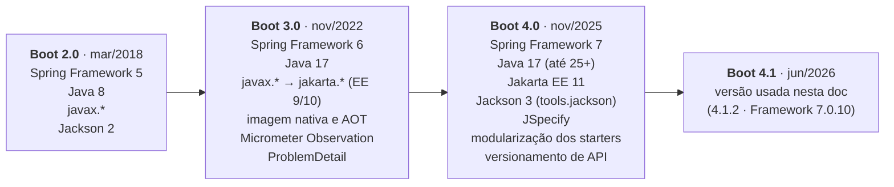

## O problema

Você já fez APIs com Spring Boot 2 ou 3. Abre um tutorial, copia a dependência `spring-boot-starter-web`, configura um `Jackson2ObjectMapperBuilderCustomizer` para formatar datas, importa `com.fasterxml.jackson.databind.ObjectMapper` num teste e usa `@MockBean`. No Spring Boot 4, cada uma dessas linhas é um problema: a primeira está depreciada, a segunda nem compila sem um módulo de compatibilidade (e, com ele, não afeta o JSON da API), a terceira aponta para a versão antiga do Jackson e a última nem compila.

Nada disso é exótico. São as primeiras coisas que alguém escreve num projeto novo, e a maior parte do material na internet ainda é do Boot 3. Quem não sabe o que mudou passa horas descobrindo por que a configuração "não pega".

Pense numa cidade em que você morou há alguns anos. As ruas principais continuam no lugar, e você ainda se localiza. Mas algumas mudaram de mão, uma ponte foi fechada e há um bairro novo. Antes de dirigir de memória, vale olhar o mapa atualizado.

> **A pergunta desta página:** o que continua igual no Spring Boot, o que mudou na versão 4 e onde cada mudança vai aparecer ao longo desta documentação?

## O conceito

### O que não mudou: IoC, autoconfiguração e *starters*

Três ideias sustentam o Spring Boot desde a versão 1, e continuam valendo:

**Inversão de controle e injeção de dependências.** Você não cria os objetos de que uma classe precisa; o *container* do Spring cria, guarda e entrega. Uma classe declara o que precisa no construtor, e o Spring resolve:

```java
@Service
class CategoriaService {

    private final CategoriaRepository repository;

    CategoriaService(CategoriaRepository repository) {   // o Spring injeta
        this.repository = repository;
    }
}
```

Os objetos gerenciados pelo *container* são os <Term id="bean">beans</Term>. Com um único construtor, nenhuma anotação é necessária para a injeção.

**Autoconfiguração.** Ao iniciar, o Spring Boot olha o que está no *classpath* e nas propriedades e configura o resto: se o Spring MVC e o Tomcat estão presentes, ele sobe um servidor na porta 8080 e registra o `DispatcherServlet`; se o Jackson está presente, ele cria o conversor de JSON. Cada autoconfiguração é condicional (`@ConditionalOnClass`, `@ConditionalOnMissingBean`) e **recua** quando você define o seu próprio bean.

**Starters.** São dependências que agrupam o que é preciso para uma funcionalidade. Você declara `spring-boot-starter-webmvc` e recebe o Spring MVC, o Tomcat, o Jackson e as autoconfigurações correspondentes, nas versões que funcionam juntas.

### Spring Boot 4 e Spring Framework 7

O Spring Boot 4.0 saiu em novembro de 2025, junto com o Spring Framework 7.0. Esta documentação usa o **Boot 4.1.2**, que depende do **Framework 7.0.10**. As mudanças que mais afetam quem escreve APIs:

| Mudança | O que significa na prática | Onde aprofundar |
|---|---|---|
| **Java 17 como mínimo** | Igual ao Boot 3. O Bazar usa o Java 25, a LTS atual. | [01.02](/comecando-e-fundamentos-de-http/preparando-o-ambiente) |
| **Jakarta EE 11** | Servlet 6.1, Bean Validation 3.1, JPA 3.2, Tomcat 11. Tudo em `jakarta.*`. | 07.01, Parte 4 |
| **Jackson 3 por padrão** | Novo pacote `tools.jackson`, `JsonMapper` imutável, novos padrões de serialização. | [06.03](/construindo-apis-com-spring-boot/jackson-3-no-spring-boot-4) |
| **JSpecify para *null safety*** | `@Nullable` e `@NullMarked` padronizados em todo o ecossistema. | Esta página |
| **Modularização** | O Boot foi quebrado em módulos menores, com *starters* por tecnologia. | Esta página |
| **Versionamento de API nativo** | `spring.mvc.apiversion.*` e o atributo `version` nos *mappings*. | [18.03](/contratos-documentacao-e-ciclo-de-vida/versionamento-nativo-no-spring-framework-7) |
| **HTTP Service Clients** | Interfaces com `@HttpExchange` viram clientes HTTP com autoconfiguração. | [24.03](/consumindo-outras-apis/http-interfaces-httpexchange-e-o-registro-de-clientes) |

### Jackson 3

O Jackson é a biblioteca que transforma objetos Java em JSON e vice-versa. A versão 3 mudou o pacote: as classes passaram de `com.fasterxml.jackson` para **`tools.jackson`** (o `ObjectMapper` agora vem de `tools.jackson.databind`). A exceção são as **anotações** (`@JsonProperty`, `@JsonIgnore`), que continuam em `com.fasterxml.jackson.annotation`, para que DTOs anotados não precisem mudar.

No Spring Boot, isso traz renomeações:

| Boot 3 (Jackson 2) | Boot 4 (Jackson 3) |
|---|---|
| `Jackson2ObjectMapperBuilderCustomizer` | `JsonMapperBuilderCustomizer` |
| `@JsonComponent` / `@JsonMixin` | `@JacksonComponent` / `@JacksonMixin` |
| `spring.jackson.serialization.*` e afins | `spring.jackson.json.read.*` / `spring.jackson.json.write.*` (e outras, ver 06.03) |

Os **padrões** também mudaram: datas saem como texto ISO 8601, propriedades desconhecidas na entrada são ignoradas e a ordem das propriedades na saída pode mudar. Se a sua API ainda precisa se comportar como no Boot 3, `spring.jackson.use-jackson2-defaults=true` aproxima os padrões antigos. O Jackson 2 ainda funciona como alternativa depreciada (`spring-boot-jackson2`), para migrações graduais. Os detalhes estão em 06.03.

### JSpecify: *null safety* padronizada

Por anos, cada biblioteca Java teve suas próprias anotações de nulidade: `javax.annotation.Nullable`, `org.springframework.lang.Nullable`, `org.jetbrains.annotations.Nullable`. O <Term id="jspecify">JSpecify</Term> é um padrão comum, criado por Google, JetBrains, Oracle, Spring e outros, com semântica precisa. O Spring Framework 7 e o Boot 4 anotaram toda a API pública com ele.

O modelo usa duas anotações principais, do pacote `org.jspecify.annotations`:

- **`@NullMarked`**, numa classe ou num pacote (em `package-info.java`): a partir dali, **tudo é não nulo por padrão**.
- **`@Nullable`**: marca as exceções, os tipos que podem ser nulos.

```java title="src/main/java/com/bazar/package-info.java"
@NullMarked
package com.bazar;

import org.jspecify.annotations.NullMarked;
```

As anotações não mudam o comportamento em tempo de execução: elas documentam o contrato e alimentam ferramentas. A IDE (o IntelliJ entende JSpecify) avisa quando você passa um valor possivelmente nulo onde ele não é aceito, e ferramentas como o NullAway transformam esses avisos em erros de compilação. As anotações antigas do Spring (`org.springframework.lang.Nullable`) estão depreciadas.

<Callout type="info" title="@NullMarked vale por pacote, não por árvore">
  Em Java, pacotes não têm hierarquia: `com.bazar.catalogo` não "herda" o `package-info.java` de `com.bazar`. Cada pacote precisa do seu próprio `package-info.java` com `@NullMarked`. No Bazar, cada pacote novo ganha um.
</Callout>

### Modularização

Até o Boot 3, quase toda a autoconfiguração morava num único JAR, o `spring-boot-autoconfigure`, com código para dezenas de tecnologias. No Boot 4, ela foi dividida em **módulos por tecnologia**: `spring-boot-webmvc`, `spring-boot-jackson`, `spring-boot-tomcat`, `spring-boot-validation` e assim por diante. Cada módulo tem a sua autoconfiguração e o seu pacote raiz (`org.springframework.boot.webmvc`). O resultado é um *classpath* menor e uma relação mais clara entre o que você declara e o que é configurado.

Para quem escreve o `pom.xml`, a mudança aparece nos *starters*:

| Antes (Boot 3) | Agora (Boot 4) | Observação |
|---|---|---|
| `spring-boot-starter-web` | **`spring-boot-starter-webmvc`** | O antigo continua existindo, mas está depreciado. |
| `spring-boot-starter-test` (tudo junto) | **`spring-boot-starter-webmvc-test`**, `spring-boot-starter-data-jpa-test`... | Um *starter* de teste por tecnologia: o padrão é `spring-boot-starter-<tecnologia>-test`. |
| `RestClient` vinha com o *starter* web | **`spring-boot-starter-restclient`** | Para consumir APIs (Parte 10). |
| `spring-boot-starter-aop` | **`spring-boot-starter-aspectj`** | Renomeado. |

Para migrações, o Boot 4 oferece os ***starters* clássicos** (`spring-boot-starter-classic` e `spring-boot-starter-test-classic`), que trazem todos os módulos de uma vez, como antes. A própria documentação recomenda abandoná-los com o tempo; um projeto novo, como o Bazar, usa os *starters* modulares desde o início.

Um efeito colateral importante: anotações de teste como `@WebMvcTest` mudaram de pacote (agora em `org.springframework.boot.webmvc.test.autoconfigure`), e só existem se o *starter* de teste correspondente estiver declarado.

### Remoções

| Removido | Alternativa |
|---|---|
| **Undertow** como servidor embutido | Tomcat (padrão) ou Jetty. O Undertow ainda não suporta Servlet 6.1. |
| Anotações `javax.*` de nulidade (`javax.annotation.Nonnull`) | JSpecify |
| `@MockBean` e `@SpyBean` (depreciados desde o 3.4) | `@MockitoBean` e `@MockitoSpyBean` |
| *Scripts* de execução embutidos no JAR ("*fully executable jar*") | `java -jar` ou um contêiner |
| Integração com Spock | JUnit (o Spock ainda não suporta Groovy 5) |

O suporte a `javax.servlet`, `javax.persistence` e afins já tinha saído no Boot 3, com a migração para Jakarta EE; no Boot 4, saíram os últimos resquícios de `javax`.

### Ciclo de lançamentos e suporte

O Spring Boot lança uma versão *minor* (4.0, 4.1, 4.2) a cada seis meses, normalmente em maio e em novembro, alinhada aos outros projetos Spring. Entre elas saem as versões de correção (4.1.1, 4.1.2), em geral uma vez por mês.

Cada *minor* recebe suporte gratuito (*OSS support*) por cerca de 13 meses, e suporte comercial por mais tempo:

| Versão | Lançamento | Fim do suporte gratuito |
|---|---|---|
| 4.0 | Novembro de 2025 | Dezembro de 2026 |
| 4.1 | Junho de 2026 | Julho de 2027 |

Na prática: **mantenha-se na versão de correção mais recente** (atualizações de segurança chegam só por ela) e **planeje a atualização de *minor*** antes que o suporte acabe. A fonte oficial é a seção *Support* da página do projeto no spring.io; as notas de cada versão ficam na wiki do GitHub.

## Diagrama

As mudanças-chave de cada geração:



## Na prática

### O `pom.xml` mínimo

Um projeto de API com o Boot 4.1.2 precisa de muito pouco. O `pom.xml` do Bazar, criado em [05.02](/construindo-apis-com-spring-boot/criando-o-projeto-bazar), acrescenta só as ferramentas de desenvolvimento:

```xml title="pom.xml (mínimo)"
<?xml version="1.0" encoding="UTF-8"?>
<project xmlns="http://maven.apache.org/POM/4.0.0"
         xmlns:xsi="http://www.w3.org/2001/XMLSchema-instance"
         xsi:schemaLocation="http://maven.apache.org/POM/4.0.0 https://maven.apache.org/xsd/maven-4.0.0.xsd">
    <modelVersion>4.0.0</modelVersion>

    <parent>
        <groupId>org.springframework.boot</groupId>
        <artifactId>spring-boot-starter-parent</artifactId>
        <version>4.1.2</version>
        <relativePath/>
    </parent>

    <groupId>com.bazar</groupId>
    <artifactId>bazar</artifactId>
    <version>0.0.1-SNAPSHOT</version>

    <properties>
        <java.version>25</java.version>
    </properties>

    <dependencies>
        <dependency>
            <groupId>org.springframework.boot</groupId>
            <artifactId>spring-boot-starter-webmvc</artifactId>
        </dependency>
        <dependency>
            <groupId>org.springframework.boot</groupId>
            <artifactId>spring-boot-starter-webmvc-test</artifactId>
            <scope>test</scope>
        </dependency>
    </dependencies>

    <build>
        <plugins>
            <plugin>
                <groupId>org.springframework.boot</groupId>
                <artifactId>spring-boot-maven-plugin</artifactId>
            </plugin>
        </plugins>
    </build>
</project>
```

O que cada parte faz:

- O ***parent*** `spring-boot-starter-parent` traz o gerenciamento de versões (o BOM): você não escreve a versão do Jackson, do Tomcat nem do JUnit, e todas são compatíveis entre si.
- A propriedade `java.version` configura o compilador.
- `spring-boot-starter-webmvc` traz o Spring MVC, o Tomcat 11 e o Jackson 3.
- `spring-boot-starter-webmvc-test` traz JUnit, AssertJ, Mockito e o suporte a `@WebMvcTest`.
- O `spring-boot-maven-plugin` empacota um JAR executável e oferece o `spring-boot:run`.

Para ver o que chega de fato, `./mvnw dependency:tree` mostra a árvore. No Bazar, o trecho do *starter* web é este (saída real, resumida):

```text
\- org.springframework.boot:spring-boot-starter-webmvc:jar:4.1.2:compile
   +- org.springframework.boot:spring-boot-starter-jackson:jar:4.1.2:compile
   |  \- org.springframework.boot:spring-boot-jackson:jar:4.1.2:compile
   +- org.springframework.boot:spring-boot-starter-tomcat:jar:4.1.2:compile
   |  +- org.springframework.boot:spring-boot-starter-tomcat-runtime:jar:4.1.2:compile
   |  |  +- org.apache.tomcat.embed:tomcat-embed-core:jar:11.0.27:compile
   +- org.springframework.boot:spring-boot-http-converter:jar:4.1.2:compile
   |  \- org.springframework:spring-web:jar:7.0.10:compile
   \- org.springframework.boot:spring-boot-webmvc:jar:4.1.2:compile
      \- org.springframework:spring-webmvc:jar:7.0.10:compile
```

Repare nos módulos `spring-boot-jackson`, `spring-boot-tomcat` e `spring-boot-webmvc`: é a modularização em ação.

### A classe principal

```java title="src/main/java/com/bazar/BazarApplication.java"
package com.bazar;

import org.springframework.boot.SpringApplication;
import org.springframework.boot.autoconfigure.SpringBootApplication;

@SpringBootApplication
public class BazarApplication {

    public static void main(String[] args) {
        SpringApplication.run(BazarApplication.class, args);
    }
}
```

`@SpringBootApplication` junta três anotações:

- `@SpringBootConfiguration`: a classe é uma fonte de configuração;
- `@EnableAutoConfiguration`: liga a autoconfiguração;
- `@ComponentScan`: procura componentes (`@RestController`, `@Service`...) **no pacote desta classe e nos subpacotes**. É por isso que ela fica no pacote raiz, `com.bazar`.

### O `package-info.java`

Com o `package-info.java` mostrado acima, tudo no pacote `com.bazar` é não nulo por padrão. Um parâmetro que aceita `null` precisa dizer isso:

```java
import org.jspecify.annotations.Nullable;

record FiltroProdutos(@Nullable String categoria, @Nullable String q) {}
```

O JSpecify chega ao projeto pelo `spring-core` (versão 1.0.1, gerenciada pelo Boot); não é preciso declarar a dependência.

## Erros comuns

<BadVsGood title="Customizar o Jackson como no Boot 3" why="No Boot 4, o JSON da API é gerado por um JsonMapper do Jackson 3. A classe do Jackson 2 nem existe no pacote antigo; ela só volta com o módulo depreciado spring-boot-jackson2, e mesmo assim configura um ObjectMapper do Jackson 2, que o Spring MVC não usa por padrão.">
<Bad title="Customizer do Jackson 2">

```java
import com.fasterxml.jackson.databind.SerializationFeature;
import org.springframework.boot.autoconfigure.jackson.Jackson2ObjectMapperBuilderCustomizer; // não existe no Boot 4

@Bean
Jackson2ObjectMapperBuilderCustomizer jackson() {
    return builder -> builder.featuresToDisable(SerializationFeature.WRITE_DATES_AS_TIMESTAMPS);
}
```

</Bad>
<Good title="Customizer do Jackson 3">

```java
import org.springframework.boot.jackson.autoconfigure.JsonMapperBuilderCustomizer;
import tools.jackson.databind.SerializationFeature;

@Bean
JsonMapperBuilderCustomizer jackson() {
    return builder -> builder.enable(SerializationFeature.INDENT_OUTPUT);
}
```

No Jackson 3, datas já saem como texto por padrão; muitas customizações antigas simplesmente deixaram de ser necessárias.

</Good>
</BadVsGood>

Outros erros frequentes na migração ou ao seguir tutoriais antigos:

- **Usar `spring-boot-starter-web`.** Funciona, mas está depreciado. Use `spring-boot-starter-webmvc`.
- **Declarar só `spring-boot-starter-test`.** `@WebMvcTest` e `@DataJpaTest` deixam de ser encontrados: eles agora vêm dos *starters* de teste por tecnologia.
- **Importar `com.fasterxml.jackson.databind.ObjectMapper`.** Esse é o Jackson 2. No Boot 4, injete o `JsonMapper` (de `tools.jackson.databind.json`).
- **Usar `@MockBean`.** Foi removido; use `@MockitoBean`.
- **Achar que `@NullMarked` vale para os subpacotes.** Cada pacote precisa do seu `package-info.java`.
- **Ficar numa versão de correção antiga.** As correções de segurança só saem na versão mais recente de cada *minor* suportada.

## Boas práticas

- **Use** os *starters* modulares (`-webmvc`, `-webmvc-test`, `-restclient`) em projetos novos.
- **Deixe** o *parent* gerenciar as versões; declare versão só para o que o Boot não gerencia (como o MapStruct).
- **Anote** cada pacote com `@NullMarked` e marque as exceções com `@Nullable`.
- **Leia** as *release notes* e o *migration guide* antes de atualizar uma versão *minor*.
- **Confira** se um tutorial é do Boot 4 antes de copiar configuração de Jackson, de testes ou de *starters*.

## Resumo

- O que não mudou: **injeção de dependências**, **autoconfiguração condicional** e ***starters***.
- Boot 4 = Framework 7: **Java 17** como mínimo, **Jakarta EE 11**, **Jackson 3** (`tools.jackson`), **JSpecify** (`@NullMarked`, `@Nullable`) e **modularização**.
- *Starters* novos: `spring-boot-starter-webmvc` (o `-web` está depreciado), `spring-boot-starter-webmvc-test`, `spring-boot-starter-restclient`.
- Removidos: **Undertow**, as últimas anotações `javax`, `@MockBean`/`@SpyBean`.
- Uma *minor* a cada seis meses, cerca de 13 meses de suporte gratuito; o Bazar usa o **Boot 4.1.2 com Java 25**.

<Exercise title="Atualize o pom de um tutorial" difficulty="facil">
Um tutorial do Boot 3 sugere estas dependências para uma API com testes de controller e um cliente HTTP:

```xml
<dependency>
    <groupId>org.springframework.boot</groupId>
    <artifactId>spring-boot-starter-web</artifactId>
</dependency>
<dependency>
    <groupId>org.springframework.boot</groupId>
    <artifactId>spring-boot-starter-undertow</artifactId>
</dependency>
<dependency>
    <groupId>org.springframework.boot</groupId>
    <artifactId>spring-boot-starter-test</artifactId>
    <scope>test</scope>
</dependency>
```

Reescreva o trecho para o Boot 4.1.2 e explique cada mudança. O que você faria com o Undertow?

<Hint>
Procure o *starter* modular de cada tecnologia: web MVC, teste de web MVC e cliente REST. Para o Undertow, consulte a tabela de remoções.
</Hint>

<Solution>

```xml
<dependency>
    <groupId>org.springframework.boot</groupId>
    <artifactId>spring-boot-starter-webmvc</artifactId>
</dependency>
<dependency>
    <groupId>org.springframework.boot</groupId>
    <artifactId>spring-boot-starter-restclient</artifactId>
</dependency>
<dependency>
    <groupId>org.springframework.boot</groupId>
    <artifactId>spring-boot-starter-webmvc-test</artifactId>
    <scope>test</scope>
</dependency>
```

- `spring-boot-starter-web` → `spring-boot-starter-webmvc`: o antigo está depreciado.
- O cliente HTTP (`RestClient`) passou a ter *starter* próprio, `spring-boot-starter-restclient`.
- `spring-boot-starter-test` → `spring-boot-starter-webmvc-test`: os testes de controller (`@WebMvcTest`) vêm do *starter* de teste da tecnologia. Se o cliente HTTP também for testado, acrescente `spring-boot-starter-restclient-test`.
- O Undertow foi removido; o *starter* nem existe no Boot 4. A solução é ficar com o Tomcat, que vem com o `-webmvc`, ou trocar para o Jetty (excluindo o Tomcat e declarando `spring-boot-starter-jetty`). Se havia configuração `server.undertow.*`, ela precisa ser revista.

</Solution>
</Exercise>

<Quiz
  questions={[
    {
      question: 'Num projeto Boot 4, você criou um bean Jackson2ObjectMapperBuilderCustomizer para mudar a serialização, mas o JSON da API não mudou. Por quê?',
      options: [
        'Porque o Boot 4 usa o Jackson 3, e o JSON da API é gerado por um JsonMapper configurado com JsonMapperBuilderCustomizer',
        'Porque customizers só funcionam com a propriedade spring.jackson.enabled=true',
        'Porque o Boot 4 não usa mais Jackson, e sim JSON-B',
      ],
      answer: 0,
      explanation: 'O Boot 4 adota o Jackson 3 (pacote tools.jackson), e o customizer correspondente é o JsonMapperBuilderCustomizer. O Jackson continua sendo o padrão, e não existe uma propriedade para "ligar" customizers.',
    },
    {
      question: 'O pacote com.bazar tem um package-info.java com @NullMarked. Os parâmetros de uma classe em com.bazar.catalogo são não nulos por padrão?',
      options: [
        'Sim, porque com.bazar.catalogo é um subpacote de com.bazar',
        'Só se a classe estender uma classe de com.bazar',
        'Não: pacotes Java não têm hierarquia, e com.bazar.catalogo precisa do seu próprio package-info.java',
      ],
      answer: 2,
      explanation: 'Para o Java, com.bazar e com.bazar.catalogo são pacotes independentes; a anotação de pacote não se propaga. Herança de classes também não transmite @NullMarked de pacote.',
    },
    {
      question: 'Por que o @SpringBootApplication fica na classe do pacote raiz (com.bazar)?',
      options: [
        'Porque o Maven só encontra a classe main no pacote raiz',
        'Porque o @ComponentScan procura componentes no pacote da classe e nos subpacotes',
        'Porque o Boot 4 exige isso desde a modularização',
      ],
      answer: 1,
      explanation: 'O @ComponentScan embutido no @SpringBootApplication varre o pacote da classe anotada e os seus subpacotes; no pacote raiz, ele encontra todos os módulos do Bazar. O Maven não impõe isso, e a regra é a mesma desde o Boot 1.',
    },
  ]}
/>

## Referências

<References />
