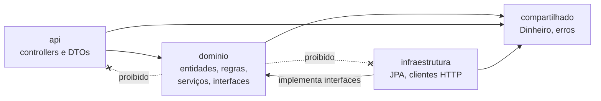

## O problema

Todo projeto Spring começa organizado. Depois de dois anos, muitos estão assim:

```text
com.loja.controller   (34 classes)
com.loja.service      (81 classes)
com.loja.repository   (40 classes)
com.loja.dto          (157 classes)
com.loja.entity       (45 classes)
```

Para mexer no cancelamento de pedidos, você abre cinco pacotes enormes e procura, em cada um, as poucas classes que importam. Nada impede que o `ProdutoService` chame o `PedidoRepository` diretamente, e é exatamente isso que acontece: tudo depende de tudo. Quando alguém propõe extrair os pagamentos para um serviço separado, ninguém consegue dizer quais classes levar.

Pense num supermercado organizado "por tipo de embalagem": todas as latas num corredor, todos os sacos em outro, todos os vidros num terceiro. Para fazer um bolo, você percorre a loja inteira atrás do fermento (lata), da farinha (saco) e da essência (vidro). Supermercados organizam por **finalidade** (padaria, limpeza, bebidas) porque é assim que as pessoas procuram.

> **A pergunta desta página:** como criar o projeto do Bazar e organizar os pacotes para que ele continue fácil de navegar e de mudar quando tiver dezenas de endpoints?

## O conceito

### O Spring Initializr

O [start.spring.io](https://start.spring.io) gera o esqueleto de um projeto Spring Boot: o `pom.xml` com o *parent* e os *starters* escolhidos, o *Maven Wrapper* (`mvnw`), a classe principal e um teste. As IDEs (IntelliJ, VS Code com as extensões de Spring) usam o mesmo serviço por trás dos assistentes de "novo projeto".

As escolhas para o Bazar:

| Campo | Valor | Por quê |
|---|---|---|
| Project | Maven | O build usado em toda a documentação |
| Language | Java | |
| Spring Boot | 4.1.2 | A versão de referência desta documentação |
| Group / Artifact | `com.bazar` / `bazar` | O pacote base vira `com.bazar` |
| Packaging | Jar | Servidor embutido; nada de WAR |
| Java | 25 | A LTS atual |

E as dependências iniciais, só as necessárias agora:

| Dependência (no Initializr) | *Starter* | Para quê |
|---|---|---|
| Spring Web | `spring-boot-starter-webmvc` | Spring MVC, Tomcat e Jackson |
| Spring Boot DevTools | `spring-boot-devtools` | Reinício automático no desenvolvimento |
| Docker Compose Support | `spring-boot-docker-compose` | Subir o banco junto com a aplicação (Parte 4) |

Validação, JPA, Flyway e as outras entram nas páginas que as ensinam. Cada dependência que você não usa é código a mais para atualizar e para auditar.

### Pacotes por camada × por módulo

Há duas formas clássicas de organizar os pacotes:

**Por camada** (*package by layer*): `controller`, `service`, `repository`. É o que a maioria dos tutoriais mostra, porque funciona bem com cinco classes. O problema é que ela agrupa coisas que **mudam juntas por acaso** (todos os controllers) e espalha as que **mudam juntas de verdade** (tudo sobre pedidos).

**Por módulo** (*package by feature*): `catalogo`, `pedidos`, `pagamentos`. Cada pacote contém tudo de uma área de negócio. Para mexer no cancelamento, você abre `pedidos`. E a fronteira do pacote vira a fronteira do módulo: fica claro o que um módulo usa do outro.

<Comparison
  title="Organização dos pacotes"
  columns={['Por camada', 'Por módulo']}
  highlight={1}
  rows={[
    { label: 'Fácil de entender com 5 classes', values: [true, true] },
    { label: 'Uma mudança de negócio fica em um pacote', values: [false, true] },
    { label: 'Fronteiras entre áreas de negócio visíveis', values: [false, true] },
    { label: 'Classes podem ser package-private', values: [false, true] },
    { label: 'Extrair um módulo para outro serviço', values: ['difícil', 'viável'] },
  ]}
/>

O Bazar organiza **por módulo**: `catalogo`, `estoque`, `clientes`, `pedidos`, `pagamentos`, `frete`, `integracoes`, `relatorios` e `compartilhado`. Hoje existem só `catalogo` e `compartilhado`; os outros nascem quando forem necessários. Na Parte 15, o Spring Modulith vai verificar essas fronteiras automaticamente ([30.01](/arquitetura/monolito-modular-com-spring-modulith)).

### Camadas dentro de cada módulo

Organizar por módulo não elimina as camadas: elas descem um nível. Cada módulo do Bazar tem três subpacotes:

| Camada | Pacote | O que contém | Pode depender de |
|---|---|---|---|
| **API** | `com.bazar.catalogo.api` | Controllers, DTOs de entrada e saída | domínio |
| **Domínio** | `com.bazar.catalogo.dominio` | Entidades, regras de negócio, serviços, interfaces de repositório | nada (só o compartilhado) |
| **Infraestrutura** | `com.bazar.catalogo.infraestrutura` | Persistência, clientes HTTP, mensageria | domínio |

A regra central: **o domínio não depende das outras camadas**. Ele não importa nada de `api` (não conhece DTOs nem HTTP) nem de `infraestrutura` (não sabe qual banco ou qual *gateway* de pagamento é usado). Quando o domínio precisa de algo externo, ele **define uma interface** (por exemplo, `GatewayDePagamento`), e a infraestrutura a implementa. É a <Term id="inversao-de-dependencia">inversão de dependência</Term>: as setas apontam para o domínio, que fica estável enquanto o resto muda.

Por que isso importa para uma API: o contrato HTTP (camada `api`) e a persistência (camada `infraestrutura`) são as partes que mais mudam por motivos técnicos (uma v2, um novo índice), e as regras de negócio não deveriam mudar junto. É a separação de três camadas vista em [03.02](/rest-e-estilos-de-api/recursos-representacoes-e-a-interface-uniforme), agora em pacotes.

<Callout type="info" title="Pragmatismo">
  Nas primeiras páginas, o catálogo é tão simples que o domínio é só uma classe e não há infraestrutura. Tudo bem: os pacotes existem desde já para que cada classe nova tenha um lugar óbvio. Quando o JPA entrar (Parte 4), o Bazar vai usar as interfaces do Spring Data direto no domínio, uma concessão comum discutida em [10.01](/persistencia-para-apis/spring-data-jpa-essencial-para-apis).
</Callout>

### `application.yml`

O Initializr gera um `application.properties`. O Bazar usa **YAML** (`application.yml`): as configurações do Spring são hierárquicas (`spring.jackson.json.write...`), e o YAML evita repetir os prefixos. Os dois formatos são equivalentes; o importante é usar **um só** no projeto, para que ninguém precise procurar em dois arquivos.

### Executando: `./mvnw spring-boot:run`

O `mvnw` é o *Maven Wrapper*: um *script* que baixa a versão do Maven definida em `.mvn/wrapper/maven-wrapper.properties` (no Bazar, a 3.10.0) e a executa. Todos que clonam o projeto usam a mesma versão, sem instalar nada.

- `./mvnw spring-boot:run` compila e sobe a aplicação a partir das classes compiladas, com o DevTools ativo.
- `./mvnw verify` compila, roda os testes e empacota. É o comando que a integração contínua executa, e o que esta documentação usa para garantir que o código das páginas funciona.
- `./mvnw package` gera o JAR em `target/bazar-0.0.1-SNAPSHOT.jar`, executável com `java -jar`.

### DevTools

O `spring-boot-devtools` melhora o ciclo de desenvolvimento:

- **Reinício automático.** Quando uma classe recompilada muda no *classpath* (a IDE compila ao salvar, ou você roda `./mvnw compile`), a aplicação reinicia em cerca de um segundo. O reinício é rápido porque as bibliotecas ficam num *classloader* separado, que não é recarregado.
- **Padrões para desenvolvimento.** O DevTools liga propriedades úteis só no desenvolvimento, como desligar *caches* de *templates* e **incluir detalhes nas respostas de erro**.

Esses detalhes aparecem já na primeira requisição: o `404` traz o *stack trace* inteiro no corpo. Isso ajuda a depurar, e seria um vazamento grave em produção. Por isso o DevTools é declarado como `optional` e é **desligado automaticamente** quando a aplicação roda como um JAR empacotado (`java -jar`): o `spring-boot-maven-plugin` nem o inclui no JAR. O formato definitivo dos erros do Bazar é construído na [Parte 3, módulo 08](/construindo-apis-com-spring-boot/problemdetail-no-spring-tratamento-global-de-erros).

### Docker Compose no desenvolvimento

A partir da Parte 4, o Bazar precisa de um PostgreSQL. Com o `spring-boot-docker-compose` no *classpath*, ao iniciar a aplicação o Spring Boot:

1. procura um `compose.yaml` no diretório de trabalho;
2. roda `docker compose up` (se os serviços ainda não estiverem rodando);
3. detecta os contêineres conhecidos (PostgreSQL, Redis, Kafka...) e **cria as configurações de conexão automaticamente**, como `spring.datasource.url`, sem que você escreva nada no `application.yml`;
4. ao encerrar, para os contêineres (`docker compose stop`, por padrão).

Nos testes, a integração é **desligada por padrão**: testes usam Testcontainers ([11.04](/testes-de-api/testes-de-integracao-com-springboottest-e-testcontainers)). E, como o DevTools, a dependência é `optional` e fica fora do JAR de produção.

O Bazar já cria o `compose.yaml`, ainda sem serviços. O PostgreSQL entra em [10.01](/persistencia-para-apis/spring-data-jpa-essencial-para-apis).

## Diagrama

A árvore de pacotes do Bazar ao fim do projeto. Nesta página existem só a raiz, o `catalogo` e o `compartilhado`; os outros módulos nascem nas partes indicadas:

<FileTree title="Pacotes do Bazar" tree={`
src/main/java/com/bazar/
  BazarApplication.java
  package-info.java
  catalogo/ # categorias, produtos, imagens
    api/ # controllers e DTOs
    dominio/ # entidades, regras, serviços
    infraestrutura/ # persistência e integrações
  compartilhado/ # Dinheiro, erros, paginação
  estoque/ # Parte 4
  clientes/ # Parte 6
  pedidos/ # Parte 6
  pagamentos/ # Parte 6
  frete/ # Parte 10
  integracoes/ # Parte 9
  relatorios/ # Parte 9
`} />

E as dependências permitidas entre as camadas de um módulo:



## Na prática

<Steps>
<Step title="Gere o projeto">

Pelo site, preencha os campos da tabela acima. Ou, no terminal, com o mesmo resultado:

```bash
curl https://start.spring.io/starter.zip \
  -d type=maven-project -d language=java \
  -d bootVersion=4.1.2 -d javaVersion=25 \
  -d groupId=com.bazar -d artifactId=bazar -d name=bazar \
  -d packageName=com.bazar -d packaging=jar \
  -d dependencies=web,devtools,docker-compose \
  -o bazar.zip
unzip bazar.zip -d bazar && cd bazar
```

</Step>
<Step title="Troque o application.properties pelo application.yml">

```bash
rm src/main/resources/application.properties
```

```yaml title="src/main/resources/application.yml"
spring:
  application:
    name: bazar

server:
  port: 8080
```

`spring.application.name` aparece nos logs (`--- [bazar]`) e, mais tarde, nas métricas e nos *traces*.

</Step>
<Step title="Crie os pacotes do primeiro módulo">

Cada pacote ganha um `package-info.java` com `@NullMarked` ([05.01](/construindo-apis-com-spring-boot/spring-boot-4-em-uma-pagina)) e uma linha de documentação dizendo o que mora ali:

```java title="src/main/java/com/bazar/catalogo/api/package-info.java"
/**
 * Camada de API do catálogo: controllers e DTOs (o contrato HTTP).
 */
@NullMarked
package com.bazar.catalogo.api;

import org.jspecify.annotations.NullMarked;
```

Repita para `com.bazar`, `com.bazar.catalogo`, `com.bazar.catalogo.dominio`, `com.bazar.catalogo.infraestrutura` e `com.bazar.compartilhado`.

</Step>
<Step title="Deixe o compose.yaml pronto">

```yaml title="compose.yaml"
# Serviços de infraestrutura para o desenvolvimento local.
# O spring-boot-docker-compose sobe este arquivo junto com a aplicação.
# O PostgreSQL entra na Parte 4 (10.01).
services: {}
```

</Step>
<Step title="Rode a aplicação">

```bash
./mvnw spring-boot:run
```

A saída (real, resumida):

```text
INFO  [restartedMain] com.bazar.BazarApplication : Starting BazarApplication using Java 25.0.4.1 with PID 122533
INFO  [restartedMain] .e.DevToolsPropertyDefaultsPostProcessor : Devtools property defaults active! Set 'spring.devtools.add-properties' to 'false' to disable
INFO  [restartedMain] .s.b.d.c.l.DockerComposeLifecycleManager : Using Docker Compose file .../bazar/compose.yaml
WARN  [restartedMain] .s.b.d.c.l.DockerComposeLifecycleManager : No services defined in Docker Compose file .../bazar/compose.yaml with active profiles []
INFO  [restartedMain] o.s.boot.tomcat.TomcatWebServer : Tomcat initialized with port 8080 (http)
INFO  [restartedMain] o.apache.catalina.core.StandardEngine : Starting Servlet engine: [Apache Tomcat/11.0.27]
INFO  [restartedMain] o.s.boot.tomcat.TomcatWebServer : Tomcat started on port 8080 (http) with context path '/'
INFO  [restartedMain] com.bazar.BazarApplication : Started BazarApplication in 1.082 seconds (process running for 1.31)
```

- `restartedMain` é a *thread* do DevTools: a aplicação roda no *classloader* que pode ser reiniciado.
- O aviso do Docker Compose é esperado: o arquivo ainda não tem serviços.
- Em cerca de um segundo, o Tomcat 11 está ouvindo na porta 8080.

</Step>
<Step title="Faça a primeira requisição">

Ainda não há nenhum endpoint, então qualquer caminho dá `404`:

```bash
curl -i http://localhost:8080/v1/categorias
```

```http
HTTP/1.1 404
Content-Type: application/json

{"timestamp":"2026-10-24T23:07:48.278Z","status":404,"error":"Not Found",
 "trace":"org.springframework.web.servlet.resource.NoResourceFoundException: No static resource v1/categorias ...
 \tat org.springframework.web.servlet.resource.ResourceHttpRequestHandler.handleRequest(...)\n ...",
 "message":"No static resource v1/categorias.","path":"/v1/categorias"}
```

Dois detalhes: o `trace` só aparece porque o DevTools está ativo; e a mensagem fala em "*static resource*" porque, sem nenhum controller que atenda a rota, o Spring MVC tenta servir um arquivo estático, e é essa tentativa que falha. O caminho completo de uma requisição está em [09.01](/construindo-apis-com-spring-boot/o-caminho-de-uma-requisicao-no-spring-mvc).

</Step>
<Step title="Rode o build completo">

```bash
./mvnw verify
```

O teste gerado pelo Initializr (`BazarApplicationTests`) sobe o contexto do Spring e falha se alguma configuração estiver quebrada. Ele é simples, mas pega erros de configuração antes de qualquer outro teste.

</Step>
</Steps>

## Erros comuns

<BadVsGood title="Onde colocar a classe principal" why="O @ComponentScan começa no pacote da classe anotada com @SpringBootApplication. Num subpacote, ele não enxerga os outros módulos, e os controllers deles simplesmente não são registrados (404 em tudo, sem erro algum na inicialização).">
<Bad title="Classe principal dentro de um módulo">

```text
com/bazar/catalogo/BazarApplication.java
com/bazar/pedidos/api/PedidoController.java   ← nunca é encontrado
```

</Bad>
<Good title="Classe principal no pacote raiz">

```text
com/bazar/BazarApplication.java
com/bazar/catalogo/api/CategoriaController.java
com/bazar/pedidos/api/PedidoController.java
```

</Good>
</BadVsGood>

Outros erros frequentes:

- **Organizar por camada "porque o projeto é pequeno".** Todo projeto grande foi pequeno. Reorganizar pacotes depois de um ano custa caro e quebra o histórico do Git.
- **Domínio importando DTOs ou classes de HTTP.** Um `PedidoService` que recebe `CriarPedidoRequest` ou devolve `ResponseEntity` amarra as regras de negócio ao contrato. O controller traduz; o serviço recebe tipos do domínio.
- **Adicionar dependências "para depois".** JPA no *classpath* sem banco configurado faz a aplicação falhar na inicialização. Adicione cada *starter* quando ele for usado.
- **Misturar `application.properties` e `application.yml`.** Os dois são carregados, e quando a mesma chave aparece nos dois, o `.properties` vence. Descobrir isso depurando é doloroso.
- **Rodar o JAR de produção com o DevTools.** Ele já é excluído pelo plugin; não force a inclusão (`excludeDevtools=false`).

## Boas práticas

- **Organize** por módulo de negócio, com camadas `api`, `dominio` e `infraestrutura` dentro de cada um.
- **Mantenha** a classe `@SpringBootApplication` no pacote raiz.
- **Proteja** o domínio: ele não importa nada de `api` nem de `infraestrutura`.
- **Use** o *Maven Wrapper* (`./mvnw`) em vez de um Maven instalado.
- **Adicione** dependências só quando forem usadas.
- **Rode** `./mvnw verify` antes de cada *commit*.

## No projeto Bazar

<ProjectStep title="Projeto criado com a estrutura de módulos" module="compartilhado" tag="pagina-05.02" files={[
  { path: 'pom.xml', change: 'novo' },
  { path: 'compose.yaml', change: 'novo' },
  { path: 'src/main/resources/application.yml', change: 'novo' },
  { path: 'src/main/java/com/bazar/BazarApplication.java', change: 'novo' },
  { path: 'src/main/java/com/bazar/package-info.java', change: 'novo' },
  { path: 'src/main/java/com/bazar/catalogo/package-info.java', change: 'novo' },
  { path: 'src/main/java/com/bazar/catalogo/api/package-info.java', change: 'novo' },
  { path: 'src/main/java/com/bazar/catalogo/dominio/package-info.java', change: 'novo' },
  { path: 'src/main/java/com/bazar/catalogo/infraestrutura/package-info.java', change: 'novo' },
  { path: 'src/main/java/com/bazar/compartilhado/package-info.java', change: 'novo' },
  { path: 'src/test/java/com/bazar/BazarApplicationTests.java', change: 'novo' },
]}>
O esqueleto do Bazar: Spring Boot 4.1.2 com Java 25, Spring MVC, DevTools e suporte a Docker Compose, organizado por módulos. Para conferir, rode `./mvnw verify` (o teste de contexto passa) e `./mvnw spring-boot:run` (o Tomcat sobe na porta 8080 e responde `404` a qualquer rota). O primeiro endpoint chega em [05.03](/construindo-apis-com-spring-boot/primeiro-endpoint).
</ProjectStep>

## Resumo

- O **Spring Initializr** gera o esqueleto; o Bazar começa com `webmvc`, `devtools` e `docker-compose`, e as outras dependências chegam quando forem usadas.
- **Pacotes por módulo** (`com.bazar.catalogo`) agrupam o que muda junto e tornam as fronteiras visíveis; **dentro** de cada módulo ficam as camadas `api`, `dominio` e `infraestrutura`.
- O **domínio não depende** de `api` nem de `infraestrutura`; quando precisa de algo externo, define uma interface.
- `application.yml` em vez de `.properties`; `./mvnw spring-boot:run` para rodar e `./mvnw verify` para o build completo.
- O **DevTools** reinicia a aplicação e liga padrões de desenvolvimento (como o *stack trace* nos erros); ele e o **Docker Compose** ficam fora do JAR de produção.

<Exercise title="Onde mora cada classe?" difficulty="facil">
Indique o pacote de cada classe abaixo, seguindo a estrutura do Bazar, e diga se alguma delas viola a regra de dependências:

1. `CriarPedidoRequest` (DTO de entrada da criação de pedido)
2. `Pedido` (entidade com as regras de transição de estado)
3. `PagaFacilClient` (cliente HTTP do *gateway* de pagamento)
4. `GatewayDePagamento` (interface que o serviço de pagamentos usa para cobrar)
5. `Dinheiro` (valor e moeda)
6. Um `PedidoService` com o método `ResponseEntity<PedidoResponse> criar(CriarPedidoRequest request)`

<Hint>
Pergunte, para cada classe: ela fala HTTP, fala de regras de negócio ou fala com o mundo externo? E quantos módulos a usam?
</Hint>

<Solution>

1. `com.bazar.pedidos.api`: é parte do contrato HTTP.
2. `com.bazar.pedidos.dominio`: entidade e regras de negócio.
3. `com.bazar.pagamentos.infraestrutura`: fala com um sistema externo.
4. `com.bazar.pagamentos.dominio`: o domínio **define** a interface de que precisa; a infraestrutura (`PagaFacilClient`, ou um adaptador que o usa) a implementa. É a inversão de dependência.
5. `com.bazar.compartilhado`: é usado por catálogo, pedidos e pagamentos.
6. Esse serviço **viola** a regra: o domínio estaria importando `ResponseEntity` (HTTP) e dois DTOs da camada `api`. O correto é o serviço receber dados do domínio (ou um comando próprio) e devolver um `Pedido`; o controller converte o DTO de entrada, chama o serviço e monta a `ResponseEntity`.

</Solution>
</Exercise>

<Quiz
  questions={[
    {
      question: 'O PedidoController está em com.bazar.pedidos.api, mas a classe @SpringBootApplication foi movida para com.bazar.catalogo. O que acontece?',
      options: [
        'A aplicação não compila',
        'A aplicação sobe normalmente, mas as rotas de pedidos respondem 404, porque o controller não é encontrado pelo component scan',
        'O Spring encontra o controller, porque varre todo o classpath',
      ],
      answer: 1,
      explanation: 'O @ComponentScan varre só o pacote da classe principal e seus subpacotes. com.bazar.pedidos não é subpacote de com.bazar.catalogo, então o controller nunca vira um bean, e não há erro de compilação nem de inicialização.',
    },
    {
      question: 'Por que o stack trace aparece no corpo do 404 ao rodar com ./mvnw spring-boot:run, e não aparece com java -jar?',
      options: [
        'Porque o Maven liga o modo debug',
        'Porque o DevTools liga padrões de desenvolvimento, como incluir detalhes nos erros, e ele fica fora do JAR empacotado',
        'Porque o Tomcat só esconde stack traces em HTTPS',
      ],
      answer: 1,
      explanation: 'O DevTools ativa propriedades de desenvolvimento, entre elas incluir o stack trace nas respostas de erro. O spring-boot-maven-plugin exclui o DevTools do JAR, e com java -jar ele também se desliga. O Maven e o HTTPS não têm relação com isso.',
    },
    {
      question: 'Qual destas dependências entre camadas é permitida no Bazar?',
      options: [
        'dominio → api (o serviço usa o DTO de entrada)',
        'dominio → infraestrutura (o serviço instancia o cliente da PagaFácil)',
        'infraestrutura → dominio (o adaptador implementa uma interface definida no domínio)',
      ],
      answer: 2,
      explanation: 'As setas apontam para o domínio: a infraestrutura implementa interfaces que o domínio define. O domínio não conhece DTOs (camada api) nem implementações concretas de infraestrutura.',
    },
  ]}
/>

## Referências

<References />
