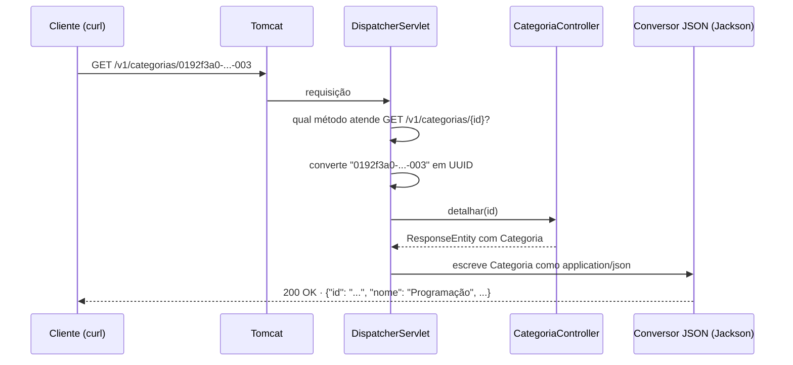

## O problema

O Bazar está no ar, mas responde `404` para tudo. O app precisa mostrar o menu de categorias, e para isso só precisa de duas coisas: a lista de categorias e os detalhes de uma delas.

Em Java puro, sobre a API de *Servlets*, isso significaria ler a URL à mão, separar o id do caminho, converter a *string* em UUID, tratar o caso de o id ser inválido, transformar o objeto em JSON, escrever o `Content-Type` e o status, e repetir tudo em cada endpoint. É muito código que não tem nada a ver com categorias.

Pense num restaurante. O cliente pede um prato pelo nome do cardápio; o garçom anota, leva para a cozinha certa e traz o prato na mesa. O cozinheiro só cozinha: ele não conversa com o cliente, não sabe qual mesa fez o pedido e não leva o prato. O Spring MVC é o garçom: ele recebe a requisição HTTP, descobre qual método deve atendê-la, entrega os parâmetros já convertidos e transforma o resultado numa resposta. O seu método é o cozinheiro.

> **A pergunta desta página:** como transformar um método Java num endpoint HTTP, como receber parâmetros do caminho, da *query string* e dos headers, e o que o Spring faz com o valor que o método devolve?

## O conceito

### `@RestController`

Um controller é uma classe cujos métodos atendem requisições. A anotação `@RestController` combina duas outras:

- **`@Controller`**: marca a classe como um componente web (um bean que o Spring encontra pelo *component scan*);
- **`@ResponseBody`**: diz que o valor devolvido por cada método **é o corpo da resposta**, e não o nome de uma página HTML a ser renderizada.

Antes do `@RestController` (Spring 4.0), era preciso anotar cada método com `@ResponseBody`. Hoje, para APIs, `@RestController` é o padrão.

### Mapeando requisições

O Spring escolhe o método pela combinação de **método HTTP** e **caminho**:

| Anotação | Método HTTP |
|---|---|
| `@GetMapping` | GET |
| `@PostMapping` | POST |
| `@PutMapping` | PUT |
| `@PatchMapping` | PATCH |
| `@DeleteMapping` | DELETE |
| `@RequestMapping(method = ...)` | Qualquer um (é a anotação genérica por trás das outras) |

Um `@RequestMapping` na **classe** define o prefixo comum a todos os métodos. Com `@RequestMapping("/v1/categorias")` na classe e `@GetMapping("/{id}")` no método, o caminho completo é `/v1/categorias/{id}`.

### Parâmetros do método

O Spring preenche os parâmetros do método a partir da requisição. As fontes mais comuns:

| Anotação | De onde vem | Exemplo de URL ou header |
|---|---|---|
| `@PathVariable` | Um trecho do caminho | `/v1/categorias/{id}` |
| `@RequestParam` | A *query string* | `/v1/categorias?q=liv` |
| `@RequestHeader` | Um header | `Accept-Language: pt-BR` |
| `@RequestBody` | O corpo (JSON) | Próxima página, [05.04](/construindo-apis-com-spring-boot/um-crud-com-status-corretos) |

A **conversão de tipos** é automática: se o parâmetro é um `UUID`, um `int`, um `boolean`, uma data ou um `enum`, o Spring converte a *string* da requisição. Quando a conversão falha (`/v1/categorias/abc` para um `UUID`), a resposta é **`400 Bad Request`**, e o método nem é chamado.

### `@RequestParam`: obrigatório, com padrão ou opcional

Por padrão, um `@RequestParam` é **obrigatório**: se ele não vier, a resposta é `400`. Há três formas de mudar isso:

```java
@RequestParam String q                                  // obrigatório: sem ?q=, 400
@RequestParam(defaultValue = "false") boolean apenasRaizes  // padrão: sem o parâmetro, false
@RequestParam(required = false) @Nullable String q     // opcional: sem o parâmetro, null
```

Também é opcional um parâmetro do tipo `Optional<String>` ou anotado com `@Nullable` (o Spring reconhece a anotação do JSpecify). O Bazar usa `required = false` com `@Nullable`, que deixa a intenção explícita para quem lê e para o verificador de nulidade.

Em filtros de listagem, quase todos os parâmetros são opcionais ou têm padrão: o cliente que não filtra nada recebe tudo. Os filtros de verdade do Bazar estão em [13.01](/design-de-apis-profissional/filtros-e-busca).

### `@RequestHeader`

Funciona como o `@RequestParam`, mas lê um header. O nome do header não diferencia maiúsculas e minúsculas:

```java
@GetMapping
public Lista<Categoria> listar(
        @RequestHeader(name = "Accept-Language", required = false) @Nullable String idioma) {
    // ...
}
```

Para headers padronizados, prefira o suporte que o Spring já oferece: o `Accept` é tratado pela negociação de conteúdo, e o idioma pode vir de um `Locale` como parâmetro, resolvido pelo `LocaleResolver` ([15.05](/design-de-apis-profissional/internacionalizacao-na-api)).

### Devolver um objeto × devolver `ResponseEntity`

Um método de controller pode devolver:

- **O próprio objeto** (`Lista<Categoria>`): o Spring o converte em JSON e responde `200 OK`. É a forma mais curta, e serve quando o resultado é sempre o mesmo status.
- **Um `ResponseEntity<T>`**: você controla **status, headers e corpo**. Serve quando o status depende do resultado (`200` ou `404`), quando há headers (`Location`, `ETag`) ou quando o corpo é vazio.

```java
ResponseEntity.ok(categoria)                    // 200 com corpo
ResponseEntity.notFound().build()               // 404 sem corpo
ResponseEntity.of(optional)                     // 200 com o valor, ou 404 se vazio
ResponseEntity.status(HttpStatus.CREATED)...    // qualquer status (05.04)
```

### A conversão para JSON

Quando o método devolve um objeto, o Spring precisa escolher **em que formato** escrevê-lo. Ele olha o `Accept` da requisição e a lista de conversores disponíveis (os `HttpMessageConverter`); com o Jackson no *classpath*, o conversor de JSON atende `application/json`. Records são serializados com um campo por componente, e o resultado sai com `Content-Type: application/json`.

Se o cliente pedir um formato que nenhum conversor produz (`Accept: application/xml`), a resposta é `406 Not Acceptable`, como em [02.05](/comecando-e-fundamentos-de-http/content-negotiation-e-media-types). O funcionamento dos conversores é o assunto de [09.03](/construindo-apis-com-spring-boot/httpmessageconverter-e-a-serializacao-por-dentro); a configuração do Jackson, de [06.03](/construindo-apis-com-spring-boot/jackson-3-no-spring-boot-4).

### O envelope `itens`

O Bazar decidiu em [02.06](/comecando-e-fundamentos-de-http/json-para-apis) que **coleções nunca são um array no topo do JSON**: a lista vai num objeto, no campo `itens`. Assim, acrescentar informações de paginação depois (`proximoCursor`, `total`) não quebra nenhum cliente. No código, o envelope é um record genérico do módulo compartilhado:

```java title="src/main/java/com/bazar/compartilhado/Lista.java"
package com.bazar.compartilhado;

import java.util.List;

/**
 * Envelope das coleções: o Bazar nunca devolve um array no topo do JSON (02.06).
 */
public record Lista<T>(List<T> itens) {
}
```

## Diagrama

O caminho simplificado de uma requisição até o JSON. A versão completa, com todos os componentes, está em [09.01](/construindo-apis-com-spring-boot/o-caminho-de-uma-requisicao-no-spring-mvc).



## Na prática

### O domínio e o repositório em memória

O Bazar ainda não tem banco. As categorias ficam num mapa em memória, numa classe com os mesmos nomes de métodos do Spring Data (`findAll`, `findById`), para que a troca pelo JPA em [10.01](/persistencia-para-apis/spring-data-jpa-essencial-para-apis) mude pouco o controller.

```java title="src/main/java/com/bazar/catalogo/dominio/Categoria.java"
package com.bazar.catalogo.dominio;

import java.util.UUID;

import org.jspecify.annotations.Nullable;

/**
 * Uma categoria do catálogo. Pode ter uma categoria pai (Livros → Programação).
 */
public record Categoria(UUID id, String nome, String slug, @Nullable UUID categoriaPaiId) {
}
```

```java title="src/main/java/com/bazar/catalogo/dominio/CategoriaRepository.java"
package com.bazar.catalogo.dominio;

import java.util.Comparator;
import java.util.List;
import java.util.Map;
import java.util.Optional;
import java.util.UUID;
import java.util.concurrent.ConcurrentHashMap;

import org.springframework.stereotype.Repository;

/**
 * Categorias guardadas em memória, enquanto o Bazar não tem banco de dados.
 * Os nomes dos métodos seguem os do Spring Data, que substitui esta classe em 10.01.
 */
@Repository
public class CategoriaRepository {

    private final Map<UUID, Categoria> categorias = new ConcurrentHashMap<>();

    public CategoriaRepository() {
        var livros = new Categoria(UUID.fromString("0192f3a0-5555-7000-8000-000000000001"), "Livros", "livros", null);
        var eletronicos = new Categoria(UUID.fromString("0192f3a0-5555-7000-8000-000000000002"), "Eletrônicos", "eletronicos", null);
        var programacao = new Categoria(UUID.fromString("0192f3a0-5555-7000-8000-000000000003"), "Programação", "programacao", livros.id());
        for (var categoria : List.of(livros, eletronicos, programacao)) {
            categorias.put(categoria.id(), categoria);
        }
    }

    public List<Categoria> findAll() {
        return categorias.values().stream()
                .sorted(Comparator.comparing(Categoria::nome))
                .toList();
    }

    public Optional<Categoria> findById(UUID id) {
        return Optional.ofNullable(categorias.get(id));
    }
}
```

O `ConcurrentHashMap` importa: o Tomcat atende várias requisições ao mesmo tempo, em *threads* diferentes, e um `HashMap` comum pode se corromper com escritas simultâneas (que chegam em 05.04).

### O controller

```java title="src/main/java/com/bazar/catalogo/api/CategoriaController.java"
package com.bazar.catalogo.api;

import java.util.Locale;
import java.util.UUID;

import com.bazar.catalogo.dominio.Categoria;
import com.bazar.catalogo.dominio.CategoriaRepository;
import com.bazar.compartilhado.Lista;
import org.jspecify.annotations.Nullable;

import org.springframework.http.ResponseEntity;
import org.springframework.web.bind.annotation.GetMapping;
import org.springframework.web.bind.annotation.PathVariable;
import org.springframework.web.bind.annotation.RequestMapping;
import org.springframework.web.bind.annotation.RequestParam;
import org.springframework.web.bind.annotation.RestController;

@RestController
@RequestMapping("/v1/categorias")
public class CategoriaController {

    private final CategoriaRepository repository;

    public CategoriaController(CategoriaRepository repository) {
        this.repository = repository;
    }

    @GetMapping
    public Lista<Categoria> listar(
            @RequestParam(required = false) @Nullable String q,
            @RequestParam(defaultValue = "false") boolean apenasRaizes) {
        var categorias = repository.findAll().stream()
                .filter(c -> q == null || c.nome().toLowerCase(Locale.ROOT).contains(q.toLowerCase(Locale.ROOT)))
                .filter(c -> !apenasRaizes || c.categoriaPaiId() == null)
                .toList();
        return new Lista<>(categorias);
    }

    @GetMapping("/{id}")
    public ResponseEntity<Categoria> detalhar(@PathVariable UUID id) {
        return ResponseEntity.of(repository.findById(id));
    }
}
```

- `listar` devolve o objeto direto: o resultado é sempre `200`.
- `detalhar` devolve `ResponseEntity`, porque o status depende de a categoria existir.
- O nome do `@PathVariable` e dos `@RequestParam` vem do nome do parâmetro Java. Isso funciona porque o `spring-boot-starter-parent` compila com a opção `-parameters`, que guarda os nomes no *bytecode*.
- O controller ainda devolve o record do domínio (`Categoria`) direto. Isso será corrigido em [06.01](/construindo-apis-com-spring-boot/dtos-com-records-e-por-que-nao-expor-entidades).

### Testando com `curl`

Com a aplicação rodando (`./mvnw spring-boot:run`), estas são as respostas reais do Bazar:

<HttpExchange
  title="Listar as categorias"
  request={{ method: 'GET', url: 'http://localhost:8080/v1/categorias' }}
  response={{
    status: 200,
    headers: { 'Content-Type': 'application/json' },
    body: {
      itens: [
        { id: '0192f3a0-5555-7000-8000-000000000002', nome: 'Eletrônicos', slug: 'eletronicos', categoriaPaiId: null },
        { id: '0192f3a0-5555-7000-8000-000000000001', nome: 'Livros', slug: 'livros', categoriaPaiId: null },
        { id: '0192f3a0-5555-7000-8000-000000000003', nome: 'Programação', slug: 'programacao', categoriaPaiId: '0192f3a0-5555-7000-8000-000000000001' },
      ],
    },
  }}
>
  O `categoriaPaiId` aparece como `null` explícito nas categorias raiz: é o padrão do Jackson, e a convenção do Bazar ([02.06](/comecando-e-fundamentos-de-http/json-para-apis)). As propriedades saem na ordem dos componentes do record.
</HttpExchange>

<HttpExchange
  title="Filtrar pelo nome e só as raízes"
  request={{ method: 'GET', url: 'http://localhost:8080/v1/categorias?q=liv' }}
  response={{
    status: 200,
    headers: { 'Content-Type': 'application/json' },
    body: { itens: [{ id: '0192f3a0-5555-7000-8000-000000000001', nome: 'Livros', slug: 'livros', categoriaPaiId: null }] },
  }}
>
  `?apenasRaizes=true` devolveria Eletrônicos e Livros. Sem parâmetros, `q` é `null` e `apenasRaizes` é `false`.
</HttpExchange>

<HttpExchange
  title="Detalhar uma categoria"
  request={{ method: 'GET', url: 'http://localhost:8080/v1/categorias/0192f3a0-5555-7000-8000-000000000003' }}
  response={{
    status: 200,
    headers: { 'Content-Type': 'application/json' },
    body: { id: '0192f3a0-5555-7000-8000-000000000003', nome: 'Programação', slug: 'programacao', categoriaPaiId: '0192f3a0-5555-7000-8000-000000000001' },
  }}
/>

<HttpExchange
  title="Um id que não existe"
  request={{ method: 'GET', url: 'http://localhost:8080/v1/categorias/0192f3a0-5555-7000-8000-000000000999' }}
  response={{ status: 404, headers: { 'Content-Length': '0' } }}
>
  O `ResponseEntity.of` recebeu um `Optional` vazio e respondeu `404` sem corpo. Correto no status, pobre na explicação: o cliente não sabe se a rota está errada ou se a categoria não existe. Os erros com corpo padronizado chegam em [08.02](/construindo-apis-com-spring-boot/problemdetail-no-spring-tratamento-global-de-erros).
</HttpExchange>

<HttpExchange
  title="Um id que não é UUID"
  request={{ method: 'GET', url: 'http://localhost:8080/v1/categorias/abc' }}
  response={{
    status: 400,
    headers: { 'Content-Type': 'application/json' },
    body: { timestamp: '2026-10-24T23:11:46.820Z', status: 400, error: 'Bad Request', path: '/v1/categorias/abc' },
  }}
>
  A conversão de `"abc"` para `UUID` falhou antes de o método ser chamado. O corpo é o formato de erro padrão do Spring Boot (rodando com `java -jar`, sem o DevTools, ele não traz o *stack trace*). `?apenasRaizes=talvez` dá o mesmo `400`.
</HttpExchange>

<HttpExchange
  title="Um formato que a API não produz"
  request={{ method: 'GET', url: 'http://localhost:8080/v1/categorias', headers: { Accept: 'application/xml' } }}
  response={{ status: 406, headers: { Accept: 'application/json, application/*+json' } }}
>
  Nenhum conversor escreve XML, então o Spring responde `406` e informa, no header `Accept` da resposta, os formatos que ele consegue produzir.
</HttpExchange>

Para ver os detalhes no terminal, use `curl -i` (mostra status e headers) e, para formatar o JSON, `jq`:

```bash
curl -s http://localhost:8080/v1/categorias | jq '.itens[].nome'
```

```text
"Eletrônicos"
"Livros"
"Programação"
```

### Um teste automatizado

O projeto também verifica esses comportamentos num teste da camada web. A explicação de `@WebMvcTest` e `MockMvcTester` está em [11.03](/testes-de-api/testando-a-camada-web-webmvctest-mockmvctester); por enquanto, basta saber que ele roda com `./mvnw verify`:

```java title="src/test/java/com/bazar/catalogo/api/CategoriaControllerTest.java"
@WebMvcTest(CategoriaController.class)
@Import(CategoriaRepository.class)
class CategoriaControllerTest {

    @Autowired
    MockMvcTester mvc;

    @Test
    void responde404ParaUmIdInexistente() {
        assertThat(mvc.get().uri("/v1/categorias/0192f3a0-5555-7000-8000-000000000999"))
                .hasStatus(HttpStatus.NOT_FOUND);
    }

    // ... outros quatro testes: listagem, filtros, detalhe e id inválido
}
```

## Erros comuns

<BadVsGood title="Escolhendo o status à mão quando ele não muda" why="Quando o resultado é sempre 200, devolver o objeto é mais simples e mais legível. ResponseEntity serve quando status ou headers dependem do resultado; usá-lo em tudo só acrescenta ruído.">
<Bad title="ResponseEntity sem necessidade">

```java
@GetMapping
public ResponseEntity<Lista<Categoria>> listar() {
    return new ResponseEntity<>(new Lista<>(repository.findAll()), HttpStatus.OK);
}
```

</Bad>
<Good title="O objeto direto">

```java
@GetMapping
public Lista<Categoria> listar() {
    return new Lista<>(repository.findAll());
}
```

</Good>
</BadVsGood>

Outros erros frequentes:

- **Usar `@Controller` em vez de `@RestController`.** O Spring tenta encontrar uma página HTML com o nome devolvido e responde com erro.
- **Esquecer que `@RequestParam` é obrigatório por padrão.** Um filtro opcional sem `required = false` (ou padrão) faz a listagem sem filtros responder `400`.
- **Receber o id como `String` e converter à mão.** Declarar `UUID id` deixa o Spring validar o formato e responder `400` sozinho.
- **Devolver `null` para dizer "não encontrei".** Num método que devolve o objeto, `null` vira `200` com corpo vazio. Para `404`, use `ResponseEntity` ou uma exceção ([05.04](/construindo-apis-com-spring-boot/um-crud-com-status-corretos)).
- **Devolver uma lista no topo do JSON.** `List<Categoria>` como retorno produz `[...]`, que não pode ganhar campos depois. Use o envelope.
- **Compilar sem `-parameters`.** Fora do *parent* do Spring Boot, `@PathVariable UUID id` falha em tempo de execução por não saber o nome do parâmetro. A solução é configurar o compilador ou escrever o nome (`@PathVariable("id")`).

## Boas práticas

- **Agrupe** os endpoints de um recurso num controller, com o prefixo no `@RequestMapping` da classe.
- **Declare** os parâmetros com o tipo certo (`UUID`, `int`, `boolean`, `enum`) e deixe o Spring converter.
- **Torne** opcionais os filtros de listagem, com `required = false` e `@Nullable` ou com `defaultValue`.
- **Devolva** o objeto quando o status é sempre `200`, e `ResponseEntity` quando o status ou os headers variam.
- **Envolva** coleções no envelope `itens`.
- **Teste** cada endpoint com `curl -i`, olhando status, headers e corpo.

## No projeto Bazar

<ProjectStep title="Listar e detalhar categorias" module="catalogo" tag="pagina-05.03" files={[
  { path: 'src/main/java/com/bazar/catalogo/dominio/Categoria.java', change: 'novo' },
  { path: 'src/main/java/com/bazar/catalogo/dominio/CategoriaRepository.java', change: 'novo' },
  { path: 'src/main/java/com/bazar/catalogo/api/CategoriaController.java', change: 'novo' },
  { path: 'src/main/java/com/bazar/compartilhado/Lista.java', change: 'novo' },
  { path: 'src/test/java/com/bazar/catalogo/api/CategoriaControllerTest.java', change: 'novo' },
]}>
`GET /v1/categorias` (com os filtros `q` e `apenasRaizes`) e `GET /v1/categorias/{id}`, sobre três categorias em memória. Para testar, rode `./mvnw spring-boot:run` e use os `curl` desta página; `./mvnw verify` roda os cinco testes do controller.
</ProjectStep>

## Resumo

- **`@RestController`** = `@Controller` + `@ResponseBody`: o retorno dos métodos é o corpo da resposta.
- **`@RequestMapping`** na classe define o prefixo; **`@GetMapping`**, `@PostMapping` e afins mapeiam método HTTP e caminho.
- **`@PathVariable`**, **`@RequestParam`** e **`@RequestHeader`** trazem dados do caminho, da *query string* e dos headers, já convertidos; uma conversão que falha vira `400`.
- `@RequestParam` é **obrigatório por padrão**; use `defaultValue` ou `required = false` com `@Nullable`.
- Devolva **o objeto** quando o status é fixo e **`ResponseEntity`** quando status ou headers variam (`ResponseEntity.of` dá `200` ou `404`).
- O Jackson converte o retorno em JSON; um `Accept` que a API não atende dá `406`.

<Exercise title="Filtre pelas subcategorias" difficulty="facil">
Acrescente ao `GET /v1/categorias` um filtro opcional `categoriaPaiId`, que devolve só as filhas de uma categoria. Depois responda:

1. Qual deve ser o tipo do parâmetro, e o que acontece se o cliente mandar `?categoriaPaiId=xyz`?
2. Como ficam as requisições `?categoriaPaiId=0192f3a0-5555-7000-8000-000000000001` e `?categoriaPaiId=...&apenasRaizes=true`? A segunda faz sentido?

<Hint>
Use `UUID` com `required = false` e `@Nullable`, e compare com `Objects.equals` (o campo da categoria pode ser nulo).
</Hint>

<Solution>

```java
@GetMapping
public Lista<Categoria> listar(
        @RequestParam(required = false) @Nullable String q,
        @RequestParam(defaultValue = "false") boolean apenasRaizes,
        @RequestParam(required = false) @Nullable UUID categoriaPaiId) {
    var categorias = repository.findAll().stream()
            .filter(c -> q == null || c.nome().toLowerCase(Locale.ROOT).contains(q.toLowerCase(Locale.ROOT)))
            .filter(c -> !apenasRaizes || c.categoriaPaiId() == null)
            .filter(c -> categoriaPaiId == null || categoriaPaiId.equals(c.categoriaPaiId()))
            .toList();
    return new Lista<>(categorias);
}
```

1. `UUID`. Com `?categoriaPaiId=xyz`, a conversão falha e o Spring responde `400` sem chamar o método.
2. A primeira devolve só "Programação". A segunda devolve uma lista vazia, porque nenhuma categoria é ao mesmo tempo raiz e filha de Livros. Os filtros são combinados com "E", o comportamento esperado; não é um erro, e a resposta continua `200` com `{"itens": []}`. Uma API poderia rejeitar a combinação com `400`, mas, em geral, filtros que se anulam devolvem só uma lista vazia.

</Solution>
</Exercise>

<Quiz
  questions={[
    {
      question: 'Um método está mapeado com @GetMapping("/{id}") e recebe @PathVariable UUID id. O que acontece com GET /v1/categorias/abc?',
      options: [
        'O método é chamado com id nulo',
        'O Spring responde 400 sem chamar o método, porque "abc" não pode ser convertido em UUID',
        'O Spring responde 404, porque nenhuma categoria tem esse id',
      ],
      answer: 1,
      explanation: 'A conversão de tipos acontece antes da chamada. Quando ela falha, a requisição é inválida (400). O 404 só viria se o método fosse chamado com um UUID válido que não existe, e um @PathVariable não recebe null nesse caso.',
    },
    {
      question: 'O método listar tem @RequestParam String status, sem mais nada. O que acontece com GET /v1/categorias?',
      options: [
        'status recebe null',
        'status recebe ""',
        'O Spring responde 400, porque @RequestParam é obrigatório por padrão',
      ],
      answer: 2,
      explanation: 'Sem required = false, defaultValue, Optional ou @Nullable, o parâmetro é obrigatório, e a ausência gera 400. Ele não vira null nem string vazia.',
    },
    {
      question: 'Quando faz sentido devolver ResponseEntity em vez do objeto?',
      options: [
        'Sempre, porque é a única forma de devolver JSON',
        'Quando o status ou os headers dependem do resultado, como 200 ou 404, ou quando é preciso um header como Location',
        'Só em métodos POST',
      ],
      answer: 1,
      explanation: 'Devolver o objeto também gera JSON (com 200). ResponseEntity é útil quando você precisa escolher o status ou acrescentar headers, o que pode acontecer em qualquer método HTTP.',
    },
  ]}
/>

## Referências

<References />
