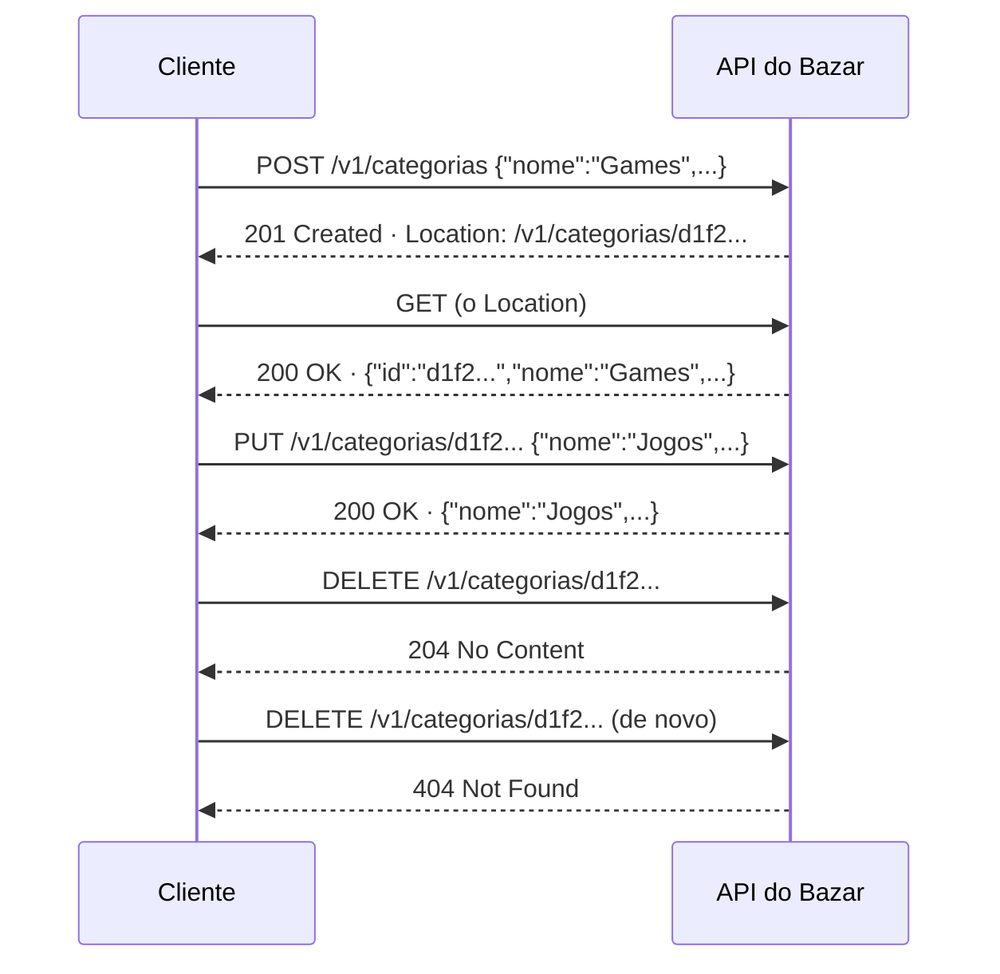

## O problema

Este é o CRUD que aparece em muitos projetos:

```java
@PostMapping("/categorias/salvar")
public Map<String, Object> salvar(@RequestBody Categoria c) {
    repository.save(c);
    return Map.of("sucesso", true, "mensagem", "Categoria salva");
}

@PostMapping("/categorias/excluir")
public Map<String, Object> excluir(@RequestBody Map<String, String> body) {
    if (!repository.existsById(body.get("id"))) {
        return Map.of("sucesso", false, "mensagem", "Não encontrada");
    }
    // ...
}
```

Tudo responde `200`. O cliente que criou a categoria não sabe qual id ela recebeu nem onde buscá-la. Um erro de "não encontrada" chega como sucesso para qualquer *proxy*, monitor ou biblioteca HTTP. E o `excluir` com `POST` não pode ser repetido com segurança se a conexão cair.

As Partes 1 e 2 explicaram o que cada método e cada status significam. Esta página aplica isso num controller Spring de verdade.

Pense nos correios. Ao postar uma encomenda, você recebe um **código de rastreio**: a prova de que ela foi aceita e o endereço para acompanhá-la. Ao retirar uma encomenda que não existe, o atendente diz "não há nada no seu nome", e não "retirada concluída". O status HTTP é a resposta do atendente; o `Location` é o código de rastreio.

> **A pergunta desta página:** como construir, em Spring, um CRUD em que cada operação responde com o status e os headers que o HTTP define?

## O conceito

### O mapa do CRUD

As quatro operações sobre uma coleção e seus itens têm método, URI e status bem definidos:

| Operação | Método | URI | Sucesso | Erros principais |
|---|---|---|---|---|
| Listar | `GET` | `/v1/categorias` | `200` com `{ "itens": [...] }` | `400` (filtro inválido) |
| Detalhar | `GET` | `/v1/categorias/{id}` | `200` com a categoria | `404`, `400` (id inválido) |
| Criar | `POST` | `/v1/categorias` | **`201`** com `Location` e a categoria criada | `400` (JSON inválido), `415` |
| Substituir | `PUT` | `/v1/categorias/{id}` | `200` com a categoria, ou `204` sem corpo | **`404`**, `400`, `415` |
| Remover | `DELETE` | `/v1/categorias/{id}` | **`204`** sem corpo | **`404`** |

### `POST` → `201 Created` com `Location`

Pela RFC 9110, `201` significa que **um ou mais recursos novos foram criados**, e o header `Location` aponta para o principal deles. O cliente não precisa adivinhar o id nem montar a URL: ele segue o `Location`.

O Bazar também devolve **a representação criada no corpo**. A RFC não exige isso, mas economiza um `GET` e mostra ao cliente os valores que o servidor gerou (o `id`, mais tarde datas e status iniciais).

No Spring, o `@RequestBody` lê o corpo da requisição e o converte (pelo `Content-Type`) no tipo do parâmetro. Para montar o `Location`, o `ServletUriComponentsBuilder` parte da URL da requisição atual:

```java
var location = ServletUriComponentsBuilder.fromCurrentRequest()   // http://localhost:8080/v1/categorias
        .path("/{id}")                                           // + /{id}
        .buildAndExpand(categoria.id())                          // {id} → o UUID
        .toUri();
return ResponseEntity.created(location).body(categoria);         // 201 + Location + corpo
```

Construir a URL a partir da requisição evita escrever `http://localhost:8080` no código. Atrás de um *proxy*, o host e o protocolo vêm dos headers `Forwarded`, configuração vista em [26.05](/seguranca-essencial-para-apis/transporte-segredos-headers-de-seguranca-e-ssrf).

### `PUT` → `200` ou `204`

O `PUT` **substitui** o estado do recurso pelo que veio no corpo. As duas respostas de sucesso são válidas:

- **`200 OK` com a representação atualizada**: o cliente vê o resultado sem outro `GET`. É a escolha do Bazar.
- **`204 No Content`**: nada a dizer além de "deu certo". Economiza bytes quando o cliente já sabe o resultado.

E se o recurso não existir? Pela RFC, um `PUT` **pode criar** o recurso na URI indicada (`201`). Isso faz sentido quando o cliente escolhe o identificador (um SKU, por exemplo, em [14.01](/design-de-apis-profissional/criacao-com-post-e-put-com-id-do-cliente)). Nas categorias, quem gera o id é o servidor, então um `PUT` num id que não existe é um erro do cliente: **`404`**.

### `DELETE` → `204`

Remover não tem o que devolver: **`204 No Content`**. Um segundo `DELETE` do mesmo id responde **`404`**, porque não há mais o que remover. Como visto em [02.02](/comecando-e-fundamentos-de-http/metodos-http-semantica-seguranca-e-idempotencia), isso não quebra a idempotência: o **efeito** no servidor é o mesmo (a categoria não existe), mesmo que a resposta mude.

### Duas formas de responder `404`

O Spring oferece duas formas, e esta página usa as duas para comparar:

**`ResponseEntity.notFound().build()`**: o método devolve um `404` como qualquer outra resposta. Funciona quando o método já devolve `ResponseEntity`. O corpo fica **vazio**.

**`throw new ResponseStatusException(HttpStatus.NOT_FOUND, "...")`**: o método lança uma exceção, e o Spring a converte numa resposta com aquele status. Funciona em qualquer ponto, inclusive em métodos que devolvem o objeto direto (como o `substituir`) e em serviços chamados pelo controller. A resposta passa pelo tratamento de erros do Spring Boot e ganha um **corpo JSON padrão**.

Repare num detalhe da resposta real, mais abaixo: a mensagem "Categoria não encontrada" **não aparece** no corpo. O Spring Boot omite a mensagem das exceções por padrão (`server.error.include-message=never`), para não vazar detalhes internos. Os dois formatos de `404` são inconsistentes entre si, e nenhum explica o erro ao cliente. A solução definitiva é o Problem Details, em [08.02](/construindo-apis-com-spring-boot/problemdetail-no-spring-tratamento-global-de-erros), que substitui as duas formas por exceções de domínio.

### `HEAD` e `OPTIONS` de graça

O Spring MVC atende dois métodos sem que você escreva nada:

- **`HEAD`**: todo `@GetMapping` também responde `HEAD`, com os mesmos headers e sem corpo.
- **`OPTIONS`**: o Spring responde `200` com o header `Allow`, listando os métodos mapeados para aquela URI. A **ordem** da lista não é garantida.

Para o *preflight* de CORS (um `OPTIONS` com headers especiais, enviado pelo navegador), a resposta é outra, configurada em [26.02](/seguranca-essencial-para-apis/cors).

### As limitações desta versão

O CRUD funciona e responde os status certos, mas tem quatro problemas, que motivam os próximos módulos:

| Limitação | O que acontece hoje | Onde é resolvida |
|---|---|---|
| **Sem validação** | `{"slug": "sem-nome"}` cria uma categoria com `nome: null` (`201`!) | 07.01 |
| **Entidade exposta** | O cliente envia e recebe o record do domínio; um `id` no corpo só é ignorado porque o código o descarta | 06.01 |
| **Campos desconhecidos aceitos** | `{"admin": true}` é ignorado em silêncio | 06.03 |
| **Erros feios e inconsistentes** | `404` às vezes vazio, às vezes com um JSON genérico sem explicação | 08.01, 08.02 |

## Diagrama

O ciclo de vida de uma categoria, com o status de cada passo:



<StatusCodeTable codes={[200, { code: 201, example: 'POST /v1/categorias' }, { code: 204, example: 'DELETE /v1/categorias/{id}' }, 400, { code: 404, example: 'PUT ou DELETE de um id inexistente' }, 415]} />

## Na prática

### O repositório ganha escrita

```java title="src/main/java/com/bazar/catalogo/dominio/CategoriaRepository.java"
    public boolean existsById(UUID id) {
        return categorias.containsKey(id);
    }

    public Categoria save(Categoria categoria) {
        categorias.put(categoria.id(), categoria);
        return categoria;
    }

    public void deleteById(UUID id) {
        categorias.remove(id);
    }
```

### O controller completo

```java title="src/main/java/com/bazar/catalogo/api/CategoriaController.java"
@RestController
@RequestMapping("/v1/categorias")
public class CategoriaController {

    private final CategoriaRepository repository;

    public CategoriaController(CategoriaRepository repository) {
        this.repository = repository;
    }

    @GetMapping
    public Lista<Categoria> listar(
            @RequestParam(required = false) @Nullable String q,
            @RequestParam(defaultValue = "false") boolean apenasRaizes) {
        // ... igual a 05.03
    }

    @GetMapping("/{id}")
    public ResponseEntity<Categoria> detalhar(@PathVariable UUID id) {
        return ResponseEntity.of(repository.findById(id));
    }

    @PostMapping
    public ResponseEntity<Categoria> criar(@RequestBody Categoria dados) {
        // Ainda é UUID v4; o Bazar passa a gerar UUID v7 em 15.03.
        var categoria = repository.save(
                new Categoria(UUID.randomUUID(), dados.nome(), dados.slug(), dados.categoriaPaiId()));
        var location = ServletUriComponentsBuilder.fromCurrentRequest()
                .path("/{id}")
                .buildAndExpand(categoria.id())
                .toUri();
        return ResponseEntity.created(location).body(categoria);
    }

    @PutMapping("/{id}")
    public Categoria substituir(@PathVariable UUID id, @RequestBody Categoria dados) {
        if (!repository.existsById(id)) {
            throw new ResponseStatusException(HttpStatus.NOT_FOUND, "Categoria não encontrada");
        }
        return repository.save(new Categoria(id, dados.nome(), dados.slug(), dados.categoriaPaiId()));
    }

    @DeleteMapping("/{id}")
    public ResponseEntity<Void> remover(@PathVariable UUID id) {
        if (!repository.existsById(id)) {
            return ResponseEntity.notFound().build();
        }
        repository.deleteById(id);
        return ResponseEntity.noContent().build();
    }
}
```

Três decisões para notar:

- **O id vem do servidor.** Em `criar`, o id do corpo é ignorado e um novo é gerado; em `substituir`, o id vem do caminho. O cliente nunca escolhe o id de uma categoria.
- **`ResponseEntity<Void>`** no `remover`: o tipo deixa claro que não há corpo.
- **UUID v4 por enquanto.** O `UUID.randomUUID()` do JDK gera a versão 4 (aleatória). O Bazar adota UUID v7, ordenável pelo tempo, em [15.03](/design-de-apis-profissional/identificadores-sequenciais-uuid-v7-e-ulid).

### A sessão de `curl`

As respostas abaixo são reais, do Bazar rodando localmente (o id gerado muda a cada execução).

<HttpExchange
  title="Criar"
  request={{ method: 'POST', url: 'http://localhost:8080/v1/categorias', headers: { 'Content-Type': 'application/json' }, body: { nome: 'Games', slug: 'games', categoriaPaiId: null } }}
  response={{
    status: 201,
    headers: { Location: 'http://localhost:8080/v1/categorias/d1f24708-d16b-4ac2-8c14-224139233353', 'Content-Type': 'application/json' },
    body: { id: 'd1f24708-d16b-4ac2-8c14-224139233353', nome: 'Games', slug: 'games', categoriaPaiId: null },
  }}
>
  O `Location` é absoluto e foi montado a partir da requisição. O id é um UUID versão 4 (veja a nota mais abaixo).
</HttpExchange>

<HttpExchange
  title="Substituir"
  request={{ method: 'PUT', url: 'http://localhost:8080/v1/categorias/d1f24708-d16b-4ac2-8c14-224139233353', headers: { 'Content-Type': 'application/json' }, body: { nome: 'Jogos', slug: 'jogos', categoriaPaiId: null } }}
  response={{
    status: 200,
    headers: { 'Content-Type': 'application/json' },
    body: { id: 'd1f24708-d16b-4ac2-8c14-224139233353', nome: 'Jogos', slug: 'jogos', categoriaPaiId: null },
  }}
/>

<HttpExchange
  title="Substituir um id que não existe"
  request={{ method: 'PUT', url: 'http://localhost:8080/v1/categorias/0192f3a0-5555-7000-8000-000000000999', headers: { 'Content-Type': 'application/json' }, body: { nome: 'X', slug: 'x', categoriaPaiId: null } }}
  response={{
    status: 404,
    headers: { 'Content-Type': 'application/json' },
    body: { timestamp: '2026-10-24T23:15:39.612Z', status: 404, error: 'Not Found', path: '/v1/categorias/0192f3a0-5555-7000-8000-000000000999' },
  }}
>
  A `ResponseStatusException` gerou um corpo JSON, mas sem a mensagem "Categoria não encontrada": o Spring Boot a omite por padrão.
</HttpExchange>

<HttpExchange
  title="Remover"
  request={{ method: 'DELETE', url: 'http://localhost:8080/v1/categorias/d1f24708-d16b-4ac2-8c14-224139233353' }}
  response={{ status: 204 }}
/>

<HttpExchange
  title="Remover de novo"
  request={{ method: 'DELETE', url: 'http://localhost:8080/v1/categorias/d1f24708-d16b-4ac2-8c14-224139233353' }}
  response={{ status: 404, headers: { 'Content-Length': '0' } }}
>
  Este `404` veio de `ResponseEntity.notFound()`: sem corpo nenhum. Compare com o `404` do `PUT`, que tinha um JSON. É a inconsistência que 08.02 resolve.
</HttpExchange>

<HttpExchange
  title="OPTIONS na coleção e num item"
  request={{ method: 'OPTIONS', url: 'http://localhost:8080/v1/categorias' }}
  response={{ status: 200, headers: { Allow: 'GET,HEAD,POST,OPTIONS', 'Content-Length': '0' } }}
>
  Para `/v1/categorias/{id}`, a resposta é `Allow: PUT,DELETE,GET,HEAD,OPTIONS`. O Spring também envia um header `Accept-Patch` vazio, porque não há `PATCH` mapeado; ele ganha valor quando o Bazar implementar o `PATCH` em [14.02](/design-de-apis-profissional/put-patch-json-merge-patch-e-json-patch).
</HttpExchange>

<Callout type="info" title="Como ler a versão de um UUID">
  A versão é o primeiro dígito do **terceiro** grupo. Em `d1f24708-d16b-4ac2-8c14-224139233353`, o terceiro grupo é `4ac2`: versão **4**, aleatória. Nos ids fixos do Bazar, como `0192f3a0-5555-7000-8000-000000000001`, o terceiro grupo é `7000`: versão **7**.
</Callout>

### As limitações, ao vivo

<HttpExchange
  title="Criar sem nome"
  request={{ method: 'POST', url: 'http://localhost:8080/v1/categorias', headers: { 'Content-Type': 'application/json' }, body: { slug: 'sem-nome' } }}
  response={{
    status: 201,
    headers: { Location: 'http://localhost:8080/v1/categorias/ffe4bd0a-8966-4ca9-a32e-7efd1db6e3ae', 'Content-Type': 'application/json' },
    body: { id: 'ffe4bd0a-8966-4ca9-a32e-7efd1db6e3ae', nome: null, slug: 'sem-nome', categoriaPaiId: null },
  }}
>
  Uma categoria sem nome foi criada com sucesso. E o record `Categoria`, que pelo `@NullMarked` não aceitaria `nome` nulo, recebeu `null`: as anotações do JSpecify não são verificadas em tempo de execução. A validação chega em [07.01](/construindo-apis-com-spring-boot/bean-validation-essencial).
</HttpExchange>

<HttpExchange
  title="Campos que o cliente não deveria enviar"
  request={{ method: 'POST', url: 'http://localhost:8080/v1/categorias', headers: { 'Content-Type': 'application/json' }, body: { id: '0192f3a0-5555-7000-8000-000000000001', nome: 'Invasor', slug: 'invasor', categoriaPaiId: null, admin: true } }}
  response={{
    status: 201,
    headers: { Location: 'http://localhost:8080/v1/categorias/aa521a40-1980-40ab-9c1e-91916ce5eabd', 'Content-Type': 'application/json' },
    body: { id: 'aa521a40-1980-40ab-9c1e-91916ce5eabd', nome: 'Invasor', slug: 'invasor', categoriaPaiId: null },
  }}
>
  O cliente tentou impor o id de "Livros", e só não sobrescreveu a categoria porque o código descarta o id. O `admin` desconhecido foi ignorado em silêncio. Com um DTO de entrada que nem tem o campo `id` ([06.01](/construindo-apis-com-spring-boot/dtos-com-records-e-por-que-nao-expor-entidades)), esse risco desaparece por construção.
</HttpExchange>

<HttpExchange
  title="JSON malformado"
  request={{ method: 'POST', url: 'http://localhost:8080/v1/categorias', headers: { 'Content-Type': 'application/json' }, body: '{"nome":"Quebrado",' }}
  response={{
    status: 400,
    headers: { 'Content-Type': 'application/json' },
    body: { timestamp: '2026-10-24T23:15:39.653Z', status: 400, error: 'Bad Request', path: '/v1/categorias' },
  }}
>
  O `400` está certo, mas o cliente não descobre o que estava errado no JSON.
</HttpExchange>

## Erros comuns

<BadVsGood title="Resposta da criação" why="201 com Location diz ao cliente que algo foi criado e onde está. 200 com uma mensagem obriga o cliente a procurar o recurso e engana intermediários e monitores sobre o que aconteceu.">
<Bad title="200 com mensagem">

```http
HTTP/1.1 200 OK
Content-Type: application/json

{ "sucesso": true, "mensagem": "Categoria salva" }
```

</Bad>
<Good title="201 com Location e o recurso criado">

```http
HTTP/1.1 201 Created
Location: http://localhost:8080/v1/categorias/d1f24708-d16b-4ac2-8c14-224139233353
Content-Type: application/json

{ "id": "d1f24708-d16b-4ac2-8c14-224139233353", "nome": "Games", "slug": "games", "categoriaPaiId": null }
```

</Good>
</BadVsGood>

Outros erros frequentes:

- **`DELETE` devolvendo `200` com `{"sucesso": true}`.** Sem nada útil a dizer, use `204`.
- **Montar o `Location` com *string* fixa** (`"http://localhost:8080/..."`). Quebra em qualquer outro ambiente. Use o `ServletUriComponentsBuilder`.
- **Aceitar o id do corpo na criação.** O cliente passa a poder escolher, ou sobrescrever, ids de outros recursos.
- **`PUT` que cria silenciosamente quando o id não existe**, numa API em que o servidor gera os ids. Um id inventado pelo cliente vira um recurso.
- **Esperar que a mensagem da `ResponseStatusException` chegue ao cliente.** Por padrão, ela não chega (e isso é proposital).
- **Testar o cabeçalho `Allow` comparando a *string* inteira.** A ordem dos métodos não é garantida.

## Boas práticas

- **Responda** `201` com `Location` (e, no Bazar, com o corpo) a cada criação.
- **Responda** `204` quando não houver corpo útil, como no `DELETE`.
- **Gere** os ids no servidor e ignore (ou, melhor, não aceite) ids no corpo.
- **Responda** `404` ao `PUT` e ao `DELETE` de ids inexistentes quando o servidor é quem cria os ids.
- **Construa** URLs a partir da requisição, nunca com host fixo.
- **Deixe** o `HEAD` e o `OPTIONS` com o Spring.

## No projeto Bazar

<ProjectStep title="CRUD de categorias" module="catalogo" tag="pagina-05.04" files={[
  { path: 'src/main/java/com/bazar/catalogo/dominio/CategoriaRepository.java', change: 'alterado' },
  { path: 'src/main/java/com/bazar/catalogo/api/CategoriaController.java', change: 'alterado' },
  { path: 'src/test/java/com/bazar/catalogo/api/CategoriaControllerTest.java', change: 'alterado' },
]}>
`POST`, `PUT` e `DELETE` em `/v1/categorias`, com `201` + `Location`, `200`, `204` e `404`. Os testes cobrem o ciclo completo (criar, detalhar, substituir, remover duas vezes) e o `OPTIONS`. Para testar à mão, rode a aplicação e repita a sessão de `curl` desta página.
</ProjectStep>

## Resumo

- `POST` cria → **`201 Created`** com **`Location`** (montado com `ServletUriComponentsBuilder`) e, no Bazar, o recurso no corpo.
- `PUT` substitui → **`200`** com o recurso (ou `204`); id inexistente → **`404`** quando o servidor gera os ids.
- `DELETE` remove → **`204`**; o segundo `DELETE` → **`404`**, sem quebrar a idempotência.
- `404` pode vir de **`ResponseEntity.notFound()`** (sem corpo) ou de **`ResponseStatusException`** (com o corpo padrão, sem a mensagem); a inconsistência é resolvida em 08.02.
- **`HEAD` e `OPTIONS`** são automáticos; a ordem do `Allow` não é garantida.
- Limitações desta versão: sem validação, entidade exposta, campos desconhecidos aceitos e erros pobres.

<Exercise title="Uma regra de remoção" difficulty="medio">
Uma categoria que tem subcategorias não pode ser removida: remover "Livros" deixaria "Programação" apontando para uma categoria que não existe.

1. Que status o `DELETE /v1/categorias/0192f3a0-5555-7000-8000-000000000001` deve devolver nesse caso? Por quê?
2. Implemente a regra no `remover`. Você vai precisar saber se alguma categoria tem `categoriaPaiId` igual ao id removido.
3. Escreva o `curl` e a resposta esperada.

<Hint>
O pedido é válido e o recurso existe; o que impede a remoção é o **estado atual** do servidor. Releia a diferença entre `400`, `404`, `409` e `422` em 02.03.
</Hint>

<Solution>

1. **`409 Conflict`**. A requisição está bem formada (não é `400`), a categoria existe (não é `404`) e não há nada de errado no conteúdo enviado (um `DELETE` não tem corpo, então não é `422`). O que impede é um conflito com o estado atual: existem filhas. Se as filhas forem removidas ou movidas, a mesma requisição passa a funcionar, o que é típico de `409`.

2. Implementação:

```java
@DeleteMapping("/{id}")
public ResponseEntity<Void> remover(@PathVariable UUID id) {
    if (!repository.existsById(id)) {
        return ResponseEntity.notFound().build();
    }
    var temFilhas = repository.findAll().stream()
            .anyMatch(c -> id.equals(c.categoriaPaiId()));
    if (temFilhas) {
        throw new ResponseStatusException(HttpStatus.CONFLICT, "A categoria tem subcategorias");
    }
    repository.deleteById(id);
    return ResponseEntity.noContent().build();
}
```

3. Teste:

```bash
curl -i -X DELETE http://localhost:8080/v1/categorias/0192f3a0-5555-7000-8000-000000000001
```

```http
HTTP/1.1 409
Content-Type: application/json

{"timestamp":"...","status":409,"error":"Conflict","path":"/v1/categorias/0192f3a0-5555-7000-8000-000000000001"}
```

No projeto final, a regra também considera os **produtos** da categoria ([14.03](/design-de-apis-profissional/delete-soft-delete-e-arquivamento)), e o erro sai como Problem Details com um `codigo` próprio.

</Solution>
</Exercise>

<Quiz
  questions={[
    {
      question: 'O POST /v1/categorias criou a categoria. Qual resposta segue o HTTP?',
      options: [
        '200 OK com { "sucesso": true }',
        '201 Created com o header Location apontando para a nova categoria',
        '204 No Content, porque o cliente já sabe o que enviou',
      ],
      answer: 1,
      explanation: '201 indica que um recurso foi criado, e o Location diz onde ele está. 200 esconde a criação e não informa a URI; 204 também não diz onde está o recurso nem os valores gerados pelo servidor, como o id.',
    },
    {
      question: 'O primeiro DELETE de uma categoria deu 204 e o segundo deu 404. O que isso diz sobre a API?',
      options: [
        'Ela quebrou a idempotência do DELETE',
        'Ela está correta: o efeito no servidor é o mesmo, só a resposta muda',
        'O segundo deveria dar 204 também, senão o cliente não pode repetir',
      ],
      answer: 1,
      explanation: 'Idempotência trata do efeito no servidor, não da resposta. Depois do primeiro DELETE, a categoria não existe; depois do segundo, continua não existindo. Responder 404 é correto, e o cliente pode repetir com segurança.',
    },
    {
      question: 'Um método lança new ResponseStatusException(HttpStatus.NOT_FOUND, "Categoria não encontrada"). O que o cliente recebe com a configuração padrão do Spring Boot?',
      options: [
        '404 com um JSON padrão (timestamp, status, error, path), sem a mensagem',
        '404 com o corpo "Categoria não encontrada" em texto puro',
        '500, porque a exceção não foi tratada',
      ],
      answer: 0,
      explanation: 'O Spring converte a ResponseStatusException no status indicado, e o Spring Boot gera o corpo de erro padrão. A mensagem é omitida por padrão (server.error.include-message=never). Não é 500, porque a exceção carrega o status.',
    },
  ]}
/>

## Referências

<References />
