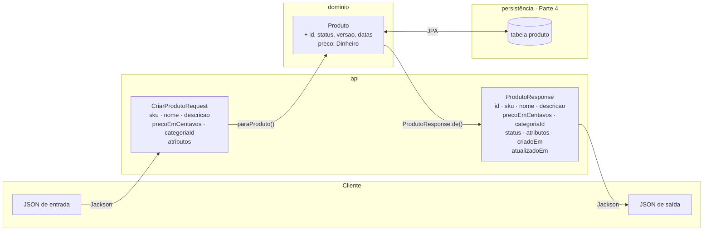

## O problema

Em 2012, um desenvolvedor descobriu que podia fazer *commits* em qualquer repositório do GitHub, inclusive no do próprio Ruby on Rails. O formulário de chaves SSH aceitava um campo que não aparecia na tela, o dono da chave, e o *framework* o gravava direto no objeto do banco. Bastou enviar o id de outro usuário. A falha ficou conhecida como ***mass assignment***: o servidor aceitava, em massa, todos os campos que vinham na requisição.

Em Spring, a mesma falha tem esta cara:

```java
@PostMapping("/v1/produtos")
public Produto criar(@RequestBody Produto produto) {   // a entidade direto do JSON
    return repository.save(produto);
}
```

O cliente manda `"status": "ATIVO"` e publica um produto que deveria passar por revisão. Manda `"versao": 99` e burla o controle de concorrência. E a resposta, que devolve a entidade inteira, mostra campos internos que nenhum cliente deveria ver.

Pense no balcão de uma farmácia. O cliente entrega a receita, e o farmacêutico devolve os remédios. O cliente não entra no estoque, não pega o que quer da prateleira e não vê a planilha de custos. A receita (o que entra) e a sacola (o que sai) são formatos próprios do balcão, e o estoque fica do lado de dentro.

> **A pergunta desta página:** o que são DTOs, por que separar o que entra e o que sai da entidade, e como escrevê-los com records do Java?

## O conceito

### O que é um DTO

Um <Term id="dto">DTO</Term> (*Data Transfer Object*) é um objeto que existe só para **carregar dados através de uma fronteira**, no caso, a fronteira HTTP da API. Ele não tem regras de negócio: tem campos, e talvez uma conversão.

Numa API há dois tipos:

- **DTOs de entrada** (o corpo das requisições): `CriarProdutoRequest`, `AtualizarProdutoRequest`. Definem **o que o cliente pode enviar**.
- **DTOs de saída** (o corpo das respostas): `ProdutoResponse`. Definem **o que o cliente pode ver**.

O sufixo `Request`/`Response` é a convenção do Bazar: ele diz, só pelo nome, de que lado da fronteira o objeto está.

### Por que não expor a entidade

A entidade (`Produto`) representa o conceito de negócio e, a partir da Parte 4, também a linha do banco. Usá-la como contrato da API causa quatro problemas:

| Problema | Como acontece | O que o DTO resolve |
|---|---|---|
| **Mass assignment** (*over-posting*) | O cliente envia `status`, `versao` ou `id`, e o Jackson preenche a entidade | O DTO de entrada simplesmente não tem esses campos |
| **Vazamento de dados** | Todo campo novo da entidade (`custoEmCentavos`, `senhaHash`) aparece na resposta | O DTO de saída lista só o que é público |
| **Contrato acoplado ao banco** | Renomear uma coluna ou mudar um tipo quebra os clientes | O DTO muda só por decisão de contrato; a conversão absorve o resto |
| **Problemas de serialização** | Relacionamentos JPA preguiçosos disparam consultas ou exceções; ciclos (pai ↔ filhos) geram JSON infinito | O DTO é uma árvore simples, montada de propósito |

Os dois primeiros são falhas de segurança. O *mass assignment* e a exposição excessiva de dados estão juntos no item **API3** do OWASP API Security Top 10 de 2023 (*Broken Object Property Level Authorization*), assunto de [26.03](/seguranca-essencial-para-apis/autorizacao-por-objeto-exposicao-de-dados-e-validacao). O terceiro é o desacoplamento de camadas visto em [03.02](/rest-e-estilos-de-api/recursos-representacoes-e-a-interface-uniforme).

### Records

Desde o Java 16, os **records** (JEP 395) são a forma natural de escrever DTOs. Um record declara seus componentes numa linha, e o compilador gera o construtor, os *getters* (`sku()`, sem o prefixo `get`), `equals`, `hashCode` e `toString`:

```java
public record CategoriaResponse(UUID id, String nome, String slug, @Nullable UUID categoriaPaiId) {
}
```

Três características importam para DTOs:

- **Imutabilidade.** Os campos são `final`. Um DTO não muda depois de criado, o que elimina uma classe inteira de bugs (alguém alterando a resposta no meio do caminho).
- **Construtor compacto.** Um construtor sem a lista de parâmetros, que roda antes da atribuição dos campos. Serve para normalizar ou validar a entrada:

  ```java
  public record CriarProdutoRequest(..., Map<String, String> atributos) {
      public CriarProdutoRequest {
          atributos = atributos == null ? Map.of() : Map.copyOf(atributos);
      }
  }
  ```

  Aqui, um `atributos` ausente no JSON vira um mapa vazio, e um mapa recebido é copiado para uma versão imutável.
- **Suporte nativo no Jackson.** O Jackson lê records pelo construtor canônico e escreve um campo JSON por componente, na ordem em que foram declarados. Nenhuma anotação é necessária.

<Callout type="warning" title="Imutável não quer dizer profundamente imutável">
  Um record com um componente `List` ou `Map` guarda a **referência** recebida. Se quem criou o record alterar a lista depois, o record "muda". Por isso o construtor compacto usa `Map.copyOf` e `List.copyOf`, que criam cópias imutáveis.
</Callout>

### Records aninhados

Quando um DTO tem uma parte estruturada que só faz sentido dentro dele, declare um record **dentro** do outro. O pedido, que o Bazar constrói mais adiante, é o exemplo típico:

```java
public record CriarPedidoRequest(UUID clienteId, List<Item> itens, Endereco enderecoEntrega) {

    public record Item(UUID produtoId, int quantidade) {
    }

    public record Endereco(String cep, String logradouro, String numero,
            @Nullable String complemento, String cidade, String uf) {
    }
}
```

O JSON correspondente tem objetos aninhados (`"itens": [{"produtoId": ..., "quantidade": 2}]`), e o código fica num único arquivo. Use records aninhados para estruturas exclusivas do DTO; se a mesma estrutura aparece em vários DTOs (como o `Dinheiro`), ela merece um arquivo próprio.

### Um DTO por caso de uso × DTO genérico

É tentador ter um único `ProdutoDTO` para tudo: criação, atualização e resposta. Ele dura pouco:

- a criação tem `sku`; a atualização não pode ter (o SKU não muda);
- a resposta tem `id`, `status` e datas; a criação não pode ter (são do servidor);
- cada campo vira "às vezes obrigatório, às vezes ignorado", e a regra fica escondida no código.

O Bazar usa **um DTO por caso de uso** quando os campos diferem: `CriarProdutoRequest` (com `sku`), `AtualizarProdutoRequest` (sem `sku`) e `ProdutoResponse`. Quando duas operações recebem exatamente os mesmos campos, como o `POST` e o `PUT` de categorias, um DTO compartilhado (`CategoriaRequest`) é aceitável, e o nome deixa isso claro. Se um dia divergirem, separe.

### Onde fica a conversão

A conversão entre DTO e domínio tem que morar **do lado da API**: o domínio não conhece os DTOs ([05.02](/construindo-apis-com-spring-boot/criando-o-projeto-bazar)). As opções mais comuns:

| Onde | Exemplo | Quando usar |
|---|---|---|
| Métodos no próprio DTO | `ProdutoResponse.de(produto)`, `request.paraProduto()` | Poucos DTOs, conversões simples. É o que o Bazar usa por enquanto. |
| No controller | `new ProdutoResponse(produto.getId(), ...)` dentro do método | Casos pontuais. Repetido em vários métodos, vira duplicação. |
| Um *mapper* dedicado | `ProdutoMapper` (manual ou MapStruct) | Muitos DTOs ou conversões com regras. Assunto de [06.02](/construindo-apis-com-spring-boot/mapeamento-manual-ou-mapstruct). |

Os métodos de conversão do Bazar são **package-private** (sem `public`): só o controller, no mesmo pacote `api`, precisa deles.

## Diagrama



Repare no que **não** atravessa a fronteira: na entrada, não há `id`, `status`, `versao` nem datas; na saída, a `versao` fica de fora. E o preço muda de forma: `Dinheiro` no domínio, `precoEmCentavos` no contrato v1.

## Na prática

### O tipo `Dinheiro`

O produto do Bazar guarda o preço como `Dinheiro`, no módulo compartilhado. Esta é a versão mínima; a completa, com validação e serialização, está em [15.02](/design-de-apis-profissional/dinheiro-e-numeros-decimais):

```java title="src/main/java/com/bazar/compartilhado/Dinheiro.java"
package com.bazar.compartilhado;

import java.math.BigDecimal;
import java.util.Currency;

/**
 * Um valor monetário com a sua moeda. Nunca use double para dinheiro (02.06).
 * Esta é a versão mínima; a validação e a serialização completas estão em 15.02.
 */
public record Dinheiro(BigDecimal valor, Currency moeda) {

    public static Dinheiro deCentavos(long centavos, String codigoMoeda) {
        var moeda = Currency.getInstance(codigoMoeda);
        return new Dinheiro(BigDecimal.valueOf(centavos, moeda.getDefaultFractionDigits()), moeda);
    }

    public long emCentavos() {
        return valor.movePointRight(moeda.getDefaultFractionDigits()).longValueExact();
    }
}
```

### A entidade

O `Produto` é uma classe, não um record: ele tem estado que muda (`atualizar` incrementa a versão e a data) e, na Parte 4, vira uma entidade JPA. O construtor só aceita o que o cliente pode escolher; o resto é decidido por ele mesmo:

```java title="src/main/java/com/bazar/catalogo/dominio/Produto.java"
public class Produto {

    private final UUID id;
    private final String sku;
    private String nome;
    private @Nullable String descricao;
    private Dinheiro preco;
    private UUID categoriaId;
    private StatusProduto status;
    private Map<String, String> atributos;
    private long versao;
    private final Instant criadoEm;
    private Instant atualizadoEm;

    public Produto(String sku, String nome, @Nullable String descricao, Dinheiro preco,
            UUID categoriaId, Map<String, String> atributos) {
        this.id = UUID.randomUUID();
        this.sku = sku;
        this.nome = nome;
        this.descricao = descricao;
        this.preco = preco;
        this.categoriaId = categoriaId;
        this.status = StatusProduto.RASCUNHO;
        this.atributos = Map.copyOf(atributos);
        this.versao = 0;
        this.criadoEm = Instant.now();
        this.atualizadoEm = this.criadoEm;
    }

    public void atualizar(String nome, @Nullable String descricao, Dinheiro preco,
            UUID categoriaId, Map<String, String> atributos) {
        this.nome = nome;
        this.descricao = descricao;
        this.preco = preco;
        this.categoriaId = categoriaId;
        this.atributos = Map.copyOf(atributos);
        this.versao++;
        this.atualizadoEm = Instant.now();
    }

    // getters: getId(), getSku(), getNome()...
}
```

Não há *setters*: o único jeito de mudar um produto é por `atualizar`, que mantém a versão e a data coerentes. Mesmo que alguém tentasse ligar o JSON direto na entidade, não haveria por onde injetar o `status`.

### Os DTOs

```java title="src/main/java/com/bazar/catalogo/api/CriarProdutoRequest.java"
/**
 * Corpo de POST /v1/produtos. Só tem o que o cliente pode escolher:
 * id, status, versão e datas são do Bazar.
 */
public record CriarProdutoRequest(
        String sku,
        String nome,
        @Nullable String descricao,
        Long precoEmCentavos,
        UUID categoriaId,
        Map<String, String> atributos) {

    public CriarProdutoRequest {
        atributos = atributos == null ? Map.of() : Map.copyOf(atributos); // ausente no JSON → vazio
    }

    Produto paraProduto() {
        return new Produto(sku, nome, descricao, Dinheiro.deCentavos(precoEmCentavos, "BRL"), categoriaId, atributos);
    }
}
```

```java title="src/main/java/com/bazar/catalogo/api/AtualizarProdutoRequest.java"
/**
 * Corpo de PUT /v1/produtos/{id}. O SKU não aparece: ele não muda depois da criação.
 */
public record AtualizarProdutoRequest(
        String nome,
        @Nullable String descricao,
        Long precoEmCentavos,
        UUID categoriaId,
        Map<String, String> atributos) {

    public AtualizarProdutoRequest {
        atributos = atributos == null ? Map.of() : Map.copyOf(atributos); // ausente no JSON → vazio
    }
}
```

```java title="src/main/java/com/bazar/catalogo/api/ProdutoResponse.java"
/**
 * Representação v1 do produto. A versão interna (usada para concorrência) não é exposta.
 */
public record ProdutoResponse(
        UUID id,
        String sku,
        String nome,
        @Nullable String descricao,
        long precoEmCentavos,
        UUID categoriaId,
        StatusProduto status,
        Map<String, String> atributos,
        Instant criadoEm,
        Instant atualizadoEm) {

    static ProdutoResponse de(Produto produto) {
        return new ProdutoResponse(
                produto.getId(),
                produto.getSku(),
                produto.getNome(),
                produto.getDescricao(),
                produto.getPreco().emCentavos(),
                produto.getCategoriaId(),
                produto.getStatus(),
                produto.getAtributos(),
                produto.getCriadoEm(),
                produto.getAtualizadoEm());
    }
}
```

O `precoEmCentavos` de entrada é `Long`, e não `long`. Com o tipo primitivo, o Jackson 3 recusa um campo ausente ou `null` (`FAIL_ON_NULL_FOR_PRIMITIVES`), mas com um erro genérico de JSON ilegível; e, num projeto com os padrões do Jackson 2 (`spring.jackson.use-jackson2-defaults=true`), o campo ausente viraria `0`, um preço válido, sem aviso. Com `Long`, ele chega como `null`, e a validação de [07.01](/construindo-apis-com-spring-boot/bean-validation-essencial) o rejeita com uma mensagem que diz qual campo faltou.

### O controller

```java title="src/main/java/com/bazar/catalogo/api/ProdutoController.java"
@RestController
@RequestMapping("/v1/produtos")
public class ProdutoController {

    private final ProdutoRepository repository;

    public ProdutoController(ProdutoRepository repository) {
        this.repository = repository;
    }

    @PostMapping
    public ResponseEntity<ProdutoResponse> criar(@RequestBody CriarProdutoRequest request) {
        var produto = repository.save(request.paraProduto());
        var location = ServletUriComponentsBuilder.fromCurrentRequest()
                .path("/{id}")
                .buildAndExpand(produto.getId())
                .toUri();
        return ResponseEntity.created(location).body(ProdutoResponse.de(produto));
    }

    @GetMapping("/{id}")
    public ResponseEntity<ProdutoResponse> detalhar(@PathVariable UUID id) {
        return ResponseEntity.of(repository.findById(id).map(ProdutoResponse::de));
    }

    @PutMapping("/{id}")
    public ProdutoResponse atualizar(@PathVariable UUID id, @RequestBody AtualizarProdutoRequest request) {
        var produto = repository.findById(id)
                .orElseThrow(() -> new ResponseStatusException(HttpStatus.NOT_FOUND, "Produto não encontrado"));
        produto.atualizar(request.nome(), request.descricao(), Dinheiro.deCentavos(request.precoEmCentavos(), "BRL"),
                request.categoriaId(), request.atributos());
        return ProdutoResponse.de(repository.save(produto));
    }
}
```

### As respostas

<HttpExchange
  title="Criar um produto"
  request={{
    method: 'POST',
    url: 'http://localhost:8080/v1/produtos',
    headers: { 'Content-Type': 'application/json' },
    body: { sku: 'LIV-0042', nome: 'Clean Code', descricao: 'Um guia de boas práticas.', precoEmCentavos: 12990, categoriaId: '0192f3a0-5555-7000-8000-000000000003', atributos: { autor: 'Robert C. Martin', paginas: '464' } },
  }}
  response={{
    status: 201,
    headers: { Location: 'http://localhost:8080/v1/produtos/72d1d185-f893-402c-bd85-f35a20de80c2', 'Content-Type': 'application/json' },
    body: {
      id: '72d1d185-f893-402c-bd85-f35a20de80c2',
      sku: 'LIV-0042',
      nome: 'Clean Code',
      descricao: 'Um guia de boas práticas.',
      precoEmCentavos: 12990,
      categoriaId: '0192f3a0-5555-7000-8000-000000000003',
      status: 'RASCUNHO',
      atributos: { autor: 'Robert C. Martin', paginas: '464' },
      criadoEm: '2026-10-24T23:20:44.027372882Z',
      atualizadoEm: '2026-10-24T23:20:44.027372882Z',
    },
  }}
>
  O produto nasce `RASCUNHO`, e a resposta não tem `versao`. As datas saem com nove casas decimais, porque o `Instant.now()` do JDK usa o relógio mais preciso do sistema; a precisão que o Bazar adota para datas é decidida em [15.01](/design-de-apis-profissional/datas-horas-e-fusos-horarios).
</HttpExchange>

<HttpExchange
  title="Tentativa de mass assignment"
  request={{
    method: 'POST',
    url: 'http://localhost:8080/v1/produtos',
    headers: { 'Content-Type': 'application/json' },
    body: { id: '0192f39f-2222-7000-8000-000000000042', sku: 'LIV-0043', nome: 'Refactoring', precoEmCentavos: 15900, categoriaId: '0192f3a0-5555-7000-8000-000000000003', status: 'ATIVO', versao: 99, criadoEm: '2020-01-01T00:00:00Z' },
  }}
  response={{
    status: 201,
    headers: { Location: 'http://localhost:8080/v1/produtos/352f2cff-dd9e-45f2-807f-ecf334bc1ab5', 'Content-Type': 'application/json' },
    body: {
      id: '352f2cff-dd9e-45f2-807f-ecf334bc1ab5',
      sku: 'LIV-0043',
      nome: 'Refactoring',
      descricao: null,
      precoEmCentavos: 15900,
      categoriaId: '0192f3a0-5555-7000-8000-000000000003',
      status: 'RASCUNHO',
      atributos: {},
      criadoEm: '2026-10-24T23:20:44.081091560Z',
      atualizadoEm: '2026-10-24T23:20:44.081091560Z',
    },
  }}
>
  O `id`, o `status`, a `versao` e o `criadoEm` enviados não existem no `CriarProdutoRequest`, então o Jackson os descarta: nenhum deles chegou ao produto. O `atributos` ausente virou `{}` pelo construtor compacto, e a `descricao` ausente aparece como `null` explícito. Descartar em silêncio é o padrão do Jackson 3; se o cliente deveria ser avisado, é uma decisão discutida em [06.03](/construindo-apis-com-spring-boot/jackson-3-no-spring-boot-4).
</HttpExchange>

<HttpExchange
  title="Atualizar"
  request={{
    method: 'PUT',
    url: 'http://localhost:8080/v1/produtos/708b6c09-0cce-4d4f-b20a-6938dac6460b',
    headers: { 'Content-Type': 'application/json' },
    body: { nome: 'Domain-Driven Design', descricao: null, precoEmCentavos: 17990, categoriaId: '0192f3a0-5555-7000-8000-000000000003', atributos: { autor: 'Eric Evans' } },
  }}
  response={{
    status: 200,
    headers: { 'Content-Type': 'application/json' },
    body: {
      id: '708b6c09-0cce-4d4f-b20a-6938dac6460b',
      sku: 'LIV-0044',
      nome: 'Domain-Driven Design',
      descricao: null,
      precoEmCentavos: 17990,
      categoriaId: '0192f3a0-5555-7000-8000-000000000003',
      status: 'RASCUNHO',
      atributos: { autor: 'Eric Evans' },
      criadoEm: '2026-10-24T23:20:44.095008707Z',
      atualizadoEm: '2026-10-24T23:20:44.112769069Z',
    },
  }}
>
  O SKU continua `LIV-0044`, porque o DTO de atualização não tem esse campo, e o `atualizadoEm` avançou.
</HttpExchange>

### As categorias também

O controller de categorias de [05.04](/construindo-apis-com-spring-boot/um-crud-com-status-corretos) expunha o record do domínio. Agora ele recebe `CategoriaRequest` e devolve `CategoriaResponse`. O JSON não mudou em nada, e é esse o ponto: o contrato ficou igual, mas passou a ter um dono próprio. A próxima mudança no domínio da categoria não chega aos clientes por acidente.

```java title="src/main/java/com/bazar/catalogo/api/CategoriaRequest.java"
/**
 * Corpo de POST e de PUT em /v1/categorias. As duas operações recebem os mesmos campos,
 * porque o PUT substitui a categoria inteira.
 */
public record CategoriaRequest(String nome, String slug, @Nullable UUID categoriaPaiId) {

    Categoria paraCategoria(UUID id) {
        return new Categoria(id, nome, slug, categoriaPaiId);
    }
}
```

## Erros comuns

<BadVsGood title="Recebendo o produto" why="Com a entidade no @RequestBody, qualquer campo com setter vira um campo que o cliente controla. Com um DTO de entrada, só existe o que foi declarado, e os campos do servidor nem têm como chegar.">
<Bad title="A entidade como corpo">

```java
@PostMapping
public Produto criar(@RequestBody Produto produto) {
    return repository.save(produto);
}
```

```http
POST /v1/produtos

{ "sku": "LIV-0043", "nome": "Refactoring", "status": "ATIVO", "versao": 99 }
```

</Bad>
<Good title="Um DTO com só o que o cliente pode escolher">

```java
@PostMapping
public ResponseEntity<ProdutoResponse> criar(@RequestBody CriarProdutoRequest request) {
    var produto = repository.save(request.paraProduto());
    // ...
}
```

</Good>
</BadVsGood>

Outros erros frequentes:

- **Um `ProdutoDTO` para tudo.** Cada campo vira "às vezes", e o *mass assignment* volta pela porta dos fundos (o `status` que existe para a resposta passa a ser aceito na entrada).
- **Ignorar campos com `@JsonIgnore` na entidade.** Funciona até alguém esquecer a anotação num campo novo. A lista do que é público deve ser explícita (DTO), não a lista do que é privado.
- **Converter no domínio.** Um `produto.paraResponse()` faz o domínio depender da camada `api`.
- **Tipos primitivos em DTOs de entrada.** Dependendo da configuração do Jackson, `long precoEmCentavos` transforma um campo esquecido em `0` (um preço válido) ou num erro genérico. Use o tipo *wrapper* e valide.
- **Records com listas mutáveis.** Sem `List.copyOf`, a "imutabilidade" do record é só aparente.
- **Devolver a entidade "só no GET".** O vazamento de dados acontece justamente na saída.

## Boas práticas

- **Separe** DTOs de entrada (`...Request`) e de saída (`...Response`).
- **Crie** um DTO por caso de uso quando os campos diferem; compartilhe só quando forem idênticos.
- **Escreva** DTOs como records e normalize a entrada no construtor compacto.
- **Deixe** fora da entrada tudo o que o servidor controla (`id`, `status`, `versao`, datas).
- **Liste** explicitamente na saída o que é público; campos internos ficam fora por padrão.
- **Mantenha** a conversão na camada `api`, com métodos package-private ou um *mapper*.

## No projeto Bazar

<ProjectStep title="Produto com DTOs e categorias desacopladas" module="catalogo" tag="pagina-06.01" files={[
  { path: 'src/main/java/com/bazar/compartilhado/Dinheiro.java', change: 'novo' },
  { path: 'src/main/java/com/bazar/catalogo/dominio/Produto.java', change: 'novo' },
  { path: 'src/main/java/com/bazar/catalogo/dominio/StatusProduto.java', change: 'novo' },
  { path: 'src/main/java/com/bazar/catalogo/dominio/ProdutoRepository.java', change: 'novo' },
  { path: 'src/main/java/com/bazar/catalogo/api/CriarProdutoRequest.java', change: 'novo' },
  { path: 'src/main/java/com/bazar/catalogo/api/AtualizarProdutoRequest.java', change: 'novo' },
  { path: 'src/main/java/com/bazar/catalogo/api/ProdutoResponse.java', change: 'novo' },
  { path: 'src/main/java/com/bazar/catalogo/api/ProdutoController.java', change: 'novo' },
  { path: 'src/main/java/com/bazar/catalogo/api/CategoriaRequest.java', change: 'novo' },
  { path: 'src/main/java/com/bazar/catalogo/api/CategoriaResponse.java', change: 'novo' },
  { path: 'src/main/java/com/bazar/catalogo/api/CategoriaController.java', change: 'alterado' },
  { path: 'src/test/java/com/bazar/catalogo/api/ProdutoControllerTest.java', change: 'novo' },
]}>
`POST /v1/produtos`, `GET /v1/produtos/{id}` e `PUT /v1/produtos/{id}`, com DTOs de entrada e saída, e as categorias usando DTOs próprios. Os testes verificam, entre outras coisas, que `id`, `status`, `versao` e `criadoEm` enviados pelo cliente são ignorados e que a resposta não expõe a `versao`.
</ProjectStep>

## Resumo

- Um **DTO** carrega dados pela fronteira HTTP: **entrada** (`...Request`) define o que o cliente pode enviar; **saída** (`...Response`), o que ele pode ver.
- Expor a entidade causa ***mass assignment***, **vazamento de dados**, **acoplamento ao banco** e problemas de serialização.
- **Records** são imutáveis, concisos e suportados nativamente pelo Jackson; o **construtor compacto** normaliza a entrada; **records aninhados** modelam partes exclusivas do DTO.
- Prefira **um DTO por caso de uso**; compartilhe só quando os campos forem idênticos.
- A **conversão** fica na camada `api` (no DTO, no controller ou num *mapper*), nunca no domínio.

<Exercise title="Os DTOs do cliente" difficulty="medio">
O `Cliente` do Bazar tem `id`, `nome`, `email`, `cpf`, `telefone`, `senhaHash`, `criadoEm` e `bloqueado` (um *flag* que só o atendimento altera).

1. Escreva os records `CriarClienteRequest` e `ClienteResponse`. Que campos ficam fora de cada um, e por quê?
2. O app quer mostrar o CPF mascarado (`***.456.789-**`). Onde fica essa regra?
3. Um colega propõe um único `ClienteDTO` com `@JsonIgnore` na `senhaHash`. Que problema continua existindo?

<Hint>
Separe: o que o cliente escolhe, o que o servidor decide, o que é segredo e o que é dado pessoal sensível.
</Hint>

<Solution>

1. DTOs:

```java
public record CriarClienteRequest(String nome, String email, String cpf,
        @Nullable String telefone, String senha) {
}

public record ClienteResponse(UUID id, String nome, String email, String cpfMascarado,
        @Nullable String telefone, Instant criadoEm) {
}
```

- Fora da entrada: `id` e `criadoEm` (decididos pelo servidor), `bloqueado` (só o atendimento muda, por outra rota) e `senhaHash` (o cliente envia a **senha**, e o servidor calcula o *hash*).
- Fora da saída: `senhaHash` (segredo) e `bloqueado` (informação interna); o CPF sai **mascarado**.

2. Na conversão para a resposta (`ClienteResponse.de(cliente)`), que é uma regra de **apresentação** do contrato. O domínio guarda o CPF completo, porque precisa dele (nota fiscal), e a API decide o que mostrar. A proteção de dados pessoais está em [26.03](/seguranca-essencial-para-apis/autorizacao-por-objeto-exposicao-de-dados-e-validacao).

3. O DTO único aceita na **entrada** os campos que só deveriam sair (`id`, `criadoEm`) e devolve na **saída** o que só deveria entrar ou ficar interno (`bloqueado`). O `@JsonIgnore` resolve a `senhaHash` nos dois sentidos, mas impede o cliente de enviar a senha no cadastro. E todo campo novo nasce público até alguém lembrar de anotá-lo.

</Solution>
</Exercise>

<Quiz
  questions={[
    {
      question: 'O CriarProdutoRequest não tem o campo status. O que acontece se o cliente enviar "status": "ATIVO"?',
      options: [
        'O Spring responde 400, porque o campo não existe',
        'O Jackson descarta o campo (padrão do Jackson 3), e o produto nasce RASCUNHO',
        'O status é aplicado ao produto pelo ProdutoRepository',
      ],
      answer: 1,
      explanation: 'Sem o campo no DTO, não há onde guardar o valor, e o Jackson 3 ignora propriedades desconhecidas por padrão. Rejeitar com 400 exigiria configurar FAIL_ON_UNKNOWN_PROPERTIES (06.03). O repositório nunca vê o JSON.',
    },
    {
      question: 'Por que o precoEmCentavos de entrada é Long e não long?',
      options: [
        'Porque o Jackson não lê tipos primitivos',
        'Porque, com long, um campo ausente vira um erro genérico (Jackson 3) ou 0 (padrões do Jackson 2); com Long, ele chega null e a validação o rejeita dizendo qual campo faltou',
        'Porque Long ocupa menos memória',
      ],
      answer: 1,
      explanation: 'Um primitivo não pode ser null: ou o Jackson falha (FAIL_ON_NULL_FOR_PRIMITIVES, padrão no Jackson 3) ou usa 0. Nenhum dos dois diz ao cliente qual campo faltou. O Jackson lê primitivos normalmente, e Long ocupa mais memória que long, não menos.',
    },
    {
      question: 'Onde deve ficar o método que converte um Produto em ProdutoResponse?',
      options: [
        'Na entidade Produto (produto.paraResponse())',
        'Na camada api: no próprio DTO, no controller ou num mapper',
        'No ProdutoRepository',
      ],
      answer: 1,
      explanation: 'O domínio não pode depender da camada api, então a conversão fica do lado de quem conhece os dois: a api. O repositório lida com persistência, não com o contrato HTTP.',
    },
  ]}
/>

## Referências

<References />
