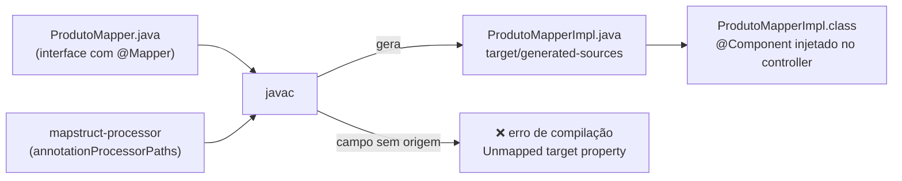

## O problema

O `ProdutoResponse` de [06.01](/construindo-apis-com-spring-boot/dtos-com-records-e-por-que-nao-expor-entidades) tem dez campos, e o método `de` copia um por um. Agora imagine que alguém acrescenta o campo `marca` ao produto e ao DTO. O código compila. Os testes passam, porque nenhum deles olhava a marca. Em produção, a marca sai sempre `null`: o método de conversão não foi atualizado e ninguém percebeu.

Com duas entidades, isso é raro. Com quarenta DTOs, é questão de tempo. E há o erro silencioso inverso: dois campos do mesmo tipo trocados de lugar no construtor (`new ProdutoResponse(id, nome, sku, ...)`), que o compilador aceita porque ambos são `String`.

Pense na tradução de um contrato. Um tradutor humano pode pular uma cláusula sem perceber. Um sistema que compara cláusula por cláusula e se recusa a entregar se alguma ficou sem tradução não pula. O MapStruct é esse sistema: ele gera a conversão e **falha a compilação** se algum campo de destino ficou sem origem.

> **A pergunta desta página:** quando escrever o mapeamento à mão e quando usar o MapStruct, e como configurá-lo para que ele pegue os erros no build?

## O conceito

### Mapeamento manual

A forma mais simples é a de 06.01: métodos estáticos no DTO (`ProdutoResponse.de(produto)`) ou métodos que constroem o domínio a partir do DTO.

Vantagens:

- **Nenhuma dependência**, nenhuma mágica: o código é Java comum, legível e depurável.
- **Controle total** de cada conversão.

Desvantagens:

- **Repetição**: cada DTO novo é mais um método de copiar campos.
- **Erros silenciosos**: um campo esquecido vira `null` sem aviso; campos do mesmo tipo podem ser trocados.

### O MapStruct

O MapStruct é um **processador de anotações**: durante a compilação, ele lê uma interface anotada com `@Mapper` e **gera a classe que a implementa**, com código Java comum, sem reflexão. Você declara o que converter em quê; ele escreve a cópia campo a campo, casando os nomes.

Três características o diferenciam de bibliotecas de mapeamento por reflexão (como ModelMapper ou Dozer):

- **Verificação em compilação.** Se um campo de destino não tem origem, o build pode falhar.
- **Desempenho.** O código gerado é igual ao que você escreveria à mão: chamadas de *getter* e construtor.
- **Depuração.** A classe gerada fica em `target/generated-sources/annotations`, e dá para colocar *breakpoints* nela.

O Bazar usa o **MapStruct 1.6.3**, a versão estável mais recente (a 1.7 ainda está em *beta*). Ele não é gerenciado pelo Spring Boot, então a versão é declarada no `pom.xml`.

### Configuração

São duas peças: a biblioteca de anotações, como dependência, e o processador, no plugin do compilador.

```xml title="pom.xml"
<properties>
    <java.version>25</java.version>
    <mapstruct.version>1.6.3</mapstruct.version>
</properties>

<dependencies>
    <!-- ... -->
    <dependency>
        <groupId>org.mapstruct</groupId>
        <artifactId>mapstruct</artifactId>
        <version>${mapstruct.version}</version>
    </dependency>
</dependencies>

<build>
    <plugins>
        <plugin>
            <groupId>org.apache.maven.plugins</groupId>
            <artifactId>maven-compiler-plugin</artifactId>
            <configuration>
                <annotationProcessorPaths>
                    <path>
                        <groupId>org.mapstruct</groupId>
                        <artifactId>mapstruct-processor</artifactId>
                        <version>${mapstruct.version}</version>
                    </path>
                </annotationProcessorPaths>
            </configuration>
        </plugin>
        <!-- spring-boot-maven-plugin -->
    </plugins>
</build>
```

<Callout type="warning" title="annotationProcessorPaths desliga a detecção automática">
  Sem `annotationProcessorPaths`, o compilador procura processadores em todo o *classpath*. Com ele, **só** os listados rodam. Se o projeto usar outro processador, como o `spring-boot-configuration-processor`, ele também precisa estar na lista, senão deixa de funcionar sem nenhum aviso.
</Callout>

### `@MapperConfig`: as regras do projeto num lugar só

As opções que valem para todos os *mappers* ficam numa interface com `@MapperConfig`, que cada `@Mapper` referencia:

| Opção | Valor no Bazar | Efeito |
|---|---|---|
| `componentModel` | `MappingConstants.ComponentModel.SPRING` | A classe gerada é um `@Component`, injetável no controller |
| `injectionStrategy` | `InjectionStrategy.CONSTRUCTOR` | *Mappers* usados por outros são injetados pelo construtor, o que facilita testes sem Spring |
| `unmappedTargetPolicy` | `ReportingPolicy.ERROR` | **Um campo de destino sem origem falha a compilação.** O padrão é `WARN`, que ninguém lê. |

### Casando campos: `@Mapping`

Por padrão, o MapStruct casa os campos **pelo nome**. Quando os nomes ou os tipos diferem, `@Mapping` diz de onde vem cada destino:

```java
@Mapping(target = "precoEmCentavos", source = "preco")
ProdutoResponse paraResponse(Produto produto);
```

O `preco` é um `Dinheiro` e o `precoEmCentavos` é um `long`. Para converter um tipo no outro, o MapStruct procura **um método disponível** que receba `Dinheiro` e devolva `long`: um método *default* na própria interface ou num *mapper* listado em `uses`. Outras opções úteis de `@Mapping`:

- `ignore = true`: o destino fica sem valor, de propósito (e o `ERROR` não reclama);
- `constant = "BRL"`: um valor fixo;
- `expression = "java(...)"`: uma expressão Java. Funciona, mas o código fica dentro de uma *string*, sem verificação da IDE. Prefira métodos.

### Records e construtores

O MapStruct (desde a 1.4) cria o objeto de destino **pelo construtor** quando não há *setters*. É o caso dos records e do `Produto`, que tem um único construtor público: os parâmetros (`sku`, `nome`, `preco`...) são tratados como as propriedades de destino. Nada precisa ser configurado.

### `@MappingTarget`: atualizar um objeto existente

Para atualizações, o MapStruct copia os campos para um objeto **que já existe**:

```java
void atualizar(AtualizarCategoriaRequest request, @MappingTarget CategoriaEntity categoria);
```

O código gerado chama os *setters* do alvo. Isso exige que o alvo **tenha *setters***, e o `Produto` do Bazar não tem, de propósito: a única forma de mudar um produto é `produto.atualizar(...)`, que mantém a versão e a data coerentes. Essa é uma escolha de design: um domínio com comportamento (métodos que garantem as regras) contra um domínio "anêmico" (só *getters* e *setters*). O Bazar escolhe o primeiro, e por isso usa o MapStruct na criação e na resposta, mas chama `atualizar` à mão no `PUT`. Em projetos com entidades de *setters*, o `@MappingTarget` é o caminho natural, inclusive com `@BeanMapping(nullValuePropertyMappingStrategy = IGNORE)` para atualizações parciais.

### *Mappers* compostos

Conversões que se repetem em vários *mappers* (como `Dinheiro` ↔ centavos) ficam num *mapper* próprio, reaproveitado com `uses`:

```java
@Mapper(config = ConfiguracaoMapStruct.class, uses = DinheiroMapper.class)
interface ProdutoMapper { ... }
```

Quando o `ProdutoMapper` precisa converter `Dinheiro` em `long`, ele encontra o método no `DinheiroMapper` e o chama. O pedido, mais adiante, também usa o `DinheiroMapper` para os valores dos itens e do total.

### Quando não usar MapStruct

O MapStruct é uma dependência, um processador no build e uma camada de indireção (o código que roda não está no arquivo que você lê). Ele compensa quando:

- há **muitos DTOs** com muitos campos;
- os nomes coincidem na maior parte, e as diferenças são poucas e regulares.

Ele não compensa quando:

- há **poucos DTOs** e pequenos (o Bazar mantém as categorias, com quatro campos, no mapeamento manual);
- quase todos os campos exigem lógica própria (o *mapper* vira uma coleção de `expression`);
- a equipe não quer processadores de anotação no build.

Uma regra prática: comece manual; quando o terceiro DTO grande aparecer ou quando um campo esquecido chegar à produção, adote o MapStruct.

### E o Lombok?

O Lombok é outro processador de anotações, que gera *getters*, *setters*, construtores e *builders* (`@Data`, `@Builder`). Ele é muito comum em projetos Spring, e esta documentação **não o usa**, por três motivos:

- **Records cobrem quase tudo** o que se usava do Lombok em DTOs: construtor, acessores, `equals`, `hashCode` e `toString`, com suporte nativo da linguagem.
- **O Lombok depende de APIs internas do compilador**: cada versão nova do JDK exige uma versão nova do Lombok. Com um JDK recente como o 25, isso é uma fonte frequente de quebras.
- **Em entidades, `@Data` e `@Setter` incentivam o domínio anêmico** e geram `equals`/`hashCode` problemáticos com o JPA (assunto da Parte 4).

Se o seu projeto usa Lombok junto com o MapStruct, os dois processadores precisam estar no `annotationProcessorPaths`, junto com o `lombok-mapstruct-binding`, para que rodem na ordem certa.

## Na prática

### A configuração comum

```java title="src/main/java/com/bazar/compartilhado/ConfiguracaoMapStruct.java"
package com.bazar.compartilhado;

import org.mapstruct.InjectionStrategy;
import org.mapstruct.MapperConfig;
import org.mapstruct.MappingConstants;
import org.mapstruct.ReportingPolicy;

/**
 * Configuração comum a todos os mappers do Bazar.
 */
@MapperConfig(
        componentModel = MappingConstants.ComponentModel.SPRING,
        injectionStrategy = InjectionStrategy.CONSTRUCTOR,
        unmappedTargetPolicy = ReportingPolicy.ERROR)
public interface ConfiguracaoMapStruct {
}
```

### O `DinheiroMapper`

```java title="src/main/java/com/bazar/compartilhado/DinheiroMapper.java"
package com.bazar.compartilhado;

import org.mapstruct.Mapper;

/**
 * Conversões de Dinheiro reaproveitadas pelos outros mappers (uses = DinheiroMapper.class).
 * Na v1, os preços saem em centavos de BRL.
 */
@Mapper(config = ConfiguracaoMapStruct.class)
public interface DinheiroMapper {

    default long emCentavos(Dinheiro dinheiro) {
        return dinheiro.emCentavos();
    }

    default Dinheiro deCentavosEmReais(Long centavos) {
        return Dinheiro.deCentavos(centavos, "BRL");
    }
}
```

### O `ProdutoMapper`

```java title="src/main/java/com/bazar/catalogo/api/ProdutoMapper.java"
package com.bazar.catalogo.api;

import com.bazar.catalogo.dominio.Produto;
import com.bazar.compartilhado.ConfiguracaoMapStruct;
import com.bazar.compartilhado.DinheiroMapper;

import org.mapstruct.Mapper;
import org.mapstruct.Mapping;

@Mapper(config = ConfiguracaoMapStruct.class, uses = DinheiroMapper.class)
interface ProdutoMapper {

    @Mapping(target = "preco", source = "precoEmCentavos")
    Produto paraProduto(CriarProdutoRequest request);

    @Mapping(target = "precoEmCentavos", source = "preco")
    ProdutoResponse paraResponse(Produto produto);
}
```

A interface é package-private, como os métodos de conversão de 06.01: só a camada `api` a usa. Os métodos `de` e `paraProduto` saíram dos DTOs, que voltaram a ser só dados.

### O código gerado

Depois de `./mvnw compile`, a implementação aparece em `target/generated-sources/annotations`. Este é o trecho real da resposta:

```java title="target/generated-sources/annotations/com/bazar/catalogo/api/ProdutoMapperImpl.java"
@Component
class ProdutoMapperImpl implements ProdutoMapper {

    private final DinheiroMapper dinheiroMapper;

    @Autowired
    public ProdutoMapperImpl(DinheiroMapper dinheiroMapper) {

        this.dinheiroMapper = dinheiroMapper;
    }

    // ...

    @Override
    public ProdutoResponse paraResponse(Produto produto) {
        if ( produto == null ) {
            return null;
        }

        long precoEmCentavos = 0L;
        UUID id = null;
        // ... uma variável por componente

        precoEmCentavos = dinheiroMapper.emCentavos( produto.getPreco() );
        id = produto.getId();
        sku = produto.getSku();
        nome = produto.getNome();
        // ...
        Map<String, String> map = produto.getAtributos();
        if ( map != null ) {
            atributos = new LinkedHashMap<String, String>( map );
        }
        criadoEm = produto.getCriadoEm();
        atualizadoEm = produto.getAtualizadoEm();

        ProdutoResponse produtoResponse = new ProdutoResponse( id, sku, nome, descricao, precoEmCentavos, categoriaId, status, atributos, criadoEm, atualizadoEm );

        return produtoResponse;
    }
}
```

É o código que você escreveria à mão, com duas diferenças: a cópia defensiva do mapa e a verificação de `null` na entrada. E ele é **regerado a cada compilação**, então nunca fica desatualizado.

### O controller

```java title="src/main/java/com/bazar/catalogo/api/ProdutoController.java"
    private final ProdutoRepository repository;
    private final ProdutoMapper mapper;

    public ProdutoController(ProdutoRepository repository, ProdutoMapper mapper) {
        this.repository = repository;
        this.mapper = mapper;
    }

    @PostMapping
    public ResponseEntity<ProdutoResponse> criar(@RequestBody CriarProdutoRequest request) {
        var produto = repository.save(mapper.paraProduto(request));
        // ... Location como antes
        return ResponseEntity.created(location).body(mapper.paraResponse(produto));
    }

    @GetMapping("/{id}")
    public ResponseEntity<ProdutoResponse> detalhar(@PathVariable UUID id) {
        return ResponseEntity.of(repository.findById(id).map(mapper::paraResponse));
    }
```

### O erro que o MapStruct pega

Para ver a proteção funcionando, acrescente um componente `String marca` ao `ProdutoResponse` sem mexer no *mapper* e compile. A saída real:

```text
[ERROR] COMPILATION ERROR :
[ERROR] .../com/bazar/catalogo/api/ProdutoMapper.java:[17,21] Unmapped target property: "marca".
[ERROR] Failed to execute goal org.apache.maven.plugins:maven-compiler-plugin:3.15.0:compile (default-compile) on project bazar: Compilation failure
```

O build para na linha do `paraResponse`. Com o mapeamento manual, o mesmo esquecimento compilaria e mandaria `"marca": null` para produção. Para corrigir, crie o campo no domínio (e ele será casado pelo nome) ou declare a intenção com `@Mapping(target = "marca", ignore = true)`.

### Testando o *mapper*

Como a classe gerada é Java comum e recebe as dependências pelo construtor, o teste não precisa do Spring:

```java title="src/test/java/com/bazar/catalogo/api/ProdutoMapperTest.java"
// Um teste unitário comum: o mapper gerado é uma classe Java, sem Spring.
class ProdutoMapperTest {

    private final ProdutoMapper mapper = new ProdutoMapperImpl(new DinheiroMapperImpl());

    @Test
    void converteOPrecoEmCentavosNosDoisSentidos() {
        var request = new CriarProdutoRequest("LIV-0042", "Clean Code", null, 12990L,
                UUID.fromString("0192f3a0-5555-7000-8000-000000000003"), Map.of("autor", "Robert C. Martin"));

        var produto = mapper.paraProduto(request);
        assertThat(produto.getPreco().valor()).isEqualByComparingTo("129.90");
        assertThat(produto.getPreco().moeda().getCurrencyCode()).isEqualTo("BRL");

        var response = mapper.paraResponse(produto);
        assertThat(response.precoEmCentavos()).isEqualTo(12990L);
        assertThat(response.status()).isEqualTo(StatusProduto.RASCUNHO);
        assertThat(response.atributos()).containsEntry("autor", "Robert C. Martin");
    }
}
```

No teste do controller (`@WebMvcTest`), os *mappers* não são carregados automaticamente, porque não são componentes web; eles entram pelo `@Import`, junto com o repositório.

## Diagrama

Onde o MapStruct age: em tempo de compilação, não em tempo de execução.



## Erros comuns

<BadVsGood title="A política de campos não mapeados" why="Com o padrão (WARN), um campo novo sem mapeamento gera um aviso perdido no meio do log do build, e o JSON passa a ter null. Com ERROR, o build quebra e o problema não chega à produção.">
<Bad title="Configuração padrão">

```java
@Mapper(componentModel = "spring")
interface ProdutoMapper { ... }
```

</Bad>
<Good title="ERROR, num @MapperConfig compartilhado">

```java
@Mapper(config = ConfiguracaoMapStruct.class, uses = DinheiroMapper.class)
interface ProdutoMapper { ... }
```

</Good>
</BadVsGood>

Outros erros frequentes:

- **Esquecer o processador.** Só a dependência `mapstruct` não gera nada; na inicialização, o Spring não encontra um bean `ProdutoMapper`.
- **Perder outros processadores ao configurar `annotationProcessorPaths`.** Liste todos os que o projeto usa.
- **Usar `expression` para tudo.** Código Java em *strings* não é verificado pela IDE nem refatorado. Prefira métodos *default* ou um *mapper* em `uses`.
- **Mapear a entrada direto para a entidade com `@MappingTarget` e *setters*.** É o *mass assignment* de volta, gerado automaticamente. O DTO de entrada continua sendo a lista do que pode mudar.
- **Ignorar campos com `ignore = true` para "fazer compilar".** O erro existia para mostrar uma decisão pendente; ignore só quando a ausência for intencional.
- **Bibliotecas de mapeamento por reflexão** (ModelMapper): casam campos "parecidos" em tempo de execução e erram sem avisar.

## Boas práticas

- **Comece** com mapeamento manual e adote o MapStruct quando os DTOs crescerem.
- **Configure** `unmappedTargetPolicy = ERROR` num `@MapperConfig` comum.
- **Use** `componentModel = SPRING` com injeção por construtor.
- **Extraia** conversões repetidas (como `Dinheiro`) para *mappers* reaproveitados com `uses`.
- **Mantenha** as regras de negócio no domínio: o *mapper* copia dados, não decide transições.
- **Teste** os *mappers* com testes unitários, sem Spring.

## No projeto Bazar

<ProjectStep title="ProdutoMapper com MapStruct" module="catalogo" tag="pagina-06.02" files={[
  { path: 'pom.xml', change: 'alterado' },
  { path: 'src/main/java/com/bazar/compartilhado/ConfiguracaoMapStruct.java', change: 'novo' },
  { path: 'src/main/java/com/bazar/compartilhado/DinheiroMapper.java', change: 'novo' },
  { path: 'src/main/java/com/bazar/catalogo/api/ProdutoMapper.java', change: 'novo' },
  { path: 'src/main/java/com/bazar/catalogo/api/ProdutoController.java', change: 'alterado' },
  { path: 'src/main/java/com/bazar/catalogo/api/CriarProdutoRequest.java', change: 'alterado' },
  { path: 'src/main/java/com/bazar/catalogo/api/ProdutoResponse.java', change: 'alterado' },
  { path: 'src/test/java/com/bazar/catalogo/api/ProdutoMapperTest.java', change: 'novo' },
  { path: 'src/test/java/com/bazar/catalogo/api/ProdutoControllerTest.java', change: 'alterado' },
]}>
O produto passa a ser convertido pelo MapStruct 1.6.3, com a política `ERROR` para campos não mapeados e um `DinheiroMapper` compartilhado. As categorias continuam com mapeamento manual. O JSON da API não mudou: os testes do controller continuam passando sem alteração nas asserções.
</ProjectStep>

## Resumo

- **Manual**: simples e sem dependências, mas repetitivo e sujeito a campos esquecidos sem aviso.
- **MapStruct** gera a implementação em tempo de compilação, sem reflexão; o código gerado fica em `target/generated-sources`.
- Configure o processador em **`annotationProcessorPaths`** (listando todos os processadores do projeto) e as regras num **`@MapperConfig`**: `componentModel = SPRING`, injeção por construtor e **`unmappedTargetPolicy = ERROR`**.
- **`@Mapping`** resolve nomes e tipos diferentes; **records** e construtores são suportados; **`@MappingTarget`** atualiza objetos com *setters*; **`uses`** compõe *mappers*.
- Não use MapStruct para poucos DTOs pequenos; esta doc **não usa Lombok**, porque records cobrem os DTOs.

<Exercise title="O mapper da categoria" difficulty="facil">
Converta o mapeamento das categorias para o MapStruct:

1. Escreva o `CategoriaMapper` com os métodos `paraResponse(Categoria)` e `paraCategoria(UUID id, CategoriaRequest request)`.
2. O segundo método tem dois parâmetros. Como o MapStruct sabe de onde vem o `id`?
3. Depois de fazer, compare com a versão manual. Valeu a pena para quatro campos?

<Hint>
Com vários parâmetros de origem, o MapStruct casa um parâmetro pelo nome com o campo de destino, e os campos dos objetos pelos nomes das propriedades. Em caso de ambiguidade, use `@Mapping(target = "...", source = "parametro.campo")`.
</Hint>

<Solution>

```java
@Mapper(config = ConfiguracaoMapStruct.class)
interface CategoriaMapper {

    CategoriaResponse paraResponse(Categoria categoria);

    Categoria paraCategoria(UUID id, CategoriaRequest request);
}
```

1. Os dois métodos compilam sem nenhum `@Mapping`: todos os nomes coincidem.
2. O parâmetro `id` (um `UUID`) tem o mesmo nome do componente `id` da `Categoria`, e o MapStruct o usa diretamente. Os outros (`nome`, `slug`, `categoriaPaiId`) vêm das propriedades do `request`. Se o `CategoriaRequest` também tivesse um `id`, haveria ambiguidade, e o MapStruct exigiria `@Mapping(target = "id", source = "id")`.
3. Para quatro campos com os mesmos nomes, o ganho é pequeno: o mapeamento manual já era uma linha por método. O que pesa a favor do MapStruct é a **consistência** (todos os *mappers* iguais) e a verificação quando a categoria crescer. O que pesa contra é a indireção. As duas escolhas são defensáveis; o Bazar mantém o manual nas categorias.

</Solution>
</Exercise>

<Quiz
  questions={[
    {
      question: 'Com unmappedTargetPolicy = ERROR, o que acontece se o ProdutoResponse ganhar um campo "marca" que não existe no Produto?',
      options: [
        'O campo sai null no JSON',
        'A compilação falha com "Unmapped target property: marca"',
        'O MapStruct lança uma exceção na primeira requisição',
      ],
      answer: 1,
      explanation: 'O MapStruct roda no javac e, com a política ERROR, recusa gerar um mapeamento que deixa um destino sem origem. Sair null é o que aconteceria com o mapeamento manual (ou com WARN); não há verificação em tempo de execução.',
    },
    {
      question: 'Por que o Bazar não usa @MappingTarget para o PUT de produtos?',
      options: [
        'Porque o MapStruct não suporta atualizações',
        'Porque o Produto não tem setters: a mudança passa por produto.atualizar(...), que mantém a versão e a data coerentes',
        'Porque @MappingTarget só funciona com records',
      ],
      answer: 1,
      explanation: 'O @MappingTarget gera chamadas a setters, e o Produto não os tem por escolha de design. O MapStruct suporta atualizações normalmente em objetos com setters; records, por serem imutáveis, nem podem ser alvo de @MappingTarget.',
    },
    {
      question: 'O projeto já usava o spring-boot-configuration-processor. Depois de configurar annotationProcessorPaths só com o MapStruct, o que acontece?',
      options: [
        'Nada muda: o compilador continua encontrando os dois',
        'O configuration-processor deixa de rodar, porque com annotationProcessorPaths só os processadores listados são usados',
        'O build falha com um erro de processador duplicado',
      ],
      answer: 1,
      explanation: 'A lista explícita substitui a detecção automática no classpath. Sem erro algum, os metadados de configuração deixam de ser gerados. A solução é acrescentar o outro processador à lista.',
    },
  ]}
/>

## Referências

<References />
