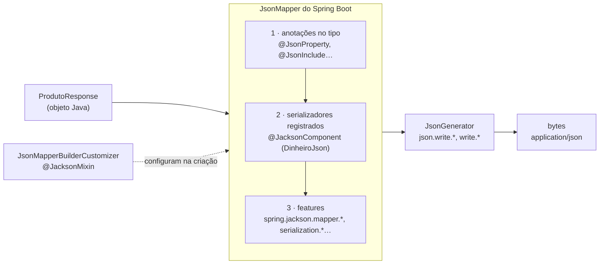

## O problema

Uma equipe migra uma API do Boot 3 para o Boot 4. O código compila depois de trocar alguns *imports*, os testes de unidade passam e a versão vai para produção. No dia seguinte, três reclamações:

- o app Android quebrou, porque esperava `"status": "ATIVO"` e passou a receber `"status": "Ativo"` (o enum tinha um `toString()` amigável, que o Jackson 3 agora usa);
- um parceiro que comparava o JSON como texto acusou mudança na ordem dos campos de um relatório, gerado a partir de uma classe comum;
- um cliente antigo que mandava `"quantidade": null` num campo `int` começou a receber `400`.

Nenhuma dessas mudanças está no código da equipe. Elas estão nos **padrões** do Jackson 3. O JSON que sai da API não é definido só pelos seus DTOs: é definido pelos DTOs **mais** a configuração do serializador. Quem não conhece essa configuração não conhece o próprio contrato.

Pense numa impressora de convites. O texto é o mesmo, mas trocar o modelo da impressora muda a fonte, as margens e a ordem das linhas, se ninguém conferir as configurações. Quem recebe o convite não sabe que a impressora mudou; só vê que o convite está diferente.

> **A pergunta desta página:** o que mudou no Jackson 3, quais são os padrões que definem o JSON do Bazar e como configurá-los e customizá-los no Spring Boot 4?

## O conceito

### O que é o Jackson para o Spring

O Jackson é a biblioteca que converte objetos Java em JSON (**serialização**) e JSON em objetos (**desserialização**). No Spring MVC, ele está por trás do conversor de mensagens de JSON ([09.03](/construindo-apis-com-spring-boot/httpmessageconverter-e-a-serializacao-por-dentro)): todo `@RequestBody` é lido por ele, e todo objeto devolvido por um controller é escrito por ele. O Spring Boot cria um único `JsonMapper` configurado e o entrega ao Spring MVC.

### Jackson 3: o que mudou na estrutura

O Jackson 3.0 é a primeira versão *major* em mais de dez anos. As mudanças estruturais:

- **Novo pacote e novo *groupId*:** `tools.jackson` em vez de `com.fasterxml.jackson`. O `JsonMapper` está em `tools.jackson.databind.json`, o `ObjectMapper` em `tools.jackson.databind`.
- **Anotações no lugar de sempre:** `@JsonProperty`, `@JsonIgnore`, `@JsonCreator` e afins continuam em **`com.fasterxml.jackson.annotation`** (artefato `jackson-annotations`, linha 2.x). DTOs anotados não precisam mudar.
- **`JsonMapper` imutável, construído por *builder*:** não existe mais `mapper.configure(...)` depois de criado. Para mudar algo, cria-se um novo: `JsonMapper.builder()...build()`, ou `mapper.rebuild()...build()` a partir de um existente. Um *mapper* compartilhado não pode mais ser alterado por acidente no meio da aplicação.
- **Exceções não checadas:** `JacksonException` estende `RuntimeException`. Acabou o `throws JsonProcessingException` em todo lugar.
- **`java.time` embutido:** `Instant`, `LocalDate`, `Duration` e afins são suportados pelo próprio *databind*, sem o módulo `jackson-datatype-jsr310`.
- **Recursos reorganizados:** algumas *features* mudaram de lugar. Por exemplo, `WRITE_DATES_AS_TIMESTAMPS` agora é `DateTimeFeature.WRITE_DATES_AS_TIMESTAMPS`, e as opções de enum ficam em `EnumFeature`.

### Os novos padrões

Esta é a tabela que mais importa. Os valores abaixo foram medidos no próprio Bazar, com o `JsonMapper` do Spring Boot 4.1.2, e comparados com o modo de compatibilidade (`spring.jackson.use-jackson2-defaults=true`):

| Opção | Jackson 3 (padrão do Boot 4) | Com `use-jackson2-defaults` | Efeito no contrato |
|---|---|---|---|
| `DateTimeFeature.WRITE_DATES_AS_TIMESTAMPS` | `false` | `false` | Datas como texto ISO 8601: `"2026-10-24T17:30:00Z"` |
| `DeserializationFeature.FAIL_ON_UNKNOWN_PROPERTIES` | `false` | `false` | Campos desconhecidos na entrada são ignorados |
| `DeserializationFeature.FAIL_ON_NULL_FOR_PRIMITIVES` | **`true`** | `false` | `null` ou ausente num `int` de record → erro (antes: `0`) |
| `DeserializationFeature.FAIL_ON_TRAILING_TOKENS` | **`true`** | — | `{"a":1} {"a":2}` → erro (antes: lia o primeiro e ignorava o resto) |
| `MapperFeature.SORT_PROPERTIES_ALPHABETICALLY` | **`true`** | `false` | Classes comuns saem em ordem alfabética |
| `MapperFeature.SORT_CREATOR_PROPERTIES_FIRST` | `true` | — | Parâmetros do construtor vêm antes: **records mantêm a ordem dos componentes** |
| `EnumFeature.WRITE_ENUMS_USING_TO_STRING` | **`true`** | `false` | Enums escritos com `toString()` (antes: `name()`) |
| `EnumFeature.READ_ENUMS_USING_TO_STRING` | **`true`** | — | Enums lidos pelo `toString()` |
| Profundidade máxima de aninhamento | **500** | | JSON com mais de 500 níveis → erro |

Três desses padrões merecem atenção especial:

**A ordem dos campos.** Uma classe comum com os campos `zeta`, `alfa` e `meio` sai como `{"alfa":...,"meio":...,"zeta":...}`. Um record com os mesmos componentes sai na ordem declarada, porque os componentes são parâmetros do construtor e `SORT_CREATOR_PROPERTIES_FIRST` os coloca primeiro, na ordem original. Os DTOs do Bazar são records, mas há classes que viram JSON também, como o `ProblemDetail` dos erros ([08.02](/construindo-apis-com-spring-boot/problemdetail-no-spring-tratamento-global-de-erros)). O Bazar desliga a ordem alfabética para que **a ordem seja sempre a da declaração**.

**Enums via `toString()`.** Os enums do Bazar não sobrescrevem `toString()`, então nada muda: `toString()` e `name()` devolvem `ATIVO`. Mas um enum com `toString()` "bonito" muda o contrato **nos dois sentidos**: na sonda feita para esta página, um enum com `toString()` devolvendo `"ativo-tostring"` saiu assim no JSON, e a leitura de `"ATIVO"` passou a falhar com `not one of the values accepted for Enum class: [ativo-tostring]`. Não use `toString()` para apresentação em enums que fazem parte do contrato.

**Primitivos.** Num record com `int n`, tanto `{"n": null}` quanto `{}` falham com `Cannot map 'null' into type 'int'`. É mais seguro do que virar `0` em silêncio, mas a mensagem não ajuda o cliente. Por isso os DTOs de entrada do Bazar usam *wrappers* (`Long`) e validação ([06.01](/construindo-apis-com-spring-boot/dtos-com-records-e-por-que-nao-expor-entidades), [07.01](/construindo-apis-com-spring-boot/bean-validation-essencial)).

### `use-jackson2-defaults`: o modo de compatibilidade

`spring.jackson.use-jackson2-defaults=true` configura o Jackson 3 com os padrões que o Spring Boot usava com o Jackson 2. Ele existe para **migrações**: sobe-se para o Boot 4 sem mudar o contrato e, depois, revisa-se cada diferença com calma. Em projetos novos, como o Bazar, não faz sentido usá-lo.

### Configurando com `spring.jackson.*`

A maior parte da configuração é feita por propriedades, sem código. As famílias de propriedades no Boot 4.1:

| Propriedade | Tipo de *feature* | Exemplo |
|---|---|---|
| `spring.jackson.mapper.*` | `MapperFeature` (geral) | `sort-properties-alphabetically: false` |
| `spring.jackson.serialization.*` | `SerializationFeature` | `indent-output: true` |
| `spring.jackson.deserialization.*` | `DeserializationFeature` | `fail-on-unknown-properties: true` |
| `spring.jackson.datatype.datetime.*` | `DateTimeFeature` | `write-dates-as-timestamps: false` |
| `spring.jackson.datatype.enum.*` | `EnumFeature` | `write-enums-using-to-string: false` |
| `spring.jackson.json.read.*` / `json.write.*` | `JsonReadFeature` / `JsonWriteFeature` (específicas de JSON) | `json.read.allow-single-quotes: true` |
| `spring.jackson.read.*` / `write.*` | `StreamReadFeature` / `StreamWriteFeature` (comuns a JSON, CBOR, XML) | `read.include-source-in-location: true` |
| `spring.jackson.default-property-inclusion` | Inclusão de nulos | `non_null` |
| `spring.jackson.property-naming-strategy` | Nomes dos campos | `SNAKE_CASE` |
| `spring.jackson.factory.constraints.read.*` | Limites de leitura | `max-nesting-depth: 500` |

As propriedades **específicas de JSON** (`spring.jackson.json.read.*` e `json.write.*`) chegaram no Boot 4.0, que moveu para elas as antigas `spring.jackson.read.*`/`write.*`. No Boot 4.1, `spring.jackson.read.*` e `write.*` voltaram, agora para as *features* **comuns a vários formatos**. Ao ler um tutorial, confira de qual versão ele é.

### Customizando com código

Quando as propriedades não bastam:

- **`JsonMapperBuilderCustomizer`**: um bean que recebe o *builder* antes de o Boot construir o `JsonMapper`. Ele **soma** às propriedades, sem substituí-las. Substitui o `Jackson2ObjectMapperBuilderCustomizer`.

  ```java
  @Bean
  JsonMapperBuilderCustomizer bazarJackson() {
      return builder -> builder.enable(SerializationFeature.INDENT_OUTPUT);
  }
  ```

- **Um bean `JsonMapper` próprio** (de preferência `@Primary`, como o do Boot) ou um bean `JsonMapper.Builder`: substitui o *mapper* do Boot por inteiro e **desliga toda a autoconfiguração** dele, então as propriedades `spring.jackson.*` deixam de valer. O tipo é **`JsonMapper`**, do Jackson 3, e não o `ObjectMapper` que os tutoriais do Boot 3 mostram. Raramente é necessário.
- **Ordem dos customizadores:** o customizador do próprio Boot tem ordem `0`. Um `JsonMapperBuilderCustomizer` com `@Order(-1)` roda antes dele, e um com `@Order(1)`, depois.
- **`@JacksonComponent`**: registra serializadores e desserializadores como beans (substitui o `@JsonComponent`).
- **`@JacksonMixin`**: aplica anotações a uma classe que você não pode alterar (de uma biblioteca, por exemplo) por meio de uma classe "espelho" (substitui o `@JsonMixin`).

### Propriedades desconhecidas e o *tolerant reader*

O padrão do Jackson 3 é **ignorar** campos que o DTO não conhece. A alternativa é falhar (`fail-on-unknown-properties: true`), respondendo `400`. Os dois lados têm argumentos:

| Ignorar (padrão) | Falhar |
|---|---|
| Clientes podem mandar campos novos antes de o servidor conhecê-los (implantações graduais, versões diferentes) | Erros de digitação aparecem: `"precoEmCentavo"` vira `400` em vez de um preço ausente |
| Segue o princípio do ***tolerant reader***: seja tolerante com o que recebe | Deixa explícito o que o contrato aceita |
| Combina com a validação: campos obrigatórios ausentes são pegos por ela | Quebra clientes que enviam campos extras inofensivos |

O Bazar **mantém o padrão (ignorar)**. O argumento decisivo é a evolução: em [18.01](/contratos-documentacao-e-ciclo-de-vida/compatibilidade-retroativa-o-que-quebra-um-cliente), acrescentar campos é a mudança compatível por excelência, e clientes e servidores que falham com campos desconhecidos transformam essa mudança em quebra. Os erros de digitação em campos obrigatórios são pegos pela validação; o risco que sobra (um campo opcional digitado errado) é aceito. O *tolerant reader* do lado dos clientes é o assunto de [15.04](/design-de-apis-profissional/enums-evolucao-e-tolerant-reader).

### Nulos e nomes

**Inclusão de `null`.** O padrão (`ALWAYS`) escreve campos nulos como `null`. As alternativas:

- `NON_NULL`: omite campos `null`;
- `NON_ABSENT`: omite `null` e também `Optional.empty()`;
- `NON_EMPTY`: omite também *strings*, listas e mapas vazios.

O Bazar usa o padrão: **campos sem valor aparecem como `null` explícito** ([02.06](/comecando-e-fundamentos-de-http/json-para-apis)). O cliente sabe que o campo existe e está vazio, e não precisa diferenciar "ausente" de "nulo".

**Estratégia de nomes.** O padrão usa o nome Java (`precoEmCentavos`). Com `spring.jackson.property-naming-strategy=SNAKE_CASE`, sairia `preco_em_centavos`. O Bazar usa *camelCase*, o mais comum em APIs JSON; o importante é ser consistente ([12.02](/design-de-apis-profissional/convencoes-de-nomenclatura)).

### Anotações essenciais

| Anotação | Uso |
|---|---|
| `@JsonProperty("nome_externo")` | Muda o nome de um campo no JSON (renomear um componente sem quebrar o contrato) |
| `@JsonIgnore` | Exclui um campo da serialização e da desserialização |
| `@JsonCreator` | Indica o construtor ou método de fábrica usado na desserialização (desnecessário em records) |
| `@JsonInclude(NON_NULL)` | Muda a inclusão de nulos de uma classe ou campo |
| `@JsonFormat(shape = STRING)` | Muda a forma de um valor (um número como *string*, por exemplo) |

Lembre-se de [06.01](/construindo-apis-com-spring-boot/dtos-com-records-e-por-que-nao-expor-entidades): num DTO, `@JsonIgnore` quase nunca é necessário. Se um campo não deve sair, ele não deveria estar no DTO.

### Serializadores customizados

Quando a forma de um tipo no JSON não segue a forma do objeto Java, escreve-se um serializador. No Jackson 3, a classe base é **`ValueSerializer<T>`** (no Jackson 2 era `JsonSerializer`), e o método recebe um `SerializationContext` (antes, `SerializerProvider`).

O `Dinheiro` do Bazar é o exemplo: o record tem um `BigDecimal` e um `Currency`, que o Jackson escreveria como `{"valor": 129.90, "moeda": "BRL"}`, com o valor como **número**. O contrato do Bazar exige o valor como *string* (`"129.90"`), para que clientes que leem números como `double` não percam precisão. O serializador está na seção prática.

### Polimorfismo e segurança

Às vezes um campo pode conter subtipos diferentes: um `pagamento` que é `PagamentoPix` ou `PagamentoCartao`. O `@JsonTypeInfo` acrescenta ao JSON uma informação de tipo, para que o Jackson saiba qual classe criar na leitura:

```java
@JsonTypeInfo(use = JsonTypeInfo.Id.NAME, property = "metodo")
@JsonSubTypes({
        @JsonSubTypes.Type(value = PagamentoPix.class, name = "PIX"),
        @JsonSubTypes.Type(value = PagamentoCartao.class, name = "CARTAO")
})
public sealed interface DadosPagamento permits PagamentoPix, PagamentoCartao {
}
```

Com `Id.NAME`, o JSON carrega um **nome lógico** (`"metodo": "PIX"`), e só os subtipos listados são aceitos. O perigo está em **`Id.CLASS`**, que coloca o nome da classe Java no JSON (`"@class": "com.bazar..."`): se o tipo base for amplo (`Object`, `Serializable`), um atacante pode pedir para o Jackson instanciar qualquer classe do *classpath*. Por anos, essa foi a origem da maioria das CVEs do Jackson.

O Jackson 3 fechou essa porta por padrão. Na sonda desta página, um campo `Object` com `@JsonTypeInfo(use = Id.CLASS)` recusou todas as classes:

```text
InvalidDefinitionException: Configured `PolymorphicTypeValidator` (of type
`tools.jackson.databind.jsontype.DefaultBaseTypeLimitingValidator`) denies resolution of all
subtypes of base type `java.lang.Object` as using too generic base type can open a security
hole without checks on subtype: please configure a custom `PolymorphicTypeValidator` for this use case
```

Mesmo assim, a regra continua: **use `Id.NAME` com subtipos explícitos**, nunca `Id.CLASS` em dados que vêm de fora. Nomes lógicos também não expõem a estrutura de pacotes da aplicação no contrato.

### Jackson 2 como *fallback*

Projetos que dependem de bibliotecas presas ao Jackson 2 podem usar o módulo **`spring-boot-jackson2`**, que cria um `ObjectMapper` do Jackson 2 configurado pelas propriedades `spring.jackson2.*` (e por beans `Jackson2ObjectMapperBuilderCustomizer`). Para que o Spring MVC use o Jackson 2 quando as duas versões estão presentes, é preciso dizer isso explicitamente: `spring.http.converters.preferred-json-mapper=jackson2`. O suporte está **depreciado** e será removido numa versão 4.x futura; ele existe só como ponte para a migração. As anotações (`com.fasterxml.jackson.annotation`) são compartilhadas pelas duas versões.

## Diagrama

O caminho de um objeto até os bytes da resposta, com os pontos onde você pode interferir:



## Na prática

### A configuração do Bazar

```yaml title="src/main/resources/application.yml"
spring:
  application:
    name: bazar
  jackson:
    mapper:
      # A ordem dos campos no JSON segue a declaração (records e classes), não o alfabeto.
      sort-properties-alphabetically: false

server:
  port: 8080
```

Uma única linha, e de propósito: o Bazar aceita os outros padrões do Jackson 3 (datas ISO 8601, `null` explícito, campos desconhecidos ignorados, primitivos estritos), e cada um deles está justificado nesta página. A configuração mínima é mais fácil de manter do que uma lista de opções que ninguém lembra por que foram mudadas.

### O serializador de `Dinheiro`

```java title="src/main/java/com/bazar/compartilhado/DinheiroJson.java"
package com.bazar.compartilhado;

import org.springframework.boot.jackson.JacksonComponent;

import tools.jackson.core.JsonGenerator;
import tools.jackson.databind.SerializationContext;
import tools.jackson.databind.ValueSerializer;

/**
 * Formato JSON do Dinheiro: { "valor": "129.90", "moeda": "BRL" }.
 * O valor vai como string para não perder precisão em clientes que leem números como double (02.06).
 * A leitura (desserialização) chega em 15.02.
 */
@JacksonComponent
public class DinheiroJson {

    public static class Serializer extends ValueSerializer<Dinheiro> {

        @Override
        public void serialize(Dinheiro dinheiro, JsonGenerator gerador, SerializationContext contexto) {
            gerador.writeStartObject();
            gerador.writeStringProperty("valor", dinheiro.valor().toPlainString());
            gerador.writeStringProperty("moeda", dinheiro.moeda().getCurrencyCode());
            gerador.writeEndObject();
        }
    }
}
```

Detalhes do Jackson 3 neste código: `ValueSerializer` e `SerializationContext` vêm de `tools.jackson.databind`; o `JsonGenerator`, de `tools.jackson.core`; o método `writeStringProperty` substitui o antigo `writeStringField`; e não há `throws IOException`. O `@JacksonComponent` numa classe com serializadores aninhados registra todos eles. O `toPlainString()` garante `"129.90"`, e nunca notação científica.

A v1 do produto ainda expõe `precoEmCentavos`; o `Dinheiro` aparece no JSON a partir dos pedidos e da v2 do produto ([18.03](/contratos-documentacao-e-ciclo-de-vida/versionamento-nativo-no-spring-framework-7)). O serializador já existe para que todo `Dinheiro` saia no mesmo formato desde o primeiro uso.

### Testando o contrato com `@JsonTest`

O `@JsonTest` sobe **só** o Jackson configurado pelo Spring Boot: o `application.yml`, os `@JacksonComponent` e os customizadores. É o teste mais barato para verificar a forma exata do JSON. Ele exige o *starter* de teste do Jackson:

```xml title="pom.xml"
<dependency>
    <groupId>org.springframework.boot</groupId>
    <artifactId>spring-boot-starter-jackson-test</artifactId>
    <scope>test</scope>
</dependency>
```

```java title="src/test/java/com/bazar/catalogo/api/ProdutoJsonTest.java"
// @JsonTest sobe só o Jackson configurado pelo Spring Boot (application.yml e @JacksonComponent).
@JsonTest
class ProdutoJsonTest {

    @Autowired
    JacksonTester<ProdutoResponse> produto;

    @Autowired
    JacksonTester<CriarProdutoRequest> criacao;

    @Autowired
    JacksonTester<Dinheiro> dinheiro;

    @Test
    void escreveOProdutoComOContratoV1() throws Exception {
        var response = new ProdutoResponse(
                UUID.fromString("0192f39f-2222-7000-8000-000000000042"), "LIV-0042", "Clean Code", null, 12990,
                UUID.fromString("0192f3a0-5555-7000-8000-000000000003"), StatusProduto.ATIVO, Map.of(),
                Instant.parse("2026-10-24T17:30:00Z"), Instant.parse("2026-10-24T17:30:00Z"));

        assertThat(produto.write(response)).isStrictlyEqualToJson("""
                { "id": "0192f39f-2222-7000-8000-000000000042", "sku": "LIV-0042", "nome": "Clean Code",
                  "descricao": null, "precoEmCentavos": 12990, "categoriaId": "0192f3a0-5555-7000-8000-000000000003",
                  "status": "ATIVO", "atributos": {}, "criadoEm": "2026-10-24T17:30:00Z",
                  "atualizadoEm": "2026-10-24T17:30:00Z" }
                """);
        // a ordem dos campos é a da declaração do record
        assertThat(produto.write(response).getJson()).startsWith("{\"id\":\"0192f39f");
    }

    @Test
    void escreveODinheiroComValorEmString() throws Exception {
        assertThat(dinheiro.write(Dinheiro.deCentavos(12990, "BRL")))
                .isStrictlyEqualToJson("""
                        { "valor": "129.90", "moeda": "BRL" }
                        """);
    }

    @Test
    void ignoraPropriedadesDesconhecidasNaEntrada() throws Exception {
        var lido = criacao.parseObject("""
                { "sku": "LIV-0042", "nome": "Clean Code", "precoEmCentavos": 12990,
                  "categoriaId": "0192f3a0-5555-7000-8000-000000000003", "status": "ATIVO" }
                """);

        assertThat(lido.sku()).isEqualTo("LIV-0042");
        assertThat(lido.atributos()).isEmpty();
    }
}
```

O `isStrictlyEqualToJson` compara o JSON inteiro: um campo a mais, a menos ou com outro valor falha o teste. A data sai com `Z` e sem frações porque o `Instant` do teste não tem frações. O `JacksonTester` do Boot 4 já trabalha com o `JsonMapper` do Jackson 3.

Esse teste é a rede de segurança para a próxima atualização: se um padrão do Jackson mudar, o contrato do Bazar não muda sem que um teste quebre.

## Erros comuns

<BadVsGood title="Enum com toString de apresentação" why="No Jackson 3, enums são escritos e lidos pelo toString(). Um toString() pensado para a tela muda o contrato e faz a leitura do valor antigo falhar.">
<Bad title="toString() amigável num enum do contrato">

```java
public enum StatusProduto {
    RASCUNHO, ATIVO, DESCONTINUADO;

    @Override
    public String toString() {
        return name().charAt(0) + name().substring(1).toLowerCase();   // "Ativo"
    }
}
```

</Bad>
<Good title="O nome do enum é o contrato; a apresentação fica no cliente ou num método próprio">

```java
public enum StatusProduto {
    RASCUNHO, ATIVO, DESCONTINUADO;

    public String rotulo() {
        return name().charAt(0) + name().substring(1).toLowerCase();
    }
}
```

</Good>
</BadVsGood>

Outros erros frequentes:

- **Importar `com.fasterxml.jackson.databind`** num projeto Boot 4. É o Jackson 2. Só as anotações ficam em `com.fasterxml.jackson.annotation`.
- **Tentar configurar o *mapper* depois de criado** (`mapper.configure(...)`). O `JsonMapper` é imutável; use propriedades, um customizador ou `rebuild()`.
- **Copiar de um tutorial antigo um bean `ObjectMapper` para "trocar" o *mapper*.** No Boot 4, a troca documentada é por um bean `JsonMapper` (ou `JsonMapper.Builder`), e ela desliga toda a autoconfiguração; quase sempre, um `JsonMapperBuilderCustomizer` é o que você queria.
- **Usar `spring.jackson.read.*` de um tutorial do Boot 3** esperando *features* de JSON. No Boot 4.1, essas propriedades configuram as *features* comuns a vários formatos; as de JSON estão em `spring.jackson.json.read.*`.
- **Mudar a inclusão de nulos "só para economizar bytes".** É uma mudança de contrato: clientes que esperavam o campo passam a não encontrá-lo.
- **`@JsonTypeInfo(use = Id.CLASS)` em dados externos.** Exponha nomes lógicos com `Id.NAME`.
- **Não testar o JSON.** Sem um `@JsonTest`, uma atualização de biblioteca muda o contrato sem que ninguém perceba.

## Boas práticas

- **Conheça** os padrões do Jackson 3 e decida, um a um, se o contrato os aceita.
- **Configure** por propriedades; use `JsonMapperBuilderCustomizer` só para o que elas não cobrem.
- **Fixe** a ordem dos campos (`sort-properties-alphabetically: false`) para que ela siga a declaração.
- **Mantenha** os enums do contrato com `toString()` igual ao `name()`.
- **Registre** serializadores de tipos do domínio (como `Dinheiro`) com `@JacksonComponent`.
- **Teste** a forma do JSON com `@JsonTest` e `isStrictlyEqualToJson`.
- **Use** `use-jackson2-defaults` só como ponte de migração.

## No projeto Bazar

<ProjectStep title="Jackson configurado e serializador de Dinheiro" module="compartilhado" tag="pagina-06.03" files={[
  { path: 'src/main/resources/application.yml', change: 'alterado' },
  { path: 'src/main/java/com/bazar/compartilhado/DinheiroJson.java', change: 'novo' },
  { path: 'pom.xml', change: 'alterado' },
  { path: 'src/test/java/com/bazar/catalogo/api/ProdutoJsonTest.java', change: 'novo' },
]}>
A ordem dos campos passa a seguir a declaração, o `Dinheiro` ganha seu formato JSON (`{"valor": "129.90", "moeda": "BRL"}`) e um `@JsonTest` fixa o contrato v1 do produto. O JSON das respostas atuais não mudou, porque todos os DTOs já eram records.
</ProjectStep>

## Resumo

- Jackson 3: pacote **`tools.jackson`** (anotações continuam em `com.fasterxml.jackson.annotation`), **`JsonMapper` imutável** por *builder*, **exceções não checadas** e **`java.time` embutido**.
- Novos padrões: **ordem alfabética** em classes (records mantêm a declaração), **enums via `toString()`**, **primitivos estritos**, **tokens extras proibidos**, **profundidade máxima de 500**.
- **`spring.jackson.use-jackson2-defaults=true`** restaura os padrões antigos, para migrações.
- Configure com **`spring.jackson.*`** (`json.read/write` para JSON no 4.0; `read/write` para *features* comuns no 4.1), **`JsonMapperBuilderCustomizer`**, um bean **`JsonMapper`**, **`@JacksonComponent`** e **`@JacksonMixin`**.
- O Bazar **ignora campos desconhecidos** (tolerant reader), escreve **`null` explícito**, usa *camelCase* e serializa `Dinheiro` com **`ValueSerializer`**.
- Polimorfismo: **`Id.NAME`** com subtipos explícitos; o Jackson 3 bloqueia `Id.CLASS` com tipo base genérico.

<Exercise title="Migrando um contrato do Boot 3" difficulty="medio">
Uma API está migrando do Boot 3 para o Boot 4 e **não pode mudar o contrato**. Ela tem:

- uma classe (não record) `PedidoResumo` com os campos `numero`, `status` e `valorTotal`, nessa ordem;
- um enum `StatusPedido` com `toString()` devolvendo `"Pagamento pendente"` para `PAGAMENTO_PENDENTE`, usado na tela de um sistema interno;
- um DTO de entrada com `int quantidade`, que alguns clientes antigos enviam como `null` (e que hoje vira `0`).

1. Para cada item, diga o que muda no JSON com os padrões do Jackson 3.
2. Proponha duas estratégias de migração: uma rápida e uma definitiva.

<Hint>
Volte à tabela de padrões. Para a estratégia rápida, há uma única propriedade. Para a definitiva, pense em cada item separadamente, e no que o `@JsonTest` pode garantir.
</Hint>

<Solution>

1. O que muda:
   - `PedidoResumo` sai em ordem alfabética: `numero`, `status`, `valorTotal` (coincide por acaso nos dois primeiros, mas um campo novo `cliente` entraria em primeiro lugar).
   - O `status` passa a sair como `"Pagamento pendente"`, e a leitura de `"PAGAMENTO_PENDENTE"` passa a falhar.
   - `"quantidade": null` passa a dar erro de desserialização (`400`) em vez de `0`.

2. Estratégias:
   - **Rápida:** `spring.jackson.use-jackson2-defaults=true`. O contrato volta a ser o do Boot 3 de uma vez, e a migração segue sem pressa.
   - **Definitiva:** escrever primeiro testes `@JsonTest` com `isStrictlyEqualToJson` para os DTOs principais, rodando no Boot 3; depois migrar e tratar cada diferença:
     - `spring.jackson.mapper.sort-properties-alphabetically: false` (ou converter `PedidoResumo` em record);
     - tirar a apresentação do `toString()` (um método `rotulo()`) ou, se não for possível, `spring.jackson.datatype.enum.write-enums-using-to-string: false` e `read-enums-using-to-string: false`;
     - trocar `int quantidade` por `Integer` e decidir o que fazer com `null`: rejeitar com validação (`400` com mensagem clara) ou assumir um padrão explícito no construtor compacto. Tratar `null` como `0` em silêncio é o que se quer evitar.

   Quando todos os testes passarem sem o modo de compatibilidade, ele pode ser removido.

</Solution>
</Exercise>

<Quiz
  questions={[
    {
      question: 'Um record ProdutoResponse(UUID id, String sku, String nome) é serializado pelo Jackson 3 com os padrões do Boot 4. Em que ordem saem os campos?',
      options: [
        'Ordem alfabética: id, nome, sku',
        'Ordem dos componentes: id, sku, nome',
        'Ordem aleatória, porque JSON não tem ordem',
      ],
      answer: 1,
      explanation: 'Os componentes do record são parâmetros do construtor, e SORT_CREATOR_PROPERTIES_FIRST os coloca primeiro, na ordem declarada. A ordem alfabética (SORT_PROPERTIES_ALPHABETICALLY) afeta as classes comuns. A ordem não é aleatória: ela é determinística.',
    },
    {
      question: 'Você precisa trocar o JsonMapper usado pela API por um totalmente seu. Qual bean deve definir?',
      options: [
        'Um bean ObjectMapper',
        'Um bean JsonMapper',
        'Um bean Jackson2ObjectMapperBuilder',
      ],
      answer: 1,
      explanation: 'A documentação do Boot 4 indica um bean JsonMapper (de preferência @Primary) ou um JsonMapper.Builder, o que desliga a autoconfiguração do mapper. O ObjectMapper dos tutoriais do Boot 3 e o Jackson2ObjectMapperBuilder pertencem ao mundo do Jackson 2.',
    },
    {
      question: 'Por que o Bazar mantém FAIL_ON_UNKNOWN_PROPERTIES desligado?',
      options: [
        'Porque o Jackson 3 não permite ligá-lo',
        'Para que campos novos enviados por clientes mais recentes não quebrem servidores mais antigos (tolerant reader); os obrigatórios ausentes são pegos pela validação',
        'Porque assim o mass assignment fica impossível',
      ],
      answer: 1,
      explanation: 'A opção pode ser ligada por spring.jackson.deserialization.fail-on-unknown-properties. O Bazar prioriza a evolução compatível. O que impede o mass assignment é o DTO sem os campos do servidor, não essa opção.',
    },
  ]}
/>

## Referências

<References />
