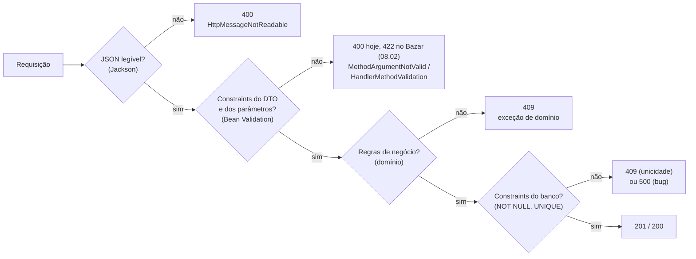

## O problema

Em [05.04](/construindo-apis-com-spring-boot/um-crud-com-status-corretos), o Bazar criou uma categoria sem nome e respondeu `201`. Em [06.01](/construindo-apis-com-spring-boot/dtos-com-records-e-por-que-nao-expor-entidades), um produto sem preço derrubava a requisição com um `NullPointerException` dentro do `Dinheiro`, e o cliente recebia `500 Internal Server Error`, como se o servidor tivesse quebrado. Nos dois casos, o erro era **do cliente**, e o servidor não disse isso a ele.

Sem validação na entrada, dados inválidos seguem em frente até alguém tropeçar neles: uma exceção no meio de uma regra de negócio, uma violação de *constraint* no banco, ou, pior, nada, e o dado ruim fica gravado. Cada um desses lugares descobre o problema tarde, com uma mensagem que o cliente não entende.

Pense na triagem de um pronto-socorro. Antes de chegar ao médico, a enfermeira confere o básico: nome, documento, pressão, temperatura. Ela não faz diagnósticos, mas impede que o médico perca tempo com uma ficha sem nome ou com a temperatura em branco. E, quando falta algo, ela diz exatamente o quê.

> **A pergunta desta página:** como validar o que chega na API com Bean Validation, onde essa validação acontece no Spring MVC, e o que é validação de entrada versus regra de negócio?

## O conceito

### Bean Validation, Jakarta e Hibernate Validator

<Term id="bean-validation">Jakarta Bean Validation</Term> é a especificação que define as anotações de validação (`@NotNull`, `@Size`...) e a API para executá-las. O Bazar usa a versão **3.1**, parte do Jakarta EE 11. A especificação não valida nada sozinha: quem implementa é o **Hibernate Validator** (versão **9.1**, sem relação com o Hibernate ORM além do nome).

No Spring Boot, tudo vem de um *starter*:

```xml title="pom.xml"
<dependency>
    <groupId>org.springframework.boot</groupId>
    <artifactId>spring-boot-starter-validation</artifactId>
</dependency>
```

Ele traz a API (`jakarta.validation-api` 3.1.1), o Hibernate Validator (9.1.5) e uma implementação de *Expression Language* (`tomcat-embed-el`), usada para montar as mensagens. Com ele no *classpath*, o Boot configura um `Validator` e o liga ao Spring MVC.

### As *constraints* mais comuns

Todas no pacote `jakarta.validation.constraints`:

| Anotação | Valida | Observação |
|---|---|---|
| `@NotNull` | Não é `null` | Aceita `""` e coleções vazias |
| `@NotEmpty` | Não é `null` nem vazio | Para *strings*, coleções e mapas |
| `@NotBlank` | Não é `null` e tem algum caractere que não seja espaço | Só para *strings*; a escolha usual para textos obrigatórios |
| `@Size(min, max)` | Tamanho dentro do intervalo | *Strings*, coleções, mapas e *arrays*; `null` é válido |
| `@Positive` / `@PositiveOrZero` | Número > 0 / ≥ 0 | `null` é válido |
| `@Min` / `@Max` | Limites de números inteiros | `null` é válido |
| `@Email` | Formato de e-mail | Verificação de formato, não de existência |
| `@Pattern(regexp)` | Casa com a expressão regular | A expressão precisa casar com a *string* inteira |
| `@Past` / `@Future` | Data no passado / no futuro | Para `Instant`, `LocalDate` etc. |

<Callout type="info" title="null é válido para quase tudo">
  Pela especificação, só `@NotNull`, `@NotEmpty` e `@NotBlank` rejeitam `null`. `@Size`, `@Positive`, `@Pattern` e as demais consideram `null` válido. Por isso um campo obrigatório com formato combina as duas: `@NotNull @Positive Long precoEmCentavos`. E um campo opcional com formato usa só a de formato: `@Nullable @Size(max = 2000) String descricao` aceita a ausência, mas não um texto enorme.
</Callout>

### `@Valid` no `@RequestBody`

Anotar o DTO não basta: é preciso pedir ao Spring que o valide. O `@Valid` (de `jakarta.validation`) no parâmetro faz isso:

```java
@PostMapping
public ResponseEntity<ProdutoResponse> criar(@Valid @RequestBody CriarProdutoRequest request) {
```

O Spring lê o JSON, cria o record e o valida **antes** de chamar o método. Se houver erros, o método não é chamado: o Spring lança uma **`MethodArgumentNotValidException`**, com **todos** os erros (não só o primeiro), e responde `400`. Esse é o padrão do Spring; o Bazar decidiu em [02.03](/comecando-e-fundamentos-de-http/status-codes-em-profundidade) usar `400` só para requisições ilegíveis e `422 Unprocessable Content` para violações de validação, e a troca é feita em 08.02. O `@Validated` do Spring também funciona aqui, e é necessário quando se quer usar grupos de validação ([07.02](/construindo-apis-com-spring-boot/validacao-avancada)).

### Validando `@PathVariable` e `@RequestParam`

Parâmetros simples também podem ter *constraints*:

```java
@GetMapping
public Lista<CategoriaResponse> listar(
        @RequestParam(required = false) @Nullable @Size(min = 2, max = 60) String q, ...)
```

Desde o **Spring Framework 6.1**, o Spring MVC tem **validação de métodos embutida**: quando um parâmetro do controller tem *constraints*, ele valida os argumentos antes da chamada, sem que a classe precise de `@Validated` (exigência das versões antigas, que usavam um *proxy* AOP). Os erros chegam numa **`HandlerMethodValidationException`**, também com `400`.

Fica a regra: `@Valid` (ou *constraints*) em `@RequestBody` → `MethodArgumentNotValidException`; *constraints* em `@PathVariable`, `@RequestParam` e `@RequestHeader` → `HandlerMethodValidationException`. As duas são tratadas da mesma forma em [08.02](/construindo-apis-com-spring-boot/problemdetail-no-spring-tratamento-global-de-erros).

### Records e objetos aninhados

Em records, as anotações vão nos **componentes**, e o Hibernate Validator as aplica aos campos gerados:

```java
public record CategoriaRequest(
        @NotBlank @Size(max = 60) String nome,
        @NotBlank @Size(max = 60) @Pattern(regexp = "[a-z0-9]+(-[a-z0-9]+)*") String slug,
        @Nullable UUID categoriaPaiId) {
```

A validação **não desce sozinha** em objetos aninhados. Para validar o conteúdo de um componente que é outro objeto, anote-o com `@Valid`:

```java
public record CriarPedidoRequest(
        @NotNull UUID clienteId,
        @NotNull @Valid Endereco enderecoEntrega) {   // valida também os campos do endereço

    public record Endereco(@NotBlank @Pattern(regexp = "\\d{5}-\\d{3}") String cep, ...) {
    }
}
```

Sem o `@Valid`, o `@NotNull` garante que o endereço existe, mas um CEP em branco passa. A validação de cada elemento de uma lista (`List<@Valid Item>`) está em [07.02](/construindo-apis-com-spring-boot/validacao-avancada).

### Validação sintática × regra de negócio

Nem toda verificação é validação de entrada. Vale separar dois tipos:

| | Validação sintática (na borda) | Regra de negócio (no domínio) |
|---|---|---|
| Pergunta | "Os dados estão bem formados?" | "Essa operação é permitida agora?" |
| Exemplos | nome obrigatório, preço positivo, slug no formato, até 120 caracteres | SKU único, categoria existente, pedido só pode ser cancelado antes do envio |
| Depende do estado do sistema? | Não: olha só a requisição | Sim: consulta o banco ou o estado atual |
| Onde | Anotações no DTO, `@Valid` | Serviços e entidades do domínio |
| Status no Bazar | `422` (o padrão do Spring é `400`) | `409` quando o estado atual impede a operação ([02.03](/comecando-e-fundamentos-de-http/status-codes-em-profundidade)) |

Misturar os dois é um erro comum nos dois sentidos: uma anotação `@SkuUnico` que consulta o banco dentro da validação do DTO acopla a borda à persistência (e roda fora da transação); uma regra "preço positivo" escrita no serviço deixa de aparecer junto com os outros erros de formato. A divisão completa, inclusive o que o domínio deve verificar de novo, está em [07.02](/construindo-apis-com-spring-boot/validacao-avancada).

E o banco tem a terceira linha de defesa: `NOT NULL`, `UNIQUE` e `CHECK`. Ela não substitui as outras, mas garante a integridade mesmo quando um bug deixa algo passar (Parte 4).

### O erro padrão, antes da Parte 8

Hoje, uma requisição inválida recebe isto:

```json
{"timestamp":"2026-10-24T23:34:28.246Z","status":400,"error":"Bad Request","path":"/v1/produtos"}
```

Dois problemas: o status é o `400` padrão do Spring, e não o `422` que o Bazar adotou, e o corpo **não diz quais campos estão errados**. O Spring Boot omite os detalhes de validação por padrão (`server.error.include-binding-errors=never`). Os detalhes existem: o Spring registra cada erro no log, em nível `WARN`. A resposta definitiva, com a lista `erros[]` em Problem Details, é construída em [08.02](/construindo-apis-com-spring-boot/problemdetail-no-spring-tratamento-global-de-erros), e é ela que o cliente vai receber.

### As mensagens

Cada *constraint* tem uma mensagem padrão, traduzida pelo Hibernate Validator para vários idiomas. A escolha usa o `Locale` da requisição: em inglês, `must not be blank`; em português, `não deve estar em branco`. As mensagens customizadas e a internacionalização estão em [07.02](/construindo-apis-com-spring-boot/validacao-avancada) e [15.05](/design-de-apis-profissional/internacionalizacao-na-api).

## Diagrama

Onde cada tipo de verificação acontece, do mais barato ao mais caro:



Quanto mais à esquerda o erro é pego, mais barato ele é e mais clara pode ser a mensagem.

## Na prática

### Os DTOs anotados

```java title="src/main/java/com/bazar/catalogo/api/CriarProdutoRequest.java"
public record CriarProdutoRequest(
        @NotBlank @Size(max = 32) String sku,
        @NotBlank @Size(max = 120) String nome,
        @Nullable @Size(max = 2000) String descricao,
        @NotNull @Positive Long precoEmCentavos,
        @NotNull UUID categoriaId,
        @Size(max = 20) Map<String, String> atributos) {

    public CriarProdutoRequest {
        atributos = atributos == null ? Map.of() : Map.copyOf(atributos); // ausente no JSON → vazio
    }
}
```

O `AtualizarProdutoRequest` tem as mesmas anotações, sem o `sku`. O formato do SKU (`LIV-0042`) ganha uma *constraint* própria, `@Sku`, em [07.02](/construindo-apis-com-spring-boot/validacao-avancada).

```java title="src/main/java/com/bazar/catalogo/api/CategoriaRequest.java"
public record CategoriaRequest(
        @NotBlank @Size(max = 60) String nome,
        @NotBlank @Size(max = 60) @Pattern(regexp = "[a-z0-9]+(-[a-z0-9]+)*") String slug,
        @Nullable UUID categoriaPaiId) {

    Categoria paraCategoria(UUID id) {
        return new Categoria(id, nome, slug, categoriaPaiId);
    }
}
```

O padrão do slug aceita letras minúsculas e números, com hífens só entre eles: `livros`, `jogos-eletronicos`, mas não `Jogos`, `-livros` ou `livros--novos`.

### Os controllers

```java title="src/main/java/com/bazar/catalogo/api/ProdutoController.java"
    @PostMapping
    public ResponseEntity<ProdutoResponse> criar(@Valid @RequestBody CriarProdutoRequest request) {
        // ...
    }

    @PutMapping("/{id}")
    public ProdutoResponse atualizar(@PathVariable UUID id, @Valid @RequestBody AtualizarProdutoRequest request) {
        // ...
    }
```

```java title="src/main/java/com/bazar/catalogo/api/CategoriaController.java"
    @GetMapping
    public Lista<CategoriaResponse> listar(
            @RequestParam(required = false) @Nullable @Size(min = 2, max = 60) String q,
            @RequestParam(defaultValue = "false") boolean apenasRaizes) {
        // ...
    }

    @PostMapping
    public ResponseEntity<CategoriaResponse> criar(@Valid @RequestBody CategoriaRequest request) {
        // ...
    }
```

O `@Size(min = 2)` no `q` evita buscas por uma única letra, que devolveriam quase tudo.

### As respostas

<HttpExchange
  title="Dois campos inválidos"
  request={{ method: 'POST', url: 'http://localhost:8080/v1/produtos', headers: { 'Content-Type': 'application/json' }, body: { sku: '', nome: 'Clean Code', precoEmCentavos: -5, categoriaId: '0192f3a0-5555-7000-8000-000000000003' } }}
  response={{
    status: 400,
    headers: { 'Content-Type': 'application/json' },
    body: { timestamp: '2026-10-24T23:34:28.246Z', status: 400, error: 'Bad Request', path: '/v1/produtos' },
  }}
>
  O cliente sabe que errou, mas não onde. O log do servidor mostra os dois erros de uma vez (trecho real, quebrado em linhas):

  ```text
  WARN ... DefaultHandlerExceptionResolver : Resolved [org.springframework.web.bind.MethodArgumentNotValidException:
    Validation failed for argument [0] in public ... ProdutoController.criar(...CriarProdutoRequest) with 2 errors:
    [Field error in object 'criarProdutoRequest' on field 'precoEmCentavos': rejected value [-5];
      codes [Positive.criarProdutoRequest.precoEmCentavos,Positive.precoEmCentavos,Positive.java.lang.Long,Positive];
      ... default message [must be greater than 0]]
    [Field error in object 'criarProdutoRequest' on field 'sku': rejected value [];
      codes [NotBlank.criarProdutoRequest.sku,NotBlank.sku,NotBlank.java.lang.String,NotBlank];
      ... default message [must not be blank]] ]
  ```

  Repare nos `codes`: são as chaves que o Spring procura para montar mensagens customizadas, do mais específico ao mais genérico (07.02).
</HttpExchange>

<HttpExchange
  title="Produto sem preço"
  request={{ method: 'POST', url: 'http://localhost:8080/v1/produtos', headers: { 'Content-Type': 'application/json' }, body: { sku: 'LIV-0042', nome: 'Clean Code', categoriaId: '0192f3a0-5555-7000-8000-000000000003' } }}
  response={{
    status: 400,
    headers: { 'Content-Type': 'application/json' },
    body: { timestamp: '2026-10-24T23:34:28.277Z', status: 400, error: 'Bad Request', path: '/v1/produtos' },
  }}
>
  Antes desta página, este caso era um `500`. Agora o `@NotNull` barra o campo antes de o método rodar, e o `NullPointerException` no `Dinheiro` nunca acontece.
</HttpExchange>

<HttpExchange
  title="Slug fora do formato e busca curta demais"
  request={{ method: 'POST', url: 'http://localhost:8080/v1/categorias', headers: { 'Content-Type': 'application/json' }, body: { nome: 'Games', slug: 'Jogos Eletrônicos' } }}
  response={{
    status: 400,
    headers: { 'Content-Type': 'application/json' },
    body: { timestamp: '2026-10-24T23:34:28.300Z', status: 400, error: 'Bad Request', path: '/v1/categorias' },
  }}
>
  `GET /v1/categorias?q=a` também responde `400`, mas por outro caminho: a validação de método, com `HandlerMethodValidationException`.
</HttpExchange>

### Testando a validação

Os testes do controller verificam o status e qual exceção o Spring gerou, o que garante que o erro veio da validação e não de outro lugar:

```java title="src/test/java/com/bazar/catalogo/api/ProdutoControllerTest.java"
    @Test
    void rejeitaUmProdutoInvalidoComOsErrosDeCadaCampo() {
        var resposta = mvc.post().uri("/v1/produtos")
                .contentType(MediaType.APPLICATION_JSON)
                .content("""
                        { "sku": "", "nome": "Clean Code", "precoEmCentavos": -5,
                          "categoriaId": "0192f3a0-5555-7000-8000-000000000003" }
                        """)
                .exchange();

        assertThat(resposta).hasStatus(HttpStatus.BAD_REQUEST);
        assertThat(resposta.getMvcResult().getResolvedException()).isInstanceOf(MethodArgumentNotValidException.class);
        var erros = ((MethodArgumentNotValidException) resposta.getMvcResult().getResolvedException()).getFieldErrors();
        assertThat(erros).extracting(FieldError::getField).containsExactlyInAnyOrder("sku", "precoEmCentavos");
    }
```

```java title="src/test/java/com/bazar/catalogo/api/CategoriaControllerTest.java"
    @Test
    void validaOParametroDeBuscaPeloMetodo() {
        var resposta = mvc.get().uri("/v1/categorias?q=a").exchange();

        assertThat(resposta).hasStatus(HttpStatus.BAD_REQUEST);
        assertThat(resposta.getMvcResult().getResolvedException()).isInstanceOf(HandlerMethodValidationException.class);
    }
```

## Erros comuns

<BadVsGood title="Validação no controller, à mão" why="Ifs no controller param no primeiro erro, se repetem em cada endpoint e misturam formato com fluxo. As anotações declaram as regras no contrato, e o Spring devolve todos os erros de uma vez, antes de o método rodar.">
<Bad title="Ifs espalhados">

```java
@PostMapping
public ResponseEntity<?> criar(@RequestBody CriarProdutoRequest request) {
    if (request.sku() == null || request.sku().isBlank()) {
        return ResponseEntity.badRequest().body("sku obrigatório");
    }
    if (request.precoEmCentavos() == null || request.precoEmCentavos() <= 0) {
        return ResponseEntity.badRequest().body("preço inválido");
    }
    // ...
}
```

</Bad>
<Good title="Constraints no DTO e @Valid">

```java
public record CriarProdutoRequest(
        @NotBlank @Size(max = 32) String sku,
        @NotNull @Positive Long precoEmCentavos, ...) { }

@PostMapping
public ResponseEntity<ProdutoResponse> criar(@Valid @RequestBody CriarProdutoRequest request) { ... }
```

</Good>
</BadVsGood>

Outros erros frequentes:

- **Anotar o DTO e esquecer o `@Valid`.** As anotações viram decoração: nada é validado.
- **Esquecer o `@Valid` em objetos aninhados.** O objeto é verificado (`@NotNull`), mas o conteúdo dele não.
- **Usar `@NotNull` em *strings* obrigatórias.** `""` e `"   "` passam. Use `@NotBlank`.
- **Achar que `@Size` ou `@Pattern` tornam o campo obrigatório.** `null` é válido para eles.
- **Consultar o banco numa *constraint*** (`@SkuUnico`). A unicidade é regra de negócio: verifique no serviço e garanta com `UNIQUE` no banco.
- **Validar só no front-end.** Qualquer cliente pode chamar a API diretamente; a API é a última fronteira.
- **Faltar o *starter*.** Sem `spring-boot-starter-validation`, as anotações compilam (se a API estiver no *classpath* por outro caminho) e nada é validado.

## Boas práticas

- **Valide** todo corpo de requisição com `@Valid` e *constraints* no DTO.
- **Combine** `@NotNull`/`@NotBlank` com as *constraints* de formato nos campos obrigatórios.
- **Limite** tamanhos (`@Size(max)`) de todo texto e coleção que vem de fora.
- **Valide** também `@RequestParam` e `@PathVariable` quando houver formato ou limite.
- **Separe** validação sintática (na borda) de regras de negócio (no domínio).
- **Teste** os casos inválidos, verificando o status e a exceção.

## No projeto Bazar

<ProjectStep title="Validação de produtos e categorias" module="catalogo" tag="pagina-07.01" files={[
  { path: 'pom.xml', change: 'alterado' },
  { path: 'src/main/java/com/bazar/catalogo/api/CriarProdutoRequest.java', change: 'alterado' },
  { path: 'src/main/java/com/bazar/catalogo/api/AtualizarProdutoRequest.java', change: 'alterado' },
  { path: 'src/main/java/com/bazar/catalogo/api/CategoriaRequest.java', change: 'alterado' },
  { path: 'src/main/java/com/bazar/catalogo/api/ProdutoController.java', change: 'alterado' },
  { path: 'src/main/java/com/bazar/catalogo/api/CategoriaController.java', change: 'alterado' },
  { path: 'src/test/java/com/bazar/catalogo/api/ProdutoControllerTest.java', change: 'alterado' },
  { path: 'src/test/java/com/bazar/catalogo/api/CategoriaControllerTest.java', change: 'alterado' },
]}>
`spring-boot-starter-validation`, *constraints* nos DTOs de produto e categoria, `@Valid` nos corpos e validação do parâmetro `q`. Categoria sem nome e produto sem preço agora respondem `400`. Os testes verificam os campos com erro e o tipo de exceção.
</ProjectStep>

## Resumo

- **Bean Validation 3.1** é a especificação; o **Hibernate Validator 9.1** é a implementação; o **`spring-boot-starter-validation`** liga tudo ao Spring MVC.
- *Constraints* comuns: `@NotNull`, `@NotBlank`, `@Size`, `@Positive`, `@Email`, `@Pattern`. **`null` é válido** para todas, exceto as de "não nulo".
- **`@Valid` no `@RequestBody`** → `MethodArgumentNotValidException`; *constraints* em **parâmetros** → `HandlerMethodValidationException` (validação de métodos embutida desde o Spring 6.1). O Spring responde `400` para as duas, com todos os erros; o Bazar troca para `422` em 08.02.
- Em records, anote os componentes; para objetos aninhados, use **`@Valid`** em cascata.
- **Sintático na borda, regra de negócio no domínio**, integridade no banco.
- O corpo padrão do erro **não lista os campos**; o formato final chega em 08.02.

<Exercise title="Valide o cliente" difficulty="facil">
Escreva o `CriarClienteRequest` do Bazar com estas regras:

- `nome`: obrigatório, até 120 caracteres;
- `email`: obrigatório, formato de e-mail, até 254 caracteres;
- `cpf`: obrigatório, só os 11 dígitos;
- `telefone`: opcional, no formato `+5511987654321` (o `+`, o código do país e de 10 a 13 dígitos no total);
- `endereco`: obrigatório, com `cep` (`01310-100`), `logradouro` e `numero` obrigatórios e `complemento` opcional até 60 caracteres.

Depois responda: "o e-mail já está cadastrado" é responsabilidade de qual camada? E "o CPF é válido" (dígitos verificadores)?

<Hint>
Para o telefone, lembre que `@Pattern` aceita `null`. Para o endereço, pense no `@Valid` em cascata.
</Hint>

<Solution>

```java
public record CriarClienteRequest(
        @NotBlank @Size(max = 120) String nome,
        @NotBlank @Email @Size(max = 254) String email,
        @NotBlank @Pattern(regexp = "\\d{11}") String cpf,
        @Nullable @Pattern(regexp = "\\+\\d{10,13}") String telefone,
        @NotNull @Valid Endereco endereco) {

    public record Endereco(
            @NotBlank @Pattern(regexp = "\\d{5}-\\d{3}") String cep,
            @NotBlank @Size(max = 120) String logradouro,
            @NotBlank @Size(max = 10) String numero,
            @Nullable @Size(max = 60) String complemento) {
    }
}
```

- **E-mail já cadastrado** é regra de negócio: depende do estado do sistema. Fica no serviço (`409 Conflict`) e é garantida por um índice `UNIQUE` no banco.
- **CPF válido** (dígitos verificadores) é validação **sintática**: depende só do valor enviado, não do banco. Ela pertence à borda, mas o `@Pattern` não consegue calcular dígitos. A solução é uma *constraint* customizada, `@Cpf`, construída em [07.02](/construindo-apis-com-spring-boot/validacao-avancada).

</Solution>
</Exercise>

<Quiz
  questions={[
    {
      question: 'Um DTO tem @Size(max = 60) String apelido. O cliente não envia o campo. A validação passa?',
      options: [
        'Não, porque @Size exige um valor',
        'Sim: para @Size, null é válido; para exigir o campo, é preciso @NotNull ou @NotBlank',
        'Depende do Jackson',
      ],
      answer: 1,
      explanation: 'Pela especificação, as constraints de formato e tamanho consideram null válido; só @NotNull, @NotEmpty e @NotBlank rejeitam a ausência. O Jackson só entrega null ao campo; quem decide é a validação.',
    },
    {
      question: 'O controller recebe @RequestParam @Size(min = 2) String q e a classe não tem @Validated. A validação acontece no Spring Framework 7?',
      options: [
        'Não: sem @Validated na classe, constraints em parâmetros são ignoradas',
        'Sim: desde o Spring 6.1, o Spring MVC valida os parâmetros com constraints e lança HandlerMethodValidationException',
        'Só se o parâmetro também tiver @Valid',
      ],
      answer: 1,
      explanation: 'A validação de métodos embutida no Spring MVC dispensa o @Validated e o proxy AOP das versões antigas. O @Valid serve para objetos (cascata), não para parâmetros simples.',
    },
    {
      question: '"O SKU deve ser único no catálogo." Onde essa regra deve ficar?',
      options: [
        'Numa constraint @SkuUnico no DTO, que consulta o repositório',
        'No domínio (serviço), com um índice UNIQUE no banco como garantia final',
        'No front-end, que conhece a lista de produtos',
      ],
      answer: 1,
      explanation: 'Unicidade depende do estado do sistema, então é regra de negócio: verificada no serviço (409) e garantida pelo banco, que resolve inclusive a concorrência entre duas criações simultâneas. Uma constraint que consulta o banco acopla a borda à persistência e não protege contra a concorrência; o front-end não é confiável.',
    },
  ]}
/>

## Referências

<References />
