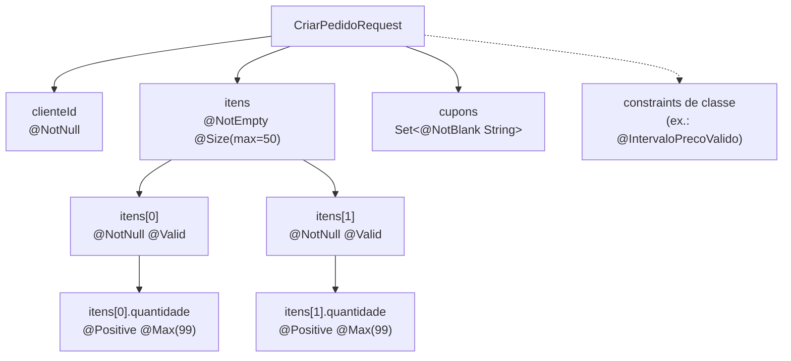

## O problema

O cadastro de clientes do Bazar precisa de um CPF. Com o que vimos em [07.01](/construindo-apis-com-spring-boot/bean-validation-essencial), o melhor possível é `@Pattern(regexp = "\\d{11}")`. Ele aceita `12345678900`, que não é um CPF, e `11111111111`, que tem 11 dígitos iguais. O CPF tem <Term id="digito-verificador">dígitos verificadores</Term>, calculados a partir dos nove primeiros, e nenhuma expressão regular consegue fazer essa conta.

O mesmo acontece com outras regras do dia a dia:

- o filtro de produtos recebe `precoMin` e `precoMax`, e o mínimo não pode ser maior que o máximo, uma regra que envolve **dois campos**;
- um pedido tem uma lista de itens, e cada item precisa ser validado;
- a mensagem `must match "[A-Z]{3}-\d{4}"` não ajuda ninguém a corrigir um SKU.

Pense nos formulários de um cartório. Alguns campos se conferem sozinhos (a data está preenchida?), mas outros exigem uma conta (o dígito do documento confere?) ou uma comparação (a data de saída é posterior à de entrada?). O funcionário não precisa de um formulário novo para cada caso: ele precisa saber fazer a conta e explicar o erro em português.

> **A pergunta desta página:** como criar validações próprias, comparar campos, validar listas, escolher entre grupos e DTOs separados e escrever mensagens que o cliente entenda?

## O conceito

### Anatomia de uma *constraint*

Uma *constraint* customizada tem duas partes: a **anotação** e o **validador**.

A anotação segue um contrato fixo da especificação:

```java
@Constraint(validatedBy = CpfValidator.class)                 // quem valida
@Target({ ElementType.FIELD, ElementType.PARAMETER, ElementType.RECORD_COMPONENT, ElementType.TYPE_USE })
@Retention(RetentionPolicy.RUNTIME)                            // precisa existir em tempo de execução
public @interface Cpf {

    String message() default "{bazar.validacao.Cpf.message}";  // obrigatório: a mensagem (ou a chave)
    Class<?>[] groups() default {};                            // obrigatório: grupos (veja adiante)
    Class<? extends Payload>[] payload() default {};           // obrigatório: metadados extras, raramente usado
}
```

Os três atributos `message`, `groups` e `payload` são **obrigatórios**: sem eles, o Hibernate Validator recusa a anotação ao iniciar. O `TYPE_USE` no `@Target` permite usá-la em tipos genéricos, como `List<@Cpf String>`.

O validador implementa **`ConstraintValidator<A, T>`**, em que `A` é a anotação e `T` é o tipo validado:

```java
public class CpfValidator implements ConstraintValidator<Cpf, String> {

    @Override
    public boolean isValid(@Nullable String cpf, ConstraintValidatorContext contexto) {
        ...
    }
}
```

Duas regras para o `isValid`:

- **`null` é válido.** Siga a convenção das *constraints* prontas: a obrigatoriedade é com `@NotNull`/`@NotBlank`. Assim, `@Cpf` funciona também num campo opcional.
- **Sem efeitos colaterais e sem estado mutável.** O mesmo validador pode atender várias requisições ao mesmo tempo.

No Spring, os validadores são criados pela fábrica do Spring, então podem receber beans por injeção. Use isso com cuidado: um validador que consulta o banco é quase sempre uma regra de negócio disfarçada ([07.01](/construindo-apis-com-spring-boot/bean-validation-essencial)).

### O algoritmo do CPF

O CPF tem 11 dígitos: nove de base e dois verificadores.

1. Multiplique os nove primeiros dígitos pelos pesos 10, 9, ..., 2 e some. O primeiro verificador é `(soma × 10) mod 11`, e o resultado `10` vira `0`.
2. Multiplique os dez primeiros dígitos (incluindo o primeiro verificador) pelos pesos 11, 10, ..., 2 e repita a conta para o segundo verificador.
3. CPFs com todos os dígitos iguais (`11111111111`) passam na conta, mas são inválidos, e precisam ser recusados à parte.

Exemplo com `529.982.247-25`: a primeira soma é `5×10 + 2×9 + 9×8 + 9×7 + 8×6 + 2×5 + 2×4 + 4×3 + 7×2 = 295`, e `2950 mod 11 = 2`. A segunda é `347`, e `3470 mod 11 = 5`. Os verificadores são `25`: CPF válido.

<Callout type="warning" title="CPF válido não é CPF existente">
  O algoritmo verifica a **forma** do número, não se ele pertence a alguém. Confirmar a existência exige consultar a Receita Federal (um serviço externo), e não cabe numa *constraint*. A validação de formato já elimina a maior parte dos erros de digitação.
</Callout>

### *Constraints* compostas

Nem toda *constraint* customizada precisa de um validador. O SKU do Bazar (`LIV-0042`) é só um padrão, e o problema do `@Pattern` era a mensagem e a repetição da expressão em vários DTOs. Uma **constraint composta** junta *constraints* existentes sob um nome do domínio:

```java
@Pattern(regexp = "[A-Z]{3}-\\d{4}")
@ReportAsSingleViolation
@Constraint(validatedBy = {})
...
public @interface Sku { ... }
```

`@Constraint(validatedBy = {})` diz que não há validador próprio: a validação vem das anotações em `@Sku`. O **`@ReportAsSingleViolation`** faz uma falha de qualquer delas aparecer como **um único erro**, com a mensagem do `@Sku`, em vez da mensagem do `@Pattern`.

### Validação entre campos

`precoMin <= precoMax` não pertence a nenhum dos dois campos: pertence ao objeto. Por isso a *constraint* é de **classe** (`@Target(ElementType.TYPE)`), e o validador recebe o objeto inteiro:

```java
@IntervaloPrecoValido
public record IntervaloPreco(@Nullable @PositiveOrZero Long precoMin, @Nullable @PositiveOrZero Long precoMax) {
}
```

Por padrão, um erro de classe não tem campo: o caminho da violação é o próprio objeto. Para o cliente, é mais útil saber **qual campo corrigir**. O `ConstraintValidatorContext` permite trocar a violação padrão por outra, presa a um campo:

```java
contexto.disableDefaultConstraintViolation();
contexto.buildConstraintViolationWithTemplate(contexto.getDefaultConstraintMessageTemplate())
        .addPropertyNode("precoMax")
        .addConstraintViolation();
```

Assim, o erro aparece em `precoMax`, junto dos erros de campo comuns. A mesma técnica serve para dar mensagens diferentes conforme o motivo da falha.

### Coleções e elementos

A validação desce numa coleção quando você pede, e há duas formas:

```java
public record CriarPedidoRequest(
        @NotNull UUID clienteId,
        @NotEmpty @Size(max = 50) List<@NotNull @Valid ItemPedidoRequest> itens,   // a lista e cada item
        @Size(max = 10) Set<@NotBlank @Size(max = 30) String> cupons) {             // constraints nos elementos

    public record ItemPedidoRequest(@NotNull UUID produtoId, @NotNull @Positive @Max(99) Integer quantidade) {
    }
}
```

- As anotações **na lista** (`@NotEmpty`, `@Size`) valem para a lista.
- As anotações **no tipo do elemento** (`List<@NotNull @Valid ItemPedidoRequest>`, `Set<@NotBlank String>`) valem para cada elemento. São as *container element constraints*, introduzidas no Bean Validation 2.0.
- O **`@Valid`** no elemento faz a validação descer nos campos de cada item.

O caminho do erro inclui o índice: `itens[2].quantidade`. O cliente sabe exatamente qual item corrigir. Esse DTO é construído no módulo de pedidos ([21.01](/padroes-avancados-de-http/idempotency-keys)); o `@Size(max = 50)` também é uma proteção contra corpos enormes ([23.02](/padroes-avancados-de-http/limites-de-payload-e-protecao-contra-abuso)).

### Grupos de validação × DTOs separados

**Grupos** permitem aplicar *constraints* só em certas situações. O caso clássico é um DTO único para criar e atualizar:

```java
public interface NaCriacao {}

public record ProdutoRequest(
        @NotBlank(groups = NaCriacao.class) @Sku String sku,   // obrigatório só na criação
        @NotBlank String nome, ...) {
}

@PostMapping
public ResponseEntity<ProdutoResponse> criar(@Validated({ NaCriacao.class, Default.class }) @RequestBody ProdutoRequest request)
```

O `@Valid` não aceita grupos: é preciso o **`@Validated`** do Spring, com a lista de grupos. As *constraints* sem `groups` pertencem ao grupo `Default`, que precisa ser incluído explicitamente quando se usa outro grupo.

Grupos funcionam, mas espalham a regra: para saber o que a criação exige, é preciso ler cada anotação e o `@Validated` do controller. O Bazar prefere **DTOs separados** (`CriarProdutoRequest` e `AtualizarProdutoRequest`, em [06.01](/construindo-apis-com-spring-boot/dtos-com-records-e-por-que-nao-expor-entidades)): cada DTO mostra, sozinho, o contrato da sua operação, e eles podem divergir livremente (o `sku` nem existe na atualização). Grupos fazem sentido quando os DTOs seriam idênticos exceto por uma ou duas regras, ou em validações em etapas (um formulário de várias páginas).

### Mensagens e internacionalização

A mensagem de uma *constraint* pode ser um texto fixo (`message = "CPF inválido"`) ou uma **chave entre chaves** (`"{bazar.validacao.Cpf.message}"`), procurada em arquivos de mensagens. Prefira a chave: ela permite traduções e mantém os textos fora do código.

O lugar padrão da especificação é o **`ValidationMessages.properties`**, na raiz do *classpath*, com uma variante por idioma (`ValidationMessages_pt.properties`). As mensagens podem usar os atributos da anotação (`{max}`, `{regexp}`) e o valor validado (`${validatedValue}`).

No Spring Boot, há uma segunda fonte: o validador é um `LocalValidatorFactoryBean` ligado ao **`MessageSource`** da aplicação, então as chaves também são procuradas no `messages.properties`. Isso permite manter as mensagens de validação junto das demais mensagens da API ([15.05](/design-de-apis-profissional/internacionalizacao-na-api)).

E o idioma? O Spring usa o `Locale` da requisição, que por padrão vem do cabeçalho **`Accept-Language`**. Com `Accept-Language: pt-BR`, o cliente recebe `deve ser um CPF válido (11 dígitos)`; com `en`, `must be a valid CPF (11 digits)`.

<Callout type="warning" title="A armadilha do locale padrão da JVM">
  Ao procurar a tradução, o `ResourceBundle` do Java tenta o idioma pedido, depois o **idioma padrão da JVM**, e só então o arquivo base. Se o arquivo base está em inglês e só existe `ValidationMessages_pt`, um pedido em inglês num servidor configurado em português recebe a mensagem em português. O Bazar evita isso com um `ValidationMessages_en.properties` vazio: ele existe, então a busca para nele e herda os textos do arquivo base. Esse comportamento foi reproduzido rodando os testes do Bazar com `-Duser.language=pt`.
</Callout>

As mensagens chegam ao cliente em [08.02](/construindo-apis-com-spring-boot/problemdetail-no-spring-tratamento-global-de-erros), dentro da lista `erros[]` do Problem Details.

### Validação no serviço

A validação de métodos também funciona fora dos controllers. Num bean comum, ela precisa do **`@Validated` na classe**: o Spring cria um *proxy* que valida os argumentos antes da chamada (e os retornos, se anotados) e lança `ConstraintViolationException`. O Spring Boot registra o necessário (`MethodValidationPostProcessor`) quando o *starter* de validação está presente.

```java
@Service
@Validated
public class CadastroDeClientes {

    public Cliente cadastrar(@Valid NovoCliente novo) { ... }
}
```

É útil quando o mesmo serviço é chamado de vários lugares (a API, uma fila, um *job* em lote) e cada um poderia esquecer de validar. Diferente dos controllers ([07.01](/construindo-apis-com-spring-boot/bean-validation-essencial)), o `@Validated` na classe é obrigatório aqui. O Bazar não precisa disso ainda: seus serviços só são chamados pelos controllers, que já validam.

### Quanto validar, e onde

Uma divisão prática:

| Camada | Verifica | Exemplo no Bazar |
|---|---|---|
| **Borda** (DTO, `@Valid`) | Forma: tipos, obrigatoriedade, tamanhos, formatos, dígitos verificadores, relações entre campos do mesmo pedido | `@Cpf`, `@Sku`, `@IntervaloPrecoValido`, `@Size(max = 120)` |
| **Domínio** (serviços e entidades) | Regras que dependem do estado: unicidade, existência de referências, transições permitidas | SKU único, categoria existente, pedido cancelável |
| **Banco** | Integridade final, inclusive sob concorrência | `UNIQUE (sku)`, `NOT NULL`, chaves estrangeiras |

O domínio também protege suas **invariantes** sem depender da borda: em [15.02](/design-de-apis-profissional/dinheiro-e-numeros-decimais), o construtor do `Dinheiro` passa a recusar valores sem moeda, mesmo que o DTO já tenha validado. Repetir uma verificação barata no domínio não é desperdício: é o que mantém o domínio correto quando ele é usado por outro caminho. A diferença está na intenção: a borda produz **erros para o cliente**, todos de uma vez; o domínio garante que **um estado inválido não existe**.

## Diagrama

Como o Hibernate Validator percorre um `CriarPedidoRequest`:



Todas as violações são coletadas, cada uma com o seu caminho (`itens[1].quantidade`), antes de qualquer resposta.

## Na prática

### `@Cpf`

```java title="src/main/java/com/bazar/compartilhado/validacao/Cpf.java"
/**
 * CPF com 11 dígitos (sem pontuação) e dígitos verificadores corretos. null é válido.
 */
@Documented
@Constraint(validatedBy = CpfValidator.class)
@Target({ ElementType.FIELD, ElementType.PARAMETER, ElementType.RECORD_COMPONENT, ElementType.TYPE_USE })
@Retention(RetentionPolicy.RUNTIME)
public @interface Cpf {

    String message() default "{bazar.validacao.Cpf.message}";

    Class<?>[] groups() default {};

    Class<? extends Payload>[] payload() default {};
}
```

```java title="src/main/java/com/bazar/compartilhado/validacao/CpfValidator.java"
public class CpfValidator implements ConstraintValidator<Cpf, String> {

    @Override
    public boolean isValid(@Nullable String cpf, ConstraintValidatorContext contexto) {
        if (cpf == null) {
            return true; // obrigatoriedade é com @NotBlank
        }
        if (!cpf.matches("\\d{11}") || cpf.chars().distinct().count() == 1) {
            return false; // formato errado ou 111.111.111-11, que passaria na conta
        }
        return digitoVerificador(cpf, 9) == cpf.charAt(9) - '0'
                && digitoVerificador(cpf, 10) == cpf.charAt(10) - '0';
    }

    // Soma os primeiros n dígitos com pesos n+1, n, ..., 2; o dígito é (soma × 10) mod 11, e 10 vira 0.
    private static int digitoVerificador(String cpf, int n) {
        int soma = 0;
        for (int i = 0; i < n; i++) {
            soma += (cpf.charAt(i) - '0') * (n + 1 - i);
        }
        int resto = soma * 10 % 11;
        return resto == 10 ? 0 : resto;
    }
}
```

Ela fica em `compartilhado.validacao` porque outros módulos (pagamentos, por exemplo) também recebem CPFs.

### `@Sku` e `@IntervaloPrecoValido`

```java title="src/main/java/com/bazar/catalogo/api/Sku.java"
/**
 * SKU do Bazar: três letras maiúsculas, hífen e quatro dígitos (LIV-0042). null é válido.
 * Constraint composta: reaproveita @Pattern e não precisa de validador próprio.
 */
@Documented
@Pattern(regexp = "[A-Z]{3}-\\d{4}")
@ReportAsSingleViolation
@Constraint(validatedBy = {})
@Target({ ElementType.FIELD, ElementType.PARAMETER, ElementType.RECORD_COMPONENT, ElementType.TYPE_USE })
@Retention(RetentionPolicy.RUNTIME)
public @interface Sku {

    String message() default "{bazar.validacao.Sku.message}";

    Class<?>[] groups() default {};

    Class<? extends Payload>[] payload() default {};
}
```

O `CriarProdutoRequest` troca `@Size(max = 32)` por `@Sku`: `@NotBlank @Sku String sku`.

```java title="src/main/java/com/bazar/catalogo/api/IntervaloPrecoValido.java"
/**
 * Constraint de classe: precoMin não pode ser maior que precoMax. O erro é atribuído ao campo precoMax.
 */
@Documented
@Constraint(validatedBy = IntervaloPrecoValido.Validador.class)
@Target(ElementType.TYPE)
@Retention(RetentionPolicy.RUNTIME)
public @interface IntervaloPrecoValido {

    String message() default "{bazar.validacao.IntervaloPrecoValido.message}";

    Class<?>[] groups() default {};

    Class<? extends Payload>[] payload() default {};

    class Validador implements ConstraintValidator<IntervaloPrecoValido, IntervaloPreco> {

        @Override
        public boolean isValid(IntervaloPreco intervalo, ConstraintValidatorContext contexto) {
            if (intervalo.precoMin() == null || intervalo.precoMax() == null
                    || intervalo.precoMin() <= intervalo.precoMax()) {
                return true;
            }
            contexto.disableDefaultConstraintViolation();
            contexto.buildConstraintViolationWithTemplate(contexto.getDefaultConstraintMessageTemplate())
                    .addPropertyNode("precoMax")
                    .addConstraintViolation();
            return false;
        }
    }
}
```

```java title="src/main/java/com/bazar/catalogo/api/IntervaloPreco.java"
/**
 * Faixa de preço em centavos dos filtros da listagem de produtos (13.01). Os dois limites são opcionais.
 */
@IntervaloPrecoValido
public record IntervaloPreco(
        @Nullable @PositiveOrZero Long precoMin,
        @Nullable @PositiveOrZero Long precoMax) {
}
```

O `IntervaloPreco` será usado pela listagem de produtos com filtros, em [13.01](/design-de-apis-profissional/filtros-e-busca). Por enquanto, ele é exercitado pelos testes.

### As mensagens

```properties title="src/main/resources/ValidationMessages.properties"
# Mensagens das constraints do Bazar. Sem sufixo de idioma: é o padrão, usado quando não há tradução.
bazar.validacao.Cpf.message=must be a valid CPF (11 digits)
bazar.validacao.Sku.message=must follow the format AAA-0000 (e.g. LIV-0042)
bazar.validacao.IntervaloPrecoValido.message=must be greater than or equal to precoMin
```

```properties title="src/main/resources/ValidationMessages_pt.properties"
bazar.validacao.Cpf.message=deve ser um CPF válido (11 dígitos)
bazar.validacao.Sku.message=deve seguir o formato AAA-0000 (ex.: LIV-0042)
bazar.validacao.IntervaloPrecoValido.message=deve ser maior ou igual a precoMin
```

```properties title="src/main/resources/ValidationMessages_en.properties"
# Vazio de propósito: herda as mensagens em inglês do arquivo base.
# Sem ele, um pedido em inglês numa JVM com locale padrão pt cairia no ValidationMessages_pt.
```

O arquivo base fica em inglês porque é o idioma usado quando o cliente pede um que o Bazar não tem, como o japonês.

### O módulo de clientes

O cadastro de clientes estreia aqui, com o mínimo: `POST /v1/clientes` e `GET /v1/clientes/{id}`, em memória. Ele cresce em [26.03](/seguranca-essencial-para-apis/autorizacao-por-objeto-exposicao-de-dados-e-validacao) e [31.04](/projeto-final-o-bazar/clientes).

```java title="src/main/java/com/bazar/clientes/api/CriarClienteRequest.java"
public record CriarClienteRequest(
        @NotBlank @Size(max = 120) String nome,
        @NotBlank @Email @Size(max = 254) String email,
        @NotBlank @Cpf String cpf,
        @Nullable @Pattern(regexp = "\\+\\d{10,13}") String telefone) {

    Cliente paraCliente() {
        return Cliente.novo(nome, email, cpf, telefone);
    }
}
```

```java title="src/main/java/com/bazar/clientes/api/ClienteResponse.java"
/**
 * O CPF não sai na resposta: o cliente já o conhece, e a versão mascarada chega em 26.03.
 */
public record ClienteResponse(UUID id, String nome, String email, @Nullable String telefone, Instant criadoEm) {

    static ClienteResponse de(Cliente cliente) {
        return new ClienteResponse(cliente.id(), cliente.nome(), cliente.email(), cliente.telefone(), cliente.criadoEm());
    }
}
```

O `ClienteController` segue o mesmo modelo do `CategoriaController`: `201` com `Location` na criação, `404` quando o cliente não existe.

<HttpExchange
  title="Cadastro válido"
  request={{ method: 'POST', url: 'http://localhost:8080/v1/clientes', headers: { 'Content-Type': 'application/json' }, body: { nome: 'Ana Souza', email: 'ana@example.com', cpf: '52998224725', telefone: '+5511987654321' } }}
  response={{
    status: 201,
    headers: { 'Location': 'http://localhost:8080/v1/clientes/165cd2e6-ce3a-42ce-978f-bbf1e7e1ce7f', 'Content-Type': 'application/json' },
    body: { id: '165cd2e6-ce3a-42ce-978f-bbf1e7e1ce7f', nome: 'Ana Souza', email: 'ana@example.com', telefone: '+5511987654321', criadoEm: '2026-10-24T23:44:00.858205356Z' },
  }}
>
  O CPF entrou, mas não sai. Repare também nos nanossegundos do `criadoEm`: a precisão das datas no contrato é assunto de 15.01.
</HttpExchange>

<HttpExchange
  title="CPF com dígito verificador errado"
  request={{ method: 'POST', url: 'http://localhost:8080/v1/clientes', headers: { 'Content-Type': 'application/json', 'Accept-Language': 'pt-BR' }, body: { nome: 'Ana Souza', email: 'ana@example.com', cpf: '52998224724' } }}
  response={{
    status: 400,
    headers: { 'Content-Type': 'application/json' },
    body: { timestamp: '2026-10-24T23:44:00.821Z', status: 400, error: 'Bad Request', path: '/v1/clientes' },
  }}
>
  O corpo ainda é o padrão do Spring Boot. A exceção já carrega o erro do campo `cpf`, com o código `Cpf` e a mensagem `deve ser um CPF válido (11 dígitos)`; em 08.02, essa informação passa a ir para o cliente.
</HttpExchange>

### Testando os validadores

Os validadores são classes comuns, testáveis sem Spring:

```java title="src/test/java/com/bazar/compartilhado/validacao/CpfValidatorTest.java"
class CpfValidatorTest {

    private final CpfValidator validador = new CpfValidator();

    @ParameterizedTest
    @ValueSource(strings = { "52998224725", "11144477735" })
    void aceitaCpfsComDigitosVerificadoresCorretos(String cpf) {
        assertThat(validador.isValid(cpf, null)).isTrue();
    }

    @ParameterizedTest
    @ValueSource(strings = { "52998224724", "529.982.247-25", "5299822472", "11111111111", "abcdefghijk" })
    void recusaCpfsInvalidos(String cpf) {
        assertThat(validador.isValid(cpf, null)).isFalse();
    }

    @org.junit.jupiter.api.Test
    void deixaONullParaONotBlank() {
        assertThat(validador.isValid(null, null)).isTrue();
    }
}
```

O contexto pode ser `null` porque o `CpfValidator` não o usa. Para *constraints* compostas ou de classe, que dependem do motor de validação, o teste cria um `Validator` do Hibernate, com o idioma fixo:

```java title="src/test/java/com/bazar/catalogo/api/ConstraintsDoCatalogoTest.java"
class ConstraintsDoCatalogoTest {

    private final Validator validator = Validation.byProvider(HibernateValidator.class)
            .configure()
            .defaultLocale(Locale.forLanguageTag("pt-BR"))
            .buildValidatorFactory()
            .getValidator();

    record ComSku(@Sku String sku) {
    }

    @Test
    void skuForaDoFormatoGeraUmaUnicaViolacaoComAMensagemDoBazar() {
        var violacoes = validator.validate(new ComSku("liv-42"));

        assertThat(violacoes).extracting(ConstraintViolation::getMessage)
                .containsExactly("deve seguir o formato AAA-0000 (ex.: LIV-0042)");
    }

    @Test
    void intervaloInvertidoAcusaOCampoPrecoMax() {
        var violacoes = validator.validate(new IntervaloPreco(5000L, 1000L));

        assertThat(violacoes).singleElement().satisfies(v -> {
            assertThat(v.getPropertyPath()).hasToString("precoMax");
            assertThat(v.getMessage()).isEqualTo("deve ser maior ou igual a precoMin");
        });
    }

    // ... e os casos válidos: SKU no formato, null, intervalos em ordem ou com um limite só
}
```

E o teste do controller confirma o caminho completo, com o `Accept-Language`:

```java title="src/test/java/com/bazar/clientes/api/ClienteControllerTest.java"
    @Test
    void recusaCpfComDigitoErradoComAMensagemNoIdiomaDoCliente() {
        var resposta = mvc.post().uri("/v1/clientes")
                .contentType(MediaType.APPLICATION_JSON)
                .header(HttpHeaders.ACCEPT_LANGUAGE, "pt-BR")
                .content("""
                        { "nome": "Ana Souza", "email": "ana@example.com", "cpf": "52998224724" }
                        """)
                .exchange();

        assertThat(resposta).hasStatus(HttpStatus.BAD_REQUEST);
        var excecao = (MethodArgumentNotValidException) resposta.getMvcResult().getResolvedException();
        assertThat(excecao.getFieldErrors()).singleElement().satisfies(erro -> {
            assertThat(erro.getField()).isEqualTo("cpf");
            assertThat(erro.getCode()).isEqualTo("Cpf");
            assertThat(erro.getDefaultMessage()).isEqualTo("deve ser um CPF válido (11 dígitos)");
        });
    }
```

## Erros comuns

<BadVsGood title="Regra entre campos sem campo" why="Uma violação de classe sem nó de propriedade aparece sem campo, e o cliente não sabe o que corrigir. Atribuir o erro a um campo o coloca ao lado dos demais erros.">
<Bad title="Violação padrão da classe">

```java
public boolean isValid(IntervaloPreco intervalo, ConstraintValidatorContext contexto) {
    return intervalo.precoMin() == null || intervalo.precoMax() == null
            || intervalo.precoMin() <= intervalo.precoMax();
}
// erro em "" (o objeto), sem campo
```

</Bad>
<Good title="Violação presa ao campo que o cliente deve corrigir">

```java
contexto.disableDefaultConstraintViolation();
contexto.buildConstraintViolationWithTemplate(contexto.getDefaultConstraintMessageTemplate())
        .addPropertyNode("precoMax")
        .addConstraintViolation();
return false;
// erro em "precoMax"
```

</Good>
</BadVsGood>

Outros erros frequentes:

- **Esquecer `message`, `groups` ou `payload` na anotação.** O Hibernate Validator recusa a *constraint* com uma exceção na primeira validação.
- **Rejeitar `null` no validador customizado.** A *constraint* deixa de servir para campos opcionais e duplica o `@NotNull`.
- **Validar CPF só com expressão regular.** `12345678900` passa.
- **Usar grupos e esquecer o `Default`.** `@Validated(NaCriacao.class)` valida **só** as *constraints* do grupo `NaCriacao`; todas as outras são ignoradas.
- **Colocar `@Valid` na lista e esperar que ela verifique tamanho, ou vice-versa.** `@Size` vale para a lista; `@Valid` no elemento desce nos itens.
- **Textos fixos em `message`.** Impossíveis de traduzir. Use chaves.
- **Ter só `ValidationMessages_pt` e um arquivo base em inglês**, sem `ValidationMessages_en`. Em servidores com locale português, clientes em inglês recebem mensagens em português.
- **Esperar que `@Valid` num parâmetro de serviço funcione sem `@Validated` na classe.** Fora dos controllers, o *proxy* é necessário.

## Boas práticas

- **Crie** *constraints* com nomes do domínio (`@Cpf`, `@Sku`) em vez de repetir expressões regulares.
- **Use** *constraints* compostas com `@ReportAsSingleViolation` quando bastar combinar as existentes.
- **Prenda** os erros de classe ao campo que o cliente deve corrigir.
- **Trate** `null` como válido nos validadores customizados.
- **Valide** listas e seus elementos (`List<@Valid Item>`), e limite o tamanho delas.
- **Prefira** DTOs separados a grupos de validação.
- **Use** chaves de mensagem e arquivos por idioma, incluindo um arquivo para o idioma do arquivo base.
- **Teste** os validadores como classes comuns e as *constraints* compostas com um `Validator`.

## No projeto Bazar

<ProjectStep title="Constraints customizadas e o módulo de clientes" module="clientes" tag="pagina-07.02" files={[
  { path: 'src/main/java/com/bazar/compartilhado/validacao/Cpf.java', change: 'novo' },
  { path: 'src/main/java/com/bazar/compartilhado/validacao/CpfValidator.java', change: 'novo' },
  { path: 'src/main/java/com/bazar/catalogo/api/Sku.java', change: 'novo' },
  { path: 'src/main/java/com/bazar/catalogo/api/IntervaloPrecoValido.java', change: 'novo' },
  { path: 'src/main/java/com/bazar/catalogo/api/IntervaloPreco.java', change: 'novo' },
  { path: 'src/main/java/com/bazar/catalogo/api/CriarProdutoRequest.java', change: 'alterado' },
  { path: 'src/main/java/com/bazar/clientes/', change: 'novo' },
  { path: 'src/main/resources/ValidationMessages.properties', change: 'novo' },
  { path: 'src/main/resources/ValidationMessages_pt.properties', change: 'novo' },
  { path: 'src/main/resources/ValidationMessages_en.properties', change: 'novo' },
  { path: 'src/test/java/com/bazar/compartilhado/validacao/CpfValidatorTest.java', change: 'novo' },
  { path: 'src/test/java/com/bazar/catalogo/api/ConstraintsDoCatalogoTest.java', change: 'novo' },
  { path: 'src/test/java/com/bazar/clientes/api/ClienteControllerTest.java', change: 'novo' },
]}>
`@Cpf` com o algoritmo dos dígitos verificadores, `@Sku` composta, `@IntervaloPrecoValido` de classe, mensagens em inglês e português, e o módulo de clientes com `POST /v1/clientes` e `GET /v1/clientes/{id}`. O CPF não aparece na resposta.
</ProjectStep>

## Resumo

- Uma *constraint* customizada é uma **anotação** (`@Constraint`, `message`, `groups`, `payload`) mais um **`ConstraintValidator`**; o validador trata **`null` como válido**.
- **Constraints compostas** (`@Sku`) combinam as existentes; **`@ReportAsSingleViolation`** gera um único erro.
- **Constraints de classe** validam relações entre campos; prenda o erro a um campo com `addPropertyNode`.
- **Coleções:** `@Size` na lista, **`List<@Valid Item>`** nos elementos; o caminho inclui o índice.
- **Grupos** exigem `@Validated` e o grupo `Default`; o Bazar prefere **DTOs separados**.
- **Mensagens:** chaves em `ValidationMessages.properties` ou no `MessageSource`; o idioma vem do `Accept-Language`, e o *locale* padrão da JVM interfere na busca.
- **Serviços:** validação de métodos com **`@Validated` na classe**.
- **Borda** para a forma, **domínio** para regras com estado e invariantes, **banco** para a integridade final.

<Exercise title="Período de promoção" difficulty="medio">
O Bazar vai ter promoções. Um `CriarPromocaoRequest` tem:

- `nome` obrigatório;
- `percentualDesconto` inteiro de 1 a 90;
- `inicio` e `fim` (`Instant`), ambos obrigatórios, com `fim` depois de `inicio` e duração máxima de 31 dias;
- `skus`: de 1 a 100 SKUs válidos, sem repetição.

Escreva o DTO e a *constraint* `@PeriodoValido`, com mensagens diferentes para "fim antes do início" e "duração maior que 31 dias", ambas no campo `fim`.

<Hint>
Para "sem repetição", pense no tipo da coleção. Para duas mensagens, use `buildConstraintViolationWithTemplate` com chaves diferentes em vez da mensagem padrão.
</Hint>

<Solution>

```java
@PeriodoValido
public record CriarPromocaoRequest(
        @NotBlank @Size(max = 80) String nome,
        @NotNull @Min(1) @Max(90) Integer percentualDesconto,
        @NotNull Instant inicio,
        @NotNull Instant fim,
        @NotEmpty @Size(max = 100) Set<@NotNull @Sku String> skus) {
}
```

```java
@Constraint(validatedBy = PeriodoValido.Validador.class)
@Target(ElementType.TYPE)
@Retention(RetentionPolicy.RUNTIME)
public @interface PeriodoValido {

    String message() default "{bazar.validacao.PeriodoValido.message}";
    Class<?>[] groups() default {};
    Class<? extends Payload>[] payload() default {};

    class Validador implements ConstraintValidator<PeriodoValido, CriarPromocaoRequest> {

        private static final Duration MAXIMO = Duration.ofDays(31);

        @Override
        public boolean isValid(CriarPromocaoRequest r, ConstraintValidatorContext contexto) {
            if (r.inicio() == null || r.fim() == null) {
                return true; // o @NotNull de cada campo cuida disso
            }
            String chave;
            if (!r.fim().isAfter(r.inicio())) {
                chave = "{bazar.validacao.PeriodoValido.fimAntesDoInicio}";
            } else if (Duration.between(r.inicio(), r.fim()).compareTo(MAXIMO) > 0) {
                chave = "{bazar.validacao.PeriodoValido.duracaoMaxima}";
            } else {
                return true;
            }
            contexto.disableDefaultConstraintViolation();
            contexto.buildConstraintViolationWithTemplate(chave).addPropertyNode("fim").addConstraintViolation();
            return false;
        }
    }
}
```

O `Set` resolve a repetição: o Jackson descarta os duplicados ao ler. Se o contrato exigir **recusar** duplicados (em vez de ignorá-los), use `List` e uma *constraint* `@SemRepeticao` que compara o tamanho da lista com o de um `Set` criado a partir dela.

</Solution>
</Exercise>

<Quiz
  questions={[
    {
      question: 'Seu validador customizado @Cep recebe null. O que ele deve devolver?',
      options: [
        'false, porque um CEP nulo é inválido',
        'true: a obrigatoriedade é responsabilidade de @NotNull/@NotBlank, e assim @Cep também serve para campos opcionais',
        'Lançar NullPointerException para indicar o erro',
      ],
      answer: 1,
      explanation: 'É a convenção das constraints da especificação. Devolver false misturaria duas regras (formato e obrigatoriedade) e impediria o uso em campos opcionais. Uma exceção num validador vira ValidationException, não um erro de campo.',
    },
    {
      question: 'Um controller usa @Validated(NaCriacao.class) @RequestBody ProdutoRequest. As constraints sem groups (como @NotBlank no nome) são verificadas?',
      options: [
        'Sim, sempre',
        'Não: elas pertencem ao grupo Default, que precisa ser incluído na lista ({NaCriacao.class, Default.class})',
        'Só se o DTO for um record',
      ],
      answer: 1,
      explanation: 'Ao indicar grupos, só eles são validados. Esquecer o Default desliga silenciosamente todas as outras constraints, um dos motivos para preferir DTOs separados.',
    },
    {
      question: 'Qual é a forma de validar cada item de List<ItemPedidoRequest> itens?',
      options: [
        '@Size(max = 50) na lista',
        'List<@Valid ItemPedidoRequest> (ou @Valid na lista), que desce nos campos de cada item',
        'Nada: o Bean Validation valida os itens automaticamente',
      ],
      answer: 1,
      explanation: 'A validação só desce em objetos quando há @Valid. @Size limita o tamanho da lista, mas não olha os itens. O erro de um item vem com o índice no caminho, como itens[2].quantidade.',
    },
  ]}
/>

## Referências

<References />
