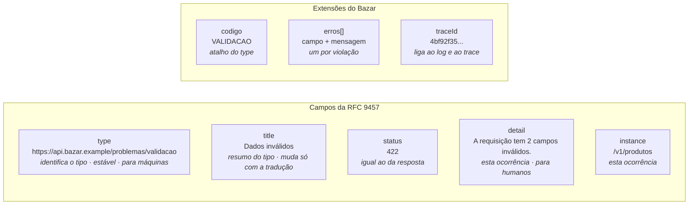

## O problema

O app do Bazar integra três serviços, e cada um erra de um jeito:

```json
{ "erro": "Produto não encontrado" }
```

```json
{ "success": false, "errorCode": 1042, "errors": ["sku is required"] }
```

```json
{ "timestamp": "2026-10-24T23:34:28.246Z", "status": 400, "error": "Bad Request", "path": "/v1/produtos" }
```

O time do app escreveu três tratadores de erro diferentes. Para saber se um erro é "produto não encontrado", um deles compara textos, e quebrou quando a mensagem foi traduzida. Outro tem uma tabela de códigos numéricos copiada de um PDF. O terceiro, o formato padrão do Spring Boot que o Bazar usa hoje ([07.01](/construindo-apis-com-spring-boot/bean-validation-essencial)), nem diz qual campo está errado.

O problema não é a falta de informação: é a falta de **um formato combinado**. Sem ele, cada cliente precisa aprender cada API, e nenhuma ferramenta genérica (um *gateway*, uma biblioteca de cliente, um painel de monitoramento) consegue entender os erros.

Pense nos avisos de um aeroporto. Em qualquer aeroporto do mundo, o painel mostra o voo, o destino, o horário e o *status* nas mesmas colunas, e "cancelado" tem sempre a mesma cor. O viajante não precisa aprender o painel de cada aeroporto: ele lê o formato uma vez e entende todos. Os detalhes específicos (o portão, o motivo do atraso) cabem nas colunas extras.

> **A pergunta desta página:** o que a RFC 9457 define, o que significa cada campo, como estendê-lo e como o Bazar organiza os seus erros?

## O conceito

### Problem Details em uma frase

A **RFC 9457** (<Term id="problem-details">*Problem Details for HTTP APIs*</Term>, de julho de 2023) define um formato JSON (e XML) para descrever erros em APIs HTTP. Ela substitui a RFC 7807, de 2016, sem quebrar a compatibilidade: um documento válido pela 7807 continua válido pela 9457. O Spring Framework adota o formato desde a versão 6.0, com a classe `ProblemDetail` ([08.02](/construindo-apis-com-spring-boot/problemdetail-no-spring-tratamento-global-de-erros)).

Um erro do Bazar no formato:

```http
HTTP/1.1 404 Not Found
Content-Type: application/problem+json

{
  "type": "https://api.bazar.example/problemas/produto-nao-encontrado",
  "title": "Produto não encontrado",
  "status": 404,
  "detail": "Não existe produto com id 0192f39f-2222-7000-8000-000000000042.",
  "instance": "/v1/produtos/0192f39f-2222-7000-8000-000000000042",
  "codigo": "PRODUTO_NAO_ENCONTRADO",
  "traceId": "4bf92f3577b34da6a3ce929d0e0e4736"
}
```

### Os cinco campos

Todos os campos são opcionais pela RFC, mas cada um tem um significado preciso:

| Campo | O que é | Muda a cada ocorrência? | Quem lê |
|---|---|---|---|
| `type` | URI que **identifica o tipo** do problema. É o identificador principal: clientes decidem o que fazer com base nele | Não | Máquinas |
| `title` | Resumo curto do tipo, para humanos | Não (só pela tradução) | Humanos |
| `status` | O código HTTP, repetido no corpo | Não | Ambos |
| `detail` | Explicação **desta ocorrência**, focada em ajudar o cliente a corrigir o problema | Sim | Humanos |
| `instance` | URI que identifica **esta ocorrência** do problema | Sim | Ambos (suporte, logs) |

Os detalhes que fazem diferença:

- **`type` é o identificador.** A RFC diz que os clientes devem usar o `type` como identificador principal do problema. Comparar o `title` ou o `detail` é frágil: eles podem mudar com a tradução ou com uma melhoria de texto.
- **`title` é estável.** Ele não deve mudar entre ocorrências do mesmo tipo, exceto pela tradução. "Produto não encontrado" é um `title`; "Produto 42 não encontrado" é um `detail`.
- **`status` é só informativo.** O status que vale é o da linha de status HTTP; o campo no corpo existe para quem guarda o corpo sem os cabeçalhos (um log, uma fila). Os dois precisam ser iguais.
- **`detail` não é depuração.** A RFC recomenda que ele ajude o cliente a corrigir o problema, sem informações de depuração. E clientes **não devem fazer *parse*** do `detail` para extrair dados: o que for para máquinas vai em extensões.
- **`instance` identifica a ocorrência.** Muitas APIs usam o caminho da requisição. Se a URI puder ser acessada, ela deve devolver o próprio problema; caso contrário, é só um identificador.

### `application/problem+json`

O formato tem *media type* próprio, **`application/problem+json`** ([02.05](/comecando-e-fundamentos-de-http/content-negotiation-e-media-types)). Ele diz ao cliente: "este corpo é um Problem Details", sem que seja preciso inspecionar o conteúdo. O sufixo `+json` garante que qualquer leitor de JSON consiga ler o corpo. Existe também `application/problem+xml`, raro em APIs novas.

### `type`: uma URI estável

O `type` é uma URI, e a escolha dela faz parte do contrato:

- **Absoluta.** A RFC recomenda URIs absolutas (`https://api.bazar.example/problemas/produto-nao-encontrado`). Uma URI relativa é resolvida em relação ao documento e pode apontar para lugares diferentes dependendo de onde o erro aparece.
- **Estável.** Clientes escrevem código que compara o `type`. Mudar a URI é uma quebra de contrato ([18.01](/contratos-documentacao-e-ciclo-de-vida/compatibilidade-retroativa-o-que-quebra-um-cliente)).
- **De preferência, acessível.** A RFC não exige que a URI possa ser aberta, mas, quando pode, ela deve levar a uma documentação do problema para humanos: o que significa e como resolver. É o que o Bazar faz no portal de documentação (Parte 7).
- **Não precisa ser HTTP.** Uma URN (`urn:bazar:problemas:produto-nao-encontrado`) também é válida, mas não pode ser aberta num navegador.

Quando o problema não tem nada além do que o status já diz, o `type` é **`about:blank`**, que é também o valor assumido quando o campo está ausente. Nesse caso, o `title` deve ser o nome do status (`Not Found`), ou a tradução dele. O Spring usa `about:blank` por padrão em todos os erros que ele próprio gera.

<Callout type="info" title="Quando criar um tipo novo">
  Crie um `type` próprio quando o cliente **precisa tratar o erro de forma diferente**. `produto-nao-encontrado` e `categoria-nao-encontrada` podem até compartilhar o tratamento (ambos são `404`), mas `categoria-com-produtos` (`409`) pede uma ação específica do usuário: mover os produtos antes. Erros genéricos, como um `405 Method Not Allowed`, ficam bem com `about:blank`.
</Callout>

### Extensões

Os tipos de problema podem definir campos próprios, as **extensões**. A RFC estabelece duas regras:

- **Clientes devem ignorar extensões que não conhecem.** É o que permite acrescentar campos sem quebrar ninguém.
- **Nomes recomendados:** começam com uma letra, usam só letras, dígitos e `_`, e têm pelo menos três caracteres. A regra garante que os nomes também funcionem no formato XML.

O Bazar usa três extensões em todos os erros:

| Extensão | Exemplo | Para quê |
|---|---|---|
| `codigo` | `"PRODUTO_NAO_ENCONTRADO"` | O mesmo identificador do `type`, numa forma curta e fácil de usar num `switch`. É sempre o final do `type` em maiúsculas, com `_` no lugar de `-` |
| `erros` | `[{ "campo": "sku", "mensagem": "não deve estar em branco" }]` | A lista de violações de validação, uma por campo |
| `traceId` | `"4bf92f3577b34da6a3ce929d0e0e4736"` | O identificador do *trace* distribuído ([28.02](/observabilidade/tracing-distribuido-com-opentelemetry)). O cliente o informa ao suporte, e o suporte encontra a requisição nos logs |

Os itens de `erros[]` têm só `campo` e `mensagem`. O Bazar **não ecoa o valor rejeitado**: um CPF ou uma senha recusados não devem voltar no corpo do erro, e muito menos parar nos logs de um *gateway* ([26.03](/seguranca-essencial-para-apis/autorizacao-por-objeto-exposicao-de-dados-e-validacao)).

### Vários problemas de uma vez

Uma requisição pode ter vários erros, e a RFC 9457 trata disso explicitamente (a 7807 não tratava):

- **Problemas do mesmo tipo** (vários campos inválidos): um único Problem Details com uma extensão que lista as ocorrências. O próprio exemplo da RFC usa uma lista `errors`, com um `detail` e um `pointer` (um JSON Pointer, como `#/itens/0/quantidade`) por item. O `erros[]` do Bazar segue a mesma ideia, com `campo` no formato que o Bean Validation produz (`itens[0].quantidade`).
- **Problemas de tipos diferentes** (o usuário não tem permissão **e** o corpo é inválido): a RFC recomenda representar **o mais relevante ou urgente**. Não existe um "envelope" de vários tipos.

### O que mudou da RFC 7807 para a 9457

A 9457 é uma revisão, não um formato novo. As mudanças:

- **Registro de tipos comuns.** A IANA mantém agora o registro *HTTP Problem Types*, para promover a reutilização de URIs de tipos muito usados. Por enquanto, a única entrada é `about:blank`.
- **Vários problemas.** Orientação explícita para o caso de vários erros numa resposta, descrita acima.
- **URIs não acessíveis.** Orientação para `type` que não pode ser aberta (como URNs) e recomendação de URIs absolutas.
- **Esclarecimentos** sobre extensões e sobre o formato XML.

Na prática: se a sua API seguia a 7807, ela segue a 9457.

### Comparação com Google e Microsoft

Os dois maiores guias de estilo públicos têm formatos próprios, anteriores à RFC ou paralelos a ela:

**Google ([AIP-193](https://google.aip.dev/193))**:

```json
{
  "error": {
    "code": 404,
    "message": "Produto não encontrado.",
    "status": "NOT_FOUND",
    "details": [
      {
        "@type": "type.googleapis.com/google.rpc.ErrorInfo",
        "reason": "PRODUTO_NAO_ENCONTRADO",
        "domain": "api.bazar.example",
        "metadata": { "produtoId": "0192f39f-2222-7000-8000-000000000042" }
      }
    ]
  }
}
```

O identificador para máquinas é o par `(reason, domain)` do `ErrorInfo`: o mesmo erro deve usar sempre o mesmo par. Toda informação dinâmica que aparece na mensagem também deve estar em `metadata`, para que nenhum cliente precise fazer *parse* da mensagem. O formato vem do gRPC (`google.rpc.Status`, em [04.01](/rest-e-estilos-de-api/rest-rpc-graphql-grpc-websocket-sse-e-webhooks-quando-usar)).

**Microsoft (Azure REST API Guidelines)**:

```json
{
  "error": {
    "code": "ProdutoNaoEncontrado",
    "message": "Produto não encontrado.",
    "target": "id",
    "details": [ ],
    "innererror": { "code": "..." }
  }
}
```

O `code` é obrigatório, faz parte do contrato e precisa aparecer também no cabeçalho `x-ms-error-code`. Mudar o código devolvido para a mesma situação é uma quebra de compatibilidade.

<Comparison
  columns={['RFC 9457', 'Google AIP-193', 'Microsoft Azure']}
  rows={[
    { label: 'Identificador para máquinas', values: ['type (URI)', 'reason + domain', 'code (+ header x-ms-error-code)'] },
    { label: 'Mensagem para humanos', values: ['title (tipo) e detail (ocorrência)', 'message', 'message'] },
    { label: 'Erros por campo', values: ['Extensão (ex.: errors com pointer)', 'details com BadRequest', 'details e target'] },
    { label: 'Media type próprio', values: ['application/problem+json', 'Não', 'Não'] },
    { label: 'Envelope', values: ['Campos na raiz', 'Objeto error', 'Objeto error'] },
    { label: 'Padrão aberto (IETF)', values: ['Sim', 'Não (guia do Google)', 'Não (guia da Microsoft)'] },
  ]}
/>

As ideias são as mesmas nos três: um **identificador estável para máquinas**, separado da **mensagem para humanos**, e **detalhes estruturados** para que ninguém precise fazer *parse* de texto. O Bazar segue a RFC porque é um padrão aberto, tem *media type* próprio e já vem pronto no Spring.

## Diagrama

A anatomia de um erro de validação do Bazar:



## Na prática

### O catálogo de erros do Bazar

Um tipo de problema é documentado uma vez e reutilizado em toda a API. O catálogo inicial:

| `type` (após `https://api.bazar.example/problemas/`) | Status | Quando |
|---|---|---|
| `validacao` | `422` | Uma ou mais *constraints* violadas (07.01, 07.02) |
| `requisicao-invalida` | `400` | Corpo ilegível, tipo errado num parâmetro (`id=abc`) |
| `produto-nao-encontrado`, `categoria-nao-encontrada`, `cliente-nao-encontrado` | `404` | O recurso não existe |
| `categoria-com-produtos` | `409` | Remoção de categoria que ainda tem produtos |
| `transicao-invalida` | `409` | Mudança de estado não permitida (cancelar um pedido enviado) |
| `formato-nao-aceito` / `formato-nao-suportado` | `406` / `415` | Negociação de conteúdo ([02.05](/comecando-e-fundamentos-de-http/content-negotiation-e-media-types)) |
| `about:blank` | outros (`405`, `500`...) | O status já diz tudo |

O catálogo cresce com a API, e cada novo tipo ganha uma página na documentação.

### Os erros mais comuns

<HttpExchange
  title="404: recurso inexistente"
  request={{ method: 'GET', url: 'https://api.bazar.example/v1/produtos/0192f39f-2222-7000-8000-000000000042' }}
  response={{
    status: 404,
    headers: { 'Content-Type': 'application/problem+json' },
    body: {
      type: 'https://api.bazar.example/problemas/produto-nao-encontrado',
      title: 'Produto não encontrado',
      status: 404,
      detail: 'Não existe produto com id 0192f39f-2222-7000-8000-000000000042.',
      instance: '/v1/produtos/0192f39f-2222-7000-8000-000000000042',
      codigo: 'PRODUTO_NAO_ENCONTRADO',
      traceId: '4bf92f3577b34da6a3ce929d0e0e4736',
    },
  }}
>
  O `title` vale para todos os produtos inexistentes; o `detail` diz qual.
</HttpExchange>

<HttpExchange
  title="409: conflito com o estado atual"
  request={{ method: 'DELETE', url: 'https://api.bazar.example/v1/categorias/0192f3a0-5555-7000-8000-000000000001' }}
  response={{
    status: 409,
    headers: { 'Content-Type': 'application/problem+json' },
    body: {
      type: 'https://api.bazar.example/problemas/categoria-com-produtos',
      title: 'A categoria possui produtos',
      status: 409,
      detail: 'A categoria "Livros" tem 42 produtos. Mova ou descontinue os produtos antes de removê-la.',
      instance: '/v1/categorias/0192f3a0-5555-7000-8000-000000000001',
      codigo: 'CATEGORIA_COM_PRODUTOS',
      quantidadeDeProdutos: 42,
      traceId: '0af7651916cd43dd8448eb211c80319c',
    },
  }}
>
  `quantidadeDeProdutos` é uma extensão **deste tipo**: o app pode mostrar o número sem fazer *parse* do `detail`. Clientes que não a conhecem simplesmente a ignoram.
</HttpExchange>

<HttpExchange
  title="422: vários campos inválidos"
  request={{ method: 'POST', url: 'https://api.bazar.example/v1/produtos', headers: { 'Content-Type': 'application/json', 'Accept-Language': 'pt-BR' }, body: { sku: 'liv-42', nome: '', precoEmCentavos: -5, categoriaId: '0192f3a0-5555-7000-8000-000000000003' } }}
  response={{
    status: 422,
    headers: { 'Content-Type': 'application/problem+json', 'Content-Language': 'pt-BR' },
    body: {
      type: 'https://api.bazar.example/problemas/validacao',
      title: 'Dados inválidos',
      status: 422,
      detail: 'A requisição tem 3 campos inválidos.',
      instance: '/v1/produtos',
      codigo: 'VALIDACAO',
      erros: [
        { campo: 'nome', mensagem: 'não deve estar em branco' },
        { campo: 'precoEmCentavos', mensagem: 'deve ser maior que 0' },
        { campo: 'sku', mensagem: 'deve seguir o formato AAA-0000 (ex.: LIV-0042)' },
      ],
      traceId: '9a8b7c6d5e4f40312a1b0c9d8e7f6a5b',
    },
  }}
>
  Todos os erros de uma vez, um por campo, com as mensagens no idioma pedido. O valor rejeitado (`liv-42`) não volta no corpo.
</HttpExchange>

Esses três exemplos são o **alvo** de [08.02](/construindo-apis-com-spring-boot/problemdetail-no-spring-tratamento-global-de-erros). Hoje, o Bazar ainda responde com o formato padrão do Spring Boot.

### Como o Spring representa o formato

A classe `ProblemDetail` (pacote `org.springframework.http`) tem os cinco campos da RFC e um mapa de propriedades para as extensões, que o Jackson escreve na raiz do JSON:

```java
var problema = ProblemDetail.forStatusAndDetail(HttpStatus.NOT_FOUND,
        "Não existe produto com id " + id + ".");
problema.setType(URI.create("https://api.bazar.example/problemas/produto-nao-encontrado"));
problema.setTitle("Produto não encontrado");
problema.setProperty("codigo", "PRODUTO_NAO_ENCONTRADO");
```

Quando um controller devolve um `ProblemDetail`, o Spring escreve o corpo como `application/problem+json`. A forma de produzir esses objetos para todas as exceções, num lugar só, é o assunto de 08.02.

### Lendo Problem Details no cliente

Do lado do cliente, o formato permite um único tratador para todos os erros:

```java
// RestClient (Parte 10): um tratador para qualquer resposta 4xx/5xx
.onStatus(HttpStatusCode::isError, (requisicao, resposta) -> {
    var problema = jsonMapper.readValue(resposta.getBody(), ProblemDetail.class);
    switch (String.valueOf(problema.getProperties().get("codigo"))) {
        case "PRODUTO_NAO_ENCONTRADO" -> throw new ProdutoInexistente(problema.getDetail());
        case "VALIDACAO" -> throw new DadosInvalidos(problema);
        default -> throw new ErroDoBazar(problema);   // tipos novos caem aqui, sem quebrar
    }
})
```

O `default` é a parte mais importante: um tipo de problema que o cliente ainda não conhece é tratado de forma genérica, pelo status e pelo `title`.

## Erros comuns

<BadVsGood title="Identificar o erro pelo texto" why="Textos mudam com traduções e revisões. O type (ou o codigo, que o espelha) é o identificador estável para máquinas; title e detail são para humanos.">
<Bad title="O cliente compara a mensagem">

```java
if (problema.getDetail().contains("não encontrado")) {
    mostrarTelaDeProdutoInexistente();
}
```

</Bad>
<Good title="O cliente compara o identificador">

```java
if (URI.create("https://api.bazar.example/problemas/produto-nao-encontrado").equals(problema.getType())) {
    mostrarTelaDeProdutoInexistente();
}
```

</Good>
</BadVsGood>

Outros erros frequentes:

- **Responder Problem Details com `Content-Type: application/json`.** O corpo está certo, mas o cliente não sabe disso sem inspecioná-lo. Use `application/problem+json`.
- **`status` do corpo diferente do status da resposta.** O cliente não sabe em qual confiar. Os dois devem ser iguais.
- ***Stack traces* ou mensagens de exceção no `detail`.** A RFC alerta contra expor detalhes de implementação: eles ajudam atacantes e não ajudam o cliente. Logue o detalhe técnico e devolva o `traceId`.
- **Um `title` diferente a cada ocorrência** ("Produto 42 não encontrado"). O que muda vai no `detail`.
- **Mudar a URI de um `type` publicado.** Clientes comparam esse valor; é uma quebra de contrato.
- **Inventar um tipo para cada exceção Java.** O `type` existe para o cliente decidir o que fazer. Se dois erros pedem o mesmo tratamento, talvez sejam o mesmo tipo.
- **Ecoar o valor rejeitado** em `erros[]`, inclusive dados sensíveis.
- **Clientes que quebram com extensões desconhecidas.** A RFC exige que elas sejam ignoradas.

## Boas práticas

- **Use** `application/problem+json` em todas as respostas de erro.
- **Identifique** o tipo com uma URI absoluta e estável, de preferência apontando para a documentação.
- **Mantenha** o `title` fixo por tipo e use o `detail` para a ocorrência.
- **Coloque** em extensões tudo o que uma máquina precisa ler.
- **Liste** os erros de validação numa extensão (`erros[]`), um por campo.
- **Devolva** o `traceId`, nunca o *stack trace*.
- **Documente** o catálogo de tipos e trate-o como parte do contrato.
- **Escreva** clientes com um tratamento genérico para tipos desconhecidos.

## No projeto Bazar

Esta página não muda o código: ela define o **contrato de erros** que o Bazar passa a seguir. As decisões estão registradas no planejamento do projeto e são implementadas em [08.02](/construindo-apis-com-spring-boot/problemdetail-no-spring-tratamento-global-de-erros):

- todos os erros em `application/problem+json`;
- `type` em `https://api.bazar.example/problemas/<slug>` e `about:blank` para erros sem semântica própria;
- extensões `codigo` (o slug em maiúsculas), `erros[]` (`campo` e `mensagem`, sem o valor rejeitado) e `traceId`;
- `422` para validação, conforme [02.03](/comecando-e-fundamentos-de-http/status-codes-em-profundidade).

## Resumo

- A **RFC 9457** define o formato padrão de erros em APIs HTTP, com o *media type* **`application/problem+json`**; ela substitui a RFC 7807 sem quebrar a compatibilidade.
- **`type`** identifica o problema (URI absoluta e estável); **`title`** resume o tipo; **`status`** repete o código HTTP; **`detail`** explica a ocorrência; **`instance`** a identifica.
- **`about:blank`** é o tipo padrão: o status diz tudo.
- **Extensões** carregam dados para máquinas; clientes **ignoram as que não conhecem**.
- **Vários erros do mesmo tipo** vão numa lista; de tipos diferentes, devolve-se **o mais relevante**.
- A 9457 trouxe o **registro IANA de tipos**, a orientação sobre **vários problemas** e sobre **URIs não acessíveis**.
- Google e Microsoft usam envelopes próprios, mas com a mesma ideia: **identificador estável para máquinas, mensagem para humanos, detalhes estruturados**.
- O Bazar usa **`codigo`**, **`erros[]`** e **`traceId`** em todos os erros.

<Exercise title="Modele os erros do carrinho" difficulty="medio">
O carrinho do Bazar terá três situações de erro novas:

1. Adicionar ao carrinho um produto `DESCONTINUADO`.
2. Pedir uma quantidade maior que o estoque disponível (o app quer mostrar "só restam 3").
3. Enviar `quantidade: 0` e `produtoId` em branco na mesma requisição.

Para cada uma, escreva a resposta completa: status, `type`, `title`, `detail` e as extensões. Diga quais situações merecem um `type` próprio.

<Hint>
Pergunte: o cliente precisa reagir de forma diferente? O app precisa de algum número para montar a tela? Para o caso 3, volte à seção sobre vários problemas.
</Hint>

<Solution>

1. Produto descontinuado: o pedido está bem formado, mas o estado do produto impede a operação, um `409`. Merece um tipo próprio, porque o app deve oferecer produtos semelhantes.

   ```json
   { "type": "https://api.bazar.example/problemas/produto-indisponivel", "title": "Produto indisponível",
     "status": 409, "detail": "O produto LIV-0042 foi descontinuado e não pode ser comprado.",
     "instance": "/v1/carrinhos/0192.../itens", "codigo": "PRODUTO_INDISPONIVEL",
     "produtoId": "0192f39f-2222-7000-8000-000000000042", "traceId": "..." }
   ```

2. Estoque insuficiente: também `409`, também tipo próprio, com o número numa extensão, para que o app não precise ler o `detail`:

   ```json
   { "type": "https://api.bazar.example/problemas/estoque-insuficiente", "title": "Estoque insuficiente",
     "status": 409, "detail": "Você pediu 5 unidades de LIV-0042, mas só restam 3.",
     "codigo": "ESTOQUE_INSUFICIENTE", "quantidadeDisponivel": 3, "traceId": "..." }
   ```

3. Dois erros de validação, do mesmo tipo: um único `422` com os dois itens em `erros[]`.

   ```json
   { "type": "https://api.bazar.example/problemas/validacao", "title": "Dados inválidos", "status": 422,
     "detail": "A requisição tem 2 campos inválidos.", "codigo": "VALIDACAO",
     "erros": [ { "campo": "produtoId", "mensagem": "não deve ser nulo" },
                { "campo": "quantidade", "mensagem": "deve ser maior que 0" } ],
     "traceId": "..." }
   ```

Se o caso 3 também tivesse o produto descontinuado, a resposta seria só o `422`: a validação acontece antes, e a RFC recomenda devolver o problema mais relevante, não juntar tipos diferentes.

</Solution>
</Exercise>

<Quiz
  questions={[
    {
      question: 'Qual campo de um Problem Details o cliente deve usar para decidir como tratar o erro?',
      options: [
        'title, porque é estável',
        'type, o identificador principal do tipo de problema',
        'detail, porque é o mais específico',
      ],
      answer: 1,
      explanation: 'A RFC 9457 define o type como o identificador principal. O title é estável, mas é texto para humanos e muda com a tradução; o detail muda a cada ocorrência e não deve ser interpretado por máquinas.',
    },
    {
      question: 'Um cliente recebe um Problem Details com uma extensão "prazoEmDias" que ele não conhece. O que a RFC manda fazer?',
      options: [
        'Rejeitar a resposta como inválida',
        'Ignorar a extensão e tratar o erro pelos campos que conhece',
        'Tratar o erro como 500',
      ],
      answer: 1,
      explanation: 'Clientes devem ignorar extensões desconhecidas. É isso que permite acrescentar informação aos erros sem quebrar clientes antigos.',
    },
    {
      question: 'Uma requisição falha na autorização (403) e também tem campos inválidos. O que a RFC 9457 recomenda?',
      options: [
        'Um array com os dois Problem Details',
        'Representar o problema mais relevante ou urgente',
        'Sempre o de menor status code',
      ],
      answer: 1,
      explanation: 'Para problemas de tipos diferentes, a RFC recomenda devolver o mais relevante. Listas cabem dentro de um mesmo tipo, como os vários campos inválidos de uma validação. Não existe envelope de vários tipos.',
    },
  ]}
/>

## Referências

<References />
