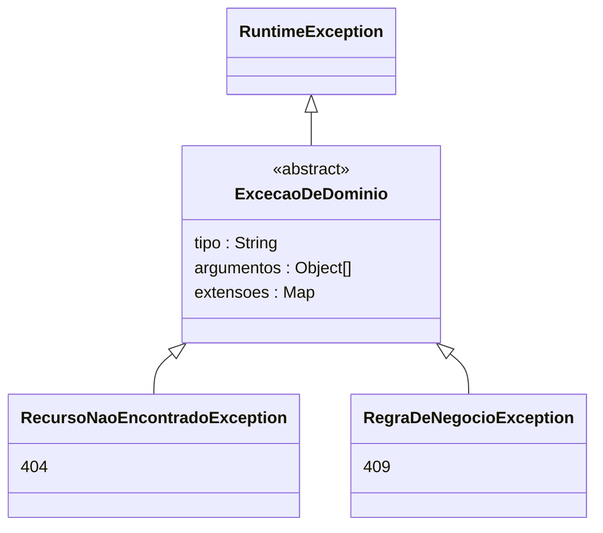
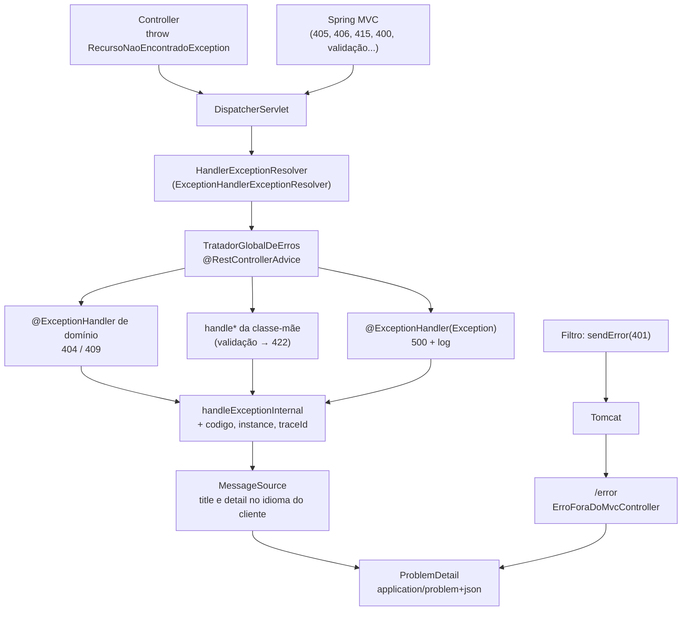

## O problema

Em [08.01](/construindo-apis-com-spring-boot/problem-details-rfc-9457), o Bazar definiu o contrato dos seus erros. O código ainda não o segue. Hoje, os erros saem de quatro lugares diferentes, e cada um faz uma coisa:

- `ResponseEntity.notFound().build()` devolve um `404` **sem corpo**;
- `throw new ResponseStatusException(HttpStatus.NOT_FOUND, "Produto não encontrado")` devolve o corpo padrão do Spring Boot, **sem a mensagem**;
- a validação devolve `400` com `{"timestamp", "status", "error", "path"}`, **sem os campos**, e com o status que o Bazar decidiu não usar ([02.03](/comecando-e-fundamentos-de-http/status-codes-em-profundidade));
- uma exceção inesperada vira `500`, e o detalhe técnico fica a uma propriedade de configuração de vazar para o cliente.

A tentação é espalhar `try/catch` pelos controllers, um para cada caso. Cada endpoint passa a ter metade do código tratando erros, e o formato depende de quem escreveu cada um.

Pense na central de atendimento de uma empresa. Os setores não falam diretamente com o cliente quando algo dá errado: eles registram o problema, e a central responde, sempre no mesmo tom, com um número de protocolo. O setor de estoque não precisa saber escrever uma carta ao cliente, só precisa dizer "esse produto não existe".

> **A pergunta desta página:** como o Spring transforma exceções em respostas, e como montar um tratador único que produza o Problem Details do Bazar para qualquer erro, inclusive os que o próprio Spring gera?

## O conceito

### Do `throw` à resposta

Quando um controller lança uma exceção, o `DispatcherServlet` não a deixa escapar: ele consulta, em ordem, os `HandlerExceptionResolver` registrados ([09.01](/construindo-apis-com-spring-boot/o-caminho-de-uma-requisicao-no-spring-mvc)). Os três principais:

1. **`ExceptionHandlerExceptionResolver`**: procura um método **`@ExceptionHandler`** compatível, primeiro no próprio controller, depois nas classes **`@ControllerAdvice`**. É aqui que o código da aplicação entra.
2. **`ResponseStatusExceptionResolver`**: trata exceções anotadas com `@ResponseStatus` e a `ResponseStatusException`.
3. **`DefaultHandlerExceptionResolver`**: trata as exceções do próprio Spring MVC (método não suportado, corpo ilegível...), com o status certo.

Se nenhum deles resolver, a exceção chega ao servidor (Tomcat), que encaminha a requisição para o caminho de erro, **`/error`**, atendido no Spring Boot pelo `BasicErrorController`.

O `@RestControllerAdvice` é um `@ControllerAdvice` com `@ResponseBody`: os métodos `@ExceptionHandler` dele valem **para todos os controllers** e devolvem o corpo da resposta. Quando várias exceções combinam, o Spring escolhe o handler da exceção **mais específica**: um handler de `RecursoNaoEncontradoException` ganha de um handler de `Exception`.

### `ProblemDetail`, `ErrorResponse` e `ErrorResponseException`

O Spring Framework (desde a versão 6.0) tem três peças para a RFC 9457:

| Tipo | O que é |
|---|---|
| **`ProblemDetail`** (`org.springframework.http`) | O corpo: `type`, `title`, `status`, `detail`, `instance` e um mapa de extensões (`setProperty`), escritas na raiz do JSON. Devolvido por um controller ou handler, sai como `application/problem+json` |
| **`ErrorResponse`** (`org.springframework.web`) | Interface de "uma resposta de erro completa": status, cabeçalhos e um `ProblemDetail`. Todas as exceções do Spring MVC a implementam. Ela também sabe procurar `title` e `detail` num `MessageSource` |
| **`ErrorResponseException`** | Uma exceção que já é um `ErrorResponse`. A `ResponseStatusException` estende essa classe |

Uma forma simples de produzir Problem Details é lançar uma `ErrorResponseException` com o `ProblemDetail` pronto. O Bazar não faz isso: as exceções saem do **domínio**, que não deve conhecer HTTP (status, URIs de tipo, cabeçalhos). Quem traduz exceções do domínio em HTTP é a borda.

### `spring.mvc.problemdetails.enabled`

Por padrão, as exceções do Spring MVC usam o corpo padrão do Spring Boot (`timestamp`, `status`, `error`, `path`). Com **`spring.mvc.problemdetails.enabled=true`**, o Boot registra um `@ControllerAdvice` pronto, que transforma essas exceções em `ProblemDetail`. Ele só é registrado se a aplicação **não** tiver o seu próprio `ResponseEntityExceptionHandler`.

Ligar a propriedade resolve os erros do Spring, mas não os da aplicação, e não acrescenta as extensões do Bazar. Por isso o Bazar escreve o seu próprio tratador, e a propriedade fica desligada.

### `ResponseEntityExceptionHandler`

A classe base do tratador é a **`ResponseEntityExceptionHandler`**, do Spring MVC. Ela já tem um `@ExceptionHandler` para cada exceção do Spring MVC, cada um delegando a um método `protected` que pode ser sobrescrito:

| Exceção | Status | Método |
|---|---|---|
| `HttpRequestMethodNotSupportedException` | `405` | `handleHttpRequestMethodNotSupported` |
| `HttpMediaTypeNotAcceptableException` | `406` | `handleHttpMediaTypeNotAcceptable` |
| `HttpMediaTypeNotSupportedException` | `415` | `handleHttpMediaTypeNotSupported` |
| `HttpMessageNotReadableException` | `400` | `handleHttpMessageNotReadable` |
| `TypeMismatchException` | `400` | `handleTypeMismatch` |
| `MethodArgumentNotValidException` | `400` | `handleMethodArgumentNotValid` |
| `HandlerMethodValidationException` | `400` | `handleHandlerMethodValidationException` |
| `NoResourceFoundException` (rota inexistente) | `404` | `handleNoResourceFoundException` |
| `ErrorResponseException` (e `ResponseStatusException`) | o da exceção | `handleErrorResponseException` |

Todos terminam em **`handleExceptionInternal`**, o ponto único por onde passa toda resposta de erro. É o lugar para acrescentar o que é comum a todos os erros: no Bazar, `codigo`, `instance` e `traceId`.

### Exceções de domínio

O Bazar organiza as suas exceções numa hierarquia pequena:



- **`ExcecaoDeDominio`** carrega o **tipo** do problema (o final da URI do `type`, como `produto-nao-encontrado`), os **argumentos** da mensagem e as **extensões**. Ela não conhece status nem URIs.
- **`RecursoNaoEncontradoException`** vira `404`; **`RegraDeNegocioException`**, `409`. A escolha do status fica no tratador, numa linha.

Por que não uma exceção por erro (`ProdutoNaoEncontradoException`, `CategoriaNaoEncontradaException`...)? Porque o tratamento é idêntico: o que muda é o tipo e a mensagem, que já estão nos dados da exceção. Uma classe nova só se justifica quando o tratamento muda.

### Validação em `erros[]`

As duas exceções de validação ([07.01](/construindo-apis-com-spring-boot/bean-validation-essencial)) têm formas diferentes de expor os erros:

- **`MethodArgumentNotValidException`** (corpo com `@Valid`): `getBindingResult().getAllErrors()`, com `FieldError` para erros de campo (com `getField()`) e `ObjectError` para erros do objeto inteiro.
- **`HandlerMethodValidationException`** (parâmetros com *constraints*): `getParameterValidationResults()`, um resultado por parâmetro, com o `MethodParameter` (de onde vem o nome) e os erros.

O tratador transforma as duas na mesma lista `erros[]`, de `{ campo, mensagem }`, e responde `422`. A mensagem já vem traduzida: o Bean Validation usa o idioma da requisição ([07.02](/construindo-apis-com-spring-boot/validacao-avancada)).

### Mensagens via `MessageSource`

O `title` e o `detail` não ficam no código. O `ErrorResponse` procura as mensagens no `MessageSource` da aplicação (o `messages.properties`), com códigos que seguem uma convenção do Spring:

| Código | Para quê |
|---|---|
| `problemDetail.title.<classe da exceção>` | O `title` de uma exceção do Spring |
| `problemDetail.<classe da exceção>` | O `detail`; os argumentos (`{0}`, `{1}`) dependem da exceção |
| `problemDetail.type.<classe da exceção>` | O `type` |

Por exemplo, `problemDetail.title.org.springframework.web.HttpRequestMethodNotSupportedException=Método não permitido` traduz o `title` dos `405`. Para as exceções de domínio, o Bazar usa a mesma convenção com o **tipo** no lugar da classe: `problemDetail.title.produto-nao-encontrado` e `problemDetail.produto-nao-encontrado`.

<Callout type="warning" title="O título usa a classe concreta; o detail, às vezes, não">
  Para um parâmetro com o tipo errado (`/v1/produtos/abc`), a exceção é a `MethodArgumentTypeMismatchException`, e o `title` é procurado com o nome dela. Mas o `ResponseEntityExceptionHandler` monta o código do `detail` com a classe genérica: `problemDetail.org.springframework.beans.TypeMismatchException`. Descobrimos isso porque o título saiu traduzido e o `detail` não. Na dúvida, teste cada mensagem.
</Callout>

Os argumentos padrão desse `detail` incluem o **valor recebido** (`{1}`): a mensagem do Spring é `Failed to convert 'id' with value: 'abc'`. A mensagem do Bazar usa só o nome do parâmetro, pela regra de não ecoar valores ([08.01](/construindo-apis-com-spring-boot/problem-details-rfc-9457)).

E o idioma? O `LocaleContextHolder` guarda o *locale* da requisição, vindo do `Accept-Language`. O Bazar configura duas propriedades:

- **`spring.web.locale: pt_BR`**: sem `Accept-Language`, a resposta sai em português;
- **`spring.messages.fallback-to-system-locale: false`**: para um idioma sem tradução (japonês, por exemplo), o Spring usa o arquivo base, e não o idioma do servidor. É a mesma armadilha de [07.02](/construindo-apis-com-spring-boot/validacao-avancada), resolvida aqui por uma propriedade.

### O erro `500`: logar e devolver só o `traceId`

Uma exceção inesperada (um `NullPointerException`, o banco fora do ar) é um erro do **servidor**. O cliente não pode fazer nada com a mensagem dela, e um atacante pode aprender muito: nomes de classes, consultas SQL, caminhos de arquivos. A regra:

- **para o cliente:** `500`, uma mensagem genérica e o `traceId`;
- **para o log:** a exceção completa, com o *stack trace*, e o **mesmo `traceId`**.

Quando o cliente liga para o suporte com o `traceId`, o suporte encontra a exceção no log. Até [28.02](/observabilidade/tracing-distribuido-com-opentelemetry), o `traceId` do Bazar é um número aleatório de 128 bits, gerado no tratador; depois, passa a ser o do OpenTelemetry, o mesmo dos *traces*.

### Erros fora do Spring MVC

Nem todo erro passa pelo `DispatcherServlet`. Um filtro de segurança que chama `response.sendError(401)` ([09.04](/construindo-apis-com-spring-boot/filtros-interceptors-e-aop-quando-usar-cada-um)) ou uma exceção num filtro acontecem **antes** do Spring MVC, e o `@ControllerAdvice` nunca os vê. Nesses casos, o Tomcat encaminha a requisição para `/error`, com o status e a URI original em atributos da requisição (`jakarta.servlet.error.status_code`, `jakarta.servlet.error.request_uri`).

No Spring Boot, `/error` é atendido pelo **`BasicErrorController`**, que monta o corpo com o **`ErrorAttributes`** (o `DefaultErrorAttributes`): é dele o formato `{"timestamp", "status", "error", "path"}`. Há duas formas de mudar isso:

- **Um `ErrorAttributes` próprio**: muda os campos do mapa, mas não o *media type*.
- **Um `ErrorController` próprio**: o Boot recua e deixa de registrar o `BasicErrorController`. O Bazar faz isso, e o seu controller responde Problem Details também em `/error`.

### A mudança do Spring 7.1: `instance`

Até o Spring Framework 7.0, o Spring MVC preenche o `instance` com o caminho da requisição quando ele está vazio. As notas da versão **7.1** (prevista para novembro de 2026) anunciam que isso deixa de acontecer: para a RFC 9457, o `instance` identifica **a ocorrência** do problema, e o caminho não atende a essa definição. Para preenchê-lo, a aplicação define o campo diretamente ou registra um `ErrorResponse.Interceptor`.

O Bazar usa o Spring 7.0.10, mas **já preenche o `instance` ele mesmo**, com o caminho, no `handleExceptionInternal`. Assim, a atualização para a 7.1 não muda o contrato. A ocorrência propriamente dita é identificada pelo `traceId`.

### Um detalhe do Spring 7: `type` vazio

Nos erros que o próprio Spring gera, `ProblemDetail.getType()` devolve **`null`**, e o campo `type` não aparece no JSON. Pela RFC, a ausência equivale a `about:blank`, então a resposta está correta. Mas um código que faz `problema.getType().toString()` quebra com `NullPointerException`, e foi exatamente o que aconteceu na primeira versão do tratador do Bazar: o handler falhou, o Spring registrou `Failure in @ExceptionHandler` no log, e a resposta saiu sem as extensões. Trate o `type` como opcional.

## Diagrama

O caminho de uma exceção até o Problem Details:



## Na prática

### As exceções de domínio

```java title="src/main/java/com/bazar/compartilhado/erros/ExcecaoDeDominio.java"
/**
 * Base das exceções que o domínio lança para o cliente. Não conhece HTTP: o status é decidido pelo
 * TratadorGlobalDeErros, a partir da subclasse.
 */
public abstract class ExcecaoDeDominio extends RuntimeException {

    private final String tipo;
    private final Object[] argumentos;
    private final Map<String, Object> extensoes;

    /**
     * @param tipo o final da URI do type (produto-nao-encontrado); também é a chave das mensagens
     * @param extensoes campos extras do Problem Details, para máquinas
     * @param argumentos valores para a mensagem do detail ({0}, {1}...)
     */
    protected ExcecaoDeDominio(String tipo, Map<String, Object> extensoes, Object... argumentos) {
        super(tipo + " " + Arrays.toString(argumentos));
        this.tipo = tipo;
        this.argumentos = argumentos;
        this.extensoes = Map.copyOf(extensoes);
    }

    // getters: getTipo(), getArgumentos() (cópia do array), getExtensoes()
}
```

```java title="src/main/java/com/bazar/compartilhado/erros/RecursoNaoEncontradoException.java"
/**
 * O recurso pedido não existe (404).
 */
public class RecursoNaoEncontradoException extends ExcecaoDeDominio {

    public RecursoNaoEncontradoException(String tipo, Object id) {
        super(tipo, Map.of(), id);
    }
}
```

```java title="src/main/java/com/bazar/compartilhado/erros/RegraDeNegocioException.java"
/**
 * A requisição é válida, mas o estado atual não permite a operação (409).
 */
public class RegraDeNegocioException extends ExcecaoDeDominio {

    public RegraDeNegocioException(String tipo, Map<String, Object> extensoes, Object... argumentos) {
        super(tipo, extensoes, argumentos);
    }
}
```

### Os controllers ficam mais simples

Os `ResponseEntity.of(...)`, `ResponseEntity.notFound()` e `ResponseStatusException` saem; o controller só diz o que aconteceu:

```java title="src/main/java/com/bazar/catalogo/api/CategoriaController.java"
    @GetMapping("/{id}")
    public CategoriaResponse detalhar(@PathVariable UUID id) {
        return repository.findById(id)
                .map(CategoriaResponse::de)
                .orElseThrow(() -> naoEncontrada(id));
    }

    @DeleteMapping("/{id}")
    public ResponseEntity<Void> remover(@PathVariable UUID id) {
        var categoria = repository.findById(id).orElseThrow(() -> naoEncontrada(id));
        // Regra de negócio no controller por enquanto; ela vai para um serviço em 10.03.
        var quantidade = produtos.countByCategoriaId(id);
        if (quantidade > 0) {
            throw new RegraDeNegocioException("categoria-com-produtos",
                    Map.of("quantidadeDeProdutos", quantidade), categoria.nome(), quantidade);
        }
        repository.deleteById(id);
        return ResponseEntity.noContent().build();
    }

    private static RecursoNaoEncontradoException naoEncontrada(UUID id) {
        return new RecursoNaoEncontradoException("categoria-nao-encontrada", id);
    }
```

O `ProdutoController` e o `ClienteController` mudam da mesma forma (`produto-nao-encontrado`, `cliente-nao-encontrado`). O `ProdutoRepository` ganhou `countByCategoriaId`, para a regra de remoção.

### O `TratadorGlobalDeErros`

```java title="src/main/java/com/bazar/compartilhado/erros/TratadorGlobalDeErros.java"
/**
 * Converte toda exceção que sai de um controller num Problem Details (RFC 9457) no formato do Bazar (08.01).
 * As exceções do Spring MVC (405, 406, 415, corpo ilegível...) são tratadas pela classe-mãe.
 */
@RestControllerAdvice
public class TratadorGlobalDeErros extends ResponseEntityExceptionHandler {

    static final String BASE_DOS_TIPOS = "https://api.bazar.example/problemas/";

    private static final Logger log = LoggerFactory.getLogger(TratadorGlobalDeErros.class);

    // Exceções do Spring que ganham um type do Bazar; as demais ficam com about:blank.
    private static final Map<Class<? extends Exception>, String> TIPOS_DO_SPRING = Map.of(
            HttpMessageNotReadableException.class, "requisicao-invalida",
            TypeMismatchException.class, "requisicao-invalida",
            HttpMediaTypeNotAcceptableException.class, "formato-nao-aceito",
            HttpMediaTypeNotSupportedException.class, "formato-nao-suportado");

    @ExceptionHandler(RecursoNaoEncontradoException.class)
    ResponseEntity<Object> recursoNaoEncontrado(RecursoNaoEncontradoException ex, WebRequest request) {
        return deDominio(ex, HttpStatus.NOT_FOUND, request);
    }

    @ExceptionHandler(RegraDeNegocioException.class)
    ResponseEntity<Object> regraDeNegocio(RegraDeNegocioException ex, WebRequest request) {
        return deDominio(ex, HttpStatus.CONFLICT, request);
    }

    // Último recurso: nada de mensagem nem stack trace para o cliente; o detalhe fica no log, ligado pelo traceId.
    @ExceptionHandler(Exception.class)
    ResponseEntity<Object> inesperado(Exception ex, WebRequest request) {
        var problema = ErrorResponse.builder(ex, HttpStatus.INTERNAL_SERVER_ERROR, "Unexpected error.")
                .detailMessageCode("problemDetail.erro-inesperado")
                .build()
                .updateAndGetBody(getMessageSource(), LocaleContextHolder.getLocale());
        return handleExceptionInternal(ex, problema, new HttpHeaders(), HttpStatus.INTERNAL_SERVER_ERROR, request);
    }

    @Override
    protected ResponseEntity<Object> handleMethodArgumentNotValid(
            MethodArgumentNotValidException ex, HttpHeaders headers, HttpStatusCode status, WebRequest request) {
        var erros = ex.getBindingResult().getAllErrors().stream()
                .map(erro -> new ErroDeCampo(
                        erro instanceof FieldError campo ? campo.getField() : erro.getObjectName(),
                        mensagem(erro.getDefaultMessage())))
                .toList();
        return validacao(ex, erros, headers, request);
    }

    @Override
    protected ResponseEntity<Object> handleHandlerMethodValidationException(
            HandlerMethodValidationException ex, HttpHeaders headers, HttpStatusCode status, WebRequest request) {
        var erros = new ArrayList<ErroDeCampo>();
        for (var resultado : ex.getParameterValidationResults()) {
            var parametro = resultado.getMethodParameter().getParameterName();
            for (var erro : resultado.getResolvableErrors()) {
                erros.add(new ErroDeCampo(String.valueOf(parametro), mensagem(erro.getDefaultMessage())));
            }
        }
        return validacao(ex, erros, headers, request);
    }

    // Ponto por onde passam todas as respostas de erro: completa o Problem Details com o que é comum a todas.
    @Override
    protected ResponseEntity<Object> handleExceptionInternal(
            Exception ex, @Nullable Object body, HttpHeaders headers, HttpStatusCode status, WebRequest request) {
        // As exceções do Spring que já são ErrorResponse (405, 406, 415...) chegam sem corpo: ele é montado aqui.
        if (body == null && ex instanceof ErrorResponse erro) {
            body = erro.updateAndGetBody(getMessageSource(), LocaleContextHolder.getLocale());
        }
        if (body instanceof ProblemDetail problema) {
            completar(problema, ex, status, request);
        }
        return super.handleExceptionInternal(ex, body, headers, status, request);
    }

    private ResponseEntity<Object> deDominio(ExcecaoDeDominio ex, HttpStatus status, WebRequest request) {
        var problema = ErrorResponse.builder(ex, status, ex.getTipo())
                .type(URI.create(BASE_DOS_TIPOS + ex.getTipo()))
                .titleMessageCode("problemDetail.title." + ex.getTipo())
                .detailMessageCode("problemDetail." + ex.getTipo())
                .detailMessageArguments(ex.getArgumentos())
                .build()
                .updateAndGetBody(getMessageSource(), LocaleContextHolder.getLocale());
        ex.getExtensoes().forEach(problema::setProperty);
        return handleExceptionInternal(ex, problema, new HttpHeaders(), status, request);
    }

    private ResponseEntity<Object> validacao(Exception ex, List<ErroDeCampo> erros, HttpHeaders headers, WebRequest request) {
        var status = HttpStatus.UNPROCESSABLE_CONTENT;
        var problema = ErrorResponse.builder(ex, status, erros.size() + " invalid field(s).")
                .type(URI.create(BASE_DOS_TIPOS + "validacao"))
                .titleMessageCode("problemDetail.title.validacao")
                .detailMessageCode("problemDetail.validacao")
                .detailMessageArguments(erros.size())
                .build()
                .updateAndGetBody(getMessageSource(), LocaleContextHolder.getLocale());
        problema.setProperty("erros", erros.stream().sorted(Comparator.comparing(ErroDeCampo::campo)).toList());
        return handleExceptionInternal(ex, problema, headers, status, request);
    }

    private void completar(ProblemDetail problema, Exception ex, HttpStatusCode status, WebRequest request) {
        var tipoDoSpring = TIPOS_DO_SPRING.entrySet().stream()
                .filter(e -> e.getKey().isInstance(ex))
                .map(Map.Entry::getValue)
                .findFirst();
        if (tipoDoSpring.isPresent() && isAboutBlank(problema)) {
            problema.setType(URI.create(BASE_DOS_TIPOS + tipoDoSpring.get()));
        }
        problema.setProperty("codigo", codigo(problema, status));
        problema.setInstance(URI.create(caminho(request)));   // o Spring 7.1 deixa de preencher sozinho
        var traceId = novoTraceId();
        problema.setProperty("traceId", traceId);
        if (status.is5xxServerError()) {
            log.error("Erro inesperado [traceId={}]", traceId, ex);
        }
        else {
            log.debug("{} {} [traceId={}]: {}", status.value(), problema.getType(), traceId, ex.getMessage());
        }
    }

    // O codigo espelha o type: produto-nao-encontrado → PRODUTO_NAO_ENCONTRADO; about:blank usa o nome do status.
    private static String codigo(ProblemDetail problema, HttpStatusCode status) {
        if (isAboutBlank(problema)) {
            var conhecido = HttpStatus.resolve(status.value());
            return conhecido != null ? conhecido.name() : "HTTP_" + status.value();
        }
        var tipo = String.valueOf(problema.getType());
        return tipo.substring(tipo.lastIndexOf('/') + 1).replace('-', '_').toUpperCase(Locale.ROOT);
    }

    // No Spring 7 o type padrão é null (ausente no JSON), que a RFC lê como about:blank.
    private static boolean isAboutBlank(ProblemDetail problema) {
        var tipo = problema.getType();
        return tipo == null || "about:blank".equals(tipo.toString());
    }

    // caminho(request), novoTraceId() e mensagem(...): utilitários de uma linha, no repositório

    public record ErroDeCampo(String campo, String mensagem) {
    }
}
```

Os pontos centrais:

- **Os dois `@ExceptionHandler` de domínio** escolhem o status; todo o resto vem da exceção e das mensagens.
- **`handleMethodArgumentNotValid` e `handleHandlerMethodValidationException`** sobrescrevem o comportamento da classe-mãe: `422` com `erros[]`, ordenados pelo campo para que a resposta seja estável.
- **`handleExceptionInternal`** completa **todos** os erros, inclusive os do Spring. As exceções do Spring que já são `ErrorResponse` (`405`, `406`, `415`, rota inexistente) chegam aqui com `body` nulo, e a classe-mãe só montaria o corpo depois; por isso o tratador o monta antes de completar. Sem esse `if`, esses erros saíam sem `codigo` nem `traceId`, como os testes mostraram.
- **O `ErrorResponse.builder`** monta o `ProblemDetail` com códigos de mensagem, e o `updateAndGetBody` resolve as mensagens no idioma da requisição.

### As mensagens

```properties title="src/main/resources/messages_pt.properties (trecho)"
problemDetail.title.validacao=Dados inválidos
problemDetail.validacao={0,choice,1#A requisição tem 1 campo inválido.|1<A requisição tem {0} campos inválidos.}
problemDetail.title.produto-nao-encontrado=Produto não encontrado
problemDetail.produto-nao-encontrado=Não existe produto com id {0}.
problemDetail.title.categoria-com-produtos=A categoria possui produtos
problemDetail.categoria-com-produtos=A categoria "{0}" tem {1} produto(s). Mova ou descontinue os produtos antes de removê-la.
problemDetail.erro-inesperado=Erro inesperado. Se persistir, informe o traceId ao suporte.

problemDetail.title.org.springframework.http.converter.HttpMessageNotReadableException=Requisição ilegível
problemDetail.org.springframework.http.converter.HttpMessageNotReadableException=O corpo da requisição não é um JSON válido ou tem um valor do tipo errado.
problemDetail.title.org.springframework.web.method.annotation.MethodArgumentTypeMismatchException=Requisição inválida
problemDetail.org.springframework.beans.TypeMismatchException=O valor do parâmetro ''{0}'' é inválido.
problemDetail.title.org.springframework.web.HttpRequestMethodNotSupportedException=Método não permitido
problemDetail.title.org.springframework.web.HttpMediaTypeNotAcceptableException=Formato não aceito
problemDetail.title.org.springframework.web.HttpMediaTypeNotSupportedException=Formato não suportado
problemDetail.title.org.springframework.web.servlet.resource.NoResourceFoundException=Não encontrado
```

O `messages.properties` (o arquivo base) tem as mesmas chaves em inglês. As mensagens usam o `MessageFormat` do Java: `{0,choice,...}` escolhe o singular ou o plural, e o apóstrofo precisa ser dobrado (`''{0}''`).

```yaml title="src/main/resources/application.yml"
spring:
  application:
    name: bazar
  jackson:
    mapper:
      # A ordem dos campos no JSON segue a declaração (records e classes), não o alfabeto.
      sort-properties-alphabetically: false
  messages:
    # Idioma sem tradução usa o arquivo base (inglês), e não o idioma do servidor.
    fallback-to-system-locale: false
  web:
    # Sem Accept-Language, o Bazar responde em português.
    locale: pt_BR

server:
  port: 8080
```

### `/error` no mesmo formato

```java title="src/main/java/com/bazar/compartilhado/erros/ErroForaDoMvcController.java"
/**
 * Substitui o BasicErrorController do Spring Boot. Atende o /error, para onde o servidor encaminha os erros
 * que não passaram pelo Spring MVC (um filtro que chama sendError, por exemplo), e responde no mesmo formato.
 */
@RestController
public class ErroForaDoMvcController implements ErrorController {

    @RequestMapping("${server.error.path:/error}")
    ResponseEntity<ProblemDetail> erro(HttpServletRequest request) {
        var codigo = request.getAttribute(RequestDispatcher.ERROR_STATUS_CODE);
        var status = HttpStatus.resolve(codigo instanceof Integer valor ? valor : 500);
        if (status == null) {
            status = HttpStatus.INTERNAL_SERVER_ERROR;
        }
        var problema = ProblemDetail.forStatus(status);
        problema.setTitle(status.getReasonPhrase());
        problema.setProperty("codigo", status.name());
        if (request.getAttribute(RequestDispatcher.ERROR_REQUEST_URI) instanceof String caminho) {
            problema.setInstance(URI.create(caminho));
        }
        problema.setProperty("traceId", TratadorGlobalDeErros.novoTraceId());
        return ResponseEntity.status(status).contentType(MediaType.APPLICATION_PROBLEM_JSON).body(problema);
    }
}
```

O `ErrorController` do Boot 4 está em `org.springframework.boot.webmvc.error`. Ao encontrar um bean desse tipo, o Boot não registra o `BasicErrorController`. Os títulos aqui ficam em inglês: esses erros (`401` de um filtro, por exemplo) ganham mensagens próprias na Parte 11.

### As respostas reais

Todas capturadas com o Bazar rodando (os `traceId` mudam a cada requisição):

<HttpExchange
  title="404: produto inexistente"
  request={{ method: 'GET', url: 'http://localhost:8080/v1/produtos/0192f39f-2222-7000-8000-000000000042' }}
  response={{
    status: 404,
    headers: { 'Content-Type': 'application/problem+json' },
    body: { type: 'https://api.bazar.example/problemas/produto-nao-encontrado', title: 'Produto não encontrado', status: 404, detail: 'Não existe produto com id 0192f39f-2222-7000-8000-000000000042.', instance: '/v1/produtos/0192f39f-2222-7000-8000-000000000042', codigo: 'PRODUTO_NAO_ENCONTRADO', traceId: '3d8575910979b595b38af977e83e0df8' },
  }}
>
  Sem `Accept-Language`, a resposta sai em português (`spring.web.locale`).
</HttpExchange>

<HttpExchange
  title="422: vários campos inválidos"
  request={{ method: 'POST', url: 'http://localhost:8080/v1/produtos', headers: { 'Content-Type': 'application/json' }, body: { sku: 'liv-42', nome: '', precoEmCentavos: -5, categoriaId: '0192f3a0-5555-7000-8000-000000000003' } }}
  response={{
    status: 422,
    headers: { 'Content-Type': 'application/problem+json' },
    body: { type: 'https://api.bazar.example/problemas/validacao', title: 'Dados inválidos', status: 422, detail: 'A requisição tem 3 campos inválidos.', instance: '/v1/produtos', erros: [{ campo: 'nome', mensagem: 'não deve estar em branco' }, { campo: 'precoEmCentavos', mensagem: 'deve ser maior que 0' }, { campo: 'sku', mensagem: 'deve seguir o formato AAA-0000 (ex.: LIV-0042)' }], codigo: 'VALIDACAO', traceId: '650231658e02fcc10d994c8adbfe8a74' },
  }}
>
  Com `Accept-Language: en`, a mesma requisição recebe `"title": "Invalid data"`, `"detail": "The request has 3 invalid fields."` e as mensagens dos campos em inglês. As extensões aparecem na ordem em que foram acrescentadas: `erros` no `validacao`, `codigo` e `traceId` no `completar`.
</HttpExchange>

<HttpExchange
  title="409: categoria com produtos"
  request={{ method: 'DELETE', url: 'http://localhost:8080/v1/categorias/0192f3a0-5555-7000-8000-000000000003' }}
  response={{
    status: 409,
    headers: { 'Content-Type': 'application/problem+json' },
    body: { type: 'https://api.bazar.example/problemas/categoria-com-produtos', title: 'A categoria possui produtos', status: 409, detail: 'A categoria "Programação" tem 1 produto(s). Mova ou descontinue os produtos antes de removê-la.', instance: '/v1/categorias/0192f3a0-5555-7000-8000-000000000003', quantidadeDeProdutos: 1, codigo: 'CATEGORIA_COM_PRODUTOS', traceId: '241f796b938b31d7c3bb29941884d0ca' },
  }}
/>

<HttpExchange
  title="400: id malformado"
  request={{ method: 'GET', url: 'http://localhost:8080/v1/produtos/abc' }}
  response={{
    status: 400,
    headers: { 'Content-Type': 'application/problem+json' },
    body: { type: 'https://api.bazar.example/problemas/requisicao-invalida', title: 'Requisição inválida', status: 400, detail: "O valor do parâmetro 'id' é inválido.", instance: '/v1/produtos/abc', codigo: 'REQUISICAO_INVALIDA', traceId: 'b854bcdf19d7a49f56dc53dc9b45a9f7' },
  }}
>
  Um corpo com JSON quebrado recebe o mesmo `type`, com `"title": "Requisição ilegível"`.
</HttpExchange>

<HttpExchange
  title="406: formato que o Bazar não produz"
  request={{ method: 'GET', url: 'http://localhost:8080/v1/categorias', headers: { Accept: 'application/xml' } }}
  response={{
    status: 406,
    headers: { Accept: 'application/json, application/*+json', 'Content-Type': 'application/problem+json' },
    body: { type: 'https://api.bazar.example/problemas/formato-nao-aceito', title: 'Formato não aceito', status: 406, detail: 'Acceptable representations: [application/json, application/*+json].', instance: '/v1/categorias', codigo: 'FORMATO_NAO_ACEITO', traceId: '782781ef637f4b349216afa938b3acd7' },
  }}
>
  O cliente pediu XML e recebeu um Problem Details em JSON. É o comportamento que [02.05](/comecando-e-fundamentos-de-http/content-negotiation-e-media-types) descreveu: um erro num formato inesperado é mais útil que nenhum. O `detail` ainda está em inglês, porque o Bazar não traduziu essa mensagem; o mesmo vale para o `405` e o `415`.
</HttpExchange>

<HttpExchange
  title="405: método não suportado"
  request={{ method: 'PATCH', url: 'http://localhost:8080/v1/categorias' }}
  response={{
    status: 405,
    headers: { Allow: 'GET, POST', 'Content-Type': 'application/problem+json' },
    body: { title: 'Método não permitido', status: 405, detail: "Method 'PATCH' is not supported.", instance: '/v1/categorias', codigo: 'METHOD_NOT_ALLOWED', traceId: '57c9833712366e1d445d811044dad093' },
  }}
>
  Sem `type`: é `about:blank`, e o `codigo` usa o nome do status. O cabeçalho `Allow` vem do próprio Spring. Uma rota inexistente (`/v1/inexistente`) responde da mesma forma, com `404`, `"title": "Não encontrado"` e `"codigo": "NOT_FOUND"`.
</HttpExchange>

### Os testes

O teste do controller verifica o corpo inteiro do erro:

```java title="src/test/java/com/bazar/catalogo/api/ProdutoControllerTest.java"
    @Test
    void responde422ComUmErroPorCampoSemEcoarOValor() {
        assertThat(mvc.post().uri("/v1/produtos")
                .contentType(MediaType.APPLICATION_JSON)
                .header(HttpHeaders.ACCEPT_LANGUAGE, "pt-BR")
                .content("""
                        { "sku": "liv-42", "nome": "Clean Code", "precoEmCentavos": -5,
                          "categoriaId": "0192f3a0-5555-7000-8000-000000000003" }
                        """))
                .hasStatus(HttpStatus.UNPROCESSABLE_CONTENT)
                .hasContentType(MediaType.APPLICATION_PROBLEM_JSON)
                .bodyJson()
                .isLenientlyEqualTo("""
                        { "type": "https://api.bazar.example/problemas/validacao", "title": "Dados inválidos",
                          "status": 422, "detail": "A requisição tem 2 campos inválidos.", "codigo": "VALIDACAO",
                          "erros": [
                            { "campo": "precoEmCentavos", "mensagem": "deve ser maior que 0" },
                            { "campo": "sku", "mensagem": "deve seguir o formato AAA-0000 (ex.: LIV-0042)" } ] }
                        """);
    }
```

O `isLenientlyEqualTo` ignora campos a mais (`instance`, `traceId`, que mudam a cada execução). O `@WebMvcTest` inclui as classes `@ControllerAdvice` e o `MessageSource`, então o tratador participa do teste sem configuração extra. Os testes de `404`, `409`, `400` e `405` seguem o mesmo modelo.

O erro `500` é testado sem Spring Boot, com um controller que falha e um `MockMvc` *standalone*. O teste garante que a mensagem da exceção, que poderia conter qualquer coisa, não chega ao cliente:

```java title="src/test/java/com/bazar/compartilhado/erros/TratadorGlobalDeErrosTest.java"
class TratadorGlobalDeErrosTest {

    @RestController
    static class ControllerQueFalha {

        @GetMapping("/falha")
        String falhar() {
            throw new IllegalStateException("senha do banco: s3cr3t");
        }
    }

    // Sem Spring Boot: só o controller e o tratador, num MockMvc standalone.
    private final MockMvcTester mvc = MockMvcTester.of(List.of(new ControllerQueFalha()),
            builder -> builder.setControllerAdvice(new TratadorGlobalDeErros()).build());

    @Test
    void erroInesperadoVira500SemVazarAMensagem() throws Exception {
        var resposta = mvc.get().uri("/falha").exchange();

        assertThat(resposta).hasStatus(HttpStatus.INTERNAL_SERVER_ERROR)
                .bodyJson()
                .hasPathSatisfying("$.codigo", v -> assertThat(v).isEqualTo("INTERNAL_SERVER_ERROR"))
                .hasPath("$.traceId");
        assertThat(resposta.getResponse().getContentAsString()).doesNotContain("s3cr3t", "IllegalStateException");
    }
}
```

No log do teste, a exceção aparece completa, ligada ao `traceId`:

```text
ERROR ... c.b.c.erros.TratadorGlobalDeErros        : Erro inesperado [traceId=fa62bffb0d4b0c0d9b622118dc5973f3]

java.lang.IllegalStateException: senha do banco: s3cr3t
```

O `ErroForaDoMvcController` é testado como uma classe comum, com uma `MockHttpServletRequest` que simula o encaminhamento do Tomcat (os atributos de status e URI).

## Erros comuns

<BadVsGood title="try/catch em cada controller" why="Cada endpoint passa a decidir o formato do erro, e um esquecimento vira 500. Com um tratador global, o controller só lança a exceção de domínio, e o formato é garantido num lugar só.">
<Bad title="O controller monta a resposta de erro">

```java
@GetMapping("/{id}")
public ResponseEntity<?> detalhar(@PathVariable UUID id) {
    try {
        return ResponseEntity.ok(servico.buscar(id));
    } catch (NoSuchElementException e) {
        return ResponseEntity.status(404).body(Map.of("erro", "não encontrado"));
    } catch (Exception e) {
        return ResponseEntity.status(500).body(Map.of("erro", e.getMessage()));   // vaza a mensagem
    }
}
```

</Bad>
<Good title="O controller só diz o que aconteceu">

```java
@GetMapping("/{id}")
public ProdutoResponse detalhar(@PathVariable UUID id) {
    return repository.findById(id)
            .map(mapper::paraResponse)
            .orElseThrow(() -> new RecursoNaoEncontradoException("produto-nao-encontrado", id));
}
```

</Good>
</BadVsGood>

Outros erros frequentes:

- **Um `@RestControllerAdvice` sem estender `ResponseEntityExceptionHandler`.** Os erros do Spring MVC (`405`, `415`, JSON ilegível) continuam no formato antigo, e o cliente recebe dois formatos de erro.
- **Sobrescrever só os `handle*` e esquecer o `handleExceptionInternal`.** As extensões comuns (`traceId`) faltam em metade dos erros.
- **`e.getMessage()` no `detail` de um `500`.** Mensagens de exceção carregam SQL, caminhos e dados. Logue a exceção e devolva o `traceId`.
- **Um `@ExceptionHandler(Exception.class)` que engole tudo sem logar.** O erro some, e ninguém consegue investigar.
- **Tratar `ProblemDetail.getType()` como obrigatório.** No Spring 7 ele é `null` nos erros do próprio Spring.
- **Exceções de domínio com status HTTP** (`new ProdutoNaoEncontradoException(HttpStatus.NOT_FOUND)`). O domínio passa a depender da web; o status é decisão da borda.
- **Esquecer os erros fora do Spring MVC.** Um `401` de um filtro sai no formato do `BasicErrorController`.
- **Depender do `instance` preenchido pelo Spring.** Ele deixa de ser preenchido na versão 7.1.

## Boas práticas

- **Centralize** o tratamento num `@RestControllerAdvice` que estende `ResponseEntityExceptionHandler`.
- **Lance** exceções de domínio sem HTTP e decida o status no tratador.
- **Complete** todos os erros no `handleExceptionInternal`.
- **Mantenha** `title` e `detail` no `MessageSource`, com as chaves `problemDetail.*`.
- **Responda** `500` com mensagem genérica e `traceId`, e logue a exceção com o mesmo `traceId`.
- **Cubra** o `/error` com um `ErrorController` próprio para manter o formato.
- **Preencha** o `instance` explicitamente.
- **Teste** o corpo dos erros, inclusive o `500` e os erros gerados pelo Spring.

## No projeto Bazar

<ProjectStep title="Tratamento global de erros com Problem Details" module="compartilhado" tag="pagina-08.02" files={[
  { path: 'src/main/java/com/bazar/compartilhado/erros/', change: 'novo' },
  { path: 'src/main/java/com/bazar/catalogo/api/CategoriaController.java', change: 'alterado' },
  { path: 'src/main/java/com/bazar/catalogo/api/ProdutoController.java', change: 'alterado' },
  { path: 'src/main/java/com/bazar/catalogo/dominio/ProdutoRepository.java', change: 'alterado' },
  { path: 'src/main/java/com/bazar/clientes/api/ClienteController.java', change: 'alterado' },
  { path: 'src/main/resources/messages.properties', change: 'novo' },
  { path: 'src/main/resources/messages_pt.properties', change: 'novo' },
  { path: 'src/main/resources/application.yml', change: 'alterado' },
  { path: 'src/test/java/com/bazar/compartilhado/erros/', change: 'novo' },
  { path: 'src/test/java/com/bazar/catalogo/api/ProdutoControllerTest.java', change: 'alterado' },
  { path: 'src/test/java/com/bazar/catalogo/api/CategoriaControllerTest.java', change: 'alterado' },
  { path: 'src/test/java/com/bazar/clientes/api/ClienteControllerTest.java', change: 'alterado' },
]}>
Exceções de domínio (`RecursoNaoEncontradoException`, `RegraDeNegocioException`), `TratadorGlobalDeErros`, `ErroForaDoMvcController` e mensagens em inglês e português. Todos os erros do Bazar saem em `application/problem+json`, com `codigo`, `instance` e `traceId`. A validação passa a responder `422`, e remover uma categoria com produtos, `409`.
</ProjectStep>

## Resumo

- Exceções de controllers passam pelos **`HandlerExceptionResolver`**; o **`@RestControllerAdvice`** centraliza os `@ExceptionHandler` de toda a aplicação.
- **`ProblemDetail`** é o corpo; **`ErrorResponse`** é a resposta completa (implementada pelas exceções do Spring); **`ErrorResponseException`** é uma exceção que já carrega o `ProblemDetail`.
- **`spring.mvc.problemdetails.enabled`** converte os erros do Spring MVC, mas não os da aplicação; o Bazar estende **`ResponseEntityExceptionHandler`**.
- **`handleExceptionInternal`** é o ponto único para acrescentar `codigo`, `instance` e `traceId`.
- **Exceções de domínio** não conhecem HTTP; o tratador decide `404` ou `409`.
- **Validação** vira `422` com **`erros[]`**, a partir de `MethodArgumentNotValidException` e `HandlerMethodValidationException`.
- **Mensagens** vêm do `MessageSource` (`problemDetail.title.*`, `problemDetail.*`), no idioma do `Accept-Language`.
- **`500`:** mensagem genérica e `traceId` para o cliente, exceção completa no log.
- **Fora do Spring MVC**, o `/error` é coberto por um **`ErrorController`** próprio.
- No **Spring 7.1**, o `instance` deixa de ser preenchido automaticamente; no **Spring 7**, o `type` dos erros do Spring é `null`.

<Exercise title="Pedido já pago" difficulty="medio">
O módulo de pedidos vai ter a regra: um pedido já pago não pode ter itens alterados. O app quer mostrar a data do pagamento na mensagem de erro.

1. Escreva o `throw` que o serviço de pedidos deve fazer.
2. Escreva as mensagens em português e inglês.
3. Mostre a resposta completa que o cliente recebe.
4. Escreva um teste que garanta o status, o `type` e a extensão.

<Hint>
Não é preciso mexer no `TratadorGlobalDeErros`. Pense no que vai em `extensoes` (para o app) e no que vai em `argumentos` (para o `detail`).
</Hint>

<Solution>

1. O serviço lança uma `RegraDeNegocioException`, com a data numa extensão e nos argumentos:

   ```java
   throw new RegraDeNegocioException("pedido-ja-pago",
           Map.of("pagoEm", pedido.getPagoEm()), pedido.getNumero(), pedido.getPagoEm());
   ```

2. As mensagens:

   ```properties
   # messages_pt.properties
   problemDetail.title.pedido-ja-pago=Pedido já pago
   problemDetail.pedido-ja-pago=O pedido {0} foi pago em {1} e não pode ser alterado.

   # messages.properties
   problemDetail.title.pedido-ja-pago=Order already paid
   problemDetail.pedido-ja-pago=Order {0} was paid on {1} and cannot be changed.
   ```

3. A resposta:

   ```json
   {
     "type": "https://api.bazar.example/problemas/pedido-ja-pago",
     "title": "Pedido já pago",
     "status": 409,
     "detail": "O pedido BZR-2026-000123 foi pago em 2026-10-24T17:30:00Z e não pode ser alterado.",
     "instance": "/v1/pedidos/0192.../itens",
     "pagoEm": "2026-10-24T17:30:00Z",
     "codigo": "PEDIDO_JA_PAGO",
     "traceId": "..."
   }
   ```

   O app lê a data da extensão `pagoEm`, já em ISO 8601, e a formata como quiser. O `detail` é para quem lê o log ou a tela de erro genérica.

4. O teste:

   ```java
   assertThat(mvc.put().uri("/v1/pedidos/{id}/itens", idPago).contentType(MediaType.APPLICATION_JSON).content(itens))
           .hasStatus(HttpStatus.CONFLICT)
           .bodyJson()
           .isLenientlyEqualTo("""
                   { "type": "https://api.bazar.example/problemas/pedido-ja-pago", "codigo": "PEDIDO_JA_PAGO",
                     "pagoEm": "2026-10-24T17:30:00Z" }
                   """);
   ```

</Solution>
</Exercise>

<Quiz
  questions={[
    {
      question: 'O Bazar tem um @RestControllerAdvice próprio que estende ResponseEntityExceptionHandler. O que acontece se spring.mvc.problemdetails.enabled=true?',
      options: [
        'Os dois tratadores atuam, e cada erro sai duas vezes',
        'O tratador do Boot não é registrado, porque já existe um ResponseEntityExceptionHandler na aplicação',
        'O tratador do Boot substitui o do Bazar',
      ],
      answer: 1,
      explanation: 'O Boot só registra o seu ProblemDetailsExceptionHandler quando a aplicação não tem um ResponseEntityExceptionHandler. Com o tratador próprio, a propriedade não tem efeito.',
    },
    {
      question: 'Por que o tratador do Bazar sobrescreve handleExceptionInternal?',
      options: [
        'Porque é o único método que trata exceções de domínio',
        'Porque todas as respostas de erro da classe-mãe passam por ele, o que permite acrescentar codigo, instance e traceId a todos os erros num lugar só',
        'Porque sem ele o Spring não usa application/problem+json',
      ],
      answer: 1,
      explanation: 'Os métodos handle* da ResponseEntityExceptionHandler terminam em handleExceptionInternal, e os handlers do Bazar também passam por ele. O media type vem do ProblemDetail, não desse método.',
    },
    {
      question: 'Um filtro de segurança chama response.sendError(401). Quem monta a resposta?',
      options: [
        'O @RestControllerAdvice, como qualquer outro erro',
        'O Tomcat encaminha para /error, atendido pelo BasicErrorController, ou por um ErrorController próprio, como o do Bazar',
        'Ninguém: o cliente recebe um 401 sem corpo',
      ],
      answer: 1,
      explanation: 'O filtro roda antes do DispatcherServlet, então o @ControllerAdvice nunca vê o erro. O servidor faz o encaminhamento para /error, e o Spring Boot o atende com o BasicErrorController, a menos que exista outro ErrorController.',
    },
  ]}
/>

## Referências

<References />
