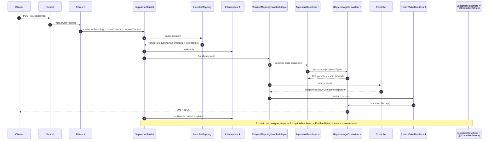

## O problema

Três chamados chegam na mesma semana ao time do Bazar:

- "O `GET /v1/produtos/abc` dá `400`, mas o método do controller nem é chamado. O *breakpoint* não para."
- "Pedi `Accept: application/xml` e recebi `406`. Onde está o código que decide isso? Não achei nenhum `if`."
- "Uma URL errada dá `404` com `No static resource`. Recurso estático? Isto é uma API!"

As três respostas estão no mesmo lugar: no caminho que a requisição percorre **antes** e **depois** do seu método. O controller é só uma parada no meio do trajeto. Quem não conhece o trajeto procura o problema no lugar errado.

Pense numa encomenda pelos Correios. Ela passa pela agência, pelo centro de triagem, pelo caminhão e pelo carteiro antes de chegar à sua porta. Quando ela se perde, saber a ordem das etapas e o que cada uma registra no rastreamento é o que permite descobrir onde o problema aconteceu. O log de DEBUG do Spring é o rastreamento da requisição.

> **A pergunta desta página:** por quais componentes uma requisição passa no Spring MVC, o que cada um faz, onde é possível interferir e como ver tudo isso acontecendo?

## O conceito

### Do Tomcat ao `DispatcherServlet`

A requisição chega primeiro ao **servidor de servlets**: no Bazar, o Tomcat 11, embutido pelo Spring Boot ([05.01](/construindo-apis-com-spring-boot/spring-boot-4-em-uma-pagina)). O Tomcat lê os bytes do HTTP, monta um `HttpServletRequest` e o entrega à **cadeia de filtros** (*filter chain*), definida pela especificação Jakarta Servlet.

Cada filtro pode olhar a requisição, alterá-la, interromper a cadeia ou deixar passar. No Bazar, o log de inicialização mostra os filtros que o Spring Boot registra:

```text
Mapping filters: characterEncodingFilter urls=[/*] order=-2147483648, formContentFilter urls=[/*] order=-9900, requestContextFilter urls=[/*] order=-105
Mapping servlets: dispatcherServlet urls=[/]
```

- **`characterEncodingFilter`**: garante UTF-8 na leitura e na escrita (é o primeiro: ordem mínima).
- **`formContentFilter`**: lê corpos `application/x-www-form-urlencoded` em `PUT`, `PATCH` e `DELETE`, que o Servlet só lê em `POST`.
- **`requestContextFilter`**: guarda a requisição e o *locale* numa variável da *thread* (`RequestContextHolder`, `LocaleContextHolder`), para que qualquer código saiba "qual é a requisição atual".

No fim da cadeia está o único servlet da aplicação: o **`DispatcherServlet`**, mapeado em `/`. Ele é o *front controller* do Spring MVC: toda requisição passa por ele, e ele distribui o trabalho para os componentes especializados. Filtros próprios, como um que mede o tempo de resposta, entram nessa cadeia ([09.04](/construindo-apis-com-spring-boot/filtros-interceptors-e-aop-quando-usar-cada-um)).

### `HandlerMapping`: quem atende?

A primeira pergunta do `DispatcherServlet` é: **qual *handler* atende esta requisição?** Ele consulta os `HandlerMapping` registrados, em ordem:

1. **`RequestMappingHandlerMapping`**: conhece todos os métodos com `@GetMapping`, `@PostMapping` etc. Na inicialização, o Bazar registra 11 (`11 mappings in 'requestMappingHandlerMapping'`): 5 de categorias, 3 de produtos, 2 de clientes e o `/error`.
2. **`RouterFunctionMapping`**: atende os *functional endpoints* ([09.05](/construindo-apis-com-spring-boot/functional-endpoints-routerfunction)).
3. **`SimpleUrlHandlerMapping`**: entre outros, mapeia `/**` para o **`ResourceHttpRequestHandler`**, que serve arquivos estáticos (`classpath:/static/`, `/public/`...).

O terceiro explica o chamado do `No static resource`: uma URL que nenhum controller atende cai no mapeamento genérico `/**` de recursos estáticos. O arquivo não existe, o handler lança `NoResourceFoundException`, e o resultado é um `404`. É o comportamento desde o Spring Framework 6.1; o Bazar o traduz para Problem Details ([08.02](/construindo-apis-com-spring-boot/problemdetail-no-spring-tratamento-global-de-erros)).

O `RequestMappingHandlerMapping` escolhe o método pelo caminho, pelo método HTTP e pelas condições do *mapping* (`consumes`, `produces`, `params`, `headers`). Se o caminho existe mas o método HTTP não, o resultado é `405`; se o `Content-Type` não está em `consumes`, `415`.

### `PathPattern` × `AntPathMatcher`

Para comparar a URL com os padrões (`/v1/produtos/{id}`), o Spring MVC usa o **`PathPattern`** (com o `PathPatternParser`), o padrão desde o Spring Framework 6.0 e o Spring Boot 2.6. Ele pré-processa os padrões na inicialização e compara a URL já dividida em segmentos, o que é mais rápido e mais previsível que o antigo **`AntPathMatcher`**, que comparava *strings*.

As diferenças que aparecem na prática:

- **`**` só no fim do padrão.** `/v1/**/itens` funcionava com o `AntPathMatcher` e é recusado pelo `PathPattern`.
- **`{*caminho}`** captura o resto do caminho numa variável, o que o `AntPathMatcher` não fazia.
- **Sem sufixos.** `/v1/produtos.json` não casa com `/v1/produtos` ([02.05](/comecando-e-fundamentos-de-http/content-negotiation-e-media-types)).

O Spring Boot ainda aceita voltar ao comportamento antigo com `spring.mvc.pathmatch.matching-strategy=ant-path-matcher`, mas essa opção está **depreciada** no Boot 4. Em código antigo, é um sinal de migração pendente.

### `HandlerExecutionChain` e interceptors

O `HandlerMapping` não devolve só o handler: devolve uma **`HandlerExecutionChain`**, o handler mais a lista de **`HandlerInterceptor`** que se aplicam àquele caminho. Os interceptors rodam dentro do `DispatcherServlet`, já sabendo qual método vai atender, e têm três ganchos: antes do handler (`preHandle`, que pode interromper a requisição), depois do handler (`postHandle`) e no fim, mesmo com erro (`afterCompletion`). Eles são o assunto de [09.04](/construindo-apis-com-spring-boot/filtros-interceptors-e-aop-quando-usar-cada-um).

### `HandlerAdapter`: chamar o método

O `DispatcherServlet` não sabe chamar um método anotado: ele só conhece a interface `HandlerAdapter`. Para métodos `@RequestMapping`, o adaptador é o **`RequestMappingHandlerAdapter`**, que faz três coisas:

1. **Resolve os argumentos.** Para cada parâmetro do método, procura um **`HandlerMethodArgumentResolver`** que o suporte: `@PathVariable`, `@RequestParam`, `@RequestHeader`, `@RequestBody`, `Locale`, `HttpServletRequest`... São dezenas, e você pode criar os seus ([09.02](/construindo-apis-com-spring-boot/argument-resolvers-e-return-value-handlers-customizados)). Aqui acontecem a conversão de tipos (`"abc"` → `UUID`) e a validação (`@Valid`).
2. **Chama o método do controller.**
3. **Trata o retorno.** Um **`HandlerMethodReturnValueHandler`** decide o que fazer com o valor devolvido: um `ResponseEntity`, um objeto num `@RestController`, um `ProblemDetail`...

Para `@RequestBody` e para o corpo da resposta, o resolvedor e o *handler* de retorno usam os **`HttpMessageConverter`**: o resolvedor procura um conversor que saiba **ler** o `Content-Type` da requisição; o *handler* de retorno, um que saiba **escrever** um dos tipos do `Accept`. Com o Jackson no *classpath*, o principal é o conversor de JSON ([09.03](/construindo-apis-com-spring-boot/httpmessageconverter-e-a-serializacao-por-dentro)). É dessa negociação que saem os `406` e os `415`, sem nenhum `if` no seu código.

### `HandlerExceptionResolver`

Se qualquer etapa lança uma exceção (o *mapping*, a conversão de um argumento, a validação, o seu método, a escrita da resposta), o `DispatcherServlet` a entrega aos `HandlerExceptionResolver`, como vimos em [08.02](/construindo-apis-com-spring-boot/problemdetail-no-spring-tratamento-global-de-erros). O primeiro deles, o `ExceptionHandlerExceptionResolver`, chama o `@ExceptionHandler` do `TratadorGlobalDeErros`. O resultado volta pelos mesmos *handlers* de retorno e conversores: por isso o `ProblemDetail` é escrito em JSON como qualquer outro objeto.

Só o que **escapa** dos resolvedores (ou acontece fora do `DispatcherServlet`, num filtro) chega ao Tomcat, que encaminha para `/error`.

### Como ver tudo isso

Duas ferramentas:

- **`logging.level.org.springframework.web=DEBUG`**: cada etapa registra uma linha. É a primeira coisa a ligar quando uma requisição se comporta de um jeito inesperado. Pode ser passada na linha de comando, sem mudar a configuração: `java -jar bazar.jar --logging.level.org.springframework.web=DEBUG`.
- **Breakpoints** nos pontos centrais: `DispatcherServlet.doDispatch` (o roteiro inteiro, em um método), `InvocableHandlerMethod.getMethodArgumentValues` (a resolução de argumentos), `AbstractMessageConverterMethodProcessor.writeWithMessageConverters` (a escolha do conversor e do *media type*).

<Callout type="warning" title="DEBUG em produção">
  O log de DEBUG do Spring MVC é verboso e pode registrar trechos do corpo das requisições e das respostas (as linhas `Read` e `Writing`). Por padrão, parâmetros e cabeçalhos são mascarados (`enableLoggingRequestDetails='false'`, como o log avisa), mas os corpos aparecem truncados. Use DEBUG em desenvolvimento, ou em produção só por um período curto e num pacote específico. A Parte 12 mostra como mudar o nível de log em tempo de execução.
</Callout>

## Diagrama

O diagrama principal desta parte: o caminho completo de uma requisição, com os pontos de extensão marcados com ✦.



## Na prática

### O log de uma criação

O Bazar rodando com `--logging.level.org.springframework.web=DEBUG` (prefixos de data e processo removidos):

```text
DispatcherServlet        : POST "/v1/categorias", parameters={}
RequestMappingHandlerMapping : Mapped to com.bazar.catalogo.api.CategoriaController#criar(CategoriaRequest)
RequestResponseBodyMethodProcessor : Read "application/json;charset=UTF-8" to [CategoriaRequest[nome=Games, slug=games, categoriaPaiId=null]]
HttpEntityMethodProcessor  : Using 'application/json', given [*/*] and supported [application/json, application/*+json]
HttpEntityMethodProcessor  : Writing [CategoriaResponse[id=c623515f-ac79-4f27-9553-c8418a186277, nome=Games, slug=games, categoriaPaiId=nu (truncated)...]
DispatcherServlet        : Completed 201 CREATED
```

Linha a linha:

1. O `DispatcherServlet` recebeu a requisição.
2. O `RequestMappingHandlerMapping` escolheu o método `criar`.
3. O `RequestResponseBodyMethodProcessor` (resolvedor do `@RequestBody`) usou um conversor para ler o JSON e criou o record. A validação acontece logo depois, sem log quando passa.
4. O `HttpEntityMethodProcessor` (o *handler* de retorno para `ResponseEntity`) negociou o formato: o cliente aceita qualquer coisa (`*/*`), o conversor oferece JSON, então sai JSON.
5. O mesmo *handler* escreveu a resposta.
6. Status final.

<HttpExchange
  title="A requisição do log, vista pelo cliente"
  request={{ method: 'POST', url: 'http://localhost:8080/v1/categorias', headers: { 'Content-Type': 'application/json' }, body: { nome: 'Games', slug: 'games', categoriaPaiId: null } }}
  response={{
    status: 201,
    headers: { Location: 'http://localhost:8080/v1/categorias/35909ef2-386e-4dca-a76e-edb9fa09b67a', 'Content-Type': 'application/json' },
    body: { id: '35909ef2-386e-4dca-a76e-edb9fa09b67a', nome: 'Games', slug: 'games', categoriaPaiId: null },
  }}
>
  Do lado de fora, só se veem a requisição e a resposta. As seis linhas do log acima são o caminho entre as duas, dentro do `DispatcherServlet`. Os ids diferem dos do log porque cada execução gera um novo.
</HttpExchange>

Na primeira requisição, o log mostra também a inicialização preguiçosa do `DispatcherServlet` (`Initializing Servlet 'dispatcherServlet'`) e os componentes que ele encontrou (`Detected AcceptHeaderLocaleResolver`...). Na inicialização da aplicação, o `ExceptionHandlerExceptionResolver` registra o tratador do Bazar: `ControllerAdvice beans: 1 @ExceptionHandler, 1 ResponseBodyAdvice`.

### O `400` que não chega ao controller

```text
DispatcherServlet        : GET "/v1/produtos/abc", parameters={}
RequestMappingHandlerMapping : Mapped to com.bazar.catalogo.api.ProdutoController#detalhar(UUID)
HandlerMethod             : Could not resolve parameter [0] in public com.bazar.catalogo.api.ProdutoResponse com.bazar.catalogo.api.ProdutoController.detalhar(java.util.UUID): Method parameter 'id': Failed to convert value of type 'java.lang.String' to required type 'java.util.UUID'; Invali...
ExceptionHandlerExceptionResolver : Using @ExceptionHandler com.bazar.compartilhado.erros.TratadorGlobalDeErros#handleException(Exception, WebRequest)
HttpEntityMethodProcessor  : Using 'application/problem+json', given [*/*] and supported [application/problem+json]
HttpEntityMethodProcessor  : Writing [ProblemDetail[type='https://api.bazar.example/problemas/requisicao-invalida', title='Requisição invá (truncated)...]
ExceptionHandlerExceptionResolver : Resolved [org.springframework.web.method.annotation.MethodArgumentTypeMismatchException: ...Invalid UUID string: abc]
DispatcherServlet        : Completed 400 BAD_REQUEST
```

Primeiro chamado resolvido: o método foi **escolhido** (linha 2), mas o argumento não pôde ser **resolvido** (linha 3). O `breakpoint` dentro de `detalhar` nunca para, porque o erro acontece na etapa anterior. O `handleException` da linha 4 é o método da `ResponseEntityExceptionHandler` que distribui para o `handleTypeMismatch`.

### O `406` sem `if`

```text
DispatcherServlet        : GET "/v1/categorias", parameters={}
RequestMappingHandlerMapping : Mapped to com.bazar.catalogo.api.CategoriaController#listar(String, boolean)
RequestResponseBodyMethodProcessor : No match for [application/xml], supported: [application/json, application/*+json]
ExceptionHandlerExceptionResolver : Using @ExceptionHandler com.bazar.compartilhado.erros.TratadorGlobalDeErros#handleException(Exception, WebRequest)
HttpEntityMethodProcessor  : Using 'application/problem+json', given [application/xml] and supported [application/problem+json]
...
DispatcherServlet        : Completed 406 NOT_ACCEPTABLE
```

Segundo chamado: o método **rodou**, e o problema apareceu na escrita (linha 3). Nenhum conversor escreve `application/xml`, então o *handler* de retorno lança `HttpMediaTypeNotAcceptableException`. A linha 5 mostra um detalhe: para escrever o `ProblemDetail`, o Spring usa `application/problem+json` mesmo com o cliente pedindo XML.

### O `404` de "recurso estático"

```text
DispatcherServlet        : GET "/v1/inexistente", parameters={}
SimpleUrlHandlerMapping  : Mapped to ResourceHttpRequestHandler [classpath [META-INF/resources/], classpath [resources/], classpath [static/], classpath [public/], ServletContext [/]]
ResourceHttpRequestHandler     : Resource not found for path [v1/inexistente]
...
ExceptionHandlerExceptionResolver : Resolved [org.springframework.web.servlet.resource.NoResourceFoundException: No static resource v1/inexistente for request '/v1/inexistente'.]
DispatcherServlet        : Completed 404 NOT_FOUND
```

Terceiro chamado: o `RequestMappingHandlerMapping` não tinha nada para `/v1/inexistente`, e o próximo mapeamento da lista, o de recursos estáticos, aceitou. O nome confuso vem daí.

### Parâmetros mascarados

```text
DispatcherServlet        : GET "/v1/categorias?q=liv", parameters={masked}
```

Os parâmetros aparecem como `{masked}`. Para vê-los em desenvolvimento, existe `spring.mvc.log-request-details=true`; em produção, deixe desligado, porque parâmetros e cabeçalhos podem levar *tokens* e dados pessoais.

## Erros comuns

<BadVsGood title="Depurar pelo controller" why="Muitos erros (400 de conversão, 404, 406, 415) acontecem antes ou depois do método. O log de DEBUG mostra em qual etapa a requisição parou, sem adivinhação.">
<Bad title="Breakpoint no controller e tentativa e erro">

```java
@GetMapping("/{id}")
public ProdutoResponse detalhar(@PathVariable UUID id) {
    System.out.println("chegou aqui?");   // nunca imprime para /v1/produtos/abc
    ...
}
```

</Bad>
<Good title="Ligar o DEBUG do Spring MVC e ler as etapas">

```bash
java -jar target/bazar-0.0.1-SNAPSHOT.jar --logging.level.org.springframework.web=DEBUG
# Mapped to ...#detalhar(UUID)
# Could not resolve parameter [0] ... Failed to convert value ... to required type 'java.util.UUID'
```

</Good>
</BadVsGood>

Outros erros frequentes:

- **Achar que o `@ControllerAdvice` pega tudo.** Ele não vê exceções lançadas em filtros, que rodam antes do `DispatcherServlet`.
- **Procurar o `406` no código da aplicação.** Ele vem da negociação entre o `Accept` e os conversores registrados.
- **Usar `**` no meio de um padrão** (`/v1/**/itens`) depois da troca para o `PathPattern`. A aplicação nem sobe.
- **Esquecer que um caminho inexistente cai nos recursos estáticos.** A mensagem `No static resource` não indica um problema com arquivos.
- **Deixar `org.springframework.web=DEBUG` ligado em produção** sem pensar no volume e nos dados dos corpos.
- **Ligar `spring.mvc.log-request-details` em produção.** Cabeçalhos como `Authorization` vão para o log.

## Boas práticas

- **Ligue** `logging.level.org.springframework.web=DEBUG` como primeiro passo para entender uma requisição estranha.
- **Identifique** a etapa (filtro, *mapping*, argumentos, método, retorno, exceção) antes de mudar código.
- **Use** breakpoints em `DispatcherServlet.doDispatch` quando o log não bastar.
- **Estenda** o framework nos pontos certos: filtros, interceptors, resolvedores de argumentos, conversores e `@ControllerAdvice`.
- **Mantenha** o `PathPattern` (o padrão) e migre padrões antigos do `AntPathMatcher`.

## No projeto Bazar

Esta página não muda o código do Bazar: ela explica o caminho que as requisições dele já percorrem. Os logs acima podem ser reproduzidos com o *jar* da tag `pagina-08.02` e a opção `--logging.level.org.springframework.web=DEBUG`. As próximas páginas usam os pontos de extensão marcados com ✦ no diagrama: resolvedores de argumentos (09.02), conversores (09.03), filtros e interceptors (09.04).

## Resumo

- **Tomcat → filtros → `DispatcherServlet`**: o Boot registra `characterEncodingFilter`, `formContentFilter` e `requestContextFilter`.
- **`HandlerMapping`** escolhe o handler: `RequestMappingHandlerMapping` (anotações), `RouterFunctionMapping` (funcional) e o mapeamento de recursos estáticos (`/**`), que gera o `404` `No static resource`.
- **`PathPattern`** é o padrão; o `AntPathMatcher` está depreciado como estratégia no Boot 4.
- **`HandlerExecutionChain`** = handler + interceptors.
- **`RequestMappingHandlerAdapter`**: resolvedores de argumentos → método → *handlers* de retorno; corpos passam pelos **`HttpMessageConverter`** (origem dos `406` e `415`).
- **`HandlerExceptionResolver`** transforma exceções de qualquer etapa em respostas.
- **`logging.level.org.springframework.web=DEBUG`** mostra cada etapa; parâmetros e cabeçalhos ficam mascarados por padrão.

<Exercise title="Leia o rastreamento" difficulty="medio">
Para cada log de DEBUG abaixo, diga em que etapa a requisição parou, qual status o cliente recebeu e o que corrigir.

```text
(a) POST "/v1/categorias", parameters={}
    Mapped to com.bazar.catalogo.api.CategoriaController#criar(CategoriaRequest)
    Resolved [org.springframework.http.converter.HttpMessageNotReadableException: JSON parse error: ...]

(b) PUT "/v1/categorias", parameters={}
    Resolved [org.springframework.web.HttpRequestMethodNotSupportedException: Request method 'PUT' is not supported]

(c) POST "/v1/categorias", parameters={}
    Mapped to com.bazar.catalogo.api.CategoriaController#criar(CategoriaRequest)
    Read "application/json;charset=UTF-8" to [CategoriaRequest[nome=, slug=games, categoriaPaiId=null]]
    Resolved [org.springframework.web.bind.MethodArgumentNotValidException: ...]
```

<Hint>
Procure a última etapa que deu certo. Houve `Mapped to`? Houve `Read`? O método chegou a rodar?
</Hint>

<Solution>

- **(a)** O *mapping* funcionou, mas a resolução do `@RequestBody` falhou na leitura: o JSON está malformado. O cliente recebeu `400` (`requisicao-invalida`). Correção no cliente: enviar um JSON válido.
- **(b)** Não houve `Mapped to`: o caminho `/v1/categorias` existe, mas não para `PUT` (o `PUT` é em `/v1/categorias/{id}`). O `HandlerMapping` lançou a exceção, e o cliente recebeu `405` com o cabeçalho `Allow: GET, POST`. Correção no cliente: usar a URI do item.
- **(c)** O JSON foi lido (`Read`), mas a validação recusou o `nome` vazio, ainda na resolução do argumento. O método `criar` não rodou. O cliente recebeu `422` com `erros: [{ campo: "nome", ... }]`.

</Solution>
</Exercise>

<Quiz
  questions={[
    {
      question: 'Uma exceção é lançada dentro de um Filter registrado no Spring Boot. O @RestControllerAdvice do Bazar a trata?',
      options: [
        'Sim, o @RestControllerAdvice trata qualquer exceção da aplicação',
        'Não: filtros rodam antes do DispatcherServlet; o erro vai para o /error do servidor',
        'Sim, desde que o filtro seja um bean do Spring',
      ],
      answer: 1,
      explanation: 'Os HandlerExceptionResolver (e, com eles, o @ControllerAdvice) são chamados pelo DispatcherServlet. Um filtro roda antes dele, na cadeia do servidor. Ser um bean só faz o Boot registrar o filtro, não muda a posição na cadeia.',
    },
    {
      question: 'Quem decide que uma requisição com Accept: application/xml recebe 406 no Bazar?',
      options: [
        'Um if no CategoriaController',
        'O handler de retorno, ao não encontrar um HttpMessageConverter que escreva application/xml',
        'O Tomcat, antes de chamar o Spring',
      ],
      answer: 1,
      explanation: 'O log mostra "No match for [application/xml], supported: [application/json, application/*+json]" vindo do RequestResponseBodyMethodProcessor, depois de o método rodar. O Tomcat não olha o Accept.',
    },
    {
      question: 'Por que GET /v1/inexistente responde 404 com a mensagem "No static resource"?',
      options: [
        'Porque o Bazar tem uma pasta static mal configurada',
        'Porque, sem um controller para o caminho, o mapeamento genérico /** de recursos estáticos atende, não encontra o arquivo e lança NoResourceFoundException',
        'Porque o PathPattern não entende o caminho',
      ],
      answer: 1,
      explanation: 'O SimpleUrlHandlerMapping mapeia /** para o ResourceHttpRequestHandler. Ele é consultado depois do RequestMappingHandlerMapping, e é por isso que a mensagem fala em recurso estático.',
    },
  ]}
/>

## Referências

<References />
