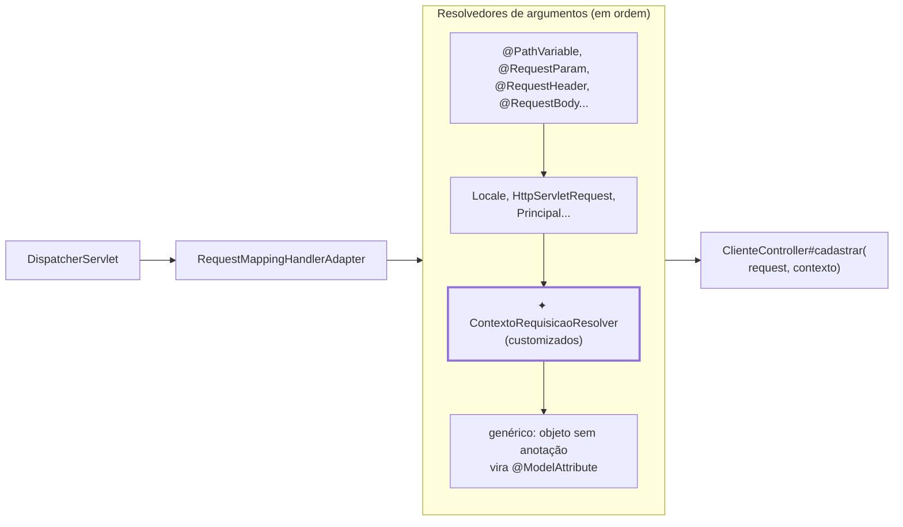

## O problema

O app e o site do Bazar mandam um cabeçalho dizendo de onde vêm: `Bazar-Canal: app` ou `Bazar-Canal: web`. O time de produto quer saber por qual canal cada cliente se cadastrou, e, mais tarde, por qual canal cada pedido foi feito. O primeiro rascunho do controller:

```java
@PostMapping
public ResponseEntity<ClienteResponse> cadastrar(@Valid @RequestBody CriarClienteRequest request,
        @RequestHeader(name = "Bazar-Canal", required = false) @Nullable String canalBruto,
        Locale idioma) {
    Canal canal;
    try {
        canal = canalBruto == null ? Canal.DESCONHECIDO : Canal.valueOf(canalBruto.toUpperCase(Locale.ROOT));
    } catch (IllegalArgumentException e) {
        canal = Canal.DESCONHECIDO;
    }
    ...
}
```

Funciona. Mas o mesmo bloco vai aparecer na criação de pedidos, no carrinho e nas avaliações. Cada cópia é uma chance de alguém esquecer o `try`, tratar a caixa de outro jeito ou ler o cabeçalho com um nome ligeiramente diferente.

Pense no crachá de um evento. Na entrada, alguém confere o ingresso e entrega um crachá com nome, empresa e tipo de acesso. Daí em diante, cada palestra só olha o crachá. Ninguém pede o ingresso de novo nem confere o documento em cada porta. O crachá é montado **uma vez**, num lugar só.

> **A pergunta desta página:** como fazer o Spring MVC entregar ao controller um objeto pronto, montado a partir da requisição, e quando isso é melhor que as alternativas mais simples?

## O conceito

### Quem preenche os parâmetros

Em [09.01](/construindo-apis-com-spring-boot/o-caminho-de-uma-requisicao-no-spring-mvc), vimos que o `RequestMappingHandlerAdapter` resolve cada parâmetro do método antes de chamá-lo, consultando uma lista de **`HandlerMethodArgumentResolver`**. Cada anotação que você já usou tem o seu: `@PathVariable`, `@RequestParam`, `@RequestHeader`, `@RequestBody`. Tipos como `Locale`, `HttpServletRequest` e `Principal` também têm resolvedores próprios, que dispensam anotação.

Um resolvedor customizado entra na mesma lista. A interface tem dois métodos:

```java
public interface HandlerMethodArgumentResolver {

    // "Este parâmetro é comigo?" Chamado uma vez por parâmetro; o resultado fica em cache.
    boolean supportsParameter(MethodParameter parameter);

    // "Qual é o valor?" Chamado a cada requisição.
    @Nullable Object resolveArgument(MethodParameter parameter, @Nullable ModelAndViewContainer mavContainer,
            NativeWebRequest webRequest, @Nullable WebDataBinderFactory binderFactory) throws Exception;
}
```

- **`supportsParameter`** decide pelo `MethodParameter`: o tipo (`getParameterType()`), as anotações (`hasParameterAnnotation(...)`), o nome. O Spring guarda a resposta em cache por parâmetro, então a decisão deve depender só da assinatura do método, nunca da requisição.
- **`resolveArgument`** recebe a requisição (`NativeWebRequest`: cabeçalhos, parâmetros, atributos, a requisição do Servlet) e devolve o valor.

### Por tipo ou por anotação

Há duas formas de dizer "este parâmetro é meu":

- **Pelo tipo:** `parametro.getParameterType().equals(ContextoRequisicao.class)`. O controller só declara `ContextoRequisicao contexto`, sem anotação. Funciona bem quando o tipo existe só para isso.
- **Por uma anotação:** `parametro.hasParameterAnnotation(ClienteAutenticado.class)`. Útil quando o tipo é genérico (um `UUID`, um `String`) e a anotação diz de onde ele vem: `@ClienteAutenticado UUID clienteId`.

O Bazar usa o tipo: `ContextoRequisicao` é um record criado para esse fim, e a anotação seria repetição.

### Registro em `WebMvcConfigurer`

O resolvedor é registrado num **`WebMvcConfigurer`**, a interface de personalização do Spring MVC. No Spring Boot, basta um bean que a implemente: a configuração automática do MVC continua valendo, e o bean só acrescenta.

```java
@Configuration(proxyBeanMethods = false)
public class ConfiguracaoWeb implements WebMvcConfigurer {

    @Override
    public void addArgumentResolvers(List<HandlerMethodArgumentResolver> resolvers) {
        resolvers.add(new ContextoRequisicaoResolver());
    }
}
```

<Callout type="warning" title="Não use @EnableWebMvc no Spring Boot">
  Em tutoriais antigos, a classe de configuração tem `@EnableWebMvc`. No Spring Boot, essa anotação **desliga** a configuração automática do Spring MVC: o Jackson configurado pelo Boot, os conversores, o tratamento de recursos estáticos e várias propriedades `spring.mvc.*` deixam de valer. Para personalizar, implemente `WebMvcConfigurer` sem `@EnableWebMvc`.
</Callout>

### A ordem: os resolvedores do Spring vêm primeiro

O Javadoc de `addArgumentResolvers` é explícito: os resolvedores customizados são consultados **depois** dos embutidos. Duas consequências:

- **Não dá para substituir o comportamento padrão por aqui.** Um resolvedor customizado para `String` ou `Locale` nunca é consultado, porque um resolvedor do Spring responde antes. Para isso, seria preciso reconfigurar o `RequestMappingHandlerAdapter`, o que quase nunca vale o custo.
- **Tipos próprios funcionam.** O `ContextoRequisicao` não é reconhecido por nenhum resolvedor embutido específico. Ele só seria capturado pelo resolvedor genérico do fim da lista, que trata qualquer objeto sem anotação como `@ModelAttribute` (preenchido a partir dos parâmetros da URL). Os customizados vêm antes desse genérico, então o do Bazar ganha.

### Alternativas mais simples

Um resolvedor customizado é a ferramenta certa quando o mesmo dado aparece em muitos endpoints e a montagem tem alguma regra. Antes de criar um, confira se uma destas basta:

| Alternativa | Como | Quando basta |
|---|---|---|
| `@RequestHeader` | `@RequestHeader("Bazar-Canal") String canal` | O valor é usado como chega, em um ou dois endpoints |
| Conversor de tipo | Um `Converter<String, Canal>` registrado em `addFormatters` | Só a conversão se repete: `@RequestHeader("Bazar-Canal") Canal canal` |
| `@RequestAttribute` | Um filtro ou interceptor guarda um atributo na requisição; o controller o recebe com `@RequestAttribute("contexto")` | O objeto já é montado por um filtro, por outro motivo |
| `@ModelAttribute` | Um método `@ModelAttribute` num `@ControllerAdvice` prepara o objeto para todos os handlers | Mais comum em aplicações com *views*; em APIs, confunde quem lê |

A diferença do resolvedor: o controller declara **o que precisa** (`ContextoRequisicao contexto`), sem saber de onde vem. Trocar o cabeçalho por um *claim* do *token* de autenticação (Parte 11) muda o resolvedor, não os controllers.

### `HandlerMethodReturnValueHandler`: quando faz sentido

O caminho inverso também é extensível: um **`HandlerMethodReturnValueHandler`** decide o que fazer com o valor devolvido pelo método (`supportsReturnType` e `handleReturnValue`). É o que o Spring usa para `ResponseEntity`, para objetos de um `@RestController` e para `ProblemDetail`.

Criar um próprio raramente se justifica numa API:

- **Faz sentido** para um tipo de retorno com semântica própria que nenhum mecanismo cobre, como um `Arquivo` que vira `200` com `Content-Disposition` e *streaming*, ou um tipo de outro framework que precisa ser adaptado.
- **É exagero** para acrescentar um cabeçalho, envolver a resposta num envelope ou mudar a serialização. Para isso existem `ResponseEntity`, `ResponseBodyAdvice` ([09.03](/construindo-apis-com-spring-boot/httpmessageconverter-e-a-serializacao-por-dentro)), conversores e filtros.

Como no caso dos argumentos, os *handlers* customizados vêm depois dos embutidos: um *handler* próprio para `Object` ou para objetos de `@RestController` nunca é chamado.

## Diagrama

O diagrama de [09.01](/construindo-apis-com-spring-boot/o-caminho-de-uma-requisicao-no-spring-mvc), com o ponto de extensão desta página em destaque:



## Na prática

### O canal e o contexto

```java title="src/main/java/com/bazar/compartilhado/Canal.java"
/**
 * Por onde o cliente chegou ao Bazar. Vem do cabeçalho Bazar-Canal (09.02).
 */
public enum Canal {
    WEB, APP, PARCEIRO, DESCONHECIDO;

    /** Valor ausente ou desconhecido vira DESCONHECIDO: o canal é informativo e não deve recusar requisições. */
    public static Canal de(@Nullable String valor) {
        if (valor == null) {
            return DESCONHECIDO;
        }
        try {
            return valueOf(valor.strip().toUpperCase(Locale.ROOT));
        }
        catch (IllegalArgumentException e) {
            return DESCONHECIDO;
        }
    }
}
```

O `Canal` fica em `compartilhado`, e não no pacote web, porque é um conceito do domínio: o `Cliente` guarda o canal de cadastro. O nome do cabeçalho segue a regra de [02.04](/comecando-e-fundamentos-de-http/headers-essenciais): sem `X-`, com o prefixo da organização.

Um canal inválido vira `DESCONHECIDO`, e não `400`. O canal serve para análise; recusar um cadastro porque o app mandou `Bazar-Canal: tablet` puniria o cliente por um detalhe que não afeta a operação.

```java title="src/main/java/com/bazar/compartilhado/web/ContextoRequisicao.java"
/**
 * Dados de contexto que vários endpoints usam. Basta declarar um parâmetro deste tipo no controller:
 * o ContextoRequisicaoResolver o preenche a partir da requisição.
 */
public record ContextoRequisicao(Canal canal, Locale idioma) {
}
```

### O resolvedor

```java title="src/main/java/com/bazar/compartilhado/web/ContextoRequisicaoResolver.java"
public class ContextoRequisicaoResolver implements HandlerMethodArgumentResolver {

    static final String CABECALHO_CANAL = "Bazar-Canal";

    @Override
    public boolean supportsParameter(MethodParameter parametro) {
        return parametro.getParameterType().equals(ContextoRequisicao.class);
    }

    @Override
    public ContextoRequisicao resolveArgument(MethodParameter parametro, @Nullable ModelAndViewContainer mavContainer,
            NativeWebRequest request, @Nullable WebDataBinderFactory binderFactory) {
        // O idioma já foi resolvido pelo LocaleResolver (Accept-Language, com pt-BR como padrão).
        return new ContextoRequisicao(Canal.de(request.getHeader(CABECALHO_CANAL)), LocaleContextHolder.getLocale());
    }
}
```

O idioma não é lido do `Accept-Language` à mão: o `LocaleResolver` do Spring já fez isso, com as regras configuradas em [08.02](/construindo-apis-com-spring-boot/problemdetail-no-spring-tratamento-global-de-erros) (`spring.web.locale: pt_BR`). Reaproveitar o `LocaleContextHolder` garante que o contexto e as mensagens de erro usem o mesmo idioma.

O registro é a `ConfiguracaoWeb` mostrada no conceito, em `com.bazar.compartilhado.web`.

### O controller

```java title="src/main/java/com/bazar/clientes/api/ClienteController.java"
    @PostMapping
    public ResponseEntity<ClienteResponse> cadastrar(@Valid @RequestBody CriarClienteRequest request,
            ContextoRequisicao contexto) {
        var cliente = repository.save(request.paraCliente(contexto.canal()));
        // ...
    }
```

O `Cliente` ganhou o campo `canalDeCadastro`, e o `ClienteResponse` o expõe.

<HttpExchange
  title="Cadastro pelo app"
  request={{ method: 'POST', url: 'http://localhost:8080/v1/clientes', headers: { 'Content-Type': 'application/json', 'Bazar-Canal': 'app' }, body: { nome: 'Ana Souza', email: 'ana@example.com', cpf: '52998224725' } }}
  response={{
    status: 201,
    headers: { Location: 'http://localhost:8080/v1/clientes/7c0cfaa4-2b88-4d98-9496-e86a2c5ac88b', 'Content-Type': 'application/json' },
    body: { id: '7c0cfaa4-2b88-4d98-9496-e86a2c5ac88b', nome: 'Ana Souza', email: 'ana@example.com', telefone: null, canalDeCadastro: 'APP', criadoEm: '2026-10-25T03:16:36.755821824Z' },
  }}
>
  `app` virou `APP`. Sem o cabeçalho, ou com um valor que o Bazar não conhece, o campo sai como `DESCONHECIDO`.
</HttpExchange>

### O teste

O teste usa `@WebMvcTest`, cuja explicação completa está em [11.03](/testes-de-api/testando-a-camada-web-webmvctest-mockmvctester). Por enquanto, rode assim: ele sobe só a camada web, com o controller e os beans `WebMvcConfigurer`. A `ConfiguracaoWeb` entra sozinha, sem `@Import`.

```java title="src/test/java/com/bazar/clientes/api/ClienteControllerTest.java"
    @Test
    void registraOCanalDoCabecalhoBazarCanal() {
        assertThat(mvc.post().uri("/v1/clientes")
                .contentType(MediaType.APPLICATION_JSON)
                .header("Bazar-Canal", "app")
                .content("""
                        { "nome": "Ana Souza", "email": "ana@example.com", "cpf": "52998224725" }
                        """))
                .hasStatus(HttpStatus.CREATED)
                .bodyJson()
                .hasPathSatisfying("$.canalDeCadastro", canal -> assertThat(canal).isEqualTo("APP"));
    }

    @Test
    void usaDesconhecidoSemOCabecalhoOuComValorInvalido() {
        for (var valor : new String[] { null, "fax" }) {
            var requisicao = mvc.post().uri("/v1/clientes")
                    .contentType(MediaType.APPLICATION_JSON)
                    .content("""
                            { "nome": "Ana Souza", "email": "ana@example.com", "cpf": "52998224725" }
                            """);
            if (valor != null) {
                requisicao.header("Bazar-Canal", valor);
            }
            assertThat(requisicao).bodyJson()
                    .hasPathSatisfying("$.canalDeCadastro", canal -> assertThat(canal).isEqualTo("DESCONHECIDO"));
        }
    }
```

## Erros comuns

<BadVsGood title="Ler o mesmo cabeçalho em cada controller" why="A regra de montagem (caixa, valor padrão, valores inválidos) se repete e diverge. Com um resolvedor, ela fica num lugar, e o controller só declara o que precisa.">
<Bad title="Regra copiada em cada endpoint">

```java
public ResponseEntity<PedidoResponse> criar(@RequestBody CriarPedidoRequest request,
        @RequestHeader(name = "Bazar-Canal", required = false) String canal) {
    var c = canal == null ? Canal.DESCONHECIDO : Canal.valueOf(canal);   // e se vier "app"?
    ...
}
```

</Bad>
<Good title="Um parâmetro, um resolvedor">

```java
public ResponseEntity<PedidoResponse> criar(@Valid @RequestBody CriarPedidoRequest request,
        ContextoRequisicao contexto) {
    ...
}
```

</Good>
</BadVsGood>

Outros erros frequentes:

- **`@EnableWebMvc` numa aplicação Spring Boot.** Desliga a configuração automática do MVC.
- **Tentar sobrescrever um tipo embutido** (um resolvedor para `String` ou `Locale`). Os resolvedores do Spring respondem antes, e o seu nunca é chamado.
- **`supportsParameter` dependente da requisição.** O resultado é guardado em cache por parâmetro; a decisão precisa depender só da assinatura.
- **Esquecer o registro.** Sem `addArgumentResolvers`, o objeto é tratado como `@ModelAttribute` e chega vazio (ou com valores dos parâmetros da URL), sem erro nenhum.
- **Colocar lógica de negócio no resolvedor.** Ele monta o contexto a partir da requisição; consultar o banco ou decidir regras é trabalho do serviço.
- **Criar um `HandlerMethodReturnValueHandler`** para algo que `ResponseEntity`, um `ResponseBodyAdvice` ou um filtro resolvem.

## Boas práticas

- **Use** um resolvedor quando o mesmo dado de contexto aparece em vários endpoints e a montagem tem regras.
- **Prefira** um tipo próprio (um record) a anotações sobre tipos genéricos, quando possível.
- **Registre** o resolvedor num `WebMvcConfigurer`, sem `@EnableWebMvc`.
- **Reaproveite** o que o Spring já resolveu (o `Locale` do `LocaleContextHolder`).
- **Considere** as alternativas mais simples (`@RequestHeader` com um conversor) antes de criar um resolvedor.
- **Teste** o resolvedor pelo controller, com e sem o cabeçalho.

## No projeto Bazar

<ProjectStep title="ContextoRequisicao e o canal de cadastro" module="compartilhado" tag="pagina-09.02" files={[
  { path: 'src/main/java/com/bazar/compartilhado/Canal.java', change: 'novo' },
  { path: 'src/main/java/com/bazar/compartilhado/web/', change: 'novo' },
  { path: 'src/main/java/com/bazar/clientes/dominio/Cliente.java', change: 'alterado' },
  { path: 'src/main/java/com/bazar/clientes/api/CriarClienteRequest.java', change: 'alterado' },
  { path: 'src/main/java/com/bazar/clientes/api/ClienteResponse.java', change: 'alterado' },
  { path: 'src/main/java/com/bazar/clientes/api/ClienteController.java', change: 'alterado' },
  { path: 'src/test/java/com/bazar/clientes/api/ClienteControllerTest.java', change: 'alterado' },
]}>
O `ContextoRequisicaoResolver` monta o canal (cabeçalho `Bazar-Canal`) e o idioma de cada requisição. O cadastro de clientes registra o canal em `canalDeCadastro`. Os pedidos usam o mesmo contexto quando forem criados.
</ProjectStep>

## Resumo

- Os parâmetros dos controllers são preenchidos por **`HandlerMethodArgumentResolver`**: `supportsParameter` (em cache, pela assinatura) e `resolveArgument` (a cada requisição).
- O resolvedor pode reconhecer o parâmetro **pelo tipo** ou **por uma anotação**.
- O registro é feito em **`WebMvcConfigurer.addArgumentResolvers`**, **sem `@EnableWebMvc`** no Spring Boot.
- Resolvedores customizados vêm **depois dos embutidos**: servem para tipos próprios, não para substituir os do Spring.
- Alternativas mais simples: **`@RequestHeader`** com conversor, **`@RequestAttribute`**, **`@ModelAttribute`**.
- **`HandlerMethodReturnValueHandler`** raramente se justifica numa API; prefira `ResponseEntity`, `ResponseBodyAdvice` e conversores.

<Exercise title="Paginação como argumento" difficulty="dificil">
Os endpoints de listagem do Bazar vão receber `limit` (de 1 a 100, padrão 20) e `cursor` (opcional), conforme [13.04](/design-de-apis-profissional/paginacao-por-cursor-keyset). Escreva um record `Pagina(int limit, @Nullable String cursor)` e um resolvedor que o preencha a partir dos parâmetros da URL, para que um controller declare só `Pagina pagina`.

Decida o que fazer com `limit=0`, `limit=500` e `limit=abc`, e explique a escolha.

<Hint>
Os parâmetros vêm de `request.getParameter(...)`. Pense na diferença entre o canal (informativo) e o `limit` (que define a resposta). Lançar uma exceção dentro do resolvedor faz o erro passar pelo `TratadorGlobalDeErros`.
</Hint>

<Solution>

```java
public record Pagina(int limit, @Nullable String cursor) {
    public static final int PADRAO = 20;
    public static final int MAXIMO = 100;
}

public class PaginaResolver implements HandlerMethodArgumentResolver {

    @Override
    public boolean supportsParameter(MethodParameter parametro) {
        return parametro.getParameterType().equals(Pagina.class);
    }

    @Override
    public Pagina resolveArgument(MethodParameter parametro, @Nullable ModelAndViewContainer mav,
            NativeWebRequest request, @Nullable WebDataBinderFactory binderFactory) {
        var bruto = request.getParameter("limit");
        int limit;
        try {
            limit = bruto == null ? Pagina.PADRAO : Integer.parseInt(bruto);
        } catch (NumberFormatException e) {
            throw new MethodArgumentTypeMismatchException(bruto, Integer.class, "limit", parametro, e);
        }
        if (limit < 1 || limit > Pagina.MAXIMO) {
            throw new ParametroInvalidoException("limit", "deve estar entre 1 e " + Pagina.MAXIMO);
        }
        return new Pagina(limit, request.getParameter("cursor"));
    }
}
```

As escolhas:

- **`limit=abc`** → `400`. É uma requisição malformada. Lançar a `MethodArgumentTypeMismatchException` do Spring reaproveita o tratamento de 08.02 (`requisicao-invalida`), com a mesma mensagem dos outros parâmetros.
- **`limit=0` e `limit=500`** → `422` com `erros: [{ campo: "limit", ... }]`. Diferente do canal, o `limit` muda a resposta: devolver silenciosamente 100 itens a quem pediu 500 esconde do cliente que ele não recebeu o que pediu. A `ParametroInvalidoException` é uma exceção nova, que o tratador transforma em `validacao` (ou, alternativamente, `@Min`/`@Max` num `@RequestParam`, que dispensa o resolvedor).

A última observação vale a reflexão: para dois parâmetros simples com limites, `@RequestParam(defaultValue = "20") @Min(1) @Max(100) int limit` resolve com validação de métodos e sem código novo. O resolvedor compensa quando `Pagina` ganha mais regras (ordenação, cursor assinado) e aparece em muitos endpoints.

</Solution>
</Exercise>

<Quiz
  questions={[
    {
      question: 'Você registra um HandlerMethodArgumentResolver que suporta parâmetros do tipo Locale, para ler o idioma de um cabeçalho próprio. O que acontece?',
      options: [
        'O seu resolvedor passa a preencher todos os parâmetros Locale',
        'Ele nunca é chamado: os resolvedores embutidos (que já tratam Locale) são consultados antes dos customizados',
        'O Spring falha ao iniciar por conflito de resolvedores',
      ],
      answer: 1,
      explanation: 'O Javadoc de addArgumentResolvers diz que os customizados são consultados depois dos embutidos. Para Locale, o Spring já tem um resolvedor, então o seu nunca chega a ser perguntado.',
    },
    {
      question: 'O controller declara ContextoRequisicao contexto, mas o resolvedor não foi registrado. O que acontece?',
      options: [
        'Erro na inicialização: parâmetro sem resolvedor',
        'O objeto é tratado como @ModelAttribute pelo resolvedor genérico e chega sem os dados esperados, sem erro aparente',
        'O parâmetro chega null',
      ],
      answer: 1,
      explanation: 'Objetos sem anotação caem no resolvedor genérico, que os trata como @ModelAttribute e tenta preenchê-los com parâmetros da requisição. É um erro silencioso, por isso vale um teste que verifique o efeito do resolvedor.',
    },
    {
      question: 'Por que não usar @EnableWebMvc na ConfiguracaoWeb do Bazar?',
      options: [
        'Porque a anotação foi removida no Spring 7',
        'Porque no Spring Boot ela desliga a configuração automática do Spring MVC; basta implementar WebMvcConfigurer',
        'Porque ela impede o uso de resolvedores customizados',
      ],
      answer: 1,
      explanation: '@EnableWebMvc continua existindo, mas assume o controle total da configuração do MVC, e o Boot recua. Um bean WebMvcConfigurer acrescenta personalizações mantendo a configuração automática.',
    },
  ]}
/>

## Referências

<References />
