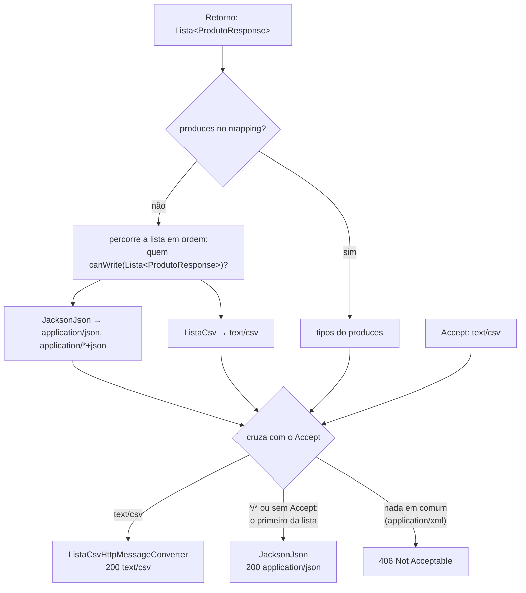

## O problema

O time financeiro quer abrir a lista de produtos do Bazar no Excel. O primeiro impulso é criar um endpoint novo:

```java
@GetMapping(value = "/v1/produtos/exportar-csv", produces = "text/csv")
public String exportarCsv() {
    var sb = new StringBuilder("id,sku,nome\n");
    for (var p : repository.findAll()) {
        sb.append(p.getId()).append(',').append(p.getSku()).append(',').append(p.getNome()).append('\n');
    }
    return sb.toString();
}
```

Funciona até o primeiro produto chamado `Clean Code, 2ª edição`: a vírgula do nome vira uma coluna a mais, e a planilha desalinha. E, quando o time quiser a lista de categorias em CSV, alguém vai copiar e adaptar o método. A mesma lista passa a ter duas URIs, uma por formato, o oposto do que [02.05](/comecando-e-fundamentos-de-http/content-negotiation-e-media-types) defendeu: **um recurso, várias representações, escolhidas pelo `Accept`**.

O Spring MVC já tem o lugar certo para isso: os **conversores de mensagem**, os mesmos que transformam objetos em JSON sem que você escreva uma linha.

Pense num tradutor de um congresso. O palestrante fala uma vez, e cada participante ouve no idioma do fone que escolheu. O palestrante não repete a palestra em cada idioma, e o tradutor não muda o conteúdo: ele só converte. O controller é o palestrante; o conversor, o tradutor; o `Accept`, o canal do fone.

> **A pergunta desta página:** como o Spring escolhe o conversor que lê e escreve cada corpo, de onde vêm os `406` e `415`, e como acrescentar um formato novo, como CSV, sem efeitos colaterais?

## O conceito

### A interface

Um **`HttpMessageConverter<T>`** sabe ler e/ou escrever um tipo Java num ou mais *media types*:

```java
public interface HttpMessageConverter<T> {
    boolean canRead(Class<?> clazz, @Nullable MediaType mediaType);
    boolean canWrite(Class<?> clazz, @Nullable MediaType mediaType);
    List<MediaType> getSupportedMediaTypes();
    T read(Class<? extends T> clazz, HttpInputMessage inputMessage) throws IOException;
    void write(T t, @Nullable MediaType contentType, HttpOutputMessage outputMessage) throws IOException;
}
```

A variante **`GenericHttpMessageConverter`** recebe também o tipo genérico completo (`Lista<ProdutoResponse>`, e não só `Lista`), o que importa quando o formato depende do tipo dos itens. O JSON do Jackson é um conversor genérico.

Em [09.01](/construindo-apis-com-spring-boot/o-caminho-de-uma-requisicao-no-spring-mvc), vimos onde eles entram: o resolvedor do `@RequestBody` usa um conversor para **ler**, e o *handler* de retorno usa outro para **escrever**.

### A lista padrão e a ordem

Os conversores ficam numa **lista ordenada**. A do Bazar, lida do `RequestMappingHandlerAdapter` numa sonda (depois de registrado o conversor de CSV desta página):

| # | Conversor | Tipos | Para quê |
|---|---|---|---|
| 0 | `ByteArrayHttpMessageConverter` | `application/octet-stream`, `*/*` | `byte[]` |
| 1 | `StringHttpMessageConverter` | `text/plain`, `*/*` | `String` |
| 2 | `ResourceHttpMessageConverter` | `*/*` | `Resource` (arquivos) |
| 3 | `ResourceRegionHttpMessageConverter` | `*/*` | Trechos de arquivos (`Range`, [22.02](/padroes-avancados-de-http/download-streaming-e-range)) |
| 4 | `AllEncompassingFormHttpMessageConverter` | `application/x-www-form-urlencoded`, `multipart/*` | Formulários |
| 5 | `JacksonJsonHttpMessageConverter` | `application/json`, `application/*+json` | Qualquer objeto, com o `JsonMapper` do Boot ([06.03](/construindo-apis-com-spring-boot/jackson-3-no-spring-boot-4)) |
| 6 | `Jaxb2RootElementHttpMessageConverter` | `application/xml`, `text/xml` | Classes com `@XmlRootElement`; **só se o JAXB estiver no *classpath*** |
| 7 | `ListaCsvHttpMessageConverter` | `text/csv` | O conversor do Bazar |

Os conversores só entram se as bibliotecas existirem: o de JSON depende do Jackson; o de XML, do JAXB. Na sonda acima, o JAXB estava presente porque ela rodou como teste, e o `spring-boot-starter-test` traz o `jakarta.xml.bind-api`. No *jar* de produção, o conversor de XML **não existe**. A lista dos testes pode ser diferente da de produção.

Os conversores do JSON do Jackson 2 (`MappingJackson2HttpMessageConverter`) e o `JacksonJsonHttpMessageConverter` do Jackson 3 seguem a mesma regra: o Boot 4 registra o do Jackson 3, a menos que se configure a preferência pelo 2 ([06.03](/construindo-apis-com-spring-boot/jackson-3-no-spring-boot-4)).

### A escolha ao escrever: `Accept`, `produces` e a ordem

Para escrever a resposta, o *handler* de retorno:

1. **Calcula os tipos aceitáveis**, a partir do `Accept` (sem `Accept`, `*/*`).
2. **Calcula os tipos produzíveis**: o `produces` do *mapping*, se houver; senão, os tipos de **todos os conversores que conseguem escrever aquele tipo Java**, na ordem da lista.
3. **Cruza as duas listas**, ordena pela qualidade (`q=`) e pela especificidade, e escolhe o primeiro tipo concreto.
4. Se o cruzamento for vazio: **`406 Not Acceptable`** (`HttpMediaTypeNotAcceptableException`).

O passo 2 tem uma consequência que surpreende: com `Accept: */*`, **ganha o primeiro conversor da lista** que consegue escrever o objeto. É por isso que a ordem importa, como a seção prática mostra com um caso real.

### A escolha ao ler: `Content-Type` e `consumes`

Para o `@RequestBody`, a regra é mais simples: o Spring percorre a lista e usa o primeiro conversor que diz `canRead` para o tipo do parâmetro e o `Content-Type` da requisição. Se o *mapping* tem `consumes` e o `Content-Type` não está nele, ou se nenhum conversor sabe ler, o resultado é **`415 Unsupported Media Type`**, com o cabeçalho `Accept` na resposta listando os tipos aceitos ([02.05](/comecando-e-fundamentos-de-http/content-negotiation-e-media-types)).

### `consumes` e `produces` nos *mappings*

```java
@PostMapping(consumes = MediaType.APPLICATION_JSON_VALUE)
public ResponseEntity<ProdutoResponse> criar(@Valid @RequestBody CriarProdutoRequest request) { ... }

@GetMapping(produces = { MediaType.APPLICATION_JSON_VALUE, "text/csv" })
public Lista<ProdutoResponse> listar() { ... }
```

- **`consumes`** restringe o `Content-Type` aceito. Também participa da escolha do método: dois métodos no mesmo caminho podem atender `Content-Type`s diferentes.
- **`produces`** restringe os tipos que o método produz, e permite dois métodos no mesmo caminho para `Accept`s diferentes.

O Bazar não declara nenhum dos dois por padrão: os tipos vêm dos conversores registrados, o que mantém os controllers limpos. Declare quando o endpoint tem um formato específico (um `POST` que recebe `multipart/form-data`, um `PATCH` com `application/merge-patch+json`).

### Negociação por sufixo ou parâmetro

Além do `Accept`, o Spring já escolheu o formato por **sufixo** (`/v1/produtos.csv`) e por **parâmetro** (`?format=csv`):

- A negociação **por sufixo** foi depreciada no Spring 5.3 e removida no Spring 6. Ela confundia o *mapping* (`/v1/produtos/{id}` com um id contendo ponto) e abria brechas de segurança (o ataque *Reflected File Download*, em que uma URL com `.bat` fazia o navegador baixar um arquivo executável com conteúdo controlado pelo atacante).
- A negociação **por parâmetro** existe, mas vem desligada (`spring.mvc.contentnegotiation.favor-parameter=false`). Ligá-la (com o nome do parâmetro em `spring.mvc.contentnegotiation.parameter-name`) é aceitável para links que precisam abrir num navegador, onde não dá para escolher o `Accept`.

### Registrando conversores no Spring Boot 4

O Spring Framework 7 trouxe um *builder*, `HttpMessageConverters`, e o Spring Boot 4 passou a usá-lo. Há três formas de acrescentar um conversor, e elas **não colocam o conversor no mesmo lugar**:

| Forma | Onde o conversor entra |
|---|---|
| Um **bean** do tipo `HttpMessageConverter` | O Boot o entrega ao `addCustomConverter` do *builder*: **início da lista**, antes dos padrões |
| `WebMvcConfigurer.configureMessageConverters(HttpMessageConverters.ServerBuilder)` | Onde você mandar: `addCustomConverter` (início), `withJsonConverter` (substitui o de JSON), `configureMessageConvertersList` (a lista inteira) |
| `WebMvcConfigurer.extendMessageConverters(List)` | Onde você colocar na lista pronta; `add` põe no **fim** |

As posições da tabela foram conferidas no Bazar, com uma sonda que imprime `adapter.getMessageConverters()`. A classe `HttpMessageConverters` do pacote do Spring Boot (`org.springframework.boot.http.converter.autoconfigure`), usada até o Boot 3 para declarar a lista como bean, está **depreciada** no Boot 4.

### Mudanças no Spring Framework 7.1

As notas da versão 7.1 (prevista para novembro de 2026; o Bazar usa a 7.0) trazem duas mudanças nos conversores:

- **JAXB deixa de ser detectado automaticamente no servidor.** O conversor de XML com JAXB consome muita CPU e era registrado só por estar no *classpath*. A partir da 7.1, uma aplicação que quer XML com JAXB o registra explicitamente: `builder.withXmlConverter(new Jaxb2RootElementHttpMessageConverter())`. O `RestClient` continua detectando.
- **`MultipartHttpMessageConverter`.** Um conversor novo lê **e** escreve conteúdo *multipart*, inclusive nas respostas que os clientes HTTP recebem. O `AllEncompassingFormHttpMessageConverter` (o #4 da lista) é depreciado e deixa de ser registrado por padrão; o `FormHttpMessageConverter` fica só com formulários `x-www-form-urlencoded`.

Outra mudança da 7.1: chamar `configureMessageConverters` não desliga mais os conversores padrão; para uma lista mínima, é preciso chamar `disableDefaults()` explicitamente.

## Diagrama

Como o conversor é escolhido para escrever `GET /v1/produtos`:



## Na prática

### A listagem de produtos

O Bazar ganha `GET /v1/produtos`, por enquanto sem filtros nem paginação ([13.01](/design-de-apis-profissional/filtros-e-busca)):

```java title="src/main/java/com/bazar/catalogo/api/ProdutoController.java"
    // Lista completa por enquanto; filtros, ordenação e paginação chegam em 13.01–13.04.
    @GetMapping
    public Lista<ProdutoResponse> listar() {
        return new Lista<>(repository.findAll().stream().map(mapper::paraResponse).toList());
    }
```

### O conversor de CSV

Em vez de um conversor só para produtos, o Bazar escreve **qualquer `Lista` de records** como CSV: o cabeçalho vem dos nomes dos componentes do record, e cada item vira uma linha. A lista de categorias ganha CSV de graça.

```java title="src/main/java/com/bazar/compartilhado/web/ListaCsvHttpMessageConverter.java"
/**
 * Escreve qualquer Lista de records como CSV (RFC 4180): uma linha de cabeçalho com os nomes dos componentes
 * e uma linha por item. Só escreve; a API não recebe CSV.
 */
public class ListaCsvHttpMessageConverter extends AbstractGenericHttpMessageConverter<Lista<?>> {

    public static final MediaType TEXT_CSV = new MediaType("text", "csv", StandardCharsets.UTF_8);

    public ListaCsvHttpMessageConverter() {
        super(TEXT_CSV);
    }

    @Override
    protected boolean supports(Class<?> clazz) {
        return Lista.class.isAssignableFrom(clazz);
    }

    @Override
    public boolean canRead(Type type, @Nullable Class<?> contextClass, @Nullable MediaType mediaType) {
        return false;
    }

    @Override
    public boolean canWrite(@Nullable Type type, Class<?> clazz, @Nullable MediaType mediaType) {
        return supports(clazz) && tipoDoItem(type) != null && canWrite(mediaType);
    }

    @Override
    protected void writeInternal(Lista<?> lista, @Nullable Type type, HttpOutputMessage saida) throws IOException {
        var componentes = Objects.requireNonNull(tipoDoItem(type)).getRecordComponents();   // garantido pelo canWrite
        Writer escritor = new OutputStreamWriter(saida.getBody(), StandardCharsets.UTF_8);
        escreverLinha(escritor, Arrays.stream(componentes).map(RecordComponent::getName).toList());
        for (Object item : lista.itens()) {
            escreverLinha(escritor, Arrays.stream(componentes).map(c -> celula(valor(c, item))).toList());
        }
        escritor.flush();
    }

    // O tipo do item vem do tipo genérico declarado no controller (Lista<ProdutoResponse>), não dos itens:
    // assim o cabeçalho sai mesmo com a lista vazia.
    private static @Nullable Class<?> tipoDoItem(@Nullable Type type) {
        if (type == null) {
            return null;
        }
        var item = ResolvableType.forType(type).as(Lista.class).getGeneric(0).resolve();
        return item != null && item.isRecord() ? item : null;
    }

    // Mapas viram "chave=valor; chave=valor", em ordem alfabética; null vira célula vazia.
    private static String celula(@Nullable Object valor) {
        if (valor == null) {
            return "";
        }
        if (valor instanceof Map<?, ?> mapa) {
            return new TreeMap<>(mapa).entrySet().stream()
                    .map(e -> e.getKey() + "=" + e.getValue())
                    .collect(Collectors.joining("; "));
        }
        return valor.toString();
    }

    // RFC 4180: campos com vírgula, aspas ou quebra de linha vão entre aspas, com as aspas internas dobradas.
    private static void escreverLinha(Writer escritor, List<String> campos) throws IOException {
        var linha = campos.stream()
                .map(c -> c.contains(",") || c.contains("\"") || c.contains("\n") || c.contains("\r")
                        ? "\"" + c.replace("\"", "\"\"") + "\""
                        : c)
                .collect(Collectors.joining(","));
        escritor.write(linha);
        escritor.write("\r\n");
    }

    // valor(...) lê o componente pelo accessor do record; read e readInternal recusam CSV como entrada.
}
```

As decisões do código:

- **`AbstractGenericHttpMessageConverter`** dá acesso ao tipo genérico (`Lista<ProdutoResponse>`), declarado no método do controller. Com ele, o cabeçalho sai até para uma lista vazia, e o `canWrite` recusa listas de algo que não é record.
- **RFC 4180:** linhas terminadas em `\r\n`, campos com vírgula, aspas ou quebra de linha entre aspas, aspas internas dobradas.
- **Só escrita:** `canRead` devolve `false`. Um `POST` com `Content-Type: text/csv` continua recebendo `415`.

### O primeiro registro, e o problema

A forma mais curta de registrar o conversor no Spring Boot é declará-lo como bean:

```java
@Bean
ListaCsvHttpMessageConverter listaCsvHttpMessageConverter() {
    return new ListaCsvHttpMessageConverter();
}
```

Com ele, `Accept: text/csv` funcionou. Mas a conferência das outras requisições mostrou o problema:

```text
### Accept: */*
HTTP/1.1 200
Content-Type: text/csv;charset=UTF-8
### sem Accept
HTTP/1.1 200
Content-Type: text/csv;charset=UTF-8
### Accept de navegador (text/html,application/xhtml+xml,application/xml;q=0.9,*/*;q=0.8)
HTTP/1.1 200
Content-Type: text/csv;charset=UTF-8
### Accept: application/json
HTTP/1.1 200
Content-Type: application/json
```

**Toda listagem do Bazar passou a responder CSV** para quem não pedisse JSON explicitamente. O `curl` sem opções, muitas bibliotecas HTTP e qualquer navegador mandam `*/*`. O bean entrou no **início** da lista (posição 0, como a sonda mostrou), e, com `*/*`, o primeiro conversor capaz vence.

### O registro correto

```java title="src/main/java/com/bazar/compartilhado/web/ConfiguracaoWeb.java"
@Configuration(proxyBeanMethods = false)
public class ConfiguracaoWeb implements WebMvcConfigurer {

    // No fim da lista: com Accept */* (ou sem Accept), o primeiro conversor capaz vence, e ele deve ser o JSON.
    // Um bean HttpMessageConverter entraria no início da lista (09.03).
    @Override
    public void extendMessageConverters(List<HttpMessageConverter<?>> converters) {
        converters.add(new ListaCsvHttpMessageConverter());
    }

    @Override
    public void addArgumentResolvers(List<HandlerMethodArgumentResolver> resolvers) {
        resolvers.add(new ContextoRequisicaoResolver());
    }
}
```

Agora o conversor fica na posição 7, depois do JSON, e as mesmas requisições respondem `application/json`. Só `Accept: text/csv` recebe CSV.

### As respostas

<HttpExchange
  title="Produtos em CSV"
  request={{ method: 'GET', url: 'http://localhost:8080/v1/produtos', headers: { Accept: 'text/csv' } }}
  response={{
    status: 200,
    headers: { 'Content-Type': 'text/csv;charset=UTF-8', 'Content-Length': '527' },
    body: 'id,sku,nome,descricao,precoEmCentavos,categoriaId,status,atributos,criadoEm,atualizadoEm\r\n91b72301-cfd2-4612-9666-7d62ba5e52e8,LIV-0042,"Clean Code, 2ª edição","O clássico de ""Uncle Bob""",12990,0192f3a0-5555-7000-8000-000000000003,RASCUNHO,autor=Robert C. Martin; idioma=pt-BR,2026-10-25T03:22:29.568928145Z,2026-10-25T03:22:29.568928145Z\r\n8cabba0e-7d42-4fdb-a17e-a962df38b967,ELE-0107,Teclado mecânico,,45900,0192f3a0-5555-7000-8000-000000000002,RASCUNHO,,2026-10-25T03:22:29.616484615Z,2026-10-25T03:22:29.616484615Z\r\n',
  }}
>
  A vírgula do nome e as aspas da descrição foram escapadas pela RFC 4180; a descrição ausente do teclado é uma célula vazia. A mesma URI, com `Accept: application/json` ou sem `Accept`, devolve o JSON de sempre.
</HttpExchange>

<HttpExchange
  title="CSV de um item: 406"
  request={{ method: 'GET', url: 'http://localhost:8080/v1/categorias/0192f3a0-5555-7000-8000-000000000001', headers: { Accept: 'text/csv' } }}
  response={{
    status: 406,
    headers: { Accept: 'application/json, application/*+json', 'Content-Type': 'application/problem+json' },
    body: {"type": "https://api.bazar.example/problemas/formato-nao-aceito", "title": "Formato não aceito", "status": 406, "detail": "Acceptable representations: [application/json, application/*+json].", "instance": "/v1/categorias/0192f3a0-5555-7000-8000-000000000001", "codigo": "FORMATO_NAO_ACEITO", "traceId": "0902819f9fa3c6ca1770514a111d3f60"},
  }}
>
  O CSV só existe para listas: o `canWrite` recusa um `CategoriaResponse` sozinho. O cabeçalho `Accept` da resposta lista o que o endpoint produz. Uma lista vazia (`GET /v1/categorias?q=zzz` com `Accept: text/csv`) devolve só o cabeçalho: `id,nome,slug,categoriaPaiId\r\n`.
</HttpExchange>

### Os testes

```java title="src/test/java/com/bazar/catalogo/api/ProdutoControllerTest.java"
    @Test
    void listaEmJsonPorPadraoEEmCsvQuandoPedido() {
        // ... cria o produto "Clean Code, 2ª edição"

        assertThat(mvc.get().uri("/v1/produtos")).hasContentType(MediaType.APPLICATION_JSON);

        var csv = mvc.get().uri("/v1/produtos").accept(ListaCsvHttpMessageConverter.TEXT_CSV).exchange();
        assertThat(csv).hasStatusOk().hasContentType(ListaCsvHttpMessageConverter.TEXT_CSV);
        assertThat(csv).bodyText()
                .startsWith("id,sku,nome,descricao,precoEmCentavos,categoriaId,status,atributos,criadoEm,atualizadoEm\r\n")
                .contains(",LIV-0042,\"Clean Code, 2ª edição\",\"O clássico de \"\"Uncle Bob\"\"\",12990,")
                .contains(",RASCUNHO,autor=Robert C. Martin; idioma=pt-BR,");
    }
```

A primeira asserção é a mais importante: ela falharia com o registro por bean, e é ela que protege os clientes que não mandam `Accept`.

<Callout type="info" title="Vary: Accept">
  Quando a mesma URI devolve formatos diferentes conforme o `Accept`, caches HTTP precisam saber disso, ou um cache pode entregar o CSV a quem pediu JSON. A resposta deve levar `Vary: Accept` ([02.05](/comecando-e-fundamentos-de-http/content-negotiation-e-media-types)). O Spring MVC não acrescenta esse cabeçalho sozinho; o Bazar trata disso junto com o cache HTTP, em [20.01](/padroes-avancados-de-http/cache-http-rfc-9111).
</Callout>

## Erros comuns

<BadVsGood title="Um endpoint por formato" why="Uma URI por formato duplica o recurso e o código, e o CSV montado à mão quebra com a primeira vírgula. Um conversor serve todas as listas, pela mesma URI, escolhido pelo Accept.">
<Bad title="/exportar-csv com StringBuilder">

```java
@GetMapping(value = "/v1/produtos/exportar-csv", produces = "text/csv")
public String exportarCsv() {
    var sb = new StringBuilder("id,sku,nome\n");
    repository.findAll().forEach(p -> sb.append(p.getId()).append(',').append(p.getNome()).append('\n'));
    return sb.toString();   // "Clean Code, 2ª edição" vira duas colunas
}
```

</Bad>
<Good title="Mesma URI, conversor registrado">

```bash
curl -H 'Accept: text/csv' http://localhost:8080/v1/produtos
curl -H 'Accept: text/csv' http://localhost:8080/v1/categorias
```

</Good>
</BadVsGood>

Outros erros frequentes:

- **Registrar um conversor amplo como bean sem pensar na ordem.** Ele entra antes do JSON e passa a responder `Accept: */*`.
- **Achar que a lista dos testes é a de produção.** Dependências de teste (como o JAXB do `spring-boot-starter-test`) acrescentam conversores.
- **Usar `configureMessageConverters(List)` para acrescentar um conversor.** Até o Spring 7.0, ele substitui a lista padrão inteira; o JSON some. Para acrescentar, use `extendMessageConverters` ou o *builder*.
- **Um conversor que diz `canWrite` para tudo** (`Object`, `*/*`). Ele captura respostas que não deveria.
- **CSV sem escape.** Vírgulas, aspas e quebras de linha nos dados quebram as colunas.
- **Esquecer o `Vary: Accept`** quando a negociação muda o formato da mesma URI.
- **Ligar a negociação por parâmetro ou tentar a por sufixo** sem necessidade.

## Boas práticas

- **Sirva** formatos diferentes do mesmo recurso pelo `Accept`, com conversores.
- **Registre** conversores novos no fim da lista (`extendMessageConverters`), a menos que você queira que eles sejam o padrão.
- **Teste** a resposta **sem `Accept`** sempre que mexer nos conversores.
- **Implemente** `GenericHttpMessageConverter` quando o formato depender do tipo genérico.
- **Siga** o padrão do formato (RFC 4180 para CSV).
- **Declare** `consumes` e `produces` só quando o endpoint tem um formato específico.
- **Confira** a lista com `RequestMappingHandlerAdapter#getMessageConverters` quando algo não bater.

## No projeto Bazar

<ProjectStep title="Listagem de produtos e CSV para todas as listas" module="compartilhado" tag="pagina-09.03" files={[
  { path: 'src/main/java/com/bazar/compartilhado/web/ListaCsvHttpMessageConverter.java', change: 'novo' },
  { path: 'src/main/java/com/bazar/compartilhado/web/ConfiguracaoWeb.java', change: 'alterado' },
  { path: 'src/main/java/com/bazar/catalogo/api/ProdutoController.java', change: 'alterado' },
  { path: 'src/main/java/com/bazar/catalogo/dominio/ProdutoRepository.java', change: 'alterado' },
  { path: 'src/test/java/com/bazar/catalogo/api/ProdutoControllerTest.java', change: 'alterado' },
]}>
`GET /v1/produtos` (sem filtros, por enquanto) e o `ListaCsvHttpMessageConverter`, registrado no fim da lista: qualquer listagem do Bazar responde CSV com `Accept: text/csv`, e JSON em todos os outros casos.
</ProjectStep>

## Resumo

- **`HttpMessageConverter`** lê e escreve corpos; **`GenericHttpMessageConverter`** conhece o tipo genérico.
- A lista é **ordenada**; conversores entram conforme as bibliotecas do *classpath* (JSON com Jackson, XML com JAXB).
- **Escrita:** tipos aceitáveis (`Accept`) × produzíveis (`produces` ou conversores capazes); sem interseção, **`406`**; com `*/*`, **vence o primeiro conversor capaz**.
- **Leitura:** primeiro conversor que lê o `Content-Type`; sem nenhum, ou fora do `consumes`, **`415`**.
- No **Boot 4**, um bean conversor entra **no início** da lista; `extendMessageConverters` permite colocá-lo **no fim**; a classe `HttpMessageConverters` do Boot está depreciada.
- Negociação **por sufixo removida**; **por parâmetro desligada** por padrão.
- **Spring 7.1:** JAXB não é mais detectado no servidor; `MultipartHttpMessageConverter` substitui o `AllEncompassingFormHttpMessageConverter`.

<Exercise title="Um PDF para o pedido" difficulty="dificil">
O Bazar vai oferecer o comprovante do pedido em PDF: `GET /v1/pedidos/{id}` com `Accept: application/pdf`. A geração do PDF fica numa classe `GeradorDeComprovante` com o método `byte[] gerar(PedidoResponse)`.

1. Escreva o conversor (só escrita) e diga onde registrá-lo e por quê.
2. O que um cliente que manda `Accept: */*` deve receber? E um navegador que abre a URL?
3. Que cabeçalhos a resposta em PDF deveria ter, além do `Content-Type`?

<Hint>
O conversor pode estender `AbstractHttpMessageConverter<PedidoResponse>`. Para o item 2, volte ao `Accept` de um navegador, que inclui `*/*;q=0.8`. Para o item 3, pense em como o navegador decide entre mostrar e baixar o arquivo, e no cache.
</Hint>

<Solution>

1. O conversor:

   ```java
   public class ComprovantePdfHttpMessageConverter extends AbstractHttpMessageConverter<PedidoResponse> {

       private final GeradorDeComprovante gerador;

       public ComprovantePdfHttpMessageConverter(GeradorDeComprovante gerador) {
           super(MediaType.APPLICATION_PDF);
           this.gerador = gerador;
       }

       @Override
       protected boolean supports(Class<?> clazz) {
           return PedidoResponse.class.equals(clazz);
       }

       @Override
       public boolean canRead(Class<?> clazz, @Nullable MediaType mediaType) {
           return false;
       }

       @Override
       protected void writeInternal(PedidoResponse pedido, HttpOutputMessage saida) throws IOException {
           saida.getBody().write(gerador.gerar(pedido));
       }

       @Override
       protected PedidoResponse readInternal(Class<? extends PedidoResponse> clazz, HttpInputMessage entrada) {
           throw new HttpMessageNotReadableException("PDF não é aceito como entrada", entrada);
       }
   }
   ```

   Registro: em `extendMessageConverters`, no **fim** da lista, pelo mesmo motivo do CSV. Como ele depende de um bean (`GeradorDeComprovante`), a `ConfiguracaoWeb` recebe o gerador no construtor.

2. Com o conversor no fim, `Accept: */*` recebe **JSON**, o formato padrão da API. O navegador manda algo como `text/html,application/xhtml+xml,application/xml;q=0.9,*/*;q=0.8`: nenhum tipo explícito é produzido, então o `*/*` decide, e ele também recebe JSON. Para um link "baixar comprovante" no site, o front-end faz a requisição com `Accept: application/pdf`; ou o Bazar liga a negociação por parâmetro (`?format=pdf`), aceitável nesse caso específico.

3. `Content-Disposition: inline; filename="pedido-BZR-2026-000123.pdf"` (ou `attachment`, para forçar o *download*, [22.02](/padroes-avancados-de-http/download-streaming-e-range)) e `Vary: Accept`, porque a mesma URI devolve JSON ou PDF. Como o conversor não define cabeçalhos por pedido, o `Content-Disposition` com o número do pedido é mais simples num endpoint que devolve `ResponseEntity`, ou num `ResponseBodyAdvice`.

</Solution>
</Exercise>

<Quiz
  questions={[
    {
      question: 'Um conversor de CSV foi registrado como @Bean no Spring Boot 4. Um cliente chama GET /v1/categorias sem Accept. O que recebe?',
      options: [
        'JSON, porque é o formato padrão do Spring',
        'CSV: o bean entra no início da lista, e com */* (ou sem Accept) vence o primeiro conversor capaz',
        '406, porque o cliente não disse o que aceita',
      ],
      answer: 1,
      explanation: 'Foi o que aconteceu no Bazar. Sem Accept equivale a */*, e a escolha segue a ordem dos conversores. Por isso o Bazar registra o CSV com extendMessageConverters, no fim da lista.',
    },
    {
      question: 'Um POST /v1/produtos chega com Content-Type: text/csv. O ListaCsvHttpMessageConverter está registrado. O que acontece?',
      options: [
        'O conversor lê o CSV e cria o produto',
        '415: o conversor só escreve (canRead devolve false), e nenhum outro lê text/csv',
        '406: o formato não é aceito',
      ],
      answer: 1,
      explanation: 'A leitura procura um conversor que diga canRead para o tipo e o Content-Type. O de CSV recusa a leitura. 406 é sobre o Accept (escrita); 415, sobre o Content-Type (leitura).',
    },
    {
      question: 'Por que o Spring removeu a negociação por sufixo (/v1/produtos.csv)?',
      options: [
        'Porque o sufixo era lento de processar',
        'Por ambiguidade no mapeamento de caminhos e por brechas de segurança como o Reflected File Download',
        'Porque o HTTP proíbe pontos em URIs',
      ],
      answer: 1,
      explanation: 'A negociação por sufixo foi depreciada no Spring 5.3 e removida no 6. Ela confundia caminhos com pontos e permitia que uma URL forjada fizesse o navegador baixar um arquivo com extensão perigosa.',
    },
  ]}
/>

## Referências

<References />
