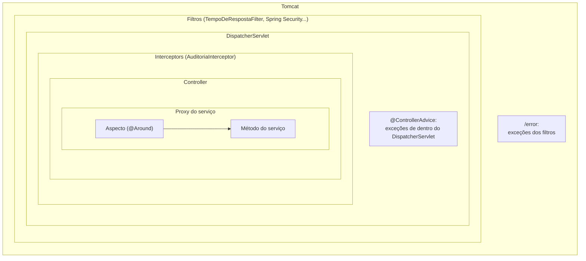

## O problema

O Bazar precisa de duas coisas que não pertencem a nenhum endpoint específico:

1. **Medir o tempo de toda requisição**, para saber quais rotas estão lentas.
2. **Auditar operações sensíveis**: quem removeu uma categoria, quem cadastrou um cliente, por qual canal, com que resultado.

Colocar esse código em cada método de controller é a primeira ideia, e a pior: dezenas de cópias, fáceis de esquecer num endpoint novo e misturadas com a regra de negócio. O Spring oferece três lugares para código **transversal**, que se aplica a muitos pontos de uma vez:

- **Filtros**, do Servlet;
- **Interceptors**, do Spring MVC;
- **Aspectos**, a AOP do Spring.

Os três parecem fazer a mesma coisa, mas cada um enxerga uma parte diferente da requisição.

Pense na segurança de um prédio comercial. A **portaria** vê todo mundo que entra e sai, inclusive quem vai ao andar errado, mas não sabe o que cada visitante foi fazer. A **recepção da empresa**, no 10º andar, sabe com quem o visitante tem reunião. A **pessoa da reunião** sabe exatamente o que foi tratado. Cada uma registra coisas diferentes, e pedir à portaria que anote o assunto das reuniões não funciona.

> **A pergunta desta página:** o que cada mecanismo enxerga, em que ordem eles rodam, o que acontece com as exceções em cada um, e qual escolher para cada necessidade?

## O conceito

### Filtros: a portaria

Um **`Filter`** é da especificação Servlet, não do Spring. Ele roda **antes do `DispatcherServlet`** ([09.01](/construindo-apis-com-spring-boot/o-caminho-de-uma-requisicao-no-spring-mvc)), em toda requisição que o Tomcat recebe, e decide se chama o resto da cadeia (`chain.doFilter`):

```java
public interface Filter {
    void doFilter(ServletRequest request, ServletResponse response, FilterChain chain)
            throws IOException, ServletException;
}
```

O que um filtro **enxerga**: a requisição e a resposta cruas, os cabeçalhos, o IP. Ele pode **trocar** a requisição ou a resposta por *wrappers* (para ler o corpo duas vezes, por exemplo).

O que ele **não enxerga**: qual controller vai atender, as anotações desse método, os argumentos convertidos. Para o filtro, uma requisição a `/v1/categorias` e outra a `/favicon.ico` são iguais.

Na prática, estende-se **`OncePerRequestFilter`**, do Spring, que garante uma única execução por requisição, mesmo quando ela passa por um *forward* ou pelo despacho de erro (`/error`). Ela também traz `shouldNotFilter(request)`, para pular caminhos.

**Registro e ordem no Spring Boot:**

- Um bean do tipo `Filter` (com `@Component`, por exemplo) é registrado automaticamente para todas as URLs (`/*`).
- A ordem vem de `@Order` ou `Ordered`; menor roda antes.
- Para restringir URLs, dar nome ou desligar o registro automático, use um `FilterRegistrationBean`:

```java
@Bean
FilterRegistrationBean<TempoDeRespostaFilter> tempoDeResposta() {
    var registro = new FilterRegistrationBean<>(new TempoDeRespostaFilter());
    registro.addUrlPatterns("/v1/*");
    registro.setOrder(Ordered.HIGHEST_PRECEDENCE + 10);
    return registro;
}
```

Os filtros que o Bazar já tem, vistos nos logs de 09.01:

| Filtro | Ordem | Função |
|---|---|---|
| `characterEncodingFilter` | `Integer.MIN_VALUE` (o primeiro) | Define UTF-8 na requisição e na resposta |
| `TempoDeRespostaFilter` (desta página) | `MIN_VALUE + 10` | Mede o tempo total |
| `formContentFilter` | `-9900` | Lê formulários em `PUT`/`PATCH`/`DELETE` |
| `requestContextFilter` | `-105` | Expõe a requisição no `RequestContextHolder` |

Quando o Spring Security entrar, a cadeia de segurança dele também será um filtro, com ordem padrão `-100` (`spring.security.filter.order`). Filtros que precisam rodar antes da autenticação, como o de *rate limiting* ([23.01](/padroes-avancados-de-http/rate-limiting-e-quotas)), recebem uma ordem menor.

### Interceptors: a recepção da empresa

Um **`HandlerInterceptor`** é do Spring MVC. Ele roda **dentro do `DispatcherServlet`**, depois que o *handler* foi escolhido, e por isso sabe qual método vai atender:

```java
public interface HandlerInterceptor {
    default boolean preHandle(HttpServletRequest request, HttpServletResponse response, Object handler) { return true; }
    default void postHandle(HttpServletRequest request, HttpServletResponse response, Object handler,
            @Nullable ModelAndView modelAndView) { }
    default void afterCompletion(HttpServletRequest request, HttpServletResponse response, Object handler,
            @Nullable Exception ex) { }
}
```

| Método | Quando roda | Uso típico |
|---|---|---|
| `preHandle` | Antes do controller; devolver `false` interrompe a requisição | Checagens que dependem do *handler* (uma anotação no método) |
| `postHandle` | Depois do controller, **se ele não lançou exceção** | Pouco útil em APIs REST: com `@ResponseBody`, a resposta já foi escrita e confirmada (*committed*) |
| `afterCompletion` | No fim, sempre, mesmo com exceção | Auditoria, métricas, limpeza de recursos |

O parâmetro `handler` é um **`HandlerMethod`** quando a requisição vai para um controller: dele saem a classe, o método e as anotações. Para um recurso estático, é outro tipo, e o interceptor precisa checar.

O cuidado com o `postHandle` está na documentação do Spring: num método `@ResponseBody` ou `ResponseEntity`, a resposta é escrita **durante** a chamada do *handler*, antes do `postHandle`. Mudar cabeçalhos ali não tem efeito. Para mexer na resposta, use um `ResponseBodyAdvice` ou faça a mudança no controller.

**Registro:** pelo `WebMvcConfigurer.addInterceptors`, com padrões de caminho opcionais (`addPathPatterns`, `excludePathPatterns`).

### Aspectos: a pessoa da reunião

A <Term id="aop">programação orientada a aspectos</Term> (AOP) do Spring não tem nada a ver com HTTP. Um **aspecto** envolve chamadas a **métodos de beans**, em qualquer camada, por um <Term id="proxy">*proxy*</Term>: o bean que os outros recebem por injeção é uma subclasse gerada (CGLIB) que roda o aspecto e depois chama o método real.

```java
@Aspect
@Component
public class AuditoriaAspect {

    @Around("@annotation(auditavel)")
    public Object auditar(ProceedingJoinPoint chamada, Auditavel auditavel) throws Throwable {
        // antes
        var resultado = chamada.proceed();   // chama o método real
        // depois
        return resultado;
    }
}
```

O que o aspecto **enxerga**: o método chamado, os argumentos já convertidos e o valor de retorno. O que ele **não enxerga**: HTTP. Um serviço chamado por um endpoint, por um *job* agendado ou por uma mensagem de fila passa pelo mesmo aspecto. É essa a vantagem: a regra "auditar o cancelamento de um pedido" vale para qualquer origem.

No Spring Boot 4, a AOP com anotações do AspectJ vem do **`spring-boot-starter-aspectj`** (no Boot 3, o nome era `spring-boot-starter-aop`).

**A pegadinha da autoinvocação.** O aspecto mora no *proxy*. Uma chamada **de dentro do próprio bean** (`this.direto()`) não passa pelo *proxy*, e o aspecto não roda. Uma sonda no Bazar mostrou isso:

```text
SONDA classe SondaAopTest$Serv$$SpringCGLIB$$0
SONDA chamada direta
SONDA aspecto antes x.direto Serv.direto()
SONDA aspecto depois
SONDA autoinvocação
SONDA fim
```

O método `indireto()` chamou `direto()` no mesmo objeto, e o aspecto ficou em silêncio. A mesma regra vale para `@Transactional`, `@Cacheable` e `@Async`, que também são *proxies* ([10.03](/persistencia-para-apis/transacoes-na-camada-de-servico)). Métodos `private` e `final` também não são interceptados.

### Exceções: por que as de filtros não passam pelo `@ControllerAdvice`

O `@ControllerAdvice` ([08.02](/construindo-apis-com-spring-boot/problemdetail-no-spring-tratamento-global-de-erros)) é chamado pelo `DispatcherServlet`, para exceções lançadas **dentro dele**:

- **Interceptors:** as exceções passam pelo `@ControllerAdvice`.
- **Controllers:** as exceções passam pelo `@ControllerAdvice`.
- **Aspectos chamados a partir do controller:** as exceções passam pelo `@ControllerAdvice`.
- **Filtros:** um filtro roda **fora** do `DispatcherServlet`, então a exceção que ele lança sobe até o Tomcat. O Tomcat registra o erro e despacha a requisição para `/error`, onde o Spring Boot (ou o `ErrorController` do Bazar) monta a resposta.

Uma sonda com um filtro que lança `IllegalStateException` confirmou o caminho:

```text
HTTP/1.1 500
Content-Type: application/problem+json

{"title":"Internal Server Error","status":500,"instance":"/v1/sonda-erro","codigo":"INTERNAL_SERVER_ERROR","traceId":"359da450ab8c85c567189f446cc6403e"}
```

O formato ficou certo graças ao `ErroForaDoMvcController` de 08.02. Mas o `TratadorGlobalDeErros` não participou, e o log com o `traceId` não aconteceu: o Tomcat registrou a exceção com sua própria mensagem (`Servlet.service() for servlet [dispatcherServlet] ... threw exception`), sem ligação com o `traceId` devolvido ao cliente. Esta página corrige isso no `ErroForaDoMvcController`.

Duas consequências práticas:

- Um filtro que precisa responder com erro (*rate limiting*, autenticação) **escreve a resposta ele mesmo**, em vez de lançar exceção.
- Exceções inesperadas em filtros caem no `/error`, que precisa produzir o mesmo formato de erro do resto da API.

### Ler o corpo duas vezes: `ContentCachingRequestWrapper`

O corpo da requisição é um *stream*: depois que o `@RequestBody` o lê, ele acabou. Um filtro que quer registrar o corpo no log usa o **`ContentCachingRequestWrapper`**, que guarda uma cópia dos bytes **à medida que alguém os lê**:

```java
@Override
protected void doFilterInternal(HttpServletRequest request, HttpServletResponse response, FilterChain chain)
        throws ServletException, IOException {
    var copia = new ContentCachingRequestWrapper(request, 10 * 1024);   // guarda no máximo 10 KiB
    chain.doFilter(copia, response);
    // Só agora o corpo está disponível: o conversor do @RequestBody já o leu.
    log.debug("corpo: {}", copia.getContentAsString());
}
```

Os custos e cuidados:

- **O corpo só existe depois do `chain.doFilter`**, e só se alguém o leu. Antes, `getContentAsByteArray()` devolve vazio.
- **Memória:** cada requisição guarda uma cópia. No Spring 7, o único construtor exige um **limite** (`cacheLimit`); bytes além dele não são copiados, e `handleContentOverflow` pode ser sobrescrito para reagir.
- **Dados sensíveis:** um corpo pode trazer senha, CPF ou cartão. Logar corpos inteiros é um vazamento esperando para acontecer; a [documentação de segurança](https://security-doc-beta.vercel.app/) trata de dados sensíveis em logs. Os logs estruturados ([27.04](/observabilidade/logs-estruturados)) registram campos escolhidos, e não o corpo.
- Para a resposta existe o `ContentCachingResponseWrapper`, que exige chamar `copyBodyToResponse()` no fim, ou o cliente recebe uma resposta vazia.

O Bazar **não** loga corpos.

### A tabela de decisão

| Necessidade | Mecanismo | Por quê |
|---|---|---|
| Medir o tempo total, inclusive 404 de rotas inexistentes | **Filtro** | Vê todas as requisições, do começo ao fim |
| Correlation ID, MDC do log ([27.07](/observabilidade/correlation-id-e-contexto-de-requisicao)) | **Filtro** | Precisa existir antes de qualquer log, inclusive dos outros filtros |
| Rate limiting, autenticação | **Filtro** | Deve barrar a requisição antes de gastar recursos |
| Ler ou trocar o corpo cru | **Filtro** | Só ele pode envolver a requisição com um *wrapper* |
| Auditoria HTTP de endpoints marcados com uma anotação | **Interceptor** | Sabe qual método atendeu e com que status terminou |
| Checagem que depende do *handler* (uma anotação no método) | **Interceptor** (`preHandle`) | Roda depois da escolha do *handler* e antes da chamada |
| Regra transversal de negócio, qualquer que seja a origem (HTTP, *job*, fila) | **Aspecto** no serviço | Não depende de HTTP |
| Transformar o corpo da resposta | `ResponseBodyAdvice` | `postHandle` chega tarde demais |

## Diagrama

As camadas, de fora para dentro:



## Na prática

### O filtro de tempo de resposta

```java title="src/main/java/com/bazar/compartilhado/web/TempoDeRespostaFilter.java"
/**
 * Mede o tempo total de cada requisição, inclusive o que acontece antes e depois do Spring MVC.
 */
@Component
@Order(Ordered.HIGHEST_PRECEDENCE + 10)   // logo depois do characterEncodingFilter
public class TempoDeRespostaFilter extends OncePerRequestFilter {

    private static final Logger log = LoggerFactory.getLogger(TempoDeRespostaFilter.class);

    @Override
    protected void doFilterInternal(HttpServletRequest request, HttpServletResponse response, FilterChain chain)
            throws ServletException, IOException {
        long inicio = System.nanoTime();
        try {
            chain.doFilter(request, response);
        }
        finally {
            // finally: mede também as requisições que terminam em exceção.
            long ms = (System.nanoTime() - inicio) / 1_000_000;
            log.info("{} {} → {} em {} ms", request.getMethod(), request.getRequestURI(), response.getStatus(), ms);
        }
    }
}
```

Dois detalhes:

- **`System.nanoTime()`** mede intervalos; `currentTimeMillis()` acompanha o relógio do sistema, que pode ser ajustado no meio da medição.
- **O `finally`** garante a medição mesmo quando uma exceção atravessa o filtro.

Por que o filtro não devolve o tempo num cabeçalho, como `Server-Timing`? Uma sonda definiu o cabeçalho **depois** do `chain.doFilter`. Ele apareceu no `200` do JSON e no `204`, mas sumiu no `404` com Problem Details: quando o corpo já foi escrito e enviado, a resposta está confirmada, e cabeçalhos novos são ignorados em silêncio. Cabeçalhos de resposta se definem **antes** do `chain.doFilter`, ou num ponto que roda antes da escrita do corpo. O tempo vai para o log, e, em [27.05](/observabilidade/metricas-com-micrometer), para as métricas do Micrometer.

### A anotação e o interceptor de auditoria

```java title="src/main/java/com/bazar/compartilhado/web/Auditavel.java"
/**
 * Marca um endpoint cujas chamadas devem ser registradas na auditoria (quem, o quê, quando, com que resultado).
 */
@Documented
@Target(ElementType.METHOD)
@Retention(RetentionPolicy.RUNTIME)
public @interface Auditavel {

    /** Nome da ação no registro de auditoria, como "categoria.remover". */
    String value();
}
```

`@Retention(RUNTIME)` é obrigatório: sem ele, a anotação some na compilação e a reflexão não a encontra.

```java title="src/main/java/com/bazar/compartilhado/web/AuditoriaInterceptor.java"
/**
 * Registra as chamadas a endpoints anotados com @Auditavel. Roda dentro do DispatcherServlet,
 * então sabe qual método atendeu e com que status a resposta terminou.
 */
public class AuditoriaInterceptor implements HandlerInterceptor {

    private static final Logger auditoria = LoggerFactory.getLogger("bazar.auditoria");

    @Override
    public void afterCompletion(HttpServletRequest request, HttpServletResponse response, Object handler,
            @Nullable Exception ex) {
        // O handler pode não ser um método de controller (um recurso estático, por exemplo).
        if (!(handler instanceof HandlerMethod metodo)) {
            return;
        }
        var auditavel = metodo.getMethodAnnotation(Auditavel.class);
        if (auditavel == null) {
            return;
        }
        auditoria.info("acao={} metodo={} caminho={} status={} canal={}", auditavel.value(), request.getMethod(),
                request.getRequestURI(), response.getStatus(), Canal.de(request.getHeader("Bazar-Canal")));
    }
}
```

O registro, na `ConfiguracaoWeb`:

```java title="src/main/java/com/bazar/compartilhado/web/ConfiguracaoWeb.java"
    @Override
    public void addInterceptors(InterceptorRegistry registry) {
        registry.addInterceptor(new AuditoriaInterceptor()).addPathPatterns("/v1/**");
    }
```

E os endpoints marcados:

```java title="src/main/java/com/bazar/catalogo/api/CategoriaController.java"
    @Auditavel("categoria.remover")
    @DeleteMapping("/{id}")
    public ResponseEntity<Void> remover(@PathVariable UUID id) { ... }
```

```java title="src/main/java/com/bazar/clientes/api/ClienteController.java"
    @Auditavel("cliente.cadastrar")
    @PostMapping
    public ResponseEntity<ClienteResponse> cadastrar(@Valid @RequestBody CriarClienteRequest request,
            ContextoRequisicao contexto) { ... }
```

Por que `afterCompletion` e não `preHandle`? A auditoria precisa do **resultado**. Os logs reais do Bazar mostram uma remoção recusada (a categoria tinha produtos) e um cadastro:

```text
INFO  bazar.auditoria          : acao=categoria.remover metodo=DELETE caminho=/v1/categorias/0192f3a0-5555-7000-8000-000000000003 status=409 canal=WEB
INFO  c.b.c.web.TempoDeRespostaFilter : DELETE /v1/categorias/0192f3a0-5555-7000-8000-000000000003 → 409 em 24 ms
INFO  bazar.auditoria          : acao=cliente.cadastrar metodo=POST caminho=/v1/clientes status=201 canal=PARCEIRO
INFO  c.b.c.web.TempoDeRespostaFilter : POST /v1/clientes → 201 em 23 ms
```

A ordem das linhas confirma as camadas: o interceptor termina antes do filtro, que está por fora. O `409` aparece porque a `RegraDeNegocioException` já foi convertida em resposta pelo `@ControllerAdvice` quando o `afterCompletion` roda. Nesse caso, o parâmetro `ex` chega `null`, porque a exceção foi tratada. Por isso o interceptor usa o status da resposta, e não o `ex`.

<Callout type="info" title="Quem fez a ação?">
  A auditoria registra o canal, mas ainda não o usuário: o Bazar não tem autenticação. Quando o *Resource Server* com JWT entrar ([26.04](/seguranca-essencial-para-apis/resource-server-com-jwt-o-essencial)), o interceptor acrescenta o `sub` do token. Uma auditoria de verdade também iria para um armazenamento próprio, e não só para o log.
</Callout>

### O aspecto: a mesma auditoria no serviço

O Bazar ainda não tem uma camada de serviço: os controllers do catálogo e de clientes falam direto com os repositórios. Quando os pedidos chegarem, cancelar um pedido poderá acontecer por um endpoint e por um *job* que cancela pedidos não pagos. A auditoria desse caso pertence ao **serviço**, e a ferramenta é um aspecto:

```java
@Aspect
@Component
public class AuditoriaAspect {

    private static final Logger auditoria = LoggerFactory.getLogger("bazar.auditoria");

    @Around("@annotation(auditavel)")
    public Object auditar(ProceedingJoinPoint chamada, Auditavel auditavel) throws Throwable {
        try {
            var resultado = chamada.proceed();
            auditoria.info("acao={} resultado=sucesso", auditavel.value());
            return resultado;
        }
        catch (Throwable erro) {
            auditoria.info("acao={} resultado=falha erro={}", auditavel.value(), erro.getClass().getSimpleName());
            throw erro;   // o aspecto registra, mas não engole a exceção
        }
    }
}
```

```xml title="pom.xml"
<dependency>
    <groupId>org.springframework.boot</groupId>
    <artifactId>spring-boot-starter-aspectj</artifactId>
</dependency>
```

O comportamento do *proxy* e da autoinvocação foi conferido com a sonda mostrada no conceito. Esse aspecto entra no Bazar junto com os serviços de pedidos. Usar a mesma anotação nos controllers e nos serviços faria a mesma ação ser auditada duas vezes. Por isso, cada ação é anotada **num lugar só**: no controller, enquanto não houver serviço, e no serviço depois.

### O log do erro fora do Spring MVC

O `ErroForaDoMvcController` passa a registrar a exceção com o mesmo `traceId` devolvido ao cliente:

```java title="src/main/java/com/bazar/compartilhado/erros/ErroForaDoMvcController.java"
        var traceId = TratadorGlobalDeErros.novoTraceId();
        problema.setProperty("traceId", traceId);
        // Uma exceção num filtro chega aqui sem passar pelo TratadorGlobalDeErros: o log com o traceId é feito aqui.
        if (status.is5xxServerError() && request.getAttribute(RequestDispatcher.ERROR_EXCEPTION) instanceof Throwable ex) {
            log.error("Erro fora do Spring MVC [traceId={}]", traceId, ex);
        }
```

### Os testes

O `@WebMvcTest` inclui os beans `Filter` e as classes `WebMvcConfigurer`, então o filtro e o interceptor rodam nos testes de controller. O `OutputCaptureExtension` do Spring Boot captura o log:

```java title="src/test/java/com/bazar/catalogo/api/CategoriaControllerTest.java"
    @Test
    void auditaARemocaoEMedeOTempo(CapturedOutput saida) {
        var location = mvc.post().uri("/v1/categorias").contentType(MediaType.APPLICATION_JSON)
                .content("""
                        { "nome": "Brinquedos", "slug": "brinquedos", "categoriaPaiId": null }
                        """)
                .exchange().getResponse().getHeader(HttpHeaders.LOCATION);
        var id = location.substring(location.lastIndexOf('/') + 1);

        assertThat(mvc.delete().uri(location).header("Bazar-Canal", "app")).hasStatus(HttpStatus.NO_CONTENT);

        // O @WebMvcTest inclui os filtros (@Component Filter) e a ConfiguracaoWeb com o interceptor.
        assertThat(saida).contains("acao=categoria.remover metodo=DELETE caminho=/v1/categorias/" + id
                + " status=204 canal=APP");
        assertThat(saida).containsPattern("DELETE /v1/categorias/" + id + " → 204 em \\d+ ms");
    }

    @Test
    void naoAuditaUmaLeitura(CapturedOutput saida) {
        assertThat(mvc.get().uri("/v1/categorias")).hasStatusOk();

        assertThat(saida).doesNotContain("bazar.auditoria");
    }
```

O teste cria a própria categoria: o repositório em memória é compartilhado pelos testes da classe, e remover uma categoria do conjunto inicial quebraria os testes de listagem.

<HttpExchange
  title="Uma remoção auditada"
  request={{ method: 'DELETE', url: 'http://localhost:8080/v1/categorias/0192f3a0-5555-7000-8000-000000000002', headers: { 'Bazar-Canal': 'app' } }}
  response={{ status: 204, headers: {} }}
>
  Para o cliente, nada muda: filtros e interceptors não acrescentam nada à resposta. No servidor, saem duas linhas de log: `acao=categoria.remover ... status=204 canal=APP`, do interceptor, e `DELETE /v1/categorias/... → 204 em 6 ms`, do filtro.
</HttpExchange>

## Erros comuns

<BadVsGood title="Auditoria num filtro" why="O filtro não sabe qual método atendeu a requisição: ele precisa adivinhar pela URL e pelo método HTTP, uma lista que fica desatualizada a cada endpoint novo. O interceptor lê a anotação do próprio método.">
<Bad title="Adivinhar pela URL">

```java
// num OncePerRequestFilter
if (request.getMethod().equals("DELETE") && request.getRequestURI().startsWith("/v1/categorias/")) {
    auditoria.info("acao=categoria.remover ...");
}
```

</Bad>
<Good title="Ler a anotação do handler">

```java
// no AuditoriaInterceptor.afterCompletion
if (handler instanceof HandlerMethod metodo
        && metodo.getMethodAnnotation(Auditavel.class) instanceof Auditavel auditavel) {
    auditoria.info("acao={} ...", auditavel.value());
}
```

</Good>
</BadVsGood>

Outros erros frequentes:

- **Lançar exceção num filtro esperando o `@ControllerAdvice`.** Ela vai para o `/error`, não para o *advice*.
- **Definir cabeçalhos de resposta depois do `chain.doFilter` ou no `postHandle`.** A resposta já pode estar confirmada, e o cabeçalho some sem erro.
- **Esquecer o `finally`** num filtro de medição ou de limpeza de contexto (MDC, `ThreadLocal`). A limpeza não acontece quando há exceção, e o contexto vaza para a próxima requisição da mesma *thread*.
- **Supor que todo `handler` é um `HandlerMethod`.** Recursos estáticos e outros *handlers* derrubam o *cast*.
- **Esperar que `this.metodo()` passe pelo aspecto.** A autoinvocação pula o *proxy*.
- **Anotar métodos `private` ou `final`** esperando AOP.
- **Logar corpos inteiros** com `ContentCachingRequestWrapper`, sem limite e sem pensar em dados sensíveis.
- **Usar `@Order` num filtro registrado por `FilterRegistrationBean`.** Quem vale é o `setOrder` do registro.

## Boas práticas

- **Escolha** pelo que o mecanismo precisa enxergar: a requisição crua (filtro), o *handler* (interceptor) ou o método de negócio (aspecto).
- **Use** `OncePerRequestFilter` em vez de implementar `Filter` diretamente.
- **Dê** uma ordem explícita a cada filtro e documente por quê.
- **Use** `afterCompletion` para tudo o que precisa do resultado.
- **Faça** filtros que barram a requisição escreverem a resposta de erro, no formato da API.
- **Garanta** que o `/error` produza o mesmo Problem Details e registre o `traceId`.
- **Anote** cada ação auditável num único lugar.
- **Teste** filtros e interceptors com `@WebMvcTest`, que os inclui.

## No projeto Bazar

<ProjectStep title="Tempo de resposta e auditoria" module="compartilhado" tag="pagina-09.04" files={[
  { path: 'src/main/java/com/bazar/compartilhado/web/TempoDeRespostaFilter.java', change: 'novo' },
  { path: 'src/main/java/com/bazar/compartilhado/web/Auditavel.java', change: 'novo' },
  { path: 'src/main/java/com/bazar/compartilhado/web/AuditoriaInterceptor.java', change: 'novo' },
  { path: 'src/main/java/com/bazar/compartilhado/web/ConfiguracaoWeb.java', change: 'alterado' },
  { path: 'src/main/java/com/bazar/compartilhado/erros/ErroForaDoMvcController.java', change: 'alterado' },
  { path: 'src/main/java/com/bazar/catalogo/api/CategoriaController.java', change: 'alterado' },
  { path: 'src/main/java/com/bazar/clientes/api/ClienteController.java', change: 'alterado' },
  { path: 'src/test/java/com/bazar/catalogo/api/CategoriaControllerTest.java', change: 'alterado' },
  { path: 'src/test/java/com/bazar/compartilhado/erros/ErroForaDoMvcControllerTest.java', change: 'alterado' },
]}>
O `TempoDeRespostaFilter` registra método, caminho, status e duração de toda requisição. O `AuditoriaInterceptor` registra as chamadas aos endpoints `@Auditavel` (`categoria.remover`, `cliente.cadastrar`). O `/error` passa a logar exceções de filtros com o `traceId` da resposta. O aspecto de auditoria fica para quando os serviços de pedidos existirem.
</ProjectStep>

## Resumo

- **Filtro** (Servlet): antes do `DispatcherServlet`, vê toda requisição crua, pode trocar a requisição por *wrappers*; não sabe qual *handler* atende. Ordem por `@Order` ou `FilterRegistrationBean`.
- **Interceptor** (Spring MVC): sabe qual `HandlerMethod` atende; `preHandle` pode barrar; `postHandle` chega tarde em APIs REST; `afterCompletion` roda sempre.
- **Aspecto** (AOP): envolve métodos de beans em qualquer camada, por *proxy*; não conhece HTTP; **autoinvocação**, métodos `private` e `final` escapam.
- Exceções de **filtros não passam pelo `@ControllerAdvice`**: vão para o `/error`.
- **`ContentCachingRequestWrapper`** guarda o corpo à medida que ele é lido, com limite obrigatório no Spring 7; cuidado com memória e dados sensíveis.
- Cabeçalhos de resposta **antes** de o corpo ser escrito.

<Exercise title="Um filtro de correlation ID" difficulty="medio">
Clientes parceiros mandam o cabeçalho `Bazar-Correlation-Id` para rastrear chamadas entre sistemas. O Bazar deve:

- usar o valor recebido, ou gerar um UUID se ele faltar;
- devolver o mesmo valor no cabeçalho da resposta;
- colocá-lo no MDC do SLF4J com a chave `correlationId`, para que todo log da requisição o mostre.

1. Filtro, interceptor ou aspecto? Por quê?
2. Escreva o código.
3. Que ordem o filtro deve ter em relação ao `TempoDeRespostaFilter`?

<Hint>
O MDC é um `ThreadLocal`: o que entra precisa sair. E o cabeçalho de resposta deve ser definido num momento em que a resposta ainda não foi confirmada.
</Hint>

<Solution>

1. **Filtro.** O valor precisa existir antes de qualquer log, inclusive dos outros filtros e de requisições que nem chegam a um controller (404 de rota, erro num filtro).

2. O código:

   ```java
   @Component
   @Order(Ordered.HIGHEST_PRECEDENCE + 5)
   public class CorrelationIdFilter extends OncePerRequestFilter {

       static final String CABECALHO = "Bazar-Correlation-Id";

       @Override
       protected void doFilterInternal(HttpServletRequest request, HttpServletResponse response, FilterChain chain)
               throws ServletException, IOException {
           var recebido = request.getHeader(CABECALHO);
           var id = recebido != null && recebido.matches("[A-Za-z0-9-]{1,64}") ? recebido : UUID.randomUUID().toString();
           response.setHeader(CABECALHO, id);   // antes do chain: a resposta ainda não foi confirmada
           MDC.put("correlationId", id);
           try {
               chain.doFilter(request, response);
           }
           finally {
               MDC.remove("correlationId");   // a thread volta ao pool limpa
           }
       }
   }
   ```

   O valor recebido é validado: um cabeçalho do cliente vai parar nos logs, e aceitar qualquer texto abre espaço para injeção de linhas falsas no log.

3. **Antes** do `TempoDeRespostaFilter` (ordem menor), para que a linha de tempo de resposta também traga o `correlationId`. O assunto continua em [27.07](/observabilidade/correlation-id-e-contexto-de-requisicao), onde o Bazar troca este filtro pelo contexto do OpenTelemetry.

</Solution>
</Exercise>

<Quiz
  questions={[
    {
      question: 'Um filtro lança uma IllegalStateException. O @RestControllerAdvice tem um @ExceptionHandler(Exception.class). O que acontece?',
      options: [
        'O @ExceptionHandler trata a exceção, como qualquer outra',
        'A exceção sobe até o Tomcat, que despacha para /error; o @ControllerAdvice não participa',
        'A requisição é repetida sem o filtro',
      ],
      answer: 1,
      explanation: 'O @ControllerAdvice é chamado pelo DispatcherServlet, e o filtro roda fora dele. No Bazar, o ErroForaDoMvcController monta o Problem Details no /error e registra a exceção com o traceId.',
    },
    {
      question: 'Por que o AuditoriaInterceptor usa afterCompletion, e não preHandle?',
      options: [
        'Porque preHandle não recebe o handler',
        'Porque a auditoria precisa do resultado (o status), que só existe depois da execução',
        'Porque preHandle não roda em requisições DELETE',
      ],
      answer: 1,
      explanation: 'preHandle recebe o handler, mas roda antes do controller. afterCompletion roda no fim, inclusive quando houve exceção, e o status da resposta já reflete o tratamento pelo @ControllerAdvice (o 409 dos logs).',
    },
    {
      question: 'Um serviço tem o método cancelar(), anotado com @Auditavel, e o método cancelarVencidos(), que chama this.cancelar() em laço. Os cancelamentos feitos por cancelarVencidos() são auditados pelo aspecto?',
      options: [
        'Sim, o aspecto intercepta toda chamada a métodos anotados',
        'Não: a chamada pelo this não passa pelo proxy, onde o aspecto mora',
        'Só se o método for private',
      ],
      answer: 1,
      explanation: 'O Spring AOP funciona por proxy. Quem chama o bean de fora passa pelo proxy; o próprio objeto chamando seu método, não. As soluções são mover o método para outro bean ou reorganizar as chamadas.',
    },
  ]}
/>

## Referências

<References />
