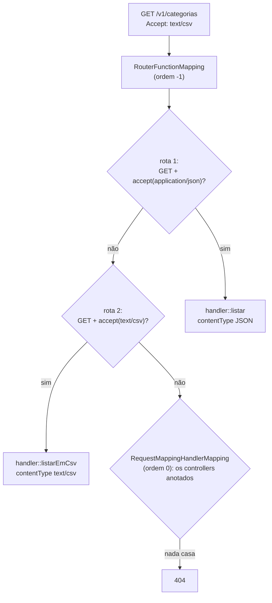

## O problema

Até aqui, toda rota do Bazar nasceu de uma anotação: `@GetMapping`, `@RequestParam`, `@Valid`. O Spring descobre os métodos na inicialização, lê as anotações e monta o mapa de rotas. É conveniente, mas tem limites:

- As rotas são **fixas no código**. Montar rotas a partir de configuração (um módulo que só existe para certos clientes, rotas geradas a partir de uma lista) exige contornos.
- A lógica de roteamento fica **espalhada** em dezenas de anotações, em várias classes. Não existe um lugar onde se leia "estas são as rotas da API".
- Quem vem do **WebFlux** ou de frameworks como Express e Ktor está acostumado a declarar rotas como código.

O Spring MVC tem um segundo modelo de programação, os *functional endpoints* (ou WebMvc.fn): as rotas são **objetos** montados com código Java comum.

A diferença lembra a de dois restaurantes. No primeiro, cada prato traz uma etiqueta dizendo a que mesa vai, e o garçom lê as etiquetas: são as anotações. No segundo, há um quadro na entrada da cozinha com todas as mesas e seus pedidos: é o `RouterFunction`. O quadro mostra tudo num lugar só, mas alguém tem de escrevê-lo e mantê-lo atualizado.

> **A pergunta desta página:** como escrever `GET /v1/categorias` em estilo funcional, o que se ganha, e o que o modelo anotado fazia de graça que agora precisa ser feito à mão?

## O conceito

### As quatro peças

| Peça | O que é | Equivalente anotado |
|---|---|---|
| **`HandlerFunction<ServerResponse>`** | Uma função `ServerRequest → ServerResponse` | O método do controller |
| **`RouterFunction<ServerResponse>`** | Uma função `ServerRequest → Optional<HandlerFunction>` | O conjunto de `@RequestMapping` |
| **`ServerRequest`** | A requisição, imutável: método, caminho, cabeçalhos, parâmetros, corpo | `@PathVariable`, `@RequestParam`, `@RequestBody`... |
| **`ServerResponse`** | A resposta, imutável, criada por um *builder* | `ResponseEntity` |

Uma rota mínima:

```java
@Bean
RouterFunction<ServerResponse> rotas() {
    return RouterFunctions.route()
            .GET("/v1/ping", request -> ServerResponse.ok().body("pong"))
            .build();
}
```

Os *beans* `RouterFunction` são detectados pelo `RouterFunctionMapping`, que os combina e roda **dentro do `DispatcherServlet`** ([09.01](/construindo-apis-com-spring-boot/o-caminho-de-uma-requisicao-no-spring-mvc)). Filtros, conversores de mensagem e o `@ControllerAdvice` continuam valendo, com as diferenças que a seção prática mostra.

### Lendo a requisição

```java
request.pathVariable("id");                 // String: a conversão para UUID é sua
request.param("q");                         // Optional<String>
request.params();                           // MultiValueMap<String, String>
request.headers().firstHeader("Bazar-Canal");
request.body(CriarProdutoRequest.class);    // usa os conversores de mensagem (JSON etc.)
request.body(new ParameterizedTypeReference<List<CriarProdutoRequest>>() { });
request.bind(FiltroDeCategorias.class);     // liga parâmetros a um objeto, como um @ModelAttribute
```

Nada é convertido nem validado automaticamente. `request.pathVariable("id")` devolve texto, e um `UUID.fromString` com um valor inválido lança `IllegalArgumentException`. No modelo anotado, isso virava um `400` com Problem Details ([08.02](/construindo-apis-com-spring-boot/problemdetail-no-spring-tratamento-global-de-erros)); aqui, cai no tratador genérico e vira `500`, como uma sonda no Bazar confirmou.

### Predicados e aninhamento

Uma rota é escolhida por **predicados** (`RequestPredicate`): método, caminho, `accept(...)`, `contentType(...)`, `headers(...)`, `queryParam(...)`, `version(...)`. Eles se combinam com `and`, `or` e `negate`, e o *builder* permite agrupar rotas por um prefixo ou predicado comum:

```java
route()
    .path("/v1/categorias", rotas -> rotas
        .GET("/{id}", handler::detalhar)
        .GET(handler::listar)
        .POST(contentType(MediaType.APPLICATION_JSON), handler::criar))
    .build();
```

A regra mais importante: **as rotas são avaliadas em ordem, e a primeira que casa vence.** No modelo anotado, o Spring escolhe o *mapping* **mais específico**, não importa a ordem de declaração. No funcional, a ordem de declaração é a regra: rotas específicas vêm antes das genéricas.

### Filtros funcionais

O *builder* aceita filtros que valem para as rotas declaradas nele:

- **`before(request -> ...)`** transforma a requisição antes do *handler*.
- **`after((request, response) -> ...)`** age sobre a resposta.
- **`filter((request, next) -> ...)`** envolve o *handler* e pode decidir não chamá-lo.

Eles fazem, para um grupo de rotas, o papel de um interceptor ([09.04](/construindo-apis-com-spring-boot/filtros-interceptors-e-aop-quando-usar-cada-um)). Filtros declarados num grupo aninhado não se aplicam às rotas de fora dele.

### Versionamento por rota

O Spring Framework 7 trouxe suporte nativo a versionamento de API. Com ele configurado ([18.03](/contratos-documentacao-e-ciclo-de-vida/versionamento-nativo-no-spring-framework-7)), o predicado `version` escolhe a rota pela versão pedida:

```java
route()
    .GET("/categorias", version("1.0"), handler::listarV1)
    .GET("/categorias", version("1.1+"), handler::listarV11)   // 1.1 e superiores
    .build();
```

Uma versão fixa (`"1.0"`) casa só com ela mesma; uma versão-base (`"1.1+"`) casa com ela e com as superiores, até a maior versão suportada. O Bazar usa a versão no caminho (`/v1`); as estratégias de versionamento são comparadas em [18.02](/contratos-documentacao-e-ciclo-de-vida/estrategias-de-versionamento).

### A diferença que surpreende: não há negociação pelo `Accept`

No modelo anotado, o `Accept` decide o conversor que escreve a resposta ([09.03](/construindo-apis-com-spring-boot/httpmessageconverter-e-a-serializacao-por-dentro)). Numa resposta funcional, não. A sonda do Bazar pediu uma lista de categorias com `Accept: text/csv` e com `Accept: application/xml`, e recebeu **JSON nos dois casos**, com `200`. Os conversores eram os mesmos: o `RouterFunctionMapping` tinha a mesma lista do controller anotado, com o conversor de CSV.

A explicação está no código do Spring Framework 7.0. A resposta funcional (`DefaultEntityResponseBuilder`) só consulta o `Content-Type` **já definido na resposta**: se nenhum foi definido, o primeiro conversor capaz de escrever o objeto vence, que é o de JSON. O `Accept` não entra na conta, e por isso também não há `406`.

No estilo funcional, o formato se escolhe **na rota**, com o predicado `accept(...)`, e o *handler* declara o `contentType` da resposta.

### Prós e contras

| | Anotações | Funcional |
|---|---|---|
| **Rotas** | Espalhadas pelos controllers | Num lugar só, como código |
| **Rotas dinâmicas** (vindas de configuração) | Difícil | Natural |
| **Escolha da rota** | A mais específica | A primeira que casa |
| **Conversão de parâmetros** (`UUID`, `int`, `LocalDate`) | Automática, com `400` em caso de erro | Manual |
| **Validação** | `@Valid` e restrições nos parâmetros, com o `422` do Bazar | Manual |
| **Negociação pelo `Accept`** | Automática, com `406` | Pela rota (`accept(...)`); sem `406` automático |
| **Testes** | `@WebMvcTest`, `MockMvcTester` | Os mesmos; o *handler* também pode ser testado como função |
| **springdoc / OpenAPI** | Lê as anotações e infere parâmetros e respostas | Exige `@RouterOperation` ou o DSL do springdoc; nada é inferido do código das funções |
| **Familiaridade** | O padrão do ecossistema Spring MVC | Comum em WebFlux, Kotlin e quem vem de Express ou Ktor |

## Diagrama

Como o `RouterFunctionMapping` escolhe a rota, e onde ele fica em relação às anotações:



## Na prática

### `GET /v1/categorias` em estilo funcional

O *handler* concentra a lógica; o `RouterFunction`, as rotas:

```java title="src/test/java/com/bazar/catalogo/api/CategoriaRotasFuncionaisTest.java"
    @TestConfiguration(proxyBeanMethods = false)
    static class Rotas {

        @Bean
        RouterFunction<ServerResponse> rotasDeCategorias(CategoriaRepository repository) {
            var handler = new CategoriaHandler(repository);
            return route()
                    .path("/v1/categorias", rotas -> rotas
                            // A resposta funcional não negocia pelo Accept: o formato é escolhido pela rota.
                            // A primeira rota que casa vence, e sem Accept (*/*) as duas casariam: JSON primeiro.
                            .GET(accept(MediaType.APPLICATION_JSON), handler::listar)
                            .GET(accept(ListaCsvHttpMessageConverter.TEXT_CSV), handler::listarEmCsv))
                    .build();
        }
    }

    static class CategoriaHandler {

        private final CategoriaRepository repository;

        CategoriaHandler(CategoriaRepository repository) {
            this.repository = repository;
        }

        ServerResponse listar(ServerRequest request) {
            return ServerResponse.ok().contentType(MediaType.APPLICATION_JSON).body(categorias(request), LISTA_DE_CATEGORIAS);
        }

        ServerResponse listarEmCsv(ServerRequest request) {
            return ServerResponse.ok().contentType(ListaCsvHttpMessageConverter.TEXT_CSV)
                    .body(categorias(request), LISTA_DE_CATEGORIAS);
        }

        // Sem @RequestParam, @Size e conversão automática: cada parâmetro é lido e validado à mão.
        private Lista<CategoriaResponse> categorias(ServerRequest request) {
            var q = request.param("q").orElse(null);
            if (q != null && (q.length() < 2 || q.length() > 60)) {
                throw new ResponseStatusException(HttpStatus.UNPROCESSABLE_CONTENT, "q deve ter entre 2 e 60 caracteres");
            }
            var apenasRaizes = Boolean.parseBoolean(request.param("apenasRaizes").orElse("false"));
            return new Lista<>(repository.findAll().stream()
                    .filter(c -> q == null || c.nome().toLowerCase(Locale.ROOT).contains(q.toLowerCase(Locale.ROOT)))
                    .filter(c -> !apenasRaizes || c.categoriaPaiId() == null)
                    .map(CategoriaResponse::de)
                    .toList());
        }
    }
```

Com a constante do tipo genérico:

```java
    static final ParameterizedTypeReference<Lista<CategoriaResponse>> LISTA_DE_CATEGORIAS =
            new ParameterizedTypeReference<>() { };
```

As decisões do código:

- **`body(objeto, LISTA_DE_CATEGORIAS)`** informa o tipo genérico. O conversor de CSV da 09.03 precisa dele para saber os nomes das colunas. Num controller anotado, o tipo vinha da assinatura do método; aqui, as funções não têm assinatura que o Spring consiga ler.
- **A ordem das rotas.** A primeira versão tinha a rota de CSV antes da de JSON, e o teste sem `Accept` recebeu CSV: sem `Accept`, o cliente aceita tudo, e o predicado `accept(text/csv)` casou. É a mesma armadilha do conversor registrado como bean em 09.03, agora no roteamento.
- **A validação manual.** O `@Size(min = 2, max = 60)` do controller anotado virou um `if`.

### Por que isso vive num teste

O Bazar **continua com o controller anotado**. A versão funcional está num `@TestConfiguration`, que só existe no teste que a compara com a anotada. Os motivos:

- Ter as duas em produção seria ter duas implementações do mesmo endpoint.
- O resto do Bazar é anotado, e misturar modelos sem necessidade aumenta o custo de leitura.
- O Bazar usa o `422` com a lista de erros e o springdoc ([17.02](/contratos-documentacao-e-ciclo-de-vida/springdoc-openapi-documentacao-a-partir-do-codigo)) que as anotações dão de graça.

### O que os testes mostram

```java title="src/test/java/com/bazar/catalogo/api/CategoriaRotasFuncionaisTest.java"
    @Test
    void aRotaFuncionalVenceOControllerNoMesmoCaminho() {
        // O RouterFunctionMapping tem ordem -1; o RequestMappingHandlerMapping, 0.
        var resposta = mvc.get().uri("/v1/categorias?apenasRaizes=true").exchange();

        assertThat(resposta.getMvcResult().getHandler()).isNotInstanceOf(org.springframework.web.method.HandlerMethod.class);
        assertThat(resposta).hasStatusOk().hasContentType(MediaType.APPLICATION_JSON)
                .bodyJson().extractingPath("$.itens[*].nome").asArray().containsExactly("Eletrônicos", "Livros");
    }

    @Test
    void escolheOCsvPeloPredicadoDeAccept() {
        assertThat(mvc.get().uri("/v1/categorias?q=livr").accept(ListaCsvHttpMessageConverter.TEXT_CSV))
                .hasStatusOk()
                .hasContentType(ListaCsvHttpMessageConverter.TEXT_CSV)
                .bodyText().isEqualTo("id,nome,slug,categoriaPaiId\r\n0192f3a0-5555-7000-8000-000000000001,Livros,livros,\r\n");
    }

    @Test
    void semAcceptOuComOAcceptDeUmNavegadorRespondeJson() {
        assertThat(mvc.get().uri("/v1/categorias")).hasContentType(MediaType.APPLICATION_JSON);
        assertThat(mvc.get().uri("/v1/categorias")
                .header("Accept", "text/html,application/xhtml+xml,application/xml;q=0.9,*/*;q=0.8"))
                .hasContentType(MediaType.APPLICATION_JSON);
    }

    @Test
    void aValidacaoManualNaoProduzOFormatoDeErroDoBazar() {
        // O @ControllerAdvice trata a exceção, mas sem o type "validacao" nem a lista de erros do 422 anotado.
        assertThat(mvc.get().uri("/v1/categorias?q=a"))
                .hasStatus(HttpStatus.UNPROCESSABLE_CONTENT)
                .bodyJson().isLenientlyEqualTo("""
                        { "status": 422, "detail": "q deve ter entre 2 e 60 caracteres", "codigo": "UNPROCESSABLE_CONTENT" }
                        """);
    }
```

Quatro fatos que o teste prova:

1. **A rota funcional vence o controller anotado no mesmo caminho.** No Spring Boot 4, o `RouterFunctionMapping` tem ordem `-1`, e o `RequestMappingHandlerMapping`, `0` (valores lidos dos beans numa sonda). Se nenhuma rota funcional casar, o `DispatcherServlet` tenta o mapeamento seguinte.
2. **O formato vem do predicado `accept(...)`**, com a rota de JSON primeiro.
3. **O `@ControllerAdvice` trata exceções dos *handlers* funcionais.** Uma `RecursoNaoEncontradoException` lançada num *handler* funcional virou o `404` com Problem Details do Bazar, igual ao do controller anotado.
4. **A validação manual perde o formato do Bazar.** O `ResponseStatusException` vira um `422` genérico (`codigo: UNPROCESSABLE_CONTENT`, sem `type` nem `erros`). Para chegar ao formato da 08.02, o *handler* precisaria validar com o `Validator` do Bean Validation e montar a resposta, código que o `@Valid` dispensa.

<HttpExchange
  title="A versão funcional, pedindo CSV"
  request={{ method: 'GET', url: 'http://localhost:8080/v1/categorias?q=livr', headers: { Accept: 'text/csv' } }}
  response={{
    status: 200,
    headers: { 'Content-Type': 'text/csv;charset=UTF-8' },
    body: 'id,nome,slug,categoriaPaiId\r\n0192f3a0-5555-7000-8000-000000000001,Livros,livros,\r\n',
  }}
>
  Para o cliente, a resposta é idêntica à do controller anotado: o contrato HTTP não depende do modelo de programação. A diferença está toda no servidor, na rota de CSV escolhida pelo predicado.
</HttpExchange>

## Erros comuns

<BadVsGood title="Esperar negociação pelo Accept" why="A resposta funcional não consulta o Accept: sem contentType definido, o primeiro conversor capaz (JSON) escreve tudo, inclusive para quem pediu CSV ou XML, sem 406. O formato precisa ser escolhido pela rota.">
<Bad title="Uma rota, esperando que o conversor decida">

```java
route()
    .GET("/v1/categorias", request ->
            ServerResponse.ok().body(categorias(), LISTA_DE_CATEGORIAS))   // sempre JSON
    .build();
```

</Bad>
<Good title="Uma rota por formato, JSON primeiro">

```java
route()
    .path("/v1/categorias", rotas -> rotas
        .GET(accept(MediaType.APPLICATION_JSON), handler::listar)
        .GET(accept(TEXT_CSV), handler::listarEmCsv))
    .build();
```

</Good>
</BadVsGood>

Outros erros frequentes:

- **Declarar a rota genérica antes da específica.** A primeira que casa vence; `GET /{id}` antes de `GET /destaques` captura `destaques` como id.
- **Converter parâmetros sem tratar o erro.** `UUID.fromString` com lixo vira `500`, e não `400`.
- **Esquecer a validação**, que não acontece sozinha.
- **Perder o tipo genérico** em `body(lista)`: conversores que dependem dele (como o CSV do Bazar) recusam a escrita.
- **Duplicar uma rota anotada sem perceber.** A funcional vence em silêncio.
- **Misturar os dois modelos** no mesmo projeto sem um motivo claro.
- **Esperar que o springdoc documente as rotas sozinho.**

## Boas práticas

- **Prefira** anotações em APIs Spring MVC comuns; use o modelo funcional quando as rotas forem dinâmicas ou quando o time já trabalha assim.
- **Declare** rotas específicas antes das genéricas, e a de JSON antes das de outros formatos.
- **Defina** o `contentType` em toda resposta funcional.
- **Centralize** a conversão e a validação de parâmetros em métodos auxiliares, para manter `400` e `422` no formato da API.
- **Passe** o tipo genérico com `ParameterizedTypeReference` quando o corpo for genérico.
- **Documente** as rotas funcionais com `@RouterOperation` ou o DSL do springdoc.
- **Teste** o *handler* também sem HTTP: ele é uma função comum.

## No projeto Bazar

<ProjectStep title="GET /v1/categorias em estilo funcional (só nos testes)" module="catalogo" tag="pagina-09.05" files={[
  { path: 'src/test/java/com/bazar/catalogo/api/CategoriaRotasFuncionaisTest.java', change: 'novo' },
]}>
A versão funcional de `GET /v1/categorias` (JSON e CSV, filtros `q` e `apenasRaizes`) vive num `@TestConfiguration`, com testes que comparam o comportamento com o do controller anotado. O código de produção do Bazar não muda: o controller anotado continua atendendo `GET /v1/categorias`.
</ProjectStep>

## Resumo

- *Functional endpoints*: rotas como objetos (`RouterFunction`), *handlers* como funções (`ServerRequest → ServerResponse`).
- **A primeira rota que casa vence**; no modelo anotado, vence a mais específica.
- Predicados (`accept`, `contentType`, `version`...), aninhamento com `path` e `nest`, filtros com `before`, `after` e `filter`.
- **Sem conversão nem validação automáticas**; o `@ControllerAdvice` continua tratando as exceções.
- **Sem negociação pelo `Accept`** na resposta: o formato se escolhe pela rota, com `contentType` explícito.
- No Spring Boot 4, o `RouterFunctionMapping` (ordem `-1`) é consultado **antes** dos controllers anotados.
- O springdoc precisa de `@RouterOperation` ou do DSL próprio.

<Exercise title="Rotas de um módulo opcional" difficulty="medio">
Alguns parceiros do Bazar contratam o módulo de "listas de presentes". As rotas `GET /v1/listas-de-presentes` e `GET /v1/listas-de-presentes/{id}` só devem existir quando a propriedade `bazar.modulos.listas-de-presentes` for `true`.

1. Escreva o `RouterFunction` e a forma de ligá-lo pela propriedade.
2. O `{id}` é um UUID. Como evitar o `500` para um id malformado?
3. Por que o modelo funcional é uma escolha razoável aqui, mesmo num projeto anotado?

<Hint>
Um `@Bean` pode ter `@ConditionalOnBooleanProperty`. Para o item 2, pense em um método auxiliar que converte o texto e, em caso de erro, lança uma exceção que o `TratadorGlobalDeErros` já transforma em `400`.
</Hint>

<Solution>

1. O código:

   ```java
   @Configuration(proxyBeanMethods = false)
   class RotasDeListasDePresentes {

       @Bean
       @ConditionalOnBooleanProperty("bazar.modulos.listas-de-presentes")
       RouterFunction<ServerResponse> rotasDeListasDePresentes(ListaDePresentesHandler handler) {
           return route()
                   .path("/v1/listas-de-presentes", rotas -> rotas
                           .GET("/{id}", accept(MediaType.APPLICATION_JSON), handler::detalhar)
                           .GET(accept(MediaType.APPLICATION_JSON), handler::listar))
                   .build();
       }
   }
   ```

   Sem a propriedade, o bean não existe, e as rotas também não: o cliente recebe `404`.

2. Um auxiliar que lança uma exceção que o Spring já trata como `400`:

   ```java
   static UUID uuid(ServerRequest request, String nome) {
       try {
           return UUID.fromString(request.pathVariable(nome));
       }
       catch (IllegalArgumentException e) {
           throw new ServerWebInputException("O parâmetro '" + nome + "' não é um UUID válido.");
       }
   }
   ```

   `ServerWebInputException` é um `ResponseStatusException` com status `400`; o `TratadorGlobalDeErros` o converte em Problem Details. Para o `type` `requisicao-invalida` do Bazar, basta acrescentá-la ao mapa `TIPOS_DO_SPRING`.

3. As rotas dependem de configuração, e é isso que o modelo funcional faz bem: o conjunto de rotas é um bean, que existe ou não. Com anotações, seria preciso condicionar o controller inteiro, o que também funciona aqui (`@ConditionalOnBooleanProperty` numa classe `@RestController`). O funcional vale mais quando as rotas são **geradas** (a partir de uma lista de módulos, por exemplo), algo que anotações não expressam.

</Solution>
</Exercise>

<Quiz
  questions={[
    {
      question: 'Um handler funcional devolve ServerResponse.ok().body(lista, tipo), sem contentType. O cliente manda Accept: text/csv, e o conversor de CSV está registrado. O que recebe?',
      options: [
        'CSV, pela negociação de conteúdo',
        'JSON com 200: a resposta funcional não consulta o Accept, e o primeiro conversor capaz vence',
        '406 Not Acceptable',
      ],
      answer: 1,
      explanation: 'No Spring Framework 7.0, a resposta funcional só considera o Content-Type já definido na resposta. Foi o que a sonda do Bazar mostrou, até com Accept: application/xml. O formato se escolhe pela rota, com o predicado accept(...).',
    },
    {
      question: 'As rotas foram declaradas nesta ordem: GET /v1/produtos/{id} e depois GET /v1/produtos/destaques. O que acontece com GET /v1/produtos/destaques?',
      options: [
        'Vai para a rota de destaques, que é mais específica',
        'Vai para a rota /{id}, com id = "destaques", porque a primeira que casa vence',
        'O Spring recusa a inicialização por ambiguidade',
      ],
      answer: 1,
      explanation: 'No modelo funcional, a ordem de declaração decide. No anotado, o Spring escolheria o mapping mais específico.',
    },
    {
      question: 'Um RouterFunction e um @RestController atendem GET /v1/categorias no mesmo projeto Spring Boot 4. Qual responde?',
      options: [
        'O controller anotado, que é o modelo principal',
        'O RouterFunction: o RouterFunctionMapping (ordem -1) é consultado antes do RequestMappingHandlerMapping (ordem 0)',
        'O Spring falha na inicialização por mapeamento duplicado',
      ],
      answer: 1,
      explanation: 'O teste CategoriaRotasFuncionaisTest prova isso. Não há erro nem aviso: a rota funcional vence em silêncio.',
    },
  ]}
/>

## Referências

<References />
