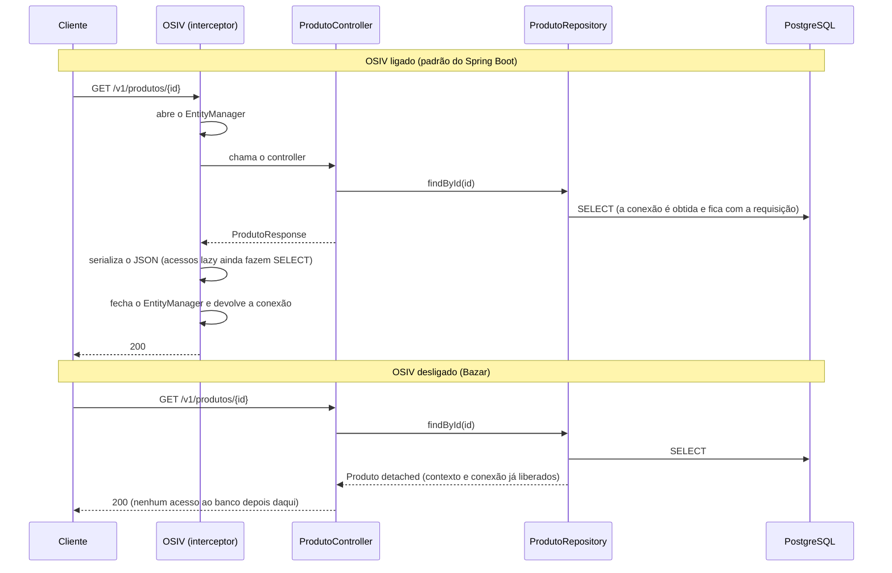

## O problema

Até aqui, os produtos do Bazar viviam num `ConcurrentHashMap`. Bastava reiniciar a aplicação para o catálogo sumir, e duas instâncias da API teriam dois catálogos diferentes. Uma API de verdade guarda os dados num banco.

Com o Spring Data JPA, persistir parece trivial: uma anotação na classe, uma interface de repositório, e `repository.save(produto)` funciona. Esse é o perigo. Atrás de cada chamada há um <Term id="orm">ORM</Term>, o Hibernate, que decide **quando** e **quantas** vezes ir ao banco. Quem não sabe o que ele faz descobre só em produção que:

- um `PUT` faz três consultas, e não uma;
- uma listagem faz cem consultas, e não uma (o problema N+1, em [10.04](/persistencia-para-apis/o-problema-n-1-e-estrategias-de-fetch));
- a conexão com o banco fica presa durante a serialização do JSON.

Pense num bibliotecário. Você pede um livro, e ele o busca no depósito. Enquanto você está na sala de leitura, ele sabe que o livro está com você e anota as páginas que você marcou. Quando você sai, ele guarda o livro e registra as anotações de uma vez. Se você leva o livro para casa, ele deixa de acompanhar o que acontece com ele. O JPA funciona assim: o "período na sala de leitura" é o contexto de persistência, e tudo nesta página gira em torno de quando ele começa e quando termina.

> **A pergunta desta página:** como ligar o Bazar a um PostgreSQL, mapear o produto como entidade e saber exatamente que SQL cada operação da API executa?

## O conceito

### As peças

| Peça | O que é |
|---|---|
| **Jakarta Persistence (JPA) 3.2** | A especificação: anotações (`@Entity`, `@Id`...) e a API do `EntityManager` |
| **Hibernate ORM 7.4** | A implementação usada pelo Spring Boot; gera o SQL |
| **Spring Data JPA** | Cria os repositórios a partir de interfaces, em cima do `EntityManager` |
| **HikariCP** | O *pool* de conexões que o Spring Boot configura |
| **Driver JDBC do PostgreSQL** | A conversa de baixo nível com o banco |

O *starter* `spring-boot-starter-data-jpa` traz tudo, exceto o driver, que depende do banco:

```xml title="pom.xml"
<dependency>
    <groupId>org.springframework.boot</groupId>
    <artifactId>spring-boot-starter-data-jpa</artifactId>
</dependency>
<dependency>
    <groupId>org.postgresql</groupId>
    <artifactId>postgresql</artifactId>
    <scope>runtime</scope>
</dependency>
```

### PostgreSQL com o Docker Compose do Spring Boot

O projeto já tinha o módulo `spring-boot-docker-compose` desde [05.02](/construindo-apis-com-spring-boot/criando-o-projeto-bazar). Ao iniciar a aplicação, ele:

1. Encontra o `compose.yaml`.
2. Roda `docker compose up` e espera os contêineres ficarem prontos.
3. Reconhece serviços conhecidos pela imagem (`postgres`) e cria a **conexão** sozinho: URL, usuário e senha, sem nenhuma linha de `spring.datasource.*`.
4. No encerramento, para os contêineres.

Detalhes que valem saber:

- O módulo é só de desenvolvimento. Ele fica fora do *jar* empacotado: o *jar* rodado com `java -jar` falhou com `Failed to configure a DataSource: 'url' attribute is not specified`. Em produção, a conexão vem de `spring.datasource.*` ou de variáveis de ambiente ([29.01](/producao-e-deploy/configuracao-externa-e-profiles)).
- Nos testes, o Docker Compose é ignorado por padrão. Os testes usam o Testcontainers, apresentado na seção prática.

### Entidades

Uma **entidade** é uma classe cujas instâncias correspondem a linhas de uma tabela:

- **`@Entity`** marca a classe; **`@Table`** escolhe o nome da tabela.
- **`@Id`** marca a chave primária.
- **`@Column`** ajusta a coluna (nome, tamanho, `nullable`, `unique`, `updatable`).
- **`@Enumerated(EnumType.STRING)`** grava o nome do enum. O padrão, `ORDINAL`, grava a posição, e acrescentar um valor no meio do enum corrompe os dados existentes.
- **`@Embedded`** com uma classe **`@Embeddable`** transforma um objeto de valor em colunas da própria tabela. O Hibernate aceita *records* como `@Embeddable`.
- **`@Version`** marca a coluna de versão (o papel dela na concorrência é assunto de [10.06](/persistencia-para-apis/concorrencia-no-banco-locking-otimista-e-pessimista)).

A JPA exige um construtor sem argumentos (pode ser `protected`) e campos não `final`: o Hibernate cria a instância vazia e preenche os campos depois. Os nomes de colunas seguem a estratégia do Spring Boot, que converte `categoriaId` em `categoria_id`.

**Estratégias de geração do id:**

| Estratégia | Quem gera | Observação |
|---|---|---|
| `GenerationType.IDENTITY` | O banco (`bigserial`/`identity`) | O id só existe depois do `INSERT`; impede o *batch* de inserções |
| `GenerationType.SEQUENCE` | Uma *sequence* do banco | Permite *batch*; o padrão do Hibernate para números |
| `GenerationType.UUID` | O Hibernate, no `persist` | UUID v4 |
| `@UuidGenerator(style = VERSION_7)` | O Hibernate, no `persist` | UUID v7, ordenável por tempo |
| Atribuído no construtor | O código | O objeto já nasce com id, antes de qualquer banco |

O Bazar atribui o id no construtor: o domínio não depende do banco para ter identidade, e o id público é um UUID, que não revela quantos produtos existem nem permite adivinhar os vizinhos. Por enquanto é um UUID v4; a troca para v7, melhor para índices, acontece em [15.03](/design-de-apis-profissional/identificadores-sequenciais-uuid-v7-e-ulid).

### O ciclo de vida e o contexto de persistência

O **`EntityManager`** mantém um <Term id="contexto-de-persistencia">contexto de persistência</Term>: o conjunto de entidades que ele está acompanhando. Uma entidade pode estar em quatro estados:

| Estado | Significado | Como chega lá |
|---|---|---|
| **New** (*transient*) | Objeto Java comum, desconhecido do Hibernate | `new Produto(...)` |
| **Managed** | Acompanhada pelo contexto; cada linha tem uma única instância | `persist`, ou carregada por uma consulta |
| **Detached** | Já foi gerenciada, mas o contexto fechou | Fim da transação (com OSIV desligado) |
| **Removed** | Marcada para exclusão no próximo *flush* | `remove` |

Enquanto a entidade está *managed*, o Hibernate faz <Term id="dirty-checking">*dirty checking*</Term>: no fim da transação, ele compara cada entidade com a cópia que guardou ao carregá-la e gera os `UPDATE`s necessários, **sem que o código chame `save`**. Uma entidade *detached* não tem essa vantagem: para gravar as mudanças, é preciso reanexá-la com `merge`, e o `merge` começa com um `SELECT`.

### `JpaRepository`, *query methods* e `@Query`

```java
public interface ProdutoRepository extends JpaRepository<Produto, UUID> {

    List<Produto> findAllByOrderByNomeAsc();

    long countByCategoriaId(UUID categoriaId);
}
```

- **`JpaRepository<Produto, UUID>`** traz `save`, `findById`, `findAll`, `deleteById`, `count`, paginação e ordenação. A implementação (`SimpleJpaRepository`) é criada na inicialização.
- **Query methods** derivam a consulta do nome do método: `findAllByOrderByNomeAsc` vira `... order by p1_0.nome`; `countByCategoriaId` vira um `select count(...) ... where categoria_id = ?`. Um nome inválido falha **na inicialização**, e não na primeira chamada.
- **`@Query`** escreve a consulta em JPQL (sobre entidades e campos, não tabelas e colunas) quando o nome ficaria longo demais:

```java
@Query("select p from Produto p where p.status = :status and p.categoriaId = :categoriaId order by p.nome")
List<Produto> buscarPorStatusECategoria(StatusProduto status, UUID categoriaId);
```

Com `nativeQuery = true`, a consulta é SQL do banco. As consultas dinâmicas para filtros (`Specification`) e as projeções ficam para [10.05](/persistencia-para-apis/projecoes-e-consultas-para-leitura).

**Como o `save` decide entre `persist` e `merge`.** O `SimpleJpaRepository.save` chama `persist` para entidades **novas** e `merge` para as outras. Para saber se é nova, o Spring Data olha:

1. o atributo `@Version`, se existir e não for primitivo: **nova se for `null`**;
2. senão, o id: **nova se for `null`**.

Com o id atribuído no construtor e sem `@Version`, todo produto parece "não novo", e o `save` faz `merge`: um `SELECT` para procurar a linha, e só depois o `INSERT`. Uma sonda com uma entidade assim mostrou exatamente isso:

```text
select sv1_0.id,sv1_0.nome from sem_versao sv1_0 where sv1_0.id=?
insert into sem_versao (nome,id) values (?,?)
```

O produto do Bazar tem `@Version private @Nullable Long versao`: nulo até a primeira gravação, ele resolve a dúvida, e a criação faz um único `INSERT`. Outra saída é implementar `Persistable<UUID>`, com um `isNew()` próprio.

### Onde ficam a entidade e o repositório

[05.02](/construindo-apis-com-spring-boot/criando-o-projeto-bazar) definiu que o domínio não depende das outras camadas. A JPA testa essa regra. A entidade `Produto`, que é do domínio, passa a ter anotações `jakarta.persistence`. O `ProdutoRepository`, uma interface do domínio, estende o `JpaRepository` do Spring Data.

A alternativa "pura" existe: o domínio declara a própria interface (`interface Produtos { Optional<Produto> porId(UUID id); ... }`), sem nada de Spring. A infraestrutura a implementa com um repositório Spring Data e uma entidade JPA separada (`ProdutoJpa`), convertendo de um lado para o outro. O domínio fica livre de qualquer *framework*, ao custo de duas classes por entidade e um mapeamento a mais em cada leitura e gravação.

O Bazar faz a **concessão** comum em projetos Spring: anotações JPA na entidade do domínio e interfaces do Spring Data no pacote `dominio`. As anotações não mudam o comportamento das regras de negócio, e os testes do domínio continuam rodando sem banco ([11.02](/testes-de-api/testes-unitarios-de-dominio-e-servicos)). A regra que continua valendo sem exceção: **o domínio não conhece a camada `api`**, nem DTOs nem HTTP. Se um dia o Bazar trocar a JPA por outra tecnologia, a separação completa passa a compensar.

### Entidade não é DTO

[06.01](/construindo-apis-com-spring-boot/dtos-com-records-e-por-que-nao-expor-entidades) mostrou por que o controller não devolve a entidade. Com JPA, os motivos ficam mais concretos:

- **Serializar uma entidade pode disparar consultas.** O Jackson chama os *getters*; um *getter* de uma associação *lazy* dispara um `SELECT` (ou uma `LazyInitializationException`).
- **A entidade muda com o banco**, e o contrato da API não pode mudar junto.
- **Campos internos** (`versao`) não pertencem ao contrato.

O Bazar mantém o `ProdutoResponse` e o mapeamento com MapStruct de [06.02](/construindo-apis-com-spring-boot/mapeamento-manual-ou-mapstruct).

### Open Session in View (`spring.jpa.open-in-view`)

Por padrão, o Spring Boot registra o `OpenEntityManagerInViewInterceptor`: um `EntityManager` é aberto no início de cada requisição web e só é fechado no fim, depois da escrita da resposta. Na inicialização, ele avisa:

```text
WARN  JpaBaseConfiguration$JpaWebConfiguration : spring.jpa.open-in-view is enabled by default. Therefore, database queries may be performed during view rendering. Explicitly configure spring.jpa.open-in-view to disable this warning
```

O padrão existe por conveniência histórica: em aplicações com páginas HTML (JSP, Thymeleaf), a *view* acessava associações *lazy*, e o OSIV evitava a `LazyInitializationException`. Numa API, o custo é alto:

- **Consultas escondidas.** Qualquer associação acessada durante a serialização do JSON vira um `SELECT` fora do serviço, invisível na leitura do código.
- **Conexão presa.** Com o OSIV ligado, o Hibernate obtém a conexão na primeira consulta e só a devolve ao *pool* no fim da requisição, inclusive durante a serialização e chamadas a outras APIs.
- **Erros mascarados.** O código parece funcionar no desenvolvimento e cai quando alguém desliga o OSIV.

O Bazar desliga (`spring.jpa.open-in-view: false`). Com isso, o contexto de persistência dura só a transação, e tudo o que a resposta precisa tem de ser carregado **dentro** dela, de forma explícita. A `LazyInitializationException` deixa de ser um bug misterioso e passa a apontar exatamente onde falta uma consulta ([10.04](/persistencia-para-apis/o-problema-n-1-e-estrategias-de-fetch)).

### `ddl-auto`: só em protótipos

`spring.jpa.hibernate.ddl-auto` faz o Hibernate gerar o esquema a partir das entidades:

| Valor | O que faz |
|---|---|
| `none` | Nada (o padrão do Boot para bancos não embutidos) |
| `validate` | Confere se as tabelas batem com as entidades; falha na inicialização se não baterem |
| `update` | Acrescenta tabelas e colunas que faltam; nunca remove nem altera |
| `create` | Apaga e recria tudo na inicialização |
| `create-drop` | Como `create`, e apaga tudo no encerramento (o padrão do Boot para bancos embutidos) |

Nenhum deles serve para produção: `update` não renomeia colunas, não migra dados e não fica registrado em lugar nenhum. O esquema precisa ser versionado como o código, com *migrations*. O Bazar usa `create-drop` **só nesta página**; em [10.02](/persistencia-para-apis/migrations-com-flyway), o Flyway assume, e o `ddl-auto` passa a `validate`.

### Log de SQL com parâmetros

```bash
./mvnw spring-boot:run -Dspring-boot.run.arguments="--logging.level.org.hibernate.SQL=debug --logging.level.org.hibernate.orm.jdbc.bind=trace"
```

- **`org.hibernate.SQL=debug`**: cada comando SQL.
- **`org.hibernate.orm.jdbc.bind=trace`**: o valor de cada parâmetro. A categoria tem esse nome desde o Hibernate 6; no Hibernate 5, era `org.hibernate.type.descriptor.sql.BasicBinder`.

A propriedade `spring.jpa.show-sql=true` também mostra o SQL, mas escreve direto na saída padrão, fora do sistema de logs, sem nível nem formato. Prefira as categorias de log. Parâmetros podem conter dados pessoais: esse nível de log é para o desenvolvimento.

## Diagrama

O contexto de persistência numa requisição `GET /v1/produtos/{id}`, com o OSIV ligado e desligado:



## Na prática

### O `compose.yaml`

```yaml title="compose.yaml"
# Serviços de infraestrutura para o desenvolvimento local.
# O spring-boot-docker-compose sobe este arquivo junto com a aplicação e cria a conexão sozinho.
services:
  postgres:
    image: postgres:18
    environment:
      POSTGRES_DB: bazar
      POSTGRES_USER: bazar
      POSTGRES_PASSWORD: bazar   # só para o ambiente local
    ports:
      - "5432"   # porta aleatória no host: o Spring Boot descobre qual
    volumes:
      # No PostgreSQL 18, os dados ficam em /var/lib/postgresql/18/docker; monta-se o diretório pai.
      - bazar-postgres:/var/lib/postgresql

volumes:
  bazar-postgres:
```

Dois detalhes:

- **Porta aleatória.** Com `"5432"`, sem porta do host, o Docker escolhe uma porta livre, e o Spring Boot a descobre. Dois projetos com PostgreSQL não brigam pela 5432.
- **Volume no PostgreSQL 18.** A imagem 18 mudou o diretório de dados para `/var/lib/postgresql/18/docker` (conferido com `echo $PGDATA` no contêiner). Tutoriais antigos montam `/var/lib/postgresql/data`, o que não funciona mais como antes.

A inicialização mostra o Compose em ação e a conexão criada:

```text
DockerComposeLifecycleManager : Using Docker Compose file .../projeto-final/compose.yaml
DockerCli   :  Container projeto-final-postgres-1 Started
DockerCli   :  Container projeto-final-postgres-1 Healthy
RepositoryConfigurationDelegate : Finished Spring Data repository scanning in 25 ms. Found 1 JPA repository interface.
HikariPool  : HikariPool-1 - Start completed.
org.hibernate.orm.connections.pooling : HHH10001005: Database info:
	Database JDBC URL [jdbc:postgresql://127.0.0.1:32768/bazar?ApplicationName=bazar]
	Database dialect: PostgreSQLDialect
	Database version: 18.6
```

### A configuração

```yaml title="src/main/resources/application.yml"
spring:
  # ... (Jackson, mensagens e idioma, das páginas anteriores)
  jpa:
    # Sem Open Session in View: nenhuma consulta escondida acontece depois do controller (10.01).
    open-in-view: false
    hibernate:
      # Provisório: o Hibernate cria as tabelas a cada inicialização. O Flyway assume em 10.02.
      ddl-auto: create-drop
```

### O `Dinheiro` como `@Embeddable`

```java title="src/main/java/com/bazar/compartilhado/Dinheiro.java"
/**
 * Um valor monetário com a sua moeda. Nunca use double para dinheiro (02.06).
 * Esta é a versão mínima; a validação e a serialização completas estão em 15.02.
 * Como @Embeddable, vira colunas da tabela de quem o usa (o produto: preco_valor e preco_moeda).
 */
@Embeddable
public record Dinheiro(BigDecimal valor, Currency moeda) {
    // ...
}
```

### A entidade `Produto`

```java title="src/main/java/com/bazar/catalogo/dominio/Produto.java"
@Entity
@Table(name = "produto")
public class Produto {

    @Id
    private UUID id;

    @Column(nullable = false, unique = true, updatable = false, length = 8)
    private String sku;

    @Column(nullable = false, length = 120)
    private String nome;

    @Column(length = 2000)
    private @Nullable String descricao;

    @Embedded
    @AttributeOverride(name = "valor", column = @Column(name = "preco_valor", nullable = false, precision = 12, scale = 2))
    @AttributeOverride(name = "moeda", column = @Column(name = "preco_moeda", nullable = false, length = 3))
    private Dinheiro preco;

    @Column(nullable = false)
    private UUID categoriaId;

    @Enumerated(EnumType.STRING)
    @Column(nullable = false, length = 20)
    private StatusProduto status;

    // Um mapa livre de atributos (autor, voltagem...) numa coluna jsonb do PostgreSQL.
    @JdbcTypeCode(SqlTypes.JSON)
    @Column(nullable = false)
    private Map<String, String> atributos;

    // Nulo até a primeira gravação: é assim que o Spring Data sabe que o produto é novo,
    // mesmo com o id já preenchido. O papel na concorrência fica para 10.06.
    @Version
    private @Nullable Long versao;

    @Column(nullable = false, updatable = false)
    private Instant criadoEm;

    @Column(nullable = false)
    private Instant atualizadoEm;

    // Exigido pela JPA, que cria a instância antes de preencher os campos. Não é para o código do Bazar.
    protected Produto() {
    }

    public Produto(String sku, String nome, @Nullable String descricao, Dinheiro preco,
            UUID categoriaId, Map<String, String> atributos) {
        // Ainda é UUID v4; o Bazar passa a gerar UUID v7 em 15.03.
        this.id = UUID.randomUUID();
        this.sku = sku;
        this.nome = nome;
        this.descricao = descricao;
        this.preco = preco;
        this.categoriaId = categoriaId;
        this.status = StatusProduto.RASCUNHO;
        this.atributos = Map.copyOf(atributos);
        this.criadoEm = agora();
        this.atualizadoEm = this.criadoEm;
    }

    public void atualizar(String nome, @Nullable String descricao, Dinheiro preco,
            UUID categoriaId, Map<String, String> atributos) {
        this.nome = nome;
        this.descricao = descricao;
        this.preco = preco;
        this.categoriaId = categoriaId;
        this.atributos = Map.copyOf(atributos);
        this.atualizadoEm = agora();
    }

    // O PostgreSQL guarda microssegundos; truncar aqui faz a resposta do POST bater com a de um GET posterior.
    private static Instant agora() {
        return Instant.now().truncatedTo(ChronoUnit.MICROS);
    }

    // getters
}
```

As decisões:

- **`atributos` em `jsonb`.** `@JdbcTypeCode(SqlTypes.JSON)` grava o mapa como JSON; o Hibernate 7.4 usa o Jackson 3 que já está no projeto (ele traz um `Jackson3JsonFormatMapper`). A alternativa, `@ElementCollection`, criaria uma tabela à parte e uma associação *lazy*, com as consultas extras que isso traz.
- **Restrições no mapeamento** (`nullable`, `length`, `unique`). Com o `ddl-auto` elas viram restrições das tabelas; com o Flyway, viram documentação conferida pelo `validate`. A validação da entrada continua no DTO ([07.01](/construindo-apis-com-spring-boot/bean-validation-essencial)): o banco é a última linha de defesa, não a primeira.
- **Microssegundos.** `Instant.now()` tem nanossegundos no Linux, e o `timestamp` do PostgreSQL guarda microssegundos. Sem o truncamento, o `criadoEm` da resposta do `POST` (vindo do objeto em memória) teria três dígitos a mais que o de um `GET` posterior (vindo do banco).
- O **`versao` manual saiu.** O Hibernate incrementa a coluna `@Version` a cada `UPDATE`.

O esquema gerado pelo Hibernate:

```sql
create table produto (
    preco_moeda varchar(3) not null, preco_valor numeric(12,2) not null,
    atualizado_em timestamp(6) with time zone not null, criado_em timestamp(6) with time zone not null,
    sku varchar(8) not null unique, versao bigint not null, categoria_id uuid not null, id uuid not null,
    status varchar(20) not null check ((status in ('RASCUNHO','ATIVO','DESCONTINUADO'))),
    nome varchar(120) not null, descricao varchar(2000), atributos jsonb not null,
    primary key (id))
```

(Quebras de linha acrescentadas.) A ordem das colunas é a do Hibernate, e não a da classe: mais um motivo para o esquema ser escrito à mão em 10.02.

### O repositório

```java title="src/main/java/com/bazar/catalogo/dominio/ProdutoRepository.java"
/**
 * O Spring Data gera a implementação na inicialização: save, findById, findAll, deleteById...
 * e as consultas derivadas dos nomes dos métodos abaixo.
 */
public interface ProdutoRepository extends JpaRepository<Produto, UUID> {

    List<Produto> findAllByOrderByNomeAsc();

    long countByCategoriaId(UUID categoriaId);
}
```

O controller troca `findAll()` por `findAllByOrderByNomeAsc()`; o resto continua igual. A `CategoriaController` usa o `countByCategoriaId` para o `409` de [05.04](/construindo-apis-com-spring-boot/um-crud-com-status-corretos). As categorias continuam em memória até 10.02, quando o catálogo inteiro ganha tabelas.

### O SQL de cada operação

Com o log de SQL ligado, as operações da API mostram o que o Hibernate faz.

**Criar (`POST`):** um único `INSERT`, graças ao `@Version` nulo.

```text
insert into produto (atributos,atualizado_em,categoria_id,criado_em,descricao,nome,preco_valor,preco_moeda,sku,status,versao,id) values (?,?,?,?,?,?,?,?,?,?,?,?)
binding parameter (1:JSON) <- [{autor=Robert C. Martin, idioma=pt-BR}]
binding parameter (7:NUMERIC) <- [129.90]
binding parameter (8:VARCHAR) <- [BRL]
binding parameter (11:BIGINT) <- [0]
```

<HttpExchange
  title="Criando um produto no PostgreSQL"
  request={{ method: 'POST', url: 'http://localhost:8080/v1/produtos', headers: { 'Content-Type': 'application/json' }, body: { sku: 'LIV-0042', nome: 'Clean Code', descricao: 'Habilidades práticas do Agile Software', precoEmCentavos: 12990, categoriaId: '0192f3a0-5555-7000-8000-000000000003', atributos: { autor: 'Robert C. Martin', idioma: 'pt-BR' } } }}
  response={{
    status: 201,
    headers: { Location: 'http://localhost:8080/v1/produtos/9af71b8d-81c6-4f22-9586-2853ab8d55d5', 'Content-Type': 'application/json' },
    body: { id: '9af71b8d-81c6-4f22-9586-2853ab8d55d5', sku: 'LIV-0042', nome: 'Clean Code', descricao: 'Habilidades práticas do Agile Software', precoEmCentavos: 12990, categoriaId: '0192f3a0-5555-7000-8000-000000000003', status: 'RASCUNHO', atributos: { autor: 'Robert C. Martin', idioma: 'pt-BR' }, criadoEm: '2026-10-25T03:48:26.775127Z', atualizadoEm: '2026-10-25T03:48:26.775127Z' },
  }}
>
  O contrato não mudou: o cliente não sabe que o produto agora está num banco. Os instantes têm seis casas decimais, a precisão do PostgreSQL.
</HttpExchange>

**Detalhar (`GET /{id}`) e listar (`GET`):** um `SELECT` cada.

```text
select p1_0.id,p1_0.atributos,...,p1_0.versao from produto p1_0 order by p1_0.nome
```

**Atualizar (`PUT`):** dois `SELECT`s e o `UPDATE`.

```text
select p1_0.id,p1_0.atributos,... from produto p1_0 where p1_0.id=?    ← findById
select p1_0.id,p1_0.atributos,... from produto p1_0 where p1_0.id=?    ← save → merge
update produto set atributos=?,atualizado_em=?,categoria_id=?,descricao=?,nome=?,preco_valor=?,preco_moeda=?,status=?,versao=? where id=? and versao=?
```

O segundo `SELECT` é o custo de não haver transação no controller. O `findById` abre e fecha a própria transação; o produto volta *detached*. O `save` faz `merge`, que precisa carregar a linha de novo. Em [10.03](/persistencia-para-apis/transacoes-na-camada-de-servico), um serviço `@Transactional` mantém o produto *managed* do `findById` até o fim: o *dirty checking* gera o `UPDATE`, o `save` desaparece, e sobra um `SELECT`.

Repare também no `where id=? and versao=?` do `UPDATE`: é o `@Version` agindo. Se outra requisição tiver alterado o produto nesse meio-tempo, nenhuma linha é atualizada, e o Hibernate lança uma exceção de concorrência ([10.06](/persistencia-para-apis/concorrencia-no-banco-locking-otimista-e-pessimista)).

No banco:

```text
$ docker exec projeto-final-postgres-1 psql -U bazar -d bazar -c "select sku, nome, preco_valor, preco_moeda, status, atributos, versao from produto"
   sku    |          nome          | preco_valor | preco_moeda |  status  |           atributos           | versao
----------+------------------------+-------------+-------------+----------+-------------------------------+--------
 LIV-0042 | Clean Code (2ª edição) |      139.90 | BRL         | RASCUNHO | {"autor": "Robert C. Martin"} |      1
```

### Os testes com um PostgreSQL de verdade

Os testes de controller com `@WebMvcTest` não sobem o JPA. O `ProdutoControllerTest`, que cria e lê produtos de verdade, passa a subir a aplicação inteira com um PostgreSQL num contêiner, pelo **Testcontainers**:

```java title="src/test/java/com/bazar/TestcontainersConfiguration.java"
/**
 * Um PostgreSQL de verdade, num contêiner, para os testes que usam o banco.
 * O @ServiceConnection entrega a URL, o usuário e a senha do contêiner ao Spring Boot.
 */
@TestConfiguration(proxyBeanMethods = false)
public class TestcontainersConfiguration {

    @Bean
    @ServiceConnection
    PostgreSQLContainer postgres() {
        return new PostgreSQLContainer("postgres:18");
    }
}
```

```java title="src/test/java/com/bazar/catalogo/api/ProdutoControllerTest.java"
// Desde 10.01 os produtos estão no PostgreSQL: o teste sobe a aplicação inteira com um banco num contêiner.
// A Parte 5 (11.03 e 11.04) separa os testes da camada web dos testes com banco.
@SpringBootTest
@AutoConfigureMockMvc
@Import(TestcontainersConfiguration.class)
class ProdutoControllerTest {

    @Autowired
    MockMvcTester mvc;

    @Autowired
    ProdutoRepository repository;

    @AfterEach
    void limparOBanco() {
        repository.deleteAll();
    }
    // ... os mesmos testes de antes
}
```

O Testcontainers 2 mudou os pacotes: a classe é `org.testcontainers.postgresql.PostgreSQLContainer`, sem parâmetro genérico. A antiga, `org.testcontainers.containers.PostgreSQLContainer<SELF>`, está depreciada. As dependências são `spring-boot-testcontainers`, `testcontainers-junit-jupiter` e `testcontainers-postgresql`. Os testes de categoria, que só precisavam da contagem de produtos, trocam o repositório por um `@MockitoBean`. A Parte 5 explica as duas abordagens em detalhe ([11.04](/testes-de-api/testes-de-integracao-com-springboottest-e-testcontainers)).

## Erros comuns

<BadVsGood title="Id atribuído sem dizer ao Spring Data que a entidade é nova" why="Com o id preenchido no construtor e sem @Version (ou com @Version primitivo), o Spring Data trata a entidade como existente: o save faz merge, que começa com um SELECT. Toda criação custa duas idas ao banco. Uma versão Long nula, ou Persistable, resolve.">
<Bad title="Sem @Version">

```java
@Entity
public class Produto {
    @Id
    private UUID id = UUID.randomUUID();
    private long versao;   // primitivo: não ajuda o Spring Data
}
// save(): select ... where id=?  +  insert ...
```

</Bad>
<Good title="@Version Long, nulo até a primeira gravação">

```java
@Entity
public class Produto {
    @Id
    private UUID id;   // atribuído no construtor
    @Version
    private @Nullable Long versao;
}
// save(): insert ...
```

</Good>
</BadVsGood>

Outros erros frequentes:

- **Deixar o OSIV ligado** numa API e descobrir as consultas escondidas em produção.
- **`ddl-auto: update` em produção.** Não renomeia, não migra dados, não deixa histórico.
- **`@Enumerated` sem `EnumType.STRING`.** O padrão grava a posição do enum.
- **Devolver a entidade no controller.** Acopla o contrato ao banco e pode disparar consultas na serialização.
- **`spring.jpa.show-sql`** em vez das categorias de log, e logs de parâmetros ligados em produção.
- **`Instant` com nanossegundos** comparado ao valor lido do banco.
- **Montar `/var/lib/postgresql/data`** com a imagem do PostgreSQL 18.
- **Usar `double` ou `float` para dinheiro** na coluna (o Bazar usa `numeric(12,2)` e `BigDecimal`).

## Boas práticas

- **Desligue** o OSIV (`spring.jpa.open-in-view: false`) em APIs.
- **Ligue** o log de SQL com parâmetros no desenvolvimento e confira o SQL de cada operação nova.
- **Mapeie** enums com `EnumType.STRING`.
- **Mantenha** entidades e DTOs separados.
- **Garanta** que entidades com id atribuído sejam reconhecidas como novas (`@Version` não primitivo ou `Persistable`).
- **Use** `ddl-auto` só em protótipos; versione o esquema com *migrations* (10.02).
- **Teste** com o mesmo banco da produção (Testcontainers), e não com um banco em memória de outro fabricante.

## No projeto Bazar

<ProjectStep title="Produtos no PostgreSQL" module="catalogo" tag="pagina-10.01" files={[
  { path: 'pom.xml', change: 'alterado' },
  { path: 'compose.yaml', change: 'alterado' },
  { path: 'src/main/resources/application.yml', change: 'alterado' },
  { path: 'src/main/java/com/bazar/compartilhado/Dinheiro.java', change: 'alterado' },
  { path: 'src/main/java/com/bazar/catalogo/dominio/Produto.java', change: 'alterado' },
  { path: 'src/main/java/com/bazar/catalogo/dominio/ProdutoRepository.java', change: 'alterado' },
  { path: 'src/main/java/com/bazar/catalogo/api/ProdutoController.java', change: 'alterado' },
  { path: 'src/test/java/com/bazar/TestcontainersConfiguration.java', change: 'novo' },
  { path: 'src/test/java/com/bazar/BazarApplicationTests.java', change: 'alterado' },
  { path: 'src/test/java/com/bazar/catalogo/api/ProdutoControllerTest.java', change: 'alterado' },
  { path: 'src/test/java/com/bazar/catalogo/api/CategoriaControllerTest.java', change: 'alterado' },
  { path: 'src/test/java/com/bazar/catalogo/api/CategoriaRotasFuncionaisTest.java', change: 'alterado' },
]}>
O `Produto` vira entidade JPA, com `Dinheiro` embutido, atributos em `jsonb` e `@Version`. O `ProdutoRepository` passa a ser um `JpaRepository`. O PostgreSQL 18 sobe pelo Docker Compose no desenvolvimento e pelo Testcontainers nos testes. OSIV desligado; esquema gerado pelo Hibernate, provisoriamente, até 10.02.
</ProjectStep>

## Resumo

- **JPA** é a especificação; **Hibernate**, a implementação; **Spring Data JPA**, os repositórios gerados a partir de interfaces.
- O **Docker Compose do Spring Boot** sobe o PostgreSQL e cria a conexão; só no desenvolvimento.
- Entidades: `@Entity`, `@Id`, `@Column`, `@Enumerated(STRING)`, `@Embedded`, `@Version`; construtor sem argumentos.
- Estados: *new*, *managed*, *detached*, *removed*. *Dirty checking* só para entidades *managed*; *detached* exige `merge`, que começa com `SELECT`.
- O `save` decide entre `persist` e `merge` pelo `@Version` não primitivo ou pelo id nulo.
- **OSIV desligado** no Bazar: nada de consultas depois do controller nem conexão presa.
- **`ddl-auto`** só em protótipos; *migrations* em 10.02.
- Log de SQL: `org.hibernate.SQL=debug` e `org.hibernate.orm.jdbc.bind=trace`.

<Exercise title="Lendo o SQL do PUT" difficulty="medio">
Com o log de SQL ligado, um `PUT /v1/produtos/{id}` do Bazar mostra dois `SELECT`s idênticos antes do `UPDATE`.

1. Explique de onde vem cada `SELECT`.
2. Se o `ProdutoController.atualizar` não chamasse `repository.save(produto)`, o que aconteceria?
3. Se o OSIV estivesse ligado, o produto devolvido pelo `findById` ainda estaria *managed* no momento do `save`? O que isso mudaria?

<Hint>
Pense em quanto tempo dura o contexto de persistência em cada caso. Os métodos do `SimpleJpaRepository` são transacionais, mas cada um tem a sua transação.
</Hint>

<Solution>

1. O primeiro `SELECT` é o `findById`. Ele roda numa transação própria, que termina ao voltar para o controller; com o OSIV desligado, o contexto de persistência fecha junto, e o produto fica *detached*. O segundo vem do `save`: o produto não é novo (`versao` já não é nulo), então o `save` chama `merge`, que carrega a linha atual para copiar o estado do objeto *detached* sobre ela.

2. A alteração seria **perdida em silêncio**. O produto está *detached*, e nenhum contexto o acompanha: o *dirty checking* não acontece. A resposta mostraria os dados novos (vindos do objeto em memória), mas o banco não mudaria. Um `GET` seguinte revelaria o problema.

3. Com o OSIV ligado, o `EntityManager` da requisição continua aberto, e o produto do `findById` continua *managed* nele. O `merge` de uma entidade já gerenciada não precisa de `SELECT`, e o segundo `SELECT` sumiria. Mas o OSIV não abre uma transação: sem o `save`, nada seria gravado do mesmo jeito. A solução certa é a de 10.03: um serviço `@Transactional`, em que o produto fica *managed* do `findById` ao *commit*, e o *dirty checking* gera o `UPDATE` sem `save`.

</Solution>
</Exercise>

<Quiz
  questions={[
    {
      question: 'Uma entidade tem o id UUID atribuído no construtor e nenhum @Version. O que o repository.save(entidade) executa para um objeto novo?',
      options: [
        'Um INSERT',
        'Um SELECT pelo id e depois um INSERT: o Spring Data a trata como existente e chama merge',
        'Um UPDATE, que falha porque a linha não existe',
      ],
      answer: 1,
      explanation: 'Sem @Version não primitivo, o Spring Data decide pelo id: preenchido significa "não nova". O merge procura a linha antes. Foi o que a sonda do Bazar mostrou.',
    },
    {
      question: 'Por que o Bazar desliga o spring.jpa.open-in-view?',
      options: [
        'Porque o OSIV impede o uso de transações',
        'Porque ele mantém o EntityManager e a conexão até o fim da requisição, permitindo consultas escondidas durante a serialização',
        'Porque o Spring Boot 4 removeu o suporte a ele',
      ],
      answer: 1,
      explanation: 'O OSIV vem ligado por padrão e o Boot avisa na inicialização. Numa API, ele esconde consultas lazy fora do serviço e prende a conexão durante toda a requisição.',
    },
    {
      question: 'Qual valor de ddl-auto é adequado para o banco de produção do Bazar?',
      options: [
        'update, porque acrescenta as colunas novas automaticamente',
        'create-drop, porque garante um esquema limpo',
        'validate (ou none), com o esquema criado por migrations versionadas',
      ],
      answer: 2,
      explanation: 'O esquema é versionado com Flyway (10.02). O validate só confere se as entidades batem com as tabelas e falha na inicialização se não baterem.',
    },
  ]}
/>

## Referências

<References />
