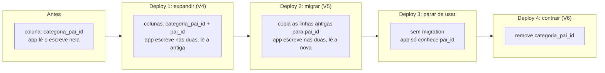

## O problema

Em [10.01](/persistencia-para-apis/spring-data-jpa-essencial-para-apis), o Hibernate criava a tabela `produto` a cada inicialização (`ddl-auto: create-drop`). Isso basta para um protótipo, mas a aplicação ainda vai ter um ambiente de homologação, um de produção e o computador de cada desenvolvedor. Logo surgem perguntas que o `ddl-auto` não responde:

- Que esquema está em produção hoje? Quem acrescentou aquela coluna, e quando?
- Como renomear uma coluna sem perder os dados?
- Como garantir que homologação e produção tenham exatamente o mesmo esquema?
- Como mudar o esquema enquanto a versão anterior da API ainda está no ar, durante o *deploy*?

O esquema precisa do mesmo tratamento que o código: **versionado no Git, revisado, aplicado em ordem e de forma repetível**. É o que as *migrations* fazem.

Pense no livro de registro de um prédio em reforma. Cada obra é anotada com número, data e descrição: "1: paredes do térreo", "2: instalação elétrica do 1º andar". Ninguém apaga uma anotação antiga; se uma obra estava errada, faz-se outra que a corrija. Qualquer pessoa sabe em que estado o prédio está lendo o livro, e um prédio igual pode ser construído seguindo as anotações na ordem. O Flyway é esse livro, e a tabela `flyway_schema_history` é a página assinada de cada obra.

> **A pergunta desta página:** como versionar o esquema do Bazar com o Flyway, e como mudar esse esquema sem quebrar a versão da API que ainda está rodando?

## O conceito

### Como o Flyway funciona

Uma *migration* é um arquivo SQL com uma versão no nome. Na inicialização da aplicação, o Flyway:

1. Lê a tabela `flyway_schema_history` do banco (e a cria, se não existir).
2. Procura os arquivos em `src/main/resources/db/migration` (a pasta padrão do Spring Boot).
3. **Valida**: cada *migration* já aplicada precisa ter o mesmo *checksum* que tinha quando foi aplicada.
4. Aplica, em ordem, as *migrations* com versão maior que a atual, cada uma numa transação (no PostgreSQL, até `create table` e `alter table` são transacionais).
5. Registra cada uma no histórico.

O Spring Boot roda o Flyway **antes** de criar o `EntityManagerFactory`. Assim, quando o Hibernate confere o esquema (`ddl-auto: validate`), as tabelas já estão na versão certa.

No Spring Boot 4, o suporte vem do *starter* `spring-boot-starter-flyway`. Desde o Flyway 10, o suporte a cada banco é um módulo à parte; para o PostgreSQL, `flyway-database-postgresql`:

```xml title="pom.xml"
<dependency>
    <groupId>org.springframework.boot</groupId>
    <artifactId>spring-boot-starter-flyway</artifactId>
</dependency>
<dependency>
    <groupId>org.flywaydb</groupId>
    <artifactId>flyway-database-postgresql</artifactId>
</dependency>
```

O Bazar usa o Flyway 12.4, a versão gerenciada pelo Spring Boot 4.1.

### Tipos e nomes

| Prefixo | Tipo | Quando roda |
|---|---|---|
| `V` | Versionada | Uma única vez, na ordem da versão |
| `R` | Repetível | Sempre que o conteúdo (o *checksum*) mudar, depois das versionadas |
| `U` | *Undo* | Só em edições pagas do Flyway; o Bazar não usa |

O nome segue `<prefixo><versão>__<descrição>.sql`, com **dois** sublinhados:

```text
V1__criar_catalogo.sql                  → versão 1, "criar catalogo"
V2__criar_estoque.sql                   → versão 2
V2.1__indice_produto_por_status.sql     → versões podem ter partes
R__view_produtos_por_categoria.sql      → repetível, sem versão
```

Convenções do Bazar:

- **Versões inteiras e sequenciais.** Times com muitos *branches* paralelos costumam usar data e hora (`V20261025_1430__...`), para que duas pessoas não criem a mesma versão.
- **Descrição no imperativo** ("criar", "adicionar", "remover").
- **Uma mudança por *migration*.** Uma *migration* que mistura três assuntos é difícil de revisar e de reverter.

*Migrations* repetíveis servem para objetos que se recriam inteiros, como *views* e funções:

```sql title="R__view_produtos_por_categoria.sql (exemplo)"
create or replace view produtos_por_categoria as
select c.id as categoria_id, c.nome, count(p.id) as quantidade
  from categoria c
  left join produto p on p.categoria_id = c.id
 group by c.id, c.nome;
```

### A regra de ouro: nunca editar uma *migration* aplicada

O *checksum* garante que o arquivo que está no Git é o mesmo que foi aplicado. Uma sonda no Bazar alterou **só o comentário** da primeira linha de `V1__criar_catalogo.sql`, depois de aplicada, e a aplicação não subiu:

```text
Migration checksum mismatch for migration version 1
-> Applied to database : -1388424204
-> Resolved locally    : -860650168
Either revert the changes to the migration, or run repair to update the schema history.
Caused by: org.flywaydb.core.api.exception.FlywayValidateException: Validate failed: Migrations have failed validation
```

A recusa é de propósito. Se a *migration* aplicada em produção não é a que está no repositório, ninguém sabe mais qual é o esquema real. Para corrigir um erro de uma *migration* já aplicada, cria-se **outra** *migration*. O comando `repair` atualiza o *checksum* no histórico, mas é para casos excepcionais (uma *migration* que falhou no meio num banco sem DDL transacional, um comentário corrigido de propósito), e nunca para esconder uma mudança real.

Editar uma *migration* que **ainda não saiu do seu *branch*** é normal: ela ainda não foi aplicada em nenhum ambiente compartilhado.

### Dados de referência × dados de teste

- **Dados de referência** são aqueles sem os quais a aplicação não funciona do jeito esperado, em **todos** os ambientes: a árvore inicial de categorias do Bazar, uma tabela de moedas aceitas. Entram em *migrations* versionadas.
- **Dados de teste** pertencem aos testes: cada teste cria o que precisa e desfaz depois (ou usa um banco descartável). Nunca entram nas *migrations* de produção.
- **Dados de exemplo para desenvolvimento** (produtos fictícios para testar a interface): se forem úteis, ficam numa pasta à parte, ligada só no perfil de desenvolvimento (`spring.flyway.locations: classpath:db/migration,classpath:db/exemplos`).

### `ddl-auto: validate`

Com o Flyway, o Hibernate deixa de criar tabelas e passa a **conferir** que cada entidade tem as tabelas e colunas de que precisa, com tipos compatíveis. Uma divergência impede a inicialização, o que é melhor do que um erro de SQL na primeira requisição. O `validate` não reclama de colunas a mais no banco, e é isso que permite a técnica da próxima seção.

### Expand-contract: mudar o esquema sem derrubar a API

Num *deploy* sem parada (*rolling update*, [29.04](/producao-e-deploy/kubernetes-para-apis-probes-graceful-shutdown-e-rollouts)), as instâncias são trocadas aos poucos. Durante alguns minutos, **a versão nova e a anterior rodam juntas, sobre o mesmo banco**. Como o Flyway roda na inicialização, a primeira instância nova muda o esquema enquanto as antigas ainda estão atendendo.

Renomear uma coluna num único *deploy* (`alter table categoria rename column categoria_pai_id to pai_id`) quebra as instâncias antigas na hora: o SQL delas cita uma coluna que não existe mais. A solução é o **expand-contract** (*parallel change*, nas palavras de Martin Fowler): primeiro **expandir** o esquema para que as duas versões funcionem, depois migrar, e só no fim **contrair**.

Para uma renomeação, com o Flyway rodando na inicialização, são quatro passos:

| *Deploy* | *Migration* | A aplicação | Por quê |
|---|---|---|---|
| 1. Expandir | `V4`: acrescenta `pai_id` | Escreve nas duas colunas; lê a antiga | As instâncias anteriores não conhecem `pai_id` e continuam funcionando |
| 2. Migrar | `V5`: copia `categoria_pai_id` para `pai_id` | Lê a nova; ainda escreve nas duas | As instâncias do *deploy* 1 ainda leem a antiga |
| 3. Parar de usar | nenhuma | Só conhece `pai_id` | As instâncias do *deploy* 2 ainda escrevem na antiga: ela não pode sumir agora |
| 4. Contrair | `V6`: remove `categoria_pai_id` | Igual ao 3 | Nenhuma instância em execução cita a coluna antiga |

Os passos 3 e 4 se juntam quando as *migrations* de contração rodam **depois** de concluído o *deploy* (por um *job* separado, por exemplo), e não na inicialização da aplicação. A mesma técnica serve para trocar o tipo de uma coluna, dividir uma tabela ou tornar uma coluna obrigatória. Ela também é a base da evolução de contratos da API ([18.01](/contratos-documentacao-e-ciclo-de-vida/compatibilidade-retroativa-o-que-quebra-um-cliente)): acrescentar antes, remover depois.

### Flyway × Liquibase

O Liquibase resolve o mesmo problema com *changesets* em XML, YAML ou SQL e tem *rollback* declarativo. O Flyway aposta em SQL puro e em simplicidade. Os dois são suportados pelo Spring Boot; o Bazar usa o Flyway.

## Diagrama

A renomeação de `categoria_pai_id` para `pai_id`, *deploy* a *deploy*:



## Na prática

### As *migrations* do catálogo

O Bazar escreve o esquema à mão, a partir do que o Hibernate gerou em 10.01, acrescentando o que o `ddl-auto` não fazia: chave estrangeira, índice, restrições de domínio e as categorias, que agora também vão para o banco.

```sql title="src/main/resources/db/migration/V1__criar_catalogo.sql"
-- Catálogo: categorias e produtos (10.02).
-- Os tipos seguem o mapeamento das entidades; o Hibernate só confere (ddl-auto: validate).

create table categoria (
    id               uuid         primary key,
    nome             varchar(60)  not null,
    slug             varchar(60)  not null unique,
    categoria_pai_id uuid         references categoria (id),
    versao           bigint       not null
);

create table produto (
    id            uuid           primary key,
    sku           varchar(8)     not null unique,
    nome          varchar(120)   not null,
    descricao     varchar(2000),
    preco_valor   numeric(12, 2) not null check (preco_valor > 0),
    preco_moeda   varchar(3)     not null,
    categoria_id  uuid           not null references categoria (id),
    status        varchar(20)    not null check (status in ('RASCUNHO', 'ATIVO', 'DESCONTINUADO')),
    atributos     jsonb          not null default '{}',
    versao        bigint         not null,
    criado_em     timestamptz    not null,
    atualizado_em timestamptz    not null
);

-- O PostgreSQL não cria índice para chaves estrangeiras. Este atende à contagem de produtos
-- por categoria (o 409 ao remover uma categoria) e, depois, ao filtro por categoria (13.01).
create index produto_categoria_id_idx on produto (categoria_id);
```

```sql title="src/main/resources/db/migration/V2__criar_estoque.sql"
-- Estoque de cada produto (10.02). A entidade e as regras de reserva chegam em 10.06.

create table estoque (
    produto_id            uuid    primary key references produto (id),
    quantidade_disponivel integer not null default 0 check (quantidade_disponivel >= 0),
    quantidade_reservada  integer not null default 0 check (quantidade_reservada >= 0),
    versao                bigint  not null default 0
);
```

```sql title="src/main/resources/db/migration/V3__inserir_categorias_iniciais.sql"
-- Dados de referência: a árvore de categorias com que o Bazar começa, em todos os ambientes.
-- Dados de teste não entram aqui; cada teste cria os seus.

insert into categoria (id, nome, slug, categoria_pai_id, versao) values
    ('0192f3a0-5555-7000-8000-000000000001', 'Livros',      'livros',      null, 0),
    ('0192f3a0-5555-7000-8000-000000000002', 'Eletrônicos', 'eletronicos', null, 0),
    ('0192f3a0-5555-7000-8000-000000000003', 'Programação', 'programacao', '0192f3a0-5555-7000-8000-000000000001', 0);
```

As restrições `check` repetem regras que o DTO já valida (`@Positive` no preço). É de propósito: o banco é a última linha de defesa contra qualquer caminho que não passe pela API, como um *script* de importação ou uma correção manual.

```yaml title="src/main/resources/application.yml"
spring:
  jpa:
    open-in-view: false
    hibernate:
      # O esquema é do Flyway (src/main/resources/db/migration); o Hibernate só confere se as entidades batem.
      ddl-auto: validate
```

A primeira inicialização sobre o banco vazio:

```text
FlywayExecutor        : Database: jdbc:postgresql://127.0.0.1:32781/bazar?ApplicationName=bazar (PostgreSQL 18.6)
JdbcTableSchemaHistory: Schema history table "public"."flyway_schema_history" does not exist yet
DbValidate            : Successfully validated 3 migrations (execution time 00:00.009s)
JdbcTableSchemaHistory: Creating Schema History table "public"."flyway_schema_history" ...
DbMigrate             : Current version of schema "public": << Empty Schema >>
DbMigrate             : Migrating schema "public" to version "1 - criar catalogo"
DbMigrate             : Migrating schema "public" to version "2 - criar estoque"
DbMigrate             : Migrating schema "public" to version "3 - inserir categorias iniciais"
DbMigrate             : Successfully applied 3 migrations to schema "public", now at version v3 (execution time 00:00.015s)
```

E o histórico:

```text
 installed_rank | version |         description         | type |               script                |  checksum   | success
----------------+---------+-----------------------------+------+-------------------------------------+-------------+---------
              1 | 1       | criar catalogo              | SQL  | V1__criar_catalogo.sql              | -1388424204 | t
              2 | 2       | criar estoque               | SQL  | V2__criar_estoque.sql               |   838004525 | t
              3 | 3       | inserir categorias iniciais | SQL  | V3__inserir_categorias_iniciais.sql |  2131880285 | t
```

### Categorias no banco

A `Categoria` deixa de ser um *record* e vira entidade. Os métodos de acesso mantêm os nomes de antes (`nome()`, `slug()`), e o resto do código não percebe a troca. O `CategoriaRepository` em memória dá lugar a um `JpaRepository`:

```java title="src/main/java/com/bazar/catalogo/dominio/CategoriaRepository.java"
public interface CategoriaRepository extends JpaRepository<Categoria, UUID> {

    List<Categoria> findAllByOrderByNomeAsc();
}
```

O `PUT` muda de estratégia. Antes, ele criava uma `Categoria` nova com o mesmo id e a gravava por cima. Com `@Version`, essa instância nova teria a versão nula e seria tratada como nova pelo Spring Data, que tentaria um `INSERT` com um id existente. Agora o `PUT` carrega a categoria e substitui os campos:

```java title="src/main/java/com/bazar/catalogo/api/CategoriaController.java"
    @PutMapping("/{id}")
    public CategoriaResponse substituir(@PathVariable UUID id, @Valid @RequestBody CategoriaRequest request) {
        var categoria = repository.findById(id).orElseThrow(() -> naoEncontrada(id));
        categoria.substituir(request.nome(), request.slug(), request.categoriaPaiId());
        return CategoriaResponse.de(repository.save(categoria));
    }
```

### A chave estrangeira e o erro que ela traria

Com `categoria_id references categoria (id)`, o banco recusa um produto de uma categoria inexistente:

```text
ERROR:  insert or update on table "produto" violates foreign key constraint "produto_categoria_id_fkey"
DETAIL:  Key (categoria_id)=(0192f3a0-5555-7000-8000-000000000999) is not present in table "categoria".
```

Se a API deixasse essa recusa chegar ao cliente, ela viraria um `500` com a mensagem do PostgreSQL escondida no log. O erro é do cliente (um campo com um valor inválido), e não do servidor. O `ProdutoController` confere antes de gravar:

```java title="src/main/java/com/bazar/catalogo/api/ProdutoController.java"
    // A chave estrangeira do banco também recusaria, mas com um erro 500 e uma mensagem do PostgreSQL.
    private void exigirCategoria(UUID categoriaId) {
        if (!categorias.existsById(categoriaId)) {
            throw new CampoInvalidoException("categoriaId", "bazar.produto.categoria-inexistente");
        }
    }
```

A `CampoInvalidoException` é nova no pacote de erros: representa um campo que passou pelo Bean Validation, mas que só o servidor sabe que é inválido. O `TratadorGlobalDeErros` a converte no mesmo `422` da validação ([08.02](/construindo-apis-com-spring-boot/problemdetail-no-spring-tratamento-global-de-erros)), com a mensagem traduzida:

```java title="src/main/java/com/bazar/compartilhado/erros/TratadorGlobalDeErros.java"
    @ExceptionHandler(CampoInvalidoException.class)
    ResponseEntity<Object> campoInvalido(CampoInvalidoException ex, WebRequest request) {
        var fonte = getMessageSource();
        var mensagem = fonte != null
                ? fonte.getMessage(ex.getCodigoDaMensagem(), null, ex.getCodigoDaMensagem(), LocaleContextHolder.getLocale())
                : ex.getCodigoDaMensagem();
        return validacao(ex, List.of(new ErroDeCampo(ex.getCampo(), mensagem(mensagem))), new HttpHeaders(), request);
    }
```

<HttpExchange
  title="Produto com uma categoria que não existe"
  request={{ method: 'POST', url: 'http://localhost:8080/v1/produtos', headers: { 'Content-Type': 'application/json' }, body: { sku: 'LIV-0042', nome: 'Clean Code', precoEmCentavos: 12990, categoriaId: '0192f3a0-5555-7000-8000-000000000999' } }}
  response={{
    status: 422,
    headers: { 'Content-Type': 'application/problem+json' },
    body: { type: 'https://api.bazar.example/problemas/validacao', title: 'Dados inválidos', status: 422, detail: 'A requisição tem 1 campo inválido.', instance: '/v1/produtos', erros: [{ campo: 'categoriaId', mensagem: 'A categoria informada não existe.' }], codigo: 'VALIDACAO', traceId: '1ae8fc3aba2c181ff93d7e7b8dd01f29' },
  }}
>
  A chave estrangeira continua no banco, como garantia. A conferência na API existe para que o cliente receba um erro que pode corrigir. Entre a conferência e o `INSERT`, outra requisição poderia remover a categoria; nesse caso raro, a chave estrangeira recusa a gravação. O tratamento desse tipo de corrida aparece em [10.06](/persistencia-para-apis/concorrencia-no-banco-locking-otimista-e-pessimista).
</HttpExchange>

### Expand-contract na prática: `categoria_pai_id` → `pai_id`

O nome `categoria_pai_id` repete o nome da tabela: numa coluna de `categoria`, `pai_id` basta. A renomeação foi feita no Bazar em etapas, cada uma testada com `./mvnw verify` e conferida no banco de desenvolvimento.

**Deploy 1: expandir.**

```sql title="src/main/resources/db/migration/V4__adicionar_coluna_pai_id.sql"
-- Expand-contract, deploy 1 de 4 (10.02): renomear categoria.categoria_pai_id para pai_id.
-- Só acrescenta. A versão anterior da aplicação, que ainda não conhece pai_id, continua funcionando.

alter table categoria add column pai_id uuid references categoria (id);
```

```java title="Categoria.java no deploy 1"
    // Lida pela aplicação: a coluna antiga ainda é a fonte da verdade neste deploy.
    @Column(name = "categoria_pai_id")
    private @Nullable UUID categoriaPaiId;

    // Expand-contract, deploy 1: a coluna nova é escrita junto com a antiga.
    @Column(name = "pai_id")
    private @Nullable UUID paiId;

    // no construtor e em substituir(...):
    this.categoriaPaiId = categoriaPaiId;
    this.paiId = categoriaPaiId;
```

Depois do *deploy* 1, uma categoria criada pela API ("Ficção científica") tem as duas colunas preenchidas, mas as linhas antigas, não:

```text
       nome        |           categoria_pai_id           |                pai_id
-------------------+--------------------------------------+--------------------------------------
 Eletrônicos       |                                      |
 Ficção científica | 0192f3a0-5555-7000-8000-000000000001 | 0192f3a0-5555-7000-8000-000000000001
 Livros            |                                      |
 Programação       | 0192f3a0-5555-7000-8000-000000000001 |
```

**Deploy 2: migrar.** Com todas as instâncias escrevendo nas duas colunas, as linhas antigas podem ser copiadas sem que novas divergências apareçam:

```sql title="src/main/resources/db/migration/V5__copiar_categoria_pai_id_para_pai_id.sql"
-- Expand-contract, deploy 2 de 4 (10.02): todas as instâncias já escrevem nas duas colunas,
-- então as linhas antigas podem ser copiadas sem que novas divergências apareçam depois.

update categoria
   set pai_id = categoria_pai_id
 where pai_id is distinct from categoria_pai_id;
```

```java title="Categoria.java no deploy 2"
    // Expand-contract, deploy 2: a coluna nova passa a ser a lida.
    @Column(name = "pai_id")
    private @Nullable UUID categoriaPaiId;

    // A antiga continua sendo escrita, porque instâncias do deploy 1 ainda podem estar lendo dela.
    @Column(name = "categoria_pai_id")
    private @Nullable UUID categoriaPaiIdAntiga;
```

A linha de Programação ganha o `pai_id`, e `GET /v1/categorias/0192f3a0-5555-7000-8000-000000000003` continua devolvendo `"categoriaPaiId": "0192f3a0-5555-7000-8000-000000000001"`, agora lido da coluna nova.

**Deploys 3 e 4: parar de usar e contrair.** O campo `categoriaPaiIdAntiga` sai da entidade; no *deploy* seguinte, a coluna sai do banco:

```sql title="src/main/resources/db/migration/V6__remover_coluna_categoria_pai_id.sql"
-- Expand-contract, deploy 4 de 4 (10.02). O deploy 3, sem migration, tirou a coluna antiga da aplicação:
-- nenhuma instância em execução usa mais categoria_pai_id.

alter table categoria drop column categoria_pai_id;
```

```java title="src/main/java/com/bazar/catalogo/dominio/Categoria.java"
    // A coluna se chamava categoria_pai_id; foi renomeada com expand-contract (V4 a V6, 10.02).
    @Column(name = "pai_id")
    private @Nullable UUID categoriaPaiId;
```

No repositório do Bazar, os passos 3 e 4 aparecem num único *commit*, porque não há instâncias antigas rodando. Em produção, seriam dois *deploys*, como na tabela do conceito.

O campo Java e o JSON (`categoriaPaiId`) não mudaram em nenhum momento. **O contrato da API é independente do esquema**, e é por isso que a entidade e o DTO são classes separadas.

O histórico final:

```text
 version |             description             |                   script
---------+-------------------------------------+---------------------------------------------
 1       | criar catalogo                      | V1__criar_catalogo.sql
 2       | criar estoque                       | V2__criar_estoque.sql
 3       | inserir categorias iniciais         | V3__inserir_categorias_iniciais.sql
 4       | adicionar coluna pai id             | V4__adicionar_coluna_pai_id.sql
 5       | copiar categoria pai id para pai id | V5__copiar_categoria_pai_id_para_pai_id.sql
 6       | remover coluna categoria pai id     | V6__remover_coluna_categoria_pai_id.sql
```

### Os testes

O Testcontainers sobe um PostgreSQL vazio a cada execução, e o Flyway aplica as seis *migrations* nele. O teste de inicialização da aplicação (`BazarApplicationTests`) passa a conferir também o esquema: se uma *migration* e uma entidade divergirem, o `validate` derruba o contexto.

O `CategoriaControllerTest` deixa de usar o repositório em memória e passa a subir a aplicação com o banco, como o de produtos. As três categorias iniciais vêm da `V3`; cada teste remove o que criou:

```java title="src/test/java/com/bazar/catalogo/api/CategoriaControllerTest.java"
    // O banco é compartilhado pelos testes: cada um desfaz o que criou, e as categorias iniciais ficam.
    @AfterEach
    void limparOBanco() {
        produtos.deleteAll();
        categorias.findAll().stream()
                .filter(categoria -> !CATEGORIAS_INICIAIS.contains(categoria.id()))
                .forEach(categorias::delete);
    }
```

E o `ProdutoControllerTest` ganha o caso da categoria inexistente:

```java title="src/test/java/com/bazar/catalogo/api/ProdutoControllerTest.java"
    @Test
    void recusaUmaCategoriaQueNaoExisteCom422() {
        assertThat(mvc.post().uri("/v1/produtos").contentType(MediaType.APPLICATION_JSON).header("Accept-Language", "pt-BR")
                .content("""
                        { "sku": "LIV-0042", "nome": "Clean Code", "precoEmCentavos": 12990,
                          "categoriaId": "0192f3a0-5555-7000-8000-000000000999" }
                        """))
                .hasStatus(HttpStatus.UNPROCESSABLE_CONTENT)
                .bodyJson().isLenientlyEqualTo("""
                        { "type": "https://api.bazar.example/problemas/validacao", "codigo": "VALIDACAO",
                          "erros": [ { "campo": "categoriaId", "mensagem": "A categoria informada não existe." } ] }
                        """);
    }
```

## Erros comuns

<BadVsGood title="Renomear uma coluna num único deploy" why="Durante o rolling update, as instâncias antigas continuam rodando e citam a coluna antiga, que não existe mais: toda gravação delas falha até a última ser substituída. Com expand-contract, as duas versões funcionam em cada momento.">
<Bad title="Um rename direto">

```sql
-- V4__renomear_categoria_pai_id.sql
alter table categoria rename column categoria_pai_id to pai_id;
```

</Bad>
<Good title="Expandir, migrar, contrair">

```sql
-- V4: add column pai_id           (app escreve nas duas)
-- V5: update ... set pai_id = ... (app lê a nova)
-- (deploy sem migration: app para de usar a antiga)
-- V6: drop column categoria_pai_id
```

</Good>
</BadVsGood>

Outros erros frequentes:

- **Editar uma *migration* aplicada**, inclusive "só um comentário". O *checksum* muda e a aplicação não sobe.
- **Usar `repair`** para esconder uma mudança real no esquema.
- **Deixar o Hibernate gerar o esquema** (`update`) em algum ambiente compartilhado.
- **Misturar dados de teste** nas *migrations* de produção.
- **Esquecer o índice das chaves estrangeiras.** O PostgreSQL não cria índice para a coluna que referencia; consultas e remoções na tabela pai ficam lentas.
- **Deixar a violação de chave estrangeira virar `500`.**
- **Juntar várias mudanças numa *migration* gigante**, difícil de revisar.
- **Esquecer o módulo `flyway-database-postgresql`**, exigido desde o Flyway 10.

## Boas práticas

- **Versione** todo o esquema com *migrations* e use `ddl-auto: validate`.
- **Escreva** uma *migration* por mudança, com nome descritivo no imperativo.
- **Nunca edite** uma *migration* aplicada num ambiente compartilhado; crie outra.
- **Use** expand-contract para toda mudança que a versão anterior da aplicação não suporta.
- **Separe** dados de referência (*migrations*) de dados de teste (os próprios testes).
- **Crie** índices para chaves estrangeiras usadas em consultas.
- **Teste** as *migrations* contra o mesmo banco da produção, com o Testcontainers.

## No projeto Bazar

<ProjectStep title="Esquema versionado com Flyway" module="catalogo" tag="pagina-10.02" files={[
  { path: 'pom.xml', change: 'alterado' },
  { path: 'src/main/resources/application.yml', change: 'alterado' },
  { path: 'src/main/resources/db/migration/V1__criar_catalogo.sql', change: 'novo' },
  { path: 'src/main/resources/db/migration/V2__criar_estoque.sql', change: 'novo' },
  { path: 'src/main/resources/db/migration/V3__inserir_categorias_iniciais.sql', change: 'novo' },
  { path: 'src/main/resources/db/migration/V4__adicionar_coluna_pai_id.sql', change: 'novo' },
  { path: 'src/main/resources/db/migration/V5__copiar_categoria_pai_id_para_pai_id.sql', change: 'novo' },
  { path: 'src/main/resources/db/migration/V6__remover_coluna_categoria_pai_id.sql', change: 'novo' },
  { path: 'src/main/java/com/bazar/catalogo/dominio/Categoria.java', change: 'alterado' },
  { path: 'src/main/java/com/bazar/catalogo/dominio/CategoriaRepository.java', change: 'alterado' },
  { path: 'src/main/java/com/bazar/catalogo/api/CategoriaController.java', change: 'alterado' },
  { path: 'src/main/java/com/bazar/catalogo/api/ProdutoController.java', change: 'alterado' },
  { path: 'src/main/java/com/bazar/compartilhado/erros/CampoInvalidoException.java', change: 'novo' },
  { path: 'src/main/java/com/bazar/compartilhado/erros/TratadorGlobalDeErros.java', change: 'alterado' },
  { path: 'src/main/resources/messages.properties', change: 'alterado' },
  { path: 'src/main/resources/messages_pt.properties', change: 'alterado' },
  { path: 'src/test/java/com/bazar/catalogo/api/CategoriaControllerTest.java', change: 'alterado' },
  { path: 'src/test/java/com/bazar/catalogo/api/CategoriaRotasFuncionaisTest.java', change: 'alterado' },
  { path: 'src/test/java/com/bazar/catalogo/api/ProdutoControllerTest.java', change: 'alterado' },
]}>
O Flyway cria o catálogo (categorias e produtos, com chave estrangeira e índice), o estoque e as categorias iniciais. O Hibernate passa a só conferir o esquema. As categorias vão para o banco, um produto com categoria inexistente recebe `422`, e a coluna `categoria_pai_id` é renomeada para `pai_id` com expand-contract.
</ProjectStep>

## Resumo

- *Migrations* versionam o esquema: `V<versão>__<descrição>.sql`, aplicadas em ordem, registradas em `flyway_schema_history`.
- O Flyway roda na inicialização, antes do Hibernate; com `ddl-auto: validate`, o Hibernate só confere.
- **Nunca edite** uma *migration* aplicada: o *checksum* muda e a aplicação não sobe. Corrija com outra *migration*.
- Repetíveis (`R__`) para *views* e funções; dados de referência em *migrations*, dados de teste nos testes.
- **Expand-contract**: expandir, migrar, parar de usar e contrair, para que a versão anterior da aplicação funcione durante o *deploy*.
- Chave estrangeira no banco **e** conferência na API, para que o cliente receba `422`, e não `500`.

<Exercise title="Uma coluna obrigatória nova" difficulty="medio">
O produto do Bazar vai ganhar a coluna `marca`, obrigatória (`not null`). Já existem milhares de produtos em produção, e o *deploy* é feito por *rolling update*.

1. Por que `alter table produto add column marca varchar(60) not null` falha ou causa problemas?
2. Planeje os *deploys* e as *migrations* com expand-contract.
3. O `CriarProdutoRequest` deve exigir `marca` desde o primeiro *deploy*? Pense nos clientes da API.

<Hint>
Uma coluna `not null` sem valor padrão não pode ser acrescentada a uma tabela com linhas. E as instâncias antigas da aplicação fazem `INSERT` sem a coluna `marca`.
</Hint>

<Solution>

1. Numa tabela com linhas, o PostgreSQL recusa uma coluna `not null` sem `default`: as linhas existentes ficariam com `null`. Com um `default` (`not null default 'Sem marca'`), a coluna é criada, mas o valor inventado se mistura aos dados reais e fica difícil de distinguir depois.

2. Os *deploys*:

   | *Deploy* | *Migration* | Aplicação |
   |---|---|---|
   | 1 | `V7__adicionar_coluna_marca.sql`: `alter table produto add column marca varchar(60);` (aceita `null`) | Aceita e grava `marca` quando vier; as instâncias antigas inserem sem ela |
   | 2 | `V8__preencher_marca.sql`: preenche as linhas antigas (a partir de `atributos->>'marca'`, ou com um valor acordado com o negócio) | Passa a exigir `marca` para produtos novos |
   | 3 | `V9__tornar_marca_obrigatoria.sql`: `alter table produto alter column marca set not null;` | Igual ao 2 |

   A restrição `not null` só entra quando nenhuma instância em execução insere sem a coluna, e quando nenhuma linha está vazia.

3. Não. Exigir `marca` no primeiro *deploy* quebraria todos os clientes que criam produtos hoje: seria uma mudança incompatível do contrato ([18.01](/contratos-documentacao-e-ciclo-de-vida/compatibilidade-retroativa-o-que-quebra-um-cliente)). O campo entra como opcional; tornar-se obrigatório pede uma nova versão da API ou um período de aviso aos clientes. O expand-contract vale para o contrato da API do mesmo jeito que vale para o esquema.

</Solution>
</Exercise>

<Quiz
  questions={[
    {
      question: 'Depois de aplicada em produção, alguém corrige um erro de digitação num comentário da V1__criar_catalogo.sql. O que acontece na próxima inicialização?',
      options: [
        'Nada: comentários são ignorados pelo Flyway',
        'O Flyway reaplica a V1',
        'A validação falha por checksum diferente, e a aplicação não sobe',
      ],
      answer: 2,
      explanation: 'O checksum é calculado sobre o arquivo. A sonda do Bazar mostrou "Migration checksum mismatch for migration version 1". A correção é desfazer a mudança no arquivo.',
    },
    {
      question: 'Por que renomear uma coluna com um único ALTER TABLE ... RENAME COLUMN é perigoso num rolling update?',
      options: [
        'Porque o PostgreSQL não permite renomear colunas',
        'Porque as instâncias da versão anterior continuam rodando e citando a coluna antiga, que deixou de existir',
        'Porque o Flyway não aceita RENAME em migrations',
      ],
      answer: 1,
      explanation: 'Durante o deploy, as duas versões da aplicação usam o mesmo banco. O expand-contract mantém o esquema compatível com as duas em todo momento.',
    },
    {
      question: 'Onde ficam as três categorias com que o Bazar começa, e onde ficam os produtos criados pelos testes?',
      options: [
        'Categorias numa migration (dados de referência); produtos criados e removidos pelos próprios testes',
        'Os dois em migrations, para que os testes encontrem os dados prontos',
        'Os dois num arquivo data.sql',
      ],
      answer: 0,
      explanation: 'Dados de referência são necessários em todos os ambientes e entram em migrations versionadas. Dados de teste pertencem aos testes e nunca chegam à produção.',
    },
  ]}
/>

## Referências

<References />
