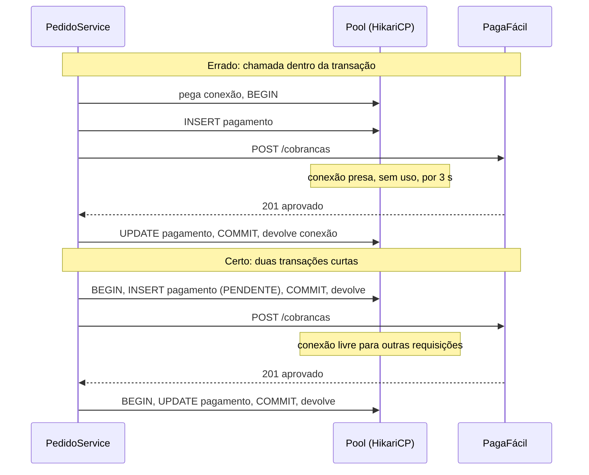
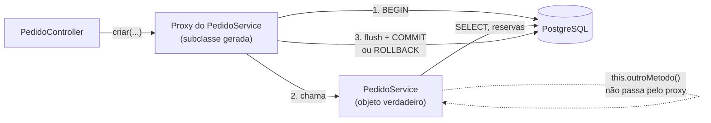

## O problema

O Bazar vai receber pedidos. Criar um pedido não é uma gravação só: para cada item, o estoque do produto é reservado, e no fim o pedido e os itens são gravados. Imagine um pedido com dois livros, em que o primeiro tem estoque e o segundo não:

1. Reserva 2 unidades de *Clean Code*. Gravado.
2. Tenta reservar 2 de *Refactoring*, que só tem 1. Erro.

Sem uma **<Term id="transacao">transação</Term>**, a reserva do passo 1 fica no banco. O cliente recebe um erro, nenhum pedido existe, e duas unidades de *Clean Code* ficam presas numa reserva que ninguém vai usar. Repita isso algumas centenas de vezes e o Bazar "esgota" produtos que estão na prateleira.

O segundo problema aparece quando a transação existe, mas está grande demais. Na Parte 10, o Bazar vai cobrar pedidos na PagaFácil, um *gateway* que às vezes demora segundos para responder. Se essa chamada acontecer **dentro** da transação, a conexão com o banco fica presa durante toda a espera. O *pool* tem poucas conexões; bastam algumas cobranças lentas ao mesmo tempo para que **todas** as requisições do Bazar, até um simples `GET /v1/categorias`, fiquem esperando uma conexão.

Pense numa transferência no caixa do banco. O caixa debita uma conta e credita a outra; se a energia cai entre as duas operações, o banco desfaz o débito, porque um extrato com só metade da transferência é inaceitável. E o caixa não fica com o guichê aberto e a operação pendente enquanto o cliente vai até o carro buscar um documento: primeiro o cliente traz tudo, depois a operação é feita, rapidamente.

> **A pergunta desta página:** onde começam e terminam as transações do Bazar, e o que nunca deve acontecer dentro delas?

## O conceito

### `@Transactional` e o *proxy*

Um método anotado com `@Transactional` roda dentro de uma transação: ela começa antes do método e, ao fim, é **confirmada** (*commit*) se o método terminar normalmente, ou **desfeita** (*rollback*) se ele lançar uma exceção não verificada.

Quem faz isso é um <Term id="proxy">*proxy*</Term>, o mesmo mecanismo de AOP de [09.04](/construindo-apis-com-spring-boot/filtros-interceptors-e-aop-quando-usar-cada-um). O *bean* que o controller recebe não é o `PedidoService`, e sim uma subclasse gerada pelo Spring que, a cada chamada:

1. pede uma conexão ao *pool* e abre a transação (`setAutoCommit(false)`);
2. chama o método verdadeiro;
3. faz o *commit* (o Hibernate grava antes as mudanças pendentes, o *flush*) ou o *rollback*;
4. devolve a conexão ao *pool*.

A conexão fica presa entre os passos 1 e 4, durante **todo** o método.

### Onde colocar: no serviço

A transação delimita uma **operação de negócio**: "criar um pedido" inclui reservar o estoque de cada item e gravar o pedido. Essa operação mora no serviço do domínio. Por isso:

- **No serviço, sim.** `PedidoService.criar` é a unidade que deve acontecer por inteiro ou não acontecer.
- **No controller, não.** O controller lida com HTTP: converte o JSON, valida, monta a resposta. Uma transação ali engloba a serialização da resposta e qualquer outra coisa que o controller faça, e espalha a regra de negócio pela camada de API.
- **No repositório, já existe.** Os métodos do `SimpleJpaRepository` são `@Transactional`: um `save` isolado roda numa transação só dele. É exatamente o que causa o problema da introdução: cada `save` confirma por conta própria.

Com `@Transactional(readOnly = true)`, o Spring avisa o Hibernate e o *driver* de que a transação só lê. O Hibernate deixa de fazer o *dirty checking* no fim, o que poupa trabalho em leituras grandes, e o PostgreSQL recusa qualquer escrita.

### *Rollback*: exceções verificadas e não verificadas

Por padrão, o Spring desfaz a transação em `RuntimeException` e `Error`, mas **confirma** em exceções verificadas (*checked*, as que estendem `Exception`). É uma herança do EJB, em que as exceções verificadas representavam resultados de negócio esperados.

As exceções do Bazar (`RegraDeNegocioException`, `CampoInvalidoException`, a nova `EstoqueInsuficienteException`) são não verificadas, e o *rollback* acontece. Para uma exceção verificada que também deve desfazer a transação, há duas saídas:

```java
@Transactional(rollbackFor = ArquivoInvalidoException.class)   // método a método
public void importar(...) throws ArquivoInvalidoException { ... }
```

```java
@EnableTransactionManagement(rollbackOn = RollbackOn.ALL_EXCEPTIONS)   // aplicação inteira, Spring 6.2+
```

### *Self-invocation*

Como o *proxy* só intercepta chamadas que vêm **de fora** do *bean*, um método que chama outro da mesma classe passa direto pelo objeto verdadeiro:

```java
public void importarTudo(List<Linha> linhas) {
    linhas.forEach(this::importarUma);   // this é o objeto verdadeiro, não o proxy
}

@Transactional(propagation = Propagation.REQUIRES_NEW)
public void importarUma(Linha linha) { ... }   // aqui, a anotação é ignorada
```

Não há erro nem aviso: a transação simplesmente não existe. A mesma armadilha foi demonstrada com o aspecto de auditoria em 09.04. A solução é mover o método para outro *bean*, ou usar o `TransactionTemplate` (adiante). Pelo mesmo motivo, `@Transactional` em métodos `private` não tem efeito.

### Propagação

A <Term id="propagacao">propagação</Term> define o que acontece quando um método transacional é chamado com uma transação já aberta:

| Propagação | Com transação em andamento | Sem transação |
|---|---|---|
| `REQUIRED` (padrão) | Participa dela | Abre uma |
| `REQUIRES_NEW` | Suspende a atual e abre outra, independente | Abre uma |
| `MANDATORY` | Participa | Lança exceção |
| `SUPPORTS` | Participa | Roda sem transação |
| `NOT_SUPPORTED` | Suspende a atual e roda sem | Roda sem |
| `NEVER` | Lança exceção | Roda sem |

Na prática, `REQUIRED` resolve quase tudo: o `ProdutoService.criar` chama `produtos.save` e `estoques.save`, os dois `@Transactional` do Spring Data, e os dois participam da transação do serviço.

`REQUIRES_NEW` serve para algo que precisa ser gravado **mesmo que a transação externa seja desfeita**, como um registro de auditoria de uma tentativa que falhou. Ela tem um custo: enquanto a transação interna roda, a externa continua segurando a **sua** conexão, e a interna pega outra. Uma requisição usa duas conexões; com o *pool* sob pressão, requisições assim podem esperar umas pelas outras até o tempo limite.

Uma armadilha do `REQUIRED`: se um método interno lança uma exceção e o externo a captura e segue em frente, a transação já foi **marcada para *rollback*** pelo interno. No fim, o *commit* falha com `UnexpectedRollbackException`. Capturar a exceção não "salva" a transação.

### Isolamento

O isolamento define o que uma transação enxerga das outras que rodam ao mesmo tempo. O padrão do PostgreSQL é `READ COMMITTED`: cada comando vê os dados confirmados até o momento em que **ele** começou. Dois comandos iguais na mesma transação podem ver resultados diferentes, se outra transação confirmar no meio.

| Nível | O que garante | No PostgreSQL |
|---|---|---|
| `READ COMMITTED` | Nunca vê dados não confirmados | Padrão |
| `REPEATABLE READ` | A transação inteira vê um retrato fixo do banco | Pode falhar com erro de serialização |
| `SERIALIZABLE` | O resultado é igual ao de rodar as transações uma depois da outra | Pode falhar com erro de serialização |

O Bazar fica no padrão (`@Transactional(isolation = ...)` muda o nível por método). O isolamento sozinho **não impede** que duas reservas simultâneas usem o mesmo saldo de estoque; isso é assunto de [10.06](/persistencia-para-apis/concorrencia-no-banco-locking-otimista-e-pessimista).

### Nada de I/O remoto dentro da transação

Esta é a regra mais importante da página. Uma chamada HTTP leva de dezenas de milissegundos a vários segundos (ou até o tempo limite, se o outro lado travar). Dentro de uma transação, a conexão com o banco fica presa durante toda a espera, sem fazer nada.

O <Term id="pool-de-conexoes">*pool* de conexões</Term> do Spring Boot (HikariCP) tem **10** conexões por padrão. Dez cobranças lentas simultâneas bastam para esgotá-lo, e a partir daí qualquer requisição que precise do banco espera até 30 segundos (o `connection-timeout` padrão) e falha. A lentidão da PagaFácil vira indisponibilidade do Bazar inteiro.

Há ainda um problema de **consistência**: se a PagaFácil aprovar a cobrança e o *commit* falhar depois, o cliente foi cobrado por um pedido que o Bazar não registrou. Uma transação de banco não desfaz uma chamada HTTP.

O desenho correto separa as etapas:

1. **Transação curta:** grava o pagamento como `PENDENTE`. *Commit*.
2. **Sem transação:** chama a PagaFácil, com tempo limite ([25.01](/consumindo-outras-apis/timeouts-e-orcamento-de-tempo)).
3. **Transação curta:** grava o resultado (`APROVADO`, `RECUSADO`, ou mantém `PENDENTE` se a chamada falhou, para tentar de novo ou esperar o *webhook*).

O registro `PENDENTE` gravado antes da chamada é o que permite reconciliar depois qualquer falha entre as etapas.

### `TransactionTemplate`

Quando a transação deve cobrir **parte** de um método, a anotação não serve: ela vale para o método inteiro. O `TransactionTemplate` abre a transação em volta de um trecho de código:

```java
var pagamento = transacao.execute(status -> pagamentos.save(Pagamento.pendente(pedido)));
var resultado = pagaFacil.cobrar(pagamento);                       // fora de qualquer transação
transacao.executeWithoutResult(status -> registrarResultado(pagamento.getId(), resultado));
```

O Spring Boot já registra um *bean* `TransactionTemplate`; basta injetá-lo. Ele também resolve a *self-invocation*, porque não depende de *proxy*.

### Eventos depois do *commit*

Depois de criar um pedido, outras partes do Bazar querem reagir: avisar o cliente por e-mail, notificar sistemas parceiros por *webhook*. Fazer isso dentro do `PedidoService.criar` tem dois problemas: o serviço passa a conhecer todos os interessados, e o aviso poderia sair **antes** do *commit*, anunciando um pedido que depois é desfeito.

O serviço publica um evento com o `ApplicationEventPublisher`, e o ouvinte usa `@TransactionalEventListener`. O Spring guarda o evento e só o entrega na fase escolhida da transação:

| Fase | Quando o ouvinte roda |
|---|---|
| `AFTER_COMMIT` (padrão) | Só se a transação for confirmada |
| `AFTER_ROLLBACK` | Só se ela for desfeita |
| `AFTER_COMPLETION` | Nos dois casos |
| `BEFORE_COMMIT` | Antes do *commit*, ainda dentro da transação |

Um ouvinte `AFTER_COMMIT` roda depois que a transação acabou. Ele não pode desfazer o pedido, e uma gravação no banco feita por ele precisa de uma transação própria (`REQUIRES_NEW`). E se a aplicação cair entre o *commit* e o ouvinte, o evento se perde: o aviso é "no máximo uma vez". A entrega garantida, gravando o evento na mesma transação do pedido, é o padrão Outbox ([30.04](/arquitetura/padrao-outbox)).

## Diagrama

A conexão durante uma cobrança que leva 3 segundos:



E o *proxy* transacional em volta do `PedidoService`:



## Na prática

### O `PedidoService`

O módulo `pedidos` chega ao Bazar com `POST /v1/pedidos` e `GET /v1/pedidos/{id}`, e o `Estoque` vira entidade (a tabela foi criada em [10.02](/persistencia-para-apis/migrations-com-flyway)). A criação do pedido é uma única transação:

```java title="src/main/java/com/bazar/pedidos/dominio/PedidoService.java"
@Service
public class PedidoService {

    private final PedidoRepository pedidos;
    private final ProdutoRepository produtos;
    private final EstoqueRepository estoques;
    private final ClienteRepository clientes;
    private final ApplicationEventPublisher eventos;

    // construtor omitido

    // Tudo ou nada: se a reserva de qualquer item falhar, as reservas dos itens anteriores e o pedido são desfeitos.
    @Transactional
    public Pedido criar(UUID clienteId, List<ItemSolicitado> itens) {
        if (clientes.findById(clienteId).isEmpty()) {
            throw new CampoInvalidoException("clienteId", "bazar.pedido.cliente-inexistente");
        }
        var pedido = new Pedido(clienteId);
        for (int i = 0; i < itens.size(); i++) {
            var solicitado = itens.get(i);
            var campo = "itens[" + i + "].produtoId";
            var produto = produtos.findById(solicitado.produtoId())
                    .orElseThrow(() -> new CampoInvalidoException(campo, "bazar.pedido.produto-inexistente"));
            var estoque = estoques.findById(produto.getId())
                    .orElseThrow(() -> new IllegalStateException("Produto sem estoque: " + produto.getId()));
            // Sem save: o estoque está gerenciado pela transação, e o dirty checking grava a mudança no commit.
            estoque.reservar(solicitado.quantidade());
            pedido.adicionarItem(produto, solicitado.quantidade());
        }
        pedidos.save(pedido);
        // Publicado agora, entregue aos ouvintes @TransactionalEventListener só depois do commit.
        eventos.publishEvent(new PedidoCriado(pedido.getId(), clienteId, pedido.getValorTotal()));
        return pedido;
    }

    @Transactional(readOnly = true)
    public Optional<Pedido> buscar(UUID id) {
        return pedidos.findComItensById(id);
    }
}
```

A reserva é uma regra do `Estoque`, que lança uma exceção não verificada quando o saldo não basta:

```java title="src/main/java/com/bazar/estoque/dominio/Estoque.java"
    // Reservar tira do disponível e guarda para o pedido; a baixa definitiva acontece no envio.
    // A proteção contra duas reservas simultâneas do mesmo saldo é assunto de 10.06.
    public void reservar(int quantidade) {
        if (quantidade > quantidadeDisponivel) {
            throw new EstoqueInsuficienteException(produtoId, quantidadeDisponivel, quantidade);
        }
        quantidadeDisponivel -= quantidade;
        quantidadeReservada += quantidade;
    }
```

O `Pedido` copia o SKU, o nome e o preço de cada produto para o item: o pedido registra o que foi comprado, e por quanto, mesmo que o produto mude depois. O preço nunca vem do cliente. Os valores usam o tipo `Dinheiro` do Bazar (`{"valor": "139.90", "moeda": "BRL"}`).

O controller não tem `@Transactional`; ele só traduz HTTP:

```java title="src/main/java/com/bazar/pedidos/api/PedidoController.java"
    @PostMapping
    public ResponseEntity<PedidoResponse> criar(@Valid @RequestBody CriarPedidoRequest request) {
        var pedido = servico.criar(request.clienteId(), request.itensSolicitados());
        var location = ServletUriComponentsBuilder.fromCurrentRequest()
                .path("/{id}")
                .buildAndExpand(pedido.getId())
                .toUri();
        return ResponseEntity.created(location).body(PedidoResponse.de(pedido));
    }
```

<HttpExchange
  title="Criando um pedido"
  request={{ method: 'POST', url: 'http://localhost:8080/v1/pedidos', headers: { 'Content-Type': 'application/json' }, body: { clienteId: '550a39f8-1400-4dc8-a5dd-4339111ee4dd', itens: [{ produtoId: 'bcd399f5-d6d1-4032-9c80-10ca4c363d31', quantidade: 2 }] } }}
  response={{
    status: 201,
    headers: { 'Location': 'http://localhost:8080/v1/pedidos/49e34c29-d967-42d5-b136-309a2638517e', 'Content-Type': 'application/json' },
    body: { id: '49e34c29-d967-42d5-b136-309a2638517e', clienteId: '550a39f8-1400-4dc8-a5dd-4339111ee4dd', status: 'CRIADO', itens: [{ produtoId: 'bcd399f5-d6d1-4032-9c80-10ca4c363d31', sku: 'LIV-0042', nomeProduto: 'Clean Code (2ª ed.)', quantidade: 2, precoUnitario: { valor: '139.90', moeda: 'BRL' }, subtotal: { valor: '279.80', moeda: 'BRL' } }], valorItens: { valor: '279.80', moeda: 'BRL' }, valorFrete: { valor: '0.00', moeda: 'BRL' }, valorTotal: { valor: '279.80', moeda: 'BRL' }, criadoEm: '2026-10-25T04:14:19.464423Z' },
  }}
>
  O frete é zero até a cotação com a FreteJá. Com o log de SQL ligado, a transação inteira aparece em sequência: os dois `SELECT`, os dois `INSERT` e o `UPDATE` do estoque, este com `where produto_id=? and versao=?`, que é o *locking* otimista de 10.06. Só depois do *commit* aparece a linha do ouvinte: `pedido.criado id=49e34c29-... total=279.80`.
</HttpExchange>

### O *rollback* em ação

O mesmo produto tinha 3 unidades livres. Um pedido com dois itens dele, 1 e depois 9 unidades:

<HttpExchange
  title="Estoque insuficiente no segundo item"
  request={{ method: 'POST', url: 'http://localhost:8080/v1/pedidos', headers: { 'Content-Type': 'application/json', 'Accept-Language': 'pt-BR' }, body: { clienteId: '550a39f8-1400-4dc8-a5dd-4339111ee4dd', itens: [{ produtoId: 'bcd399f5-d6d1-4032-9c80-10ca4c363d31', quantidade: 1 }, { produtoId: 'bcd399f5-d6d1-4032-9c80-10ca4c363d31', quantidade: 9 }] } }}
  response={{
    status: 409,
    headers: { 'Content-Type': 'application/problem+json' },
    body: { type: 'https://api.bazar.example/problemas/estoque-insuficiente', title: 'Estoque insuficiente', status: 409, detail: 'O produto bcd399f5-d6d1-4032-9c80-10ca4c363d31 tem 2 unidade(s) disponível(is); foram pedidas 9.', instance: '/v1/pedidos', quantidadeSolicitada: 9, produtoId: 'bcd399f5-d6d1-4032-9c80-10ca4c363d31', quantidadeDisponivel: 2, codigo: 'ESTOQUE_INSUFICIENTE', traceId: '8240ca7d70eaf580661852bc199cf585' },
  }}
>
  "2 disponíveis", e não 3: dentro da transação, o primeiro item já tinha reservado 1. O segundo `findById` do mesmo estoque nem chegou ao banco; o Hibernate devolveu a mesma instância do contexto de persistência. No log, esse pedido tem só dois `SELECT` e nenhum `INSERT` ou `UPDATE`: as mudanças estavam na memória, esperando o *flush* do *commit*, e o *rollback* as descartou. Se algo já tivesse sido enviado ao banco antes da exceção, o *rollback* do PostgreSQL desfaria do mesmo jeito.
</HttpExchange>

O teste confere o estado do banco depois da falha, e que o ouvinte `AFTER_COMMIT` não rodou:

```java title="src/test/java/com/bazar/pedidos/api/PedidoControllerTest.java"
    @Test
    void desfazTudoQuandoUmItemNaoTemEstoque(CapturedOutput saida) {
        // O primeiro item tem estoque e é reservado; o segundo pede 2 de um produto com 1.
        var resposta = mvc.post().uri("/v1/pedidos").contentType(MediaType.APPLICATION_JSON)
                .header("Accept-Language", "pt-BR")
                .content("""
                        { "clienteId": "%s",
                          "itens": [ { "produtoId": "%s", "quantidade": 2 }, { "produtoId": "%s", "quantidade": 2 } ] }
                        """.formatted(clienteId, cleanCode, refactoring))
                .exchange();

        assertThat(resposta).hasStatus(HttpStatus.CONFLICT)
                .bodyJson().isLenientlyEqualTo("""
                        { "type": "https://api.bazar.example/problemas/estoque-insuficiente",
                          "codigo": "ESTOQUE_INSUFICIENTE", "produtoId": "%s",
                          "quantidadeDisponivel": 1, "quantidadeSolicitada": 2 }
                        """.formatted(refactoring));
        // A reserva do primeiro item foi desfeita junto com o resto da transação.
        assertThat(estoques.findById(cleanCode)).get()
                .returns(5, e -> e.getQuantidadeDisponivel())
                .returns(0, e -> e.getQuantidadeReservada());
        assertThat(jdbc.sql("select count(*) from pedido").query(Long.class).single()).isZero();
        assertThat(saida).doesNotContain("pedido.criado id=");
    }
```

### O evento depois do *commit*

```java title="src/main/java/com/bazar/pedidos/infraestrutura/RegistroDePedidosCriados.java"
@Component
class RegistroDePedidosCriados {

    private static final Logger log = LoggerFactory.getLogger(RegistroDePedidosCriados.class);

    // AFTER_COMMIT (o padrão): só roda se a transação que publicou o evento for confirmada.
    // Um pedido desfeito por falta de estoque nunca chega aqui.
    @TransactionalEventListener
    void aoCriarPedido(PedidoCriado evento) {
        log.info("pedido.criado id={} cliente={} total={}", evento.pedidoId(), evento.clienteId(), evento.valorTotal().valor());
    }
}
```

Por enquanto, o ouvinte só registra. Ele é o ponto onde, mais adiante, entram o e-mail ao cliente e os *webhooks* para parceiros.

### Os serviços do catálogo

Os controllers do catálogo também passam a delegar para serviços transacionais:

- **`ProdutoService.criar`** grava o produto e o seu estoque zerado na mesma transação. Um produto sem estoque não pode existir. A `V7` cria o estoque dos produtos gravados antes desta página.
- **`ProdutoService.atualizar`** resolve o que [10.01](/persistencia-para-apis/spring-data-jpa-essencial-para-apis) deixou pendente. Sem transação, o `PUT` fazia dois `SELECT` do produto (um no `findById`, outro dentro do `save`, que chamava `merge` numa entidade desanexada). Agora o produto continua gerenciado até o fim do método, e o `save` nem é chamado:

```java title="src/main/java/com/bazar/catalogo/dominio/ProdutoService.java"
    // Sem save: o produto carregado continua gerenciado até o commit, e o dirty checking gera o UPDATE.
    @Transactional
    public Produto atualizar(UUID id, String nome, @Nullable String descricao, Dinheiro preco, UUID categoriaId,
            Map<String, String> atributos) {
        var produto = produtos.findById(id)
                .orElseThrow(() -> new RecursoNaoEncontradoException("produto-nao-encontrado", id));
        exigirCategoria(categoriaId);
        produto.atualizar(nome, descricao, preco, categoriaId, atributos);
        return produto;
    }
```

O log de SQL do `PUT /v1/produtos/{id}`, agora:

```text
select p1_0.id,p1_0.atributos,p1_0.atualizado_em,... from produto p1_0 where p1_0.id=?
select count(*) from categoria c1_0 where c1_0.id=?
update produto set atributos=?,atualizado_em=?,categoria_id=?,descricao=?,nome=?,preco_valor=?,preco_moeda=?,status=?,versao=? where id=? and versao=?
```

- **`CategoriaService.remover`** confere as regras e remove na mesma transação. Ganhou uma regra nova: uma categoria com subcategorias responde `409` (`categoria-com-subcategorias`), em vez de deixar a chave estrangeira de `pai_id` virar um `500`.

### Medindo a conexão presa

Para ver o efeito de uma chamada lenta dentro da transação, uma sonda no Bazar reduziu o *pool* para 2 conexões, com tempo limite de 1 segundo, e disparou 4 chamadas simultâneas a dois métodos. Os dois fazem um `select 1` e esperam 3 segundos, simulando a PagaFácil. O primeiro espera dentro de um método `@Transactional`; o segundo usa o `TransactionTemplate` só em volta do `select`:

```text
errado: conexões ativas durante a chamada lenta: 2 de 2, threads esperando: 2
errado: ok=2 falhas=2 tempo=3032ms
        SQLTransientConnectionException: HikariPool-1 - Connection is not available, request timed out after 1003ms (total=2, active=2, idle=0, waiting=0)
certo:  conexões ativas durante a chamada lenta: 0 de 2, threads esperando: 0
certo:  ok=4 falhas=0 tempo=3008ms
```

Mesma espera, mesmo número de chamadas. Na versão errada, duas requisições falharam sem nem chegar à PagaFácil, só por não conseguirem uma conexão. Na versão certa, nenhuma conexão ficou ocupada durante a espera. Num Bazar real, as "requisições que falharam" seriam as de qualquer outro *endpoint*.

## Erros comuns

<BadVsGood title="Cobrança na PagaFácil dentro da transação" why="A conexão fica presa durante toda a chamada HTTP, e algumas cobranças lentas esgotam o pool para a aplicação inteira. Pior: se a PagaFácil aprovar e o commit falhar, o cliente é cobrado sem pedido registrado. Com transações curtas e o registro PENDENTE, a conexão só é usada para gravar, e uma falha entre as etapas pode ser reconciliada.">
<Bad title="Uma transação em volta de tudo">

```java
@Transactional
public Pagamento pagar(UUID pedidoId) {
    var pedido = pedidos.findById(pedidoId).orElseThrow();
    var resultado = pagaFacil.cobrar(pedido);   // 3 s com a conexão presa
    return pagamentos.save(Pagamento.de(pedido, resultado));
}
```

</Bad>
<Good title="Gravar, chamar, gravar">

```java
public Pagamento pagar(UUID pedidoId) {
    var pagamento = transacao.execute(s -> pagamentos.save(
            Pagamento.pendente(pedidos.findById(pedidoId).orElseThrow())));
    var resultado = pagaFacil.cobrar(pagamento);   // sem conexão presa
    return transacao.execute(s -> registrarResultado(pagamento.getId(), resultado));
}
```

</Good>
</BadVsGood>

Outros erros frequentes:

- **Uma operação de negócio sem transação**, em vários `save` isolados: uma falha no meio deixa metade gravada.
- **`@Transactional` no controller**, englobando HTTP e serialização.
- **Chamar um método `@Transactional` da mesma classe** (*self-invocation*) ou anotar um método `private`: a anotação é ignorada sem aviso.
- **Contar com o *rollback* numa exceção verificada.** O padrão é confirmar.
- **Capturar a exceção de um método interno** e seguir: a transação já está marcada para *rollback*, e o *commit* lança `UnexpectedRollbackException`.
- **Mandar e-mail, publicar mensagem ou chamar *webhook* dentro da transação**: o aviso sai mesmo que a transação seja desfeita depois. Use `@TransactionalEventListener`.
- **Usar `REQUIRES_NEW` por hábito**: cada uso segura uma segunda conexão.
- **Esperar que o isolamento padrão impeça a venda do mesmo estoque duas vezes.** Não impede (10.06).

## Boas práticas

- **Coloque** `@Transactional` nos métodos públicos dos serviços, um por operação de negócio.
- **Use** `readOnly = true` nas consultas.
- **Mantenha** a transação curta: nada de HTTP, arquivos grandes ou esperas dentro dela.
- **Use** o `TransactionTemplate` para cobrir só parte de um método.
- **Publique** eventos e reaja a eles com `@TransactionalEventListener`.
- **Prefira** exceções não verificadas para regras de negócio, ou configure `rollbackFor`.
- **Teste** o *rollback*: confira o banco depois de uma falha, não só o status da resposta.

## Por baixo dos panos

<DeepDive title="Como a transação chega ao repositório">
O `JpaTransactionManager` abre a transação e guarda o `EntityManager` e a conexão num `ThreadLocal`, por meio do `TransactionSynchronizationManager`. Quando o `PedidoService` chama `estoques.findById`, o repositório do Spring Data usa um `EntityManager` compartilhado que procura, nesse `ThreadLocal`, o da transação em andamento. Por isso o `Estoque` carregado pelo repositório é a mesma instância que o *dirty checking* confere no *commit*.

A consequência: a transação pertence à *thread*. Um trabalho enviado para outra *thread* (um `@Async`, um `CompletableFuture.supplyAsync`) não participa da transação de quem o enviou. Ele roda sem transação, ou com uma própria. Isso vale também para *virtual threads*.

Os eventos de `@TransactionalEventListener` usam o mesmo mecanismo: o `publishEvent` registra uma `TransactionSynchronization` na transação corrente, e o gerenciador chama o ouvinte no `afterCommit`. Se não houver transação em andamento, o evento é **descartado**, a menos que o ouvinte tenha `fallbackExecution = true`.
</DeepDive>

## No projeto Bazar

<ProjectStep title="Serviços transacionais, estoque e pedidos" module="pedidos" tag="pagina-10.03" files={[
  { path: 'src/main/resources/db/migration/V7__criar_estoque_dos_produtos_existentes.sql', change: 'novo' },
  { path: 'src/main/resources/db/migration/V8__criar_pedidos.sql', change: 'novo' },
  { path: 'src/main/java/com/bazar/estoque/dominio/Estoque.java', change: 'novo' },
  { path: 'src/main/java/com/bazar/estoque/dominio/EstoqueInsuficienteException.java', change: 'novo' },
  { path: 'src/main/java/com/bazar/estoque/dominio/EstoqueRepository.java', change: 'novo' },
  { path: 'src/main/java/com/bazar/pedidos/dominio/Pedido.java', change: 'novo' },
  { path: 'src/main/java/com/bazar/pedidos/dominio/ItemPedido.java', change: 'novo' },
  { path: 'src/main/java/com/bazar/pedidos/dominio/StatusPedido.java', change: 'novo' },
  { path: 'src/main/java/com/bazar/pedidos/dominio/PedidoRepository.java', change: 'novo' },
  { path: 'src/main/java/com/bazar/pedidos/dominio/PedidoService.java', change: 'novo' },
  { path: 'src/main/java/com/bazar/pedidos/dominio/PedidoCriado.java', change: 'novo' },
  { path: 'src/main/java/com/bazar/pedidos/infraestrutura/RegistroDePedidosCriados.java', change: 'novo' },
  { path: 'src/main/java/com/bazar/pedidos/api/PedidoController.java', change: 'novo' },
  { path: 'src/main/java/com/bazar/pedidos/api/CriarPedidoRequest.java', change: 'novo' },
  { path: 'src/main/java/com/bazar/pedidos/api/PedidoResponse.java', change: 'novo' },
  { path: 'src/main/java/com/bazar/catalogo/dominio/ProdutoService.java', change: 'novo' },
  { path: 'src/main/java/com/bazar/catalogo/dominio/CategoriaService.java', change: 'novo' },
  { path: 'src/main/java/com/bazar/catalogo/api/ProdutoController.java', change: 'alterado' },
  { path: 'src/main/java/com/bazar/catalogo/api/CategoriaController.java', change: 'alterado' },
  { path: 'src/test/java/com/bazar/pedidos/api/PedidoControllerTest.java', change: 'novo' },
  { path: 'src/test/java/com/bazar/LimpezaDoBanco.java', change: 'novo' },
]}>
O módulo `pedidos` nasce com `POST /v1/pedidos`, que reserva o estoque de cada item numa única transação, e `GET /v1/pedidos/{id}`. O `PedidoCriado` é entregue depois do *commit*. O catálogo ganha `ProdutoService` (produto e estoque juntos; `PUT` com um `SELECT` só) e `CategoriaService` (`409` para categoria com subcategorias).
</ProjectStep>

## Resumo

- `@Transactional` funciona por *proxy*: *commit* no fim normal, *rollback* em exceção não verificada.
- A transação delimita uma operação de negócio e mora no **serviço**; `readOnly = true` nas consultas.
- Exceções verificadas **não** desfazem a transação por padrão (`rollbackFor` ou `RollbackOn.ALL_EXCEPTIONS`).
- *Self-invocation* e métodos `private` ignoram a anotação.
- `REQUIRED` resolve quase tudo; `REQUIRES_NEW` segura uma segunda conexão.
- **Nunca** faça I/O remoto dentro da transação: grave, chame fora, grave de novo. O `TransactionTemplate` ajuda.
- `@TransactionalEventListener` entrega eventos só depois do *commit*.

<Exercise title="O reembolso" difficulty="medio">
O Bazar vai implementar o reembolso de um pedido pago. A operação precisa:

1. conferir que o pedido está `PAGO`;
2. pedir o estorno à PagaFácil (que pode demorar ou falhar);
3. mudar o pedido para `REEMBOLSADO` e devolver as unidades ao estoque;
4. avisar o cliente por e-mail.

Desenhe o `ReembolsoService`: quais etapas ficam em transação, quantas transações são, e o que acontece se a PagaFácil der tempo esgotado na etapa 2.

<Hint>
O estorno é uma chamada HTTP. O e-mail não deve sair se o reembolso não for confirmado. Pense também no que precisa estar gravado antes de chamar a PagaFácil, para que uma falha possa ser retomada.
</Hint>

<Solution>

```java
public void reembolsar(UUID pedidoId) {
    // Transação 1: confere e registra a intenção.
    var reembolso = transacao.execute(s -> {
        var pedido = pedidos.findById(pedidoId).orElseThrow(...);
        pedido.exigirStatus(StatusPedido.PAGO);
        return reembolsos.save(Reembolso.solicitado(pedido));
    });

    // Fora de transação: a chamada lenta.
    var resultado = pagaFacil.estornar(reembolso);

    // Transação 2: aplica o resultado e publica o evento.
    transacao.executeWithoutResult(s -> concluir(reembolso.getId(), resultado));
}
```

- **Transação 1** confere o status e grava o reembolso como `SOLICITADO`. Esse registro marca que há um estorno em andamento.
- **A chamada à PagaFácil** fica fora de transação, com tempo limite.
- **Transação 2** muda o pedido para `REEMBOLSADO`, devolve as unidades ao estoque e marca o reembolso como `CONCLUIDO`. É uma única transação, para que pedido e estoque nunca fiquem divergentes. Ela publica `ReembolsoConcluido`.
- **O e-mail** sai num `@TransactionalEventListener` (`AFTER_COMMIT`), e só se a transação 2 for confirmada.
- **Com tempo esgotado**, o Bazar não sabe se o estorno foi feito. O reembolso fica `SOLICITADO`, e o resultado vem depois: pelo *webhook* da PagaFácil ([21.03](/padroes-avancados-de-http/webhooks-enviando-e-recebendo)) ou por uma nova tentativa, com a mesma chave de idempotência ([21.01](/padroes-avancados-de-http/idempotency-keys)) para que o estorno não seja feito duas vezes.

</Solution>
</Exercise>

<Quiz
  questions={[
    {
      question: 'O método public void importarTudo() chama this.importarUma(), anotado com @Transactional(propagation = REQUIRES_NEW), na mesma classe. O que acontece?',
      options: [
        'Cada importarUma roda numa transação nova, como pedido',
        'A anotação é ignorada: a chamada via this não passa pelo proxy',
        'O Spring lança uma exceção na inicialização',
      ],
      answer: 1,
      explanation: 'O proxy só intercepta chamadas vindas de fora do bean. Mova importarUma para outro bean ou use o TransactionTemplate.',
    },
    {
      question: 'Um método @Transactional lança IOException (verificada) depois de gravar duas linhas. O que acontece com elas, no padrão do Spring?',
      options: [
        'São desfeitas',
        'São confirmadas: exceções verificadas não causam rollback por padrão',
        'Ficam pendentes até a próxima transação',
      ],
      answer: 1,
      explanation: 'O padrão desfaz só em RuntimeException e Error. Use rollbackFor, ou RollbackOn.ALL_EXCEPTIONS no @EnableTransactionManagement.',
    },
    {
      question: 'Por que a cobrança na PagaFácil não deve ficar dentro da transação que grava o pagamento?',
      options: [
        'Porque o Spring não permite chamadas HTTP em métodos @Transactional',
        'Porque a conexão fica presa durante a espera, o pool se esgota, e o rollback não desfaz uma cobrança já aprovada',
        'Porque o RestClient abre a sua própria transação',
      ],
      answer: 1,
      explanation: 'Na sonda do Bazar, com a espera dentro da transação, metade das chamadas falhou por falta de conexão. Com transações curtas em volta da chamada, nenhuma conexão ficou ocupada.',
    },
    {
      question: 'Um ouvinte com @TransactionalEventListener (fase padrão) recebe PedidoCriado. Quando ele roda?',
      options: [
        'Imediatamente, no publishEvent',
        'Depois do commit, e só se a transação for confirmada',
        'Antes do commit, para poder desfazer o pedido',
      ],
      answer: 1,
      explanation: 'A fase padrão é AFTER_COMMIT. No teste do Bazar, o pedido desfeito por falta de estoque não gerou a linha pedido.criado no log.',
    },
  ]}
/>

## Referências

<References />
