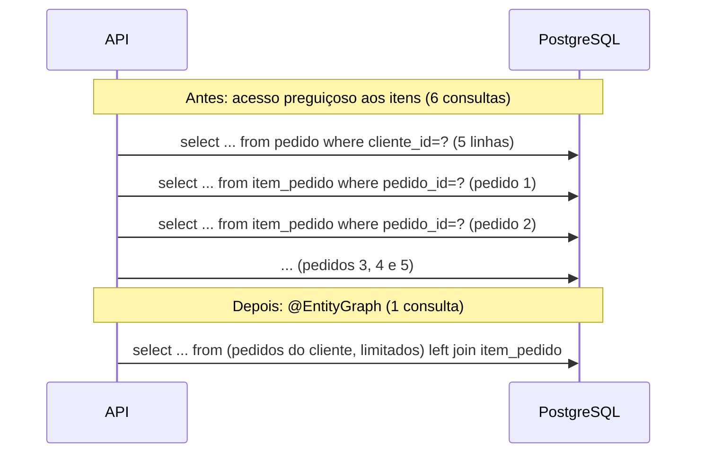

## O problema

O Bazar ganha `GET /v1/pedidos?clienteId=...`: os pedidos mais recentes de um cliente, cada um com os seus itens. Em desenvolvimento, o cliente de teste tem dois pedidos e a resposta sai em 15 ms. Em produção, um cliente fiel tem 20 pedidos na primeira página, e a resposta leva 400 ms. Com 50 requisições por segundo, o banco começa a sofrer.

O código não tem nada de errado à primeira vista: uma consulta busca os pedidos e o código percorre os itens de cada um. O problema só aparece no log de SQL: **uma** consulta para os pedidos e **mais uma para os itens de cada pedido**. Com 20 pedidos, 21 idas ao banco, quando 1 bastaria. É o problema **<Term id="n-mais-1">N+1</Term>**, e ele cresce com os dados. Por isso passa por todos os testes com bancos pequenos e explode em produção.

Pense num garçom que anota o pedido de uma mesa de dez pessoas indo à cozinha uma vez por prato: dez viagens, quando uma comanda com tudo resolveria. Cada viagem é rápida, mas o tempo que importa é o da soma, e enquanto ele anda, as outras mesas esperam.

> **A pergunta desta página:** como o N+1 acontece, como detectá-lo antes da produção, e como o Bazar busca pedidos e itens numa consulta só?

## O conceito

### `LAZY` e `EAGER`

Toda associação JPA tem um *fetch type*, que diz **quando** os dados associados são carregados:

| Associação | Padrão da JPA |
|---|---|
| `@ManyToOne`, `@OneToOne` | `EAGER` |
| `@OneToMany`, `@ManyToMany` | `LAZY` |

Com `LAZY`, o Hibernate coloca no lugar da coleção um objeto que só busca os dados no primeiro acesso: a `PersistentBag`, no caso de `Pedido.itens`. Ler os pedidos não lê os itens; chamar `pedido.getItens().size()` dispara um `SELECT` para os itens **daquele** pedido. Num laço sobre N pedidos, são N consultas.

`EAGER` parece a solução, mas **não é**:

- **Não elimina o N+1 em consultas.** Uma consulta JPQL ou derivada (`findByClienteId`) carrega o que a consulta pede. Depois, o Hibernate precisa preencher cada associação `EAGER` dos resultados, e faz isso com consultas adicionais, uma por pedido. O N+1 continua lá, só que agora sempre acontece.
- **Vale para todo uso da entidade.** Um caso que só precisa do pedido (conferir o status, por exemplo) passa a carregar os itens também, para sempre.

Por isso a regra é: **todas as associações `LAZY`**, inclusive as `@ManyToOne` (no `ItemPedido`, `fetch = FetchType.LAZY`), e cada consulta diz explicitamente o que precisa trazer.

### Com o OSIV desligado, o N+1 vira um erro

Em [10.01](/persistencia-para-apis/spring-data-jpa-essencial-para-apis), o Bazar desligou o *Open Session in View* (`spring.jpa.open-in-view: false`). Com ele ligado, o contexto de persistência fica aberto até o fim da requisição, e o acesso preguiçoso aos itens funciona até na serialização do JSON, gerando o N+1 sem nenhum aviso.

Com o OSIV desligado, o contexto fecha junto com a transação do serviço. O controller recebe pedidos com coleções ainda não carregadas, e o primeiro acesso falha:

```text
org.hibernate.LazyInitializationException: Cannot lazily initialize collection of role
'com.bazar.pedidos.dominio.Pedido.itens' with key 'c11abdf6-38ac-463a-bd59-006a1903ec5c' (no session)
```

O erro é uma vantagem: ele aparece no primeiro teste, e não em produção. A correção **não** é religar o OSIV, nem anotar o controller com `@Transactional`, nem chamar `Hibernate.initialize` em laço. Tudo isso esconde o erro e traz o N+1 de volta. A correção é a consulta trazer o que a resposta precisa.

### Como detectar

- **Log de SQL** em desenvolvimento: `logging.level.org.hibernate.SQL: debug`. Uma sequência de `SELECT` iguais, mudando só o parâmetro, é o N+1.
- **Contar as consultas num teste.** As estatísticas do Hibernate (`spring.jpa.properties.hibernate.generate_statistics: true`) contam os comandos preparados. O Bazar usa esse recurso, sem dependências novas. Outra opção é o `datasource-proxy-spring-boot-starter` (versão 2.0.x, compatível com o Boot 4), que intercepta o `DataSource` e conta qualquer SQL, inclusive o que não passa pelo Hibernate.
- **Em produção**, as métricas e os *traces* com os comandos SQL de cada requisição ([27.06](/observabilidade/tracing-distribuido-com-opentelemetry)) mostram uma requisição com dezenas de *spans* de banco.

### As soluções

**`JOIN FETCH`** na consulta JPQL traz a coleção no mesmo `SELECT`:

```java
@Query("select p from Pedido p join fetch p.itens where p.clienteId = :clienteId order by p.criadoEm desc")
List<Pedido> buscarComItens(UUID clienteId);
```

**`@EntityGraph`** faz o mesmo sem escrever JPQL, sobre uma consulta derivada. É o que o Bazar usa:

```java
@EntityGraph(attributePaths = "itens")
List<Pedido> findComItensByClienteIdOrderByCriadoEmDesc(UUID clienteId, Limit limite);
```

O `Com` em `findComItensBy...` não significa nada para o Spring Data: tudo entre `find` e `By` é ignorado. Ele serve para o nome dizer o que o método traz, ao lado de um `findByClienteId...` sem os itens.

**Carregamento em lote** (`@BatchSize` na coleção, ou `hibernate.default_batch_fetch_size` para a aplicação inteira): o acesso preguiçoso continua, mas, quando a primeira coleção é acessada, o Hibernate carrega de uma vez as coleções de vários pedidos do contexto. Com o valor 50, uma sonda no Bazar trocou 1 + 5 consultas por 2:

```text
select ... from pedido p1_0 where p1_0.cliente_id=? order by p1_0.criado_em desc fetch first ? rows only
select ... from item_pedido i1_0 where i1_0.pedido_id = any (?) order by i1_0.posicao
```

É uma boa rede de proteção, mas não substitui consultas explícitas, e continua dependendo de uma sessão aberta.

**Projeções de DTO**: a consulta devolve direto os campos que a resposta usa, sem entidades. É o assunto de [10.05](/persistencia-para-apis/projecoes-e-consultas-para-leitura).

### Paginação com `JOIN FETCH` de coleção

Uma consulta com `join fetch` de uma coleção devolve uma linha por **item**, e não por pedido. Um `limit 20` no SQL cortaria a lista no 20º item, e não no 20º pedido. Até o Hibernate 7.3, a saída era trazer **todas** as linhas e paginar na memória da JVM, com este aviso no log:

```text
HHH90003004: firstResult/maxResults specified with collection fetch; applying in memory
```

Para um cliente com 3.000 pedidos, isso carregava todos os pedidos e itens para devolver 20. A configuração `hibernate.query.fail_on_pagination_over_collection_fetch=true` transformava o aviso num erro, e a técnica recomendada era fazer **duas consultas**: primeiro os ids da página, sem a coleção; depois os pedidos desses ids, com a coleção.

```java
// Forma legada (antes do Hibernate 7.4): duas consultas.
@Query("select p.id from Pedido p where p.clienteId = :clienteId order by p.criadoEm desc")
List<UUID> idsDaPagina(UUID clienteId, Limit limite);

@EntityGraph(attributePaths = "itens")
List<Pedido> findByIdInOrderByCriadoEmDesc(List<UUID> ids);
```

**O Hibernate 7.4 resolveu isso no SQL.** Ele aplica o limite numa subconsulta só com os pedidos e faz o *join* com os itens por fora. O SQL real do `GET /v1/pedidos` do Bazar:

```sql
select p1_0.id, ..., i1_0.pedido_id, i1_0.id, i1_0.nome_produto, ...
  from (select p1_0.id, ... from pedido p1_0
         where p1_0.cliente_id=?
         order by p1_0.criado_em desc
         offset ? rows fetch first ? rows only) p1_0(id, ...)
  left join item_pedido i1_0 on p1_0.id=i1_0.pedido_id
 order by p1_0.criado_em desc, i1_0.posicao
```

Uma sonda conferiu o mesmo comportamento com `@EntityGraph` e `Limit`, com `@Query` com `join fetch` e `Pageable`, e com um `Page<Pedido>` (que acrescenta o `select count(*)`). Nenhum aviso apareceu, e cada página veio com 3 pedidos completos. A documentação do 7.4 diz que isso vale para todo banco que aceita `limit` e `offset` em subconsultas, o que inclui o PostgreSQL. Projetos em versões anteriores do Hibernate continuam precisando das duas consultas.

## Diagrama

As consultas de `GET /v1/pedidos` para um cliente com 5 pedidos:



## Na prática

### A listagem de pedidos

```java title="src/main/java/com/bazar/pedidos/dominio/PedidoRepository.java"
public interface PedidoRepository extends JpaRepository<Pedido, UUID> {

    // Traz os itens na mesma consulta: com o OSIV desligado, eles não podem ser carregados depois (10.04).
    @EntityGraph(attributePaths = "itens")
    Optional<Pedido> findComItensById(UUID id);

    // Sem o @EntityGraph, seriam 1 + N consultas: uma para os pedidos e uma para os itens de cada um.
    // Desde o Hibernate 7.4, o limite é aplicado no SQL mesmo com a coleção no join (subconsulta).
    @EntityGraph(attributePaths = "itens")
    List<Pedido> findComItensByClienteIdOrderByCriadoEmDesc(UUID clienteId, Limit limite);
}
```

O `Limit` do Spring Data limita o número de resultados sem a contagem de um `Page`. A paginação completa, por cursor, chega em [13.04](/design-de-apis-profissional/paginacao-por-cursor-keyset); por enquanto, os 20 mais recentes:

```java title="src/main/java/com/bazar/pedidos/dominio/PedidoService.java"
    // Os mais recentes primeiro. A paginação de verdade, com cursor, chega em 13.04.
    @Transactional(readOnly = true)
    public List<Pedido> listarDoCliente(UUID clienteId, int limite) {
        return pedidos.findComItensByClienteIdOrderByCriadoEmDesc(clienteId, Limit.of(limite));
    }
```

```java title="src/main/java/com/bazar/pedidos/api/PedidoController.java"
    @GetMapping
    public Lista<PedidoResponse> listar(@RequestParam UUID clienteId) {
        return new Lista<>(servico.listarDoCliente(clienteId, 20).stream().map(PedidoResponse::de).toList());
    }
```

<HttpExchange
  title="Pedidos de um cliente"
  request={{ method: 'GET', url: 'http://localhost:8080/v1/pedidos?clienteId=550a39f8-1400-4dc8-a5dd-4339111ee4dd' }}
  response={{
    status: 200,
    headers: { 'Content-Type': 'application/json' },
    body: { itens: [{ id: '49e34c29-d967-42d5-b136-309a2638517e', clienteId: '550a39f8-1400-4dc8-a5dd-4339111ee4dd', status: 'CRIADO', itens: [{ produtoId: 'bcd399f5-d6d1-4032-9c80-10ca4c363d31', sku: 'LIV-0042', nomeProduto: 'Clean Code (2ª ed.)', quantidade: 2, precoUnitario: { valor: '139.90', moeda: 'BRL' }, subtotal: { valor: '279.80', moeda: 'BRL' } }], valorItens: { valor: '279.80', moeda: 'BRL' }, valorFrete: { valor: '0.00', moeda: 'BRL' }, valorTotal: { valor: '279.80', moeda: 'BRL' }, criadoEm: '2026-10-25T04:14:19.464423Z' }] },
  }}
>
  Uma única linha `select ... from (select ... from pedido ...) left join item_pedido ...` aparece no log para esta requisição. Por enquanto, qualquer um pode listar os pedidos de qualquer cliente informando o `clienteId`. A autorização por objeto, que restringe cada cliente aos próprios pedidos, chega em [26.03](/seguranca-essencial-para-apis/autorizacao-por-objeto-exposicao-de-dados-e-validacao); veja também a [documentação de segurança](https://security-doc-beta.vercel.app/).
</HttpExchange>

### O teste que conta as consultas

Um utilitário de teste lê as estatísticas do Hibernate:

```java title="src/test/java/com/bazar/ContadorDeConsultas.java"
/**
 * Conta os comandos SQL que o Hibernate preparou durante um trecho de código (10.04).
 * Exige spring.jpa.properties.hibernate.generate_statistics=true no teste.
 */
public final class ContadorDeConsultas {

    private final Statistics estatisticas;

    public ContadorDeConsultas(EntityManagerFactory emf) {
        this.estatisticas = emf.unwrap(SessionFactory.class).getStatistics();
    }

    public long contar(Runnable trecho) {
        estatisticas.clear();
        trecho.run();
        return estatisticas.getPrepareStatementCount();
    }
}
```

E o teste fixa o número de consultas da listagem, para que uma mudança futura não traga o N+1 de volta sem ninguém perceber:

```java title="src/test/java/com/bazar/pedidos/api/PedidoControllerTest.java"
// As estatísticas do Hibernate permitem contar as consultas de cada requisição (10.04).
@SpringBootTest(properties = "spring.jpa.properties.hibernate.generate_statistics=true")
@AutoConfigureMockMvc
@Import(TestcontainersConfiguration.class)
@ExtendWith(OutputCaptureExtension.class)
class PedidoControllerTest {
    // ...

    @Test
    void listaOsPedidosDoClienteComUmaConsultaSo() {
        for (int i = 0; i < 5; i++) {
            mvc.post().uri("/v1/pedidos").contentType(MediaType.APPLICATION_JSON)
                    .content("""
                            { "clienteId": "%s", "itens": [ { "produtoId": "%s", "quantidade": 1 } ] }
                            """.formatted(clienteId, cleanCode))
                    .exchange();
        }

        var consultas = new ContadorDeConsultas(emf).contar(() ->
                assertThat(mvc.get().uri("/v1/pedidos?clienteId={id}", clienteId)).hasStatusOk()
                        .bodyJson().extractingPath("$.itens[*].itens[0].sku").asArray().hasSize(5).containsOnly("LIV-0042"));

        // Pedidos e itens no mesmo SELECT. Sem o @EntityGraph, seriam 6: 1 + 1 por pedido.
        assertThat(consultas).isEqualTo(1);
    }
```

Para conferir que o teste protege mesmo, o `@EntityGraph` foi retirado por um momento. O teste falhou, e não pela contagem: a resposta virou um `500`, com a `LazyInitializationException` no log, porque o OSIV está desligado. Numa sonda **com** uma transação aberta durante o acesso aos itens (a situação de quem usa OSIV), a mesma consulta sem `@EntityGraph` gerou 6 comandos: o `select ... from pedido` e cinco `select ... from item_pedido where pedido_id=?`.

## Erros comuns

<BadVsGood title="Resolver o LazyInitializationException" why="Religar o OSIV ou abrir uma transação no controller faz o erro sumir e traz o N+1 de volta, agora invisível. A consulta que traz o que a resposta precisa resolve as duas coisas.">
<Bad title="Esconder o erro">

```yaml
spring:
  jpa:
    open-in-view: true   # o JSON carrega os itens pedido a pedido
```

</Bad>
<Good title="Buscar o necessário">

```java
@EntityGraph(attributePaths = "itens")
List<Pedido> findComItensByClienteIdOrderByCriadoEmDesc(
        UUID clienteId, Limit limite);
```

</Good>
</BadVsGood>

Outros erros frequentes:

- **Trocar `LAZY` por `EAGER`** para "resolver": o N+1 continua em consultas JPQL e passa a acontecer em todo uso da entidade.
- **Deixar `@ManyToOne` no padrão `EAGER`.** Cada item carregaria o seu pedido, ou o seu produto, por conta própria.
- **Buscar duas coleções com `join fetch`** na mesma consulta (os itens e os pagamentos de um pedido, por exemplo). O resultado é um produto cartesiano: 10 itens × 3 pagamentos = 30 linhas por pedido. Com coleções do tipo `List` sem índice, o Hibernate recusa com `MultipleBagFetchException`. Busque uma coleção por consulta.
- **Paginar com `join fetch` de coleção em versões do Hibernate anteriores à 7.4** sem as duas consultas: tudo é carregado e paginado na memória.
- **Só testar com bancos pequenos** e sem contar consultas.

## Boas práticas

- **Declare** todas as associações como `LAZY`.
- **Busque** o que cada resposta precisa com `@EntityGraph` ou `join fetch`, em métodos de repositório com nomes que dizem o que trazem.
- **Mantenha** o OSIV desligado: o `LazyInitializationException` aponta o problema cedo.
- **Conte** as consultas nos testes dos *endpoints* de listagem.
- **Considere** o `default_batch_fetch_size` como rede de proteção, não como solução principal.
- **Use** projeções de DTO para listagens que não precisam de entidades (10.05).

## No projeto Bazar

<ProjectStep title="Listagem de pedidos sem N+1" module="pedidos" tag="pagina-10.04" files={[
  { path: 'src/main/java/com/bazar/pedidos/dominio/PedidoRepository.java', change: 'alterado' },
  { path: 'src/main/java/com/bazar/pedidos/dominio/PedidoService.java', change: 'alterado' },
  { path: 'src/main/java/com/bazar/pedidos/api/PedidoController.java', change: 'alterado' },
  { path: 'src/test/java/com/bazar/ContadorDeConsultas.java', change: 'novo' },
  { path: 'src/test/java/com/bazar/pedidos/api/PedidoControllerTest.java', change: 'alterado' },
]}>
`GET /v1/pedidos?clienteId=...` devolve os 20 pedidos mais recentes do cliente, com os itens, numa única consulta. Um teste conta as consultas com as estatísticas do Hibernate.
</ProjectStep>

## Resumo

- N+1: uma consulta para a lista e uma para cada elemento. Cresce com os dados e passa despercebido em bancos pequenos.
- `EAGER` não resolve; todas as associações ficam `LAZY`, e cada consulta pede o que precisa.
- Com o OSIV desligado, o N+1 vira `LazyInitializationException`, que aparece cedo.
- Soluções: `join fetch`, `@EntityGraph`, carregamento em lote, projeções de DTO.
- Desde o Hibernate 7.4, paginar com `join fetch` de coleção é feito no SQL; antes, eram necessárias duas consultas.
- Conte as consultas nos testes.

<Exercise title="O nome da categoria na listagem de produtos" difficulty="medio">
A equipe quer que `GET /v1/produtos` mostre o nome da categoria de cada produto. Hoje, o `Produto` guarda só o `categoriaId` (um `UUID`). Um colega propõe trocar o campo por uma associação:

```java
@ManyToOne
@JoinColumn(name = "categoria_id")
private Categoria categoria;
```

e montar a resposta com `produto.getCategoria().nome()`.

1. Quantas consultas `GET /v1/produtos` fará com 50 produtos de 8 categorias diferentes, com a proposta como está?
2. O que muda com `fetch = FetchType.LAZY`, com o OSIV desligado?
3. Proponha uma solução com uma única consulta.

<Hint>
Lembre o padrão de `@ManyToOne`. O contexto de persistência evita carregar duas vezes a mesma categoria.
</Hint>

<Solution>

1. `@ManyToOne` é `EAGER` por padrão. A consulta derivada `findAllByOrderByNomeAsc` traz os produtos e, depois, o Hibernate carrega a categoria de cada um. Como o contexto de persistência guarda cada categoria uma vez, são **1 + 8** consultas (uma por categoria distinta), e não 1 + 50. Ainda assim, é N+1: com 200 categorias, seriam até 201 consultas.

2. Com `LAZY`, o produto recebe um *proxy* da categoria. O acesso a `nome()` no controller, depois do fim da transação, lança `LazyInitializationException`.

3. Associação `LAZY` e uma consulta que traz a categoria:

   ```java
   @EntityGraph(attributePaths = "categoria")
   List<Produto> findComCategoriaByOrderByNomeAsc();
   ```

   Para uma `@ManyToOne`, o `join` não multiplica linhas, e a paginação não tem problema em nenhuma versão do Hibernate. Outra saída, sem mexer na entidade, é uma projeção que devolve só os campos da listagem com um `join` na categoria (10.05).

</Solution>
</Exercise>

<Quiz
  questions={[
    {
      question: 'Por que trocar @OneToMany(fetch = LAZY) por EAGER não resolve o N+1 de uma consulta findByClienteId?',
      options: [
        'Porque o Hibernate ignora EAGER em coleções',
        'Porque a consulta traz só os pedidos; o Hibernate preenche a coleção EAGER de cada um com consultas adicionais',
        'Porque EAGER só funciona com @Transactional',
      ],
      answer: 1,
      explanation: 'O tipo de fetch do mapeamento não vira join numa consulta JPQL. O N+1 continua, e passa a acontecer em todo uso da entidade.',
    },
    {
      question: 'Com spring.jpa.open-in-view: false, o controller acessa pedido.getItens() de um pedido buscado sem @EntityGraph. O que acontece?',
      options: [
        'Os itens são carregados com uma consulta adicional',
        'A lista vem vazia',
        'LazyInitializationException, porque o contexto de persistência já fechou',
      ],
      answer: 2,
      explanation: 'O contexto fecha junto com a transação do serviço. O erro aparece no primeiro teste, o que é bom: a correção é a consulta trazer os itens.',
    },
    {
      question: 'O que o Hibernate 7.4 faz com uma consulta com join fetch de coleção e limite de 20?',
      options: [
        'Traz todas as linhas e pagina na memória, com o aviso HHH90003004',
        'Aplica o limite numa subconsulta só com os pedidos e faz o join com os itens por fora',
        'Lança exceção, sempre',
      ],
      answer: 1,
      explanation: 'O SQL do GET /v1/pedidos mostra "from (select ... fetch first ? rows only) left join item_pedido". Até o 7.3, a paginação era feita em memória.',
    },
  ]}
/>

## Referências

<References />
