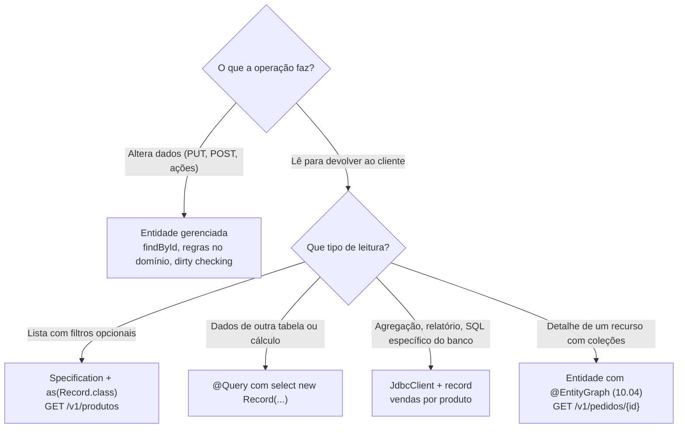

## O problema

`GET /v1/produtos` carregava entidades `Produto` completas: descrição (até 2.000 caracteres), atributos em `jsonb`, datas de criação e alteração. Para cada uma, o Hibernate ainda guardava uma cópia do estado original no contexto de persistência, para o *dirty checking* conferir no fim da transação. Tudo isso para uma listagem que mostra o SKU, o nome e o preço.

Com 50 produtos, ninguém percebe. Com 5.000 produtos numa exportação em CSV, o desperdício vira memória, tráfego entre o banco e a aplicação, e tempo de resposta.

O outro lado da leitura são os filtros e os relatórios. O catálogo vai ser filtrado por categoria, status, faixa de preço e texto, em qualquer combinação: um método de repositório para cada combinação não escala. E o relatório de vendas por produto, que agrega pedidos e itens, não tem nada a ver com entidades: é um `group by`.

Pense numa biblioteca. Para saber quais livros existem numa estante, você consulta o catálogo de fichas (título, autor, localização), e não retira cada livro da estante para lê-lo. As fichas são uma **projeção** do acervo, feita para a pergunta "o que existe aqui?".

> **A pergunta desta página:** como o Bazar lê só o que precisa, monta filtros combináveis e escreve relatórios em SQL?

## O conceito

### Entidades são para escrever

Uma entidade gerenciada é ótima para **alterar** dados: o Hibernate rastreia as mudanças, aplica o *locking* otimista e grava no *commit*. Para **ler** e devolver ao cliente, esse trabalho todo é desperdício. A alternativa é a **<Term id="projecao">projeção</Term>**: a consulta devolve só as colunas pedidas, num objeto que não é gerenciado.

O Spring Data JPA tem três formas de projeção.

**Por interface.** Um método de repositório devolve uma interface com *getters*, e o Spring Data cria a implementação com um *proxy*:

```java
interface NomeDoProduto {
    String getNome();
    String getSku();
}

List<NomeDoProduto> findByStatusOrderByNome(StatusProduto status);
```

O SQL real gerado: `select p1_0.nome,p1_0.sku from produto p1_0 where p1_0.status=? order by p1_0.nome`.

**Por record (DTO).** O mesmo, com um *record*, sem *proxy*. Os nomes e os tipos dos componentes precisam bater com as propriedades da entidade. É a forma preferida no Bazar.

**Dinâmica.** O tipo do resultado vira parâmetro, e o mesmo método serve para várias projeções (ou para a própria entidade):

```java
<T> List<T> findByCategoriaIdOrderByNome(UUID categoriaId, Class<T> tipo);

repository.findByCategoriaIdOrderByNome(categoriaId, ProdutoResumo.class);
```

### `@Query` com o construtor de um record

Quando a projeção precisa de dados de outra tabela, ou de um cálculo, a consulta JPQL chama o construtor do *record* com `select new`:

```java
record ProdutoComCategoria(UUID id, String nome, String categoriaNome) {}

@Query("""
        select new com.bazar.catalogo.dominio.ProdutoComCategoria(p.id, p.nome, c.nome)
          from Produto p join Categoria c on c.id = p.categoriaId
         order by p.nome""")
List<ProdutoComCategoria> listarComCategoria();
```

O `join ... on` junta duas entidades sem associação mapeada entre elas: o `Produto` do Bazar guarda só o `categoriaId`. Numa sonda, o SQL gerado foi exatamente o que se escreveria à mão: `select p1_0.id,p1_0.nome,c1_0.nome from produto p1_0 join categoria c1_0 on c1_0.id=p1_0.categoria_id order by p1_0.nome`. O nome do *record* vai completo, com o pacote, porque a JPQL não conhece os *imports* do Java.

### Filtros combináveis: `Specification`

Para filtros opcionais em qualquer combinação, os métodos derivados não servem: seriam dezenas (`findByCategoriaIdAndStatusAndPreco...`). Uma `Specification` é uma condição isolada, escrita com a Criteria API da JPA, que pode ser combinada com outras com `and`, `or`, `not`, `allOf` e `anyOf`.

O Spring Data JPA 4 trouxe a `PredicateSpecification`, mais simples: ela recebe só o `From` e o `CriteriaBuilder`, porque a maioria das condições não precisa da `CriteriaQuery`:

```java
public static PredicateSpecification<Produto> comStatus(StatusProduto status) {
    return (produto, cb) -> cb.equal(produto.get("status"), status);
}
```

A forma anterior, que ainda existe, é a `Specification` com três parâmetros: `(root, query, cb) -> ...`. Até o Spring Data JPA 3, era comum começar com `Specification.where(null)` e encadear `and`. No 4, as APIs são anotadas com JSpecify e os parâmetros não são anuláveis: o ponto de partida sem restrição é `Specification.unrestricted()`, ou `allOf` com uma lista vazia.

O repositório passa a estender `JpaSpecificationExecutor<Produto>`, que acrescenta `findAll(spec)`, `count(spec)`, `exists(spec)` e a **API fluente** `findBy(spec, consulta -> ...)`. A API fluente permite escolher a projeção, a ordenação e o limite:

```java
produtos.findBy(spec, consulta -> consulta.as(ProdutoResumo.class).sortBy(Sort.by("nome")).all());
```

No Spring Data JPA 4.1, o `as(ProdutoResumo.class)` seleciona só as colunas do *record*. Os componentes precisam bater com as propriedades da entidade, em nome e em tipo: na sonda do Bazar, um *record* com `BigDecimal preco` para a propriedade `preco`, que é um `Dinheiro` embutido, falhou com `Unable to determine bean info from class`.

**Querydsl** é a alternativa com consultas tipadas, geradas a partir das entidades (`QProduto.produto.status.eq(ATIVO)`), também suportada pelo Spring Data (`QuerydslPredicateExecutor`). Ela exige um passo de geração de código no *build*; o Bazar fica com as `Specification`.

### `JdbcClient` para relatórios

Relatórios agregam e cruzam tabelas: somas, contagens, agrupamentos, *window functions*. Escrever isso em JPQL ou Criteria é possível, mas o SQL é mais direto, e o resultado não é uma entidade. O `JdbcClient`, do Spring Framework 6.1, é uma API fluente sobre o `JdbcTemplate`:

```java
jdbc.sql("select ... where p.criado_em >= :de")
        .param("de", valor)
        .query(VendasDoProduto.class)   // mapeia as colunas para o record
        .list();
```

O `query(Classe.class)` mapeia cada linha para o *record* pelos nomes das colunas, convertendo `snake_case` em `camelCase` (`nome_produto` → `nomeProduto`). Os parâmetros nomeados (`:de`) viram parâmetros do `PreparedStatement`, nunca texto concatenado no SQL.

O Spring Boot registra um *bean* `JdbcClient` sobre o mesmo `DataSource` e participa das mesmas transações do JPA.

### CQRS leve

**<Term id="cqrs">CQRS</Term>** (*Command Query Responsibility Segregation*) separa o modelo de escrita do modelo de leitura. Na forma completa, são bancos ou tabelas diferentes, atualizados por eventos ([30.03](/arquitetura/eventos-e-mensageria-introducao)). O Bazar faz a versão **leve**, no mesmo banco:

- **Escrita**: entidades, serviços transacionais, regras no domínio (`Produto.atualizar`, `Estoque.reservar`).
- **Leitura**: projeções, `Specification` com `as(...)` e `JdbcClient`, devolvendo *records* moldados para cada resposta.

Os dois lados leem as mesmas tabelas, mas com código separado. Uma listagem nova não exige mudar a entidade, e uma mudança na entidade não arrasta todas as consultas.

## Diagrama



## Na prática

### A listagem de produtos com projeção

O resumo tem só o que a listagem mostra:

```java title="src/main/java/com/bazar/catalogo/dominio/ProdutoResumo.java"
/**
 * Projeção de leitura para listagens (10.05): só as colunas que a lista mostra, sem descrição nem atributos.
 * Os nomes e tipos dos componentes precisam bater com as propriedades de Produto.
 */
public record ProdutoResumo(UUID id, String sku, String nome, Dinheiro preco, StatusProduto status, UUID categoriaId) {
}
```

O serviço monta a consulta com as `Specification` do filtro e a projeção:

```java title="src/main/java/com/bazar/catalogo/dominio/ProdutoService.java"
    // Sem entidades gerenciadas: a projeção seleciona só as colunas de ProdutoResumo.
    @Transactional(readOnly = true)
    public List<ProdutoResumo> listar(FiltroDeProdutos filtro) {
        return produtos.findBy(ProdutoSpecifications.filtradoPor(filtro),
                consulta -> consulta.as(ProdutoResumo.class).sortBy(Sort.by("nome")).all());
    }
```

O controller ainda não recebe filtros. Os parâmetros HTTP (`categoria`, `status`, `precoMin`, `precoMax`, `q`), a validação deles e a ordenação escolhida pelo cliente são o assunto de [13.01](/design-de-apis-profissional/filtros-e-busca):

```java title="src/main/java/com/bazar/catalogo/api/ProdutoController.java"
    // Uma projeção, e não entidades: só as colunas da listagem (10.05).
    // Os filtros já existem no serviço; os parâmetros HTTP, a ordenação e a paginação chegam em 13.01–13.04.
    @GetMapping
    public Lista<ProdutoResumoResponse> listar() {
        return new Lista<>(servico.listar(FiltroDeProdutos.nenhum()).stream().map(mapper::paraResumo).toList());
    }
```

<HttpExchange
  title="Listagem de produtos com o resumo"
  request={{ method: 'GET', url: 'http://localhost:8080/v1/produtos' }}
  response={{
    status: 200,
    headers: { 'Content-Type': 'application/json' },
    body: { itens: [{ id: 'bcd399f5-d6d1-4032-9c80-10ca4c363d31', sku: 'LIV-0042', nome: 'Clean Code (2ª ed.)', precoEmCentavos: 13990, categoriaId: '0192f3a0-5555-7000-8000-000000000003', status: 'RASCUNHO' }] },
  }}
>
  O SQL desta requisição: `select p1_0.id,p1_0.sku,p1_0.nome,p1_0.preco_valor,p1_0.preco_moeda,p1_0.status,p1_0.categoria_id from produto p1_0 order by 3`. Nada de `descricao`, `atributos` ou datas. O CSV de [09.03](/construindo-apis-com-spring-boot/httpmessageconverter-e-a-serializacao-por-dentro) também encolheu, porque o conversor escreve as colunas do *record* que recebe: `id,sku,nome,precoEmCentavos,categoriaId,status`.
</HttpExchange>

<Callout type="warning" title="Mudar a representação de uma lista é mudar o contrato">
A listagem deixou de trazer `descricao`, `atributos`, `criadoEm` e `atualizadoEm`. O Bazar ainda não tem clientes, e a mudança é segura. Numa API publicada, remover campos de uma resposta quebra quem os usa ([18.01](/contratos-documentacao-e-ciclo-de-vida/compatibilidade-retroativa-o-que-quebra-um-cliente)). Seria preciso manter os campos, ou oferecer o resumo como opção, por exemplo com respostas parciais ([13.05](/design-de-apis-profissional/respostas-parciais-e-expansao)).
</Callout>

### As `Specification` do catálogo

Cada filtro é uma condição independente, e o `filtradoPor` junta só as que foram pedidas:

```java title="src/main/java/com/bazar/catalogo/dominio/ProdutoSpecifications.java"
public final class ProdutoSpecifications {

    private ProdutoSpecifications() {
    }

    public static PredicateSpecification<Produto> daCategoria(UUID categoriaId) {
        return (produto, cb) -> cb.equal(produto.get("categoriaId"), categoriaId);
    }

    public static PredicateSpecification<Produto> comStatus(StatusProduto status) {
        return (produto, cb) -> cb.equal(produto.get("status"), status);
    }

    public static PredicateSpecification<Produto> custandoAPartirDe(BigDecimal minimo) {
        return (produto, cb) -> cb.greaterThanOrEqualTo(produto.get("preco").get("valor"), minimo);
    }

    public static PredicateSpecification<Produto> custandoAte(BigDecimal maximo) {
        return (produto, cb) -> cb.lessThanOrEqualTo(produto.get("preco").get("valor"), maximo);
    }

    // O texto vira parâmetro do LIKE, nunca parte do SQL. Os curingas digitados pelo cliente são escapados.
    public static PredicateSpecification<Produto> comNomeContendo(String texto) {
        var padrao = "%" + texto.toLowerCase(Locale.ROOT)
                .replace("\\", "\\\\").replace("%", "\\%").replace("_", "\\_") + "%";
        return (produto, cb) -> cb.like(cb.lower(produto.get("nome")), padrao, '\\');
    }

    public static PredicateSpecification<Produto> filtradoPor(FiltroDeProdutos filtro) {
        var condicoes = new ArrayList<PredicateSpecification<Produto>>();
        if (filtro.categoriaId() != null) {
            condicoes.add(daCategoria(filtro.categoriaId()));
        }
        if (filtro.status() != null) {
            condicoes.add(comStatus(filtro.status()));
        }
        if (filtro.precoMinimo() != null) {
            condicoes.add(custandoAPartirDe(filtro.precoMinimo()));
        }
        if (filtro.precoMaximo() != null) {
            condicoes.add(custandoAte(filtro.precoMaximo()));
        }
        if (filtro.texto() != null) {
            condicoes.add(comNomeContendo(filtro.texto()));
        }
        // Sem condições, allOf não restringe nada: todos os produtos.
        return PredicateSpecification.allOf(condicoes);
    }
}
```

O escape dos curingas merece atenção. O texto do cliente já vai como parâmetro, então não há risco de *SQL injection*. Mas, dentro de um `LIKE`, `%` e `_` são curingas: sem o escape, uma busca por `%` casaria com todos os produtos, e uma busca por `100%` casaria com "100" seguido de qualquer coisa. O teste confere isso:

```java title="src/test/java/com/bazar/catalogo/dominio/ProdutoServiceTest.java"
    @Test
    void trataOsCuringasDoTextoComoTextoComum() {
        // Sem o escape, "%" casaria com qualquer nome.
        assertThat(servico.listar(new FiltroDeProdutos(null, null, null, null, "100%")))
                .extracting(ProdutoResumo::sku).containsExactly("ELE-0001");
        assertThat(servico.listar(new FiltroDeProdutos(null, null, null, null, "%"))).hasSize(1);
        assertThat(servico.listar(new FiltroDeProdutos(null, null, null, null, "_"))).isEmpty();
    }
```

O mesmo teste de serviço confere as combinações de filtros e, pelo log de SQL, que a listagem seleciona só as colunas do resumo.

### O relatório de vendas com `JdbcClient`

O módulo `relatorios` nasce com a consulta de vendas por produto. Ela vai alimentar o relatório assíncrono de [21.02](/padroes-avancados-de-http/operacoes-assincronas-e-de-longa-duracao-202-polling):

```java title="src/main/java/com/bazar/relatorios/infraestrutura/ConsultaDeVendas.java"
/**
 * Relatórios são agregações sobre várias tabelas: SQL direto, sem entidades e sem contexto de persistência (10.05).
 */
@Repository
public class ConsultaDeVendas {

    private final JdbcClient jdbc;

    public ConsultaDeVendas(JdbcClient jdbc) {
        this.jdbc = jdbc;
    }

    // Período semiaberto [de, ate): um pedido criado exatamente em "ate" fica para o período seguinte.
    // Pedidos cancelados não contam como venda.
    @Transactional(readOnly = true)
    public List<VendasDoProduto> porProduto(Instant de, Instant ate) {
        return jdbc.sql("""
                select i.produto_id,
                       i.sku,
                       i.nome_produto,
                       count(distinct p.id) as pedidos,
                       sum(i.quantidade)    as unidades,
                       sum(i.subtotal)      as receita
                  from item_pedido i
                  join pedido p on p.id = i.pedido_id
                 where p.criado_em >= :de
                   and p.criado_em <  :ate
                   and p.status <> 'CANCELADO'
                 group by i.produto_id, i.sku, i.nome_produto
                 order by receita desc, i.sku
                """)
                // O driver do PostgreSQL não aceita Instant; para timestamptz, o JDBC 4.2 define OffsetDateTime.
                .param("de", de.atOffset(ZoneOffset.UTC))
                .param("ate", ate.atOffset(ZoneOffset.UTC))
                .query(VendasDoProduto.class)
                .list();
    }
}
```

```java title="src/main/java/com/bazar/relatorios/infraestrutura/VendasDoProduto.java"
public record VendasDoProduto(UUID produtoId, String sku, String nomeProduto, long pedidos, long unidades,
        BigDecimal receita) {
}
```

O relatório usa os dados copiados no item (`sku`, `nome_produto`, `subtotal`), e não os do produto atual: as vendas de março mostram o preço de março, mesmo que o produto tenha mudado depois.

A primeira versão passava o `Instant` direto para o `param`, e o teste falhou com:

```text
org.postgresql.util.PSQLException: Can't infer the SQL type to use for an instance of java.time.Instant.
Use setObject() with an explicit Types value to specify the type to use.
```

O JDBC 4.2 define os tipos de `java.time` aceitos pelos *drivers*. Para `timestamp with time zone`, o tipo é `OffsetDateTime`; o `Instant` não está na lista. O Hibernate faz essa conversão sozinho nas entidades, mas com o `JdbcClient` ela é responsabilidade do código.

O teste cria três pedidos, cancela um e confere a agregação:

```java title="src/test/java/com/bazar/relatorios/infraestrutura/ConsultaDeVendasTest.java"
        pedidos.criar(cliente, List.of(new ItemSolicitado(cleanCode, 2), new ItemSolicitado(refactoring, 1)));
        pedidos.criar(cliente, List.of(new ItemSolicitado(cleanCode, 1)));
        var cancelado = pedidos.criar(cliente, List.of(new ItemSolicitado(refactoring, 5)));
        // O cancelamento pela API chega em 12.04.
        jdbc.sql("update pedido set status = 'CANCELADO' where id = ?").param(cancelado.getId()).update();

        var agora = Instant.now();
        var vendas = consulta.porProduto(agora.minus(1, ChronoUnit.HOURS), agora.plus(1, ChronoUnit.HOURS));

        assertThat(vendas).containsExactly(
                new VendasDoProduto(cleanCode, "LIV-0042", "Clean Code", 2, 3, new BigDecimal("389.70")),
                new VendasDoProduto(refactoring, "LIV-0043", "Refactoring", 1, 1, new BigDecimal("159.00")));
```

## Erros comuns

<BadVsGood title="Uma listagem montada com entidades" why="findAll carrega todas as colunas, inclusive descrição e atributos, cria uma entidade gerenciada por linha e guarda uma cópia de cada uma para o dirty checking. A projeção seleciona só as colunas usadas e devolve objetos simples.">
<Bad title="Entidades para ler">

```java
@GetMapping
public Lista<ProdutoResponse> listar() {
    return new Lista<>(repository.findAll().stream()
            .map(mapper::paraResponse).toList());
}
```

</Bad>
<Good title="Projeção para ler">

```java
produtos.findBy(spec, consulta -> consulta
        .as(ProdutoResumo.class)
        .sortBy(Sort.by("nome"))
        .all());
```

</Good>
</BadVsGood>

Outros erros frequentes:

- **Concatenar o texto do cliente no SQL ou na JPQL** (`"... where nome like '%" + q + "%'"`): é *SQL injection*. Use sempre parâmetros. A [documentação de segurança](https://security-doc-beta.vercel.app/) trata do assunto em detalhe.
- **Esquecer os curingas do `LIKE`**: `%` e `_` digitados pelo cliente mudam o sentido da busca.
- **Um método de repositório por combinação de filtros.**
- **Componentes do *record* que não batem** com as propriedades da entidade, numa projeção derivada ou fluente.
- **Passar `Instant` para o `JdbcClient` com o PostgreSQL.** Use `OffsetDateTime`.
- **Relatórios com entidades e laços em Java** (carregar todos os pedidos e somar na aplicação), em vez de `group by` no banco.
- **Alterar uma projeção e esperar que o banco mude.** Projeções são só leitura; alterações passam pela entidade.

## Boas práticas

- **Use** entidades para escrever e projeções para ler.
- **Prefira** *records* a interfaces nas projeções.
- **Monte** filtros opcionais com `Specification`, uma condição por filtro.
- **Escreva** relatórios e consultas complexas em SQL, com `JdbcClient` e parâmetros nomeados.
- **Marque** as consultas com `@Transactional(readOnly = true)`.
- **Teste** os filtros com combinações e com entradas maliciosas (curingas, aspas).

## No projeto Bazar

<ProjectStep title="Projeções, filtros e relatório de vendas" module="catalogo" tag="pagina-10.05" files={[
  { path: 'src/main/java/com/bazar/catalogo/dominio/ProdutoResumo.java', change: 'novo' },
  { path: 'src/main/java/com/bazar/catalogo/dominio/FiltroDeProdutos.java', change: 'novo' },
  { path: 'src/main/java/com/bazar/catalogo/dominio/ProdutoSpecifications.java', change: 'novo' },
  { path: 'src/main/java/com/bazar/catalogo/dominio/ProdutoRepository.java', change: 'alterado' },
  { path: 'src/main/java/com/bazar/catalogo/dominio/ProdutoService.java', change: 'alterado' },
  { path: 'src/main/java/com/bazar/catalogo/api/ProdutoResumoResponse.java', change: 'novo' },
  { path: 'src/main/java/com/bazar/catalogo/api/ProdutoMapper.java', change: 'alterado' },
  { path: 'src/main/java/com/bazar/catalogo/api/ProdutoController.java', change: 'alterado' },
  { path: 'src/main/java/com/bazar/relatorios/infraestrutura/ConsultaDeVendas.java', change: 'novo' },
  { path: 'src/main/java/com/bazar/relatorios/infraestrutura/VendasDoProduto.java', change: 'novo' },
  { path: 'src/test/java/com/bazar/catalogo/dominio/ProdutoServiceTest.java', change: 'novo' },
  { path: 'src/test/java/com/bazar/relatorios/infraestrutura/ConsultaDeVendasTest.java', change: 'novo' },
  { path: 'src/test/java/com/bazar/catalogo/api/ProdutoControllerTest.java', change: 'alterado' },
]}>
`GET /v1/produtos` passa a devolver o resumo de cada produto, lido com uma projeção. As `ProdutoSpecifications` implementam os filtros que 13.01 vai expor. O módulo `relatorios` ganha a consulta de vendas por produto, em SQL com `JdbcClient`.
</ProjectStep>

## Resumo

- Entidades servem para escrever; para ler, projeções selecionam só as colunas necessárias e não são gerenciadas.
- Projeções por interface, por *record* e dinâmicas; `select new` na `@Query` para *joins* e cálculos.
- `Specification` (e a nova `PredicateSpecification`) para filtros combináveis; a API fluente `findBy` escolhe projeção, ordenação e limite.
- `JdbcClient` para relatórios: SQL direto, parâmetros nomeados, mapeamento para *records*.
- CQRS leve: código de leitura separado do de escrita, no mesmo banco.

<Exercise title="Produtos com estoque baixo" difficulty="medio">
O time de compras quer `GET /v1/relatorios/estoque-baixo?limite=5`: os produtos ativos com até `limite` unidades disponíveis, com SKU, nome, nome da categoria e quantidade disponível, do menor saldo para o maior.

1. Qual ferramenta desta página você usaria, e por quê?
2. Escreva a consulta e o *record* do resultado.
3. Que índice ajudaria essa consulta quando o catálogo crescer?

<Hint>
São três tabelas: `produto`, `estoque` e `categoria`. O resultado não é nenhuma entidade.
</Hint>

<Solution>

1. É uma leitura que cruza três tabelas e devolve um formato próprio. Uma `@Query` com `select new` funcionaria (são três entidades). Num relatório, o `JdbcClient` deixa o SQL explícito e facilita evoluções como ordenar por uma conta, sem depender da JPQL.

2. A consulta:

   ```java
   public record ProdutoComEstoqueBaixo(UUID produtoId, String sku, String nome, String categoria,
           int quantidadeDisponivel) {
   }

   public List<ProdutoComEstoqueBaixo> estoqueBaixo(int limite) {
       return jdbc.sql("""
               select p.id as produto_id, p.sku, p.nome, c.nome as categoria, e.quantidade_disponivel
                 from produto p
                 join estoque e   on e.produto_id = p.id
                 join categoria c on c.id = p.categoria_id
                where p.status = 'ATIVO'
                  and e.quantidade_disponivel <= :limite
                order by e.quantidade_disponivel, p.sku
               """)
               .param("limite", limite)
               .query(ProdutoComEstoqueBaixo.class)
               .list();
   }
   ```

   Os apelidos (`as produto_id`, `as categoria`) fazem as colunas baterem com os componentes do *record*.

3. Um índice em `estoque (quantidade_disponivel)` ajuda o filtro e a ordenação quando poucos produtos têm estoque baixo. Como só os produtos ativos interessam, outra opção é filtrar pelo status primeiro; a decisão vem do `explain analyze` com dados reais ([28.04](/performance/consultas-e-paginacao-eficientes)).

</Solution>
</Exercise>

<Quiz
  questions={[
    {
      question: 'Por que usar uma projeção, e não entidades, numa listagem?',
      options: [
        'Porque entidades não podem ser serializadas em JSON',
        'Porque a projeção seleciona só as colunas usadas e não cria entidades gerenciadas, que o Hibernate rastrearia para o dirty checking',
        'Porque projeções são cacheadas automaticamente',
      ],
      answer: 1,
      explanation: 'No Bazar, a listagem passou a selecionar 7 colunas em vez de 12, e nenhuma entidade é criada.',
    },
    {
      question: 'Um cliente busca produtos com q=%. Sem o escape dos curingas, o que a busca com LIKE devolveria?',
      options: [
        'Um erro de SQL',
        'Todos os produtos, porque % é curinga no LIKE',
        'Nenhum produto',
      ],
      answer: 1,
      explanation: 'Não é SQL injection (o texto é parâmetro), mas o sentido da busca muda. O teste do Bazar confere que "%" só casa com nomes que contêm o caractere.',
    },
    {
      question: 'Com o JdbcClient e o PostgreSQL, qual tipo usar como parâmetro de uma coluna timestamptz?',
      options: [
        'Instant',
        'OffsetDateTime',
        'String no formato ISO 8601',
      ],
      answer: 1,
      explanation: 'O JDBC 4.2 define OffsetDateTime para timestamp with time zone. Com Instant, o driver falha com "Can\'t infer the SQL type to use for an instance of java.time.Instant".',
    },
  ]}
/>

## Referências

<References />
