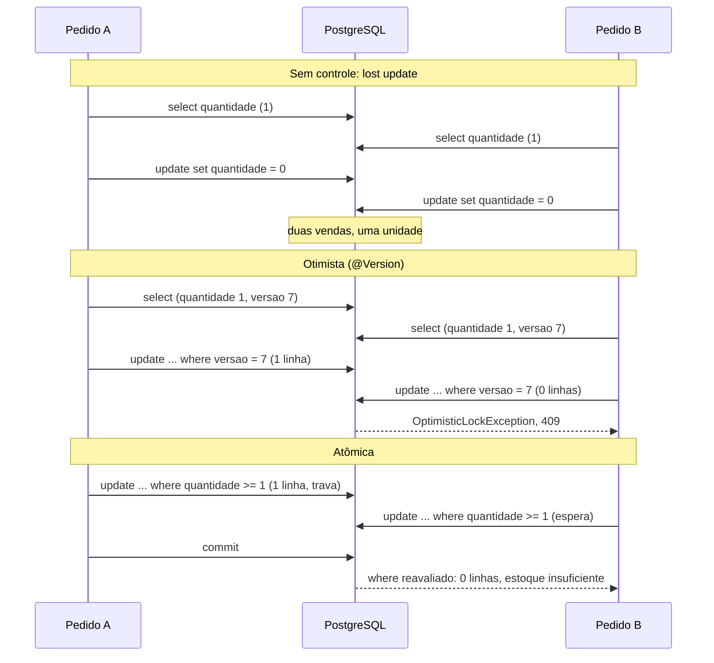

## O problema

Black Friday no Bazar: o último lote de *Clean Code* tem 5 unidades, e 20 pessoas clicam em "comprar" no mesmo segundo. Cada requisição faz o que [10.03](/persistencia-para-apis/transacoes-na-camada-de-servico) ensinou: lê o estoque, confere se há saldo, reserva e grava. Se nada coordenar essas requisições, várias leem "5 disponíveis" ao mesmo tempo, todas acham que há saldo, e o Bazar vende mais livros do que tem. É o *overselling*: clientes que pagaram e não vão receber.

O problema tem nome: **<Term id="lost-update">lost update</Term>** (atualização perdida). Uma sonda no Bazar reproduziu o caso mais simples, com duas transações que leem o saldo, subtraem 2 e gravam o resultado, sincronizadas para lerem ao mesmo tempo:

```text
lostupdate: leram 5 e 5; ficou 3
```

Duas reservas de 2 unidades, e o saldo caiu só 2. Uma das gravações apagou a outra, sem erro nenhum.

Pense em dois atendentes de uma livraria com um único exemplar de um livro. Os dois consultam o sistema ao mesmo tempo, veem "1 em estoque" e vendem para os seus clientes. O sistema não errou nas consultas; errou ao deixar as duas vendas acontecerem a partir da mesma leitura.

> **A pergunta desta página:** quais estratégias impedem que requisições simultâneas se atropelem no banco, e qual o Bazar usa em cada caso?

## O conceito

### Por que a transação não basta

A transação garante "tudo ou nada", e não "um de cada vez". No isolamento padrão do PostgreSQL (`READ COMMITTED`, visto em 10.03), duas transações leem a mesma linha ao mesmo tempo sem esperar uma pela outra. O padrão "ler, decidir no Java, gravar" tem uma janela entre a leitura e a gravação, e outra transação pode passar por ela.

Há três estratégias para fechar essa janela.

### 1. *Locking* otimista: `@Version`

O **<Term id="locking-otimista">*locking* otimista</Term>** não trava nada. Cada linha tem uma versão; a gravação inclui a versão lida no `where`:

```sql
update estoque set quantidade_disponivel=?, quantidade_reservada=?, versao=?
 where produto_id=? and versao=?
```

Se outra transação gravou antes, a versão mudou, o `UPDATE` não encontra a linha, e o Hibernate lança `OptimisticLockException`. O Spring a traduz para `ObjectOptimisticLockingFailureException`, da hierarquia `OptimisticLockingFailureException`. Na API, esse conflito vira `409`.

O `Estoque`, o `Produto`, a `Categoria` e o `Pedido` do Bazar têm `@Version` desde que viraram entidades. A estratégia é "otimista" porque aposta que conflitos são raros: ninguém espera, e quem perde repete.

Ela é ótima quando conflitos são raros, como na edição de um produto por um administrador. É **péssima para um recurso disputado**. Na sonda do Bazar, 10 pedidos simultâneos de 1 unidade, com 5 em estoque, usando a versão de 10.03 (ler a entidade, `reservar` no Java, gravar com `@Version`):

```text
otimista: {ok=1, ObjectOptimisticLockingFailureException=9} estoque=4/1
```

Havia saldo para 5, mas só 1 pedido passou. Não houve *overselling*, mas houve 9 clientes recusados à toa. Repetir automaticamente ajuda pouco: na repetição, eles disputam de novo.

Um detalhe do Hibernate: se a entidade não mudou, não há `UPDATE`, e portanto não há conferência de versão. Definir um campo com o valor que ele já tinha não gera conflito, nem aumenta a versão.

### 2. *Locking* pessimista: `SELECT ... FOR UPDATE`

O **<Term id="locking-pessimista">*locking* pessimista</Term>** trava a linha **na leitura**. As outras transações que tentam travar a mesma linha esperam até o *commit* ou o *rollback* da primeira:

```java
@Lock(LockModeType.PESSIMISTIC_WRITE)
@Query("select e from Estoque e where e.produtoId = :id")
Optional<Estoque> travar(UUID id);
```

O SQL que o Hibernate 7 gerou no PostgreSQL:

```sql
select e1_0.produto_id, ... from estoque e1_0 where e1_0.produto_id=? for no key update of e1_0
```

`FOR NO KEY UPDATE` é uma variante mais leve do `FOR UPDATE`: impede outras alterações na linha, mas não bloqueia quem só precisa garantir que ela exista, como a inserção de uma chave estrangeira apontando para ela.

Com a trava, "ler, decidir, gravar" fica correto, porque a decisão é tomada com a linha travada. O custo: as requisições ficam em fila na linha disputada, e cada uma segura uma conexão enquanto espera. Também é preciso definir um tempo limite (`jakarta.persistence.lock.timeout`), ou a espera pode ser longa.

Uma variação útil é o **`SKIP LOCKED`**: em vez de esperar, a consulta pula as linhas travadas. É a base de filas de trabalho no banco, em que vários processos pegam tarefas diferentes sem disputar a mesma. O Bazar vai usá-lo na publicação de eventos do Outbox ([30.04](/arquitetura/padrao-outbox)). Com a dica de *timeout* `-2`, o Hibernate gera:

```sql
select ... from estoque e1_0 where e1_0.quantidade_disponivel>0 order by e1_0.produto_id
 fetch first ? rows only for no key update of e1_0 skip locked
```

Na sonda, com o estoque do produto A travado por outra transação, essa consulta devolveu só o produto B.

### 3. Atualização atômica

A terceira estratégia elimina a janela: a conferência e a alteração viram **um único comando SQL**:

```sql
update estoque
   set quantidade_disponivel = quantidade_disponivel - :quantidade,
       quantidade_reservada = quantidade_reservada + :quantidade
 where produto_id = :produtoId
   and quantidade_disponivel >= :quantidade
```

Duas reservas simultâneas da mesma linha: a segunda espera a trava de linha que o primeiro `UPDATE` pegou. Quando a primeira transação confirma, o PostgreSQL **reavalia o `where`** da segunda sobre a linha já atualizada (é o comportamento documentado do `READ COMMITTED`). Se o saldo não basta mais, o comando altera 0 linhas. O código só olha o número de linhas afetadas: 1 reservou, 0 não havia saldo.

Ninguém lê o saldo para decidir no Java, e ninguém falha por conflito de versão. As requisições esperam umas pelas outras só durante o `UPDATE` e o restante da transação, e todas que cabem no saldo passam.

### *Deadlocks*

Toda estratégia que trava linhas (o pessimista e a atualização atômica) pode gerar um **<Term id="deadlock">*deadlock*</Term>**: o pedido 1 reserva o produto A e vai reservar o B; ao mesmo tempo, o pedido 2 reservou o B e vai reservar o A. Cada um espera a trava do outro. O PostgreSQL detecta o ciclo e desfaz uma das transações:

```text
ERROR: deadlock detected
  Detail: Process 89 waits for ExclusiveLock on tuple (0,4) of relation 16447 of database 16384; blocked by process 83.
Process 83 waits for ShareLock on transaction 774; blocked by process 81.
```

O Spring traduz o erro para `CannotAcquireLockException`. A prevenção clássica: **travar sempre na mesma ordem**. Se todo pedido reserva os produtos em ordem de `produtoId`, o pedido 2 espera o 1 terminar com A antes de pegar qualquer coisa, e o ciclo não se forma.

### Como escolher

| Situação | Estratégia | Por quê |
|---|---|---|
| Edição de um recurso por pessoas, conflitos raros | Otimista (`@Version`) | Ninguém espera; o conflito vira `409` e a pessoa revisa |
| Contador ou saldo disputado, com regra simples | Atualização atômica | Uma instrução, sem janela, sem conflitos à toa |
| Regra complexa que precisa ler vários dados antes de decidir | Pessimista, com tempo limite | A decisão é tomada com a linha travada |
| Vários processos pegando tarefas de uma tabela | `FOR UPDATE SKIP LOCKED` | Cada processo pega linhas diferentes |

### O impacto nas novas tentativas

- **Conflito otimista (`409`)**: repetir a mesma requisição às cegas não faz sentido. O cliente precisa reler o recurso, ver o que mudou e decidir de novo. Uma nova tentativa automática no servidor só é segura quando a operação é recalculada a partir da leitura nova.
- **Saldo insuficiente**: repetir não adianta; é uma regra de negócio.
- ***Deadlock* ou tempo de trava esgotado**: a transação foi desfeita por inteiro, e repetir a operação é seguro. Ainda assim, *deadlocks* frequentes são sinal de travas em ordem inconsistente, e a correção é no código. Novas tentativas e suas condições de segurança são o assunto de [25.02](/consumindo-outras-apis/retry-quando-e-seguro-e-como-fazer).

### Rumo ao `ETag`

No `PUT /v1/produtos/{id}/estoque`, o cliente manda a versão que leu, no corpo. É o *locking* otimista atravessando a API: o conflito não acontece só entre duas transações, mas entre duas pessoas que leram o mesmo saldo minutos atrás. Em [20.03](/padroes-avancados-de-http/concorrencia-otimista-com-if-match-412-e-428), a versão sai do corpo e vira o cabeçalho `ETag`, e o cliente a devolve no `If-Match`. O mecanismo no banco continua o mesmo.

## Diagrama

Duas reservas simultâneas de 1 unidade, com 1 unidade em estoque:



## Na prática

### A reserva atômica

O `EstoqueRepository` ganha o `UPDATE` atômico, em JPQL. A versão também sobe, para que um `PUT` do saldo feito com a versão antiga perceba que a reserva aconteceu:

```java title="src/main/java/com/bazar/estoque/dominio/EstoqueRepository.java"
public interface EstoqueRepository extends JpaRepository<Estoque, UUID> {

    // Conferência e baixa num único comando: duas reservas simultâneas não conseguem usar o mesmo saldo,
    // porque o PostgreSQL serializa os UPDATEs da mesma linha e reavalia o where na segunda (10.06).
    // Devolve 1 se reservou e 0 se o saldo não bastava. A versão sobe, como num UPDATE feito pelo Hibernate.
    @Modifying
    @Query("""
            update Estoque e
               set e.quantidadeDisponivel = e.quantidadeDisponivel - :quantidade,
                   e.quantidadeReservada = e.quantidadeReservada + :quantidade,
                   e.versao = e.versao + 1
             where e.produtoId = :produtoId
               and e.quantidadeDisponivel >= :quantidade""")
    int reservar(UUID produtoId, int quantidade);
}
```

O SQL gerado:

```sql
update estoque e1_0 set quantidade_disponivel=(e1_0.quantidade_disponivel-?),
       quantidade_reservada=(e1_0.quantidade_reservada+?), versao=(e1_0.versao+1)
 where e1_0.produto_id=? and e1_0.quantidade_disponivel>=?
```

Um `@Modifying` vai direto ao banco, sem passar pelo contexto de persistência. Uma entidade `Estoque` carregada antes, na mesma transação, ficaria com os valores antigos. O `PedidoService` não carrega estoques, então não há problema. Quando houver, `@Modifying(clearAutomatically = true)` limpa o contexto depois do comando.

O método `reservar` saiu da entidade `Estoque`, para que não existam dois caminhos para a mesma regra. O `EstoqueService` traduz as 0 linhas em erro de negócio:

```java title="src/main/java/com/bazar/estoque/dominio/EstoqueService.java"
    // Participa da transação de quem chama (o PedidoService): se o pedido for desfeito, a reserva também é.
    @Transactional
    public void reservar(UUID produtoId, int quantidade) {
        if (estoques.reservar(produtoId, quantidade) == 0) {
            var estoque = buscar(produtoId);
            throw new EstoqueInsuficienteException(produtoId, estoque.getQuantidadeDisponivel(), quantidade);
        }
    }
```

E o `PedidoService` reserva em ordem de `produtoId`, somando os itens repetidos:

```java title="src/main/java/com/bazar/pedidos/dominio/PedidoService.java"
    // Cada reserva trava a linha do estoque até o commit. Reservando sempre na mesma ordem (por produtoId),
    // dois pedidos com os mesmos produtos esperam um pelo outro em vez de entrar em deadlock (10.06).
    // Itens repetidos do mesmo produto viram uma reserva só.
    private void reservarEstoque(List<ItemSolicitado> itens) {
        var quantidades = new TreeMap<UUID, Integer>();
        itens.forEach(item -> quantidades.merge(item.produtoId(), item.quantidade(), Integer::sum));
        quantidades.forEach(estoques::reservar);
    }
```

A soma muda a mensagem de erro do exemplo de 10.03. O pedido com 1 e depois 9 unidades do mesmo produto agora é recusado como "foram pedidas 10", com o saldo inteiro como disponível, em vez de "2 disponíveis; foram pedidas 9".

### Os testes de concorrência

Os testes disparam pedidos de verdade em paralelo, cada um numa *virtual thread*, contra o PostgreSQL do Testcontainers. Um `CountDownLatch` segura todas as *threads* e as solta juntas:

```java title="src/test/java/com/bazar/estoque/dominio/ReservaConcorrenteTest.java"
    @Test
    void vinteComprasSimultaneasDeCincoUnidadesNaoVendemDemais() throws Exception {
        var produto = criarProdutoComEstoque("LIV-0042", 5);

        var resultados = emParalelo(20, () -> pedidos.criar(clienteId, List.of(new ItemSolicitado(produto, 1))));

        assertThat(resultados).containsExactlyInAnyOrderEntriesOf(Map.of("criado", 5, "EstoqueInsuficienteException", 15));
        assertThat(estoques.findById(produto)).get()
                .returns(0, Estoque::getQuantidadeDisponivel)
                .returns(5, Estoque::getQuantidadeReservada);
        assertThat(jdbc.sql("select count(*) from pedido").query(Long.class).single()).isEqualTo(5);
    }

    @Test
    void pedidosComOsMesmosProdutosEmOrdemInversaNaoEntramEmDeadlock() throws Exception {
        var a = criarProdutoComEstoque("LIV-0042", 100);
        var b = criarProdutoComEstoque("LIV-0043", 100);

        var resultados = emParalelo(40, indice -> indice % 2 == 0
                ? pedidos.criar(clienteId, List.of(new ItemSolicitado(a, 1), new ItemSolicitado(b, 1)))
                : pedidos.criar(clienteId, List.of(new ItemSolicitado(b, 1), new ItemSolicitado(a, 1))));

        // Sem a ordenação das reservas, parte destes pedidos falharia com "deadlock detected".
        assertThat(resultados).containsExactlyEntriesOf(Map.of("criado", 40));
        assertThat(estoques.findById(a)).get().returns(60, Estoque::getQuantidadeDisponivel);
        assertThat(estoques.findById(b)).get().returns(60, Estoque::getQuantidadeDisponivel);
    }
```

Exatamente 5 pedidos criados, nenhum a mais, nenhum recusado à toa. Para conferir o segundo teste, a ordenação foi trocada por um `LinkedHashMap` (a ordem dos itens no pedido), e o resultado foi:

```text
Actual was:
  {"CannotAcquireLockException"=34, "criado"=6}
Expected was:
  ["criado"=40]
```

34 dos 40 pedidos caíram em *deadlock*. Com a ordenação, os 40 passam.

### O saldo com *locking* otimista

Definir o saldo é uma operação de pessoas (o time de compras faz o inventário), com conflitos raros: o caso certo para o `@Version`. O Bazar ganha o sub-recurso do estoque, cujo desenho de rota é assunto de [12.03](/design-de-apis-profissional/relacionamentos-e-sub-recursos):

```java title="src/main/java/com/bazar/estoque/dominio/EstoqueService.java"
    // Locking otimista em duas camadas: a versão que o cliente leu é conferida aqui; a corrida entre esta
    // conferência e o commit é pega pelo @Version no UPDATE (OptimisticLockingFailureException → 409).
    @Transactional
    public Estoque definirDisponivel(UUID produtoId, int quantidade, long versaoLida) {
        var estoque = buscar(produtoId);
        if (estoque.getVersao() != versaoLida) {
            throw new ConflitoDeVersaoException(estoque.getVersao());
        }
        estoque.definirDisponivel(quantidade);
        return estoque;
    }
```

A conferência explícita é necessária porque o Hibernate usa, no `where versao=?`, a versão que **ele** leu nesta transação, e não a que o cliente leu minutos atrás. Ela pega o caso comum (o cliente está desatualizado). O `@Version` pega a corrida rara entre a conferência e o *commit*, e o `TratadorGlobalDeErros` converte a exceção do Spring no mesmo `409`, sem expor a mensagem interna (que cita a classe da entidade):

```java title="src/main/java/com/bazar/compartilhado/erros/TratadorGlobalDeErros.java"
    // Lançada no commit, quando o UPDATE com "where versao=?" não encontra a linha: outra transação
    // alterou o registro entre a leitura e a gravação. A mensagem do Spring cita a entidade; não vai para o cliente.
    @ExceptionHandler(OptimisticLockingFailureException.class)
    ResponseEntity<Object> conflitoDeVersao(OptimisticLockingFailureException ex, WebRequest request) {
        return deDominio(new ConflitoDeVersaoException(), HttpStatus.CONFLICT, request);
    }
```

<HttpExchange
  title="Lendo o saldo"
  request={{ method: 'GET', url: 'http://localhost:8080/v1/produtos/bcd399f5-d6d1-4032-9c80-10ca4c363d31/estoque' }}
  response={{
    status: 200,
    headers: { 'Content-Type': 'application/json' },
    body: { produtoId: 'bcd399f5-d6d1-4032-9c80-10ca4c363d31', quantidadeDisponivel: 3, quantidadeReservada: 2, versao: 1 },
  }}
>
  A versão 1 vem da reserva do pedido de 10.03. Dois funcionários leem este saldo ao mesmo tempo. O primeiro define 20 unidades com `"versao": 1` e recebe a versão 2.
</HttpExchange>

<HttpExchange
  title="O segundo funcionário, com a versão antiga"
  request={{ method: 'PUT', url: 'http://localhost:8080/v1/produtos/bcd399f5-d6d1-4032-9c80-10ca4c363d31/estoque', headers: { 'Content-Type': 'application/json', 'Accept-Language': 'pt-BR' }, body: { quantidadeDisponivel: 15, versao: 1 } }}
  response={{
    status: 409,
    headers: { 'Content-Type': 'application/problem+json' },
    body: { type: 'https://api.bazar.example/problemas/conflito-de-versao', title: 'Conflito de versão', status: 409, detail: 'O recurso foi alterado por outra requisição. Leia de novo e repita a alteração.', instance: '/v1/produtos/bcd399f5-d6d1-4032-9c80-10ca4c363d31/estoque', versaoAtual: 2, codigo: 'CONFLITO_DE_VERSAO', traceId: 'bcd389688bc638adaa95acea4a9df185' },
  }}
>
  Sem o controle de versão, o saldo ficaria em 15 e a contagem do primeiro funcionário sumiria sem aviso. Com ele, o segundo recebe `409` e a versão atual, relê o saldo e decide. O teste `deDuasAlteracoesSimultaneasDaMesmaVersaoSoUmaVence` dispara dois `PUT` com a mesma versão, dez vezes seguidas, e confere que sempre um recebe `200` e o outro `409`.
</HttpExchange>

## Erros comuns

<BadVsGood title="Reservar estoque lendo e gravando" why="Entre a leitura e a gravação, outra requisição pode ler o mesmo saldo. Sem @Version, é overselling; com @Version, é uma enxurrada de 409 num produto disputado. O UPDATE com a condição no where confere e altera num único passo.">
<Bad title="Ler, decidir no Java, gravar">

```java
var estoque = estoques.findById(produtoId).orElseThrow();
if (estoque.getQuantidadeDisponivel() < quantidade) {
    throw new EstoqueInsuficienteException(...);
}
estoque.setQuantidadeDisponivel(
        estoque.getQuantidadeDisponivel() - quantidade);
```

</Bad>
<Good title="Uma instrução atômica">

```java
if (estoques.reservar(produtoId, quantidade) == 0) {
    throw new EstoqueInsuficienteException(...);
}
// update ... where quantidade_disponivel >= :quantidade
```

</Good>
</BadVsGood>

Outros erros frequentes:

- **Achar que `@Transactional` impede atualizações concorrentes.** No `READ COMMITTED`, não impede.
- **Usar `@Version` num recurso muito disputado**: quase todos perdem e recebem `409`.
- **Deixar o `OptimisticLockingFailureException` virar `500`**, ou expor a mensagem dele.
- **Repetir automaticamente uma requisição que recebeu `409` de versão**, sem reler o recurso.
- **Travar linhas em ordem arbitrária**: *deadlocks* sob carga.
- **Usar `PESSIMISTIC_WRITE` sem tempo limite**, ou segurar a trava durante uma chamada HTTP (10.03).
- **Misturar `@Modifying` com entidades já carregadas** na mesma transação sem limpar o contexto: elas ficam com valores antigos.

## Boas práticas

- **Use** `@Version` em toda entidade alterada pela API e responda `409` nos conflitos.
- **Faça** a reserva de saldos e contadores com `UPDATE` atômico e confira as linhas afetadas.
- **Trave** linhas sempre na mesma ordem.
- **Reserve** o *lock* pessimista para regras que precisam decidir com dados travados, sempre com tempo limite.
- **Use** `SKIP LOCKED` para filas de trabalho no banco.
- **Teste** a concorrência com execuções paralelas reais contra o mesmo banco da produção.

## No projeto Bazar

<ProjectStep title="Reserva atômica e saldo com versão" module="estoque" tag="pagina-10.06" files={[
  { path: 'src/main/java/com/bazar/estoque/dominio/EstoqueRepository.java', change: 'alterado' },
  { path: 'src/main/java/com/bazar/estoque/dominio/Estoque.java', change: 'alterado' },
  { path: 'src/main/java/com/bazar/estoque/dominio/EstoqueService.java', change: 'novo' },
  { path: 'src/main/java/com/bazar/estoque/api/EstoqueController.java', change: 'novo' },
  { path: 'src/main/java/com/bazar/estoque/api/EstoqueResponse.java', change: 'novo' },
  { path: 'src/main/java/com/bazar/estoque/api/DefinirEstoqueRequest.java', change: 'novo' },
  { path: 'src/main/java/com/bazar/pedidos/dominio/PedidoService.java', change: 'alterado' },
  { path: 'src/main/java/com/bazar/compartilhado/erros/ConflitoDeVersaoException.java', change: 'novo' },
  { path: 'src/main/java/com/bazar/compartilhado/erros/TratadorGlobalDeErros.java', change: 'alterado' },
  { path: 'src/main/resources/messages.properties', change: 'alterado' },
  { path: 'src/main/resources/messages_pt.properties', change: 'alterado' },
  { path: 'src/test/java/com/bazar/estoque/dominio/ReservaConcorrenteTest.java', change: 'novo' },
  { path: 'src/test/java/com/bazar/estoque/api/EstoqueControllerTest.java', change: 'novo' },
]}>
A reserva de estoque dos pedidos vira um `UPDATE` atômico, feito em ordem de `produtoId` para evitar *deadlocks*. `GET` e `PUT /v1/produtos/{id}/estoque` expõem o saldo, com a versão no corpo e `409` para versões desatualizadas. Testes paralelos com *virtual threads* comprovam que não há *overselling* nem *deadlock*.
</ProjectStep>

## Resumo

- *Lost update*: duas transações leem, calculam e gravam; uma apaga a outra. A transação sozinha não impede.
- **Otimista** (`@Version`): sem travas, o conflito vira `409`. Bom para edições raras, ruim para recursos disputados.
- **Pessimista** (`FOR UPDATE`, no PostgreSQL `FOR NO KEY UPDATE`): trava na leitura, com fila e tempo limite. `SKIP LOCKED` para filas de trabalho.
- **Atômica**: conferência e alteração num `UPDATE` com a condição no `where`. A escolha do Bazar para a reserva.
- *Deadlocks*: travar sempre na mesma ordem.
- Repetir após `409` exige reler; após *deadlock*, é seguro, mas o problema é do código.

<Exercise title="O cupom com limite de usos" difficulty="medio">
O Bazar vai lançar cupons de desconto. Cada cupom tem `codigo`, `usosMaximos` e `usosRealizados`, e o mesmo cliente não pode usar o mesmo cupom duas vezes. Na Black Friday, o cupom `BAZAR10` tem 1.000 usos e será disputado por milhares de clientes no mesmo minuto.

1. Que estratégia você usaria para controlar `usosRealizados`? Por que não `@Version`?
2. Como garantir que o mesmo cliente não use o cupom duas vezes, mesmo com dois cliques simultâneos?
3. O uso do cupom acontece na criação do pedido, junto com a reserva de estoque. O que precisa ser cuidado na ordem das travas?

<Hint>
Um contador disputado é o caso clássico da atualização atômica. Para "no máximo uma vez por cliente", pense numa restrição que o banco garante sozinho.
</Hint>

<Solution>

1. Atualização atômica:

   ```sql
   update cupom set usos_realizados = usos_realizados + 1
    where codigo = :codigo and usos_realizados < usos_maximos
   ```

   Se o comando alterar 0 linhas, o cupom esgotou. Com `@Version`, milhares de clientes disputariam a mesma linha, e quase todos receberiam `409` mesmo com usos disponíveis, como os 9 pedidos recusados na sonda desta página.

2. Uma tabela `uso_de_cupom (cupom_codigo, cliente_id, pedido_id)` com `unique (cupom_codigo, cliente_id)`. Dois cliques simultâneos tentam inserir a mesma linha; o banco aceita um e recusa o outro com violação de unicidade, que a API converte em `409` (cupom já usado). A conferência "já usou?" com um `select` antes do `insert` teria a mesma janela de corrida do *lost update*; a restrição única não tem. A idempotência dos cliques repetidos é aprofundada em [21.01](/padroes-avancados-de-http/idempotency-keys).

3. A transação do pedido passa a travar a linha do cupom e as linhas de estoque. Para não criar *deadlocks*, todos os fluxos que travam essas linhas precisam seguir a mesma sequência: por exemplo, os estoques em ordem de `produtoId` e o cupom no fim. Deixar o cupom por último tem outra vantagem: a linha mais disputada fica travada pelo menor tempo possível, só até o *commit*.

</Solution>
</Exercise>

<Quiz
  questions={[
    {
      question: 'Na sonda desta página, 10 pedidos simultâneos de 1 unidade (com 5 em estoque) usaram a reserva com @Version. O que aconteceu?',
      options: [
        '5 pedidos passaram e 5 receberam estoque insuficiente',
        '1 pedido passou e 9 falharam com ObjectOptimisticLockingFailureException',
        'Os 10 passaram, com overselling',
      ],
      answer: 1,
      explanation: 'Todos leram a mesma versão; só o primeiro UPDATE encontrou a linha. Não houve overselling, mas houve 9 recusas com saldo disponível. Com o UPDATE atômico, exatamente 5 passam.',
    },
    {
      question: 'Por que o UPDATE ... WHERE quantidade_disponivel >= :n não vende demais, no READ COMMITTED do PostgreSQL?',
      options: [
        'Porque o READ COMMITTED impede leituras simultâneas',
        'Porque o segundo UPDATE espera a trava da linha e, depois do commit do primeiro, reavalia o where sobre a linha atualizada',
        'Porque o Hibernate faz um SELECT FOR UPDATE antes',
      ],
      answer: 1,
      explanation: 'É o comportamento documentado do READ COMMITTED para UPDATE: a linha é relida depois que a transação concorrente termina, e a condição é testada de novo.',
    },
    {
      question: 'Dois pedidos reservam os produtos A e B, em ordens inversas, ao mesmo tempo. Como o Bazar evita o deadlock?',
      options: [
        'Usando SERIALIZABLE',
        'Reservando sempre em ordem de produtoId',
        'Com @Version no Estoque',
      ],
      answer: 1,
      explanation: 'Com a mesma ordem de travas, um pedido espera o outro, e o ciclo não se forma. No teste sem a ordenação, 34 de 40 pedidos caíram em deadlock.',
    },
    {
      question: 'O cliente recebeu 409 conflito-de-versao no PUT do saldo. O que ele deve fazer?',
      options: [
        'Repetir a mesma requisição até funcionar',
        'Reler o recurso, ver o que mudou e decidir de novo, com a versão atual',
        'Mandar a requisição sem a versão',
      ],
      answer: 1,
      explanation: 'O conflito significa que a decisão foi tomada sobre dados antigos. A resposta traz versaoAtual, mas a decisão precisa ser refeita sobre o estado novo.',
    },
  ]}
/>

## Referências

<References />
