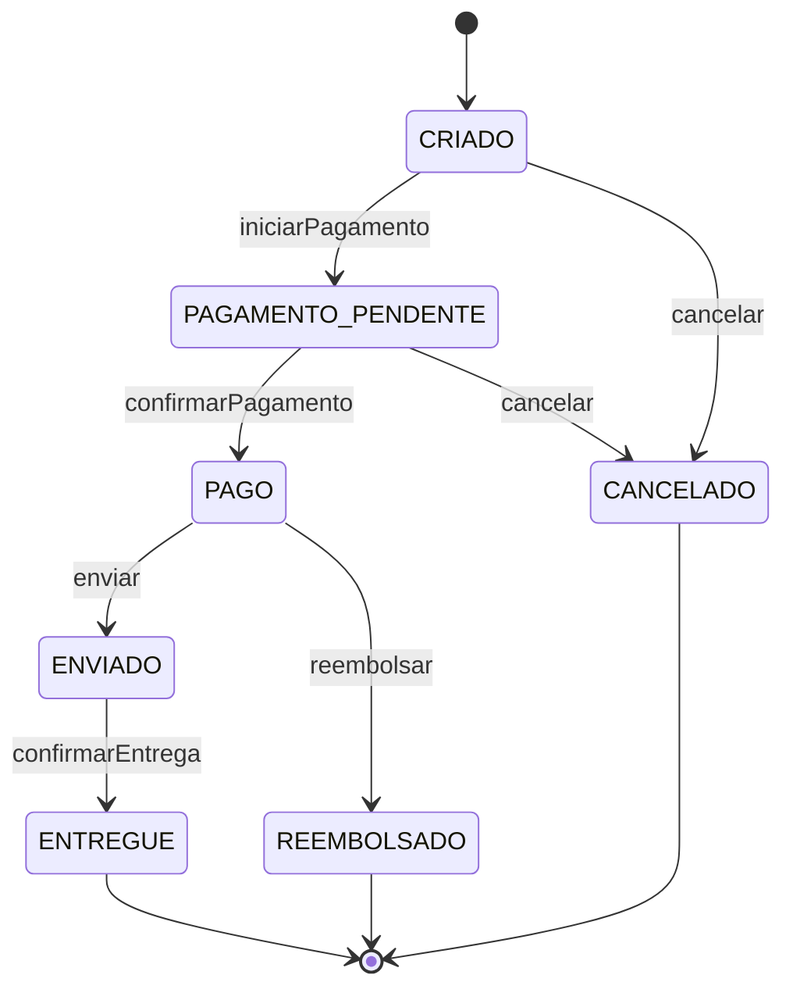

## O problema

O pedido do Bazar tem sete status, e só algumas passagens entre eles são permitidas. Um pedido criado pode ir para pagamento ou ser cancelado. Um pedido pago pode ser enviado, mas não cancelado (vira reembolso). Um pedido entregue não muda mais. São 7 status e 6 ações: 42 combinações, das quais 7 são permitidas e 35 precisam ser recusadas.

Testar essas 42 combinações pela API seria absurdo. Cada uma exigiria criar cliente, produto e estoque, criar o pedido, levá-lo até o status de origem por várias chamadas HTTP e só então tentar a ação. Isso daria centenas de requisições e um banco para cada execução. E, quando um teste falhasse, você ainda teria de descobrir se o erro está na regra, no controller ou no SQL.

A regra, porém, não depende de nada disso. "De `PAGO` se pode ir para `ENVIADO`" é uma frase sobre duas constantes de um `enum`. Testá-la exige só criar um objeto Java e chamar um método.

É como conferir a tabela de horários de uma linha de ônibus: você confere a tabela no papel, sem pegar cada ônibus para ver se ele passa na hora.

> **A pergunta desta página:** como testar as regras de negócio do Bazar sem subir o Spring, com dublês só onde eles ajudam?

## O conceito

### As ferramentas: JUnit 6, AssertJ e Mockito 5

O `spring-boot-starter-test`, que vem nos *starters* de teste do Bazar, traz as três:

| Biblioteca | Versão | Papel |
|---|---|---|
| **JUnit 6** (Jupiter) | 6.0.3 | Executa os testes: `@Test`, `@ParameterizedTest`, `@Nested`, ciclo de vida |
| **AssertJ** | 3.27.7 | Asserções fluentes: `assertThat(x).isEqualTo(y)`, exceções, coleções |
| **Mockito** | 5.23.0 | Dublês: `mock`, `when(...).thenReturn(...)`, `verify` |

O JUnit 6 é a continuação do JUnit 5. A API de escrita de testes é a mesma (pacote `org.junit.jupiter.api`), então quase todo teste do JUnit 5 compila sem mudança. As diferenças que você pode notar:

- exige Java 17 ou mais recente;
- a Platform, o Jupiter e o Vintage passaram a ter o mesmo número de versão;
- as APIs têm anotações de nulidade do <Term id="jspecify">JSpecify</Term>;
- o `@CsvSource` usa outro *parser* (FastCSV), mais rígido com aspas malformadas;
- o motor Vintage, que roda testes do JUnit 4, está depreciado.

O JUnit 4 (`org.junit.Test`, `@RunWith`) é legado. Ao encontrá-lo, migre para o Jupiter, em vez de manter o Vintage.

### Testes parametrizados

Um <Term id="teste-parametrizado">teste parametrizado</Term> é o mesmo teste executado com várias entradas. Cada execução aparece como um teste separado no relatório, então uma combinação que falha não esconde as outras. As fontes de dados mais usadas:

| Anotação | Quando usar |
|---|---|
| `@ValueSource(ints = {1, 2, 3})` | Um único parâmetro, valores literais |
| `@EnumSource(names = {...})` | Constantes de um `enum`, todas ou uma seleção (`mode = EXCLUDE` inverte) |
| `@CsvSource(textBlock = """...""")` | Uma tabela pequena, legível, escrita no próprio teste |
| `@MethodSource("nome")` | Combinações calculadas por um método `static` que devolve `Stream<Arguments>` |

O atributo `name` do `@ParameterizedTest` define o nome de cada execução. `{0}`, `{1}`... são os argumentos, e `{arguments}` são todos eles. Um bom nome transforma o relatório em documentação: `PAGO --ENVIAR--> permitido` diz mais que `[5]`.

### `@Nested`: agrupar por assunto

`@Nested` marca uma classe interna (não `static`) como um grupo de testes. O `PedidoTest` tem dois grupos: `Valores` (total e subtotais) e `Transicoes` (máquina de estados). No relatório e na IDE os grupos aparecem como uma árvore, e cada um pode ter o seu `@BeforeEach`.

### AssertJ: asserções que explicam a falha

Com AssertJ, a asserção começa sempre por `assertThat(valorReal)` e o autocompletar da IDE oferece só as verificações que fazem sentido para o tipo. A vantagem principal é a mensagem de falha:

```text noCopy
Expecting actual:
  [PAGAMENTO_PENDENTE]
to contain exactly (and in same order):
  [PAGAMENTO_PENDENTE, CANCELADO]
but could not find the following elements:
  [CANCELADO]
```

Para exceções, há duas formas:

```java
// 1. Tudo numa expressão
assertThatThrownBy(() -> pedido.enviar())
        .isInstanceOf(TransicaoInvalidaException.class)
        .hasMessageContaining("CRIADO");

// 2. Capturar e examinar à vontade
var erro = catchThrowableOfType(TransicaoInvalidaException.class, pedido::enviar);
assertThat(erro.getExtensoes()).containsEntry("statusAtual", StatusPedido.CRIADO);
```

O equivalente do JUnit é `assertThrows`. Ele funciona, mas é menos fluente na hora de examinar a exceção.

### Dublês: *stub*, *mock* e *fake*

A página [11.01](/testes-de-api/estrategia-de-testes-para-apis) apresentou os três tipos de <Term id="dubles-de-teste">dublê</Term>. Na prática, com Mockito:

- **Stub:** `when(produtos.findById(id)).thenReturn(Optional.of(cleanCode))`. O serviço recebe o produto sem banco.
- **Mock:** `verify(eventos).publishEvent(new PedidoCriado(...))`. O teste confirma que a interação aconteceu, com esses argumentos.
- **Fake:** o `ClienteRepository` do Bazar, que ainda guarda os clientes num `ConcurrentHashMap`. Ele já é uma implementação simples e funcional, e o teste a usa como está.

A pergunta importante não é "como mockar", e sim **o que não mockar**:

- ***Value objects* e entidades.** `Dinheiro`, `Pedido` e `Produto` são baratos de criar e não têm efeitos colaterais. Mockar `Dinheiro` significaria reescrever no teste a aritmética que você quer testar. Use os objetos reais, criados por *builders*.
- **A própria classe testada.** Um `spy` do serviço testado, com metade dos métodos substituídos, testa o *stub*.
- **O que você não controla.** Mockar o `EntityManager` ou o `JdbcClient` produz testes que passam com SQL errado. Para isso existe o teste de integração (11.04).
- **Dependências com comportamento simples.** Se existe uma implementação em memória fácil de usar (como o `ClienteRepository`), ela costuma ser melhor que um *mock*. O teste não precisa saber quais métodos o serviço chama.

Mocke as dependências que levam a efeitos externos ou caros: o repositório JPA, o serviço de outro módulo, o publicador de eventos, um cliente HTTP.

<Callout type="warning" title="verify só quando a interação é o comportamento">
`verify(pedidos).save(pedido)` amarra o teste a uma decisão de implementação. Se o serviço trocar o `save` explícito por *dirty checking*, o teste quebra sem que nada observável tenha mudado. No `PedidoServiceTest`, `verify` aparece onde a interação **é** a regra: reservar o estoque na ordem certa, publicar o evento, não gravar nada quando falta estoque.
</Callout>

## Diagrama

A tabela de transições que os testes verificam, como está no `PROJETO-FINAL.md`:



As 7 setas são as transições permitidas. Toda outra combinação de status e ação (35 delas) tem de lançar `TransicaoInvalidaException` e deixar o status como estava.

## Na prática

### A regra no domínio

A máquina de estados fica no domínio, onde o resto da regra do pedido já está. O `StatusPedido` sabe para onde cada status pode ir:

```java title="src/main/java/com/bazar/pedidos/dominio/StatusPedido.java"
public enum StatusPedido {
    CRIADO, PAGAMENTO_PENDENTE, PAGO, ENVIADO, ENTREGUE, CANCELADO, REEMBOLSADO;

    // ENTREGUE, CANCELADO e REEMBOLSADO são finais: não saem para nenhum outro estado.
    public boolean podeIrPara(StatusPedido destino) {
        return destinosPermitidos().contains(destino);
    }

    private Set<StatusPedido> destinosPermitidos() {
        return switch (this) {
            case CRIADO -> EnumSet.of(PAGAMENTO_PENDENTE, CANCELADO);
            case PAGAMENTO_PENDENTE -> EnumSet.of(PAGO, CANCELADO);
            case PAGO -> EnumSet.of(ENVIADO, REEMBOLSADO);
            case ENVIADO -> EnumSet.of(ENTREGUE);
            case ENTREGUE, CANCELADO, REEMBOLSADO -> EnumSet.noneOf(StatusPedido.class);
        };
    }
}
```

O `switch` sem `default` é proposital. Se alguém acrescentar um status novo ao `enum`, o compilador acusa que o `switch` não cobre todos os casos, e a pessoa é obrigada a decidir as transições do novo status.

O `Pedido` expõe uma ação por transição, e nenhum `setStatus`. Todas passam pelo mesmo ponto de verificação:

```java title="src/main/java/com/bazar/pedidos/dominio/Pedido.java"
public void enviar() {
    mudarPara(StatusPedido.ENVIADO);
}

public void cancelar() {
    mudarPara(StatusPedido.CANCELADO);
}

// ... iniciarPagamento, confirmarPagamento, confirmarEntrega, reembolsar

private void mudarPara(StatusPedido destino) {
    if (!status.podeIrPara(destino)) {
        throw new TransicaoInvalidaException(id, status, destino);
    }
    status = destino;
}
```

```java title="src/main/java/com/bazar/pedidos/dominio/TransicaoInvalidaException.java"
public class TransicaoInvalidaException extends RegraDeNegocioException {

    public TransicaoInvalidaException(UUID pedidoId, StatusPedido atual, StatusPedido desejado) {
        super("transicao-invalida", Map.of("statusAtual", atual, "statusDesejado", desejado),
                pedidoId, atual, desejado);
    }
}
```

Por ser uma `RegraDeNegocioException`, o `TratadorGlobalDeErros` já sabe transformá-la num `409 Conflict` com Problem Details (08.02). As mensagens `problemDetail.transicao-invalida` foram acrescentadas aos `messages*.properties`. Nenhum endpoint dispara essas ações ainda: o `POST /v1/pedidos/{id}/cancelamento` e as outras ações chegam na página [12.04](/design-de-apis-profissional/acoes-que-nao-sao-crud-e-maquinas-de-estado), que vai usar exatamente esta regra.

### Os *builders* de teste

Para testar uma transição a partir de `PAGO`, o teste precisa de um pedido pago. O `PedidoDeTeste` cria esse pedido levando-o até lá **pelas mesmas ações** que o código de produção usa, sem reflexão e sem um *setter* criado só para o teste:

```java title="src/test/java/com/bazar/pedidos/dominio/PedidoDeTeste.java"
public final class PedidoDeTeste {

    private UUID clienteId = UUID.fromString("0192f3a1-7777-7000-8000-000000000001");
    private final List<Item> itens = new ArrayList<>();
    private StatusPedido status = StatusPedido.CRIADO;

    public static PedidoDeTeste umPedido() {
        return new PedidoDeTeste();
    }

    public PedidoDeTeste com(Produto produto, int quantidade) { /* ... */ }
    public PedidoDeTeste noStatus(StatusPedido status) { /* ... */ }

    public Pedido build() {
        var pedido = new Pedido(clienteId);
        if (itens.isEmpty()) {
            pedido.adicionarItem(umProduto().build(), 1);
        }
        itens.forEach(item -> pedido.adicionarItem(item.produto(), item.quantidade()));
        caminhoAte(status).forEach(acao -> acao.accept(pedido));
        return pedido;
    }

    private static List<Consumer<Pedido>> caminhoAte(StatusPedido status) {
        return switch (status) {
            case CRIADO -> List.of();
            case PAGAMENTO_PENDENTE -> List.of(Pedido::iniciarPagamento);
            case PAGO -> List.of(Pedido::iniciarPagamento, Pedido::confirmarPagamento);
            // ... ENVIADO, ENTREGUE, CANCELADO, REEMBOLSADO
        };
    }
}
```

O `ProdutoDeTeste` faz o mesmo para o produto: `umProduto()` devolve um "Clean Code" de R$ 129,90 na categoria Programação, e `comSku`, `comPreco` e `daCategoria` mudam o que o teste precisa.

### `PedidoTest`: valores e transições

```java title="src/test/java/com/bazar/pedidos/dominio/PedidoTest.java"
// Um teste unitário: sem Spring, sem banco. Roda em milissegundos.
class PedidoTest {

    @Nested
    class Valores {

        @Test
        void somaOsSubtotaisDosItensNoTotal() {
            var pedido = umPedido()
                    .com(umProduto().comSku("LIV-0042").comPreco(12990).build(), 2)
                    .com(umProduto().comSku("LIV-0043").comPreco(5000).build(), 1)
                    .build();

            assertThat(pedido.getValorItens()).isEqualTo(Dinheiro.deCentavos(30980, "BRL"));
            assertThat(pedido.getValorFrete()).isEqualTo(Dinheiro.deCentavos(0, "BRL"));
            assertThat(pedido.getValorTotal()).isEqualTo(Dinheiro.deCentavos(30980, "BRL"));
        }

        @ParameterizedTest(name = "{1} × R$ {0} centavos = R$ {2}")
        @CsvSource(textBlock = """
                1990,  3, 59.70
                1,     1, 0.01
                12990, 100, 12990.00
                """)
        void calculaOSubtotalDeCadaItem(long precoEmCentavos, int quantidade, String subtotal) {
            var pedido = umPedido().com(umProduto().comPreco(precoEmCentavos).build(), quantidade).build();

            assertThat(pedido.getItens()).singleElement()
                    .satisfies(item -> assertThat(item.getSubtotal()).hasToString(subtotal));
        }

        @Test
        void guardaOPrecoDoMomentoDaCompra() {
            var produto = umProduto().comPreco(12990).build();
            var pedido = umPedido().com(produto, 1).build();

            produto.atualizar(produto.getNome(), null, Dinheiro.deCentavos(15990, "BRL"), produto.getCategoriaId(), Map.of());

            assertThat(pedido.getItens().getFirst().getPrecoUnitario()).hasToString("129.90");
            assertThat(pedido.getValorTotal()).isEqualTo(Dinheiro.deCentavos(12990, "BRL"));
        }
    }
```

O subtotal é comparado com `hasToString("59.70")`, e não com `isEqualTo(new BigDecimal("59.7"))`. A diferença importa: `BigDecimal.equals` compara também a escala, e `59.7` com escala 1 é diferente de `59.70` com escala 2. Como a escala é o que vai para a coluna `numeric(12,2)` e para o JSON, o teste fixa a escala também.

A parte das transições é a tabela do diagrama, escrita no teste:

```java title="src/test/java/com/bazar/pedidos/dominio/PedidoTest.java"
    @Nested
    class Transicoes {

        // As ações do pedido e o status a que cada uma leva.
        enum Acao {
            INICIAR_PAGAMENTO(Pedido::iniciarPagamento, PAGAMENTO_PENDENTE),
            CONFIRMAR_PAGAMENTO(Pedido::confirmarPagamento, PAGO),
            ENVIAR(Pedido::enviar, ENVIADO),
            CONFIRMAR_ENTREGA(Pedido::confirmarEntrega, ENTREGUE),
            CANCELAR(Pedido::cancelar, CANCELADO),
            REEMBOLSAR(Pedido::reembolsar, REEMBOLSADO);
            // ... campos executar e destino
        }

        // A tabela de transições, copiada da especificação (PROJETO-FINAL.md), e não do StatusPedido:
        // se o teste lesse a regra do próprio código, um erro na regra passaria nos dois.
        static final Map<StatusPedido, Set<Acao>> PERMITIDAS = Map.of(
                CRIADO, Set.of(Acao.INICIAR_PAGAMENTO, Acao.CANCELAR),
                PAGAMENTO_PENDENTE, Set.of(Acao.CONFIRMAR_PAGAMENTO, Acao.CANCELAR),
                PAGO, Set.of(Acao.ENVIAR, Acao.REEMBOLSAR),
                ENVIADO, Set.of(Acao.CONFIRMAR_ENTREGA));

        static Stream<Arguments> transicoesPermitidas() {
            return PERMITIDAS.entrySet().stream()
                    .flatMap(e -> e.getValue().stream().map(acao -> arguments(e.getKey(), acao)));
        }

        static Stream<Arguments> transicoesProibidas() {
            return Arrays.stream(StatusPedido.values())
                    .flatMap(origem -> Arrays.stream(Acao.values())
                            .filter(acao -> !PERMITIDAS.getOrDefault(origem, Set.of()).contains(acao))
                            .map(acao -> arguments(origem, acao)));
        }

        @ParameterizedTest(name = "{0} --{1}--> permitido")
        @MethodSource("transicoesPermitidas")
        void mudaOStatusNasTransicoesPermitidas(StatusPedido origem, Acao acao) {
            var pedido = umPedido().noStatus(origem).build();

            acao.executar.accept(pedido);

            assertThat(pedido.getStatus()).isEqualTo(acao.destino);
        }

        @ParameterizedTest(name = "{0} --{1}--> proibido")
        @MethodSource("transicoesProibidas")
        void recusaAsOutrasTransicoesSemMudarOStatus(StatusPedido origem, Acao acao) {
            var pedido = umPedido().noStatus(origem).build();

            var erro = catchThrowableOfType(TransicaoInvalidaException.class, () -> acao.executar.accept(pedido));

            assertThat(erro).isNotNull();
            assertThat(erro.getTipo()).isEqualTo("transicao-invalida");
            assertThat(erro.getExtensoes()).containsEntry("statusAtual", origem).containsEntry("statusDesejado", acao.destino);
            assertThat(pedido.getStatus()).isEqualTo(origem);
        }

        @ParameterizedTest
        @EnumSource(names = { "ENTREGUE", "CANCELADO", "REEMBOLSADO" })
        void estadosFinaisNaoSaemParaNenhumOutro(StatusPedido finalizado) {
            assertThat(StatusPedido.values()).noneMatch(finalizado::podeIrPara);
        }
    }
}
```

Duas decisões merecem atenção:

- **As proibidas são calculadas, não listadas.** `transicoesProibidas()` gera todas as combinações de status e ação e tira as permitidas. Ninguém precisa escrever 35 linhas à mão, e, se um status novo aparecer, as combinações dele entram sozinhas.
- **A tabela vem da especificação, não do código.** Se o teste chamasse `StatusPedido.podeIrPara` para decidir o que esperar, ele concordaria com qualquer erro da regra. Um teste só prova alguma coisa se a expectativa vier de uma fonte independente do código testado.

Rodando:

```bash
./mvnw test -Dtest=PedidoTest
```

```text noCopy
[INFO] Tests run: 51, Failures: 0, Errors: 0, Skipped: 0
```

São 51 execuções: 5 de valores e 46 de transições (1 do status inicial, 7 permitidas, 35 proibidas e 3 estados finais). Todas juntas levam cerca de 0,2 s.

### `PedidoServiceTest`: o serviço com dublês

O `PedidoService.criar` coordena: confere o cliente, busca os produtos, monta o pedido, reserva o estoque, grava e publica o evento. O teste unitário verifica essa coordenação, com as dependências substituídas:

```java title="src/test/java/com/bazar/pedidos/dominio/PedidoServiceTest.java"
@ExtendWith(MockitoExtension.class)
class PedidoServiceTest {

    @Mock
    PedidoRepository pedidos;

    @Mock
    ProdutoRepository produtos;

    @Mock
    EstoqueService estoques;

    @Mock
    ApplicationEventPublisher eventos;

    // O repositório de clientes ainda guarda tudo num mapa: é um fake pronto, e o teste usa o real.
    ClienteRepository clientes = new ClienteRepository();

    PedidoService service;
    Cliente maria;

    @BeforeEach
    void montarOServico() {
        service = new PedidoService(pedidos, produtos, estoques, clientes, eventos);
        maria = clientes.save(Cliente.novo("Maria Souza", "maria@example.com", "52998224725", null, Canal.WEB));
    }

    @Test
    void criaOPedidoReservandoOEstoqueEPublicandoOEvento() {
        var cleanCode = umProduto().comPreco(12990).build();
        when(produtos.findById(cleanCode.getId())).thenReturn(Optional.of(cleanCode));

        var pedido = service.criar(maria.id(), List.of(new ItemSolicitado(cleanCode.getId(), 2)));

        assertThat(pedido.getStatus()).isEqualTo(StatusPedido.CRIADO);
        assertThat(pedido.getValorTotal()).isEqualTo(Dinheiro.deCentavos(25980, "BRL"));
        verify(estoques).reservar(cleanCode.getId(), 2);
        verify(pedidos).save(pedido);
        verify(eventos).publishEvent(new PedidoCriado(pedido.getId(), maria.id(), Dinheiro.deCentavos(25980, "BRL")));
    }

    @Test
    void reservaCadaProdutoUmaVezEmOrdemDeId() {
        var a = umProduto().comSku("LIV-0001").build();
        var b = umProduto().comSku("LIV-0002").build();
        var menor = a.getId().compareTo(b.getId()) < 0 ? a : b;
        var maior = menor == a ? b : a;
        when(produtos.findById(a.getId())).thenReturn(Optional.of(a));
        when(produtos.findById(b.getId())).thenReturn(Optional.of(b));

        service.criar(maria.id(), List.of(
                new ItemSolicitado(maior.getId(), 1),
                new ItemSolicitado(menor.getId(), 2),
                new ItemSolicitado(maior.getId(), 3)));

        var ordem = inOrder(estoques);
        ordem.verify(estoques).reservar(menor.getId(), 2);
        ordem.verify(estoques).reservar(maior.getId(), 4);
        verifyNoMoreInteractions(estoques);
    }

    @Test
    void naoGravaNemPublicaQuandoFaltaEstoque() {
        var cleanCode = umProduto().build();
        when(produtos.findById(cleanCode.getId())).thenReturn(Optional.of(cleanCode));
        doThrow(new EstoqueInsuficienteException(cleanCode.getId(), 1, 2)).when(estoques).reservar(cleanCode.getId(), 2);

        assertThatThrownBy(() -> service.criar(maria.id(), List.of(new ItemSolicitado(cleanCode.getId(), 2))))
                .isInstanceOf(EstoqueInsuficienteException.class);

        verify(pedidos, never()).save(any());
        verifyNoInteractions(eventos);
    }

    // ... recusaUmClienteInexistenteSemTocarNoEstoque, apontaOItemCujoProdutoNaoExiste
}
```

O que cada parte faz:

- **`@ExtendWith(MockitoExtension.class)`** cria os `@Mock` antes de cada teste e confere, no fim, se algum *stub* ficou sem uso. Esse é o modo *strict stubs*, o padrão da extensão. Um `when(...)` que o código nunca chamou faz o teste falhar com `UnnecessaryStubbingException`, porque ele indica um teste desatualizado ou que não testa o que parece testar.
- **O serviço é criado com `new`.** Assim fica explícito quais dependências são dublês e quais são reais. A alternativa `@InjectMocks` injeta só *mocks* e *spies*: o `ClienteRepository` real ficaria `null`.
- **`reservaCadaProdutoUmaVezEmOrdemDeId`** verifica duas regras da 10.06: itens repetidos viram uma reserva só (1 + 3 = 4), e as reservas seguem a ordem dos ids, para evitar *deadlock*. `inOrder` falha se a ordem for outra. `verifyNoMoreInteractions` falha se houver uma terceira reserva.
- **`naoGravaNemPublicaQuandoFaltaEstoque`** prova que o serviço para no ponto certo. Ele **não** prova o *rollback* das reservas anteriores: quem desfaz é a transação do banco, e um teste sem banco não tem transação. Essa parte continua coberta pelo `PedidoControllerTest` e pelo `ReservaConcorrenteTest`, que rodam no PostgreSQL.

### Mockito como agente da JVM

Rodando esses testes no Java 25, o Mockito avisava:

```text noCopy
Mockito is currently self-attaching to enable the inline-mock-maker. This will no longer work
in future releases of the JDK. Please add Mockito as an agent to your build ...
```

O Mockito 5 cria os dublês com um *Java agent* que ele mesmo carregava em tempo de execução. Do Java 21 em diante, o JDK avisa quando um agente é carregado assim, e versões futuras vão bloquear isso. A correção recomendada pela documentação do Mockito é declarar o agente na linha de comando da JVM dos testes:

```xml title="pom.xml"
<properties>
    <!-- Vazio por padrão; o Surefire acrescenta o agente do Mockito (11.02). -->
    <argLine></argLine>
</properties>

<!-- ... -->

<plugin>
    <groupId>org.apache.maven.plugins</groupId>
    <artifactId>maven-dependency-plugin</artifactId>
    <executions>
        <execution>
            <goals>
                <goal>properties</goal>
            </goals>
        </execution>
    </executions>
</plugin>
<plugin>
    <groupId>org.apache.maven.plugins</groupId>
    <artifactId>maven-surefire-plugin</artifactId>
    <configuration>
        <argLine>@{argLine} -javaagent:${org.mockito:mockito-core:jar}</argLine>
    </configuration>
</plugin>
```

O objetivo `properties` cria uma propriedade com o caminho de cada dependência (`${org.mockito:mockito-core:jar}`). O `@{argLine}` preserva argumentos acrescentados por outros *plugins*, como o JaCoCo. A propriedade `argLine` vazia evita que a JVM receba o texto literal `@{argLine}` quando nenhum outro *plugin* a define.

## Erros comuns

<BadVsGood title="Colocar o pedido num status" why="Um setter criado só para o teste deixa qualquer código de produção pular a máquina de estados. Levar o pedido ao status pelas ações reais testa o caminho também.">
<Bad title="Setter ou reflexão">

```java
var pedido = new Pedido(clienteId);
pedido.setStatus(StatusPedido.PAGO);   // público só para o teste
// ou ReflectionTestUtils.setField(pedido, "status", PAGO);
```

</Bad>
<Good title="Builder que usa as ações">

```java
var pedido = umPedido().noStatus(StatusPedido.PAGO).build();
// internamente: iniciarPagamento(), confirmarPagamento()
```

</Good>
</BadVsGood>

<BadVsGood title="Esperado calculado pelo código testado" why="Se a expectativa sai da mesma regra que está sendo testada, o teste sempre concorda com ela, inclusive quando ela está errada.">
<Bad title="O teste pergunta ao código o que esperar">

```java
if (origem.podeIrPara(acao.destino)) {
    acao.executar.accept(pedido);
    assertThat(pedido.getStatus()).isEqualTo(acao.destino);
}
```

</Bad>
<Good title="A tabela vem da especificação">

```java
static final Map<StatusPedido, Set<Acao>> PERMITIDAS = Map.of(
        CRIADO, Set.of(Acao.INICIAR_PAGAMENTO, Acao.CANCELAR),
        // ... copiado do PROJETO-FINAL.md
```

</Good>
</BadVsGood>

Outros erros frequentes:

- **Mockar *value objects*.** `when(dinheiro.somar(any())).thenReturn(...)` testa o *stub*. `Dinheiro` é barato e determinístico: use o real.
- **Um *stub* para tudo com `any()`.** `when(produtos.findById(any())).thenReturn(Optional.of(cleanCode))` devolve o mesmo produto para qualquer id, e um erro que troca os ids passa despercebido. Use o argumento exato sempre que puder.
- **`@SpringBootTest` para testar regra de negócio.** Subir a aplicação para testar `StatusPedido.podeIrPara` custa 1,5 s em vez de milissegundos e não acrescenta nada.
- **Comparar `BigDecimal` com `isEqualTo`.** `new BigDecimal("59.7")` não é igual a `new BigDecimal("59.70")`. Use `isEqualByComparingTo` quando a escala não importa e `hasToString` quando ela importa.
- **Desligar o *strict stubs* para o teste passar.** `@MockitoSettings(strictness = LENIENT)` esconde *stubs* mortos. Se o código não usa o *stub*, apague-o.

## Boas práticas

- **Coloque as regras de negócio em classes de domínio** que dependam só de Java: assim elas podem ser testadas sem Spring.
- **Teste as regras com objetos reais**, criados por *builders*, e reserve os dublês para as dependências com efeito externo.
- **Use testes parametrizados para tabelas de regras**, com nomes que leiam como a regra (`PAGO --ENVIAR--> permitido`).
- **Gere as combinações proibidas a partir das permitidas**, em vez de listá-las à mão.
- **Tire a expectativa de uma fonte independente** do código testado: a especificação, um exemplo calculado à mão.
- **Use `verify` só quando a interação é o comportamento** (ordem das reservas, evento publicado, nada gravado).
- **Mantenha o *strict stubs* ligado** e apague os *stubs* que sobrarem.

## No projeto Bazar

<ProjectStep title="Máquina de estados do pedido e os primeiros testes unitários" module="pedidos" tag="pagina-11.02" files={[
  { path: 'src/main/java/com/bazar/pedidos/dominio/StatusPedido.java', change: 'alterado' },
  { path: 'src/main/java/com/bazar/pedidos/dominio/Pedido.java', change: 'alterado' },
  { path: 'src/main/java/com/bazar/pedidos/dominio/TransicaoInvalidaException.java', change: 'novo' },
  { path: 'src/main/resources/messages.properties', change: 'alterado' },
  { path: 'src/main/resources/messages_pt.properties', change: 'alterado' },
  { path: 'src/test/java/com/bazar/catalogo/dominio/ProdutoDeTeste.java', change: 'novo' },
  { path: 'src/test/java/com/bazar/pedidos/dominio/PedidoDeTeste.java', change: 'novo' },
  { path: 'src/test/java/com/bazar/pedidos/dominio/PedidoTest.java', change: 'novo' },
  { path: 'src/test/java/com/bazar/pedidos/dominio/PedidoServiceTest.java', change: 'novo' },
  { path: 'pom.xml', change: 'alterado' },
]}>
O pedido ganhou as seis ações da máquina de estados, todas validadas por `StatusPedido.podeIrPara`, e a `TransicaoInvalidaException` (409, `transicao-invalida`). Os *builders* `umProduto()` e `umPedido()` passam a ser a forma de criar dados nos testes. O `PedidoTest` (51 casos) e o `PedidoServiceTest` (5 casos) rodam sem Spring, e o Mockito agora é carregado como agente da JVM. Rode `./mvnw test -Dtest='PedidoTest,PedidoServiceTest'` para ver só os novos testes.
</ProjectStep>

## Resumo

- Regras de negócio, como a máquina de estados e o cálculo do total, são testadas com JUnit 6 e AssertJ, sem Spring e em milissegundos.
- `@ParameterizedTest` com `@CsvSource`, `@EnumSource` e `@MethodSource` transforma uma tabela de regras em dezenas de casos, cada um com nome próprio no relatório.
- Mockito cria *stubs* (respostas prontas) e *mocks* (interações verificadas). *Fakes* são implementações simples que funcionam. *Value objects* e entidades não se mockam.
- O teste unitário do serviço verifica a coordenação. *Rollback*, SQL e *locks* continuam sendo trabalho dos testes de integração.
- No Java 21 ou mais recente, declare o Mockito como `-javaagent` no Surefire.

<Exercise title="Teste a regra de cancelamento com motivo" difficulty="medio">
A equipe decidiu que `cancelar` passa a exigir um motivo (`String`) que não pode ser vazio. Um motivo em branco deve lançar `IllegalArgumentException`, mesmo num status em que o cancelamento é permitido, e o status não deve mudar.

1. Escreva os testes antes de mudar o `Pedido`: um teste parametrizado com os motivos inválidos (`""`, `"   "`) e um que confirma que o motivo fica guardado.
2. Mude o `Pedido` e o `PedidoDeTeste` para os testes passarem.
3. Os testes de transição continuam passando? O que precisa mudar neles?

<Hint>`@ValueSource(strings = {"", "   "})` cobre os vazios. Para o `null`, existe `@NullSource`, ou `@NullAndEmptySource` para `null` e `""` juntos. O `enum Acao` do teste guarda um `Consumer<Pedido>`: a ação de cancelar passa a ser `p -> p.cancelar("desistência")`.</Hint>

<Solution>

```java title="src/test/java/com/bazar/pedidos/dominio/PedidoTest.java"
@Nested
class Cancelamento {

    @ParameterizedTest
    @ValueSource(strings = { "", "   " })
    void exigeUmMotivo(String motivo) {
        var pedido = umPedido().build();

        assertThatThrownBy(() -> pedido.cancelar(motivo))
                .isInstanceOf(IllegalArgumentException.class)
                .hasMessageContaining("motivo");
        assertThat(pedido.getStatus()).isEqualTo(StatusPedido.CRIADO);
    }

    @Test
    void guardaOMotivo() {
        var pedido = umPedido().build();

        pedido.cancelar("Comprei em outra loja");

        assertThat(pedido.getMotivoDoCancelamento()).isEqualTo("Comprei em outra loja");
    }
}
```

```java title="src/main/java/com/bazar/pedidos/dominio/Pedido.java"
public void cancelar(String motivo) {
    if (motivo.isBlank()) {
        throw new IllegalArgumentException("O motivo do cancelamento é obrigatório");
    }
    mudarPara(StatusPedido.CANCELADO);
    this.motivoDoCancelamento = motivo.strip();
}
```

A validação vem **antes** de `mudarPara`, para que um motivo inválido não mude o status. O teste `exigeUmMotivo` verifica exatamente isso.

Os testes de transição continuam valendo depois de duas mudanças: no `enum Acao`, `CANCELAR(p -> p.cancelar("desistência"), CANCELADO)`, e no `PedidoDeTeste`, `case CANCELADO -> List.of(p -> p.cancelar("desistência"))`. A tabela de transições não muda, porque o motivo é uma regra nova e não altera a máquina de estados. Na API (12.04), o motivo vem no corpo do `POST /v1/pedidos/{id}/cancelamento` e é validado com Bean Validation antes de chegar ao domínio. A verificação no domínio é a última linha de defesa.
</Solution>
</Exercise>

<Quiz questions={[
  {
    question: 'O teste de transições proibidas calcula as combinações com StatusPedido.podeIrPara em vez de usar uma tabela própria. Qual é o problema?',
    options: [
      'Nenhum: o código fica menor e evita duplicação',
      'O teste fica mais lento porque chama o método de produção',
      'O teste passa a concordar com qualquer erro da regra, porque a expectativa sai do código testado',
      'O JUnit não aceita métodos de produção num @MethodSource',
    ],
    answer: 2,
    explanation: 'Se a regra disser, por engano, que PAGO pode ir para CANCELADO, o teste calculado com a mesma regra espera exatamente isso e passa. A "duplicação" entre a tabela do teste e o código é o que dá valor ao teste: duas fontes independentes que precisam concordar. A velocidade não muda, e o JUnit aceita qualquer código num @MethodSource.',
  },
  {
    question: 'Por que o PedidoServiceTest usa o ClienteRepository real em vez de um @Mock?',
    options: [
      'Porque o Mockito não consegue mockar classes, só interfaces',
      'Porque ele é uma implementação em memória, simples e sem efeitos externos: um fake pronto, que deixa o teste independente dos métodos que o serviço chama',
      'Porque @InjectMocks exige pelo menos uma dependência real',
      'Porque repositórios nunca devem ser substituídos em testes',
    ],
    answer: 1,
    explanation: 'O Mockito 5 mocka classes sem problema, e o PedidoServiceTest mocka o PedidoRepository, que é um repositório. A escolha é de qualidade: com o fake, o teste cadastra a cliente e o serviço a encontra, sem um when(...) amarrado ao nome do método. O @InjectMocks, aliás, só injeta mocks e spies, por isso o serviço é criado com new.',
  },
  {
    question: 'O teste naoGravaNemPublicaQuandoFaltaEstoque passa. O que ele NÃO garante?',
    options: [
      'Que o serviço não chama save quando a reserva falha',
      'Que nenhum evento é publicado',
      'Que as reservas de itens anteriores são desfeitas no banco',
      'Que a exceção lançada é EstoqueInsuficienteException',
    ],
    answer: 2,
    explanation: 'Desfazer as reservas anteriores é trabalho do rollback da transação no PostgreSQL. Sem banco, não há transação para desfazer. As outras três afirmações são exatamente o que o teste verifica (never().save, verifyNoInteractions(eventos), isInstanceOf). O rollback fica com os testes de integração.',
  },
]} />

## Referências

<References />
