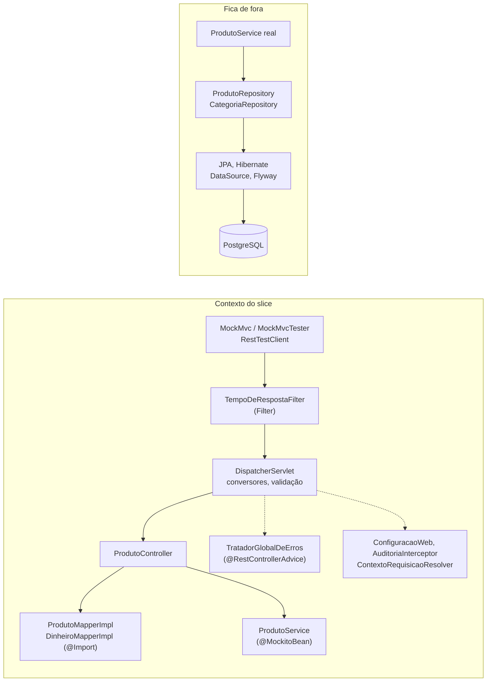

## O problema

O contrato HTTP do Bazar tem muitos detalhes que um cliente percebe na hora:

- um `POST /v1/produtos` válido responde `201 Created` com `Location`;
- um produto inválido responde `422` com `application/problem+json` e um item em `erros[]` por campo;
- um id que não é UUID responde `400` sem ecoar o valor recebido;
- o CSV da listagem tem cabeçalho e separador `\r\n`.

Nada disso depende do PostgreSQL. Mesmo assim, até a página anterior, o `ProdutoControllerTest` subia a aplicação inteira e um contêiner do banco para verificar esses detalhes. Para testar o 404, o teste precisava de um banco vazio. Para testar a atualização, gravava um produto antes. O teste ficava lento, e uma mudança no esquema do banco podia quebrar um teste que só queria saber o status de uma resposta.

Pense no teste de um balcão de atendimento. Para saber se o atendente pede os documentos certos e dá a resposta certa, você não precisa do arquivo inteiro da repartição: basta um colega nos fundos que devolva a resposta que você combinou. O que está sendo testado é o balcão.

> **A pergunta desta página:** como testar só a camada web do Bazar (rotas, JSON, validação, erros) em milissegundos, com o serviço substituído por um dublê?

## O conceito

### `@WebMvcTest`: o que sobe e o que fica de fora

`@WebMvcTest(ProdutoController.class)` sobe um contexto Spring com a infraestrutura do Spring MVC e só os componentes ligados à web. Segundo a documentação do Spring Boot, ele considera:

- `@Controller` e `@RestController` (limitados aos que você listar na anotação);
- `@ControllerAdvice` (no Bazar, o `TratadorGlobalDeErros`);
- `@JacksonComponent`, `Converter` e `GenericConverter`;
- `Filter`, `HandlerInterceptor`, `WebMvcConfigurer`, `WebMvcRegistrations` e `HandlerMethodArgumentResolver`.

`@Component`, `@Service`, `@Repository` e `@ConfigurationProperties` comuns **ficam de fora**. Não há `DataSource`, JPA, Flyway nem PostgreSQL. As dependências do controller que não são web precisam entrar como dublês ou ser importadas explicitamente.

A anotação vem do módulo `spring-boot-webmvc-test`, que o `spring-boot-starter-webmvc-test` do Bazar já traz. O <Term id="slice-test">*slice*</Term> também auto-configura o `MockMvc` e, com AssertJ no *classpath*, o `MockMvcTester`.

### `@MockitoBean`

`@MockitoBean` cria um *mock* do Mockito e o registra no contexto no lugar do *bean* daquele tipo. Se não houver *bean* do tipo, como acontece num *slice*, o *mock* é acrescentado. O controller recebe o *mock* pelo construtor, como receberia o serviço real.

```java
@MockitoBean
ProdutoService produtos;
```

Entre um teste e outro, o Spring reinicia o *mock* (os `when(...)` e as chamadas registradas são apagados), então um teste não vê os *stubs* do outro. Como a página [11.01](/testes-de-api/estrategia-de-testes-para-apis) explicou, cada conjunto diferente de `@MockitoBean` é uma chave diferente no cache de contexto. Num *slice* isso custa pouco, porque o contexto é pequeno.

Em código legado, o equivalente é `@MockBean` (`org.springframework.boot.test.mock.mockito`), removido no Spring Boot 4.

### `MockMvcTester`: MockMvc com AssertJ

O `MockMvc` executa a requisição dentro do `DispatcherServlet` sem abrir porta nem *socket*. O pedido passa pelos filtros, pelo roteamento, pela conversão de JSON, pela validação e pelo `@ControllerAdvice`, exatamente como em produção, mas com objetos de requisição e resposta simulados.

O `MockMvcTester`, do Spring Framework 6.2 em diante, é a forma AssertJ de usar o `MockMvc`:

```java
assertThat(mvc.get().uri("/v1/produtos/{id}", id))
        .hasStatus(HttpStatus.NOT_FOUND)
        .hasContentType(MediaType.APPLICATION_PROBLEM_JSON)
        .bodyJson()
        .hasPathSatisfying("$.codigo", v -> assertThat(v).isEqualTo("PRODUTO_NAO_ENCONTRADO"));
```

As peças principais:

| Método | Para quê |
|---|---|
| `mvc.get()`, `.post()`, `.put()`... + `.uri(...)` | Monta a requisição: `contentType`, `content`, `header`, `accept` |
| `assertThat(requisicao)` | Executa e começa as asserções |
| `.exchange()` | Executa e devolve o resultado, para examinar várias vezes |
| `hasStatus`, `hasStatusOk`, `hasHeader`, `hasContentType` | Status e headers |
| `bodyJson().isLenientlyEqualTo(json)` | Compara o JSON ignorando campos a mais e a ordem dos campos |
| `bodyJson().isStrictlyEqualTo(json)` | Compara o JSON exato |
| `bodyJson().extractingPath("$.x")` | Extrai um valor por JSONPath e continua com AssertJ |
| `bodyText()` | O corpo como texto (CSV, por exemplo) |

`isLenientlyEqualTo` é a escolha certa na maior parte dos testes de contrato: o teste fixa os campos que importam e não quebra quando um campo novo é acrescentado, o que é uma mudança compatível ([18.01](/contratos-documentacao-e-ciclo-de-vida/compatibilidade-retroativa-o-que-quebra-um-cliente)).

### `RestTestClient`: uma API, dois alvos

O `RestTestClient` é novo no Spring Framework 7. Ele tem a API fluente do `RestClient` para montar a requisição e uma API de expectativas para a resposta. A diferença em relação ao `MockMvcTester` é **onde** a requisição chega:

| Configuração | Alvo |
|---|---|
| `@WebMvcTest` + `@AutoConfigureRestTestClient` | O `MockMvc` do *slice*: sem servidor, como o `MockMvcTester` |
| `@SpringBootTest(webEnvironment = RANDOM_PORT)` + `@AutoConfigureRestTestClient` | O servidor real, por HTTP, numa porta aleatória (11.04) |
| `RestTestClient.bindToController(...)` | Um controller, sem contexto Spring |
| `RestTestClient.bindToServer().baseUrl(...)` | Qualquer servidor já rodando |

O mesmo teste escrito com `RestTestClient` roda contra o `MockMvc` num *slice* e contra o Tomcat num teste de integração. É útil quando você quer reaproveitar cenários, ou quando o comportamento depende do servidor real (compressão, `server.error`, limites do Tomcat), que o `MockMvc` não reproduz.

As expectativas ficam encadeadas depois de `exchange()`:

```java
cliente.post().uri("/v1/produtos")
        .contentType(MediaType.APPLICATION_JSON)
        .body(json)
        .exchange()
        .expectStatus().isCreated()
        .expectHeader().valueMatches(HttpHeaders.LOCATION, "http://localhost/v1/produtos/[0-9a-f-]{36}")
        .expectBody()
        .jsonPath("$.status").isEqualTo("RASCUNHO");
```

Se preferir AssertJ, `RestTestClientResponse.from(exchange)` devolve um objeto que aceita `assertThat(...)`.

<Comparison
  title="MockMvcTester × RestTestClient"
  columns={['MockMvcTester', 'RestTestClient']}
  rows={[
    { label: 'Asserções', values: ['AssertJ', 'API própria (ou AssertJ via RestTestClientResponse)'] },
    { label: 'Funciona num @WebMvcTest', values: [true, true] },
    { label: 'Funciona contra servidor real', values: [false, true] },
    { label: 'Acesso à exceção resolvida e ao handler', values: [true, false] },
    { label: 'Disponível desde', values: ['Framework 6.2', 'Framework 7'] },
  ]}
/>

No Bazar, o padrão nos *slices* é o `MockMvcTester`, porque ele dá acesso à exceção que o Spring resolveu (`getResolvedException()`), útil para testar o tratamento de erros. O `RestTestClient` é o padrão nos testes de integração com servidor real.

### `@JsonTest`: só a serialização

Quando o que importa é só o formato do JSON (nomes de campos, `null` explícito, datas em RFC 3339, `Dinheiro` com valor em *string*), há um *slice* ainda menor. `@JsonTest` sobe só o Jackson configurado pelo Spring Boot, com o `application.yml` e os `@JacksonComponent`, e oferece o `JacksonTester`. O Bazar tem o `ProdutoJsonTest` desde a Parte 3:

```java title="src/test/java/com/bazar/catalogo/api/ProdutoJsonTest.java"
@JsonTest
class ProdutoJsonTest {

    @Autowired
    JacksonTester<Dinheiro> dinheiro;

    @Test
    void escreveODinheiroComValorEmString() throws Exception {
        assertThat(dinheiro.write(Dinheiro.deCentavos(12990, "BRL")))
                .isStrictlyEqualToJson("""
                        { "valor": "129.90", "moeda": "BRL" }
                        """);
    }
}
```

Dentro da suíte, ele sobe em 0,09 s.

### MockMvc clássico (para reconhecer)

Antes do `MockMvcTester`, os testes eram escritos com `perform` e os *matchers* estáticos de `MockMvcRequestBuilders` e `MockMvcResultMatchers`. Esse estilo ainda funciona e está em quase todo projeto existente:

```java
mockMvc.perform(post("/v1/produtos")
                .contentType(MediaType.APPLICATION_JSON)
                .content(json))
        .andExpect(status().isCreated())
        .andExpect(header().exists("Location"))
        .andExpect(jsonPath("$.status").value("RASCUNHO"));
```

As diferenças práticas: `perform` declara `throws Exception`, os *matchers* vêm de *imports* estáticos difíceis de descobrir, e as falhas de JSONPath são menos legíveis. Em código novo, use o `MockMvcTester`. Ao manter um teste antigo, não há urgência em migrar: os dois podem conviver na mesma classe, porque o `MockMvcTester` é construído sobre o mesmo `MockMvc`.

## Diagrama



A requisição percorre o mesmo caminho que em produção até o controller. A partir do serviço, quem responde é o dublê, com a resposta combinada no teste.

## Na prática

### O controller depende só do serviço

Até a 11.02, o `ProdutoController` recebia o `ProdutoRepository` para o `GET /{id}`. Num *slice*, isso obrigaria o teste a mockar também o repositório, e o teste ficaria sabendo de um detalhe que não é da camada web. O detalhe passou para o serviço:

```java title="src/main/java/com/bazar/catalogo/dominio/ProdutoService.java"
@Transactional(readOnly = true)
public Produto detalhar(UUID id) {
    return produtos.findById(id).orElseThrow(() -> naoEncontrado(id));
}
```

```java title="src/main/java/com/bazar/catalogo/api/ProdutoController.java"
// O controller só conhece o serviço e o mapper: no @WebMvcTest, basta substituir o serviço (11.03).
private final ProdutoService servico;
private final ProdutoMapper mapper;

// ...

@GetMapping("/{id}")
public ProdutoResponse detalhar(@PathVariable UUID id) {
    return mapper.paraResponse(servico.detalhar(id));
}
```

Um controller que precisa de cinco dublês para ser testado está fazendo coisa demais. A dificuldade de testar costuma ser o primeiro sinal de um problema de design.

### A classe de teste

```java title="src/test/java/com/bazar/catalogo/api/ProdutoControllerTest.java"
// Um slice test: só a camada web sobe (controller, Jackson, validação, TratadorGlobalDeErros, filtros).
// O serviço é um dublê; nada aqui toca no banco. O que depende do PostgreSQL está em ProdutoIntegracaoTest (11.04).
@WebMvcTest(ProdutoController.class)
@AutoConfigureRestTestClient
@Import({ ProdutoMapperImpl.class, DinheiroMapperImpl.class })
class ProdutoControllerTest {

    @Autowired
    MockMvcTester mvc;

    @MockitoBean
    ProdutoService produtos;
```

O *mapper* gerado pelo MapStruct é um `@Component` comum, então o *slice* não o encontra sozinho. Ele entra pelo `@Import`, real, e não como *mock*. O *mapper* é parte do contrato: é ele que decide que o preço vira `precoEmCentavos`. Um *mock* dele faria o teste verificar uma resposta que o teste mesmo inventou.

### 201 com `Location`

Para o `POST`, o *stub* devolve o próprio produto que o controller montou a partir do JSON. Assim o teste exercita o *mapper* nos dois sentidos:

<HttpExchange
  title="O que o teste envia e verifica"
  request={{ method: 'POST', url: '/v1/produtos', headers: { 'Content-Type': 'application/json' }, body: { sku: 'LIV-0042', nome: 'Clean Code', descricao: 'Um guia de boas práticas.', precoEmCentavos: 12990, categoriaId: '0192f3a0-5555-7000-8000-000000000003', atributos: { autor: 'Robert C. Martin' } } }}
  response={{ status: 201, headers: { 'Location': 'http://localhost/v1/produtos/9b0e…', 'Content-Type': 'application/json' }, body: { id: '9b0e…', sku: 'LIV-0042', nome: 'Clean Code', descricao: 'Um guia de boas práticas.', precoEmCentavos: 12990, categoriaId: '0192f3a0-5555-7000-8000-000000000003', status: 'RASCUNHO', atributos: { autor: 'Robert C. Martin' }, criadoEm: '2026-10-25T12:27:23.412Z', atualizadoEm: '2026-10-25T12:27:23.412Z' } }}
>
O `MockMvc` usa `http://localhost` como origem, então o `Location` montado com `ServletUriComponentsBuilder` começa por aí.
</HttpExchange>

```java title="src/test/java/com/bazar/catalogo/api/ProdutoControllerTest.java"
@Test
void criaUmProdutoComoRascunho() {
    when(produtos.criar(any())).thenAnswer(chamada -> chamada.getArgument(0));

    var resposta = mvc.post().uri("/v1/produtos")
            .contentType(MediaType.APPLICATION_JSON)
            .content("""
                    { "sku": "LIV-0042", "nome": "Clean Code", "descricao": "Um guia de boas práticas.",
                      "precoEmCentavos": 12990, "categoriaId": "0192f3a0-5555-7000-8000-000000000003",
                      "atributos": { "autor": "Robert C. Martin" } }
                    """)
            .exchange();

    assertThat(resposta).hasStatus(HttpStatus.CREATED);
    assertThat(resposta).bodyJson().isLenientlyEqualTo("""
            { "sku": "LIV-0042", "nome": "Clean Code", "precoEmCentavos": 12990,
              "status": "RASCUNHO", "atributos": { "autor": "Robert C. Martin" } }
            """);
    assertThat(resposta).bodyJson().doesNotHavePath("$.versao");
    var criado = ArgumentCaptor.forClass(Produto.class);
    verify(produtos).criar(criado.capture());
    assertThat(resposta).hasHeader(HttpHeaders.LOCATION, "http://localhost/v1/produtos/" + criado.getValue().getId());
}
```

O `ArgumentCaptor` captura o `Produto` que o controller passou ao serviço. Com ele, o teste confere que o `Location` aponta exatamente para o id do produto criado, e não só que começa com `/v1/produtos/`.

### 422 com `erros[]`, sem chamar o serviço

```java title="src/test/java/com/bazar/catalogo/api/ProdutoControllerTest.java"
@Test
void responde422ComUmErroPorCampoSemEcoarOValor() {
    assertThat(mvc.post().uri("/v1/produtos")
            .contentType(MediaType.APPLICATION_JSON)
            .header(HttpHeaders.ACCEPT_LANGUAGE, "pt-BR")
            .content("""
                    { "sku": "liv-42", "nome": "Clean Code", "precoEmCentavos": -5,
                      "categoriaId": "0192f3a0-5555-7000-8000-000000000003" }
                    """))
            .hasStatus(HttpStatus.UNPROCESSABLE_CONTENT)
            .hasContentType(MediaType.APPLICATION_PROBLEM_JSON)
            .bodyJson()
            .isLenientlyEqualTo("""
                    { "type": "https://api.bazar.example/problemas/validacao", "title": "Dados inválidos",
                      "status": 422, "detail": "A requisição tem 2 campos inválidos.", "codigo": "VALIDACAO",
                      "erros": [
                        { "campo": "precoEmCentavos", "mensagem": "deve ser maior que 0" },
                        { "campo": "sku", "mensagem": "deve seguir o formato AAA-0000 (ex.: LIV-0042)" } ] }
                    """);
}

@Test
void rejeitaUmProdutoInvalidoSemChamarOServico() {
    var resposta = mvc.post().uri("/v1/produtos") /* ... sku vazio, preço negativo ... */ .exchange();

    assertThat(resposta).hasStatus(HttpStatus.UNPROCESSABLE_CONTENT);
    assertThat(resposta.getMvcResult().getResolvedException()).isInstanceOf(MethodArgumentNotValidException.class);
    verifyNoInteractions(produtos);
}
```

`verifyNoInteractions(produtos)` prova uma propriedade importante: a validação acontece **antes** do serviço, e um corpo inválido nunca chega ao domínio. `getResolvedException()` mostra qual exceção o Spring MVC resolveu, o que ajuda a distinguir um 422 de Bean Validation (`MethodArgumentNotValidException`) de um 422 de validação no método (`HandlerMethodValidationException`, [07.01](/construindo-apis-com-spring-boot/bean-validation-essencial)).

### Erros que vêm do serviço

Um *stub* também pode lançar exceções. É assim que o *slice* testa o mapeamento de cada exceção de domínio para HTTP, sem precisar provocar a situação real:

```java title="src/test/java/com/bazar/catalogo/api/ProdutoControllerTest.java"
@Test
void responde404ComProblemDetails() {
    var id = UUID.fromString("0192f39f-2222-7000-8000-000000000999");
    when(produtos.detalhar(id)).thenThrow(new RecursoNaoEncontradoException("produto-nao-encontrado", id));

    assertThat(mvc.get().uri("/v1/produtos/{id}", id).header(HttpHeaders.ACCEPT_LANGUAGE, "pt-BR"))
            .hasStatus(HttpStatus.NOT_FOUND)
            .hasContentType(MediaType.APPLICATION_PROBLEM_JSON)
            .bodyJson()
            .hasPathSatisfying("$.type", v -> assertThat(v).isEqualTo("https://api.bazar.example/problemas/produto-nao-encontrado"))
            .hasPathSatisfying("$.title", v -> assertThat(v).isEqualTo("Produto não encontrado"))
            .hasPathSatisfying("$.instance", v -> assertThat(v).isEqualTo("/v1/produtos/0192f39f-2222-7000-8000-000000000999"))
            .hasPathSatisfying("$.traceId", v -> assertThat(v).asString().matches("[0-9a-f]{32}"));
}

@Test
void recusaUmaCategoriaQueNaoExisteCom422() {
    when(produtos.criar(any())).thenThrow(new CampoInvalidoException("categoriaId", "bazar.produto.categoria-inexistente"));
    // ... espera 422 com { "campo": "categoriaId", "mensagem": "A categoria informada não existe." }
}
```

O *slice* prova que **se** o serviço lançar `RecursoNaoEncontradoException`, o cliente recebe o 404 certo. **Se** o serviço lança essa exceção para um id inexistente é outra pergunta, respondida pelo teste de integração da 11.04. Cada teste prova a sua metade.

### Headers como `ETag`

Headers são verificados do mesmo jeito que o `Location`: `hasHeader(nome, valor)` para um valor exato, `containsHeader(nome)` e `doesNotContainHeader(nome)` para presença, e `headers()` para as verificações do `HttpHeadersAssert` (`hasValue`, `hasHeaderSatisfying`...). O Bazar ainda não envia `ETag`. Quando a página [20.02](/padroes-avancados-de-http/etag-e-requisicoes-condicionais) acrescentar o header ao `GET /v1/produtos/{id}`, o teste do *slice* será desta forma:

```java
assertThat(mvc.get().uri("/v1/produtos/{id}", id))
        .hasStatusOk()
        .hasHeader(HttpHeaders.ETAG, "\"3\"");
```

### O mesmo contrato com `RestTestClient`

```java title="src/test/java/com/bazar/catalogo/api/ProdutoControllerTest.java"
// Os mesmos contratos, escritos com o RestTestClient. Aqui ele usa o MockMvc por baixo; em 11.04 o mesmo
// código fala com um servidor de verdade.
@Nested
class ComRestTestClient {

    @Autowired
    RestTestClient cliente;

    @Test
    void criaUmProdutoCom201ELocation() {
        when(produtos.criar(any())).thenAnswer(chamada -> chamada.getArgument(0));

        cliente.post().uri("/v1/produtos")
                .contentType(MediaType.APPLICATION_JSON)
                .body("""
                        { "sku": "LIV-0042", "nome": "Clean Code", "precoEmCentavos": 12990,
                          "categoriaId": "0192f3a0-5555-7000-8000-000000000003" }
                        """)
                .exchange()
                .expectStatus().isCreated()
                .expectHeader().valueMatches(HttpHeaders.LOCATION, "http://localhost/v1/produtos/[0-9a-f-]{36}")
                .expectBody()
                .jsonPath("$.sku").isEqualTo("LIV-0042")
                .jsonPath("$.status").isEqualTo("RASCUNHO");
    }

    @Test
    void responde422ComOsErrosDeCadaCampo() {
        cliente.post().uri("/v1/produtos")
                // ... mesmo corpo inválido
                .exchange()
                .expectStatus().isEqualTo(HttpStatus.UNPROCESSABLE_CONTENT)
                .expectHeader().contentType(MediaType.APPLICATION_PROBLEM_JSON)
                .expectBody()
                .json("""
                        { "type": "https://api.bazar.example/problemas/validacao", "codigo": "VALIDACAO",
                          "erros": [
                            { "campo": "precoEmCentavos", "mensagem": "deve ser maior que 0" },
                            { "campo": "sku", "mensagem": "deve seguir o formato AAA-0000 (ex.: LIV-0042)" } ] }
                        """);
        verifyNoInteractions(produtos);
    }
}
```

`.json(...)` compara em modo leniente por padrão, como o `isLenientlyEqualTo`. A classe `@Nested` herda o contexto da classe externa: o mesmo *slice*, o mesmo `@MockitoBean`, nenhum contexto a mais.

### Quanto custa

Na suíte completa do Bazar, as linhas `Started ... in` do log mostram a diferença:

```text noCopy
Started CategoriaControllerTest in 1.647 seconds    # @SpringBootTest + PostgreSQL
Started ProdutoControllerTest in 0.231 seconds      # @WebMvcTest
Started ProdutoJsonTest in 0.09 seconds             # @JsonTest
```

Rodando o `ProdutoControllerTest` sozinho, o contexto leva 2,1 s, porque a JVM ainda está fria e tudo é carregado pela primeira vez. Dentro da suíte, quando as classes do Spring já estão carregadas, o *slice* sobe em um quarto de segundo, e cada um dos 15 testes roda em poucos milissegundos.

## Erros comuns

<BadVsGood title="Mockar o mapper" why="O mapper decide o formato da resposta. Mockado, ele devolve o que o teste mandou, e o teste deixa de verificar o contrato que existe para verificar.">
<Bad title="Tudo como mock">

```java
@MockitoBean ProdutoService produtos;
@MockitoBean ProdutoMapper mapper;

when(mapper.paraResponse(any())).thenReturn(responsePronto);
// o teste confere que o JSON é... o responsePronto
```

</Bad>
<Good title="Mapper real, só o serviço é dublê">

```java
@WebMvcTest(ProdutoController.class)
@Import({ ProdutoMapperImpl.class, DinheiroMapperImpl.class })
class ProdutoControllerTest {
    @MockitoBean ProdutoService produtos;
```

</Good>
</BadVsGood>

<BadVsGood title="Verificar só o status" why="Dois endpoints podem responder 422 com corpos completamente diferentes. O cliente lê o corpo do erro; o teste também precisa ler.">
<Bad title="Status e mais nada">

```java
assertThat(mvc.post().uri("/v1/produtos").content(invalido))
        .hasStatus(HttpStatus.UNPROCESSABLE_CONTENT);
```

</Bad>
<Good title="Status, media type e os campos do problema">

```java
assertThat(mvc.post().uri("/v1/produtos").content(invalido))
        .hasStatus(HttpStatus.UNPROCESSABLE_CONTENT)
        .hasContentType(MediaType.APPLICATION_PROBLEM_JSON)
        .bodyJson().isLenientlyEqualTo("""
            { "codigo": "VALIDACAO", "erros": [ { "campo": "sku", ... } ] }
            """);
```

</Good>
</BadVsGood>

Outros erros frequentes:

- **`@WebMvcTest` sem a lista de controllers.** Sem argumento, ele sobe **todos** os controllers, e você precisa de dublês para as dependências de todos eles. Liste o controller testado.
- **`NoSuchBeanDefinitionException` e a tentação do `@SpringBootTest`.** O erro diz qual *bean* faltou. Se for uma dependência de domínio, use `@MockitoBean`. Se for um componente barato e determinístico (um *mapper*), use `@Import`. Trocar o *slice* pela aplicação inteira esconde o problema.
- **Esperar comportamento do servidor no MockMvc.** O `MockMvc` não passa pelo Tomcat: o `server.error.*` do Spring Boot, a compressão e os limites de tamanho do conector não aparecem. Para esses casos, use `RestTestClient` contra um servidor real (11.04).
- **Comparar JSON com `isEqualTo` de *string*.** A ordem dos campos e os espaços fazem o teste falhar sem motivo. Use `bodyJson()`.
- **Testar regra de negócio no *slice*.** "Pedido pago não pode ser cancelado" é regra do domínio (11.02). No *slice*, teste só que a `TransicaoInvalidaException` vira `409`.

## Boas práticas

- **Teste o contrato HTTP de cada endpoint num *slice***: status, headers, corpo de sucesso e corpo de cada erro.
- **Liste o controller na anotação** (`@WebMvcTest(ProdutoController.class)`) e mantenha o controller dependente só do serviço.
- **Substitua o serviço com `@MockitoBean`** e importe com `@Import` os componentes baratos que fazem parte do contrato, como os *mappers*.
- **Use `isLenientlyEqualTo`** para o corpo, fixando os campos que importam, e `doesNotHavePath` para o que **não** pode aparecer (`versao`, `cpf`).
- **Confirme com `verifyNoInteractions`** que requisições inválidas não chegam ao serviço.
- **Teste o mapeamento de cada exceção de domínio** com um *stub* que a lança.
- **Prefira `MockMvcTester` nos *slices* e `RestTestClient` contra servidor real.** Reconheça o `perform(...).andExpect(...)` em código legado.

## No projeto Bazar

<ProjectStep title="ProdutoControllerTest como slice" module="catalogo" tag="pagina-11.03" files={[
  { path: 'src/main/java/com/bazar/catalogo/dominio/ProdutoService.java', change: 'alterado' },
  { path: 'src/main/java/com/bazar/catalogo/api/ProdutoController.java', change: 'alterado' },
  { path: 'src/test/java/com/bazar/catalogo/api/ProdutoControllerTest.java', change: 'alterado' },
]}>
O `ProdutoController` passou a depender só do `ProdutoService` (novo método `detalhar`) e do *mapper*. O `ProdutoControllerTest` deixou de subir a aplicação e o PostgreSQL: é um `@WebMvcTest` com o serviço em `@MockitoBean` e os *mappers* reais. São 13 testes com `MockMvcTester` e 2 com `RestTestClient`. O que dependia do banco (gravar e ler de volta, *constraints*) vai para o `ProdutoIntegracaoTest` na 11.04. Os outros `*ControllerTest` com `@SpringBootTest` (categorias, estoque, pedidos) são testes de integração com outro nome, e a 11.04 os organiza.
</ProjectStep>

## Resumo

- `@WebMvcTest(Controller.class)` sobe só a camada web: controllers, `@ControllerAdvice`, filtros, conversores e Jackson. Serviços e banco ficam de fora.
- `@MockitoBean` coloca um dublê no lugar do serviço. Componentes que fazem parte do contrato, como os *mappers*, entram reais com `@Import`.
- `MockMvcTester` testa com AssertJ: `hasStatus`, `hasHeader`, `bodyJson().isLenientlyEqualTo(...)`, e dá acesso à exceção resolvida.
- `RestTestClient` (Framework 7) usa a mesma API contra o `MockMvc` ou contra um servidor real.
- `@JsonTest` testa só a serialização. O `perform(...).andExpect(...)` é o estilo legado do MockMvc.

<Exercise title="Slice para o CategoriaController" difficulty="medio">
O `CategoriaControllerTest` ainda sobe a aplicação inteira com PostgreSQL. Crie um `CategoriaControllerSliceTest` com `@WebMvcTest(CategoriaController.class)` que verifique, sem banco:

1. `DELETE /v1/categorias/{id}` de uma categoria com produtos responde `409` com `codigo` `CATEGORIA_COM_PRODUTOS` e `quantidadeDeProdutos`.
2. `POST /v1/categorias` com `slug` `"Jogos Eletrônicos"` responde `422` e não chama o serviço.
3. `GET /v1/categorias/abc` responde `400`.

<Hint>Veja de que o `CategoriaController` depende e qual exceção o `CategoriaService` lança quando há produtos (`grep -n "categoria-com-produtos" -r src/main/java`). O teste não precisa provocar a situação: basta um `when(...).thenThrow(...)` com a mesma exceção.</Hint>

<Solution>

```java title="src/test/java/com/bazar/catalogo/api/CategoriaControllerSliceTest.java"
@WebMvcTest(CategoriaController.class)
class CategoriaControllerSliceTest {

    static final UUID PROGRAMACAO = UUID.fromString("0192f3a0-5555-7000-8000-000000000003");

    @Autowired
    MockMvcTester mvc;

    @MockitoBean
    CategoriaService categorias;

    @MockitoBean
    CategoriaRepository repositorio; // o controller ainda o usa nas leituras (listar, detalhar)

    @Test
    void responde409AoRemoverCategoriaComProdutos() {
        doThrow(new RegraDeNegocioException("categoria-com-produtos",
                Map.of("quantidadeDeProdutos", 1), "Programação", 1))
                .when(categorias).remover(PROGRAMACAO);

        assertThat(mvc.delete().uri("/v1/categorias/{id}", PROGRAMACAO).header("Accept-Language", "pt-BR"))
                .hasStatus(HttpStatus.CONFLICT)
                .bodyJson().isLenientlyEqualTo("""
                        { "codigo": "CATEGORIA_COM_PRODUTOS", "quantidadeDeProdutos": 1 }
                        """);
    }

    @Test
    void recusaSlugForaDoFormatoSemChamarOServico() {
        assertThat(mvc.post().uri("/v1/categorias").contentType(MediaType.APPLICATION_JSON)
                .content("""
                        { "nome": "Games", "slug": "Jogos Eletrônicos" }
                        """))
                .hasStatus(HttpStatus.UNPROCESSABLE_CONTENT);
        verifyNoInteractions(categorias);
    }

    @Test
    void responde400ParaIdQueNaoEUuid() {
        assertThat(mvc.get().uri("/v1/categorias/abc")).hasStatus(HttpStatus.BAD_REQUEST);
    }
}
```

O `CategoriaController` recebe o `CategoriaRepository` e o `CategoriaService`, então o *slice* precisa de dois dublês. O `CategoriaService.remover` lança uma `RegraDeNegocioException` com o tipo `categoria-com-produtos`, a extensão `quantidadeDeProdutos` e os argumentos da mensagem (nome e quantidade). O *stub* reproduz exatamente isso. Precisar de dois dublês é o mesmo sinal que o `ProdutoController` deu nesta página: mover as leituras para o serviço deixaria um único dublê. O teste de "categoria com produtos" que usa o banco continua valendo, como teste de integração: ele prova que a contagem de produtos no PostgreSQL leva à exceção.
</Solution>
</Exercise>

<Quiz questions={[
  {
    question: 'Num @WebMvcTest(ProdutoController.class), o teste falha com NoSuchBeanDefinitionException para ProdutoMapper. Qual é a correção mais adequada?',
    options: [
      'Trocar @WebMvcTest por @SpringBootTest, que encontra todos os beans',
      'Importar a implementação gerada com @Import(ProdutoMapperImpl.class), porque o mapper faz parte do contrato da resposta',
      'Declarar @MockitoBean ProdutoMapper e fazer stub de cada conversão',
      'Anotar o mapper com @Controller para que o slice o encontre',
    ],
    answer: 1,
    explanation: 'O slice não varre @Component comuns, e o mapper gerado pelo MapStruct é um deles. Ele é barato, determinístico e decide o formato do JSON, então entra real. Com @SpringBootTest o teste sobe a aplicação e o banco sem necessidade. Com um mock, o teste verifica uma resposta inventada por ele mesmo. Anotar o mapper com @Controller distorce o código de produção para agradar o teste.',
  },
  {
    question: 'O teste do slice prova que RecursoNaoEncontradoException vira 404 com Problem Details. O que ele NÃO prova?',
    options: [
      'Que o corpo tem o type e o codigo corretos',
      'Que o Content-Type é application/problem+json',
      'Que o serviço real lança essa exceção quando o produto não existe no banco',
      'Que o detail está em português quando Accept-Language é pt-BR',
    ],
    answer: 2,
    explanation: 'O stub lança a exceção porque o teste mandou. Se o serviço real devolvesse null ou lançasse outra exceção para um id inexistente, o slice continuaria verde. Essa metade é provada no teste de integração. Corpo, Content-Type e mensagem localizada são produzidos pela camada web e estão cobertos pelo slice.',
  },
  {
    question: 'Qual a principal vantagem do RestTestClient sobre o MockMvcTester?',
    options: [
      'As asserções são mais legíveis que as do AssertJ',
      'Ele é mais rápido dentro de um @WebMvcTest',
      'Ele dá acesso à exceção resolvida pelo Spring MVC',
      'A mesma API funciona contra o MockMvc e contra um servidor HTTP real',
    ],
    answer: 3,
    explanation: 'O RestTestClient pode ser ligado ao MockMvc, a um controller, ao contexto ou a um servidor real, sem mudar o código do teste. No slice, a velocidade é a mesma, porque os dois usam o MockMvc por baixo. Quem expõe a exceção resolvida é o MockMvcTester (getMvcResult().getResolvedException()). E legibilidade é questão de gosto: o RestTestClient aceita AssertJ via RestTestClientResponse.',
  },
]} />

## Referências

<References />
