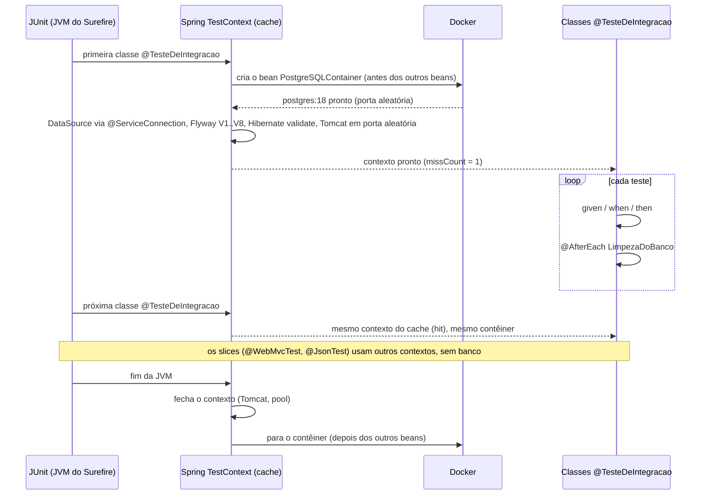

## O problema

Na página anterior, o `ProdutoControllerTest` virou um *slice* e deixou de usar o banco. Ele prova que, **se** o serviço lançar `RecursoNaoEncontradoException`, o cliente recebe o 404 certo. Mas não prova o que acontece quando o PostgreSQL recusa um `INSERT`.

Para descobrir, esta página escreveu um teste que cadastra o mesmo produto duas vezes pela API. A segunda resposta deveria ser `409 Conflict`. Foi esta:

```text noCopy
WARN  org.hibernate.orm.jdbc.error : ERROR: duplicate key value violates unique constraint "produto_sku_key"
ERROR c.b.c.erros.TratadorGlobalDeErros : Erro inesperado [traceId=ebfcf9ad918f417c0a7e9262e7fd3fda]
org.springframework.dao.DataIntegrityViolationException: could not execute statement ...

{"title":"Internal Server Error","status":500,"detail":"Erro inesperado. Se persistir, informe o traceId ao suporte.", ...}

java.lang.AssertionError: Status expected:<409 CONFLICT> but was:<500 INTERNAL_SERVER_ERROR>
```

O Bazar responde `500` para um SKU repetido desde que o catálogo passou para o PostgreSQL (10.01), e nenhum dos 131 testes existentes percebeu. O *slice* não tem banco. Os testes unitários usam dublês. E os testes antigos com banco nunca tentaram um SKU repetido. Só um teste que passa pela API **e** chega ao PostgreSQL de verdade encontra esse erro.

Banco em memória (H2) não resolveria: ele também tem *constraint* `unique`, mas não tem `jsonb`, `for no key update`, `skip locked` nem a mesma detecção de *deadlock*. A [10.06](/persistencia-para-apis/concorrencia-no-banco-locking-otimista-e-pessimista) depende de tudo isso. Testar com outro banco é como fazer o ensaio de uma peça em outro palco: as marcações não batem no dia da estreia.

> **A pergunta desta página:** como testar o Bazar inteiro com o PostgreSQL de produção, num contêiner, sem deixar a suíte lenta nem os testes dependentes uns dos outros?

## O conceito

### `@SpringBootTest` e o ambiente web

`@SpringBootTest` sobe a aplicação inteira, como o `main` faria: todos os *beans*, a autoconfiguração e o `application.yml`. O atributo `webEnvironment` decide se há servidor:

| `webEnvironment` | Servidor | Como o teste faz requisições |
|---|---|---|
| `MOCK` (padrão) | Nenhum. O contexto web é simulado | `MockMvcTester`, no mesmo *thread* do teste |
| `RANDOM_PORT` | Tomcat de verdade, numa porta livre escolhida a cada execução | `RestTestClient` (ou qualquer cliente HTTP) pela rede, mais o `MockMvcTester` se quiser |
| `DEFINED_PORT` | Tomcat na porta do `server.port` | Idem, mas dois processos de teste brigam pela porta |
| `NONE` | Nenhum contexto web | Chamando os *beans* diretamente |

Com `RANDOM_PORT`, a porta pode ser injetada com `@LocalServerPort`, e o `RestTestClient` configurado por `@AutoConfigureRestTestClient` já aponta para ela. Esse é o teste que mais se parece com produção: a requisição passa pelo Tomcat, pelos filtros e pela serialização, como faria a de um cliente real.

### Testcontainers 2 e `@ServiceConnection`

O Testcontainers sobe contêineres Docker a partir do código do teste e os remove no fim. A versão 2 organizou os módulos com o prefixo `testcontainers-` (`testcontainers-postgresql`, `testcontainers-junit-jupiter`) e moveu as classes para pacotes por tecnologia: o `PostgreSQLContainer` está em `org.testcontainers.postgresql`. Em código da versão 1, ele aparece em `org.testcontainers.containers` e com tipo genérico (`PostgreSQLContainer<?>`).

A forma tradicional de ligar o contêiner ao Spring era copiar a URL, o usuário e a senha para as propriedades:

```java
// forma antiga: ainda funciona e é útil para propriedades que não têm suporte nativo
@DynamicPropertySource
static void banco(DynamicPropertyRegistry registro) {
    registro.add("spring.datasource.url", postgres::getJdbcUrl);
    registro.add("spring.datasource.username", postgres::getUsername);
    registro.add("spring.datasource.password", postgres::getPassword);
}
```

Com `@ServiceConnection`, o Spring Boot reconhece o tipo do contêiner e cria sozinho os *beans* de `ConnectionDetails`. Para um `PostgreSQLContainer`, ele cria o `JdbcConnectionDetails`, que o `DataSource` e o Flyway usam. Há suporte para PostgreSQL, MongoDB, Redis, Kafka, RabbitMQ, Elasticsearch e outros. O `TestcontainersConfiguration` do Bazar existe desde a 10.01:

```java title="src/test/java/com/bazar/TestcontainersConfiguration.java"
@TestConfiguration(proxyBeanMethods = false)
public class TestcontainersConfiguration {

    // @RestartScope: quando o DevTools reinicia a aplicação (TestBazarApplication), o contêiner e os dados ficam.
    @Bean
    @RestartScope
    @ServiceConnection
    PostgreSQLContainer postgres() {
        return new PostgreSQLContainer("postgres:18");
    }
}
```

### Duas formas de declarar o contêiner

| | Contêiner como `@Bean` | `@Testcontainers` + `@Container static` |
|---|---|---|
| Quem inicia e para | O Spring, junto com o contexto | A extensão do JUnit, junto com a classe de teste |
| Quando para | Quando o contexto é fechado (fim da JVM ou expulso do cache) | Ao fim da classe de teste |
| Combina com o cache de contexto | Sim | Pode quebrar: o contexto fica no cache, o contêiner não |
| Um contêiner por | Contexto | Classe de teste (ou JVM, se compartilhado à mão) |

A documentação do Spring Boot alerta para o segundo caso. A extensão do JUnit para o contêiner `static` quando a classe termina, mas o Spring pode guardar o contexto e entregá-lo a outra classe, agora apontando para um banco que não existe mais. Por isso o Bazar usa o contêiner como `@Bean`. A consequência foi vista na [11.01](/testes-de-api/estrategia-de-testes-para-apis): cada contexto cria o seu contêiner, então é preciso ter **um contexto só**.

Se for necessário compartilhar um contêiner entre contextos diferentes, a alternativa é declarar o contêiner num campo `static` de uma interface e importá-lo com `@ImportTestcontainers`. O contêiner passa a viver enquanto a JVM viver.

### Uma configuração compartilhada

O jeito de garantir um contexto é não deixar cada classe montar o seu. O Bazar ganhou uma anotação composta, `@TesteDeIntegracao`, que reúne tudo o que os testes de integração usam:

```java title="src/test/java/com/bazar/TesteDeIntegracao.java"
/**
 * A configuração única dos testes de integração: a aplicação inteira, num servidor em porta aleatória, com o
 * PostgreSQL do TestcontainersConfiguration. Todas as classes que a usam compartilham o mesmo contexto (e o
 * mesmo contêiner) no cache do Spring. Para continuar assim, não acrescente propriedades, @MockitoBean nem
 * @DirtiesContext nas classes de teste: o que for comum a todos entra aqui (11.04).
 */
@Target(ElementType.TYPE)
@Retention(RetentionPolicy.RUNTIME)
@Documented
@SpringBootTest(webEnvironment = WebEnvironment.RANDOM_PORT,
        properties = "spring.jpa.properties.hibernate.generate_statistics=true")
@AutoConfigureMockMvc
@AutoConfigureRestTestClient
@Import(TestcontainersConfiguration.class)
public @interface TesteDeIntegracao {
}
```

Cada decisão resolve uma das diferenças que dividiam os contextos:

- **`RANDOM_PORT` para todos.** Os testes que só usam `MockMvcTester` continuam funcionando. O servidor sobe uma vez e serve aos que precisam dele (11.05 também).
- **`@AutoConfigureMockMvc` e `@AutoConfigureRestTestClient` para todos.** Antes, só três classes tinham `@AutoConfigureMockMvc`, e isso bastava para separar os contextos.
- **As estatísticas do Hibernate ligadas para todos.** O `PedidoControllerTest` conta consultas com elas ([10.04](/persistencia-para-apis/o-problema-n-1-e-estrategias-de-fetch)). O custo é desprezível, e manter a propriedade só nele custava uma aplicação e um banco a mais.
- **O log de SQL deixou de ser propriedade.** O `ProdutoServiceTest` liga o log em tempo de execução, sem mudar a chave do cache:

```java title="src/test/java/com/bazar/catalogo/dominio/ProdutoServiceTest.java"
@Autowired
LoggingSystem logs;

@BeforeEach
void prepararCatalogo() {
    logs.setLogLevel("org.hibernate.SQL", LogLevel.DEBUG);
    // ...
}

@AfterEach
void limparOBanco() {
    logs.setLogLevel("org.hibernate.SQL", null);   // volta ao nível configurado
    LimpezaDoBanco.limpar(jdbc);
}
```

### Limpeza de dados entre testes

Com um contexto e um banco compartilhados, o que um teste grava fica para o próximo. As opções:

| Estratégia | Como | Problema |
|---|---|---|
| `@Transactional` no teste | O Spring abre uma transação e faz *rollback* no fim | Engana (seção seguinte) |
| Apagar no `@AfterEach` | `delete` em ordem de chaves estrangeiras (o `LimpezaDoBanco` do Bazar) | Precisa ser mantido a cada tabela nova |
| `truncate ... cascade` | Uma instrução para todas as tabelas | Apaga também os dados de referência das *migrations* |
| Dados únicos por teste | Cada teste usa SKUs e ids próprios e não depende de tabelas vazias | Asserções como "a lista tem 3 itens" deixam de valer |
| Contêiner novo por classe | `@DirtiesContext` ou contêiner `static` por classe | Lento: perde exatamente o que esta página ganhou |

O Bazar apaga no `@AfterEach`. O `LimpezaDoBanco` preserva as três categorias inseridas pela *migration* `V3`, porque vários testes contam com elas:

```java title="src/test/java/com/bazar/LimpezaDoBanco.java"
public static void limpar(JdbcClient jdbc) {
    jdbc.sql("delete from item_pedido").update();
    jdbc.sql("delete from pedido").update();
    jdbc.sql("delete from estoque").update();
    jdbc.sql("delete from produto").update();
    // ... categorias criadas pelos testes, filhas antes das mães
}
```

A 11.05 combina essa limpeza com dados únicos por cenário, que é o que permite rodar testes ponta a ponta em paralelo.

### `@Transactional` no teste e por que pode enganar

Anotar a classe de teste com `@Transactional` parece a limpeza perfeita: cada teste roda numa transação, e o Spring faz *rollback* no fim. Uma sonda com o Bazar mostrou três problemas:

```text noCopy
[MockMvc, mesmo thread]  POST /v1/pedidos → status=201
                         select count(*) from pedido (dentro do teste) → 0
                         log "pedido.criado" → ausente
                         depois do rollback → produtos=0 pedidos=0
[servidor real]          POST /v1/produtos → 201 CREATED
                         depois do rollback → produtos=1
```

1. **O `INSERT` nunca aconteceu.** O pedido foi criado com `201`, mas a contagem dentro do teste deu 0. O Hibernate guarda os `INSERT` até o *flush*, que normalmente acontece no *commit*. Com o *rollback*, não houve *commit*, não houve *flush* e o SQL nunca chegou ao banco. *Constraints*, *triggers* e erros de SQL não são exercitados. O SKU repetido do começo da página teria passado.
2. **O que depende do *commit* não acontece.** O `RegistroDePedidosCriados` é um `@TransactionalEventListener` (`AFTER_COMMIT`, 10.03). Sem *commit*, ele nunca roda. Um teste `@Transactional` não consegue verificar nada que aconteça depois do *commit*.
3. **Com servidor real, o *rollback* não alcança nada.** A requisição do `RestTestClient` é atendida por um *thread* do Tomcat, com a sua própria transação, que faz *commit* normalmente. O produto continua no banco depois do teste, e o próximo teste o encontra.

Há ainda um quarto problema, menos visível: a transação do teste fica aberta durante toda a requisição, então o contexto de persistência continua vivo depois do controller. Um `LazyInitializationException` que aconteceria em produção, com o `open-in-view` desligado, não acontece no teste.

Por isso os testes de integração do Bazar não usam `@Transactional`: cada requisição faz *commit* como em produção, e a limpeza é explícita. `@Transactional` em teste ainda tem uso em testes de repositório com `@DataJpaTest`, que já vem com ele, desde que você chame `flush()` antes de verificar o que depende do SQL.

### Testar *migrations*

Toda execução da suíte já é um teste das *migrations*. O contêiner nasce vazio, o Flyway aplica da `V1` à `V8`, e o Hibernate confere o esquema contra as entidades (`ddl-auto: validate`). Uma *migration* com erro de sintaxe ou uma entidade que não bate com a tabela derruba o contexto, e todos os testes de integração falham com uma mensagem clara.

O que esse teste automático não cobre é o efeito de uma *migration* sobre **dados que já existiam**. A `V7`, por exemplo, cria um estoque zerado para os produtos cadastrados antes da 10.03. No banco vazio do teste, ela não tem o que fazer. O `MigracoesTest` migra um esquema separado até a versão anterior, insere os dados e aplica a *migration*:

```java title="src/test/java/com/bazar/MigracoesTest.java"
@TesteDeIntegracao
class MigracoesTest {

    static final String ESQUEMA = "teste_migracoes";

    @Autowired
    DataSource dataSource;

    @Autowired
    JdbcClient jdbc;

    @AfterEach
    void apagarOEsquema() {
        jdbc.sql("drop schema if exists " + ESQUEMA + " cascade").update();
    }

    @Test
    void aV7CriaUmEstoqueZeradoParaOsProdutosQueJaExistiam() {
        flywayAte("6").migrate();
        var produtoAntigo = UUID.fromString("0192f39f-2222-7000-8000-000000000001");
        jdbc.sql("""
                insert into teste_migracoes.produto
                    (id, sku, nome, preco_valor, preco_moeda, categoria_id, status, versao, criado_em, atualizado_em)
                values (?, 'LIV-0001', 'Produto de antes da 10.03', 10.00, 'BRL',
                        '0192f3a0-5555-7000-8000-000000000003', 'ATIVO', 0, now(), now())
                """).param(produtoAntigo).update();

        var resultado = flywayAte("7").migrate();

        assertThat(resultado.migrationsExecuted).isEqualTo(1);
        assertThat(jdbc.sql("select quantidade_disponivel from teste_migracoes.estoque where produto_id = ?")
                .param(produtoAntigo).query(Integer.class).single()).isZero();
    }

    private Flyway flywayAte(String versao) {
        return Flyway.configure()
                .dataSource(dataSource)
                .schemas(ESQUEMA)
                .target(versao)
                .load();
    }
}
```

`schemas(ESQUEMA)` faz o Flyway criar o esquema e aplicar as *migrations* dentro dele, sem tocar no `public` que a aplicação usa. `target("6")` para na versão indicada. O teste usa o mesmo contexto e o mesmo contêiner dos outros, e o esquema é apagado no fim.

## Diagrama



## Na prática

### Um contexto, um contêiner

Os sete testes que usavam o banco trocaram as anotações próprias por `@TesteDeIntegracao`:

```java
@SpringBootTest(properties = "spring.jpa.properties.hibernate.generate_statistics=true") // [!code --]
@AutoConfigureMockMvc // [!code --]
@Import(TestcontainersConfiguration.class) // [!code --]
@TesteDeIntegracao // [!code ++]
@ExtendWith(OutputCaptureExtension.class)
class PedidoControllerTest {
```

Rodando a suíte com as estatísticas do cache ligadas (`-Dlogging.level.org.springframework.test.context.cache=debug`):

| | Antes (tag `pagina-11.03`) | Depois (tag `pagina-11.04`) |
|---|---|---|
| Testes | 131 | 136 |
| Contextos (`missCount`) | 8 | 5 (1 de integração + 4 *slices*) |
| Contêineres do PostgreSQL | 4 | 1 |
| `./mvnw test`, nesta máquina | 31 a 32 s | 24 a 26 s |

A suíte ficou mais rápida mesmo com cinco testes de integração a mais. Os números absolutos dependem da máquina, mas a proporção se mantém: cada contexto com banco evitado poupa a subida de uma aplicação e de um PostgreSQL.

### `ProdutoIntegracaoTest`: o produto pela rede, até o banco

```java title="src/test/java/com/bazar/catalogo/ProdutoIntegracaoTest.java"
// Um teste de integração: a aplicação inteira num Tomcat de verdade, numa porta aleatória, com o PostgreSQL
// num contêiner. O RestTestClient é o mesmo do slice (11.03), mas aqui as requisições passam pela rede.
@TesteDeIntegracao
class ProdutoIntegracaoTest {

    static final String CLEAN_CODE = """
            { "sku": "LIV-0042", "nome": "Clean Code", "precoEmCentavos": 12990,
              "categoriaId": "0192f3a0-5555-7000-8000-000000000003", "atributos": { "autor": "Robert C. Martin" } }
            """;

    @Autowired
    RestTestClient cliente;

    @Autowired
    JdbcClient jdbc;

    @LocalServerPort
    int porta;

    @AfterEach
    void limparOBanco() {
        LimpezaDoBanco.limpar(jdbc);
    }

    @Test
    void gravaOProdutoEOEncontraPeloLocation() {
        var location = cliente.post().uri("/v1/produtos")
                .contentType(MediaType.APPLICATION_JSON)
                .body(CLEAN_CODE)
                .exchange()
                .expectStatus().isCreated()
                .returnResult()
                .getResponseHeaders().getLocation();

        assertThat(location).hasToString("http://localhost:" + porta + location.getPath());
        cliente.get().uri(location)
                .exchange()
                .expectStatus().isOk()
                .expectBody()
                .jsonPath("$.sku").isEqualTo("LIV-0042")
                .jsonPath("$.atributos.autor").isEqualTo("Robert C. Martin");
        cliente.get().uri(location + "/estoque")
                .exchange()
                .expectStatus().isOk()
                .expectBody()
                .jsonPath("$.quantidadeDisponivel").isEqualTo(0);
    }
```

O primeiro teste segue o `Location` devolvido pelo servidor real (com a porta verdadeira), lê o produto de volta do banco, incluindo o `jsonb` dos atributos, e confere que o estoque zerado nasceu junto (10.03). Os outros dois verificam o 404 e o 422 com o serviço real consultando o banco. São as metades que o *slice* da 11.03 não podia provar.

### O SKU repetido: do teste vermelho à correção

O teste que abriu esta página:

<HttpExchange
  title="Segundo cadastro com o mesmo SKU (depois da correção)"
  request={{ method: 'POST', url: '/v1/produtos', headers: { 'Content-Type': 'application/json', 'Accept-Language': 'pt-BR' }, body: { sku: 'LIV-0042', nome: 'Clean Code', precoEmCentavos: 12990, categoriaId: '0192f3a0-5555-7000-8000-000000000003' } }}
  response={{ status: 409, headers: { 'Content-Type': 'application/problem+json' }, body: { type: 'https://api.bazar.example/problemas/sku-duplicado', title: 'SKU já cadastrado', status: 409, detail: 'Já existe um produto com o SKU LIV-0042.', instance: '/v1/produtos', codigo: 'SKU_DUPLICADO', sku: 'LIV-0042', traceId: '4b1c…' } }}
/>

```java title="src/test/java/com/bazar/catalogo/ProdutoIntegracaoTest.java"
@Test
void recusaUmSkuRepetidoCom409() {
    cliente.post().uri("/v1/produtos").contentType(MediaType.APPLICATION_JSON).body(CLEAN_CODE)
            .exchange().expectStatus().isCreated();

    cliente.post().uri("/v1/produtos")
            .contentType(MediaType.APPLICATION_JSON)
            .header(HttpHeaders.ACCEPT_LANGUAGE, "pt-BR")
            .body(CLEAN_CODE)
            .exchange()
            .expectStatus().isEqualTo(HttpStatus.CONFLICT)
            .expectBody()
            .json("""
                    { "type": "https://api.bazar.example/problemas/sku-duplicado", "status": 409,
                      "codigo": "SKU_DUPLICADO", "sku": "LIV-0042",
                      "detail": "Já existe um produto com o SKU LIV-0042." }
                    """);
    assertThat(jdbc.sql("select count(*) from produto").query(Integer.class).single()).isEqualTo(1);
}
```

A correção é uma regra de negócio explícita no serviço, com a exceção de domínio correspondente. O `409` segue a convenção do Bazar para conflitos com o estado atual (08.02):

```java title="src/main/java/com/bazar/catalogo/dominio/ProdutoService.java"
@Transactional
public Produto criar(Produto produto) {
    exigirCategoria(produto.getCategoriaId());
    // A constraint unique continua sendo a garantia; a consulta antes existe para responder 409, e não 500.
    if (produtos.existsBySku(produto.getSku())) {
        throw new SkuDuplicadoException(produto.getSku());
    }
    produtos.save(produto);
    estoques.save(new Estoque(produto.getId()));
    return produto;
}
```

```java title="src/main/java/com/bazar/catalogo/dominio/SkuDuplicadoException.java"
public class SkuDuplicadoException extends RegraDeNegocioException {

    public SkuDuplicadoException(String sku) {
        super("sku-duplicado", Map.of("sku", sku), sku);
    }
}
```

O `ProdutoRepository` ganhou `boolean existsBySku(String sku)`, uma consulta derivada (10.01), e os `messages*.properties` ganharam o título e o `detail` de `sku-duplicado`.

<Callout type="info" title="E se dois cadastros chegarem ao mesmo tempo?">
A consulta e o `INSERT` não são atômicos. Dois `POST` simultâneos com o mesmo SKU podem passar os dois pela consulta, e o segundo `INSERT` ainda é recusado pela *constraint*, com `500`. O banco nunca fica com dois produtos iguais, porque a *constraint* garante isso. O que fica errado, nesse caso raro, é só o status. Fechar essa janela exige traduzir a violação da *constraint* para `409`, ou tornar o cadastro idempotente ([21.01](/padroes-avancados-de-http/idempotency-keys)). Para um cadastro de catálogo feito por pessoas, a consulta prévia resolve o caso comum.
</Callout>

### A aplicação local com contêineres: `TestBazarApplication`

O mesmo `TestcontainersConfiguration` dos testes pode subir a aplicação no desenvolvimento, sem `compose.yaml` e sem instalar nada além do Docker:

```java title="src/test/java/com/bazar/TestBazarApplication.java"
/**
 * Sobe o Bazar no desenvolvimento com o PostgreSQL dos testes (TestcontainersConfiguration), sem compose.yaml:
 * {@code ./mvnw spring-boot:test-run}. O banco nasce vazio a cada execução e some quando a aplicação para.
 */
public class TestBazarApplication {

    public static void main(String[] args) {
        // Sem isto, o spring-boot-docker-compose também sobe o compose.yaml, e a aplicação se conecta ao banco
        // dele: o contêiner do Testcontainers fica rodando sem uso (verificado na 11.04).
        System.setProperty("spring.docker.compose.enabled", "false");
        SpringApplication.from(BazarApplication::main)
                .with(TestcontainersConfiguration.class)
                .run(args);
    }
}
```

```bash
./mvnw spring-boot:test-run
```

```text noCopy
tc.postgres:18       : Container postgres:18 started in PT1.186022056S
FlywayExecutor       : Database: jdbc:postgresql://localhost:32885/test?loggerLevel=OFF (PostgreSQL 18.6)
DbMigrate            : Successfully applied 8 migrations to schema "public", now at version v8
BazarApplication     : Started BazarApplication in 7.93 seconds
```

`SpringApplication.from(BazarApplication::main)` reaproveita o `main` de produção, e `.with(...)` acrescenta configurações. A classe fica em `src/test` porque o Testcontainers é uma dependência de teste. O objetivo `spring-boot:test-run` roda com o *classpath* de teste. Por isso o mesmo arquivo serve aos testes e ao desenvolvimento.

A linha do `System.setProperty` veio de um erro real. Na primeira execução, o log mostrou o Docker Compose subindo o `compose.yaml` **e** o Testcontainers subindo outro PostgreSQL. A aplicação se conectou ao primeiro, com os dados de desenvolvimento, e o contêiner do teste ficou rodando sem uso. O suporte a Docker Compose é desligado automaticamente nos testes (`spring.docker.compose.skip.in-tests`), mas o `test-run` não é um teste.

O `@RestartScope` no *bean* do contêiner vale para o DevTools: quando a aplicação reinicia depois de uma mudança no código, o contêiner e os dados ficam, em vez de um PostgreSQL novo a cada reinício.

| | `compose.yaml` (10.01) | `TestBazarApplication` |
|---|---|---|
| Dados entre execuções | Ficam (volume) | Somem ao parar a aplicação |
| Como subir | `./mvnw spring-boot:run` | `./mvnw spring-boot:test-run` |
| Bom para | O dia a dia, com dados de exemplo | Começar do zero, reproduzir o ambiente dos testes |

### Reutilizar contêineres entre execuções

Cada `./mvnw test` cria um PostgreSQL novo, o que custa alguns segundos. O Testcontainers tem um recurso **experimental** para manter o contêiner vivo entre execuções: `withReuse(true)` no contêiner, mais `testcontainers.reuse.enable=true` no arquivo `~/.testcontainers.properties` da máquina. A documentação avisa que o recurso não é adequado para CI e que o contêiner continua rodando depois dos testes. O Bazar não usa: com um contêiner por execução, o custo já é baixo, e começar de um banco limpo vale mais que os segundos economizados.

## Erros comuns

<BadVsGood title="Uma configuração por classe" why="Cada combinação de propriedades, anotações e dublês é uma chave de cache, e no Bazar cada chave significa uma aplicação e um PostgreSQL a mais.">
<Bad title="Cada classe monta o seu contexto">

```java
@SpringBootTest(properties = "logging.level.org.hibernate.SQL=debug")
@Import(TestcontainersConfiguration.class)
class ProdutoServiceTest { }

@SpringBootTest(properties = "spring.jpa.properties.hibernate.generate_statistics=true")
@AutoConfigureMockMvc
@Import(TestcontainersConfiguration.class)
class PedidoControllerTest { }
```

</Bad>
<Good title="Uma anotação para todos">

```java
@TesteDeIntegracao
class ProdutoServiceTest { }   // o log de SQL muda em tempo de execução

@TesteDeIntegracao
class PedidoControllerTest { }
```

</Good>
</BadVsGood>

<BadVsGood title="Limpar com @Transactional" why="Com o rollback, o SQL nem chega ao banco, os ouvintes de commit não rodam, e as requisições ao servidor real fazem commit mesmo assim.">
<Bad title="Rollback automático">

```java
@TesteDeIntegracao
@Transactional
class ProdutoIntegracaoTest {
    // o INSERT duplicado nunca é executado: o teste do SKU passa sem a correção
}
```

</Bad>
<Good title="Commit de verdade e limpeza explícita">

```java
@TesteDeIntegracao
class ProdutoIntegracaoTest {

    @AfterEach
    void limparOBanco() {
        LimpezaDoBanco.limpar(jdbc);
    }
}
```

</Good>
</BadVsGood>

Outros erros frequentes:

- **H2 "porque é mais rápido".** O ganho é de segundos, e você troca o banco que roda em produção por outro, com outro SQL, outros tipos e outros *locks*. Com Testcontainers, o PostgreSQL 18 sobe em cerca de 1 s.
- **`@Container static` com cache de contexto.** O contêiner para no fim da classe, mas o contexto fica no cache. A próxima classe recebe um `DataSource` apontando para um banco morto. Use o contêiner como `@Bean` ou `@ImportTestcontainers`.
- **Fixar a porta (`DEFINED_PORT` ou `jdbc:postgresql://localhost:5432`).** Dois processos de teste, ou o PostgreSQL local, ocupam a porta, e o teste falha por motivo alheio. Deixe o servidor e o contêiner escolherem portas livres.
- **Esquecer de limpar uma tabela nova.** Ao criar uma tabela, acrescente-a ao `LimpezaDoBanco`, senão os dados vazam entre testes e aparecem como falhas intermitentes.
- **Testar no *slice* o que depende do banco, e vice-versa.** O 422 de um JSON malformado não precisa de PostgreSQL. A *constraint* de SKU único não pode ser testada sem ele.

## Boas práticas

- **Rode os testes de integração contra o banco de produção**, na mesma versão (`postgres:18`), num contêiner.
- **Declare os contêineres como `@Bean` com `@ServiceConnection`** e deixe o Spring cuidar do ciclo de vida.
- **Concentre a configuração numa anotação composta** e trate um contexto a mais no log do cache como regressão.
- **Mude configurações em tempo de execução** (`LoggingSystem`, por exemplo) em vez de criar propriedades por classe.
- **Faça *commit* de verdade nos testes de integração** e limpe os dados explicitamente no `@AfterEach`.
- **Teste as *migrations* que transformam dados** com um esquema separado, migrado até a versão anterior.
- **Use o `TestBazarApplication` para subir a aplicação com um banco limpo**, idêntico ao dos testes.

## No projeto Bazar

<ProjectStep title="Testes de integração com um contexto só" module="compartilhado" tag="pagina-11.04" files={[
  { path: 'src/test/java/com/bazar/TesteDeIntegracao.java', change: 'novo' },
  { path: 'src/test/java/com/bazar/TestBazarApplication.java', change: 'novo' },
  { path: 'src/test/java/com/bazar/TestcontainersConfiguration.java', change: 'alterado' },
  { path: 'src/test/java/com/bazar/catalogo/ProdutoIntegracaoTest.java', change: 'novo' },
  { path: 'src/test/java/com/bazar/MigracoesTest.java', change: 'novo' },
  { path: 'src/test/java/com/bazar/catalogo/dominio/ProdutoServiceTest.java', change: 'alterado' },
  { path: 'src/main/java/com/bazar/catalogo/dominio/SkuDuplicadoException.java', change: 'novo' },
  { path: 'src/main/java/com/bazar/catalogo/dominio/ProdutoService.java', change: 'alterado' },
  { path: 'src/main/java/com/bazar/catalogo/dominio/ProdutoRepository.java', change: 'alterado' },
]}>
Os sete testes com banco passaram a usar `@TesteDeIntegracao`: a suíte sobe 5 contextos e 1 PostgreSQL, em vez de 8 e 4. O `ProdutoIntegracaoTest` testa o produto por HTTP real até o banco e encontrou o `500` do SKU repetido, agora `409 sku-duplicado`. O `MigracoesTest` verifica a `V7` com dados anteriores. O `TestBazarApplication` sobe o Bazar com um banco limpo (`./mvnw spring-boot:test-run`). Os outros arquivos com `@TesteDeIntegracao` (`BazarApplicationTests`, `CategoriaControllerTest`, `EstoqueControllerTest`, `PedidoControllerTest`, `ConsultaDeVendasTest`, `ReservaConcorrenteTest`) mudaram só as anotações.
</ProjectStep>

## Resumo

- `@SpringBootTest(webEnvironment = RANDOM_PORT)` sobe a aplicação num Tomcat real. Com `@AutoConfigureRestTestClient`, o `RestTestClient` fala com ele pela rede.
- Com Testcontainers e `@ServiceConnection`, o PostgreSQL de produção roda num contêiner, e o Spring Boot configura a conexão sozinho.
- O contêiner declarado como `@Bean` vive com o contexto. Uma anotação composta garante um contexto, e um contêiner, para todos os testes de integração.
- `@Transactional` no teste engana: o SQL pode nem ser executado, os ouvintes de *commit* não rodam e o servidor real faz *commit* mesmo assim. Limpe os dados explicitamente.
- As *migrations* são testadas a cada execução. As que transformam dados merecem um teste com um esquema na versão anterior.
- `SpringApplication.from(...).with(...)` reaproveita a configuração de teste para subir a aplicação local.

<Exercise title="Prove que a remoção de categoria é atômica" difficulty="medio">
O `CategoriaService.remover` faz duas verificações (produtos e subcategorias) antes do `delete`. Escreva um teste em `CategoriaIntegracaoTest`, com `@TesteDeIntegracao`, que:

1. crie pelo `RestTestClient` uma categoria "Games" e, dentro dela, uma subcategoria "Consoles";
2. tente remover "Games" e verifique o `409` com `codigo` `CATEGORIA_COM_SUBCATEGORIAS`;
3. confirme, com `JdbcClient`, que as duas categorias continuam no banco.

Depois responda: por que este teste ficaria verde mesmo com um erro grave de transação, se a classe tivesse `@Transactional`?

<Hint>O `Location` do primeiro `POST` traz o id de "Games", que vai no `categoriaPaiId` de "Consoles". `returnResult().getResponseHeaders().getLocation()` devolve a URI. Não esqueça do `@AfterEach` com o `LimpezaDoBanco`: ele já apaga as categorias criadas, filhas antes das mães.</Hint>

<Solution>

```java title="src/test/java/com/bazar/catalogo/CategoriaIntegracaoTest.java"
@TesteDeIntegracao
class CategoriaIntegracaoTest {

    @Autowired
    RestTestClient cliente;

    @Autowired
    JdbcClient jdbc;

    @AfterEach
    void limparOBanco() {
        LimpezaDoBanco.limpar(jdbc);
    }

    @Test
    void naoRemoveUmaCategoriaComSubcategorias() {
        var games = criar("""
                { "nome": "Games", "slug": "games", "categoriaPaiId": null }
                """);
        var gamesId = games.getPath().substring(games.getPath().lastIndexOf('/') + 1);
        criar("""
                { "nome": "Consoles", "slug": "consoles", "categoriaPaiId": "%s" }
                """.formatted(gamesId));

        cliente.delete().uri(games)
                .exchange()
                .expectStatus().isEqualTo(HttpStatus.CONFLICT)
                .expectBody()
                .jsonPath("$.codigo").isEqualTo("CATEGORIA_COM_SUBCATEGORIAS");

        assertThat(jdbc.sql("select count(*) from categoria where slug in ('games', 'consoles')")
                .query(Integer.class).single()).isEqualTo(2);
    }

    private URI criar(String json) {
        return cliente.post().uri("/v1/categorias")
                .contentType(MediaType.APPLICATION_JSON)
                .body(json)
                .exchange()
                .expectStatus().isCreated()
                .returnResult()
                .getResponseHeaders().getLocation();
    }
}
```

**Por que `@Transactional` esconderia um erro:** suponha que alguém inverta a ordem no serviço e faça o `delete` antes de verificar as subcategorias, confiando que a exceção desfaz tudo. Com servidor real (`RANDOM_PORT`), a requisição roda em outro *thread*, com outra transação, e o teste veria o resultado verdadeiro. Mas, se o mesmo teste usasse `MockMvcTester` dentro de uma classe `@Transactional`, a requisição participaria da transação do teste. O `delete` ficaria pendente no contexto de persistência, sem *flush*, e a contagem pelo `JdbcClient` veria as duas categorias. O teste passaria por um motivo errado, e o *rollback* do fim apagaria a evidência. Sem `@Transactional`, cada requisição faz *commit* ou *rollback* sozinha, como em produção, e a contagem mostra o que realmente ficou gravado.
</Solution>
</Exercise>

<Quiz questions={[
  {
    question: 'Duas classes de teste usam @SpringBootTest com o mesmo @Import(TestcontainersConfiguration.class), mas uma delas acrescenta @MockitoBean EstoqueService. Quantos contêineres do PostgreSQL sobem?',
    options: [
      'Um: o contêiner é compartilhado por estar na mesma classe de configuração',
      'Dois: @MockitoBean muda a chave do cache, cada contexto cria os seus beans, e o contêiner é um bean',
      'Nenhum: o @MockitoBean desliga o banco',
      'Um por teste, porque o @MockitoBean é reiniciado a cada teste',
    ],
    answer: 1,
    explanation: 'O contêiner declarado como @Bean pertence ao contexto que o criou. Com chaves de cache diferentes, há dois contextos e dois contêineres. Estar na mesma classe de configuração não basta, porque cada contexto instancia os seus beans. O @MockitoBean não desliga o banco. E o reset do mock entre testes não recria o contexto.',
  },
  {
    question: 'Com a classe de teste anotada com @Transactional, um teste cria um pedido via MockMvcTester e recebe 201. Uma consulta pelo JdbcClient logo depois conta 0 pedidos. Por quê?',
    options: [
      'O MockMvc não chama o serviço de verdade',
      'O JdbcClient usa outro banco',
      'O Hibernate ainda não fez o flush: o INSERT só seria enviado no commit, que o rollback do teste impede',
      'O pedido foi gravado em outra transação, que o teste não enxerga',
    ],
    answer: 2,
    explanation: 'A requisição via MockMvc roda no thread do teste e participa da transação dele. O Hibernate acumula o INSERT no contexto de persistência até o flush, e a consulta do JdbcClient não dispara esse flush. O serviço foi chamado e o banco é o mesmo. Também não há outra transação: é justamente por ser a mesma que o INSERT não aconteceu.',
  },
  {
    question: 'Por que o Bazar usa o contêiner como @Bean e não com @Testcontainers e @Container static em cada classe?',
    options: [
      'Porque @Container não funciona com PostgreSQL',
      'Porque a extensão do JUnit para o contêiner no fim da classe, mas o Spring pode reaproveitar o contexto cacheado, que ficaria apontando para um banco parado',
      'Porque @Bean inicia o contêiner mais rápido',
      'Porque @ServiceConnection só funciona com @Bean',
    ],
    answer: 1,
    explanation: 'A documentação do Spring Boot alerta exatamente para esse conflito de ciclos de vida. Como @Bean, o contêiner vive enquanto o contexto viver. @Container funciona com PostgreSQL, a velocidade de início é a mesma, e @ServiceConnection também pode ser usado em campos @Container.',
  },
]} />

## Referências

<References />
