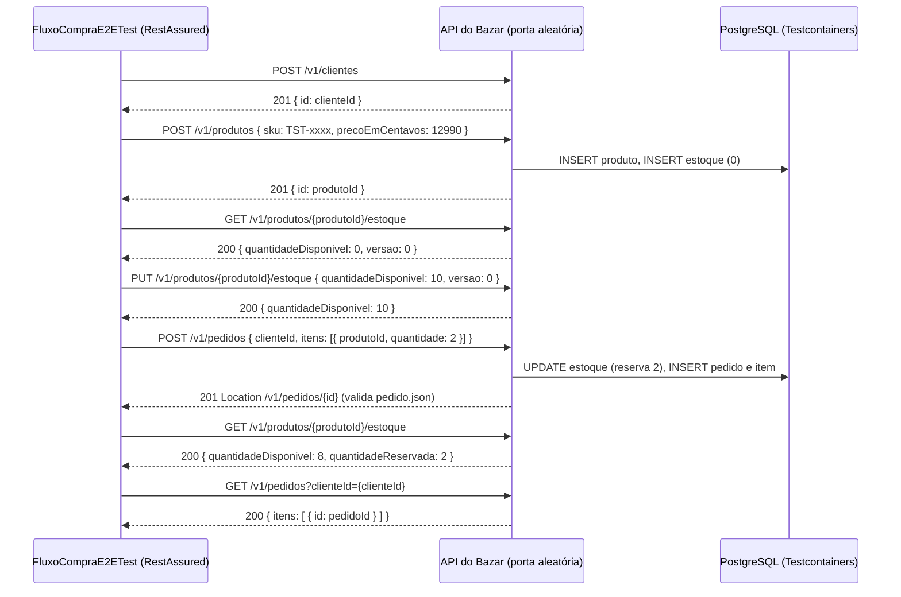

## O problema

Cada endpoint do Bazar tem os seus testes, mas uma compra atravessa vários deles. O cliente se cadastra, alguém cadastra o produto e define o estoque, o cliente faz o pedido, e o estoque disponível diminui. Os testes de cada endpoint não provam que esses passos se encaixam:

- o `id` que o `POST /v1/produtos` devolve é o mesmo que o `POST /v1/pedidos` aceita;
- a `versao` que o `GET` do estoque devolve é a que o `PUT` exige;
- o preço que aparece no pedido é o do produto, em `Dinheiro`, com duas casas.

Uma mudança no formato de um campo pode passar nos testes do endpoint que o produz e quebrar o passo seguinte. Um app que use a API só percebe na sequência.

É a diferença entre testar cada estação de uma linha de montagem e acompanhar um carro do começo ao fim da linha. As estações podem estar todas certas e, mesmo assim, a peça que uma entrega não encaixar na seguinte.

> **A pergunta desta página:** como escrever, com RestAssured, cenários que percorrem uma compra inteira pela API, como um cliente faria, sem que um cenário dependa do outro?

## O conceito

### O que é um teste ponta a ponta numa API

Um teste ponta a ponta (*end-to-end*, E2E) usa a API **só pela interface pública**: requisições HTTP para uma aplicação rodando, sem chamar *beans*, sem ler o banco e sem dublês. Ele verifica o que o cliente vê e mais nada. Se o teste precisar de um produto, ele o cria por `POST`, como qualquer cliente faria.

Na [11.01](/testes-de-api/estrategia-de-testes-para-apis), esse é o topo da pirâmide. Esses testes são poucos, porque são os mais lentos, e uma falha aponta um fluxo, não uma linha de código. Um bom teste E2E cobre um **caminho de negócio** inteiro, não as variações de um endpoint. As variações (validação de cada campo, cada 404) já estão nos *slices* e na integração.

No Bazar, os testes E2E rodam contra a aplicação em `RANDOM_PORT` com o PostgreSQL do Testcontainers, usando a mesma `@TesteDeIntegracao` da [11.04](/testes-de-api/testes-de-integracao-com-springboottest-e-testcontainers). Assim não sobem um contexto a mais. O mesmo código poderia apontar para um ambiente de homologação, trocando só a URL base.

### RestAssured 6

O RestAssured é uma biblioteca Java para testar APIs HTTP. A sintaxe imita o *Given-When-Then*:

```java
given(api)
        .body(Map.of("sku", sku, "nome", "Clean Code", "precoEmCentavos", 12990, "categoriaId", PROGRAMACAO))
.when()
        .post("/produtos")
.then()
        .statusCode(201)
        .body("status", equalTo("RASCUNHO"));
```

Os caminhos em `body("...")` usam a sintaxe GPath do Groovy: `itens[0].sku` é o SKU do primeiro item, e `itens.id` é a lista com o `id` de cada item. Os *matchers* são do Hamcrest (`equalTo`, `contains`, `matchesPattern`, `hasSize`...), que vem com o `spring-boot-starter-test`.

A versão 6 (a 6.3.0 é a usada aqui) exige Java 17 e Groovy 5. Ela serializa e desserializa com Jackson 3 (`tools.jackson`) quando ele é o único Jackson do *classpath*, como no Bazar com o Spring Boot 4. O Spring Boot **não** gerencia a versão do RestAssured, então ela vai explícita no `pom.xml`. Em projetos antigos você vai encontrar a 4.x e a 5.x, com a mesma API para os usos comuns.

### Especificações reutilizáveis

Repetir porta, caminho base, `Content-Type` e idioma em cada requisição polui o cenário. O RestAssured tem dois objetos para isso:

- **`RequestSpecification`** (`RequestSpecBuilder`): o que toda requisição leva. O cenário usa `given(api)`.
- **`ResponseSpecification`** (`ResponseSpecBuilder`): o que toda resposta de um tipo deve ter. O cenário usa `.then().spec(PROBLEMA)`.

A especificação de resposta é útil para regras de contrato que valem para muitos endpoints. No Bazar, todo erro é `application/problem+json`, com `type` em `https://api.bazar.example/problemas/...` e um `traceId`. Uma `ResponseSpecification` verifica isso em qualquer cenário de erro com uma linha.

### Extrair valores

O cenário precisa levar valores de um passo para o outro: o `id` do produto vai para o pedido, a `versao` do estoque vai para o `PUT`. `extract()` devolve o que você pedir:

```java
String produtoId = given(api)./* ... */.then().statusCode(201).extract().path("id");
int versao = given(api).get("/produtos/{id}/estoque", produtoId).then().extract().path("versao");
String location = /* ... */ .extract().header("Location");
Response resposta = /* ... */ .extract().response();   // tudo: status, headers, corpo
```

### Validar contra JSON Schema

Comparar campo a campo prova os valores de um exemplo. Um <Term id="json-schema">JSON Schema</Term> prova a **forma** da resposta: quais campos são obrigatórios, de que tipo, com que formato. O módulo `json-schema-validator` do RestAssured valida o corpo contra um esquema guardado nos recursos de teste:

```java
.then().body(matchesJsonSchemaInClasspath("esquemas/pedido.json"));
```

A versão 6.1 em diante entende os *drafts* 06, 07, 2019-09 e 2020-12, escolhidos pelo `$schema` do arquivo. Sem `$schema`, o padrão continua sendo o antigo *draft* 04, então declare sempre a versão. Nos *drafts* 2019-09 e 2020-12, `format` (como `"format": "uuid"`) é só uma anotação e **não é verificado**. Para garantir o formato, use `pattern`.

<Callout type="info" title="Visto em detalhes adiante">
Na Parte 7, o contrato do Bazar passa a ser descrito em OpenAPI ([17.01](/contratos-documentacao-e-ciclo-de-vida/a-especificacao-openapi)), que usa JSON Schema para os corpos. Os esquemas escritos à mão nos testes podem então ser substituídos pelos do contrato, e a [18.05](/contratos-documentacao-e-ciclo-de-vida/testes-de-contrato) trata de testar o provedor contra o contrato.
</Callout>

### RestAssured × `RestTestClient`

Os dois falam HTTP com um servidor real, então a escolha é de propósito e de estilo:

<Comparison
  title="RestAssured × RestTestClient"
  columns={['RestAssured', 'RestTestClient']}
  rows={[
    { label: 'Contra servidor real', values: [true, true] },
    { label: 'Contra MockMvc, sem servidor', values: ['módulo spring-mock-mvc', true] },
    { label: 'Contra outro ambiente (homologação)', values: [true, true] },
    { label: 'Especificações reutilizáveis', values: ['RequestSpec / ResponseSpec', 'Builder + defaultHeader'] },
    { label: 'JSON Schema embutido', values: [true, false] },
    { label: 'Dependência extra', values: [true, false] },
    { label: 'Leitura para quem não programa em Spring', values: ['given/when/then', 'fluente do Spring'] },
  ]}
/>

No Bazar, a divisão é:

- **`RestTestClient`** nos testes de integração de um recurso (11.04). Ele já vem com o Spring, usa a mesma API nos *slices* e no servidor real, e o teste continua "dentro" do mundo Spring.
- **RestAssured** nos cenários E2E. Os cenários leem como roteiros de uso, a validação por JSON Schema já vem pronta, e o mesmo código pode rodar fora do projeto, contra um ambiente implantado.

Usar só um dos dois também é uma decisão razoável. O que não faz sentido é misturar os dois no mesmo teste.

### Organizar cenários e isolar os dados

Três regras mantêm os cenários E2E legíveis e independentes:

1. **Um cenário, um caminho de negócio.** `compraCompleta` e `pedidoMaiorQueOEstoqueNaoReservaNada` são dois testes, não um teste com dois `when`.
2. **Passos com nome de negócio.** `cadastrarCliente()`, `cadastrarProduto(sku, preco)`, `definirEstoque(id, quantidade)`. O teste lê como o roteiro que um analista escreveria. Os passos fazem as requisições e as asserções mínimas (o `201`), para que uma falha num passo pare o cenário no ponto certo.
3. **Dados próprios e únicos por cenário.** Cada cenário cria o cliente, o produto e o estoque de que precisa, com um SKU que nenhum outro cenário usa. Nenhum depende de dados deixados por outro, nem de tabelas vazias. Mesmo que a limpeza falhe, ou que os cenários rodem em paralelo, eles não disputam o mesmo produto.

## Diagrama



O pagamento ainda não existe: o `POST /v1/pedidos/{id}/pagamentos`, com a PagaFácil, chega na Parte 10 ([24.02](/consumindo-outras-apis/restclient-a-fundo)). Quando chegar, o cenário ganha mais dois passos, pagar e receber a confirmação, e o resto continua igual.

## Na prática

### Dependências

```xml title="pom.xml"
<properties>
    <!-- O Spring Boot não gerencia a versão do RestAssured (11.05). -->
    <rest-assured.version>6.3.0</rest-assured.version>
</properties>

<dependency>
    <groupId>io.rest-assured</groupId>
    <artifactId>rest-assured</artifactId>
    <version>${rest-assured.version}</version>
    <scope>test</scope>
</dependency>
<dependency>
    <groupId>io.rest-assured</groupId>
    <artifactId>json-schema-validator</artifactId>
    <version>${rest-assured.version}</version>
    <scope>test</scope>
</dependency>
```

### O esquema do pedido

```json title="src/test/resources/esquemas/pedido.json"
{
  "$schema": "https://json-schema.org/draft/2020-12/schema",
  "$id": "https://api.bazar.example/esquemas/pedido.json",
  "title": "Pedido",
  "type": "object",
  "required": ["id", "clienteId", "status", "itens", "valorItens", "valorFrete", "valorTotal", "criadoEm"],
  "properties": {
    "id": { "type": "string", "format": "uuid" },
    "status": {
      "enum": ["CRIADO", "PAGAMENTO_PENDENTE", "PAGO", "ENVIADO", "ENTREGUE", "CANCELADO", "REEMBOLSADO"]
    },
    "itens": {
      "type": "array",
      "minItems": 1,
      "items": {
        "type": "object",
        "required": ["produtoId", "sku", "nomeProduto", "quantidade", "precoUnitario", "subtotal"],
        "properties": {
          "sku": { "type": "string", "pattern": "^[A-Z]{3}-[0-9]{4}$" },
          "quantidade": { "type": "integer", "minimum": 1 },
          "precoUnitario": { "$ref": "#/$defs/dinheiro" },
          "subtotal": { "$ref": "#/$defs/dinheiro" }
        }
      }
    },
    "valorTotal": { "$ref": "#/$defs/dinheiro" },
    "criadoEm": { "type": "string", "pattern": "^\\d{4}-\\d{2}-\\d{2}T\\d{2}:\\d{2}:\\d{2}(\\.\\d+)?Z$" }
  },
  "$defs": {
    "dinheiro": {
      "type": "object",
      "required": ["valor", "moeda"],
      "additionalProperties": false,
      "properties": {
        "valor": { "type": "string", "pattern": "^-?\\d+\\.\\d{2}$" },
        "moeda": { "type": "string", "pattern": "^[A-Z]{3}$" }
      }
    }
  }
}
```

(Trecho: o arquivo completo declara também `clienteId`, `produtoId`, `nomeProduto`, `valorItens` e `valorFrete`.)

O `$defs.dinheiro` fixa as regras do tipo `Dinheiro` (15.02) num lugar só: valor em *string* com duas casas, moeda com três letras e nenhum campo a mais. O `criadoEm` usa `pattern` para exigir RFC 3339 em UTC (com `Z`), porque o `format` não seria verificado.

Para conferir que o esquema pega erros de verdade, ele foi quebrado de propósito, exigindo um campo `centavos` em `Dinheiro`. A falha mostra todos os pontos em que a resposta diverge:

```text noCopy
java.lang.AssertionError:
1 expectation failed.
Response body doesn't match expectation.
Expected: The content to match the given JSON schema.
$.itens[0].precoUnitario: required property 'centavos' not found
$.itens[0].subtotal: required property 'centavos' not found
$.valorItens: required property 'centavos' not found
$.valorFrete: required property 'centavos' not found
$.valorTotal: required property 'centavos' not found

  Actual: {"id":"5337fdd5-...","status":"CRIADO","itens":[{...,"precoUnitario":{"valor":"129.90","moeda":"BRL"}, ...
```

Um teste que nunca foi visto falhando pode estar verificando nada. Quebrar a expectativa uma vez, de propósito, é a forma mais barata de confiar nele.

### `FluxoCompraE2ETest`

```java title="src/test/java/com/bazar/e2e/FluxoCompraE2ETest.java"
/**
 * Fluxos completos pela perspectiva de um cliente da API: só HTTP, sem acesso a beans nem ao banco (a não ser
 * para limpar no fim). Cada cenário cria os próprios dados, com um SKU único, e não depende de nada que outro
 * teste tenha deixado.
 */
@TesteDeIntegracao
class FluxoCompraE2ETest {

    static final String PROGRAMACAO = "0192f3a0-5555-7000-8000-000000000003";

    // O que toda resposta de erro do Bazar tem (08.01).
    static final ResponseSpecification PROBLEMA = new ResponseSpecBuilder()
            .expectContentType("application/problem+json")
            .expectBody("type", matchesPattern("https://api\\.bazar\\.example/problemas/[a-z-]+"))
            .expectBody("traceId", matchesPattern("[0-9a-f]{32}"))
            .build();

    @LocalServerPort
    int porta;

    @Autowired
    JdbcClient jdbc;

    RequestSpecification api;

    @BeforeEach
    void configurarOCliente() {
        api = new RequestSpecBuilder()
                .setBaseUri("http://localhost")
                .setPort(porta)
                .setBasePath("/v1")
                .setContentType(ContentType.JSON)
                .addHeader("Accept-Language", "pt-BR")
                .build();
    }

    @AfterEach
    void limparOBanco() {
        LimpezaDoBanco.limpar(jdbc);
    }
```

A especificação é criada no `@BeforeEach`, e não num campo `static`, porque a porta só é conhecida depois que o contexto sobe. O RestAssured também tem configuração global (`RestAssured.port = ...`), mas ela é estado estático compartilhado por todos os testes da JVM. Uma especificação por classe evita surpresas quando outro teste muda a configuração global.

O cenário principal:

```java title="src/test/java/com/bazar/e2e/FluxoCompraE2ETest.java"
@Test
void compraCompleta() {
    var clienteId = cadastrarCliente();
    var sku = skuUnico();
    var produtoId = cadastrarProduto(sku, 12990);
    definirEstoque(produtoId, 10);

    var pedidoId = given(api)
            .body(Map.of("clienteId", clienteId, "itens", List.of(Map.of("produtoId", produtoId, "quantidade", 2))))
    .when()
            .post("/pedidos")
    .then()
            .statusCode(201)
            .header("Location", matchesPattern("http://localhost:\\d+/v1/pedidos/[0-9a-f-]{36}"))
            .body(matchesJsonSchemaInClasspath("esquemas/pedido.json"))
            .body("status", equalTo("CRIADO"))
            .body("itens[0].sku", equalTo(sku))
            .body("itens[0].precoUnitario.valor", equalTo("129.90"))
            .body("valorTotal.valor", equalTo("259.80"))
            .extract().<String>path("id");

    given(api)
    .when()
            .get("/produtos/{id}/estoque", produtoId)
    .then()
            .statusCode(200)
            .body("quantidadeDisponivel", equalTo(8))
            .body("quantidadeReservada", equalTo(2));

    given(api)
            .queryParam("clienteId", clienteId)
    .when()
            .get("/pedidos")
    .then()
            .statusCode(200)
            .body("itens.id", contains(pedidoId));
}
```

O cenário de erro reaproveita os passos e a especificação de problema:

```java title="src/test/java/com/bazar/e2e/FluxoCompraE2ETest.java"
@Test
void pedidoMaiorQueOEstoqueNaoReservaNada() {
    var clienteId = cadastrarCliente();
    var produtoId = cadastrarProduto(skuUnico(), 5000);
    definirEstoque(produtoId, 1);

    given(api)
            .body(Map.of("clienteId", clienteId, "itens", List.of(Map.of("produtoId", produtoId, "quantidade", 2))))
    .when()
            .post("/pedidos")
    .then()
            .statusCode(409)
            .spec(PROBLEMA)
            .body("codigo", equalTo("ESTOQUE_INSUFICIENTE"))
            .body("quantidadeDisponivel", equalTo(1))
            .body("quantidadeSolicitada", equalTo(2));

    given(api)
    .when()
            .get("/produtos/{id}/estoque", produtoId)
    .then()
            .body("quantidadeDisponivel", equalTo(1))
            .body("quantidadeReservada", equalTo(0));
}
```

A segunda parte é o que dá valor ao cenário: além do `409`, o cliente confere que nada ficou reservado. É o *rollback* da 10.03 visto de fora, pela API.

Os passos:

```java title="src/test/java/com/bazar/e2e/FluxoCompraE2ETest.java"
private String cadastrarCliente() {
    return given(api)
            .body(Map.of("nome", "Maria Souza", "email", "maria@example.com", "cpf", "52998224725"))
    .when()
            .post("/clientes")
    .then()
            .statusCode(201)
            .extract().path("id");
}

// O PUT do estoque exige a versão lida (10.06): primeiro o GET, depois o PUT com ela.
private void definirEstoque(String produtoId, int quantidade) {
    int versao = given(api)
            .get("/produtos/{id}/estoque", produtoId)
    .then()
            .statusCode(200)
            .extract().path("versao");

    given(api)
            .body(Map.of("quantidadeDisponivel", quantidade, "versao", versao))
    .when()
            .put("/produtos/{id}/estoque", produtoId)
    .then()
            .statusCode(200)
            .body("quantidadeDisponivel", equalTo(quantidade));
}

// Um SKU por cenário: dois cenários nunca disputam o mesmo produto, mesmo que a limpeza falhe.
private static String skuUnico() {
    return "TST-%04d".formatted(ThreadLocalRandom.current().nextInt(10_000));
}
```

O corpo das requisições é um `Map`, que o RestAssured serializa com o Jackson 3. Não há *records* de requisição no teste, e isso é proposital. O teste E2E escreve o JSON como um cliente externo escreveria, sem reaproveitar as classes do servidor. Se um *record* do servidor mudar o nome de um campo, o teste quebra, como quebraria o app do cliente.

### Rodando

```bash
./mvnw test -Dtest=FluxoCompraE2ETest
```

```text noCopy
[INFO] Tests run: 2, Failures: 0, Errors: 0, Skipped: 0
```

Na suíte completa (138 testes), o cache continua com 5 contextos: os cenários E2E reaproveitam o contexto e o PostgreSQL dos testes de integração. O primeiro cenário leva cerca de 1 s, porque o RestAssured e o Groovy são carregados nessa hora. O segundo leva 0,4 s.

<Callout type="tip" title="Quando o cenário falhar">
`given(api).log().ifValidationFails()` imprime a requisição e a resposta só quando uma asserção falha. Para ligar em todos os testes, use `RestAssured.enableLoggingOfRequestAndResponseIfValidationFails()` uma vez, num `@BeforeAll`. Num cenário de seis passos, ver a requisição exata que falhou economiza tempo.
</Callout>

## Erros comuns

<BadVsGood title="Preparar o cenário por dentro" why="Um teste E2E que grava no banco ou chama serviços diretamente pula a parte da API que ele deveria provar. Se o POST de produto quebrar, o cenário continua verde.">
<Bad title="Atalho pelo repositório">

```java
@Autowired ProdutoRepository produtos;

var produto = produtos.save(new Produto("TST-0001", ...));
jdbc.sql("update estoque set quantidade_disponivel = 10 ...").update();
given(api).body(pedido).post("/pedidos")...
```

</Bad>
<Good title="Só pela API">

```java
var produtoId = cadastrarProduto(skuUnico(), 12990);   // POST /v1/produtos
definirEstoque(produtoId, 10);                          // GET + PUT do estoque
given(api).body(pedido).post("/pedidos")...
```

</Good>
</BadVsGood>

<BadVsGood title="Cenários encadeados" why="Quando um cenário depende de outro, uma falha no primeiro derruba todos, a ordem passa a importar e nenhum pode rodar sozinho.">
<Bad title="Estado compartilhado entre testes">

```java
static String produtoId;

@Test @Order(1) void criaProduto() { produtoId = ...; }
@Test @Order(2) void criaPedido() { /* usa produtoId */ }
@Test @Order(3) void confereEstoque() { /* depende dos dois */ }
```

</Bad>
<Good title="Cada cenário completo e independente">

```java
@Test void compraCompleta() { /* cria tudo de que precisa */ }
@Test void pedidoMaiorQueOEstoqueNaoReservaNada() { /* idem */ }
```

</Good>
</BadVsGood>

Outros erros frequentes:

- **Testar variações de um endpoint no E2E.** Doze cenários E2E para doze erros de validação do `POST /v1/produtos` tornam a suíte lenta e repetem o que o *slice* já prova em milissegundos. No E2E, fique com os caminhos de negócio.
- **Dados fixos compartilhados.** Todos os cenários usam o SKU `LIV-0042`. Rodando em paralelo, ou com uma limpeza que falhou, o segundo `POST` recebe `409` e o cenário falha por um motivo que não tem nada a ver com ele.
- **Configuração global do RestAssured.** `RestAssured.baseURI` e `RestAssured.port` são estáticos. Um teste que os muda afeta os que rodam depois na mesma JVM. Prefira uma `RequestSpecification` por classe.
- **Comparar valores monetários como número.** `body("valorTotal.valor", equalTo(259.8))` falha, porque no Bazar o valor é a *string* `"259.80"` (15.02). E deve falhar mesmo: é o contrato.
- **Confiar num esquema sem `$schema`.** Sem a declaração, o validador usa o *draft* 04, e palavras-chave mais novas (`$defs`, por exemplo) são ignoradas em silêncio.

## Boas práticas

- **Escreva poucos cenários E2E**, um por caminho de negócio importante, e deixe as variações para os *slices* e a integração.
- **Use só a API pública** para preparar e verificar o cenário. O banco serve apenas para limpar no fim.
- **Dê aos passos nomes de negócio** (`cadastrarProduto`, `definirEstoque`) e mantenha a asserção mínima dentro de cada passo.
- **Crie dados únicos por cenário**, para que nenhum dependa de outro nem da ordem de execução.
- **Centralize as regras comuns em especificações**: a `RequestSpecification` para porta e headers, a `ResponseSpecification` para o formato de erro.
- **Valide a forma das respostas com JSON Schema**, com `$schema` declarado e `pattern` onde o formato importa.
- **Veja cada teste falhar uma vez** antes de confiar nele.

## No projeto Bazar

<ProjectStep title="Fluxo de compra ponta a ponta" module="pedidos" tag="pagina-11.05" files={[
  { path: 'pom.xml', change: 'alterado' },
  { path: 'src/test/java/com/bazar/e2e/FluxoCompraE2ETest.java', change: 'novo' },
  { path: 'src/test/resources/esquemas/pedido.json', change: 'novo' },
]}>
O RestAssured 6.3.0 e o `json-schema-validator` entraram como dependências de teste. O `FluxoCompraE2ETest` tem dois cenários: a compra completa (cliente, produto, estoque, pedido, estoque reservado, lista de pedidos) e o pedido maior que o estoque, que responde `409` sem reservar nada. A resposta do pedido é validada contra `esquemas/pedido.json` (JSON Schema 2020-12). Os cenários usam `@TesteDeIntegracao` e não acrescentam nenhum contexto à suíte, que fecha a Parte 5 com 138 testes. O pagamento entra no cenário quando o `POST /v1/pedidos/{id}/pagamentos` for construído, na Parte 10.
</ProjectStep>

## Resumo

- Um teste E2E usa só a interface pública: HTTP contra a aplicação rodando, sem *beans*, sem banco e sem dublês.
- RestAssured 6 escreve os cenários em *given/when/then*, com Hamcrest e caminhos GPath, e usa o Jackson 3 do Spring Boot 4.
- `RequestSpecification` e `ResponseSpecification` concentram a configuração e as regras comuns. `extract()` leva valores de um passo para o outro.
- `matchesJsonSchemaInClasspath` valida a forma da resposta. Declare o `$schema` e use `pattern`, porque `format` não é verificado no 2020-12.
- `RestTestClient` para a integração de um recurso, RestAssured para os cenários de negócio: os dois falam HTTP real.
- Cenários com dados próprios e únicos não dependem uns dos outros nem da ordem.

<Exercise title="Cenário: dois clientes disputam a última unidade" difficulty="dificil">
Escreva o cenário `doisClientesDisputamAUltimaUnidade`: um produto com 1 unidade em estoque e dois clientes que fazem o pedido ao mesmo tempo. Exatamente um deve receber `201` e o outro `409 ESTOQUE_INSUFICIENTE`. No fim, o estoque deve ter 0 disponível e 1 reservado.

<Hint>Prepare tudo (os dois clientes, o produto e o estoque) antes de disparar os pedidos. Para os pedidos simultâneos, use um `ExecutorService` com dois *threads* e um `CountDownLatch` para que os dois comecem juntos, como no `ReservaConcorrenteTest` da 10.06. Cada *thread* devolve o `statusCode()` da resposta. A `RequestSpecification` pode ser usada por vários *threads*, porque `given(api)` cria uma requisição nova a cada chamada.</Hint>

<Solution>

```java title="src/test/java/com/bazar/e2e/FluxoCompraE2ETest.java"
@Test
void doisClientesDisputamAUltimaUnidade() throws Exception {
    var ana = cadastrarCliente();
    var bruno = cadastrarCliente();
    var produtoId = cadastrarProduto(skuUnico(), 12990);
    definirEstoque(produtoId, 1);

    var largada = new CountDownLatch(1);
    try (var executor = Executors.newFixedThreadPool(2)) {
        var respostas = Stream.of(ana, bruno)
                .map(clienteId -> executor.submit(() -> {
                    largada.await();
                    return given(api)
                            .body(Map.of("clienteId", clienteId,
                                    "itens", List.of(Map.of("produtoId", produtoId, "quantidade", 1))))
                            .post("/pedidos")
                            .statusCode();
                }))
                .toList();
        largada.countDown();

        var status = new ArrayList<Integer>();
        for (var resposta : respostas) {
            status.add(resposta.get(10, TimeUnit.SECONDS));
        }
        assertThat(status).containsExactlyInAnyOrder(201, 409);
    }

    given(api)
    .when()
            .get("/produtos/{id}/estoque", produtoId)
    .then()
            .body("quantidadeDisponivel", equalTo(0))
            .body("quantidadeReservada", equalTo(1));
}
```

O `CountDownLatch` segura os dois *threads* até a largada, para que as requisições cheguem praticamente juntas. Quem garante o resultado é o `UPDATE` atômico da 10.06 (`where quantidade_disponivel >= :quantidade`): só uma das duas reservas encontra a linha com estoque. O teste não precisa saber disso. Ele só observa, pela API, que a regra "nunca vender mais do que existe" vale sob concorrência. `containsExactlyInAnyOrder` aceita qualquer ordem, porque não dá para saber qual cliente chega primeiro.
</Solution>
</Exercise>

<Quiz questions={[
  {
    question: 'O cenário E2E precisa de um produto com estoque. Qual é a forma correta de prepará-lo?',
    options: [
      'Inserir o produto e o estoque com JdbcClient no @BeforeEach, porque é mais rápido',
      'Injetar o ProdutoService e chamar criar, para reaproveitar a regra de negócio',
      'Criar o produto com POST /v1/produtos e definir o estoque com GET e PUT do estoque, como um cliente faria',
      'Usar um produto fixo inserido por uma migration de teste',
    ],
    answer: 2,
    explanation: 'O E2E prova o caminho do cliente, e preparar o cenário pela API faz parte dessa prova: se o POST de produto ou o PUT de estoque quebrarem, o cenário falha. Inserir no banco ou chamar o serviço pula exatamente essa parte. Um produto fixo de migration cria dados compartilhados entre cenários, o oposto do isolamento.',
  },
  {
    question: 'O esquema pedido.json declara "criadoEm": { "type": "string", "format": "date-time" } e $schema 2020-12. A API passa a devolver "criadoEm": "25/10/2026". O que acontece com a validação?',
    options: [
      'Falha, porque date-time exige RFC 3339',
      'Passa, porque no draft 2020-12 format é só uma anotação e não é verificado por padrão',
      'Falha, porque o validador usa o draft 04 nesse caso',
      'O RestAssured lança exceção ao carregar o esquema',
    ],
    answer: 1,
    explanation: 'Nos drafts 2019-09 e 2020-12, format é anotação. O validador do RestAssured 6.1+ segue essa regra, então qualquer string passa. Por isso o pedido.json do Bazar usa pattern para o criadoEm. O draft 04 só seria usado se o $schema estivesse ausente, e o esquema é carregado sem problema.',
  },
  {
    question: 'Por que o FluxoCompraE2ETest usa @TesteDeIntegracao em vez de uma configuração própria com @SpringBootTest(webEnvironment = RANDOM_PORT)?',
    options: [
      'Porque RestAssured só funciona com @TesteDeIntegracao',
      'Porque assim ele reaproveita o contexto e o PostgreSQL já cacheados pelos testes de integração, sem subir outra aplicação e outro banco',
      'Porque @SpringBootTest não suporta RANDOM_PORT com RestAssured',
      'Porque @TesteDeIntegracao desliga a limpeza do banco',
    ],
    answer: 1,
    explanation: 'Com a mesma anotação, a chave do cache é a mesma, e o contexto (com o seu contêiner) é reaproveitado. A suíte continuou com 5 contextos depois dos cenários E2E. RestAssured funciona com qualquer servidor HTTP, @SpringBootTest aceita RANDOM_PORT normalmente, e a anotação não mexe na limpeza, que continua no @AfterEach.',
  },
]} />

## Referências

<References />
