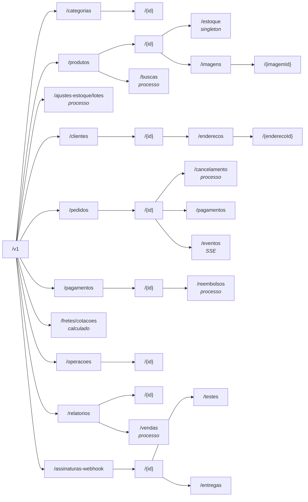

## O problema

Imagine a primeira versão da API do Bazar escrita por quem pensa em funções, e não em recursos:

```text noCopy
POST /criarPedido
POST /cancelarPedido
GET  /buscarPedidosDoCliente?id=...
POST /atualizarStatusPedido
POST /reservarEstoqueProduto
GET  /obterEstoque?produto=...
POST /alterarQuantidadeEstoque
GET  /listarItensPedido?pedido=...
POST /adicionarItemPedido
```

Cada novo caso de uso vira mais um endpoint, com um nome inventado na hora. O cliente não consegue prever nada: se existe `cancelarPedido`, existe `cancelarPagamento`? É `obterEstoque` ou `buscarEstoque`? Nenhum desses endpoints aproveita a semântica do HTTP. Todos os `POST` parecem iguais para um *proxy*, nenhum `GET` pode ser cacheado com segurança, e repetir uma requisição depois de um *timeout* é uma aposta. Isso é RPC disfarçado de REST, o nível 0 do modelo de Richardson ([03.03](/rest-e-estilos-de-api/o-modelo-de-maturidade-de-richardson)).

Pior: esse modelo é o mais caro de consertar. Trocar a implementação de um endpoint é uma tarde de trabalho. Trocar o **modelo de recursos** de uma API publicada exige uma versão nova, um período de convivência e a migração de todos os clientes ([18.02](/contratos-documentacao-e-ciclo-de-vida/estrategias-de-versionamento)).

Pense na planta de um prédio. Mudar a cor das paredes depois da obra é fácil. Mudar onde ficam as colunas, não. O modelo de recursos é a estrutura da API: precisa ser decidido com cuidado antes de qualquer `@GetMapping`.

> **A pergunta desta página:** como chegar, a partir do domínio e dos casos de uso, a um conjunto de recursos estável, previsível e do tamanho certo?

## O conceito

A página [03.02](/rest-e-estilos-de-api/recursos-representacoes-e-a-interface-uniforme) definiu o que é um <Term id="recurso">recurso</Term> e mostrou que recursos não são tabelas. Esta página trata do método: como decidir **quais** recursos a API tem.

### De casos de uso a recursos

O ponto de partida não é o banco nem as classes Java. São os casos de uso, escritos na linguagem do negócio:

1. Liste os casos de uso como frases: "o cliente faz um pedido", "o operador ajusta o estoque", "o cliente cancela um pedido que ainda não foi pago".
2. Sublinhe os **substantivos**: pedido, estoque, cliente, item. São os candidatos a recurso.
3. Sublinhe os **verbos**: fazer, ajustar, cancelar. Para cada verbo, pergunte se ele é um dos métodos HTTP aplicado a um substantivo: criar (`POST`), ler (`GET`), substituir (`PUT`), alterar (`PATCH`), remover (`DELETE`).
4. Os verbos que não cabem nos métodos ("cancelar", "pagar", "reembolsar") viram **recursos de processo** ou ações, assunto da [12.04](/design-de-apis-profissional/acoes-que-nao-sao-crud-e-maquinas-de-estado).
5. Para cada recurso, decida o tipo (coleção, item, *singleton*, processo) e quem é o pai.

Aplicando aos casos de uso do problema:

| Caso de uso | Substantivo | Verbo → método | Resultado |
|---|---|---|---|
| Criar um pedido | pedido | criar → `POST` | `POST /pedidos` |
| Ver os pedidos de um cliente | pedido | ler → `GET` | `GET /pedidos?clienteId=...` |
| Ver o saldo de um produto | estoque | ler → `GET` | `GET /produtos/{id}/estoque` |
| Definir o saldo | estoque | substituir → `PUT` | `PUT /produtos/{id}/estoque` |
| Cancelar um pedido | cancelamento | criar → `POST` | `POST /pedidos/{id}/cancelamento` |
| "Atualizar o status" | — | — | Não é caso de uso: é efeito de outros (pagar, enviar, cancelar) |
| "Adicionar item ao pedido" | — | — | Não existe no Bazar: o pedido nasce com os itens |

As duas últimas linhas mostram o ganho real do método. "Atualizar status" e "adicionar item" são operações que alguém imaginou olhando a tabela do banco, e não algo que um cliente do Bazar faz. Modelar a partir dos casos de uso elimina esses endpoints antes que existam.

### Os tipos de recurso

| Tipo | O que é | Exemplo no Bazar |
|---|---|---|
| **Coleção** | Um conjunto de recursos do mesmo tipo. Aceita `GET` (listar) e `POST` (criar) | `/produtos`, `/pedidos`, `/clientes/{id}/enderecos` |
| **Item** | Um elemento de uma coleção, identificado por id | `/produtos/{id}`, `/pedidos/{id}` |
| **<Term id="recurso-singleton">*Singleton*</Term>** | Um recurso que existe no máximo uma vez dentro do pai. Não tem id próprio nem é listado | `/produtos/{id}/estoque` |
| **<Term id="recurso-de-processo">Processo</Term>** | Uma operação ou o registro dela, tratada como coisa | `/pedidos/{id}/cancelamento`, `/pagamentos/{id}/reembolsos`, `/operacoes/{id}` |
| **Calculado** | Um resultado que não é guardado, mas é obtido sob demanda | `POST /fretes/cotacoes` |

O estoque é o exemplo mais claro de *singleton*: cada produto tem exatamente um saldo. Por isso ele não é `/estoques/{id}`, nem `/produtos/{id}/estoques`. O Google AIP-121 dispensa os *singletons* do método de listagem exatamente por isso: não há o que listar.

### Granularidade: *chatty* × *chunky*

Granularidade é o tamanho de cada recurso, ou seja, quanto de informação uma requisição traz ou altera.

- **Fina demais (*chatty*).** Para mostrar a tela de um pedido, o app faz uma chamada para o pedido, uma para cada item, uma para o endereço e uma para o pagamento. Num celular com 150 ms de latência, dez chamadas são um segundo e meio de espera.
- **Grossa demais (*chunky*).** `GET /clientes/{id}` devolve o cliente com todos os pedidos, cada pedido com os itens e os pagamentos. A resposta tem centenas de KB, o banco faz dezenas de consultas, e quase ninguém usa tudo isso.

A regra da Zalando resume o equilíbrio: um recurso útil "deve conter tanta informação quanto necessário, mas tão pouca quanto possível". O critério prático é perguntar **o que os clientes leem juntos e o que muda junto**:

- Os itens de um pedido são sempre lidos com o pedido e nunca mudam sozinhos. Vêm **dentro** do pedido, como um *array* `itens`, e não como `/pedidos/{id}/itens`.
- O estoque de um produto é lido e alterado com frequência e independência (por operadores, pela reserva de cada pedido). É um recurso **separado**, `/produtos/{id}/estoque`, e não um campo do produto.
- Os pedidos de um cliente crescem sem limite. Ficam **fora** do cliente, numa coleção filtrada (`/pedidos?clienteId=`), com paginação (13.03, 13.04).

Quando clientes diferentes precisam de tamanhos diferentes do mesmo recurso, a resposta não é criar recursos novos. São as respostas parciais e a expansão (`fields`, `expand`), da [13.05](/design-de-apis-profissional/respostas-parciais-e-expansao).

### Agregados como guia de fronteira

O DDD (*Domain-Driven Design*) tem um conceito que responde bem à pergunta "o que muda junto": o <Term id="agregado">agregado</Term>. Um agregado é um grupo de objetos tratado como uma unidade de consistência. Toda alteração passa pela **raiz**, e uma transação altera um agregado só.

No Bazar:

| Agregado (raiz) | Contém | Recurso | Por que essa fronteira |
|---|---|---|---|
| `Pedido` | `ItemPedido` | `/pedidos/{id}`, com `itens` embutidos | O total e as regras de status dependem dos itens. Um item não muda sozinho |
| `Produto` | atributos | `/produtos/{id}` | |
| `Estoque` | — | `/produtos/{id}/estoque` | É alterado com muito mais frequência que o produto, por outros atores. Separado, não disputa a versão do produto (10.06) |
| `Cliente` | `Endereco` | `/clientes/{id}`, `/clientes/{id}/enderecos` | O endereço só existe dentro do cliente, mas é mantido individualmente |
| `Categoria` | — | `/categorias/{id}` | Hierarquia por referência (`categoriaPaiId`), não por composição |
| `Pagamento` | — | `/pedidos/{id}/pagamentos`, `/pagamentos/{id}` | Tem ciclo de vida próprio na PagaFácil. Um pedido pode ter várias tentativas |

A correspondência é útil, mas não é automática:

- **Raiz do agregado → recurso de primeiro nível ou sub-recurso.** Quase sempre um recurso com URI própria.
- **Entidade interna lida junto com a raiz → campo embutido** (os itens do pedido).
- **Entidade interna mantida individualmente → sub-recurso** (os endereços do cliente). A 12.03 detalha o aninhamento.
- **Referência a outro agregado → id na representação** (`categoriaId` no produto, `clienteId` no pedido), nunca o outro agregado inteiro embutido.

A separação entre `Produto` e `Estoque` mostra que agregados vêm de comportamento, e não da estrutura dos dados. Num modelo que só olha os dados, o saldo seria uma coluna da tabela `produto`. No Bazar, ele é outro agregado, porque a reserva de estoque precisa de *locks* e versões que não podem bloquear a edição do nome do produto.

### Não espelhar tabelas

O AIP-121 diz isso de forma direta: quem projeta a API "não deve esperar que ela reflita o esquema do banco". O modelo do banco e o da API respondem a perguntas diferentes. O banco é otimizado para consistência e consulta. A API, para os casos de uso dos clientes e para evoluir sem quebrá-los.

Os sinais de uma API que espelha tabelas:

- um recurso por tabela, inclusive tabelas de junção (`/produto-categorias`);
- campos com nomes de coluna (`categoria_pai_id`, `dt_criacao`) e chaves técnicas (`versao`, ids sequenciais internos);
- recursos que só fazem sentido para quem conhece o banco (`/itens-pedido/{id}`);
- toda mudança no esquema vira uma mudança no contrato.

No Bazar, o banco tem `item_pedido` como tabela, mas a API não tem `/itens-pedido`. A coluna `versao` existe, mas não aparece no JSON do produto (a versão chega ao cliente pelo `ETag`, 20.02). E a renomeação de `categoria_pai_id` para `pai_id`, na 10.02, não mudou nada no contrato.

### Nomes de recursos estáveis

O nome de um recurso (a URI) é o que os clientes guardam: em favoritos, em bancos de dados, em links enviados por e-mail, nos `Location` que receberam. O AIP-122 diz que os nomes são o que os usuários devem guardar como referência canônica, e que o nome deve persistir de versão para versão. Isso tem consequências práticas:

- **O id não muda.** Por isso o Bazar usa UUID gerado pelo servidor (15.03), e não algo que o negócio pode alterar. Um SKU parece um bom id, mas um produto pode ser recadastrado com outro SKU. O `numero` do pedido (`BZR-2026-000123`, que chega na [15.03](/design-de-apis-profissional/identificadores-sequenciais-uuid-v7-e-ulid)) é para humanos. A URI usa o `id`.
- **A hierarquia não muda.** `/categorias/livros/produtos/{id}` quebra no dia em que o produto mudar de categoria. O produto fica em `/produtos/{id}`, e a categoria é um atributo.
- **O plural é sempre plural.** `/produtos/{id}`, e não `/produto/{id}`. A coleção e o item compartilham o prefixo, então o cliente deduz um a partir do outro (Zalando [134], AIP-122).
- **Um recurso, um nome canônico.** Atalhos como `/clientes/me` são aceitáveis, mas as respostas devem trazer o nome canônico (`/clientes/0192f3a1-…`), como pede o AIP-122.

### Quantos recursos?

A Zalando observa que APIs bem definidas costumam ter "não mais que 4 a 8 tipos de recurso" (regra [146]), e que aninhar mais de 3 níveis é sinal de problema ([147]). Não é uma cota. É um alerta: se a API de um módulo passou de 15 tipos de recurso, provavelmente ela mistura vários contextos, ou expõe entidades internas que deveriam estar embutidas.

O Bazar tem módulos (catálogo, estoque, clientes, pedidos, pagamentos...) e, em cada um, poucos tipos de recurso. É a mesma divisão do monólito modular da [30.01](/arquitetura/monolito-modular-com-spring-modulith).

## Diagrama



Nenhum caminho tem mais de um nível de sub-recurso abaixo do item de primeiro nível (`/produtos/{id}/imagens/{imagemId}` é o mais fundo), bem dentro do limite de 3 da Zalando. Os recursos de processo são substantivos (`cancelamento`, `reembolsos`, `buscas`), e não verbos. E nenhum nó corresponde a uma tabela de junção.

## Na prática

Esta página não muda o código: o resultado é a tabela de recursos, que as próximas páginas implementam e o contrato OpenAPI da [31.02](/projeto-final-o-bazar/o-contrato-primeiro) formaliza.

### O modelo de recursos do Bazar

| Recurso | Tipo | URI | Agregado | Métodos | Página |
|---|---|---|---|---|---|
| Categorias | coleção / item | `/categorias`, `/categorias/{id}` | `Categoria` | `GET`, `POST` / `GET`, `PUT`, `DELETE` | 05.04 |
| Produtos | coleção / item | `/produtos`, `/produtos/{id}` | `Produto` | `GET`, `POST` / `GET`, `PUT`, `PATCH`, `DELETE` | 06.01, 14.02 |
| Busca de produtos | processo | `/produtos/buscas` | — | `POST` | 13.01 |
| Imagens do produto | coleção / item | `/produtos/{id}/imagens/{imagemId}` | `Produto` | `POST` / `GET` | 22.01 |
| Estoque | *singleton* | `/produtos/{id}/estoque` | `Estoque` | `GET`, `PUT` | 10.06 |
| Ajuste de estoque em lote | processo | `/ajustes-estoque/lotes` | `Estoque` | `POST` | 14.04 |
| Clientes | coleção / item | `/clientes`, `/clientes/{id}` | `Cliente` | `POST` / `GET`, `PATCH` | 07.02 |
| Endereços | coleção / item | `/clientes/{id}/enderecos/{enderecoId}` | `Cliente` | `GET`, `POST` / `PUT`, `DELETE` | 12.03 |
| Pedidos | coleção / item | `/pedidos`, `/pedidos/{id}` | `Pedido` | `GET`, `POST` / `GET` | 10.03 |
| Cancelamento | processo | `/pedidos/{id}/cancelamento` | `Pedido` | `POST` | 12.04 |
| Pagamentos | coleção / item | `/pedidos/{id}/pagamentos`, `/pagamentos/{id}` | `Pagamento` | `GET`, `POST` / `GET` | 24.02 |
| Reembolsos | processo | `/pagamentos/{id}/reembolsos` | `Reembolso` | `POST` → `202` | 21.02 |
| Cotação de frete | calculado | `/fretes/cotacoes` | — | `POST` | 24.03 |
| Operações | item | `/operacoes/{id}` | `Operacao` | `GET` | 21.02 |
| Assinaturas de webhook | coleção / item | `/assinaturas-webhook`, `/assinaturas-webhook/{id}` | `AssinaturaWebhook` | `GET`, `POST` / `GET`, `DELETE` | 21.03 |

Algumas decisões dessa tabela merecem explicação:

- **Pagamentos aparecem em dois lugares.** São criados e listados a partir do pedido (`POST /pedidos/{id}/pagamentos`), porque é assim que o cliente pensa: "pagar este pedido". Mas o pagamento tem id próprio e ciclo de vida próprio na PagaFácil, então também existe em `/pagamentos/{id}`, de onde partem os reembolsos. É o caso da regra Zalando [145]: um sub-recurso que pode ser acessado pelo próprio id também é exposto no primeiro nível.
- **`ajustes-estoque/lotes` é de primeiro nível.** Um lote ajusta o estoque de vários produtos. Não pertence a nenhum produto específico.
- **Não há `/pedidos/{id}/itens`.** Os itens vêm no pedido e não mudam depois da criação.
- **Não há `/produtos/{id}/categoria`.** O produto traz `categoriaId`. O cliente que precisar dos dados da categoria lê `/categorias/{categoriaId}`, que é cacheável e muda raramente.

### *Chatty* × *chunky* no Bazar

O app do Bazar mostra a tela de detalhes de um pedido com os itens, o total e o status. Num modelo fino demais:

<HttpExchange
  title="Modelo chatty: uma chamada por pedaço da tela"
  request={{ method: 'GET', url: '/v1/pedidos/0192f3a1-9999-7000-8000-000000000123/itens' }}
  response={{ status: 200, headers: { 'Content-Type': 'application/json' }, body: { itens: [ { id: '0192f3a1-…-0001', produtoId: '0192f39f-…-0042', quantidade: 2 } ] } }}
>
E depois mais um `GET /v1/itens-pedido/{id}/produto` para cada item, para descobrir o nome e o preço. Para um pedido de 5 itens, são 7 chamadas. Pior: o preço vem do produto **hoje**, e não do momento da compra.
</HttpExchange>

No modelo do Bazar, a representação do pedido já traz o que a tela precisa, e o preço é o do momento da compra (10.03):

<HttpExchange
  title="Modelo do Bazar: o agregado inteiro numa chamada"
  request={{ method: 'GET', url: '/v1/pedidos/0192f3a1-9999-7000-8000-000000000123' }}
  response={{ status: 200, headers: { 'Content-Type': 'application/json' }, body: { id: '0192f3a1-9999-7000-8000-000000000123', clienteId: '0192f3a1-7777-7000-8000-000000000001', status: 'CRIADO', itens: [ { produtoId: '0192f39f-2222-7000-8000-000000000042', sku: 'LIV-0042', nomeProduto: 'Clean Code', quantidade: 2, precoUnitario: { valor: '129.90', moeda: 'BRL' }, subtotal: { valor: '259.80', moeda: 'BRL' } } ], valorItens: { valor: '259.80', moeda: 'BRL' }, valorFrete: { valor: '0.00', moeda: 'BRL' }, valorTotal: { valor: '259.80', moeda: 'BRL' }, criadoEm: '2026-10-24T17:30:00Z' } }}
/>

## Erros comuns

<BadVsGood title="Um endpoint por operação" why="Verbos no caminho transformam a API num catálogo de funções: nada é previsível, nada aproveita a semântica do HTTP, e cada caso de uso novo vira um endpoint novo.">
<Bad title="RPC disfarçado">

```text
POST /criarPedido
GET  /obterEstoque?produto=0192f39f-…
POST /alterarQuantidadeEstoque
POST /cancelarPedido
```

</Bad>
<Good title="Recursos e métodos">

```text
POST /pedidos
GET  /produtos/{id}/estoque
PUT  /produtos/{id}/estoque
POST /pedidos/{id}/cancelamento
```

</Good>
</BadVsGood>

<BadVsGood title="A tabela como recurso" why="A API passa a depender do esquema: renomear uma coluna ou normalizar uma tabela quebra os clientes. E o cliente precisa montar o agregado com várias chamadas.">
<Bad title="Espelho do banco">

```text
GET /itens-pedido?pedido_id=0192f3a1-…
GET /produto-categorias?produto_id=0192f39f-…
```

</Bad>
<Good title="O agregado como recurso">

```text
GET /pedidos/{id}        → itens embutidos
GET /produtos/{id}       → categoriaId
```

</Good>
</BadVsGood>

Outros erros frequentes:

- **Hierarquia que pode mudar na URI.** `/categorias/{categoriaId}/produtos/{id}` quebra todos os links quando o produto muda de categoria. Use hierarquia só para composição verdadeira (12.03).
- **Um recurso por tela do app.** `/tela-detalhe-pedido` resolve a tela de hoje e não serve a mais nenhum cliente. Para necessidades específicas de um cliente, existe o BFF ([29.05](/producao-e-deploy/api-gateway-e-bff)).
- **Expor o estado como campo editável.** `PATCH /pedidos/{id} { "status": "CANCELADO" }` deixa o cliente pular as regras. O status muda por ações (12.04).
- **Id de negócio mutável na URI.** SKU, e-mail ou CPF na URI obrigam a "mudar o endereço" do recurso quando o dado muda. Use um id técnico estável e permita a busca pelo dado de negócio (`/produtos?sku=LIV-0042`).
- **Recurso que existe "por precaução".** Cada recurso publicado é um compromisso de compatibilidade. Comece pelos casos de uso de hoje e acrescente depois, porque acrescentar não quebra ninguém.

## Boas práticas

- **Comece pelos casos de uso**, e não pelo banco nem pelas classes: substantivos viram recursos, verbos viram métodos ou processos.
- **Use os agregados do domínio** para decidir o que é um recurso, o que vem embutido e o que é só uma referência por id.
- **Defina o tipo de cada recurso** (coleção, item, *singleton*, processo, calculado) antes de escrever a URI.
- **Ajuste a granularidade ao uso real:** embuta o que é lido e alterado junto, separe o que muda com frequência e independência.
- **Use ids estáveis gerados pelo servidor** nas URIs e coloque na hierarquia só o que nunca muda de pai.
- **Nomeie recursos com substantivos no plural**, na linguagem do negócio.
- **Desconfie de mais de 8 tipos de recurso por módulo** e de mais de 3 níveis de aninhamento.

## Resumo

- O modelo de recursos é a parte mais cara de mudar numa API publicada. Ele vem dos casos de uso, não das tabelas.
- Recursos podem ser coleções, itens, *singletons*, processos ou resultados calculados.
- A granularidade certa segue o que é lido e alterado junto. Os agregados do DDD são um bom guia para essa fronteira.
- URIs são nomes que os clientes guardam. Use ids estáveis e uma hierarquia que não mude.
- O Bazar tem poucos tipos de recurso por módulo, ações modeladas como substantivos e nenhuma tabela de junção exposta.

<Exercise title="Modele avaliações e lista de desejos" difficulty="medio">
O Bazar vai ganhar dois casos de uso:

1. **Avaliações:** o cliente que comprou um produto pode avaliá-lo (nota de 1 a 5 e um comentário), editar a própria avaliação e removê-la. Qualquer pessoa pode ler as avaliações de um produto. Um moderador pode ocultar uma avaliação ofensiva.
2. **Lista de desejos:** cada cliente tem uma lista de desejos, à qual adiciona e da qual remove produtos.

Para cada caso, defina os recursos (tipo, URI, métodos) e justifique as fronteiras. Diga também o que você **não** criaria.

<Hint>Para cada um, pergunte: quantos existem por pai (um ou vários)? Quem altera? A avaliação pertence ao produto, ao cliente, ou a nenhum dos dois? Ocultar uma avaliação é um `PATCH` de um campo ou um processo com regras?</Hint>

<Solution>

**Avaliações**

| Recurso | Tipo | URI | Métodos |
|---|---|---|---|
| Avaliações de um produto | coleção | `/produtos/{id}/avaliacoes` | `GET` (público, paginado), `POST` (cliente que comprou) |
| Avaliação | item | `/avaliacoes/{id}` | `GET`, `PUT` (autor), `DELETE` (autor) |
| Ocultação | processo | `/avaliacoes/{id}/ocultacao` | `POST` (moderador, com motivo), `DELETE` (reexibir) |

- A avaliação é criada e listada a partir do produto, porque é assim que o cliente pensa. Mas tem id próprio, e o cliente que a escreveu também precisa encontrá-la (`/avaliacoes?clienteId=`), então o item fica no primeiro nível (regra [145]).
- A avaliação é um agregado próprio, e não parte do `Produto`. Ela muda por outros atores e em outro ritmo, e embuti-la faria o produto crescer sem limite.
- Ocultar é um processo, e não `PATCH { "oculta": true }`. Tem regra (só moderador, motivo obrigatório) e gera auditoria. É o mesmo raciocínio do cancelamento (12.04).
- **Não criaria** `/clientes/{id}/avaliacoes/{avaliacaoId}` e `/produtos/{id}/avaliacoes/{avaliacaoId}` ao mesmo tempo: seriam dois nomes para o mesmo recurso.

**Lista de desejos**

| Recurso | Tipo | URI | Métodos |
|---|---|---|---|
| Lista de desejos | *singleton* | `/clientes/{id}/lista-de-desejos` | `GET` |
| Itens da lista | coleção / item | `/clientes/{id}/lista-de-desejos/itens/{produtoId}` | `PUT` (adicionar, idempotente), `DELETE` |

- Cada cliente tem **uma** lista: é um *singleton*, como o estoque do produto. Não há `/listas-de-desejos/{id}`.
- O item é identificado pelo `produtoId`, porque um produto aparece no máximo uma vez. Por isso adicionar é `PUT` no item, e não `POST` na coleção: repetir não duplica. A [14.01](/design-de-apis-profissional/criacao-com-post-e-put-com-id-do-cliente) trata de `PUT` com id escolhido pelo cliente.
- **Não criaria** `POST /clientes/{id}/lista-de-desejos/adicionar` (verbo no caminho) nem um recurso para a tabela de junção `lista_desejo_produto`.
</Solution>
</Exercise>

<Quiz questions={[
  {
    question: 'Por que o estoque do Bazar é /produtos/{id}/estoque, e não um campo quantidadeDisponivel na representação do produto?',
    options: [
      'Porque o estoque fica em outra tabela no banco',
      'Porque é alterado com frequência e por outros atores: separado, não disputa a versão do produto nem obriga a reenviar o produto inteiro',
      'Porque campos numéricos não podem estar na representação de um produto',
      'Porque o REST proíbe recursos com mais de 10 campos',
    ],
    answer: 1,
    explanation: 'A fronteira vem do comportamento: o saldo muda a cada pedido e a cada ajuste, com locking próprio (10.06), enquanto o produto muda raramente. A tabela separada é consequência, não causa. Recursos não espelham tabelas. As outras duas opções são regras que não existem.',
  },
  {
    question: 'Qual URI é mais estável para um produto da categoria Livros?',
    options: [
      '/categorias/livros/produtos/LIV-0042',
      '/produtos/LIV-0042',
      '/produtos/0192f39f-2222-7000-8000-000000000042',
      '/categorias/0192f3a0-5555-7000-8000-000000000001/produtos/0192f39f-2222-7000-8000-000000000042',
    ],
    answer: 2,
    explanation: 'Um id gerado pelo servidor, que nunca muda, sem uma hierarquia que pode mudar. A categoria de um produto pode mudar, o que invalida as opções com /categorias/... no caminho. O SKU é dado de negócio e pode ser corrigido ou recadastrado. Ele serve como filtro (/produtos?sku=), não como nome.',
  },
  {
    question: 'Os itens do pedido aparecem embutidos em GET /pedidos/{id}, e não como /pedidos/{id}/itens. Qual é o principal motivo?',
    options: [
      'Os itens são sempre lidos com o pedido e não mudam sozinhos: fazem parte do agregado Pedido',
      'Sub-recursos não podem ter coleções',
      'O JSON de um pedido não pode ter mais de um nível',
      'Embutir é sempre melhor que separar',
    ],
    answer: 0,
    explanation: 'Os itens só existem dentro do pedido, são definidos na criação e o total depende deles. Separá-los obrigaria o cliente a fazer chamadas extras sem ganho nenhum. Sub-recursos podem ser coleções (/clientes/{id}/enderecos), o JSON aceita aninhamento, e embutir nem sempre é melhor: os pedidos do cliente, por exemplo, ficam fora do cliente.',
  },
]} />

## Referências

<References />
