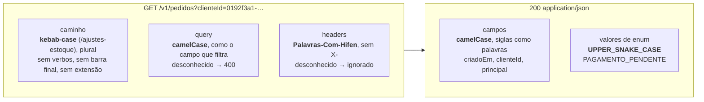

## O problema

Uma API escrita por três times diferentes, sem combinar nada:

```text noCopy
GET  /v1/Produtos?categoria_id=...           → { "product_name": "...", "PrecoUnitario": 129.9 }
GET  /v1/pedido/{id}                         → { "clienteID": "...", "dataCriacao": "2026-10-24" }
GET  /v1/clientes/{id}/listarEnderecos/      → { "isPrincipal": true, "created_at": "..." }
```

Nenhuma dessas rotas está "errada" isoladamente. O problema é a soma. Quem integra precisa consultar a documentação a cada campo, porque não consegue prever se o nome é `clienteId`, `clienteID` ou `cliente_id`. Um SDK gerado a partir dessa API terá classes com nomes misturados. E cada novo endpoint reabre a discussão.

Há um problema menos visível e mais perigoso. No Bazar, a listagem de categorias aceita `?apenasRaizes=true`. Veja o que acontece quando o cliente escreve o nome no estilo de outra API:

<HttpExchange
  title="Um parâmetro com o nome errado (antes desta página)"
  request={{ method: 'GET', url: '/v1/categorias?apenas-raizes=true' }}
  response={{ status: 200, headers: { 'Content-Type': 'application/json' }, body: { itens: [ { id: '0192f3a0-5555-7000-8000-000000000002', nome: 'Eletrônicos', slug: 'eletronicos', categoriaPaiId: null }, { id: '0192f3a0-5555-7000-8000-000000000001', nome: 'Livros', slug: 'livros', categoriaPaiId: null }, { id: '0192f3a0-5555-7000-8000-000000000003', nome: 'Programação', slug: 'programacao', categoriaPaiId: '0192f3a0-5555-7000-8000-000000000001' } ] } }}
>
`200 OK`, com as **três** categorias, inclusive a subcategoria. O Spring ignora parâmetros que nenhum argumento do método declara. O cliente acha que filtrou e não filtrou. Com `apenasRaizes`, vêm só as duas raízes.
</HttpExchange>

Convenções de nomenclatura resolvem as duas coisas. Elas tornam a API previsível, e tornam possível **verificar** a API: o que tem regra pode ser checado por uma máquina.

## O conceito

### Por que convenção vale mais que preferência

Uma convenção é útil porque **elimina decisões**. O cliente que aprendeu que o Bazar usa `clienteId` em `/pedidos?clienteId=` deduz `produtoId` em `/imagens?produtoId=` sem ler nada. O time que adiciona um endpoint não discute se é `criadoEm` ou `dataCriacao`, porque isso já foi decidido. E uma ferramenta de *lint* ([17.04](/contratos-documentacao-e-ciclo-de-vida/governanca-linting-e-deteccao-de-breaking-changes)) pode recusar no CI o que fugir da regra.

Por isso a escolha entre `snake_case` e `camelCase` importa muito menos do que escolher **uma** e aplicá-la em todo lugar. Google, Microsoft e Zalando fizeram escolhas diferentes, e as três APIs são consistentes.

### Caminhos

| Regra | Bazar | Por quê |
|---|---|---|
| Substantivos no **plural** para coleções | `/produtos`, `/pedidos/{id}` | A coleção e o item compartilham o prefixo. Zalando [134], AIP-122 |
| **<Term id="kebab-case">kebab-case</Term>** (minúsculas e hífen) | `/ajustes-estoque`, `/assinaturas-webhook` | URLs são *case-sensitive* no caminho. Minúsculas evitam `/Produtos` × `/produtos`. Zalando [129], Microsoft `http-url-casing` |
| **Sem verbos** | `/pedidos/{id}/cancelamento`, não `/cancelarPedido` | O verbo é o método HTTP. As exceções são as ações da [12.04](/design-de-apis-profissional/acoes-que-nao-sao-crud-e-maquinas-de-estado). Zalando [141] |
| **Sem extensão** | `/categorias`, não `/categorias.json` | O formato é negociado pelo `Accept` ([02.05](/comecando-e-fundamentos-de-http/content-negotiation-e-media-types)) |
| **Sem barra final** nem segmentos vazios | `/categorias`, não `/categorias/` | Um recurso, uma URI. Zalando [136] |

A barra final e a extensão merecem atenção no Spring, porque o comportamento padrão mudou com o tempo:

- **Até o Spring 5**, `/categorias/` e `/categorias.json` chegavam ao mesmo método que `/categorias`. A correspondência por sufixo foi desativada por padrão no 5.3. A da barra final foi depreciada no 6.0 **por segurança**: se uma regra de autorização protege `/admin/usuarios` e o controller também atende `/admin/usuarios/`, a requisição com barra pode escapar da regra. O Spring 7 removeu as duas opções: `setUseTrailingSlashMatch` e `setUseSuffixPatternMatch` já não existem no `PathMatchConfigurer`.
- **No Bazar (Spring 7)**, as duas variações recebem `404`. Testamos na aplicação rodando:

```text noCopy
GET /v1/categorias         → 200 application/json
GET /v1/categorias/        → 404 application/problem+json
GET /v1/categorias.json    → 404 application/problem+json
GET /V1/Categorias         → 404 application/problem+json
```

Para quem está migrando uma API antiga e tem clientes que mandam a barra final, a documentação do Spring indica o `UrlHandlerFilter`. Ele roda antes da segurança e do *matching*, e remove a barra de forma consistente para os dois: responde com um redirecionamento (por exemplo, `308`) ou reescreve a requisição. É uma ferramenta de transição. Numa API nova, o `404` é o comportamento certo.

### Campos do JSON

| Regra | Bazar | Por quê |
|---|---|---|
| **<Term id="camel-case">camelCase</Term>** | `quantidadeDisponivel`, `categoriaPaiId` | É o padrão do Jackson para *records* Java e do JavaScript. Microsoft `json-field-name-casing` |
| **Siglas como palavras** | `cpf`, `traceId`, `urlImagem` | `clienteID` e `URLImagem` quebram a regra de camelCase e confundem geradores de SDK. Microsoft: "não use maiúsculas em siglas" |
| **Coleções no plural** | `itens`, `erros`, `parametrosAceitos` | Zalando [120], AIP-140 |
| **Referências: recurso + `Id`** | `clienteId`, `produtoId`, `categoriaPaiId` | O nome diz para qual recurso o id aponta |
| **Booleanos sem prefixo** | `principal`, `ativo`, `apenasRaizes` | Nada de `isPrincipal` ou `ehAtivo`. AIP-140: "omit the prefix *is*" |
| **Instantes: particípio + `Em`** | `criadoEm`, `atualizadoEm`, `pagoEm` | O equivalente em português do `created_at` (Zalando [235]). O tipo é sempre um instante UTC ([15.01](/design-de-apis-profissional/datas-horas-e-fusos-horarios)) |
| **Unidade no nome** quando o valor é um número solto | `precoEmCentavos`, `prazoEmDias`, `pesoEmGramas` | Microsoft `json-durations-use-fixed-time-intervals`: "inclua a unidade no nome". Quando o valor é um objeto, a unidade vai dentro dele (`{ "valor": "129.90", "moeda": "BRL" }`, [15.02](/design-de-apis-profissional/dinheiro-e-numeros-decimais)) |
| **Valores de enum em UPPER_SNAKE_CASE** | `PAGAMENTO_PENDENTE`, `CANCELADO` | Zalando [240]. Distingue valores de nomes de campo ([15.04](/design-de-apis-profissional/enums-evolucao-e-tolerant-reader)) |

### Parâmetros de *query*

O Bazar usa **camelCase** nos parâmetros: `?clienteId=`, `?apenasRaizes=`, `?criadoApos=`. O motivo é que muitos parâmetros filtram por um campo da representação. `GET /pedidos?clienteId=X` devolve os pedidos cujo campo `clienteId` é `X`. Com o mesmo estilo nos dois lugares, o nome do filtro é o nome do campo. A Microsoft também usa camelCase nos dois lugares (`json-field-name-casing` e `http-query-names-casing`), e a Zalando usa `snake_case` nos dois ([118] e [130]).

E, como mostrou o problema, um parâmetro que o endpoint não declara é **recusado** com `400`, e não ignorado. Essa é a regra `collections-error-on-unknown-parameter` da Microsoft: "retorne um erro se o cliente especificar qualquer parâmetro não suportado". Os headers são outra história. A mesma diretriz pede para **não** falhar por um header desconhecido (`http-allow-unrecognized-headers`), porque *proxies* e *gateways* acrescentam headers que a aplicação nunca viu.

### Headers

Headers próprios seguem o estilo dos padrões: palavras com inicial maiúscula separadas por hífen (Zalando [132]), **sem** o prefixo `X-`, que a RFC 6648 depreciou ([02.04](/comecando-e-fundamentos-de-http/headers-essenciais)). No Bazar: `Bazar-Canal`. Os nomes de header não diferenciam maiúsculas de minúsculas no HTTP, então isso é questão de leitura, e não de funcionamento.

### Português × inglês no contrato

A Zalando ([103]) e o Google (AIP-140) exigem inglês americano. O Bazar usa **português** nos recursos, campos e valores. É uma escolha consciente, e tem custos e ganhos:

| | Português (Bazar) | Inglês |
|---|---|---|
| A favor | É a língua do negócio e do time: `cpf`, `cep`, `pedido`, `reembolso` não precisam de tradução. O código Java, os testes e a API usam os mesmos termos | É a língua dos padrões HTTP, das ferramentas e de quase todas as APIs públicas. Funciona para parceiros estrangeiros |
| Contra | Os nomes padronizados continuam em inglês (`type`, `title`, `detail` do Problem Details; `Idempotency-Key`; `next` no `Link`), então o contrato mistura as duas línguas. Sem acentos nos identificadores (`codigo`, `endereco`) | Termos do domínio brasileiro ficam forçados (`taxpayerId` para CPF?) e o time traduz o tempo todo |
| Bom para | APIs internas e de parceiros no Brasil | APIs públicas, globais ou de produto internacional |

A regra prática: decida **uma vez**, registre no guia de estilo ([16.02](/design-de-apis-profissional/escrevendo-o-guia-de-estilo-da-sua-api)) e não misture dentro do seu próprio vocabulário. `pedido.status` com valor `CANCELADO` é consistente. `pedido.status` com valor `CANCELLED` ao lado de `criadoEm` não é.

O português pede duas decisões que o inglês não pede:

- **Identificadores sem acento.** `endereco`, `codigo`, `avaliacoes`. Acentos funcionam em JSON e (codificados) em URLs, mas geram problemas em geradores de código, em ferramentas de busca e em teclados de outros países.
- **Preposições.** O AIP-140 diz para evitar preposições ("with", "for", "by"), mas essa regra foi pensada para o inglês, que compõe substantivos sem elas. Em português, `canalCadastro` soa estranho, e `quantidadeProdutos` é ambíguo. O Bazar usa a preposição quando ela faz parte de como o negócio fala (`canalDeCadastro`, `quantidadeDeProdutos`, `precoEmCentavos`), e a omite em caminhos com um termo curto já consagrado (`ajustes-estoque`).

### O que dizem os três guias

| Tópico | Google (AIPs) | Microsoft (Azure) | Zalando | **Bazar** |
|---|---|---|---|---|
| Coleções no caminho | plural, camelCase (AIP-122) | plural; kebab-case (preferido) ou camelCase | plural, kebab-case [129] [134] | plural, kebab-case |
| Campos do JSON | `lower_snake_case` no protobuf, convertido para lowerCamelCase no JSON (AIP-140) | camelCase, siglas como palavras | snake_case [118] | camelCase, siglas como palavras |
| Parâmetros de *query* | campos da requisição (ex.: `page_size`, AIP-158) | camelCase | snake_case [130] | camelCase |
| Valores de enum | UPPER_SNAKE_CASE (AIP-126) | sem regra explícita | UPPER_SNAKE_CASE [240] | UPPER_SNAKE_CASE |
| Instantes | sufixo `_time`, sem passado: `create_time` (AIP-142) | valor em RFC 3339, sem regra de nome | sufixo `_at` ou indicador de tipo [235] | particípio + `Em`: `criadoEm` |
| Booleanos | sem prefixo `is` (AIP-140) | sem regra de nome | sem regra de nome; nunca `null` [122] | sem prefixo |
| Barra final | sem regra | sem regra | proibida [136] | proibida (`404`) |
| Parâmetro desconhecido | sem regra | erro nas listagens | sem regra | `400` em todos os endpoints |
| Língua | inglês americano | sem regra | inglês americano [103] | português, sem acentos |

Os três guias concordam no essencial: plural, minúsculas no caminho, um único estilo no JSON e nada de verbos. As diferenças são de gosto, e o que pesa é a coerência.

<DeepDive title="Mudar o estilo do JSON inteiro com uma propriedade">

O Jackson usa os nomes dos componentes do *record* como estão: `quantidadeDisponivel` vira `"quantidadeDisponivel"`. Se a sua organização adota `snake_case` (como a Zalando), não renomeie cada campo com `@JsonProperty`. Uma propriedade do Spring Boot muda a estratégia de toda a aplicação:

```yaml title="application.yml"
spring:
  jackson:
    property-naming-strategy: SNAKE_CASE   # quantidadeDisponivel → quantidade_disponivel
```

O valor é o nome de uma constante de `tools.jackson.databind.PropertyNamingStrategies` (Jackson 3). A estratégia vale para a escrita **e** para a leitura: um cliente que mandar `quantidadeDisponivel` passa a ver o campo ignorado (ou recusado, se `FAIL_ON_UNKNOWN_PROPERTIES` estiver ligado). Por isso essa escolha precisa ser feita antes da primeira versão. Trocar depois é uma *breaking change* em todos os endpoints.

Os parâmetros de *query* e os caminhos não são afetados: eles vêm das anotações do Spring MVC, e não do Jackson.
</DeepDive>

## Diagrama



## Na prática

### Recusando parâmetros desconhecidos

O Spring não tem uma opção para recusar parâmetros que nenhum argumento declara. Mas ele sabe, para cada requisição, qual método vai atendê-la, e esse método diz quais parâmetros aceita. Um `HandlerInterceptor` ([09.04](/construindo-apis-com-spring-boot/filtros-interceptors-e-aop-quando-usar-cada-um)) roda depois que o método foi escolhido e antes de ele ser chamado, que é o ponto certo para comparar as duas listas.

```java title="src/main/java/com/bazar/compartilhado/web/ParametrosDeConsultaInterceptor.java"
/**
 * Recusa parâmetros de query que o endpoint não declara (12.02). Os nomes aceitos vêm da assinatura do método:
 * cada @RequestParam, explícito ou implícito (um tipo simples sem anotação). Um @RequestParam Map aceita tudo.
 */
public class ParametrosDeConsultaInterceptor implements HandlerInterceptor {

    // Set.of("*") = o método aceita qualquer parâmetro
    private final Map<Method, Set<String>> aceitosPorMetodo = new ConcurrentHashMap<>();

    @Override
    public boolean preHandle(HttpServletRequest request, HttpServletResponse response, Object handler) {
        if (!(handler instanceof HandlerMethod metodo) || request.getQueryString() == null) {
            return true;
        }
        var aceitos = aceitosPorMetodo.computeIfAbsent(metodo.getMethod(), m -> aceitos(metodo));
        if (aceitos.contains("*")) {
            return true;
        }
        var desconhecidos = new TreeSet<String>();
        for (var nome : request.getParameterMap().keySet()) {
            if (!aceitos.contains(nome)) {
                desconhecidos.add(nome);
            }
        }
        if (!desconhecidos.isEmpty()) {
            throw new ParametroDesconhecidoException(desconhecidos, new TreeSet<>(aceitos));
        }
        return true;
    }

    private static Set<String> aceitos(HandlerMethod metodo) {
        SortedSet<String> nomes = new TreeSet<>();
        for (var parametro : metodo.getMethodParameters()) {
            var anotacao = parametro.getParameterAnnotation(RequestParam.class);
            if (anotacao != null && Map.class.isAssignableFrom(parametro.getParameterType())) {
                return Set.of("*");
            }
            if (anotacao != null) {
                nomes.add(StringUtils.hasText(anotacao.name()) ? anotacao.name() : nomeNoCodigo(parametro));
            }
            else if (parametro.getParameterAnnotations().length == 0
                    && BeanUtils.isSimpleProperty(parametro.getParameterType())) {
                nomes.add(nomeNoCodigo(parametro));
            }
        }
        return Set.copyOf(nomes);
    }

    // Depende de -parameters na compilação, que o plugin do Spring Boot configura.
    private static String nomeNoCodigo(MethodParameter parametro) {
        var nome = parametro.getParameterName();
        if (nome == null) {
            throw new IllegalStateException("Compile com -parameters: " + parametro);
        }
        return nome;
    }
}
```

Alguns detalhes:

- **A lista de aceitos é calculada uma vez por método** e guardada num `ConcurrentHashMap`. As requisições seguintes só consultam o mapa.
- **`request.getParameterMap()` inclui os campos de formulário** num `POST application/x-www-form-urlencoded`. O Bazar só aceita JSON, então isso não é um problema aqui. Numa API com formulários, use `getQueryString()` e separe os nomes.
- **O `@RequestParam Map` desliga a verificação**, porque o método declarou que aceita qualquer coisa.
- **Na 13.01, os filtros viram um *record*** com `@ModelAttribute` (`FiltroProduto`), e este interceptor passa a ler os componentes do *record*. Na 13.03, o `Pageable` acrescenta `page`, `size` e `sort`.

A exceção segue o padrão das outras do Bazar ([08.02](/construindo-apis-com-spring-boot/problemdetail-no-spring-tratamento-global-de-erros)): ela não conhece HTTP, e as listas vão como extensões do Problem Details para que um programa possa lê-las.

```java title="src/main/java/com/bazar/compartilhado/erros/ParametroDesconhecidoException.java"
public class ParametroDesconhecidoException extends ExcecaoDeDominio {

    public ParametroDesconhecidoException(SortedSet<String> desconhecidos, SortedSet<String> aceitos) {
        super("parametro-desconhecido",
                Map.of("parametros", List.copyOf(desconhecidos), "parametrosAceitos", List.copyOf(aceitos)),
                String.join(", ", desconhecidos));
    }
}
```

```java title="src/main/java/com/bazar/compartilhado/erros/TratadorGlobalDeErros.java (trecho)"
@ExceptionHandler(ParametroDesconhecidoException.class)
ResponseEntity<Object> parametroDesconhecido(ParametroDesconhecidoException ex, WebRequest request) {
    return deDominio(ex, HttpStatus.BAD_REQUEST, request);
}
```

```java title="src/main/java/com/bazar/compartilhado/web/ConfiguracaoWeb.java (trecho)"
@Override
public void addInterceptors(InterceptorRegistry registry) {
    registry.addInterceptor(new AuditoriaInterceptor()).addPathPatterns("/v1/**");
    registry.addInterceptor(new ParametrosDeConsultaInterceptor()).addPathPatterns("/v1/**");
}
```

```properties title="src/main/resources/messages_pt.properties (trecho)"
problemDetail.title.parametro-desconhecido=Parâmetro desconhecido
problemDetail.parametro-desconhecido=Parâmetro(s) não aceito(s) por este endpoint: {0}.
```

Uma exceção lançada no `preHandle` passa pelo mesmo tratamento das lançadas no controller: o `DispatcherServlet` a entrega aos `HandlerExceptionResolver`, e o `@RestControllerAdvice` a converte. A mesma requisição do problema agora falha de forma clara:

<HttpExchange
  title="O mesmo parâmetro errado, com o interceptor"
  request={{ method: 'GET', url: '/v1/categorias?apenas-raizes=true', headers: { 'Accept-Language': 'pt-BR' } }}
  response={{ status: 400, headers: { 'Content-Type': 'application/problem+json' }, body: { type: 'https://api.bazar.example/problemas/parametro-desconhecido', title: 'Parâmetro desconhecido', status: 400, detail: 'Parâmetro(s) não aceito(s) por este endpoint: apenas-raizes.', instance: '/v1/categorias', codigo: 'PARAMETRO_DESCONHECIDO', parametros: ['apenas-raizes'], parametrosAceitos: ['apenasRaizes', 'q'], traceId: '7d0e…' } }}
>
O `parametrosAceitos` diz ao desenvolvedor exatamente como corrigir. `400`, e não `422`: o problema é a forma da requisição, e não o valor de um campo.
</HttpExchange>

### Os testes

Os testes ficam no `CategoriaControllerTest`, que já roda com a aplicação inteira, então não criam um contexto novo:

```java title="src/test/java/com/bazar/catalogo/api/CategoriaControllerTest.java (trecho)"
// Sem o ParametrosDeConsultaInterceptor, o nome errado seria ignorado e a resposta traria as 3 categorias (12.02).
@Test
void recusaUmParametroDeQueryDesconhecido() {
    assertThat(mvc.get().uri("/v1/categorias?apenas-raizes=true").header("Accept-Language", "pt-BR"))
            .hasStatus(HttpStatus.BAD_REQUEST)
            .bodyJson()
            .isLenientlyEqualTo("""
                    { "type": "https://api.bazar.example/problemas/parametro-desconhecido",
                      "title": "Parâmetro desconhecido", "status": 400,
                      "detail": "Parâmetro(s) não aceito(s) por este endpoint: apenas-raizes.",
                      "codigo": "PARAMETRO_DESCONHECIDO",
                      "parametros": ["apenas-raizes"], "parametrosAceitos": ["apenasRaizes", "q"] }
                    """);
}

@Test
void aceitaOsParametrosDeclarados() {
    assertThat(mvc.get().uri("/v1/categorias?apenasRaizes=true"))
            .hasStatusOk()
            .bodyJson().extractingPath("$.itens.length()").isEqualTo(2);
}

@Test
void endpointSemParametrosRecusaQualquerUm() {
    assertThat(mvc.get().uri("/v1/categorias/{id}?expand=pai", "0192f3a0-5555-7000-8000-000000000003"))
            .hasStatus(HttpStatus.BAD_REQUEST)
            .bodyJson().extractingPath("$.parametrosAceitos").asArray().isEmpty();
}
```

O último teste mostra uma consequência importante. `?expand=pai` também é recusado, porque o endpoint ainda não tem expansão. Quando a [13.05](/design-de-apis-profissional/respostas-parciais-e-expansao) acrescentar o `expand`, ele passa a ser aceito. Acrescentar um parâmetro opcional continua sendo uma mudança compatível. O que deixa de existir é o cliente que mandava um parâmetro inventado e recebia `200`.

<Callout type="warning" title="Ligar a verificação numa API que já está em produção">
Num serviço com clientes, recusar parâmetros desconhecidos pode quebrar quem mandava lixo sem saber: um `?_=1729789200` contra cache de navegador, parâmetros de rastreamento como `utm_source`, um filtro digitado errado. Antes de ligar, registre em log os parâmetros desconhecidos por algumas semanas, avise os clientes que aparecerem, e só então passe a recusar. Se algum parâmetro tiver que ser tolerado sempre, crie uma lista explícita.
</Callout>

### Um checklist para revisar nomes

<Checklist id="12-02-nomes" items={[
  'Coleções no plural e em kebab-case; nenhum verbo no caminho',
  'Nenhuma barra final, extensão ou maiúscula nos caminhos',
  'Campos e parâmetros em camelCase, com siglas como palavras (cpf, traceId)',
  'Referências como recurso + Id (clienteId)',
  'Booleanos sem prefixo; instantes como particípio + Em (criadoEm)',
  'Unidade no nome de números soltos (precoEmCentavos, prazoEmDias)',
  'Valores de enum em UPPER_SNAKE_CASE',
  'Headers próprios sem X-',
  'A mesma língua em todo o vocabulário próprio, sem acentos nos identificadores',
]} />

## Erros comuns

<BadVsGood title="Estilos misturados" why="Cada estilo diferente é uma pergunta que o cliente precisa fazer à documentação. Um único estilo permite deduzir os nomes e verificá-los com um linter.">
<Bad title="Três estilos na mesma API">

```json
{
  "clienteID": "0192f3a1-…",
  "data_criacao": "2026-10-24T17:30:00Z",
  "isPrincipal": true,
  "Status": "cancelado"
}
```

</Bad>
<Good title="Um estilo só">

```json
{
  "clienteId": "0192f3a1-…",
  "criadoEm": "2026-10-24T17:30:00Z",
  "principal": true,
  "status": "CANCELADO"
}
```

</Good>
</BadVsGood>

<BadVsGood title="Verbos e variações no caminho" why="Com verbos, cada operação inventa um nome. Com barra final e extensão, o mesmo recurso ganha várias URIs. O Spring 7 responde 404 a essas variações: não dependa delas.">
<Bad title="Caminhos criativos">

```text
GET  /v1/getProdutos
GET  /v1/Produtos/
GET  /v1/produto/0192f39f-…​.json
POST /v1/clientes/{id}/enderecos/novo
```

</Bad>
<Good title="Caminhos previsíveis">

```text
GET  /v1/produtos
GET  /v1/produtos/0192f39f-…
POST /v1/clientes/{id}/enderecos
```

</Good>
</BadVsGood>

Outros erros frequentes:

- **Nomes que vazam a implementação.** `dtCriacao`, `flAtivo`, `idCategoriaFk` são nomes de coluna. O contrato fala a língua do cliente, e não a do banco (12.01).
- **Abreviações inventadas.** `qtdDisp`, `vlTotal`. O AIP-140 aceita só abreviações universais (`id`, `info`, `config`). Em português, `quantidadeDisponivel` custa poucos caracteres e não precisa de glossário.
- **O mesmo conceito com nomes diferentes.** `criadoEm` em pedidos e `dataCadastro` em clientes. Antes de nomear, procure se o conceito já existe na API.
- **Booleano negativo.** `naoAtivo`, `semEstoque`. A leitura de `"naoAtivo": false` exige uma dupla negação. Prefira o positivo (`ativo`).
- **Data sem indicação do tipo.** `entrega: "2026-11-02"` pode ser data ou instante. Para datas civis, use `data` no nome (`dataNascimento`) ou o tipo no contrato, e reserve `...Em` para instantes.

## Boas práticas

- **Escolha um estilo por elemento** (caminho, campo, parâmetro, enum, header) e escreva-o no guia de estilo antes da primeira versão.
- **Use o mesmo nome para o parâmetro e para o campo que ele filtra.**
- **Recuse parâmetros de *query* desconhecidos** com `400` e a lista dos aceitos. Tolere headers desconhecidos.
- **Inclua a unidade no nome** de números soltos.
- **Decida a língua do contrato conscientemente** e aplique-a em todo o vocabulário próprio.
- **Automatize a verificação.** O que só depende de revisão humana se perde com o tempo. A 17.04 mostra como recusar nomes fora do padrão no CI com um *linter* de OpenAPI.

## No projeto Bazar

<ProjectStep title="Parâmetros de query desconhecidos viram 400" module="compartilhado" tag="pagina-12.02" files={[
  { path: 'src/main/java/com/bazar/compartilhado/web/ParametrosDeConsultaInterceptor.java', change: 'novo' },
  { path: 'src/main/java/com/bazar/compartilhado/erros/ParametroDesconhecidoException.java', change: 'novo' },
  { path: 'src/main/java/com/bazar/compartilhado/erros/TratadorGlobalDeErros.java', change: 'alterado' },
  { path: 'src/main/java/com/bazar/compartilhado/web/ConfiguracaoWeb.java', change: 'alterado' },
  { path: 'src/main/resources/messages.properties', change: 'alterado' },
  { path: 'src/main/resources/messages_pt.properties', change: 'alterado' },
  { path: 'src/test/java/com/bazar/catalogo/api/CategoriaControllerTest.java', change: 'alterado' },
]}>
Todos os endpoints de `/v1/**` recusam parâmetros de *query* que o método não declara, com `400 parametro-desconhecido` e a lista dos aceitos. Os nomes já seguiam as convenções desta página, então nenhum endpoint mudou de contrato. A suíte passou de 138 para 141 testes.
</ProjectStep>

## Resumo

- Convenções tornam a API previsível e verificável. A escolha específica importa menos do que aplicá-la em todo lugar.
- Caminhos: plural, kebab-case, sem verbos, sem extensão e sem barra final. O Spring 7 responde `404` para as variações.
- JSON e *query*: camelCase, siglas como palavras, booleanos sem prefixo, instantes como `criadoEm`, unidades no nome, enums em UPPER_SNAKE_CASE.
- O Bazar recusa parâmetros de *query* desconhecidos com `400`, como pede a diretriz da Microsoft, e tolera headers desconhecidos.
- Google, Microsoft e Zalando divergem nos detalhes e concordam no essencial. O Bazar usa português por decisão registrada, com os custos conhecidos.

<Exercise title="Revise os nomes de um endpoint" difficulty="facil">
Um colega propôs este endpoint para as avaliações de produto (o exercício da 12.01):

```text
GET /v1/Produtos/{id}/Avaliacoes/?nota_minima=4&ordenar=data
```

```json
{
  "Itens": [
    {
      "avaliacaoID": "0192f3a1-…",
      "nota": 5,
      "texto_comentario": "Ótimo livro",
      "isVerificada": true,
      "dtCriacao": "2026-10-24T17:30:00Z",
      "situacao": "publicada"
    }
  ]
}
```

Liste cada problema de acordo com as convenções do Bazar e reescreva a requisição e a resposta.

<Hint>Passe pelo checklist desta página item por item: caminho, parâmetros, campos, booleanos, instantes, enums. E pense no que o cliente veria se mandasse `nota_minima` para um endpoint que espera `notaMinima`.</Hint>

<Solution>

**Problemas**

- Caminho: maiúsculas (`Produtos`, `Avaliacoes`) e barra final. No Spring 7, essa URI daria `404`.
- Parâmetros: `nota_minima` em snake_case. O campo que ele filtra é `nota`, então o filtro deve ser `notaMinima`. `ordenar=data` não segue o padrão de ordenação do Spring (`sort`, [13.02](/design-de-apis-profissional/ordenacao)) e "data" não diz qual data.
- `Itens` com maiúscula.
- `avaliacaoID`: sigla em maiúsculas, e o campo que identifica o próprio recurso é `id`, não `avaliacaoId`.
- `texto_comentario` em snake_case e redundante: `comentario` basta.
- `isVerificada`: prefixo em booleano. Use `compraVerificada`.
- `dtCriacao`: abreviação de coluna. Use `criadoEm`.
- `situacao: "publicada"`: valor de enum em minúsculas, e o resto da API chama esse conceito de `status`.

**Reescrito**

```text
GET /v1/produtos/{id}/avaliacoes?notaMinima=4&sort=criadoEm,desc
```

```json
{
  "itens": [
    {
      "id": "0192f3a1-…",
      "nota": 5,
      "comentario": "Ótimo livro",
      "compraVerificada": true,
      "criadoEm": "2026-10-24T17:30:00Z",
      "status": "PUBLICADA"
    }
  ]
}
```

Com o `ParametrosDeConsultaInterceptor`, um cliente que mandar `nota_minima=4` recebe `400` com `parametrosAceitos: ["notaMinima", ...]`, e não uma lista sem filtro.
</Solution>
</Exercise>

<Quiz questions={[
  {
    question: 'No Spring 7, o que acontece com GET /v1/categorias/ (barra final) quando o controller mapeia /v1/categorias?',
    options: [
      'O Spring remove a barra e atende normalmente',
      'Responde 404: a correspondência com barra final foi depreciada no Spring 6 e removida no 7',
      'Responde 301 para /v1/categorias',
      'Responde 400 Bad Request',
    ],
    answer: 1,
    explanation: 'A correspondência com barra final foi depreciada no 6.0, por segurança, e removida no 7.0. Um redirecionamento só acontece se você configurar o UrlHandlerFilter, pensado para migrações.',
  },
  {
    question: 'Por que o Bazar usa camelCase nos parâmetros de query, e não kebab-case como nos caminhos?',
    options: [
      'Porque URLs não aceitam hífen na query string',
      'Porque o Spring só reconhece parâmetros em camelCase',
      'Porque muitos parâmetros filtram um campo do JSON: com o mesmo estilo, o nome do filtro é o nome do campo',
      'Porque kebab-case é proibido pela RFC 3986',
    ],
    answer: 2,
    explanation: '?clienteId= filtra pelo campo clienteId. A Microsoft também usa camelCase nos dois lugares, e a Zalando usa snake_case nos dois. Hífens são válidos na query, e o Spring aceita qualquer nome: tanto que ?apenas-raizes= chegava sem erro, só era ignorado.',
  },
  {
    question: 'Um cliente manda um header Bazar-Experimento que a API não conhece. O que o Bazar faz, e por quê?',
    options: [
      'Recusa com 400, como faz com parâmetros de query desconhecidos',
      'Ignora o header: proxies e gateways acrescentam headers que a aplicação não conhece, e recusá-los quebraria requisições legítimas',
      'Recusa com 431 Request Header Fields Too Large',
      'Responde 200 e devolve o header na resposta',
    ],
    answer: 1,
    explanation: 'É a regra http-allow-unrecognized-headers da Microsoft. A query é escrita pelo cliente para o endpoint, então um nome desconhecido é quase sempre um erro dele. Os headers passam por intermediários que acrescentam os seus, então um header desconhecido é normal.',
  },
]} />

## Referências

<References />
