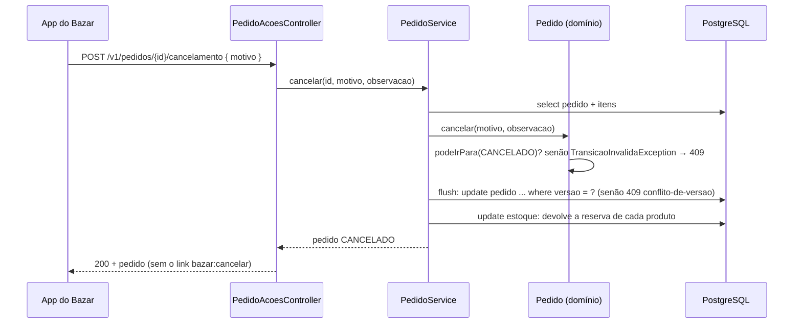

## O problema

O pedido do Bazar tem um `status`. A forma mais rápida de deixar o cliente cancelar um pedido é aceitar uma alteração desse campo:

```http noCopy
PATCH /v1/pedidos/0192f3a1-9999-7000-8000-000000000123
Content-Type: application/merge-patch+json

{ "status": "CANCELADO" }
```

Funciona no primeiro dia, e cria problemas que só aparecem depois:

- **O cliente escolhe o estado de destino.** Se `CANCELADO` é aceito, por que `PAGO` não seria? O servidor precisa de um `if` para cada combinação de origem e destino, e a lista de destinos "permitidos ao cliente" fica espalhada pelo código do `PATCH`.
- **Os efeitos colaterais ficam escondidos.** Cancelar devolve a reserva ao estoque. Num `PATCH` genérico, essa regra vira um caso especial ("se o status mudou para cancelado, então...") dentro de um método que também altera outros campos.
- **A ação não tem onde guardar os próprios dados.** O cancelamento tem motivo e observação. No `PATCH`, eles viram campos soltos do pedido, que o cliente poderia mandar sem cancelar nada.
- **O contrato não diz nada.** A documentação do `PATCH` lista o campo `status`, e o cliente não descobre lá quais transições existem nem o que cada uma provoca.
- **Permissões e auditoria por ação ficam difíceis.** "O cliente pode cancelar, mas só o financeiro pode reembolsar" exige olhar o valor do campo para decidir a permissão.

Cancelar, pagar, enviar e reembolsar não são edições de um campo. São **ações** com regras e efeitos. Esta página mostra como modelá-las num contrato HTTP, como manter as regras no domínio e como o servidor informa ao cliente quais ações estão disponíveis em cada estado.

## O conceito

### Quatro formas de expor uma ação

| Forma | Exemplo | Quem recomenda | Prós | Contras |
|---|---|---|---|---|
| **`PATCH` do estado** | `PATCH /pedidos/{id}` `{ "status": "CANCELADO" }` | Ninguém, para estados com regras | Nenhum endpoint novo | Todos os problemas acima |
| **Sub-recurso com nome de substantivo** | `POST /pedidos/{id}/cancelamento` | Zalando [138] ("pense em recursos": um *lock* vira `PUT /article-locks/{id}`) | Sem verbos no caminho; cada ação tem o seu corpo, permissão e documentação | É preciso achar um substantivo bom; o "recurso" às vezes só existe para receber o `POST` |
| **Recurso de processo** | `POST /pagamentos/{id}/reembolsos` → `202` | Todos os guias, quando a ação tem vida própria | A ação vira um recurso consultável, com id, status e histórico | Mais estrutura: id, `GET`, às vezes operação longa ([21.02](/padroes-avancados-de-http/operacoes-assincronas-e-de-longa-duracao-202-polling)) |
| **<Term id="metodo-customizado">Método customizado</Term>** | `POST /pedidos/{id}:cancelar` | Google (AIP-136), Microsoft (`actions-url-pattern-for-resource-action`) | O verbo fica explícito e separado do caminho dos recursos | Caracteres especiais no caminho; o `:` precisa ser proibido nos ids |

Os três guias concordam no essencial: **ações usam `POST`** e **não se disfarçam de `PATCH`**. O AIP-136 diz que métodos customizados devem ser usados só para "o que não pode ser expresso facilmente pelos métodos padrão", e a Microsoft proíbe ações para o que "poderia razoavelmente ser definido" como CRUD (`actions-no-actions-for-crud`). Eles divergem na sintaxe: a Zalando quer substantivos, enquanto Google e Microsoft aceitam o verbo depois de `:`.

O método customizado funciona no Spring, mas tem uma armadilha. Testamos `@PostMapping("/v1/pedidos/{id}:cancelar")` ao lado de `@PostMapping("/v1/pedidos/{id}")`:

```text noCopy
POST /v1/pedidos/abc:cancelar     → atende o método "cancelar", id = "abc"
POST /v1/pedidos/abc%3Acancelar   → atende o OUTRO método, id = "abc%3Acancelar"
```

Alguns clientes HTTP e bibliotecas codificam o `:` como `%3A` num segmento de caminho, e a requisição cai no método errado. Por isso a Microsoft recomenda proibir o `:` nos ids, e quem adota essa sintaxe precisa testar com os clientes reais.

### A escolha do Bazar

O Bazar usa **sub-recursos com nome de substantivo** para as ações sobre um recurso, e **recursos de processo** quando a ação tem vida própria:

| Ação | Endpoint | Por quê |
|---|---|---|
| Cancelar o pedido | `POST /pedidos/{id}/cancelamento` | Síncrona, com dados próprios (motivo), sem ciclo de vida depois de feita |
| Pagar o pedido | `POST /pedidos/{id}/pagamentos` | Cada tentativa é um recurso: tem id, status e pode falhar ([24.02](/consumindo-outras-apis/restclient-a-fundo)) |
| Reembolsar | `POST /pagamentos/{id}/reembolsos` → `202` | Demora (depende do gateway) e tem status próprio |
| Testar um webhook | `POST /assinaturas-webhook/{id}/testes` | Imperativa, mas o teste gera uma entrega consultável |

Os motivos: é coerente com a regra "sem verbos no caminho" da [12.02](/design-de-apis-profissional/convencoes-de-nomenclatura), não usa caracteres que mudam com a codificação e funciona igual em qualquer *gateway* e em qualquer ferramenta de OpenAPI.

Vale ser honesto sobre o `/cancelamento`: ele não tem `GET`. Os dados do cancelamento aparecem na representação do pedido (o campo `cancelamento`), e o caminho existe para receber a ação. É o que alguns autores chamam de "recurso controlador". A alternativa seria oferecer `GET /pedidos/{id}/cancelamento`. O Bazar não oferece porque nenhum cliente precisa ler o cancelamento separado do pedido (12.01: recursos vêm dos casos de uso).

### A máquina de estados fica no domínio

A <Term id="maquina-de-estados">máquina de estados</Term> do pedido, a regra "de onde para onde", já existe desde a [11.02](/testes-de-api/testes-unitarios-de-dominio-e-servicos), testada com 51 casos:

```java title="src/main/java/com/bazar/pedidos/dominio/StatusPedido.java (trecho)"
// ENTREGUE, CANCELADO e REEMBOLSADO são finais: não saem para nenhum outro estado.
public boolean podeIrPara(StatusPedido destino) {
    return destinosPermitidos().contains(destino);
}

private Set<StatusPedido> destinosPermitidos() {
    return switch (this) {
        case CRIADO -> EnumSet.of(PAGAMENTO_PENDENTE, CANCELADO);
        case PAGAMENTO_PENDENTE -> EnumSet.of(PAGO, CANCELADO);
        case PAGO -> EnumSet.of(ENVIADO, REEMBOLSADO);
        case ENVIADO -> EnumSet.of(ENTREGUE);
        case ENTREGUE, CANCELADO, REEMBOLSADO -> EnumSet.noneOf(StatusPedido.class);
    };
}
```

O endpoint HTTP não repete essa regra. O controller recebe a ação, o serviço chama `pedido.cancelar(...)`, e o pedido decide. Se a transição não é permitida, o domínio lança `TransicaoInvalidaException`, que o `TratadorGlobalDeErros` converte em `409 Conflict`. A requisição está correta. O que impede a ação é o estado atual do recurso, e é exatamente para isso que existe o `409`.

O Problem Details do `409` traz o estado atual e o desejado como extensões, então um programa pode reagir sem interpretar o texto:

```json noCopy
{
  "type": "https://api.bazar.example/problemas/transicao-invalida",
  "title": "Transição de status inválida",
  "status": 409,
  "detail": "O pedido 0192f3a1-…-0123 não pode passar de PAGO para CANCELADO.",
  "statusAtual": "PAGO",
  "statusDesejado": "CANCELADO",
  "codigo": "TRANSICAO_INVALIDA"
}
```

### O que a ação responde

A Microsoft pede `200 OK` para ações síncronas concluídas (`actions-synchronous-success-status-code`). O Bazar responde `200` com **o pedido atualizado**, porque é disso que o cliente precisa: o novo status, os dados do cancelamento e os links das ações que ainda restam. Um `204` obrigaria o cliente a fazer um `GET` em seguida, e um `201` daria a entender que um recurso novo, consultável, foi criado.

### Ações e idempotência

`POST` não é idempotente. O que acontece se o app manda o cancelamento, a conexão cai antes da resposta e o app tenta de novo?

```text noCopy
1ª tentativa: POST /pedidos/{id}/cancelamento → cancelou, mas a resposta se perdeu
2ª tentativa: POST /pedidos/{id}/cancelamento → 409 transicao-invalida, statusAtual: CANCELADO
```

O pedido não é cancelado duas vezes, e o estoque não volta duas vezes: a máquina de estados já protege. Mas o cliente recebe um erro para uma operação que deu certo. Ele pode tratar "`409` com `statusAtual` igual ao destino" como sucesso, mas isso é uma regra que cada cliente precisa conhecer. A solução geral é o header `Idempotency-Key`, que permite ao servidor reconhecer a repetição e devolver a **mesma** resposta da primeira vez ([21.01](/padroes-avancados-de-http/idempotency-keys)).

A queda da conexão não é hipotética. Durante a implementação desta página, um erro na montagem da resposta fez o `POST /pedidos` responder `500` **depois** do *commit*: o pedido existia e o estoque estava reservado, mas o cliente recebeu um erro. Qualquer cliente razoável tentaria de novo, e sem idempotência criaria um segundo pedido.

### Duas ações ao mesmo tempo

E se o mesmo pedido recebe dez cancelamentos simultâneos (um usuário impaciente clicando várias vezes, ou o app e o site ao mesmo tempo)? As dez transações leem o pedido como `CRIADO`, e as dez acham que podem cancelar. O `@Version` do pedido ([10.06](/persistencia-para-apis/concorrencia-no-banco-locking-otimista-e-pessimista)) garante que só uma grave. Mas a **ordem** das operações dentro da transação importa:

| Ordem dentro da transação | Resultado medido (10 cancelamentos simultâneos) |
|---|---|
| Libera o estoque, grava o pedido no *commit* | 1 sucesso e **9 `IllegalStateException`** (`500`): as nove liberações esbarraram numa reserva que já tinha voltado |
| Grava o pedido (`flush`), **depois** libera o estoque | 1 sucesso e **9 `ObjectOptimisticLockingFailureException`** (`409 conflito-de-versao`): nenhuma chegou ao estoque |

Com o `flush()`, o `UPDATE pedido ... where versao = ?` é executado antes do efeito colateral. A segunda transação espera o *lock* da linha do pedido, encontra a versão já alterada e falha **antes** de tocar no estoque. A regra geral: **confirme a transição de estado antes de executar os efeitos dela.**

### Ações em lote

"Cancelar todos os pedidos não pagos há mais de 7 dias" é uma ação sobre muitos recursos. Chamar o cancelamento um por um funciona, mas é lento e não informa o resultado do conjunto. A [14.04](/design-de-apis-profissional/operacoes-em-lote) trata das operações em lote, com o resultado de cada item.

### Ações disponíveis como links

O app do Bazar precisa decidir quando mostrar o botão "Cancelar". Se ele copiar a regra (`CRIADO` ou `PAGAMENTO_PENDENTE`), ela fica em dois lugares, que é o problema que abriu a [03.04](/rest-e-estilos-de-api/hateoas-e-hipermidia). A alternativa é o servidor dizer, em cada representação do pedido, quais ações estão disponíveis, como links HAL:

```json noCopy
"_links": {
  "self":           { "href": "http://localhost:8080/v1/pedidos/…-0123" },
  "bazar:cliente":  { "href": "http://localhost:8080/v1/clientes/…-0001" },
  "bazar:cancelar": { "href": "http://localhost:8080/v1/pedidos/…-0123/cancelamento" },
  "curies": [ { "name": "bazar", "href": "https://api.bazar.example/rels/{rel}", "templated": true } ]
}
```

O link `bazar:cancelar` aparece só quando `StatusPedido.podeIrPara(CANCELADO)` é verdadeiro. O app mostra o botão se o link existir, e a regra continua num lugar só. Quando o negócio decidir que pedidos `PAGO` também podem ser cancelados, o app passa a mostrar o botão sem nenhuma alteração.

O Spring HATEOAS monta esses links a partir dos próprios controllers: `linkTo(methodOn(PedidoAcoesController.class).cancelar(id, null))` chama o método num *proxy*, registra o caminho e os parâmetros, e devolve a URI, sem nenhuma string montada à mão. A seção "Na prática" mostra o *assembler* completo e duas armadilhas que apareceram na implementação.

## Diagrama

```mermaid title="A máquina de estados do pedido e como cada transição chega pela API"
stateDiagram-v2
    [*] --> CRIADO: POST /pedidos
    CRIADO --> PAGAMENTO_PENDENTE: POST /pedidos/{id}/pagamentos (24.02)
    PAGAMENTO_PENDENTE --> PAGO: webhook da PagaFácil (21.03)
    CRIADO --> CANCELADO: POST /pedidos/{id}/cancelamento
    PAGAMENTO_PENDENTE --> CANCELADO: POST /pedidos/{id}/cancelamento
    PAGO --> ENVIADO: processo interno da logística
    PAGO --> REEMBOLSADO: POST /pagamentos/{id}/reembolsos → 202 (21.02)
    ENVIADO --> ENTREGUE: processo interno da logística
    CANCELADO --> [*]
    REEMBOLSADO --> [*]
    ENTREGUE --> [*]
```

Nem toda transição tem um endpoint público. "Confirmar o pagamento" chega pelo webhook do gateway, e o envio é decidido pela logística. A máquina de estados é do domínio, e a API expõe só as ações que os clientes podem disparar.



## Na prática

### O domínio: o cancelamento como parte do pedido

O cancelamento ganha dados próprios: o motivo (um enum), uma observação opcional e o momento. Eles ficam num `@Embeddable`, guardado em colunas da tabela `pedido`:

```sql title="src/main/resources/db/migration/V9__cancelamento_do_pedido.sql"
-- O cancelamento do pedido (12.04): preenchido só quando o status é CANCELADO.

alter table pedido
    add column cancelamento_motivo     varchar(30),
    add column cancelamento_observacao varchar(500),
    add column cancelado_em            timestamptz;
```

```java title="src/main/java/com/bazar/pedidos/dominio/Cancelamento.java"
/**
 * Quem cancelou explicou por quê, e quando. Faz parte do pedido (colunas da tabela pedido), não é um recurso à parte.
 */
@Embeddable
public record Cancelamento(
        @Enumerated(EnumType.STRING) @Column(name = "cancelamento_motivo", length = 30) MotivoCancelamento motivo,
        @Column(name = "cancelamento_observacao", length = 500) @Nullable String observacao,
        @Column(name = "cancelado_em") Instant canceladoEm) {
}
```

```java title="src/main/java/com/bazar/pedidos/dominio/MotivoCancelamento.java"
public enum MotivoCancelamento {
    CLIENTE_DESISTIU, ENDERECO_ERRADO, OUTRO
}
```

```java title="src/main/java/com/bazar/pedidos/dominio/Pedido.java (trecho)"
// null enquanto o pedido não for cancelado (o Hibernate lê as três colunas nulas como um Cancelamento nulo).
@Embedded
private @Nullable Cancelamento cancelamento;

// A transição é validada primeiro: um pedido que não pode ser cancelado não ganha um Cancelamento.
public void cancelar(MotivoCancelamento motivo, @Nullable String observacao) {
    mudarPara(StatusPedido.CANCELADO);
    cancelamento = new Cancelamento(motivo, observacao, Instant.now().truncatedTo(ChronoUnit.MICROS));
}
```

Desde a 6.2, o Hibernate aceita *records* como `@Embeddable`. As anotações nos componentes do *record* valem para os campos que o Java gera.

### O serviço: transição primeiro, efeitos depois

```java title="src/main/java/com/bazar/pedidos/dominio/PedidoService.java (trecho)"
// Cancela e devolve ao estoque o que estava reservado, numa transação só.
@Transactional
public Pedido cancelar(UUID id, MotivoCancelamento motivo, @Nullable String observacao) {
    var pedido = pedidos.findComItensById(id)
            .orElseThrow(() -> new RecursoNaoEncontradoException("pedido-nao-encontrado", id));
    pedido.cancelar(motivo, observacao);
    // Grava o novo status antes de mexer no estoque. Se outra requisição cancelou este pedido ao mesmo tempo,
    // o UPDATE com "where versao=?" falha aqui (409), e a reserva não é liberada duas vezes.
    pedidos.flush();
    var quantidades = new TreeMap<UUID, Integer>();
    pedido.getItens().forEach(item -> quantidades.merge(item.getProdutoId(), item.getQuantidade(), Integer::sum));
    quantidades.forEach(estoques::liberar);
    return pedido;
}
```

A liberação é o inverso da reserva da [10.06](/persistencia-para-apis/concorrencia-no-banco-locking-otimista-e-pessimista): um `UPDATE` só, com a condição no `where`, e na mesma ordem de produtos para evitar *deadlocks*:

```java title="src/main/java/com/bazar/estoque/dominio/EstoqueRepository.java (trecho)"
// O inverso da reserva, quando o pedido é cancelado. O where protege de liberar mais do que foi reservado.
@Modifying
@Query("""
        update Estoque e
           set e.quantidadeDisponivel = e.quantidadeDisponivel + :quantidade,
               e.quantidadeReservada = e.quantidadeReservada - :quantidade,
               e.versao = e.versao + 1
         where e.produtoId = :produtoId
           and e.quantidadeReservada >= :quantidade""")
int liberar(UUID produtoId, int quantidade);
```

```java title="src/main/java/com/bazar/estoque/dominio/EstoqueService.java (trecho)"
// Uma reserva que não pode ser liberada é um bug (o pedido e o estoque divergiram), não um erro do cliente.
@Transactional
public void liberar(UUID produtoId, int quantidade) {
    if (estoques.liberar(produtoId, quantidade) == 0) {
        throw new IllegalStateException("Reserva de " + quantidade + " não encontrada no estoque de " + produtoId);
    }
}
```

O `IllegalStateException` é proposital. Se a liberação falhar, o banco ficou inconsistente, e o certo é um `500` com o *traceId* no log, e não um `409` que esconde o bug. Foi essa exceção que revelou o problema da ordem das operações na tabela acima.

### O controller das ações

```java title="src/main/java/com/bazar/pedidos/api/PedidoAcoesController.java"
/**
 * As ações sobre um pedido que não são CRUD (12.04). Cada ação é um POST num sub-recurso com nome de substantivo,
 * e a regra (pode ou não pode) fica no domínio: Pedido e StatusPedido.
 */
@RestController
@RequestMapping("/v1/pedidos/{id}")
public class PedidoAcoesController {

    private final PedidoService servico;
    private final PedidoModelAssembler assembler;

    public PedidoAcoesController(PedidoService servico, PedidoModelAssembler assembler) {
        this.servico = servico;
        this.assembler = assembler;
    }

    @PostMapping("/cancelamento")
    public EntityModel<PedidoResponse> cancelar(@PathVariable UUID id, @Valid @RequestBody CancelarPedidoRequest request) {
        return assembler.toModel(servico.cancelar(id, request.motivo(), request.observacao()));
    }
}
```

```java title="src/main/java/com/bazar/pedidos/api/CancelarPedidoRequest.java"
public record CancelarPedidoRequest(
        @NotNull MotivoCancelamento motivo,
        @Nullable @Size(max = 500) String observacao) {
}
```

Um controller separado para as ações mantém o `PedidoController` com o CRUD e deixa cada ação com o seu corpo, a sua validação e, a partir da [26.04](/seguranca-essencial-para-apis/resource-server-com-jwt-o-essencial), a sua regra de permissão.

### Os links: `PedidoModelAssembler`

O Spring HATEOAS entra com o *starter* (versão 3.1.3, gerenciada pelo Spring Boot):

```xml title="pom.xml (trecho)"
<dependency>
    <!-- Os _links do pedido (12.04) -->
    <groupId>org.springframework.boot</groupId>
    <artifactId>spring-boot-starter-hateoas</artifactId>
</dependency>
```

O *assembler* converte um `Pedido` na representação com links. É um `RepresentationModelAssembler`, a interface do Spring HATEOAS para esse papel:

```java title="src/main/java/com/bazar/pedidos/api/PedidoModelAssembler.java"
/**
 * A representação do pedido com os links do estado atual (03.04): o cliente descobre o que pode fazer
 * pelos links presentes, e não repetindo as regras da máquina de estados.
 */
@Component
public class PedidoModelAssembler implements RepresentationModelAssembler<Pedido, EntityModel<PedidoResponse>> {

    @Override
    public EntityModel<PedidoResponse> toModel(Pedido pedido) {
        var modelo = EntityModel.of(PedidoResponse.de(pedido),
                linkTo(methodOn(PedidoController.class).detalhar(pedido.getId())).withSelfRel(),
                // methodOn não serve aqui: ele cria uma subclasse do tipo de retorno do método, e o
                // ClienteResponse é um record (final). Com linkTo(classe), o caminho vem do @RequestMapping.
                linkTo(ClienteController.class).slash(pedido.getClienteId()).withRel("cliente"));
        // O link só aparece quando a ação é possível. A decisão é do domínio, não deste assembler.
        if (pedido.getStatus().podeIrPara(StatusPedido.CANCELADO)) {
            modelo.add(linkTo(methodOn(PedidoAcoesController.class).cancelar(pedido.getId(), null))
                    .withRel(Relacoes.CANCELAR));
        }
        return modelo;
    }
}
```

```java title="src/main/java/com/bazar/pedidos/api/Relacoes.java"
/**
 * As relações próprias do Bazar. Pela RFC 8288, uma relação que não é registrada na IANA deve ser uma URI;
 * no HAL, a CURIE "bazar" abrevia https://api.bazar.example/rels/{rel} (03.04).
 */
final class Relacoes {

    static final LinkRelation CANCELAR = HalLinkRelation.curied("bazar", "cancelar");

    private Relacoes() {
    }
}
```

```java title="src/main/java/com/bazar/compartilhado/web/ConfiguracaoWeb.java (trecho)"
// A CURIE "bazar" das relações próprias (03.04). Aparece em _links.curies sempre que um link usa bazar:...
@Bean
CurieProvider curieProvider() {
    return new DefaultCurieProvider("bazar", UriTemplate.of("https://api.bazar.example/rels/{rel}"));
}
```

O `PedidoController` passa a devolver `EntityModel<PedidoResponse>` no `POST` e no `GET /{id}`, usando o mesmo *assembler*. A listagem continua sem links: calcular as ações de cada item tem custo, e o cliente as encontra no detalhe (a 03.04 discute esse custo).

Três comportamentos que só ficaram claros rodando a aplicação:

- **`methodOn` não aceita métodos que devolvem um *record*.** A primeira versão do *assembler* usava `methodOn(ClienteController.class).detalhar(...)`, e o `POST /pedidos` respondeu `500` com `Cannot subclass final class com.bazar.clientes.api.ClienteResponse`. O `methodOn` precisa criar uma subclasse do tipo de retorno para registrar a chamada, e *records* são `final`. Os métodos que devolvem `EntityModel` ou `ResponseEntity` funcionam. Para os outros, `linkTo(Controller.class).slash(id)`.
- **O `DefaultCurieProvider` coloca a CURIE em toda relação que não é da IANA.** Por isso `withRel("cliente")` sai como `bazar:cliente`. Isso é o que a RFC 8288 pede (relações próprias devem ser URIs), e a 03.04 foi ajustada para mostrar o mesmo formato.
- **O `Content-Type` depende do `Accept`.** O Spring Boot configura o HAL também para `application/json` (`spring.hateoas.use-hal-as-default-json-media-type`, ligado por padrão):

```text noCopy
Accept: application/json                 → 200 Content-Type: application/json       (corpo em HAL)
Accept: application/hal+json             → 200 Content-Type: application/hal+json
Accept: */* (ou sem Accept)              → 200 Content-Type: application/hal+json
Accept: application/prs.hal-forms+json   → 406
```

<DeepDive title="E o HAL-FORMS?">

O HAL diz **para onde** ir (`bazar:cancelar`), mas não o método nem os campos. O HAL-FORMS acrescenta `_templates` com essas informações, e o Spring HATEOAS o produz a partir dos mesmos controllers. O Bazar não liga o HAL-FORMS: os clientes do Bazar são o app e o site, que já conhecem o formulário de cancelamento. Se você precisar, o caminho documentado é:

- **Ligar o formato:** `@EnableHypermediaSupport(type = HypermediaType.HAL_FORMS)` numa classe `@Configuration`. Com isso, `Accept: application/prs.hal-forms+json` passa a ser atendido.
- **Declarar a ação no link:** `linkTo(...).withSelfRel().andAffordance(afford(methodOn(PedidoAcoesController.class).cancelar(id, null)))`. Os campos do template vêm do tipo do `@RequestBody` (`CancelarPedidoRequest`).
- **Metadados dos campos:** `required` vem do `@NotNull`, `regex` do `@Pattern`, `min`/`max` do `@Size`, `@Min`/`@Max` e `@Range`, e `minLength`/`maxLength` do `@Length` do Hibernate Validator.
- **Nome do template:** se houver um só, ele se chama `default`. Com vários, cada um leva o nome do método.
- **Textos:** títulos e *prompts* vêm do *bundle* `rest-messages` (`_templates.cancelar.title`, `CancelarPedidoRequest.motivo._prompt`).
- **Opções de um campo** (a lista de motivos): `HalFormsConfiguration.withOptions(...)` com `HalFormsOptions.inline(...)`.

A referência do Spring HATEOAS tem os detalhes de cada item.
</DeepDive>

### Pela API

<HttpExchange
  title="Um pedido CRIADO oferece o cancelamento"
  request={{ method: 'GET', url: '/v1/pedidos/0192f3a1-9999-7000-8000-000000000123', headers: { Accept: 'application/hal+json' } }}
  response={{ status: 200, headers: { 'Content-Type': 'application/hal+json' }, body: { id: '0192f3a1-9999-7000-8000-000000000123', clienteId: '0192f3a1-7777-7000-8000-000000000001', status: 'CRIADO', itens: [ { produtoId: '0192f39f-2222-7000-8000-000000000042', sku: 'LIV-0042', nomeProduto: 'Clean Code', quantidade: 2, precoUnitario: { valor: '129.90', moeda: 'BRL' }, subtotal: { valor: '259.80', moeda: 'BRL' } } ], valorItens: { valor: '259.80', moeda: 'BRL' }, valorFrete: { valor: '0.00', moeda: 'BRL' }, valorTotal: { valor: '259.80', moeda: 'BRL' }, criadoEm: '2026-10-25T13:32:43.032907Z', cancelamento: null, _links: { self: { href: 'http://localhost:8080/v1/pedidos/0192f3a1-9999-7000-8000-000000000123' }, 'bazar:cliente': { href: 'http://localhost:8080/v1/clientes/0192f3a1-7777-7000-8000-000000000001' }, 'bazar:cancelar': { href: 'http://localhost:8080/v1/pedidos/0192f3a1-9999-7000-8000-000000000123/cancelamento' }, curies: [ { href: 'https://api.bazar.example/rels/{rel}', name: 'bazar', templated: true } ] } } }}
/>

<HttpExchange
  title="Cancelar: 200 com o pedido atualizado"
  request={{ method: 'POST', url: '/v1/pedidos/0192f3a1-9999-7000-8000-000000000123/cancelamento', headers: { 'Content-Type': 'application/json' }, body: { motivo: 'ENDERECO_ERRADO', observacao: 'Mudei de endereço' } }}
  response={{ status: 200, headers: { 'Content-Type': 'application/hal+json' }, body: { id: '0192f3a1-9999-7000-8000-000000000123', clienteId: '0192f3a1-7777-7000-8000-000000000001', status: 'CANCELADO', itens: [ { produtoId: '0192f39f-2222-7000-8000-000000000042', sku: 'LIV-0042', nomeProduto: 'Clean Code', quantidade: 2, precoUnitario: { valor: '129.90', moeda: 'BRL' }, subtotal: { valor: '259.80', moeda: 'BRL' } } ], valorItens: { valor: '259.80', moeda: 'BRL' }, valorFrete: { valor: '0.00', moeda: 'BRL' }, valorTotal: { valor: '259.80', moeda: 'BRL' }, criadoEm: '2026-10-25T13:32:43.032907Z', cancelamento: { motivo: 'ENDERECO_ERRADO', observacao: 'Mudei de endereço', canceladoEm: '2026-10-25T13:35:02.118254Z' }, _links: { self: { href: 'http://localhost:8080/v1/pedidos/0192f3a1-9999-7000-8000-000000000123' }, 'bazar:cliente': { href: 'http://localhost:8080/v1/clientes/0192f3a1-7777-7000-8000-000000000001' }, curies: [ { href: 'https://api.bazar.example/rels/{rel}', name: 'bazar', templated: true } ] } } }}
>
O link `bazar:cancelar` sumiu, porque `CANCELADO` é um estado final. As 2 unidades reservadas voltaram ao estoque na mesma transação.
</HttpExchange>

<HttpExchange
  title="Cancelar de novo: 409 com o estado atual"
  request={{ method: 'POST', url: '/v1/pedidos/0192f3a1-9999-7000-8000-000000000123/cancelamento', headers: { 'Content-Type': 'application/json', 'Accept-Language': 'pt-BR' }, body: { motivo: 'CLIENTE_DESISTIU' } }}
  response={{ status: 409, headers: { 'Content-Type': 'application/problem+json' }, body: { type: 'https://api.bazar.example/problemas/transicao-invalida', title: 'Transição de status inválida', status: 409, detail: 'O pedido 0192f3a1-9999-7000-8000-000000000123 não pode passar de CANCELADO para CANCELADO.', instance: '/v1/pedidos/0192f3a1-9999-7000-8000-000000000123/cancelamento', statusAtual: 'CANCELADO', statusDesejado: 'CANCELADO', codigo: 'TRANSICAO_INVALIDA', traceId: '2e4334af292af4505b4b45e026b02799' } }}
/>

Um motivo fora do enum (`"TALVEZ"`) recebe `400 requisicao-invalida`, porque o Jackson não consegue ler o corpo. Um corpo sem motivo recebe `422 validacao` com `erros[0].campo = "motivo"`.

### Os testes

Os testes de HTTP ficam num `@Nested` do `PedidoControllerTest`, que já roda com o PostgreSQL ([11.04](/testes-de-api/testes-de-integracao-com-springboottest-e-testcontainers)):

```java title="src/test/java/com/bazar/pedidos/api/PedidoControllerTest.java (trecho)"
@Test
void naoCancelaDuasVezes() {
    mvc.post().uri(pedido + "/cancelamento").contentType(MediaType.APPLICATION_JSON)
            .content("{ \"motivo\": \"CLIENTE_DESISTIU\" }").exchange();

    assertThat(mvc.post().uri(pedido + "/cancelamento").contentType(MediaType.APPLICATION_JSON)
            .content("{ \"motivo\": \"CLIENTE_DESISTIU\" }"))
            .hasStatus(HttpStatus.CONFLICT)
            .bodyJson().isLenientlyEqualTo("""
                    { "codigo": "TRANSICAO_INVALIDA", "statusAtual": "CANCELADO", "statusDesejado": "CANCELADO" }
                    """);
    // A segunda tentativa não devolveu ao estoque o que já tinha sido devolvido.
    assertThat(estoques.findById(cleanCode)).get().returns(5, e -> e.getQuantidadeDisponivel());
}

@Test
void umPedidoPagoNaoOfereceNemAceitaOCancelamento() {
    jdbc.sql("update pedido set status = 'PAGO'").update();

    assertThat(mvc.get().uri(pedido)).hasStatusOk()
            .bodyJson().doesNotHavePath("$._links['bazar:cancelar']");
    assertThat(mvc.post().uri(pedido + "/cancelamento").contentType(MediaType.APPLICATION_JSON)
            .content("{ \"motivo\": \"CLIENTE_DESISTIU\" }"))
            .hasStatus(HttpStatus.CONFLICT)
            .bodyJson().extractingPath("$.statusAtual").isEqualTo("PAGO");
    assertThat(estoques.findById(cleanCode)).get().returns(2, e -> e.getQuantidadeReservada());
}
```

O segundo teste verifica as duas metades do contrato: o link some **e** a ação é recusada. Um teste só do link deixaria passar um servidor que esconde o botão mas aceita a requisição.

E a corrida, com dez cancelamentos em *virtual threads*, junto dos outros testes de concorrência:

```java title="src/test/java/com/bazar/estoque/dominio/ReservaConcorrenteTest.java (trecho)"
// Dez cliques em "Cancelar" ao mesmo tempo (12.04): um cancela, os outros recebem 409, e a reserva volta uma vez só.
@Test
void cancelamentosSimultaneosLiberamOEstoqueUmaVezSo() throws Exception {
    var produto = criarProdutoComEstoque("LIV-0042", 5);
    var pedido = pedidos.criar(clienteId, List.of(new ItemSolicitado(produto, 3))).getId();

    var resultados = emParalelo(10, () -> pedidos.cancelar(pedido, MotivoCancelamento.CLIENTE_DESISTIU, null));

    assertThat(resultados).containsEntry("sucesso", 1);
    // Quem leu o pedido antes do primeiro commit falha no @Version; quem leu depois já o vê CANCELADO.
    assertThat(resultados.keySet()).isSubsetOf("sucesso", "ObjectOptimisticLockingFailureException",
            "TransicaoInvalidaException");
    assertThat(estoques.findById(produto)).get()
            .returns(5, Estoque::getQuantidadeDisponivel)
            .returns(0, Estoque::getQuantidadeReservada);
}
```

Sem o `pedidos.flush()` no serviço, esse teste falha nas três execuções que fizemos, com nove `IllegalStateException`. O esquema JSON do teste ponta a ponta ([11.05](/testes-de-api/testes-ponta-a-ponta-com-restassured)) também mudou: `_links` passou a ser obrigatório, e `cancelamento` é `null` ou um objeto com `motivo` e `canceladoEm`.

## Erros comuns

<BadVsGood title="O estado como campo editável" why="O cliente escolhe o destino, os efeitos colaterais viram casos especiais do PATCH e a ação não tem onde guardar os próprios dados. Uma ação explícita deixa a regra no domínio e o contrato autoexplicativo.">
<Bad title="PATCH no status">

```http
PATCH /v1/pedidos/{id}
Content-Type: application/merge-patch+json

{ "status": "CANCELADO", "motivoCancelamento": "OUTRO" }
```

</Bad>
<Good title="Uma ação com corpo próprio">

```http
POST /v1/pedidos/{id}/cancelamento
Content-Type: application/json

{ "motivo": "OUTRO", "observacao": "Comprei em outra loja" }
```

</Good>
</BadVsGood>

<BadVsGood title="Efeito colateral antes da transição" why="Com o efeito antes do UPDATE versionado, requisições simultâneas executam o efeito mais de uma vez antes de descobrir que perderam a corrida. Medido no Bazar: 9 de 10 cancelamentos terminaram em 500.">
<Bad title="Libera e depois grava">

```java
pedido.cancelar(motivo, observacao);
itens.forEach(i -> estoques.liberar(...));
// o UPDATE do pedido só acontece no commit
```

</Bad>
<Good title="Grava e depois libera">

```java
pedido.cancelar(motivo, observacao);
pedidos.flush();   // a corrida é decidida aqui
itens.forEach(i -> estoques.liberar(...));
```

</Good>
</BadVsGood>

Outros erros frequentes:

- **Regra de estado no controller.** `if (pedido.getStatus() == CRIADO || ...)` no controller duplica a máquina de estados, e o próximo endpoint esquece uma condição. A pergunta "pode?" é do domínio.
- **Link que não corresponde à regra.** Montar o link com uma condição própria no *assembler* (`status == CRIADO`) em vez de `podeIrPara(CANCELADO)` faz o link e a validação divergirem com o tempo. Use a mesma fonte para os dois.
- **Tratar a ausência do link como validação.** O cliente pode chamar a URI sem seguir o link, e o estado pode mudar entre a leitura e a ação. O servidor sempre revalida e responde `409`.
- **`422` para transição inválida.** O corpo está correto. O que impede é o estado do recurso, e isso é `409`. O `422` fica para campos inválidos (o motivo ausente).
- **Uma ação genérica.** `POST /pedidos/{id}/acoes { "tipo": "cancelar" }` é o `PATCH` de status com outro nome: um endpoint que faz tudo, com um corpo diferente para cada caso.
- **Verbo e substantivo misturados na mesma API.** `POST /pedidos/{id}/cancelamento` ao lado de `POST /pagamentos/{id}:estornar`. Escolha uma convenção e registre no guia de estilo ([16.02](/design-de-apis-profissional/escrevendo-o-guia-de-estilo-da-sua-api)).

## Boas práticas

- **Modele ações como `POST`** num sub-recurso com nome de substantivo (Zalando) ou num método customizado (Google e Microsoft). Nunca como `PATCH` do estado.
- **Promova a ação a recurso de processo** quando ela tiver id, status ou duração própria.
- **Mantenha a máquina de estados no domínio** e responda `409` com o estado atual e o desejado no Problem Details.
- **Confirme a transição antes dos efeitos colaterais**, para que a concorrência seja decidida antes de qualquer efeito.
- **Responda `200` com o recurso atualizado** numa ação síncrona.
- **Derive os links das ações da mesma regra que valida a ação** (`podeIrPara`), e continue validando no servidor.
- **Planeje a repetição:** sem `Idempotency-Key`, uma ação repetida depois de um *timeout* recebe `409`. A 21.01 resolve isso.

## No projeto Bazar

<ProjectStep title="Cancelamento de pedido com 409 e links de ação" module="pedidos" tag="pagina-12.04" files={[
  { path: 'pom.xml', change: 'alterado' },
  { path: 'src/main/resources/db/migration/V9__cancelamento_do_pedido.sql', change: 'novo' },
  { path: 'src/main/java/com/bazar/pedidos/dominio/MotivoCancelamento.java', change: 'novo' },
  { path: 'src/main/java/com/bazar/pedidos/dominio/Cancelamento.java', change: 'novo' },
  { path: 'src/main/java/com/bazar/pedidos/dominio/Pedido.java', change: 'alterado' },
  { path: 'src/main/java/com/bazar/pedidos/dominio/PedidoService.java', change: 'alterado' },
  { path: 'src/main/java/com/bazar/estoque/dominio/EstoqueRepository.java', change: 'alterado' },
  { path: 'src/main/java/com/bazar/estoque/dominio/EstoqueService.java', change: 'alterado' },
  { path: 'src/main/java/com/bazar/pedidos/api/PedidoAcoesController.java', change: 'novo' },
  { path: 'src/main/java/com/bazar/pedidos/api/CancelarPedidoRequest.java', change: 'novo' },
  { path: 'src/main/java/com/bazar/pedidos/api/PedidoModelAssembler.java', change: 'novo' },
  { path: 'src/main/java/com/bazar/pedidos/api/Relacoes.java', change: 'novo' },
  { path: 'src/main/java/com/bazar/pedidos/api/PedidoController.java', change: 'alterado' },
  { path: 'src/main/java/com/bazar/pedidos/api/PedidoResponse.java', change: 'alterado' },
  { path: 'src/main/java/com/bazar/compartilhado/web/ConfiguracaoWeb.java', change: 'alterado' },
  { path: 'src/test/java/com/bazar/pedidos/dominio/PedidoTest.java', change: 'alterado' },
  { path: 'src/test/java/com/bazar/pedidos/dominio/PedidoDeTeste.java', change: 'alterado' },
  { path: 'src/test/java/com/bazar/pedidos/api/PedidoControllerTest.java', change: 'alterado' },
  { path: 'src/test/java/com/bazar/estoque/dominio/ReservaConcorrenteTest.java', change: 'alterado' },
  { path: 'src/test/resources/esquemas/pedido.json', change: 'alterado' },
]}>
`POST /v1/pedidos/{id}/cancelamento` cancela o pedido, devolve a reserva ao estoque e responde `200` com o pedido. A transição inválida é `409 transicao-invalida`, e a corrida entre cancelamentos simultâneos é `409 conflito-de-versao`, sem liberar o estoque duas vezes. A representação do pedido (no `POST`, no `GET /{id}` e no cancelamento) traz `_links` em HAL, com `bazar:cancelar` só quando o cancelamento é possível. A suíte tem 160 testes.
</ProjectStep>

## Resumo

- Ações com regras (cancelar, pagar, reembolsar) não são `PATCH` de um campo. São `POST` num sub-recurso com nome de substantivo, num recurso de processo ou num método customizado (`:cancelar`).
- O Bazar usa substantivos: `/pedidos/{id}/cancelamento`, e recursos de processo quando a ação tem vida própria (`/pagamentos/{id}/reembolsos`).
- A máquina de estados fica no domínio. A transição inválida é `409`, com o estado atual e o desejado no Problem Details.
- Numa ação com efeitos colaterais, a transição é gravada antes dos efeitos, para que a concorrência seja decidida primeiro.
- Repetir uma ação sem `Idempotency-Key` gera `409`, mesmo quando a primeira tentativa deu certo. A 21.01 resolve.
- O pedido traz em `_links` as ações disponíveis no estado atual, derivadas da mesma regra que as valida.

<Exercise title="O pedido de troca" difficulty="dificil">
O Bazar vai aceitar trocas: até 7 dias depois da entrega, o cliente pode pedir a troca de um pedido `ENTREGUE`, informando o motivo. A equipe de logística aprova ou recusa. Se aprovar, o cliente devolve o produto, e a troca é concluída quando o produto chega ao depósito.

1. Modele as URIs, os métodos e as respostas. A troca é uma ação no pedido ou um recurso de processo?
2. Que estados a troca tem, e o que acontece com o status do pedido?
3. Em que situações a API responde `409`, e em quais responde `422`?
4. Quais links a representação do pedido e a da troca devem oferecer, e quando?

<Hint>A troca tem ciclo de vida próprio (solicitada, aprovada, recusada, concluída), pode demorar dias e envolve outro ator. Compare com o reembolso, e não com o cancelamento. E o pedido continua `ENTREGUE` enquanto a troca anda?</Hint>

<Solution>

**1. Um recurso de processo**

A troca tem id, estados, outro ator e dura dias, então é um recurso de processo, como o reembolso:

| Método e rota | Quem | Resposta |
|---|---|---|
| `POST /v1/pedidos/{id}/trocas` `{ "motivo": "TAMANHO_ERRADO", "observacao": "…" }` | Cliente | `201` + `Location: /v1/trocas/{trocaId}` |
| `GET /v1/trocas/{trocaId}` | Cliente, logística | `200` |
| `POST /v1/trocas/{trocaId}/aprovacao` | Logística | `200` com a troca |
| `POST /v1/trocas/{trocaId}/recusa` `{ "motivo": "…" }` | Logística | `200` com a troca |
| `POST /v1/trocas/{trocaId}/recebimento` | Depósito | `200` com a troca |

A troca é criada a partir do pedido, mas tem URI de primeiro nível, como os pagamentos (12.03, regra [145]).

**2. Estados**

A troca tem a sua máquina: `SOLICITADA → APROVADA → CONCLUIDA` e `SOLICITADA → RECUSADA`. O pedido continua `ENTREGUE`: a troca é um processo **sobre** o pedido, e não um estado dele. Colocar `TROCA_SOLICITADA` no `StatusPedido` misturaria duas máquinas, e cada novo processo (devolução, garantia) acrescentaria estados ao pedido.

**3. `409` × `422`**

- `409`: pedir troca de um pedido que não está `ENTREGUE`; pedir depois de 7 dias da entrega; já existir uma troca em andamento para o pedido; aprovar uma troca já recusada (transição inválida da troca).
- `422`: motivo ausente ou fora da lista; observação longa demais.

O prazo de 7 dias é um `409`: a requisição está correta, mas o estado do pedido (a data da entrega) não permite.

**4. Links**

- No pedido `ENTREGUE` dentro do prazo e sem troca em andamento: `bazar:trocar` → `/v1/pedidos/{id}/trocas`. Com troca em andamento: `bazar:troca` → `/v1/trocas/{trocaId}`.
- Na troca `SOLICITADA`, para a logística: `bazar:aprovar` e `bazar:recusar`. Na troca `APROVADA`, para o depósito: `bazar:receber`. Nos estados finais, só `self` e `bazar:pedido`.
- Os links por papel (o cliente não vê `bazar:aprovar`) dependem da autenticação ([26.04](/seguranca-essencial-para-apis/resource-server-com-jwt-o-essencial)). A regra é a mesma do cancelamento: o *assembler* pergunta ao domínio, e o servidor revalida.
</Solution>
</Exercise>

<Quiz questions={[
  {
    question: 'Por que POST /pedidos/{id}/cancelamento é melhor que PATCH /pedidos/{id} com { "status": "CANCELADO" }?',
    options: [
      'Porque PATCH não é suportado pelo Spring MVC',
      'Porque a ação tem regra, efeitos colaterais e dados próprios (motivo): um endpoint dedicado deixa tudo isso explícito, e o cliente não escolhe o estado de destino',
      'Porque POST é idempotente e PATCH não é',
      'Porque o status não pode ser um campo da representação',
    ],
    answer: 1,
    explanation: 'Com o PATCH, o cliente escolhe o destino, os efeitos viram casos especiais e o motivo não tem lugar natural. POST não é idempotente (por isso existe a 21.01), o Spring aceita PATCH (14.02), e o status continua na representação, só não é editável.',
  },
  {
    question: 'Um pedido PAGO recebe POST /pedidos/{id}/cancelamento. Qual é a resposta?',
    options: [
      '422, porque o pedido é inválido para cancelamento',
      '400, porque a requisição está errada',
      '409, com statusAtual PAGO e statusDesejado CANCELADO: a requisição é válida, mas o estado atual não permite a transição',
      '404, porque o link bazar:cancelar não existe nesse estado',
    ],
    answer: 2,
    explanation: 'O corpo está correto (motivo válido), então não é 400 nem 422. A ausência do link não torna a URI inexistente: o servidor revalida e responde 409, o status de "conflito com o estado atual do recurso".',
  },
  {
    question: 'No PedidoService.cancelar, por que o pedidos.flush() vem antes da liberação do estoque?',
    options: [
      'Para o Hibernate gerar o id do pedido',
      'Porque o UPDATE com where versao = ? decide qual requisição simultânea vence: as que perdem falham antes de tocar no estoque, e a reserva volta uma vez só',
      'Porque o JPA exige flush antes de qualquer @Modifying',
      'Para liberar o lock da linha do pedido mais cedo',
    ],
    answer: 1,
    explanation: 'Sem o flush, o UPDATE do pedido só aconteceria no commit, depois da liberação. Medido: com 10 cancelamentos simultâneos, 9 terminavam em IllegalStateException (500). Com o flush, os 9 recebem 409 conflito-de-versao. O lock da linha, aliás, é adquirido no flush e mantido até o commit.',
  },
]} />

## Referências

<References />
