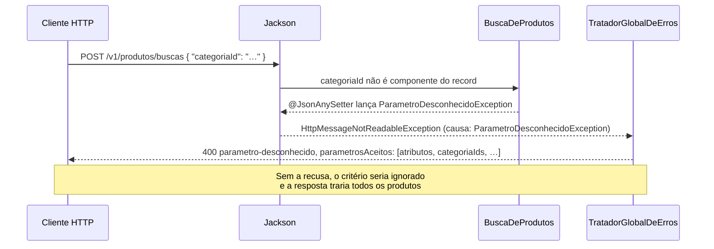

## O problema

O backoffice do Bazar precisa de "livros de programação até R$ 150". O app quer "tudo que tem *code* no nome". O time de catálogo quer "os rascunhos criados desde o dia 1º" e "os livros do Martin Fowler". Até agora, `GET /v1/produtos` devolve **todos** os produtos, e cada pedido desses leva a uma tentação diferente:

```text noCopy
GET /v1/produtos/por-categoria/{id}                ← um endpoint por critério
GET /v1/produtos/por-categoria/{id}/ate/15000      ← e por combinação de critérios
GET /v1/produtos?where=preco_valor<150             ← SQL vindo do cliente
GET /v1/produtos?categoria=…                       ← o nome errado, ignorado em silêncio: devolve tudo
```

O primeiro caminho multiplica endpoints: cada nova combinação vira uma rota, um teste e uma linha na documentação. O segundo entrega o banco ao cliente: ele filtra por colunas internas, monta consultas que nenhum índice atende e, se o servidor concatenar o texto, abre a porta para *SQL injection*. O terceiro é o pior de todos, porque ninguém percebe: o filtro com nome errado é ignorado e a resposta parece certa.

Filtrar é como o balcão de uma loja de material de construção. O cliente não entra no estoque: ele diz o que quer ("parafuso, 6 mm, inox, até R$ 20") e o vendedor sabe quais perguntas consegue responder rápido. Uma API de filtros bem desenhada é esse balcão: um vocabulário pequeno, documentado e que o servidor sabe atender.

## O conceito

### Filtros simples: um parâmetro por campo, combinados com E

A forma mais comum, e a que os três guias recomendam como ponto de partida, é **um parâmetro de query por critério**:

```http
GET /v1/produtos?categoriaId=0192f3a0-5555-7000-8000-000000000003&status=ATIVO
```

A Zalando chama isso de <Term id="linguagem-de-consulta-simples">linguagem de consulta simples</Term> (regra [236]): pares nome-valor combinados **de um único jeito**, com semântica de E. A regra pede que cada parâmetro documente quatro coisas, e o Bazar segue as quatro:

| O que documentar | No Bazar |
|---|---|
| A propriedade a que o parâmetro se refere | `categoriaId` filtra o campo `categoriaId` da resposta. Mesmo nome, mesmo formato |
| A faixa de valores e se os limites são inclusivos | `precoMin` e `precoMax` incluem os limites; `criadoApos` não inclui |
| A semântica da comparação | igualdade, exceto `q` (contém) e os intervalos |
| Como se combina com os outros | parâmetros diferentes: E. Valores do mesmo parâmetro: OU |

Por que `categoriaId`, e não `categoria=livros`? Porque o **nome do filtro é o nome do campo**. O cliente vê `"categoriaId": "0192f3a0-…"` numa resposta e sabe, sem ler a documentação, que `?categoriaId=0192f3a0-…` traz os produtos daquela categoria. Um filtro por *slug* (`categoria=livros`) exigiria um segundo identificador para a categoria, e essa decisão não é desta página.

A vantagem dessa forma é que ela não exige nada do cliente: não há sintaxe a aprender, não há escape especial (só a codificação normal da URL) e ela é documentada no OpenAPI como qualquer parâmetro. A Zalando dá um exemplo do contrário: em `?user_id=gt:100`, o valor é "maior que 100" ou é o texto `gt:100`? Num contrato simples, essa pergunta não existe.

### Listas: OU dentro do parâmetro

"Ativos ou rascunhos" é uma lista de valores no mesmo parâmetro. Há duas formas de escrever isso na URL, e a Zalando (regra [154]) exige que a API **escolha e documente** uma delas, porque o OpenAPI descreve uma de cada vez:

| Forma | Exemplo | No OpenAPI |
|---|---|---|
| Separada por vírgula | `?status=ATIVO,RASCUNHO` | `style: form, explode: false` |
| Parâmetro repetido | `?status=ATIVO&status=RASCUNHO` | `style: form, explode: true` |

O Bazar documenta a vírgula, que é mais curta. O Spring aceita as duas formas sem configuração, mas **não a mistura**: em `?status=RASCUNHO,ATIVO&status=DESCONTINUADO`, ele recebe dois valores, `"RASCUNHO,ATIVO"` e `"DESCONTINUADO"`, não divide o primeiro e a conversão falha com `400`. Esse é um motivo concreto para documentar uma forma só.

Uma lista separada por vírgula só funciona para valores que não contêm vírgula. UUIDs e enums nunca contêm. Um texto livre pode conter, e por isso `q` não é lista.

Toda lista precisa de um **tamanho máximo**. Sem ele, `?categoriaId=` com 5.000 ids vira um `IN` de 5.000 parâmetros no banco. O Bazar aceita até 20 categorias na URL.

### Intervalos e datas

Um intervalo vira **dois parâmetros**, um para cada limite, e qualquer um deles pode faltar:

- `precoMin` e `precoMax`, em centavos, como o `precoEmCentavos` das respostas da v1. Os dois limites são **inclusivos**: `precoMax=15000` inclui um produto de R$ 150,00 exatos. Se o filtro usasse reais e a resposta centavos, o cliente teria que converter a cada consulta, e esse erro de unidade acabaria acontecendo.
- `criadoApos`, um instante em ISO 8601 com fuso (`2026-10-01T00:00:00Z`). O nome diz a semântica: "após" é **estritamente depois**. Por isso o nome é `criadoApos` e não `criadoEm`, que sugeriria igualdade.

O mínimo maior que o máximo é um pedido que não faz sentido, e o Bazar responde `422` desde a [07.02](/construindo-apis-com-spring-boot/validacao-avancada). Responder `200` com uma lista vazia esconderia o erro do cliente.

Há outras convenções: `preco[gte]=100` (o estilo de colchetes de algumas APIs públicas) ou `preco=gte:100`. Elas são mais compactas quando há muitos operadores, mas criam a ambiguidade do exemplo `gt:100` e não têm suporte direto nos geradores de cliente. Com só dois limites por campo, `Min`/`Max` e `Apos`/`Antes` são mais claros.

### Busca textual: `q`

`q` é o nome convencional do parâmetro de busca livre (Zalando, regra [137]: *"default query parameter, e.g. used by browser tab completion"*). No Bazar, `q=code` encontra os produtos com "code" no nome, sem diferenciar maiúsculas de minúsculas.

Isso é um `LIKE '%code%'`, não uma busca de verdade. Ele não ordena por relevância, não sabe que "cafe" e "café" são a mesma palavra nem que "livros" e "livro" também são. Ele também não usa índice comum, como você vai ver no fim desta página. Dois limites tornam isso aceitável:

- **Tamanho mínimo de 2 caracteres.** `q=a` casaria com quase tudo e percorreria a tabela inteira.
- **Os curingas do cliente são texto.** `q=100%` procura "100%", não "100 seguido de qualquer coisa". A [10.05](/persistencia-para-apis/projecoes-e-consultas-para-leitura) já faz esse escape.

Quando o catálogo crescer e a busca virar produto (relevância, acentos, sinônimos, facetas), o caminho é a busca textual do PostgreSQL (`tsvector`) ou um motor de busca dedicado, como OpenSearch ou Elasticsearch. O contrato `q=` pode continuar o mesmo: o que muda é a implementação.

### Parâmetro vazio é parâmetro ausente

Formulários HTML e muitas telas enviam o campo vazio: a caixa de busca em branco vira `?q=`. O Bazar trata `?q=`, `?categoriaId=` e `?status=` como se o parâmetro **não estivesse lá**. É a mesma ideia da regra [123] da Zalando para JSON, em que `null` e ausente têm o mesmo significado: um valor vazio não é um filtro "por texto vazio".

### Linguagens de filtro: quando os pares nome-valor não bastam

Os parâmetros simples não expressam "categoria X **ou** preço abaixo de R$ 50", nem "tudo, **menos** os descontinuados". Para isso existem as <Term id="linguagem-de-filtro">linguagens de filtro</Term>: uma expressão inteira num único parâmetro.

| Estilo | Como fica | Quem usa |
|---|---|---|
| **Parâmetros simples** | `?categoriaId=X&precoMax=15000` | Zalando [236] (preferido), Bazar |
| **RSQL / FIQL** | `?filtro=categoriaId==X;precoEmCentavos=le=15000` | Bibliotecas Java como `rsql-parser` |
| **AIP-160** | `?filter=categoriaId = "X" AND precoEmCentavos <= 15000` | Google |
| **Expressão estilo OData** | `?filter=precoEmCentavos le 15000 and status eq 'ATIVO'` | Microsoft Azure (`collections-filter-param`) |
| **JSON estruturado** | `{ "categoriaIds": ["X"], "precoMax": 15000 }` no corpo | Zalando [237] |

Cada um resolve o mesmo problema com um custo diferente:

- **RSQL** é um superconjunto da FIQL, uma sintaxe pensada para caber na URL sem escape: `;` é E, `,` é OU, e operadores como `=lt=` e `=in=` têm forma alternativa (`<`, `>=`). O parser Java mais conhecido, o `rsql-parser`, teve a última versão (2.1.0) publicada em 2016. Ele funciona, mas a gramática fica congelada.
- **AIP-160** é a linguagem dos Google APIs: um único campo `filter`, com `=`, `!=`, `<`, `>`, `:` ("tem") e `AND`/`OR`/`NOT`. Ela tem uma armadilha de precedência que surpreende quem vem do SQL: **`OR` tem precedência sobre `AND`**. `a AND b OR c` significa `a AND (b OR c)`, e não `(a AND b) OR c`. Por isso a própria AIP pede que a documentação incentive parênteses explícitos. A AIP também diz que um serviço não precisa suportar a gramática inteira, desde que documente o que aceita, e que um filtro inválido é um erro (`INVALID_ARGUMENT`, o `400` do gRPC).
- **O guia da Microsoft** define um `filter` com operadores `eq`, `ne`, `gt`, `ge`, `lt`, `le`, `and`, `or` e `not`. Os nomes são os do OData, mas o parâmetro é `filter`, sem o `$` do OData (regra `collections-query-options-no-dollar-sign`). Um operador que o serviço não suporta é erro (`collections-filter-unknown-operator`), assim como um parâmetro desconhecido (`collections-error-on-unknown-parameter`, a regra que o Bazar já segue desde a [12.02](/design-de-apis-profissional/convencoes-de-nomenclatura)).
- **JSON estruturado** é a recomendação da Zalando para consultas complexas (regra [237]): o cliente monta um objeto, sem concatenar texto nem fazer escape, o servidor não precisa de *parser* e o OpenAPI descreve tudo. O preço é que a consulta vai no **corpo**, e um GET não tem corpo (veja a próxima seção).

O que pesa na escolha é o que você vai ter que **sustentar**:

| Critério | Parâmetros simples | Linguagem de filtro (RSQL, AIP-160, OData) | JSON no corpo |
|---|---|---|---|
| Expressividade | E entre campos, OU dentro de um campo | E, OU, NÃO, parênteses | O que o esquema definir |
| Curva para o cliente | Nenhuma | Aprender a gramática e o escape | Ler o esquema |
| Documentação no OpenAPI | Nativa, campo a campo | Um `string` e um link para a gramática | Nativa |
| Validação no servidor | Bean Validation | Parser + validação da árvore | Bean Validation |
| Risco de consulta cara | Baixo: só as combinações publicadas | Alto: qualquer combinação, inclusive `OR` entre campos sem índice | Médio: o esquema limita |
| Cache HTTP e links | Sim (é um GET) | Sim (é um GET) | Não, se for POST |

O Bazar usa **parâmetros simples** na listagem e **JSON no corpo** para o que não cabe neles. Ele não adota uma linguagem de filtro porque nenhum caso de uso precisa de OU entre campos, e uma linguagem de filtro é uma promessa difícil de desfazer: depois que um cliente escreve `categoriaId==X,precoEmCentavos<5000`, o servidor precisa atender essa consulta, com ou sem índice, para sempre.

<Callout type="warning" title="Uma linguagem de filtro genérica não é uma whitelist">
Bibliotecas que traduzem RSQL ou OData direto para JPA (`produto.get(nomeQueOClienteMandou)`) aceitam **qualquer atributo da entidade**: a coluna `versao`, um futuro `custo`, as relações. O cliente passa a filtrar por campos que nem aparecem na resposta, e a mudança de uma entidade quebra clientes. Se adotar uma linguagem, mapeie cada seletor permitido para um caminho explícito, e recuse os outros com `400`.
</Callout>

### A whitelist é o contrato

Um filtro só existe se estiver **declarado**. No Bazar, a declaração é o próprio record que recebe os parâmetros: os componentes de `FiltroProduto` são a lista completa do que `GET /v1/produtos` aceita. Qualquer outro nome recebe `400 parametro-desconhecido`, com a lista dos aceitos no corpo. É o `ParametrosDeConsultaInterceptor` da 12.02, que agora também lê os componentes de um record recebido com `@ModelAttribute`.

O mesmo vale para o corpo de uma busca. Nos corpos de escrita, o Bazar mantém o padrão do Jackson 3, que ignora campos desconhecidos (o *tolerant reader* da [06.03](/construindo-apis-com-spring-boot/jackson-3-no-spring-boot-4)). A 06.03 aceita um risco: "um campo opcional digitado errado". Numa busca, **todos** os campos são opcionais, e o risco aceito vira o problema inteiro: `{"categoriaId": "…"}`, no singular, é um erro de digitação que, ignorado, devolveria **todos** os produtos. Um filtro ignorado sempre devolve mais do que o cliente pediu, e pode expor dados que ele não deveria ver. Por isso `BuscaDeProdutos` recusa campos desconhecidos com o mesmo `400`.

Um valor que nem converte (`status=ESGOTADO`, `precoMin=abc`) também é `400`, como um id malformado no caminho. Um valor que converte mas viola uma regra (`q=a`, `precoMin` maior que `precoMax`) é `422`. A divisão é a mesma da [08.01](/construindo-apis-com-spring-boot/problem-details-rfc-9457): `400` quando a requisição está malformada, `422` quando está bem formada mas não pode ser atendida.

### Buscas complexas: GET, POST de busca ou QUERY

O time de catálogo quer buscar por **atributos**: `{"autor": "Martin Fowler"}`. Os atributos são livres (cada categoria tem os seus), e colocá-los na URL exige uma convenção (`?atributo.autor=Martin%20Fowler`? `?atributos=autor:Martin Fowler`?) que se mistura com a lista de parâmetros fixos. Além disso, buscas maiores esbarram no **tamanho da URL**: o Tomcat recusa com `400` uma requisição cuja linha e cabeçalhos passam de 8 KB (`server.max-http-request-header-size`), e proxies e CDNs pelo caminho podem ter limites menores. No Bazar, 300 UUIDs em `categoriaId` já bastam para esse `400`, antes de a requisição chegar ao Spring.

Há três formas de mandar uma consulta no corpo.

**1. GET com corpo: não.** A RFC 9110 diz que o conteúdo de um GET *"has no generally defined semantics, cannot alter the meaning or target of the request, and might lead some implementations to reject the request"*. Proxies podem descartar o corpo, clientes HTTP podem se recusar a enviá-lo, e a Zalando exige que o servidor o ignore. O Elasticsearch aceita GET com corpo, mas é uma exceção conhecida, não um modelo.

**2. POST de busca: a solução de hoje.** O cliente envia `POST /v1/produtos/buscas` com os critérios no corpo e recebe `200` com o resultado. A Zalando chama isso de *"GET with body payload"* e pede que o endpoint seja **documentado explicitamente** como uma consulta que não cria nada. O nome segue a escolha da [12.04](/design-de-apis-profissional/acoes-que-nao-sao-crud-e-maquinas-de-estado): um substantivo sob o recurso, e não um método customizado (`POST /produtos:buscar`). A alternativa da Zalando, o POST na própria coleção, não serve ao Bazar: `POST /v1/produtos` já cria produtos.

O custo é que o HTTP **não sabe** que esse POST é seguro e idempotente:

- caches e CDNs não guardam a resposta;
- um cliente HTTP não repete a requisição sozinho depois de uma falha de conexão, como faria com um GET;
- não há uma URL para compartilhar ou salvar nos favoritos.

<DeepDive title="O POST que cria um recurso de busca">
O nome "recurso de busca" também descreve um desenho diferente: `POST /buscas` **cria** uma busca salva, responde `201` com `Location: /buscas/{id}`, e `GET /buscas/{id}/resultados` traz o resultado, que pode ser paginado, compartilhado e consultado de novo. Esse modelo vale quando a busca é cara (o servidor processa em segundo plano, como os relatórios de vendas da [21.02](/padroes-avancados-de-http/operacoes-assincronas-e-de-longa-duracao-202-polling)) ou quando ela é, de fato, um objeto do domínio, como um alerta "me avise quando aparecer um livro do Fowler abaixo de R$ 100".

O Bazar não precisa disso: a busca de produtos é rápida e descartável. Por isso `POST /v1/produtos/buscas` responde `200` com os itens e não cria nada.
</DeepDive>

**3. QUERY: a solução de amanhã.** A <Term id="metodo-query">RFC 10008</Term>, publicada em junho de 2026, define o método **QUERY**: uma requisição com corpo que é **segura e idempotente**, como um GET. Ela resolve exatamente o custo do POST de busca:

- **Retry:** como é idempotente, clientes e proxies podem repetir a requisição depois de uma falha de conexão.
- **Cache:** a resposta pode ser guardada, e a chave do cache **deve incluir o corpo** da requisição.
- **`Content-Type` obrigatório:** o servidor deve recusar um corpo sem `Content-Type` ou incompatível com ele.
- **Descoberta:** o cabeçalho de resposta `Accept-Query` anuncia quais formatos de consulta um recurso aceita.
- **URL do resultado:** a resposta pode trazer `Content-Location` (onde buscar este resultado de novo com GET) ou `Location` (uma URI que repete a consulta).

O Spring Framework **7.1**, previsto para novembro de 2026, traz um suporte mínimo: `RequestMethod.QUERY` em `@RequestMapping(method = RequestMethod.QUERY, ...)`, sem uma anotação `@QueryMapping` "por enquanto", segundo as notas da versão. O Bazar usa o Spring 7.0, e nele `QUERY` não existe no enum `RequestMethod`. A requisição chega ao servidor e recebe `405`, como você vai ver abaixo.

Mesmo com o Spring 7.1, adotar QUERY numa API pública pede cautela. Proxies, *gateways*, WAFs e bibliotecas de cliente precisam conhecer o método, e o navegador trata `QUERY` como um método que não é *CORS-safelisted*, exigindo *preflight*. O caminho prudente é **oferecer QUERY ao lado do POST de busca**, com o mesmo corpo, e deixar o cliente escolher. Para o Bazar, isso vai ser uma mudança compatível: um método novo no mesmo recurso, sem tirar nada de quem já usa o POST.

### Especificações: cada filtro é uma condição

A [10.05](/persistencia-para-apis/projecoes-e-consultas-para-leitura) já montou a consulta com `PredicateSpecification`: cada filtro é uma condição independente, e a consulta junta só as que foram pedidas. Esta página acrescenta quatro: lista de categorias (`IN`), lista de status, SKU exato, data de criação e atributo no `jsonb`.

O atributo merece atenção. A coluna `atributos` é `jsonb`, e o PostgreSQL extrai um valor com `jsonb_extract_path_text(atributos, 'autor')`. A chave vem do cliente, então ela **não pode** ser escrita dentro do SQL:

- `cb.literal(chave)` parece um parâmetro, mas o Hibernate escreve o valor **no texto do SQL**, entre aspas: `jsonb_extract_path_text(p1_0.atributos,'autor')`. Ele escapa as aspas, mas nenhuma consulta deveria depender disso.
- `HibernateCriteriaBuilder.value(chave)` cria um parâmetro de verdade: `jsonb_extract_path_text(p1_0.atributos,?)=?`. O teste confere esse SQL.

E, como defesa em profundidade, a borda só aceita chaves em *camelCase* com até 30 letras e no máximo 5 atributos por busca. A [documentação de segurança](https://security-doc-beta.vercel.app/) trata de *SQL injection* em detalhe.

### Cada filtro publicado é uma promessa de desempenho

Um filtro na documentação diz ao cliente "pode usar". Se a consulta correspondente percorre a tabela inteira, ela vai funcionar com 300 produtos e falhar com 3 milhões. Antes de publicar um filtro, pergunte **qual índice atende** a ele:

| Filtro | Condição | Índice que atende |
|---|---|---|
| `categoriaId` | `categoria_id in (?)` | `produto_categoria_id_idx`, criado na V1 |
| `sku` | `sku = ?` | o índice da restrição `unique` |
| `status` | `status in (?)` | Sozinho, raramente vale um índice (só 3 valores). Combinado, um índice composto `(status, categoria_id)` |
| `precoMin`, `precoMax` | `preco_valor between ...` | B-tree em `preco_valor`, se for um filtro frequente |
| `criadoApos` | `criado_em > ?` | B-tree em `criado_em` |
| `q` | `lower(nome) like '%code%'` | **Nenhum B-tree.** Só um índice de trigramas (`pg_trgm`, GIN) em `lower(nome)` |
| `atributos` | `jsonb_extract_path_text(atributos, ?) = ?` | Um índice de expressão por chave, ou um GIN em `atributos` com o operador `@>` |

O Bazar ainda é pequeno e não cria esses índices agora. A [28.04](/performance/consultas-e-paginacao-eficientes) mede cada consulta com `EXPLAIN ANALYZE` e cria os índices que fazem diferença. O que importa nesta página é a disciplina: **só publique um filtro que você sabe como atender**.

## Diagrama

```mermaid title="Onde vai a consulta: query params, POST de busca ou QUERY"
flowchart TB
    INICIO(["O cliente precisa filtrar uma coleção"]) --> SIMPLES{"Os critérios são pares<br/>nome = valor, combinados com E?"}
    SIMPLES -- "sim" --> URL{"Cabem com folga na URL?<br/>(poucos KB, contando proxies)"}
    URL -- "sim" --> GET["GET /v1/produtos?categoriaId=…&precoMax=…<br/>cacheável, compartilhável, retry automático"]
    URL -- "não" --> CORPO
    SIMPLES -- "não: atributos livres, listas longas,<br/>OU entre campos" --> CORPO{"A busca é um objeto<br/>que precisa durar?"}
    CORPO -- "sim: busca salva,<br/>processamento demorado" --> RECURSO["POST /buscas → 201 + Location<br/>GET /buscas/{id}/resultados"]
    CORPO -- "não: só quer o resultado" --> QUERYOK{"Servidor, proxies e clientes<br/>suportam QUERY (RFC 10008)?"}
    QUERYOK -- "sim" --> QUERY["QUERY /v1/produtos<br/>segura, idempotente, cacheável"]
    QUERYOK -- "não (o Bazar hoje)" --> POST["POST /v1/produtos/buscas → 200<br/>documentado como consulta"]
```



## Na prática

### O contrato

| Método e rota | Critérios | Respostas |
|---|---|---|
| `GET /v1/produtos` | `q`, `sku`, `categoriaId` (lista, até 20), `status` (lista), `precoMin`, `precoMax` (centavos, inclusivos), `criadoApos` (exclusivo) | `200`, `400` (parâmetro desconhecido ou valor que não converte), `422` (regra violada) |
| `POST /v1/produtos/buscas` | os mesmos, com `categoriaIds` (até 100), mais `atributos` (até 5) | `200`, `400` (critério desconhecido, JSON inválido), `422` |

No corpo, a lista de categorias se chama `categoriaIds`, no plural. Na URL, cada ocorrência do parâmetro traz um id (`?categoriaId=A&categoriaId=B`), e o singular se lê naturalmente. No JSON, o campo é um array, e arrays têm nome no plural (Zalando [120], Google AIP-140). A diferença é pequena, mas é exatamente o tipo de erro que a recusa de critérios desconhecidos pega: quem copiar `categoriaId` da URL para o corpo recebe `400` com a lista dos nomes aceitos.

### Os parâmetros num record

O Spring preenche um record a partir dos parâmetros de query com `@ModelAttribute`: cada componente vira um parâmetro, convertido pelo mesmo mecanismo do `@RequestParam` (inclusive listas separadas por vírgula). As anotações do Bean Validation funcionam como num corpo:

```java title="src/main/java/com/bazar/catalogo/api/FiltroProduto.java"
/**
 * Os parâmetros de query de GET /v1/produtos (13.01). Os componentes do record são a lista de parâmetros aceitos:
 * qualquer outro nome recebe 400 (12.02). Parâmetros diferentes se somam (E); os valores de uma lista são
 * alternativas (OU), separados por vírgula ou com o parâmetro repetido. Os preços são em centavos, como nas respostas.
 */
@IntervaloPrecoValido
public record FiltroProduto(
        @Nullable @Size(min = 2, max = 100) String q,
        @Nullable @Sku String sku,
        @Nullable @Size(max = 20) List<UUID> categoriaId,
        @Nullable List<StatusProduto> status,
        @Nullable @PositiveOrZero Long precoMin,
        @Nullable @PositiveOrZero Long precoMax,
        @Nullable Instant criadoApos) implements IntervaloDePreco {

    // ?q= vazio (a caixa de busca em branco) é o mesmo que não informar o parâmetro, como já acontece com
    // ?categoriaId= e ?status=, que o Spring converte em null.
    public FiltroProduto {
        q = semTextoVazio(q);
        sku = semTextoVazio(sku);
    }

    FiltroDeProdutos paraDominio() {
        return new FiltroDeProdutos(q, sku, conjunto(categoriaId), conjunto(status),
                IntervaloDePreco.emReais(precoMin), IntervaloDePreco.emReais(precoMax), criadoApos, Map.of());
    }

    static @Nullable String semTextoVazio(@Nullable String valor) {
        return valor == null || valor.isBlank() ? null : valor;
    }

    static <T> Set<T> conjunto(@Nullable List<T> valores) {
        return valores == null ? Set.of() : Set.copyOf(valores);
    }
}
```

O record é da camada `api`, o contrato. O serviço recebe `FiltroDeProdutos`, do domínio, que não sabe nada de HTTP: os preços já em reais (a escala do `Dinheiro`), as listas como conjuntos, nada nulo onde "vazio" basta. A conversão de centavos para reais fica na borda, junto do contrato:

```java title="src/main/java/com/bazar/catalogo/api/IntervaloDePreco.java"
/**
 * Uma faixa de preço opcional, em centavos, como o precoEmCentavos das respostas da v1. Implementada pelos
 * filtros da listagem e da busca de produtos, que compartilham a validação @IntervaloPrecoValido (13.01).
 */
public interface IntervaloDePreco {

    @Nullable Long precoMin();

    @Nullable Long precoMax();

    // O domínio trabalha em reais (Dinheiro.valor); a conversão fica na borda, junto do contrato.
    static @Nullable BigDecimal emReais(@Nullable Long centavos) {
        return centavos == null ? null : BigDecimal.valueOf(centavos, 2);
    }
}
```

Na [07.02](/construindo-apis-com-spring-boot/validacao-avancada), a constraint de classe `@IntervaloPrecoValido` validava um record `IntervaloPreco`, criado para quando os filtros chegassem. Agora dois records têm a faixa de preço, e a constraint passa a validar a interface que os dois implementam. O validador é o mesmo, com `IntervaloDePreco` no lugar de `IntervaloPreco`:

```java title="src/main/java/com/bazar/catalogo/api/IntervaloPrecoValido.java (trecho)"
class Validador implements ConstraintValidator<IntervaloPrecoValido, IntervaloDePreco> {

    @Override
    public boolean isValid(IntervaloDePreco intervalo, ConstraintValidatorContext contexto) {
        if (intervalo.precoMin() == null || intervalo.precoMax() == null
                || intervalo.precoMin() <= intervalo.precoMax()) {
            return true;
        }
        // ... a violação é atribuída ao campo precoMax
    }
}
```

### O controller

```java title="src/main/java/com/bazar/catalogo/api/ProdutoController.java (trecho)"
// Uma projeção, e não entidades: só as colunas da listagem (10.05).
// Os filtros chegam como parâmetros de query (13.01); a ordenação e a paginação, em 13.02–13.04.
@GetMapping
public Lista<ProdutoResumoResponse> listar(@Valid @ModelAttribute FiltroProduto filtro) {
    return new Lista<>(servico.listar(filtro.paraDominio()).stream().map(mapper::paraResumo).toList());
}

// Uma consulta com corpo: não altera nada, mas usa POST porque os critérios não cabem bem numa URL (13.01).
@PostMapping("/buscas")
public Lista<ProdutoResumoResponse> buscar(@Valid @RequestBody BuscaDeProdutos busca) {
    return new Lista<>(servico.listar(busca.paraDominio()).stream().map(mapper::paraResumo).toList());
}
```

O `@ModelAttribute` é opcional para um record (o Spring o aplica a qualquer tipo que não seja "simples"), mas o Bazar o escreve. Ele deixa claro que o record vem da query e é a anotação que o interceptor procura.

### A whitelist, no interceptor e no corpo

O interceptor da 12.02 descobria os nomes aceitos pelos `@RequestParam` do método. Agora ele também lê os componentes de um record `@ModelAttribute`:

```java title="src/main/java/com/bazar/compartilhado/web/ParametrosDeConsultaInterceptor.java (trecho)"
private static Set<String> aceitos(HandlerMethod metodo) {
    SortedSet<String> nomes = new TreeSet<>();
    for (var parametro : metodo.getMethodParameters()) {
        var anotacao = parametro.getParameterAnnotation(RequestParam.class);
        if (anotacao != null && Map.class.isAssignableFrom(parametro.getParameterType())) {
            return Set.of("*");
        }
        if (anotacao != null) {
            nomes.add(StringUtils.hasText(anotacao.name()) ? anotacao.name() : nomeNoCodigo(parametro));
        }
        else if (parametro.hasParameterAnnotation(ModelAttribute.class)) {
            nomes.addAll(componentes(parametro.getParameterType()));
        }
        else if (parametro.getParameterAnnotations().length == 0
                && BeanUtils.isSimpleProperty(parametro.getParameterType())) {
            nomes.add(nomeNoCodigo(parametro));
        }
    }
    return Set.copyOf(nomes);
}

// Só records: os componentes são exatamente os parâmetros que o Spring consegue preencher.
private static List<String> componentes(Class<?> tipo) {
    if (!tipo.isRecord()) {
        throw new IllegalStateException("@ModelAttribute sem record não é suportado: " + tipo.getName());
    }
    return Arrays.stream(tipo.getRecordComponents()).map(RecordComponent::getName).toList();
}
```

Uma classe comum com *setters* também pode ser `@ModelAttribute`, mas aí os nomes aceitos dependeriam de quais métodos existem, inclusive os herdados. Com records, a lista é exata. Para qualquer outro tipo, o interceptor falha na primeira requisição ao endpoint (um `500` que o teste do endpoint pega), em vez de adivinhar os nomes.

No corpo, quem lê os campos é o Jackson, que ignora os desconhecidos. Para a busca, o record declara um `@JsonAnySetter`: o Jackson chama esse método para cada campo do JSON que não é componente, e o método recusa:

```java title="src/main/java/com/bazar/catalogo/api/BuscaDeProdutos.java"
/**
 * O corpo de POST /v1/produtos/buscas (13.01): os mesmos critérios da listagem, mais os que não cabem bem
 * numa URL, como os atributos ({"autor": "Robert C. Martin"}). Os nomes são os mesmos dos parâmetros de GET,
 * no plural quando o valor é uma lista.
 */
@IntervaloPrecoValido
public record BuscaDeProdutos(
        @Nullable @Size(min = 2, max = 100) String q,
        @Nullable @Sku String sku,
        @Nullable @Size(max = 100) List<UUID> categoriaIds,
        @Nullable List<StatusProduto> status,
        @Nullable @PositiveOrZero Long precoMin,
        @Nullable @PositiveOrZero Long precoMax,
        @Nullable Instant criadoApos,
        // Até 5 atributos; a chave em camelCase, como os nomes do contrato (12.02).
        @Nullable @Size(max = 5)
        Map<@Pattern(regexp = "[a-z][a-zA-Z]{0,29}") String, @NotBlank @Size(max = 100) String> atributos)
        implements IntervaloDePreco {

    private static final SortedSet<String> CAMPOS = Arrays.stream(BuscaDeProdutos.class.getRecordComponents())
            .map(RecordComponent::getName)
            .collect(Collectors.toCollection(TreeSet::new));

    public BuscaDeProdutos {
        q = FiltroProduto.semTextoVazio(q);
        sku = FiltroProduto.semTextoVazio(sku);
    }

    // Um critério com o nome errado não pode ser ignorado em silêncio: a busca devolveria mais produtos do que o
    // cliente pediu. O Jackson chama este método para cada campo do JSON que não é componente do record.
    @JsonAnySetter
    void recusarCampoDesconhecido(String campo, @Nullable Object valor) {
        throw new ParametroDesconhecidoException(new TreeSet<>(Set.of(campo)), CAMPOS);
    }

    FiltroDeProdutos paraDominio() {
        return new FiltroDeProdutos(q, sku, FiltroProduto.conjunto(categoriaIds), FiltroProduto.conjunto(status),
                IntervaloDePreco.emReais(precoMin), IntervaloDePreco.emReais(precoMax), criadoApos,
                atributos == null ? Map.of() : atributos);
    }
}
```

O Jackson embrulha a exceção numa `HttpMessageNotReadableException`, a mesma de um JSON malformado. O tratador olha a causa e devolve o problema certo:

```java title="src/main/java/com/bazar/compartilhado/erros/TratadorGlobalDeErros.java (trecho)"
// Um campo desconhecido no corpo de uma busca chega embrulhado pelo Jackson (BuscaDeProdutos, 13.01).
@Override
protected ResponseEntity<Object> handleHttpMessageNotReadable(
        HttpMessageNotReadableException ex, HttpHeaders headers, HttpStatusCode status, WebRequest request) {
    if (ex.getMostSpecificCause() instanceof ParametroDesconhecidoException desconhecido) {
        return parametroDesconhecido(desconhecido, request);
    }
    return super.handleHttpMessageNotReadable(ex, headers, status, request);
}

@Override
protected ResponseEntity<Object> handleMethodArgumentNotValid(
        MethodArgumentNotValidException ex, HttpHeaders headers, HttpStatusCode status, WebRequest request) {
    // Num @ModelAttribute, um valor que nem converte (status=ESGOTADO, precoMin=abc) vira erro de binding.
    // É o mesmo caso de um @PathVariable malformado: 400, sem a mensagem do conversor, que cita tipos Java e
    // ecoa o valor.
    var naoConvertidos = ex.getBindingResult().getFieldErrors().stream()
            .filter(FieldError::isBindingFailure)
            .map(FieldError::getField)
            .distinct()
            .sorted()
            .toList();
    if (!naoConvertidos.isEmpty()) {
        return valorNaoConvertido(ex, naoConvertidos, request);
    }
    // ... o resto continua como na 08.02: 422 com um erro por campo
}
```

O segundo método corrige um vazamento que o `@ModelAttribute` traz. Num `@RequestParam`, um valor que não converte lança `MethodArgumentTypeMismatchException`, que o Bazar já trata como `400` desde a [08.02](/construindo-apis-com-spring-boot/problemdetail-no-spring-tratamento-global-de-erros). Num `@ModelAttribute`, o mesmo erro vira um erro de *binding* dentro do `BindingResult`, e a mensagem padrão é assim:

```text noCopy
Failed to convert value of type 'java.lang.String' to required type 'java.util.List'; Failed to convert from type
[java.lang.String] to type [com.bazar.catalogo.dominio.StatusProduto] for value [ESGOTADO]
```

Ela expõe nomes de classes internas e ecoa o valor enviado. Sem o filtro `isBindingFailure`, essa mensagem iria para o campo `mensagem` de um `422`.

### As especificações novas

```java title="src/main/java/com/bazar/catalogo/dominio/ProdutoSpecifications.java (trecho)"
public static PredicateSpecification<Produto> daCategoriaEm(Collection<UUID> categoriaIds) {
    return (produto, cb) -> produto.get("categoriaId").in(categoriaIds);
}

public static PredicateSpecification<Produto> comStatusEm(Collection<StatusProduto> status) {
    return (produto, cb) -> produto.get("status").in(status);
}

public static PredicateSpecification<Produto> comSku(String sku) {
    return (produto, cb) -> cb.equal(produto.get("sku"), sku);
}

public static PredicateSpecification<Produto> criadoApos(Instant instante) {
    return (produto, cb) -> cb.greaterThan(produto.get("criadoEm"), instante);
}

// atributos é uma coluna jsonb: jsonb_extract_path_text(atributos, 'autor') devolve o valor como texto.
// A chave e o valor vão como parâmetros da consulta (?). cb.literal(chave) escreveria a chave dentro do SQL;
// o value do Hibernate a transforma em parâmetro, como o valor do equal e o padrão do LIKE abaixo.
public static PredicateSpecification<Produto> comAtributo(String chave, String valor) {
    return (produto, cb) -> cb.equal(
            cb.function("jsonb_extract_path_text", String.class, produto.get("atributos"),
                    ((HibernateCriteriaBuilder) cb).value(chave)),
            valor);
}
```

`filtradoPor` acrescenta uma condição para cada critério presente e junta todas com `PredicateSpecification.allOf`, como na 10.05. Cada atributo vira uma condição, então dois atributos são combinados com E.

O *cast* para `HibernateCriteriaBuilder` prende esta especificação ao Hibernate, e `jsonb_extract_path_text` a prende ao PostgreSQL. É uma escolha consciente: o Bazar já depende dos dois (a coluna é `jsonb`), e a alternativa portável seria não filtrar por atributo.

### Na prática, pela API

<HttpExchange
  title="Livros de programação até R$ 150 com 'code' no nome"
  request={{ method: 'GET', url: '/v1/produtos?categoriaId=0192f3a0-5555-7000-8000-000000000003&precoMax=15000&q=code' }}
  response={{ status: 200, headers: { 'Content-Type': 'application/json' }, body: { itens: [ { id: '0192f39f-2222-7000-8000-000000000042', sku: 'LIV-0042', nome: 'Clean Code', precoEmCentavos: 12990, categoriaId: '0192f3a0-5555-7000-8000-000000000003', status: 'RASCUNHO' } ] } }}
>
Três critérios, combinados com E. O `Refactoring` (R$ 159,00) fica de fora pelo preço, e o cabo USB, pela categoria.
</HttpExchange>

<HttpExchange
  title="O nome errado do filtro"
  request={{ method: 'GET', url: '/v1/produtos?categoria=0192f3a0-5555-7000-8000-000000000003', headers: { 'Accept-Language': 'pt-BR' } }}
  response={{ status: 400, headers: { 'Content-Type': 'application/problem+json' }, body: { type: 'https://api.bazar.example/problemas/parametro-desconhecido', title: 'Parâmetro desconhecido', status: 400, detail: 'Parâmetro(s) não aceito(s) por este endpoint: categoria.', instance: '/v1/produtos', parametros: ['categoria'], parametrosAceitos: ['categoriaId', 'criadoApos', 'precoMax', 'precoMin', 'q', 'sku', 'status'], codigo: 'PARAMETRO_DESCONHECIDO', traceId: '08a29f77…' } }}
>
Sem a whitelist, a resposta seria `200` com o catálogo inteiro. A lista dos aceitos vem do record `FiltroProduto`.
</HttpExchange>

<HttpExchange
  title="Um status que não existe"
  request={{ method: 'GET', url: '/v1/produtos?status=ESGOTADO', headers: { 'Accept-Language': 'pt-BR' } }}
  response={{ status: 400, headers: { 'Content-Type': 'application/problem+json' }, body: { type: 'https://api.bazar.example/problemas/requisicao-invalida', title: 'Requisição inválida', status: 400, detail: "O valor do parâmetro 'status' é inválido.", instance: '/v1/produtos', parametros: ['status'], codigo: 'REQUISICAO_INVALIDA', traceId: '8a0be427…' } }}
>
O valor não aparece na resposta, nem o nome de nenhuma classe Java.
</HttpExchange>

<HttpExchange
  title="Uma faixa de preço invertida"
  request={{ method: 'GET', url: '/v1/produtos?precoMin=5000&precoMax=1000', headers: { 'Accept-Language': 'pt-BR' } }}
  response={{ status: 422, headers: { 'Content-Type': 'application/problem+json' }, body: { type: 'https://api.bazar.example/problemas/validacao', title: 'Dados inválidos', status: 422, detail: 'A requisição tem 1 campo inválido.', instance: '/v1/produtos', erros: [ { campo: 'precoMax', mensagem: 'deve ser maior ou igual a precoMin' } ], codigo: 'VALIDACAO', traceId: '6a71c04a…' } }}
/>

<HttpExchange
  title="Busca por atributo"
  request={{ method: 'POST', url: '/v1/produtos/buscas', headers: { 'Content-Type': 'application/json' }, body: { categoriaIds: ['0192f3a0-5555-7000-8000-000000000003'], precoMax: 20000, atributos: { autor: 'Martin Fowler' } } }}
  response={{ status: 200, headers: { 'Content-Type': 'application/json' }, body: { itens: [ { id: '0192f39f-2222-7000-8000-000000000043', sku: 'LIV-0043', nome: 'Refactoring', precoEmCentavos: 15900, categoriaId: '0192f3a0-5555-7000-8000-000000000003', status: 'RASCUNHO' } ] } }}
>
`200`, e não `201`: a busca não cria nada. A resposta tem o mesmo formato da listagem.
</HttpExchange>

<HttpExchange
  title="O nome da URL copiado para o corpo"
  request={{ method: 'POST', url: '/v1/produtos/buscas', headers: { 'Content-Type': 'application/json', 'Accept-Language': 'pt-BR' }, body: { categoriaId: '0192f3a0-5555-7000-8000-000000000003' } }}
  response={{ status: 400, headers: { 'Content-Type': 'application/problem+json' }, body: { type: 'https://api.bazar.example/problemas/parametro-desconhecido', title: 'Parâmetro desconhecido', status: 400, detail: 'Parâmetro(s) não aceito(s) por este endpoint: categoriaId.', instance: '/v1/produtos/buscas', parametros: ['categoriaId'], parametrosAceitos: ['atributos', 'categoriaIds', 'criadoApos', 'precoMax', 'precoMin', 'q', 'sku', 'status'], codigo: 'PARAMETRO_DESCONHECIDO', traceId: 'b5dfec96…' } }}
>
Antes desta página, o mesmo corpo devolvia `200` com **todos** os produtos: o campo desconhecido era ignorado e a busca ficava sem critério nenhum.
</HttpExchange>

<HttpExchange
  title="QUERY no Spring 7.0"
  request={{ method: 'QUERY', url: '/v1/produtos/buscas', headers: { 'Content-Type': 'application/json', 'Accept-Language': 'pt-BR' }, body: {} }}
  response={{ status: 405, headers: { Allow: 'POST, GET, PUT', 'Content-Type': 'application/problem+json' }, body: { title: 'Método não permitido', status: 405, detail: "Method 'QUERY' is not supported.", instance: '/v1/produtos/buscas', codigo: 'METHOD_NOT_ALLOWED', traceId: 'ce138156…' } }}
>
O Tomcat aceita o método e o entrega ao Spring, que não tem nenhum mapeamento para ele. O `Allow` lista `GET` e `PUT` porque `/v1/produtos/{id}` também casa com o caminho `/v1/produtos/buscas`. Um `GET` ali responde `400` (id malformado), e não a busca.
</HttpExchange>

### Os testes

Os testes da camada web conferem a tradução de parâmetros para o filtro do domínio e cada recusa. O serviço é um dublê, e o `ArgumentCaptor` captura o filtro que chegou até ele:

```java title="src/test/java/com/bazar/catalogo/api/ProdutoControllerTest.java (trecho)"
@Nested
class Filtros {

    final ArgumentCaptor<FiltroDeProdutos> filtro = ArgumentCaptor.forClass(FiltroDeProdutos.class);

    @Test
    void convertemOsParametrosNoFiltroDoDominio() {
        when(produtos.listar(any())).thenReturn(List.of());

        var resposta = mvc.get().uri("/v1/produtos?q=code&categoriaId={a},{b}&status=ATIVO&status=RASCUNHO"
                + "&precoMin=1000&precoMax=20050&criadoApos=2026-01-01T00:00:00Z", PROGRAMACAO, ELETRONICOS).exchange();

        assertThat(resposta).hasStatusOk();
        verify(produtos).listar(filtro.capture());
        assertThat(filtro.getValue()).isEqualTo(new FiltroDeProdutos("code", null, Set.of(PROGRAMACAO, ELETRONICOS),
                Set.of(StatusProduto.ATIVO, StatusProduto.RASCUNHO), new BigDecimal("10.00"), new BigDecimal("200.50"),
                Instant.parse("2026-01-01T00:00:00Z"), Map.of()));
    }

    @Test
    void parametroVazioEhOMesmoQueAusente() {
        when(produtos.listar(any())).thenReturn(List.of());

        assertThat(mvc.get().uri("/v1/produtos?q=&sku=&categoriaId=&status=&precoMin=&criadoApos=").exchange())
                .hasStatusOk();

        verify(produtos).listar(FiltroDeProdutos.nenhum());
    }

    @Test
    void misturarVirgulaERepeticaoNoMesmoParametroNaoConverte() {
        // Cada forma funciona sozinha; juntas, o Spring recebe ["RASCUNHO,ATIVO", "DESCONTINUADO"] e não divide.
        assertThat(mvc.get().uri("/v1/produtos?status=RASCUNHO,ATIVO&status=DESCONTINUADO").exchange())
                .hasStatus(HttpStatus.BAD_REQUEST);
        verifyNoInteractions(produtos);
    }

    @Test
    void recusaUmValorQueNaoConverteSemEcoarOValor() {
        var resposta = mvc.get().uri("/v1/produtos?status=ESGOTADO&precoMin=abc").exchange();

        assertThat(resposta).hasStatus(HttpStatus.BAD_REQUEST);
        assertThat(resposta).bodyJson().isLenientlyEqualTo("""
                { "type": "https://api.bazar.example/problemas/requisicao-invalida",
                  "parametros": ["precoMin", "status"] }
                """);
        assertThat(resposta).bodyText().doesNotContain("ESGOTADO", "abc", "java.");
        verifyNoInteractions(produtos);
    }

    @Test
    void aBuscaRecusaUmCriterioDesconhecido() {
        // "categoriaId" no singular é o nome do parâmetro de GET; no corpo, o critério é "categoriaIds".
        var resposta = mvc.post().uri("/v1/produtos/buscas")
                .contentType(MediaType.APPLICATION_JSON)
                .content("""
                        { "categoriaId": "%s" }
                        """.formatted(PROGRAMACAO))
                .exchange();

        assertThat(resposta).hasStatus(HttpStatus.BAD_REQUEST)
                .bodyJson().isLenientlyEqualTo("""
                        { "type": "https://api.bazar.example/problemas/parametro-desconhecido",
                          "parametros": ["categoriaId"] }
                        """);
        verifyNoInteractions(produtos);
    }

    // ... mais 5: sem parâmetros, nome desconhecido, faixa invertida, busca por atributo e chave inválida
}
```

O filtro por atributo depende do PostgreSQL (`jsonb_extract_path_text`), então ele é testado no `ProdutoServiceTest`, com o banco do Testcontainers ([11.04](/testes-de-api/testes-de-integracao-com-springboottest-e-testcontainers)). O teste também lê o SQL do log, para provar que a chave e o valor viraram parâmetros:

```java title="src/test/java/com/bazar/catalogo/dominio/ProdutoServiceTest.java (trecho)"
@Test
void filtraPorAtributoNoJsonbComChaveEValorComoParametros(CapturedOutput saida) {
    assertThat(servico.listar(FiltroDeProdutos.nenhum().comAtributo("autor", "Robert C. Martin")))
            .extracting(ProdutoResumo::sku).containsExactly("LIV-0042");
    assertThat(servico.listar(FiltroDeProdutos.nenhum().comAtributo("autor", "Martin Fowler"))).isEmpty();
    // Os valores vão como parâmetros: uma aspa no valor não quebra a consulta, só não casa com nada.
    assertThat(servico.listar(FiltroDeProdutos.nenhum().comAtributo("autor'", "x' or '1'='1"))).isEmpty();
    assertThat(saida).contains("jsonb_extract_path_text(p1_0.atributos,?)=?").doesNotContain("'1'='1");
}

@Test
void umaListaDeCategoriasEhUmOu() {
    assertThat(servico.listar(FiltroDeProdutos.nenhum().daCategoria(PROGRAMACAO, ELETRONICOS))).hasSize(3);
}
```

## Erros comuns

<BadVsGood title="Um endpoint por critério" why="Cada combinação nova vira uma rota, e as combinações crescem mais rápido que os critérios. Parâmetros de query combinam livremente, e um único endpoint documenta todos.">
<Bad title="Rotas de busca">

```http
GET /v1/produtos/por-categoria/{categoriaId}
GET /v1/produtos/por-categoria/{categoriaId}/ate/{preco}
GET /v1/produtos/rascunhos
GET /v1/produtos/busca/{texto}
```

</Bad>
<Good title="Uma coleção, critérios na query">

```http
GET /v1/produtos?categoriaId={id}
GET /v1/produtos?categoriaId={id}&precoMax=15000
GET /v1/produtos?status=RASCUNHO
GET /v1/produtos?q=clean
```

</Good>
</BadVsGood>

<BadVsGood title="Filtro ignorado em silêncio" why="Um filtro ignorado devolve mais do que o cliente pediu. O erro só aparece quando alguém nota dados demais na tela, ou não aparece nunca. Recusar com 400 e a lista dos aceitos transforma o erro em algo que o cliente corrige na hora.">
<Bad title="O padrão do Spring">

```text noCopy
GET /v1/produtos?categoria=…         → 200, todos os produtos
POST /buscas { "categoriaId": "…" }  → 200, todos os produtos
```

</Bad>
<Good title="A whitelist do Bazar">

```text noCopy
GET /v1/produtos?categoria=…         → 400 parametro-desconhecido, parametrosAceitos: [...]
POST /buscas { "categoriaId": "…" }  → 400 parametro-desconhecido, parametrosAceitos: [...]
```

</Good>
</BadVsGood>

<BadVsGood title="Nome de campo vindo do cliente direto para a consulta" why="O cliente passa a filtrar por qualquer atributo da entidade, inclusive os internos, e por campos sem índice. Cada filtro aceito precisa ser uma escolha do contrato.">
<Bad title="Filtro genérico">

```java
// GET /v1/produtos?campo=versao&valor=3
return (produto, cb) -> cb.equal(produto.get(campo), valor);
```

</Bad>
<Good title="Uma especificação por filtro publicado">

```java
public static PredicateSpecification<Produto> comSku(String sku) {
    return (produto, cb) -> cb.equal(produto.get("sku"), sku);
}
```

</Good>
</BadVsGood>

Outros erros frequentes:

- **GET com corpo.** Funciona no seu teste local e some no primeiro proxy. Use POST de busca, ou QUERY quando toda a cadeia suportar.
- **POST de busca sem documentação.** Para quem lê o OpenAPI, um POST cria algo. Documente que o endpoint é uma consulta, que pode ser repetido e que não altera nada (Zalando, *"GET with body payload"*).
- **Unidades diferentes entre filtro e resposta.** `precoMax` em reais e `precoEmCentavos` na resposta fazem o cliente errar por um fator de 100.
- **Listas sem limite.** `?categoriaId=` com milhares de ids vira um `IN` gigante, ou um `400` do Tomcat que o cliente não entende.
- **`q` como `LIKE '%x%'` sem mínimo.** `q=a` percorre a tabela inteira e devolve quase tudo.
- **Limites ambíguos.** Se a documentação não diz se `precoMax` inclui o limite, cada cliente vai supor uma coisa.
- **`cb.literal` com valor do cliente.** O valor vai escrito dentro do SQL. Use parâmetros: o valor numa comparação, ou `HibernateCriteriaBuilder.value` como argumento de função.

## Boas práticas

- **Comece com parâmetros simples:** um por critério, combinados com E, com o mesmo nome do campo da resposta.
- **Documente cada filtro:** o campo, a semântica da comparação, se os limites são inclusivos e o formato das listas.
- **Escolha um formato de lista,** documente-o e limite o tamanho.
- **Use a mesma unidade e o mesmo formato da resposta:** centavos com centavos, ISO 8601 com fuso.
- **Recuse o que não reconhece,** na query e no corpo, com a lista do que é aceito.
- **`400` para o que não converte, `422` para o que converte mas viola uma regra.** Nunca ecoe o valor nem a mensagem do conversor.
- **Trate parâmetro vazio como ausente.**
- **Mova para o corpo o que não cabe na URL,** com um POST de busca documentado. Planeje QUERY para quando a cadeia inteira suportar.
- **Prefira JSON estruturado a uma linguagem de filtro em texto,** a menos que os clientes precisem mesmo de OU e NÃO entre campos.
- **Só publique um filtro que um índice atende,** ou que você mediu e aceita percorrer.

## No projeto Bazar

<ProjectStep title="Filtros na listagem de produtos e a busca por atributos" module="catalogo" tag="pagina-13.01" files={[
  { path: 'src/main/java/com/bazar/catalogo/api/FiltroProduto.java', change: 'novo' },
  { path: 'src/main/java/com/bazar/catalogo/api/BuscaDeProdutos.java', change: 'novo' },
  { path: 'src/main/java/com/bazar/catalogo/api/IntervaloDePreco.java', change: 'novo' },
  { path: 'src/main/java/com/bazar/catalogo/api/IntervaloPreco.java', change: 'removido' },
  { path: 'src/main/java/com/bazar/catalogo/api/IntervaloPrecoValido.java', change: 'alterado' },
  { path: 'src/main/java/com/bazar/catalogo/api/ProdutoController.java', change: 'alterado' },
  { path: 'src/main/java/com/bazar/catalogo/dominio/FiltroDeProdutos.java', change: 'alterado' },
  { path: 'src/main/java/com/bazar/catalogo/dominio/ProdutoSpecifications.java', change: 'alterado' },
  { path: 'src/main/java/com/bazar/compartilhado/web/ParametrosDeConsultaInterceptor.java', change: 'alterado' },
  { path: 'src/main/java/com/bazar/compartilhado/erros/TratadorGlobalDeErros.java', change: 'alterado' },
  { path: 'src/test/java/com/bazar/catalogo/api/ProdutoControllerTest.java', change: 'alterado' },
  { path: 'src/test/java/com/bazar/catalogo/api/ConstraintsDoCatalogoTest.java', change: 'alterado' },
  { path: 'src/test/java/com/bazar/catalogo/dominio/ProdutoServiceTest.java', change: 'alterado' },
  { path: 'src/test/java/com/bazar/catalogo/dominio/ProdutoDeTeste.java', change: 'alterado' },
]}>
`GET /v1/produtos` aceita `q`, `sku`, `categoriaId`, `status`, `precoMin`, `precoMax` e `criadoApos`, e recusa qualquer outro nome. `POST /v1/produtos/buscas` recebe os mesmos critérios no corpo, mais `atributos`, e também recusa campos desconhecidos. Um valor que não converte passa a receber `400 requisicao-invalida`, sem ecoar o valor. A suíte tem 173 testes e continua com 5 contextos.
</ProjectStep>

## Resumo

- Filtros simples são um parâmetro de query por critério, com o nome do campo da resposta, combinados com E. Valores de uma lista são alternativas (OU).
- Documente a semântica de cada filtro: limites inclusivos ou não, formato da lista, unidade. Use as mesmas unidades e formatos da resposta.
- A whitelist é o contrato. No Bazar, ela é o record do `@ModelAttribute` na query e o record do corpo na busca, e um nome desconhecido recebe `400`.
- Linguagens de filtro (RSQL, AIP-160, a do guia da Microsoft) expressam OU e NÃO, mas cobram parser, documentação e consultas imprevisíveis. JSON estruturado no corpo é a alternativa recomendada pela Zalando.
- GET não tem corpo. Hoje, consultas com corpo vão num POST de busca documentado. O método QUERY (RFC 10008) é a solução padronizada, com suporte mínimo no Spring 7.1.
- Cada filtro publicado é uma promessa de desempenho: saiba qual índice o atende.

<Exercise title="Filtros dos pedidos" difficulty="medio">
O backoffice precisa listar pedidos com estes critérios:

- de um cliente;
- em um ou mais status;
- criados num intervalo de datas;
- com valor total acima de um mínimo;
- que contenham um produto específico.

E o time financeiro quer, além disso, "os pedidos com pagamento recusado **ou** cancelados por `ENDERECO_ERRADO` no último mês".

1. Desenhe os parâmetros de `GET /v1/pedidos`: nomes, tipos, semântica e limites.
2. Qual critério exige uma decisão sobre o modelo de dados, e por quê?
3. O pedido do time financeiro cabe nos parâmetros simples? Se não, o que você propõe?

<Hint>Olhe para os nomes dos campos da resposta do pedido (12.04) e para o que a 12.03 diz sobre coleções filtradas. Para o item 3, pense em qual combinação os parâmetros simples não expressam.</Hint>

<Solution>

**1. Parâmetros**

| Parâmetro | Tipo | Semântica |
|---|---|---|
| `clienteId` | UUID | igualdade. Já existe, mas é obrigatório; o backoffice precisa dele opcional |
| `status` | lista de `StatusPedido`, separada por vírgula, até 7 | OU entre os valores |
| `criadoDesde`, `criadoAntes` | instante ISO 8601 com fuso | `criadoDesde` inclusivo, `criadoAntes` exclusivo: a janela `[desde, antes)`. Janelas consecutivas (outubro, novembro) se encaixam sem sobrepor nem deixar buraco. Os nomes dizem a semântica, como o `criadoApos` dos produtos |
| `valorTotalMin` | centavos? | **cuidado:** a resposta do pedido usa `{ valor: "259.80", moeda: "BRL" }`, não centavos. O filtro deve seguir a resposta: um decimal em reais (`valorTotalMin=100.00`), validado com `@Digits(fraction = 2)` |
| `produtoId` | UUID | pedidos com **pelo menos um** item desse produto |

A pegadinha é a unidade: os produtos da v1 usam centavos, os pedidos usam o objeto de dinheiro. O filtro segue a resposta do recurso filtrado, mesmo que isso deixe as duas coleções diferentes. A unificação é assunto da [15.02](/design-de-apis-profissional/dinheiro-e-numeros-decimais).

**2. O critério que pede uma decisão de modelo**

`produtoId`. Ele não filtra uma coluna do pedido, mas os itens: vira um `exists (select 1 from item_pedido where pedido_id = p.id and produto_id = ?)`. Um `join` simples devolveria o pedido repetido quando o produto aparece em mais de um item. O índice `item_pedido_produto_id_idx` (V8) atende a essa subconsulta. Antes de publicar o filtro, confirme que a consulta usa esse índice.

**3. O pedido do time financeiro**

Não cabe: é um **OU entre campos diferentes** ("pagamento recusado" *ou* `cancelamento.motivo = ENDERECO_ERRADO`), e os parâmetros simples só combinam campos com E. Note também que "pagamento recusado" não é um status do pedido: a máquina de estados do pedido não tem esse estado. A recusa é um fato do **pagamento**, e o critério teria que consultar os pagamentos, não o pedido.

Há três saídas, da mais simples para a mais cara:

- **Duas consultas**, unidas pelo cliente: os pagamentos recusados do mês, em `GET /v1/pagamentos?status=…&criadoDesde=…`, e `GET /v1/pedidos?motivoCancelamento=ENDERECO_ERRADO&criadoDesde=…`. Exige só um parâmetro novo em cada coleção.
- **Um POST de busca** (`POST /v1/pedidos/buscas`) com JSON estruturado que admita grupos de OU, por exemplo `{ "qualquerUm": [ {…}, {…} ] }`. Bom se o caso se repetir.
- **Um relatório**, e não um filtro: o time financeiro quer uma visão periódica, e o módulo `relatorios` (10.05) é o lugar dela.

A melhor resposta para um caso isolado é a primeira, ou a terceira. Uma linguagem de filtro inteira para atender a um pedido do time financeiro seria desproporcional.
</Solution>
</Exercise>

<Quiz questions={[
  {
    question: 'Um cliente chama GET /v1/produtos?categoria=X (o nome correto é categoriaId). Num Spring Boot sem configuração extra, o que acontece, e o que o Bazar faz?',
    options: [
      'O Spring responde 400 automaticamente nos dois casos',
      'O Spring ignora o parâmetro e devolve todos os produtos; o Bazar responde 400 parametro-desconhecido com a lista dos aceitos',
      'O Spring tenta casar "categoria" com "categoriaId" por prefixo',
      'O Spring responde 404, porque a rota com esse parâmetro não existe',
    ],
    answer: 1,
    explanation: 'Parâmetros de query desconhecidos são ignorados por padrão, e um filtro ignorado devolve mais do que o cliente pediu. O ParametrosDeConsultaInterceptor do Bazar (12.02, ampliado nesta página) compara os nomes recebidos com os componentes do record FiltroProduto.',
  },
  {
    question: 'Na AIP-160 do Google, como é interpretado o filtro a AND b OR c?',
    options: [
      '(a AND b) OR c, como no SQL',
      'a AND (b OR c), porque OR tem precedência sobre AND',
      'É um erro: a AIP-160 exige parênteses',
      'Depende do serviço',
    ],
    answer: 1,
    explanation: 'A AIP-160 dá precedência ao OR, ao contrário do SQL e da maioria das linguagens de programação. Por isso ela pede que a documentação e os exemplos incentivem parênteses explícitos, embora não os exija.',
  },
  {
    question: 'Por que o Bazar usa POST /v1/produtos/buscas, e não GET com corpo, para a busca por atributos?',
    options: [
      'Porque o Spring não lê corpo em métodos GET',
      'Porque o corpo de um GET não tem semântica definida (RFC 9110): proxies podem descartá-lo e clientes podem se recusar a enviá-lo',
      'Porque POST é mais rápido que GET',
      'Porque a busca cria um recurso',
    ],
    answer: 1,
    explanation: 'A RFC 9110 diz que o conteúdo de um GET não tem semântica definida e pode levar implementações a recusar a requisição. O POST de busca é a solução portável hoje; o método QUERY (RFC 10008) será a padronizada, porque é seguro, idempotente e aceita corpo.',
  },
  {
    question: 'Qual destas é uma vantagem do método QUERY (RFC 10008) sobre o POST de busca?',
    options: [
      'Não precisa de Content-Type',
      'É seguro e idempotente: pode ser repetido depois de uma falha de conexão e ter a resposta guardada em cache, com o corpo na chave',
      'Funciona em qualquer versão do Spring',
      'Não passa por preflight de CORS',
    ],
    answer: 1,
    explanation: 'QUERY é definido como seguro e idempotente, e a resposta é cacheável com o corpo na chave do cache. A RFC exige Content-Type, o Spring só o suporta a partir da 7.1, e QUERY não é um método CORS-safelisted.',
  },
  {
    question: 'GET /v1/produtos?status=ESGOTADO e GET /v1/produtos?q=a: quais são as respostas no Bazar?',
    options: [
      'As duas 422',
      'As duas 400',
      '400 para status=ESGOTADO (não converte) e 422 para q=a (converte, mas tem menos de 2 caracteres)',
      '200 com lista vazia nas duas',
    ],
    answer: 2,
    explanation: 'ESGOTADO não é um StatusProduto, então a requisição está malformada: 400 requisicao-invalida, sem ecoar o valor. "a" é uma String válida que viola uma regra (@Size(min = 2)): 422 validacao, com o erro no campo q.',
  },
]} />

## Referências

<References />
