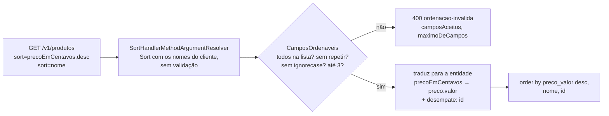

## O problema

O app do Bazar quer mostrar os livros "do mais caro para o mais barato". O backoffice quer os produtos "mais recentes primeiro". Hoje, `GET /v1/produtos` ordena sempre pelo nome, e o Spring oferece uma saída de uma linha: aceitar um `Sort` no controller e repassá-lo ao repositório. O cliente escreve `?sort=preco,desc` e pronto.

Pronto até alguém escrever:

```text noCopy
?sort=versao                   ← ordena por uma coluna interna
?sort=descricao                ← uma coluna de texto longo, sem índice
?sort=atributos                ← jsonb: o PostgreSQL ordena, mas por quê?
?sort=preco                    ← o nome da propriedade na entidade, não no contrato
```

A documentação do Spring Data avisa: as ordens resolvidas a partir da requisição são *"plain transfer objects carrying property names as is, without any validation against the domain model. Applications are responsible for verifying these values"*. Sem essa verificação, o cliente passa a conhecer a estrutura interna da entidade e escolhe ordenações que nenhum índice atende.

E há um problema mais sutil, que aparece mesmo com os campos certos. Três livros custam R$ 159,00. Em que ordem eles saem quando o cliente pede `?sort=precoEmCentavos,desc`? O SQL não garante nenhuma: o banco pode devolvê-los numa ordem agora e em outra na próxima consulta. Com paginação ([13.03](/design-de-apis-profissional/paginacao-por-offset)), um deles aparece em duas páginas e outro em nenhuma.

Ordenar é como organizar uma fila por ordem de chegada. Se duas pessoas chegam no mesmo minuto, alguém precisa decidir quem vai primeiro, senão elas trocam de lugar toda vez que a fila é refeita. Numa API, esse critério é o **desempate**, e ele não pode ficar por conta do banco.

## O conceito

### Três sintaxes para a mesma ideia

Ordenar é dizer **por quais campos** e **em que direção**. Cada guia escreve isso de um jeito:

| Sintaxe | "Preço decrescente, depois nome" | Quem usa |
|---|---|---|
| Spring Data | `?sort=precoEmCentavos,desc&sort=nome` | `Pageable` e `Sort` do Spring |
| Prefixo `-` | `?sort=-precoEmCentavos,nome` | JSON:API; Zalando ([137], com `+` opcional para crescente) |
| Sufixo ` desc` | `?order_by=precoEmCentavos desc,nome` | Google (AIP-132, campo `order_by`); Microsoft (`orderby`) |

As três dizem a mesma coisa, e a diferença está nos detalhes:

- **Spring Data.** Cada `sort` é `campo,campo,...` seguido de uma direção opcional (`asc` ou `desc`) e de um `ignorecase` opcional. A direção vale para **todos os campos daquele parâmetro**: `sort=criadoEm,sku,desc` ordena os dois de forma decrescente. Para direções diferentes, repete-se o parâmetro.
- **Prefixo `-`.** Compacta e cabe numa lista separada por vírgula, cada campo com a própria direção. Exige um *parser* próprio no Spring.
- **Sufixo ` desc`.** Lê-se como SQL. O espaço precisa ser codificado na URL (`%20` ou `+`), o que torna as URLs menos legíveis.

O Bazar usa a **sintaxe do Spring**, como a [12.02](/design-de-apis-profissional/convencoes-de-nomenclatura) já antecipou. O motivo é de custo, e não de estética: o Spring já converte o parâmetro em `Sort`, e o mesmo `sort` vai fazer parte do `Pageable` da 13.03 sem nenhum código a mais. O preço é uma pequena incoerência com a regra de listas da [13.01](/design-de-apis-profissional/filtros-e-busca): nos filtros, a vírgula separa **valores**; no `sort`, ela separa os campos da direção. A documentação da API precisa dizer isso, e o `sort` é o único parâmetro com essa regra.

Se o Bazar começasse do zero, sem o Spring, o prefixo `-` seria uma escolha igualmente boa. O que não se deve fazer é **misturar**: uma API com `sort=-preco` num endpoint e `sort=preco,desc` em outro obriga o cliente a ler a documentação de cada um.

### O desempate pelo id é obrigatório

Uma ordenação é **estável** quando a mesma consulta, sobre os mesmos dados, devolve sempre a mesma ordem. O SQL só garante isso se a combinação de campos do `ORDER BY` for **única** para cada linha. `preco` não é único, `nome` também não (dois produtos podem ter o mesmo nome) e `criadoEm` quase é, o que é pior: funciona nos testes e falha quando duas linhas são criadas no mesmo microssegundo.

A solução é sempre terminar a ordenação por um campo único e imutável: o **id**. O Bazar acrescenta `id` ao fim de **toda** ordenação, pedida ou padrão, sem o cliente precisar pedir:

```text noCopy
?sort=precoEmCentavos,desc   →   order by preco_valor desc, id
(sem sort)                   →   order by nome, id
```

O guia da Microsoft chama isso de compor a ordenação (`collections-orderby-behavior`: os itens empatados no primeiro critério são ordenados pelo segundo), e exige que todas as páginas de uma listagem usem a mesma ordenação (`collections-consistent-options-with-pagination`). Sem o desempate, a segunda regra é impossível de cumprir.

Há um detalhe sobre o que "ordem do id" significa. O PostgreSQL compara `uuid` **byte a byte**, a mesma ordem do texto em hexadecimal. O `UUID.compareTo` do Java compara dois `long` **com sinal**, e por isso discorda do banco quando o primeiro dígito é `8` ou maior:

```text noCopy
0192f3a0-… × f192f3a0-…
  PostgreSQL e String.compareTo: 0192… vem antes
  UUID.compareTo:                f192… vem antes (f1 é negativo como long com sinal)
```

Isso importa no teste: para conferir a ordem que o banco devolveu, compare os ids como texto. E importa na 13.04, em que o cursor guarda o último id visto e a próxima página pede os "maiores que ele".

Os ids do Bazar ainda são UUIDs aleatórios (v4). O desempate é **determinístico, mas não cronológico**: entre três produtos empatados no preço, a ordem é sempre a mesma, só não é a de criação. Com UUID v7 ([15.03](/design-de-apis-profissional/identificadores-sequenciais-uuid-v7-e-ulid)), que começa pelo instante de criação, o desempate passa a seguir também a ordem de chegada.

### A whitelist e a tradução de nomes

O cliente ordena pelos **nomes do contrato**, e o banco, pelas **propriedades da entidade**. Os dois nem sempre coincidem. No Bazar, o campo da resposta é `precoEmCentavos`, mas a entidade guarda `preco.valor` (o `Dinheiro`, em reais). A ordem dos dois é a mesma, mas o nome não.

Por isso, a lista de campos ordenáveis é um **mapa**, e não só uma lista de nomes permitidos:

| No contrato (`sort=`) | Na entidade | Por que pode ordenar |
|---|---|---|
| `nome` | `nome` | É a ordem padrão da listagem |
| `precoEmCentavos` | `preco.valor` | "Mais caro / mais barato" é um caso de uso do app |
| `sku` | `sku` | Único e com índice; útil para o backoffice |
| `criadoEm` | `criadoEm` | "Mais recentes" é um caso de uso do backoffice |

O mapa resolve três problemas de uma vez:

- **Esconde a estrutura interna.** Se a entidade trocar `preco.valor` por `precoEmCentavos`, só o mapa muda, e o contrato continua o mesmo.
- **Limita as ordenações ao que o servidor sabe atender.** `descricao`, `atributos` e `versao` não estão na lista, e pedir qualquer um deles é `400`.
- **Documenta-se sozinho.** A resposta de erro lista os campos aceitos, como os filtros da 13.01.

O Google (AIP-132) pede que a ordem siga o "comparador natural" do tipo do campo e que qualquer outra ordem seja documentada. A Microsoft exige um erro quando o campo não é suportado (`collections-orderby-unsupported-field`), e a JSON:API, um `400`. O Bazar responde `400 ordenacao-invalida`.

### O que mais recusar

- **`ignorecase`.** A sintaxe do Spring aceita `sort=nome,ignorecase`, que o Spring Data JPA transforma em `order by lower(nome)`. Nenhum índice comum atende a isso, e a ordem sem distinção de maiúsculas é uma decisão do contrato, não do cliente. O Bazar recusa.
- **Campo repetido.** `sort=nome&sort=nome,desc` não tem significado. Ignorar o segundo seria escolher pelo cliente.
- **Campos demais.** Cada campo a mais é uma coluna a mais num índice composto, e um índice com quatro colunas para atender a uma ordenação raramente vale a pena. O Bazar aceita até **3 campos** (mais o desempate).
- **Uma direção que não existe.** O Spring só reconhece `asc` e `desc` (sem diferenciar maiúsculas) no fim do parâmetro. Em `sort=nome,decrescente`, `decrescente` é lido como **mais um campo**, e a whitelist o recusa. O erro aponta para `decrescente`, o que basta para o cliente entender.

`sort=` vazio, ou só com a direção (`sort=,desc`), é tratado como ausente, como os filtros vazios da 13.01: vale a ordem padrão.

### Nulos e texto: a ordem que o banco escolhe

Dois detalhes não aparecem até alguém reclamar:

- **Nulos.** No PostgreSQL, `NULL` é tratado como **maior** que qualquer valor: vem por último em `asc` e primeiro em `desc`. O guia da Microsoft pede o contrário (`collections-orderby-null-ordering`: nulos são "menores"). O `Sort.Order` do Spring tem `nullsFirst()` e `nullsLast()` para fixar o comportamento. Nenhum campo ordenável do Bazar aceita nulo, e isso foi uma escolha: um campo opcional na ordenação obriga a documentar onde ficam os nulos.
- **Texto.** A ordem de `nome` depende da *collation* do banco. Com `pt_BR` ou `en_US`, "água" fica perto de "abacaxi". Com `C`, a ordem é a dos bytes: todas as maiúsculas antes das minúsculas e as letras acentuadas depois do "z". A *collation* é configuração do banco, e não da API, mas o contrato pode precisar dizer qual é a ordem esperada.

### Ordenação, índices e paginação

Ordenar milhares de linhas para devolver as 20 primeiras é caro, a menos que um índice já as guarde na ordem pedida. A pergunta da 13.01 volta aqui: **qual índice atende a esta ordenação?**

- `sku`: o índice da restrição `unique`.
- `nome`, `criadoEm`, `precoEmCentavos`: cada um precisa de um índice B-tree. Combinados com o desempate, os índices ficam `(nome, id)`, `(criado_em, id)` e `(preco_valor, id)`.
- Combinados com um filtro, como `?categoriaId=X&sort=precoEmCentavos`, o índice ideal começa pelo filtro: `(categoria_id, preco_valor, id)`.

Por isso a lista de campos é curta e o número de campos é limitado: cada combinação permitida é uma combinação que pode precisar de índice. A [28.04](/performance/consultas-e-paginacao-eficientes) mede essas consultas e cria os índices. Na paginação por cursor ([13.04](/design-de-apis-profissional/paginacao-por-cursor-keyset)), a ordenação deixa de ser só apresentação: o cursor é construído a partir dos campos ordenados, e cada ordenação permitida precisa ser atendida por um índice.

## Diagrama



## Na prática

### A whitelist reutilizável

A lista de campos ordenáveis é de cada coleção, mas a regra (traduzir, recusar, desempatar) é a mesma para todas. Ela fica em `compartilhado.web`:

```java title="src/main/java/com/bazar/compartilhado/web/CamposOrdenaveis.java"
/**
 * Os campos pelos quais uma coleção pode ser ordenada (13.02): o nome no contrato e a propriedade da entidade,
 * que nem sempre coincidem (precoEmCentavos → preco.valor). O Spring entrega o Sort com os nomes que o cliente
 * escreveu, sem validar nada; esta classe recusa o que não está na lista e traduz o resto.
 *
 * <p>Toda ordenação termina pelo id: sem um critério único no fim, dois itens com o mesmo valor podem trocar de
 * lugar entre duas consultas, e a paginação repete ou pula itens (13.03).
 *
 * @param propriedadePorCampo o nome no contrato → a propriedade da entidade
 * @param padrao a ordenação quando o cliente não pede nenhuma, já com os nomes do contrato
 */
public record CamposOrdenaveis(Map<String, String> propriedadePorCampo, Sort padrao) {

    public static final int MAXIMO_DE_CAMPOS = 3;

    private static final Sort DESEMPATE = Sort.by("id");

    public CamposOrdenaveis {
        propriedadePorCampo = Map.copyOf(propriedadePorCampo);
    }

    public Sort traduzir(Sort pedida) {
        var ordens = (pedida.isSorted() ? pedida : padrao).toList();
        var recusados = new ArrayList<String>();
        var vistos = new HashSet<String>();
        for (var ordem : ordens) {
            if (!propriedadePorCampo.containsKey(ordem.getProperty()) || !vistos.add(ordem.getProperty())) {
                recusados.add(ordem.getProperty());
            }
            // Ignorar maiúsculas exige lower() no ORDER BY, que nenhum índice comum atende.
            else if (ordem.isIgnoreCase()) {
                recusados.add(ordem.getProperty() + ",ignorecase");
            }
        }
        if (ordens.size() > MAXIMO_DE_CAMPOS) {
            ordens.stream().skip(MAXIMO_DE_CAMPOS).map(Sort.Order::getProperty).forEach(recusados::add);
        }
        if (!recusados.isEmpty()) {
            throw new OrdenacaoInvalidaException(recusados, new TreeSet<>(propriedadePorCampo.keySet()),
                    MAXIMO_DE_CAMPOS);
        }
        List<Sort.Order> traduzidas = ordens.stream()
                .map(ordem -> new Sort.Order(ordem.getDirection(), propriedadePorCampo.get(ordem.getProperty())))
                .toList();
        return Sort.by(traduzidas).and(DESEMPATE);
    }
}
```

`traduzir` cria ordens novas, só com a direção e a propriedade traduzida. Se copiasse as ordens recebidas, levaria junto o que o cliente mandou e a whitelist não verificou, como o `ignorecase`.

O `id` do desempate é uma **propriedade da entidade**, não um campo do contrato: o cliente não pode pedir `sort=id`, mas toda ordenação termina por ele.

### O controller

```java title="src/main/java/com/bazar/catalogo/api/ProdutoController.java (trecho)"
// Os campos de ?sort=: o nome no contrato e a propriedade da entidade (13.02). Sem sort, ordena pelo nome.
static final CamposOrdenaveis ORDENACAO = new CamposOrdenaveis(Map.of(
        "nome", "nome",
        "precoEmCentavos", "preco.valor",
        "sku", "sku",
        "criadoEm", "criadoEm"), Sort.by("nome"));

@GetMapping
public Lista<ProdutoResumoResponse> listar(@Valid @ModelAttribute FiltroProduto filtro, Sort sort) {
    return new Lista<>(servico.listar(filtro.paraDominio(), ORDENACAO.traduzir(sort)).stream()
            .map(mapper::paraResumo).toList());
}

@PostMapping("/buscas")
public Lista<ProdutoResumoResponse> buscar(@Valid @RequestBody BuscaDeProdutos busca, Sort sort) {
    return new Lista<>(servico.listar(busca.paraDominio(), ORDENACAO.traduzir(sort)).stream()
            .map(mapper::paraResumo).toList());
}
```

O parâmetro `Sort` é resolvido pelo `SortHandlerMethodArgumentResolver`, que o Spring Boot registra junto com o suporte web do Spring Data, inclusive no `@WebMvcTest`. Na busca, o `sort` continua na query (`POST /v1/produtos/buscas?sort=precoEmCentavos`): o corpo diz **o que** buscar, e a query diz **como apresentar**, como na listagem.

A tradução fica na camada `api`, porque o mapa é parte do contrato. O serviço recebe um `Sort` já em termos da entidade:

```java title="src/main/java/com/bazar/catalogo/dominio/ProdutoService.java (trecho)"
// A ordenação já chega com os nomes das propriedades da entidade e com o desempate pelo id (13.02).
public List<ProdutoResumo> listar(FiltroDeProdutos filtro, Sort ordenacao) {
    return produtos.findBy(ProdutoSpecifications.filtradoPor(filtro),
            consulta -> consulta.as(ProdutoResumo.class).sortBy(ordenacao).all());
}
```

### O interceptor aceita `sort`

O `ParametrosDeConsultaInterceptor` ([12.02](/design-de-apis-profissional/convencoes-de-nomenclatura)) só aceita os parâmetros que o método declara. Um parâmetro do tipo `Sort` declara `sort`:

```java title="src/main/java/com/bazar/compartilhado/web/ParametrosDeConsultaInterceptor.java (trecho)"
// O nome padrão do SortHandlerMethodArgumentResolver; o Bazar não o troca.
else if (parametro.getParameterType() == Sort.class) {
    nomes.add("sort");
}
```

O efeito colateral é bom: `GET /v1/categorias?sort=nome` continua recebendo `400 parametro-desconhecido`, porque a listagem de categorias não ordena por nada além do padrão. O cliente descobre que a opção não existe, em vez de receber uma ordem que ele acha que pediu.

### O erro

```java title="src/main/java/com/bazar/compartilhado/erros/OrdenacaoInvalidaException.java"
/**
 * O parâmetro sort pediu uma ordenação que o endpoint não oferece (400): um campo fora da lista, um campo repetido,
 * ignorecase ou campos demais (13.02). O corpo traz a lista dos campos aceitos e o máximo de campos.
 */
public class OrdenacaoInvalidaException extends ExcecaoDeDominio {

    public OrdenacaoInvalidaException(List<String> recusados, SortedSet<String> aceitos, int maximoDeCampos) {
        super("ordenacao-invalida",
                Map.of("ordenacao", List.copyOf(recusados), "camposAceitos", List.copyOf(aceitos),
                        "maximoDeCampos", maximoDeCampos),
                String.join("; ", recusados), maximoDeCampos, String.join(", ", aceitos));
    }
}
```

```properties title="src/main/resources/messages_pt.properties (trecho)"
problemDetail.title.ordenacao-invalida=Ordenação inválida
problemDetail.ordenacao-invalida=Ordenação não aceita: {0}. Ordene por até {1} campos diferentes entre: {2}.
```

O `detail` é para pessoas, e por isso lista os campos aceitos por extenso. As extensões `camposAceitos` e `maximoDeCampos` são para programas, que não deveriam extrair nada do texto.

### Na prática, pela API

<HttpExchange
  title="Do mais caro para o mais barato; no empate, pelo nome"
  request={{ method: 'GET', url: '/v1/produtos?sort=precoEmCentavos,desc&sort=nome' }}
  response={{ status: 200, headers: { 'Content-Type': 'application/json' }, body: { itens: [
    { id: '0192f39f-2222-7000-8000-000000000044', sku: 'LIV-0044', nome: 'Domain-Driven Design', precoEmCentavos: 15900, categoriaId: '0192f3a0-5555-7000-8000-000000000003', status: 'RASCUNHO' },
    { id: '0192f39f-2222-7000-8000-000000000043', sku: 'LIV-0043', nome: 'Refactoring', precoEmCentavos: 15900, categoriaId: '0192f3a0-5555-7000-8000-000000000003', status: 'RASCUNHO' },
    { id: '0192f39f-2222-7000-8000-000000000042', sku: 'LIV-0042', nome: 'Clean Code', precoEmCentavos: 12990, categoriaId: '0192f3a0-5555-7000-8000-000000000003', status: 'RASCUNHO' },
    { id: '0192f39f-2222-7000-8000-000000000001', sku: 'ELE-0001', nome: 'Cabo USB-C', precoEmCentavos: 2990, categoriaId: '0192f3a0-5555-7000-8000-000000000002', status: 'RASCUNHO' } ] } }}
>
Dois livros custam R$ 159,00, e o segundo critério (`nome`) decide entre eles. O SQL termina com `id`, mesmo sem o cliente pedir.
</HttpExchange>

<HttpExchange
  title="O nome da entidade em vez do nome do contrato"
  request={{ method: 'GET', url: '/v1/produtos?sort=preco,desc', headers: { 'Accept-Language': 'pt-BR' } }}
  response={{ status: 400, headers: { 'Content-Type': 'application/problem+json' }, body: { type: 'https://api.bazar.example/problemas/ordenacao-invalida', title: 'Ordenação inválida', status: 400, detail: 'Ordenação não aceita: preco. Ordene por até 3 campos diferentes entre: criadoEm, nome, precoEmCentavos, sku.', instance: '/v1/produtos', ordenacao: ['preco'], camposAceitos: ['criadoEm', 'nome', 'precoEmCentavos', 'sku'], maximoDeCampos: 3, codigo: 'ORDENACAO_INVALIDA', traceId: 'fdadfee6…' } }}
>
Sem a whitelist, `preco` funcionaria (é uma propriedade da entidade), e o cliente passaria a depender de um nome que o contrato não publica.
</HttpExchange>

<HttpExchange
  title="ignorecase"
  request={{ method: 'GET', url: '/v1/produtos?sort=nome,ignorecase', headers: { 'Accept-Language': 'pt-BR' } }}
  response={{ status: 400, headers: { 'Content-Type': 'application/problem+json' }, body: { type: 'https://api.bazar.example/problemas/ordenacao-invalida', title: 'Ordenação inválida', status: 400, detail: 'Ordenação não aceita: nome,ignorecase. Ordene por até 3 campos diferentes entre: criadoEm, nome, precoEmCentavos, sku.', instance: '/v1/produtos', ordenacao: ['nome,ignorecase'], camposAceitos: ['criadoEm', 'nome', 'precoEmCentavos', 'sku'], maximoDeCampos: 3, codigo: 'ORDENACAO_INVALIDA', traceId: '16193786…' } }}
/>

<HttpExchange
  title="Ordenar uma coleção que não oferece ordenação"
  request={{ method: 'GET', url: '/v1/categorias?sort=nome', headers: { 'Accept-Language': 'pt-BR' } }}
  response={{ status: 400, headers: { 'Content-Type': 'application/problem+json' }, body: { type: 'https://api.bazar.example/problemas/parametro-desconhecido', title: 'Parâmetro desconhecido', status: 400, detail: 'Parâmetro(s) não aceito(s) por este endpoint: sort.', instance: '/v1/categorias', parametros: ['sort'], parametrosAceitos: ['apenasRaizes', 'q'], codigo: 'PARAMETRO_DESCONHECIDO', traceId: '3c1e09a2…' } }}
/>

### Os testes

O teste da camada web confere a tradução e as recusas. O `ArgumentCaptor` mostra o `Sort` que chegou ao serviço:

```java title="src/test/java/com/bazar/catalogo/api/ProdutoControllerTest.java (trecho)"
@Nested
class Ordenacao {

    final ArgumentCaptor<Sort> ordenacao = ArgumentCaptor.forClass(Sort.class);

    Sort ordenacaoRecebida(String uri) {
        when(produtos.listar(any(), any())).thenReturn(List.of());
        assertThat(mvc.get().uri(uri).exchange()).hasStatusOk();
        verify(produtos).listar(any(), ordenacao.capture());
        return ordenacao.getValue();
    }

    @Test
    void semSortOrdenaPeloNomeEDesempataPeloId() {
        assertThat(ordenacaoRecebida("/v1/produtos")).isEqualTo(Sort.by("nome", "id"));
    }

    @Test
    void traduzOsNomesDoContratoParaAsPropriedadesDaEntidade() {
        assertThat(ordenacaoRecebida("/v1/produtos?sort=precoEmCentavos,desc&sort=nome"))
                .isEqualTo(Sort.by(Sort.Order.desc("preco.valor"), Sort.Order.asc("nome"), Sort.Order.asc("id")));
    }

    @Test
    void variosCamposNaMesmaDirecaoNumParametroSo() {
        assertThat(ordenacaoRecebida("/v1/produtos?sort=criadoEm,sku,desc"))
                .isEqualTo(Sort.by(Sort.Order.desc("criadoEm"), Sort.Order.desc("sku"), Sort.Order.asc("id")));
    }

    @Test
    void umaDirecaoInvalidaViraUmCampoDesconhecido() {
        // O Spring só reconhece asc e desc no fim; "decrescente" é lido como mais uma propriedade.
        assertThat(mvc.get().uri("/v1/produtos?sort=nome,decrescente").exchange())
                .hasStatus(HttpStatus.BAD_REQUEST)
                .bodyJson().extractingPath("$.ordenacao").asArray().containsExactly("decrescente");
    }

    // ... mais 3: campo fora da lista, ignorecase/repetido/campos demais, sort na busca
}
```

O teste de **ordenação estável** precisa do banco de verdade: é o PostgreSQL que decide a ordem dos empatados. Três produtos com o mesmo preço, e a pergunta é se o desempate segue a ordem dos ids **como o banco os compara**:

```java title="src/test/java/com/bazar/catalogo/dominio/ProdutoServiceTest.java (trecho)"
@Test
void ordenaPelosCamposPedidosEDesempataPeloId(CapturedOutput saida) {
    servico.criar(new Produto("LIV-0044", "Domain-Driven Design", null, Dinheiro.deCentavos(15900, "BRL"), PROGRAMACAO,
            Map.of()));
    servico.criar(new Produto("LIV-0045", "Effective Java", null, Dinheiro.deCentavos(15900, "BRL"), PROGRAMACAO,
            Map.of()));

    var porPreco = servico.listar(FiltroDeProdutos.nenhum(), Sort.by(Sort.Order.desc("preco.valor"), Sort.Order.asc("id")));

    assertThat(porPreco).extracting(ProdutoResumo::sku).endsWith("LIV-0042", "ELE-0001");
    // Três produtos custam R$ 159,00: entre eles, quem decide é o id. Os ids ainda são aleatórios (v4; o v7 chega
    // em 15.03), então a ordem não é a de criação, mas é sempre a mesma. O PostgreSQL compara uuid byte a byte,
    // como o texto em hexadecimal; UUID.compareTo, do Java, compara com sinal e discordaria dele.
    var empatados = porPreco.subList(0, 3);
    assertThat(empatados).extracting(ProdutoResumo::sku).containsExactlyInAnyOrder("LIV-0043", "LIV-0044", "LIV-0045");
    assertThat(empatados).extracting(produto -> produto.id().toString()).isSorted();
    // O Hibernate cita o id pela posição na lista do select (1), como o nome em "order by 3" (10.05).
    assertThat(saida).contains("order by p1_0.preco_valor desc,1");
}
```

A primeira versão deste teste esperava os empatados na ordem de criação (`LIV-0043`, `LIV-0044`, `LIV-0045`) e falhou: os ids são aleatórios. A falha mostrou a diferença entre uma ordem **determinística** (sempre a mesma) e uma ordem **significativa** (a de criação). O desempate garante a primeira. A segunda depende do tipo de id.

## Erros comuns

<BadVsGood title="Repassar o Sort do cliente para o repositório" why="O Spring não valida os nomes: o cliente ordena por qualquer propriedade da entidade, inclusive as internas e as sem índice, e passa a depender dos nomes internos.">
<Bad title="Direto do parâmetro para a consulta">

```java
@GetMapping
public Lista<ProdutoResumoResponse> listar(Sort sort) {
    return new Lista<>(servico.listar(FiltroDeProdutos.nenhum(), sort) /* ... */);
}
```

</Bad>
<Good title="Whitelist, tradução e desempate">

```java
@GetMapping
public Lista<ProdutoResumoResponse> listar(@Valid @ModelAttribute FiltroProduto filtro, Sort sort) {
    return new Lista<>(servico.listar(filtro.paraDominio(), ORDENACAO.traduzir(sort)) /* ... */);
}
```

</Good>
</BadVsGood>

<BadVsGood title="Ordenar só por um campo que se repete" why="Com valores empatados, o banco devolve os itens em qualquer ordem, que pode mudar de uma consulta para outra. Na paginação, itens aparecem duas vezes ou nenhuma.">
<Bad title="Sem desempate">

```sql
select ... from produto order by preco_valor desc limit 20 offset 20
```

</Bad>
<Good title="Com desempate por um campo único">

```sql
select ... from produto order by preco_valor desc, id limit 20 offset 20
```

</Good>
</BadVsGood>

Outros erros frequentes:

- **Desempatar por `criadoEm`.** Quase único não é único: duas linhas no mesmo instante bastam. Use o id, ou `criadoEm` **e** o id.
- **Ignorar um campo de ordenação desconhecido.** O cliente recebe uma ordem que não pediu e acha que pediu. Responda `400`.
- **Duas sintaxes na mesma API.** Escolha uma e use em todos os endpoints.
- **Conferir a ordem do banco com `UUID.compareTo`.** Compare como texto, ou use o próprio banco.
- **Ordenar por campos calculados ou de texto longo** (`descricao`, um total calculado na consulta). Sem índice, cada consulta ordena a tabela inteira.
- **Aceitar `ignorecase`** sem um índice de expressão em `lower(nome)`.

## Boas práticas

- **Publique uma lista curta de campos ordenáveis**, cada um com um caso de uso e um índice possível.
- **Mapeie o nome do contrato para a propriedade da entidade.** O cliente nunca vê o nome interno.
- **Termine toda ordenação pelo id,** inclusive a padrão, sem depender do cliente.
- **Defina uma ordem padrão e documente-a.**
- **Recuse campos desconhecidos, repetidos e combinações demais** com `400` e a lista do que é aceito.
- **Use uma sintaxe só em toda a API.** No Spring, a do próprio Spring é a de menor custo.
- **Prefira campos que não aceitam nulo.** Se aceitarem, documente onde os nulos ficam.
- **Teste a ordem com o banco de verdade,** incluindo empates.

## No projeto Bazar

<ProjectStep title="Ordenação da listagem e da busca de produtos" module="catalogo" tag="pagina-13.02" files={[
  { path: 'src/main/java/com/bazar/compartilhado/web/CamposOrdenaveis.java', change: 'novo' },
  { path: 'src/main/java/com/bazar/compartilhado/erros/OrdenacaoInvalidaException.java', change: 'novo' },
  { path: 'src/main/java/com/bazar/compartilhado/erros/TratadorGlobalDeErros.java', change: 'alterado' },
  { path: 'src/main/java/com/bazar/compartilhado/web/ParametrosDeConsultaInterceptor.java', change: 'alterado' },
  { path: 'src/main/java/com/bazar/catalogo/api/ProdutoController.java', change: 'alterado' },
  { path: 'src/main/java/com/bazar/catalogo/dominio/ProdutoService.java', change: 'alterado' },
  { path: 'src/main/resources/messages.properties', change: 'alterado' },
  { path: 'src/main/resources/messages_pt.properties', change: 'alterado' },
  { path: 'src/test/java/com/bazar/catalogo/api/ProdutoControllerTest.java', change: 'alterado' },
  { path: 'src/test/java/com/bazar/catalogo/dominio/ProdutoServiceTest.java', change: 'alterado' },
]}>
`GET /v1/produtos` e `POST /v1/produtos/buscas` aceitam `sort` com os campos `nome` (o padrão), `precoEmCentavos`, `sku` e `criadoEm`, até 3 campos. Toda ordenação termina pelo id. Uma ordenação fora da lista recebe `400 ordenacao-invalida`. A suíte tem 181 testes e continua com 5 contextos.
</ProjectStep>

## Resumo

- Ordenar é escolher campos e direções. O Bazar usa a sintaxe do Spring (`sort=campo,desc`, repetido para direções diferentes), a mesma do `Pageable`.
- O Spring não valida os nomes do `sort`. A aplicação precisa de uma whitelist, que também traduz o nome do contrato para a propriedade da entidade.
- Toda ordenação termina por um campo único e imutável, o id. Sem isso, empates trocam de lugar entre consultas e a paginação repete ou pula itens.
- O desempate pelo id é determinístico. Ele só segue a ordem de criação quando o id começa pelo instante (UUID v7).
- O PostgreSQL compara `uuid` byte a byte. O `UUID.compareTo` do Java compara com sinal e pode discordar.
- Cada ordenação permitida é uma promessa de desempenho: mantenha a lista curta e limite o número de campos.

<Exercise title="Ordenação dos pedidos" difficulty="facil">
A listagem de pedidos (`GET /v1/pedidos`) vai ganhar ordenação. Os casos de uso são:

- o cliente vê os próprios pedidos, mais recentes primeiro;
- o backoffice ordena por valor total, para achar os maiores pedidos do dia;
- o suporte procura pedidos por status.

1. Monte o `CamposOrdenaveis` dos pedidos: os nomes no contrato, as propriedades da entidade e a ordem padrão.
2. Um analista pede `sort=status`. Você aceita? O que a ordem de `status` significa?
3. O backoffice reclama que `?sort=valorTotal,desc` mostra o mesmo pedido em duas páginas. Qual é a causa provável, se o desempate está lá?

<Hint>Veja a resposta do pedido na 12.04: como o valor total aparece no contrato, e onde ele está na entidade? Para o item 3, pense no que muda entre uma página e outra.</Hint>

<Solution>

**1. Os campos**

```java
static final CamposOrdenaveis ORDENACAO = new CamposOrdenaveis(Map.of(
        "criadoEm", "criadoEm",
        "valorTotal", "valorTotal"), Sort.by(Sort.Order.desc("criadoEm")));
```

- No contrato, o valor total é o objeto `valorTotal: { valor, moeda }`. O cliente ordena por `valorTotal`, e o mapa aponta para a propriedade da entidade que guarda o número. No `Pedido`, ela é um `BigDecimal` chamado `valorTotal`, e o `Dinheiro` é montado na leitura, então os dois nomes coincidem. Se a entidade mudar, só o mapa muda.
- A ordem padrão é **decrescente** por `criadoEm`: é o caso de uso mais comum. O desempate pelo id continua no fim.

**2. `sort=status`**

Não. A ordem de um enum no banco é a ordem do **texto** (`CANCELADO`, `CRIADO`, `ENTREGUE`...), não a do ciclo de vida, e ela não significa nada para quem lê a tela. O suporte quer **filtrar** por status (`?status=PAGAMENTO_PENDENTE`, como na 13.01), não ordenar. Se a ordem do ciclo de vida fosse necessária, ela precisaria de uma coluna própria (a posição no ciclo) e de documentação.

**3. O mesmo pedido em duas páginas**

O desempate garante a ordem **entre consultas sobre os mesmos dados**. Mas os dados mudaram entre a página 1 e a página 2: novos pedidos foram criados, ou um pedido mudou de valor. Com paginação por *offset*, uma linha nova que entra antes da posição 20 empurra todas as outras uma posição para a frente, e o último item da página 1 reaparece como o primeiro da página 2. Esse é o problema da [13.03](/design-de-apis-profissional/paginacao-por-offset), e a solução é a paginação por cursor da 13.04.
</Solution>
</Exercise>

<Quiz questions={[
  {
    question: 'Em ?sort=criadoEm,sku,desc (sintaxe do Spring), qual é a direção de cada campo?',
    options: [
      'criadoEm crescente e sku decrescente',
      'Os dois decrescentes: a direção no fim vale para todos os campos daquele parâmetro',
      'É um erro de sintaxe',
      'Os dois crescentes: desc é ignorado quando há mais de um campo',
    ],
    answer: 1,
    explanation: 'Na sintaxe do Spring, cada parâmetro sort é uma lista de propriedades seguida de uma direção opcional, que vale para todas. Para direções diferentes, repita o parâmetro: sort=criadoEm,desc&sort=sku.',
  },
  {
    question: 'Por que o Bazar acrescenta o id ao fim de toda ordenação?',
    options: [
      'Porque o PostgreSQL exige um campo único no ORDER BY',
      'Porque, sem um critério único no fim, itens empatados podem sair em ordens diferentes a cada consulta, e a paginação repete ou pula itens',
      'Para que a resposta mostre o id',
      'Porque o id é o campo mais rápido de ordenar',
    ],
    answer: 1,
    explanation: 'O SQL não garante a ordem entre linhas com os mesmos valores nos campos do ORDER BY. Um campo único e imutável no fim torna a ordem total e estável, o que a paginação (13.03 e 13.04) exige.',
  },
  {
    question: 'O cliente pede ?sort=preco. A entidade tem a propriedade preco, mas o contrato publica precoEmCentavos. O que o Bazar responde?',
    options: [
      '200, ordenado por preço, porque a propriedade existe',
      '200 na ordem padrão, ignorando o parâmetro',
      '400 ordenacao-invalida, com os campos aceitos: o cliente só ordena pelos nomes do contrato',
      '422, porque o valor do parâmetro é inválido',
    ],
    answer: 2,
    explanation: 'A whitelist é do contrato, não da entidade. Aceitar preco faria o cliente depender de um nome interno. Ignorar daria uma ordem que ele acha que pediu. O 400 traz camposAceitos para ele corrigir.',
  },
  {
    question: 'Num teste, você confere a ordem de ids que o PostgreSQL devolveu com UUID.compareTo. Qual é o risco?',
    options: [
      'Nenhum: as duas comparações são iguais',
      'UUID.compareTo compara com sinal e discorda do PostgreSQL (byte a byte) quando o primeiro dígito é 8 ou maior, e o teste falha ou passa por acaso',
      'UUID.compareTo é lento',
      'O PostgreSQL não ordena uuid',
    ],
    answer: 1,
    explanation: 'O PostgreSQL compara uuid como bytes sem sinal, a mesma ordem do texto em hexadecimal. O UUID.compareTo do Java compara dois long com sinal. Compare como texto (toString) para conferir a ordem do banco.',
  },
]} />

## Referências

<References />
