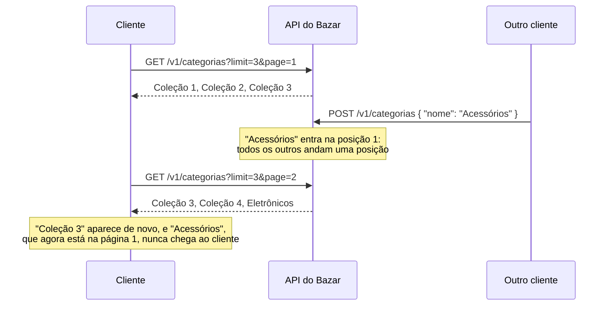

## O problema

`GET /v1/categorias` devolve todas as categorias de uma vez. Hoje são poucas, mas o backoffice já planeja centenas, e a mesma listagem sem limite em `/v1/produtos` devolveria o catálogo inteiro: milhares de linhas lidas do banco, serializadas e enviadas para um app que mostra 20 por tela.

Toda coleção que pode crescer precisa de **paginação** (Zalando, regra [159]: *"MUST support pagination"*). A forma mais conhecida é a do livro: "página 3, com 20 itens por página". Ela é simples de entender, o Spring a oferece pronta com o `Pageable`, e é exatamente por ser tão fácil que os custos dela passam despercebidos:

- para dizer "página 3 de 47", o servidor precisa **contar** todas as linhas que casam com o filtro, a cada requisição;
- para chegar à página 1.000, o banco **lê e descarta** as 19.980 linhas anteriores;
- se alguém cria uma categoria enquanto o cliente está na página 1, a página 2 **repete** um item da página 1.

E o `Pageable` do Spring tem um comportamento que nenhum tutorial mostra: valores inválidos não dão erro.

```text noCopy
?page=-1        → a primeira página
?page=abc       → a primeira página
?limit=0        → 20 itens
?limit=abc      → 20 itens
```

Esta página usa paginação por *offset* na listagem de categorias, mostra onde ela funciona bem, onde ela falha e por que o Bazar não usa o `Pageable` diretamente.

É como marcar um livro pelo número da página. Funciona enquanto ninguém mexe no livro. Se alguém insere um capítulo no começo, a página 40 que você anotou passa a ter outro texto.

> **A pergunta desta página:** como paginar por *offset* do jeito certo, com limites validados e links de navegação, e quando ele deixa de ser a escolha certa?

## O conceito

### Offset: pular N, devolver M

Paginar por <Term id="paginacao-por-offset">offset</Term> é traduzir "página 3 com 20 itens" para SQL:

```sql
select ... from categoria order by nome, id
offset 40 rows fetch first 20 rows only   -- (3 - 1) × 20 = 40
```

Há duas formas de expor isso na API, e elas são equivalentes:

| Estilo | Exemplo | Quem usa |
|---|---|---|
| Página e tamanho | `?page=3&limit=20` | Spring (`page`/`size`), GitHub (`page`/`per_page`) |
| Deslocamento e limite | `?offset=40&limit=20` | Zalando ([137]: `offset`, `limit`) |

"Página e tamanho" é mais fácil para quem monta uma tela com botões numerados. "Deslocamento e limite" é mais flexível (o cliente pode pedir "do 37 ao 52"), mas raramente alguém precisa disso.

O Bazar usa **`page` e `limit`**. `page` porque o caso de uso é uma tela paginada do backoffice. `limit`, e não o `size` do Spring, porque a paginação por cursor da [13.04](/design-de-apis-profissional/paginacao-por-cursor-keyset) usa `limit` e `cursor` (os nomes da Zalando, regra [137]). Uma API não deve ter dois nomes para "quantos itens por página". Os nomes de protocolo (`q`, `sort`, `page`, `limit`, `cursor`) seguem a convenção em inglês, que clientes e ferramentas reconhecem. Os campos do domínio continuam em português.

`page` começa em **1**. O Spring começa em 0, o que é natural para quem programa e estranho para quem lê a URL `?page=0`. A conversão fica num lugar só.

### O tamanho da página: padrão, máximo e o que fazer com o excesso

- **Padrão: 20.** Um cliente que não pede nada recebe uma página razoável.
- **Máximo: 100.** Sem um máximo, `?limit=1000000` desfaz a paginação. O padrão do Spring Boot é **2000** (`spring.data.web.pageable.max-page-size`), alto demais para quase qualquer API.
- **Acima do máximo: vale o máximo.** O Google (AIP-158) e a Microsoft (`collections-maxpagesize-might-return-fewer`) fazem assim: o cliente pede um limite, e o servidor pode devolver menos. O Bazar mostra o tamanho aplicado na resposta (`pagina.tamanho: 100`), e o cliente não precisa adivinhar.
- **Abaixo de 1, ou algo que não é número: erro.** A AIP-158 pede `INVALID_ARGUMENT` para um tamanho negativo. O Bazar responde `422` para `page=0` e `limit=-3`, e `400` para `limit=dez`: a mesma divisão da [13.01](/design-de-apis-profissional/filtros-e-busca) entre o que converte mas viola uma regra e o que nem converte.

Note a diferença entre os dois casos. Reduzir um limite grande ao máximo não muda o significado da consulta: o cliente recebe os mesmos itens, só que em mais páginas. Trocar `page=-1` pela primeira página muda: o cliente pediu algo que não existe e recebeu outra coisa, sem saber.

### Por que o Bazar não usa o `Pageable` direto

O `PageableHandlerMethodArgumentResolver` converte `page`, `size` e `sort` num `Pageable`, e é o caminho mais curto. Mas ele foi feito para ser tolerante. No Spring Data 4.1, com `one-indexed-parameters` ligado, verificamos isto no Bazar:

| Requisição | O que o `Pageable` entrega |
|---|---|
| `?page=0`, `?page=-1`, `?page=abc` | a primeira página |
| `?limit=0`, `?limit=-3`, `?limit=abc` | o tamanho padrão (20) |
| `?limit=500` | o máximo configurado |

E um header `Link` montado a partir da requisição repetiria `limit=abc` nas URLs das outras páginas, propagando o erro. É o mesmo problema dos filtros ignorados da 13.01: o cliente erra e não fica sabendo.

O Bazar declara `page` e `limit` num *record* recebido com `@ModelAttribute`, como os filtros. Isso aproveita tudo o que já existe: a conversão (`abc` → `400`), o Bean Validation (`@Min(1)` → `422`) e o `ParametrosDeConsultaInterceptor`, que lê os componentes do *record* e passa a aceitar `page` e `limit`. O *record* devolve um `Pageable` para o repositório, que continua fazendo o trabalho pesado.

O `Pageable` continua sendo uma ótima escolha em APIs internas, em que a tolerância não incomoda, ou com um `HandlerMethodArgumentResolver` próprio que valide antes de delegar. O que importa é saber que o comportamento padrão é engolir o erro.

### O formato da resposta

Uma resposta paginada precisa de três coisas: os itens, os metadados da página e uma forma de chegar às outras páginas.

**Os itens e os metadados.** O Bazar já tem um envelope para coleções, `Lista`, com o campo `itens` ([02.06](/comecando-e-fundamentos-de-http/json-para-apis)). A coleção paginada usa o mesmo campo e acrescenta `pagina`:

```json
{
  "itens": [ { "nome": "Categoria 6" }, "…" ],
  "pagina": { "numero": 2, "tamanho": 5, "totalDeItens": 12, "totalDePaginas": 3 }
}
```

Por que não devolver o `Page` do Spring? A documentação do Spring Data pede que não se faça isso: o `PageImpl` é um tipo do domínio dela, e *"we might want or have to change its API for unrelated reasons, and such changes might alter the resulting JSON representation in a breaking way"*. Desde a versão 3.3, o Spring Data oferece o `PagedModel` (do pacote `org.springframework.data.web`), um DTO estável:

```json
{
  "content": [ "…" ],
  "page": { "size": 20, "totalElements": 30, "totalPages": 2, "number": 0 }
}
```

O modo `VIA_DTO` (`@EnableSpringDataWebSupport(pageSerializationMode = VIA_DTO)`, ou `spring.data.web.pageable.serialization-mode: via-dto` no Spring Boot) converte qualquer `Page` devolvido por um controller em `PagedModel`. No Spring Boot 4.1, o padrão **continua `direct`**, então é preciso ativar.

O Bazar ativa o `via-dto` como rede de proteção: se alguém devolver um `Page` por engano, sai um formato estável, e não os campos internos do `PageImpl`. Mas as listagens do Bazar devolvem o próprio `Pagina`, pelo mesmo motivo que não devolvem entidades ([06.01](/construindo-apis-com-spring-boot/dtos-com-records-e-por-que-nao-expor-entidades)): o contrato é do Bazar. `content` e `number` a partir de 0 são escolhas do Spring, e `itens` com `numero` a partir de 1 são as escolhas do Bazar.

**As outras páginas: no corpo ou no header?** Aqui os guias discordam, e vale entender por quê:

| Onde | Como | Quem usa |
|---|---|---|
| No corpo | `"next": "https://…?cursor=…"` (Zalando [161], [248]); `nextLink` (Microsoft); `next_page_token` (Google, AIP-158) | Os três grandes guias |
| No header | `Link: <…?page=3>; rel="next"` (RFC 8288) | GitHub; o Bazar |

A Zalando vai além e **proíbe** o header (regra [166]): *"we prefer links to be directly embedded in the JSON payload instead of being attached using the uncommon link header syntax"*. O argumento é real: o cliente precisa ler e interpretar um header com uma sintaxe própria, e muitas bibliotecas HTTP não fazem isso sozinhas.

O Bazar usa o header `Link` mesmo assim, uma decisão tomada na [03.04](/rest-e-estilos-de-api/hateoas-e-hipermidia): fora do pedido, os recursos não têm `_links`, e a navegação vai no header. O argumento a favor dele é específico do Bazar: a listagem de produtos também é servida em **CSV** ([09.03](/construindo-apis-com-spring-boot/httpmessageconverter-e-a-serializacao-por-dentro)), e um CSV não tem onde guardar um link. Com o header, a navegação funciona igual nos dois formatos. Se o Bazar não tivesse CSV, os links no corpo seriam a escolha mais simples para os clientes.

Os metadados (`numero`, `totalDePaginas`) ficam no corpo nos dois casos: são dados que a tela mostra, e não instruções de navegação.

### O custo do total

`totalDeItens` e `totalDePaginas` exigem um `select count(*)` com o mesmo filtro. Numa tabela pequena, isso não custa nada. Num catálogo com milhões de produtos e filtros combinados, o `count` percorre todos os registros que casam, a cada página. A Zalando (regra [254]) recomenda **evitar o total**: ele é caro, raramente necessário, e difícil de remover depois que os clientes passam a depender dele. Para quem precisa mesmo, ela sugere pedir o total explicitamente (`Prefer: return=total-count`).

O Spring Data já economiza alguns `count`. Com um `Page`, ele **não executa o `count`** quando a página veio incompleta e não vazia, porque o total pode ser deduzido. Verificamos no Bazar, com 12 categorias:

| Requisição | `count` executado? | Por quê |
|---|---|---|
| `?limit=20` | não | Primeira página com 12 itens, menos que o limite: o total é 12 |
| `?limit=5` | sim | Página cheia: pode haver mais |
| `?limit=5&page=2` | sim | Página cheia |
| `?limit=5&page=3` | não | Última página incompleta: total = 10 + 2 |
| `?limit=5&page=9` | sim | Página vazia: não dá para deduzir nada |

A alternativa ao total é o **`Slice`**: o repositório devolve `Slice<T>` em vez de `Page<T>`, busca um item a mais que o tamanho da página e responde só "há uma próxima?". Sem `count`, sem `totalDePaginas`, e sem o link `last`. É o meio-termo antes da paginação por cursor.

O Bazar mantém o total nas **categorias**: são poucas (dezenas), o `count` é barato, e o backoffice mostra "página 2 de 3". Nos **produtos** e **pedidos**, que crescem sem limite, a 13.04 não tem total.

### Onde o offset falha

**Itens que mudam de página.** Uma inserção entre duas requisições empurra todos os itens seguintes uma posição para a frente. O último item da página 1 aparece de novo como o primeiro da página 2. Uma remoção faz o contrário, e um item é pulado. O desempate pelo id ([13.02](/design-de-apis-profissional/ordenacao)) não resolve isso: ele garante a ordem entre consultas **sobre os mesmos dados**, e aqui os dados mudaram. A Microsoft pede que a API documente isso (`collections-document-pagination-reliability`: *"resources may be skipped or duplicated across pages"*).

**Offsets altos são lentos.** A documentação do PostgreSQL é direta: *"The rows skipped by an OFFSET clause still have to be computed inside the server; therefore a large OFFSET might be inefficient."* A página 5.000 lê 100.000 linhas para devolver 20. Por isso alguns sistemas limitam o deslocamento máximo, como o Elasticsearch, que por padrão recusa buscas que passem do 10.000º resultado (`index.max_result_window`).

As duas falhas têm a mesma causa: o *offset* identifica uma página pela **posição**, e a posição muda quando os dados mudam. A paginação por cursor identifica a página pelo **último item visto**, e por isso resolve as duas. A Zalando (regra [160]) prefere o cursor e lista quando o *offset* ainda compensa: quando o cliente precisa **pular para uma página específica** ("página 51 de 100") e quando o conjunto é pequeno.

| | Offset | Cursor (13.04) |
|---|---|---|
| Pular para a página N | Sim | Não |
| Total de páginas | Sim (com `count`) | Não |
| Estável com inserções e remoções | Não | Sim |
| Custo da página N | Cresce com N | Constante (com índice) |
| Ordenação livre | Fácil | Cada ordenação precisa ser codificada no cursor |
| Bom para | Coleções pequenas, telas com páginas numeradas | Coleções grandes, *scroll* infinito, sincronização |

## Diagrama



## Na prática

### O contrato

| Parâmetro | Tipo | Padrão | Regras |
|---|---|---|---|
| `page` | inteiro | `1` | `≥ 1`. Depois da última página, `200` com `itens` vazio |
| `limit` | inteiro | `20` | `≥ 1`. Acima de 100, vale 100, e `pagina.tamanho` mostra o valor aplicado |

A ordem é sempre por `nome`, com o desempate pelo id: a listagem de categorias não oferece `sort`. Os links preservam os outros parâmetros (`q`, `apenasRaizes`, `limit`) e mudam só o `page`. O guia da Microsoft exige o mesmo (`collections-nextlink-includes-all-query-params`).

### O *record* de paginação

```java title="src/main/java/com/bazar/compartilhado/web/PaginaPedida.java"
/**
 * Os parâmetros de paginação por offset (13.03): ?page=1&limit=20. Um record com @ModelAttribute, e não o
 * Pageable do Spring, porque o Pageable transforma valores inválidos (page=-1, limit=abc) na primeira página com
 * 20 itens, em silêncio. Aqui, um valor que não converte é 400 e um valor menor que 1 é 422.
 *
 * @param page a página pedida, a partir de 1
 * @param limit quantos itens por página; acima do máximo, vale o máximo (a resposta mostra o tamanho aplicado)
 */
public record PaginaPedida(@Nullable @Min(1) Integer page, @Nullable @Min(1) Integer limit) {

    public static final int TAMANHO_PADRAO = 20;
    public static final int TAMANHO_MAXIMO = 100;

    public int numero() {
        return page == null ? 1 : page;
    }

    public int tamanho() {
        return limit == null ? TAMANHO_PADRAO : Math.min(limit, TAMANHO_MAXIMO);
    }

    // O Spring Data conta as páginas a partir de 0.
    public Pageable ordenadaPor(Sort ordenacao) {
        return PageRequest.of(numero() - 1, tamanho(), ordenacao);
    }
}
```

A ordenação entra pelo método `ordenadaPor`, e não pelo cliente: cada listagem decide a sua (13.02).

### O repositório: a consulta e o `count`

```java title="src/main/java/com/bazar/catalogo/dominio/CategoriaRepository.java (trecho)"
// Com um Pageable, o Spring Data executa esta consulta com limit/offset e deriva dela um select count(...),
// para os totais da página (13.03). O padrão do LIKE já chega com os curingas escapados.
@Query("""
        select c from Categoria c
        where (:apenasRaizes = false or c.categoriaPaiId is null)
          and (:padrao is null or lower(c.nome) like :padrao escape '\\')
        """)
Page<Categoria> buscar(@Nullable String padrao, boolean apenasRaizes, Pageable pagina);
```

Antes desta página, o controller lia **todas** as categorias e filtrava em memória. Para paginar, o filtro precisa ir para o banco: não faz sentido buscar a página 2 e só então descartar as que não têm `q` no nome. O escape do `LIKE` saiu de `ProdutoSpecifications` para `compartilhado.PadraoLike`, e as duas consultas usam o mesmo código.

O SQL que o Hibernate gera para a página 2 com 5 itens, e o `count` que o Spring Data deriva da mesma consulta:

```sql
select c1_0.id,c1_0.pai_id,c1_0.nome,c1_0.slug,c1_0.versao from categoria c1_0
 where (?=false or c1_0.pai_id is null) and (? is null or lower(c1_0.nome) like ? escape '\')
 order by c1_0.nome,c1_0.id offset ? rows fetch first ? rows only

select count(*) from categoria c1_0
 where (?=false or c1_0.pai_id is null) and (? is null or lower(c1_0.nome) like ? escape '\')
```

`offset ... rows fetch first ... rows only` é a sintaxe do padrão SQL para `limit`/`offset`, que o PostgreSQL também aceita. Para consultas em que a derivação automática do `count` não funciona (com `join fetch`, por exemplo), o `@Query` aceita um `countQuery` explícito.

### O envelope e os links

```java title="src/main/java/com/bazar/compartilhado/Pagina.java"
/**
 * Envelope das coleções paginadas por offset (13.03): os itens, como em Lista, e os metadados da página.
 * O Page do Spring não sai na resposta: o formato do contrato é do Bazar, e não da biblioteca.
 */
public record Pagina<T>(List<T> itens, Metadados pagina) {

    /**
     * @param numero a página atual, a partir de 1, como no parâmetro page
     * @param tamanho quantos itens cabem numa página (o limit aplicado, que pode ser menor que o pedido)
     */
    public record Metadados(int numero, int tamanho, long totalDeItens, int totalDePaginas) {
    }

    public static <E, R> Pagina<R> de(Page<E> pagina, Function<E, R> conversor) {
        return new Pagina<>(pagina.getContent().stream().map(conversor).toList(),
                new Metadados(pagina.getNumber() + 1, pagina.getSize(), pagina.getTotalElements(),
                        pagina.getTotalPages()));
    }
}
```

```java title="src/main/java/com/bazar/compartilhado/web/LinksDePaginacao.java"
/**
 * O header Link (RFC 8288) de uma coleção paginada por offset (13.03): first, prev, next e last. Cada URI é a
 * requisição atual com outro page; os demais parâmetros (filtros, limit) são preservados.
 */
public final class LinksDePaginacao {

    private LinksDePaginacao() {
    }

    public static HttpHeaders de(Page<?> pagina) {
        var links = new ArrayList<String>();
        var atual = pagina.getNumber() + 1;
        var ultima = Math.max(pagina.getTotalPages(), 1);
        links.add(link(1, "first"));
        if (atual > 1) {
            links.add(link(Math.min(atual - 1, ultima), "prev"));
        }
        if (atual < ultima) {
            links.add(link(atual + 1, "next"));
        }
        links.add(link(ultima, "last"));
        var headers = new HttpHeaders();
        headers.add(HttpHeaders.LINK, String.join(", ", links));
        return headers;
    }

    private static String link(int pagina, String relacao) {
        var uri = ServletUriComponentsBuilder.fromCurrentRequest()
                .replaceQueryParam("page", pagina)
                .build()
                .toUriString();
        return "<" + uri + ">; rel=\"" + relacao + "\"";
    }
}
```

Dois detalhes:

- **`prev` depois da última página.** Quem pede `page=9` de 3 recebe uma lista vazia e um `prev` que aponta para a página **3**, e não para a 8, que também estaria vazia. É o caminho de volta mais útil.
- **Uma coleção vazia tem uma página.** `Math.max(totalPages, 1)` faz `first` e `last` apontarem para a página 1, em vez de uma página 0 que não existe.

`first`, `prev`, `next` e `last` são relações registradas na IANA, como `self`. Não precisam de CURIE, ao contrário das relações próprias do Bazar (12.04).

### O controller

```java title="src/main/java/com/bazar/catalogo/api/CategoriaController.java (trecho)"
// A listagem não oferece ?sort=: a ordem é sempre pelo nome, com o desempate pelo id (13.02).
private static final Sort POR_NOME = Sort.by("nome", "id");

// Paginada por offset (13.03): ?page=1&limit=20, com os totais no corpo e first/prev/next/last no header Link.
@GetMapping
public ResponseEntity<Pagina<CategoriaResponse>> listar(
        @RequestParam(required = false) @Nullable @Size(min = 2, max = 60) String q,
        @RequestParam(defaultValue = "false") boolean apenasRaizes,
        @Valid @ModelAttribute PaginaPedida pagina) {
    var categorias = servico.listar(q, apenasRaizes, pagina.ordenadaPor(POR_NOME));
    return ResponseEntity.ok()
            .headers(LinksDePaginacao.de(categorias))
            .body(Pagina.de(categorias, CategoriaResponse::de));
}
```

### Um ajuste no tratador de erros

Este método tem uma *constraint* direto num parâmetro (`@Size` no `q`). Nesse caso, o Spring valida o método inteiro de uma vez (*method validation*, [07.01](/construindo-apis-com-spring-boot/bean-validation-essencial)), inclusive o `@Valid @ModelAttribute`, e os erros chegam numa `HandlerMethodValidationException`. O tratador montava o nome do campo a partir do **parâmetro do método**. O primeiro teste de `page=0` respondeu:

```json
{ "erros": [ { "campo": "pagina", "mensagem": "deve ser maior que ou igual à 1" } ] }
```

`pagina` é o nome da variável Java, que o cliente nunca viu. Para um objeto validado com `@Valid`, o Spring entrega um `ParameterErrors`, com os erros de cada campo do objeto, e o tratador passou a usá-los:

```java title="src/main/java/com/bazar/compartilhado/erros/TratadorGlobalDeErros.java (trecho)"
for (var resultado : ex.getParameterValidationResults()) {
    // Um objeto validado com @Valid (um record @ModelAttribute, como PaginaPedida): o campo é o do objeto
    // (page), e não o nome do parâmetro no método (pagina), que o cliente nunca viu (13.03).
    if (resultado instanceof ParameterErrors errosDoObjeto) {
        for (var erro : errosDoObjeto.getFieldErrors()) {
            erros.add(new ErroDeCampo(erro.getField(), mensagem(erro.getDefaultMessage())));
        }
        continue;
    }
    // ... os parâmetros simples continuam como antes
}
```

Na listagem de produtos (13.01), o mesmo problema não aparecia, porque aquele método não tem *constraints* direto nos parâmetros: o Spring valida só o `@ModelAttribute` e lança `MethodArgumentNotValidException`, que já trazia os nomes certos. É o tipo de diferença que só um teste com a requisição real pega.

### Na prática, pela API

<HttpExchange
  title="A página 2, com 5 categorias por página"
  request={{ method: 'GET', url: '/v1/categorias?limit=5&page=2' }}
  response={{ status: 200, headers: { Link: '<http://localhost:8080/v1/categorias?limit=5&page=1>; rel="first", <http://localhost:8080/v1/categorias?limit=5&page=1>; rel="prev", <http://localhost:8080/v1/categorias?limit=5&page=3>; rel="next", <http://localhost:8080/v1/categorias?limit=5&page=3>; rel="last"', 'Content-Type': 'application/json' }, body: { itens: [
    { id: '0192f3a1-3333-7000-8000-000000000006', nome: 'Categoria 6', slug: 'categoria-6', categoriaPaiId: null },
    { id: '0192f3a1-3333-7000-8000-000000000007', nome: 'Categoria 7', slug: 'categoria-7', categoriaPaiId: null },
    { id: '0192f3a1-3333-7000-8000-000000000008', nome: 'Categoria 8', slug: 'categoria-8', categoriaPaiId: null },
    { id: '0192f3a1-3333-7000-8000-000000000009', nome: 'Categoria 9', slug: 'categoria-9', categoriaPaiId: null },
    { id: '0192f3a0-5555-7000-8000-000000000002', nome: 'Eletrônicos', slug: 'eletronicos', categoriaPaiId: null } ],
    pagina: { numero: 2, tamanho: 5, totalDeItens: 12, totalDePaginas: 3 } } }}
>
Doze categorias: as três iniciais e nove criadas para o exemplo. A ordem é alfabética, e "Eletrônicos" fecha a página 2.
</HttpExchange>

<HttpExchange
  title="page=0"
  request={{ method: 'GET', url: '/v1/categorias?page=0', headers: { 'Accept-Language': 'pt-BR' } }}
  response={{ status: 422, headers: { 'Content-Type': 'application/problem+json' }, body: { type: 'https://api.bazar.example/problemas/validacao', title: 'Dados inválidos', status: 422, detail: 'A requisição tem 1 campo inválido.', instance: '/v1/categorias', erros: [ { campo: 'page', mensagem: 'deve ser maior que ou igual à 1' } ], codigo: 'VALIDACAO', traceId: '9073fde9…' } }}
>
Com o `Pageable`, esta requisição devolveria a primeira página. A mensagem é a tradução do Hibernate Validator para `@Min`.
</HttpExchange>

<HttpExchange
  title="limit=dez"
  request={{ method: 'GET', url: '/v1/categorias?limit=dez', headers: { 'Accept-Language': 'pt-BR' } }}
  response={{ status: 400, headers: { 'Content-Type': 'application/problem+json' }, body: { type: 'https://api.bazar.example/problemas/requisicao-invalida', title: 'Requisição inválida', status: 400, detail: "O valor do parâmetro 'limit' é inválido.", instance: '/v1/categorias', parametros: ['limit'], codigo: 'REQUISICAO_INVALIDA', traceId: 'ac035487…' } }}
/>

### Os testes

Os testes de paginação usam o banco de verdade (o `CategoriaControllerTest` é um teste de integração desde a 10.02), porque o que importa é o SQL: a ordem, o *offset* e o `count`.

```java title="src/test/java/com/bazar/catalogo/api/CategoriaControllerTest.java (trecho)"
@Nested
class Paginacao {

    // Com as 3 iniciais (Eletrônicos, Livros, Programação), são 7 categorias; 4 delas têm "Coleção" no nome.
    @BeforeEach
    void criarCategorias() {
        for (var n = 1; n <= 4; n++) {
            jdbc.sql("insert into categoria (id, nome, slug, versao) values (?, ?, ?, 0)")
                    .params(UUID.randomUUID(), "Coleção " + n, "colecao-" + n)
                    .update();
        }
    }

    @Test
    void devolveAPaginaPedidaComOsTotaisEOsLinks() {
        var resposta = mvc.get().uri("/v1/categorias?q=cole&limit=3&page=2").exchange();

        assertThat(resposta).hasStatusOk();
        assertThat(resposta).bodyJson().isLenientlyEqualTo("""
                { "itens": [ { "nome": "Coleção 4" } ],
                  "pagina": { "numero": 2, "tamanho": 3, "totalDeItens": 4, "totalDePaginas": 2 } }
                """);
        // Os links preservam os filtros e o limit; só o page muda.
        assertThat(resposta).hasHeader(HttpHeaders.LINK, String.join(", ",
                "<http://localhost/v1/categorias?q=cole&limit=3&page=1>; rel=\"first\"",
                "<http://localhost/v1/categorias?q=cole&limit=3&page=1>; rel=\"prev\"",
                "<http://localhost/v1/categorias?q=cole&limit=3&page=2>; rel=\"last\""));
    }

    @Test
    void ordenaPeloNomeEmTodasAsPaginas() {
        var nomes = new ArrayList<String>();
        for (var pagina = 1; pagina <= 3; pagina++) {
            var corpo = mvc.get().uri("/v1/categorias?limit=3&page={p}", pagina).exchange()
                    .getResponse().getContentAsByteArray();
            nomes.addAll(JsonPath.read(new String(corpo, StandardCharsets.UTF_8), "$.itens[*].nome"));
        }

        assertThat(nomes).containsExactly("Coleção 1", "Coleção 2", "Coleção 3", "Coleção 4", "Eletrônicos",
                "Livros", "Programação");
    }

    // O Pageable do Spring transformaria todos estes valores na primeira página com 20 itens, em silêncio.
    @Test
    void recusaUmaPaginaOuUmLimiteMenorQue1() {
        assertThat(mvc.get().uri("/v1/categorias?page=0").exchange())
                .hasStatus(HttpStatus.UNPROCESSABLE_CONTENT)
                .bodyJson().extractingPath("$.erros[0].campo").isEqualTo("page");
        assertThat(mvc.get().uri("/v1/categorias?limit=-3").exchange())
                .hasStatus(HttpStatus.UNPROCESSABLE_CONTENT)
                .bodyJson().extractingPath("$.erros[0].campo").isEqualTo("limit");
    }

    // ... mais 4: sem parâmetros (página 1, 20 itens), limite acima do máximo, página depois da última,
    // valores que não são número
}
```

`ordenaPeloNomeEmTodasAsPaginas` percorre as três páginas e confere a sequência inteira. Esse teste pega erros que um teste de uma página só não vê: um *offset* calculado a partir de 1 em vez de 0 pularia três itens, e um desempate ausente poderia trocar itens de página.

## Erros comuns

<BadVsGood title="Devolver o Page do Spring" why="O formato do PageImpl é um detalhe de implementação do Spring Data, que pode mudar entre versões. O contrato da API precisa de um formato próprio, ou pelo menos do PagedModel, que é estável.">
<Bad title="Page direto na resposta">

```java
@GetMapping
public Page<CategoriaResponse> listar(Pageable pagina) {
    return repository.findAll(pagina).map(CategoriaResponse::de);
}
```

</Bad>
<Good title="Um envelope do contrato">

```java
@GetMapping
public ResponseEntity<Pagina<CategoriaResponse>> listar(@Valid @ModelAttribute PaginaPedida pagina) {
    var categorias = servico.listar(null, false, pagina.ordenadaPor(POR_NOME));
    return ResponseEntity.ok()
            .headers(LinksDePaginacao.de(categorias))
            .body(Pagina.de(categorias, CategoriaResponse::de));
}
```

</Good>
</BadVsGood>

<BadVsGood title="Paginar depois de filtrar em memória" why="A página precisa ser calculada pelo banco, sobre o resultado já filtrado. Filtrar a página depois devolve páginas com menos itens que o limite, e o total fica errado.">
<Bad title="Busca a página e filtra">

```java
var pagina = repository.findAll(PageRequest.of(n, 20));
var itens = pagina.getContent().stream().filter(c -> c.nome().contains(q)).toList();
```

</Bad>
<Good title="O filtro dentro da consulta paginada">

```java
Page<Categoria> buscar(@Nullable String padrao, boolean apenasRaizes, Pageable pagina);
```

</Good>
</BadVsGood>

Outros erros frequentes:

- **Sem tamanho máximo,** ou com o máximo padrão do Boot (2000).
- **Aceitar valores inválidos em silêncio,** como o `Pageable` faz por padrão.
- **Paginar sem ordem total.** Sem `order by`, ou sem o desempate, o banco pode devolver as mesmas linhas em páginas diferentes.
- **Prometer um total que não escala.** Depois que um cliente mostra "página 3 de 47.312", não dá para tirar o total sem quebrar a tela dele.
- **Links que perdem os filtros.** `next` sem o `q` leva para a página 2 de **outra** consulta.
- **Offset para *scroll* infinito ou sincronização.** Inserções e remoções repetem e pulam itens. Use cursor.

## Boas práticas

- **Pagine toda coleção que pode crescer,** desde a primeira versão. Acrescentar paginação depois muda o formato da resposta.
- **Defina padrão e máximo** e mostre na resposta o tamanho aplicado.
- **Valide `page` e `limit`:** `400` para o que não converte, `422` para o que é menor que 1.
- **Use um envelope próprio** (ou o `PagedModel`), nunca o `Page` serializado direto. Ative `serialization-mode: via-dto` como rede de proteção.
- **Ordene sempre com desempate** e teste a sequência de várias páginas.
- **Ofereça o total só onde ele é barato,** ou use `Slice`.
- **Preserve os parâmetros da consulta nos links.**
- **Use offset para coleções pequenas e telas com páginas numeradas;** para o resto, cursor (13.04).

## No projeto Bazar

<ProjectStep title="Listagem de categorias paginada por offset" module="catalogo" tag="pagina-13.03" files={[
  { path: 'src/main/java/com/bazar/compartilhado/web/PaginaPedida.java', change: 'novo' },
  { path: 'src/main/java/com/bazar/compartilhado/Pagina.java', change: 'novo' },
  { path: 'src/main/java/com/bazar/compartilhado/web/LinksDePaginacao.java', change: 'novo' },
  { path: 'src/main/java/com/bazar/compartilhado/PadraoLike.java', change: 'novo' },
  { path: 'src/main/java/com/bazar/catalogo/api/CategoriaController.java', change: 'alterado' },
  { path: 'src/main/java/com/bazar/catalogo/dominio/CategoriaService.java', change: 'alterado' },
  { path: 'src/main/java/com/bazar/catalogo/dominio/CategoriaRepository.java', change: 'alterado' },
  { path: 'src/main/java/com/bazar/catalogo/dominio/ProdutoSpecifications.java', change: 'alterado' },
  { path: 'src/main/java/com/bazar/compartilhado/erros/TratadorGlobalDeErros.java', change: 'alterado' },
  { path: 'src/main/resources/application.yml', change: 'alterado' },
  { path: 'src/test/java/com/bazar/catalogo/api/CategoriaControllerTest.java', change: 'alterado' },
]}>
`GET /v1/categorias` passa a ser paginada por offset: `page` (a partir de 1) e `limit` (padrão 20, máximo 100), com `itens` e `pagina` no corpo e `first`/`prev`/`next`/`last` no header `Link`. O filtro saiu da memória para a consulta. Valores inválidos de `page` e `limit` recebem `400` ou `422`. O `serialization-mode: via-dto` protege contra um `Page` devolvido por engano. A suíte tem 188 testes e continua com 5 contextos.
</ProjectStep>

## Resumo

- Paginação por offset traduz "página N com M itens" para `offset (N-1)×M`. O Bazar usa `page` (a partir de 1) e `limit`, o mesmo nome da paginação por cursor.
- Defina um tamanho padrão e um máximo. Acima do máximo, o servidor pode devolver menos. Abaixo de 1, ou algo que não é número, é erro.
- O `Pageable` do Spring transforma valores inválidos na primeira página com o tamanho padrão, em silêncio. O Bazar usa um *record* validado.
- Não serialize o `Page` direto: use um envelope próprio ou o `PagedModel` (`via-dto`, que no Boot 4.1 ainda não é o padrão).
- Os links de navegação podem ir no corpo (Zalando, Microsoft, Google) ou no header `Link` (RFC 8288). O Bazar usa o header porque também serve CSV, e diverge da Zalando, que o proíbe com JSON.
- O total custa um `count` por requisição. O Spring Data o pula quando a página vem incompleta, e o `Slice` dispensa o total.
- Offset repete ou pula itens quando os dados mudam, e fica lento com deslocamentos altos. Para coleções grandes, use cursor.

<Exercise title="Paginar os endereços?" difficulty="facil">
Um colega propõe paginar todas as coleções do Bazar por offset, "para padronizar". A lista inclui:

1. `GET /v1/clientes/{id}/enderecos` (12.03);
2. `GET /v1/pedidos?clienteId=…`;
3. `GET /v1/categorias` (já paginada);
4. `GET /v1/produtos`.

Para cada uma, diga se deve ser paginada, e como (offset, cursor ou nenhuma). Justifique.

<Hint>Lembre do limite de 10 endereços da 12.03, de quanto cada coleção pode crescer e de como os clientes a percorrem.</Hint>

<Solution>

1. **Endereços: nenhuma paginação.** A coleção tem no máximo 10 itens por regra de negócio ([12.03](/design-de-apis-profissional/relacionamentos-e-sub-recursos)). Paginar seria só complexidade: o cliente faria duas requisições para algo que cabe numa. O limite, documentado, é a garantia de que a resposta não cresce. A regra [159] da Zalando pede paginação para coleções que **podem** crescer, e esta não pode.
2. **Pedidos: cursor.** Um cliente frequente acumula pedidos sem limite, e o caso de uso é "mais recentes primeiro", com *scroll* no app. Pedidos novos chegam o tempo todo: com offset, o cliente veria pedidos repetidos ao rolar. É o caso da 13.04.
3. **Categorias: offset, como está.** Poucas dezenas de itens, que mudam raramente, e uma tela de backoffice com páginas numeradas. O total é barato.
4. **Produtos: cursor.** O catálogo cresce sem limite, a listagem tem filtros e ordenação, e o app usa *scroll* infinito. Offsets altos ficariam lentos e o `count` com filtros seria caro. Também é o caso da 13.04.

"Padronizar" é um bom objetivo para os **nomes** (`limit` em todas) e o **formato** (`itens` em todas), não para o mecanismo. O mecanismo segue o tamanho e o uso de cada coleção.
</Solution>
</Exercise>

<Quiz questions={[
  {
    question: 'Com o Pageable padrão do Spring (one-indexed-parameters ligado), o que acontece com GET /v1/categorias?page=-1&size=abc?',
    options: [
      '400, porque os dois valores são inválidos',
      '422, com um erro em cada campo',
      '200 com a primeira página e o tamanho padrão, sem nenhum aviso',
      '500, porque o PageRequest não aceita página negativa',
    ],
    answer: 2,
    explanation: 'O PageableHandlerMethodArgumentResolver é tolerante: página inválida vira a primeira, tamanho inválido vira o padrão. Por isso o Bazar declara page e limit num record validado com @Min(1), que responde 422 ou 400.',
  },
  {
    question: 'Quando o Spring Data deixa de executar o select count(*) de um Page?',
    options: [
      'Nunca: o count sempre é executado',
      'Quando a página veio incompleta e não vazia, porque o total pode ser deduzido (primeira página com menos itens que o limite, ou a última página)',
      'Quando a consulta não tem filtro',
      'Quando o limite é maior que 100',
    ],
    answer: 1,
    explanation: 'Se a página tem menos itens que o limite e não está vazia, ela é a última, e o total é (página - 1) × limite + itens. Numa página cheia ou vazia, o Spring Data não tem como deduzir e executa o count.',
  },
  {
    question: 'O Bazar põe os links de paginação no header Link. Qual guia proíbe isso para respostas JSON, e por que o Bazar diverge?',
    options: [
      'O Google, porque headers não são cacheáveis; o Bazar diverge porque usa REST',
      'A Zalando (regra 166), que prefere links no corpo JSON; o Bazar diverge porque a listagem de produtos também sai em CSV, que não tem onde guardar links',
      'A Microsoft, porque o Link não é um header padrão; o Bazar diverge porque usa Spring',
      'Nenhum guia trata disso',
    ],
    answer: 1,
    explanation: 'A Zalando proíbe o header Link com tipos JSON e pede os links no corpo. O Bazar decidiu (03.04) usar o header para a navegação, e o argumento concreto é o CSV: o header funciona igual nos dois formatos. Sem o CSV, os links no corpo seriam a opção mais simples para os clientes.',
  },
  {
    question: 'Um cliente lê a página 1 de categorias; antes de pedir a página 2, outro cliente cria uma categoria que, em ordem alfabética, fica antes de todas. O que acontece com a página 2?',
    options: [
      'Nada: o desempate pelo id garante a ordem',
      'O último item da página 1 aparece de novo no início da página 2',
      'A página 2 fica vazia',
      'O servidor responde 409',
    ],
    answer: 1,
    explanation: 'O offset identifica a página pela posição. A inserção empurra todos os itens uma posição para a frente, e o item que fechava a página 1 passa a abrir a página 2. O desempate garante a ordem entre consultas sobre os mesmos dados, mas aqui os dados mudaram. A paginação por cursor (13.04) resolve isso.',
  },
]} />

## Referências

<References />
