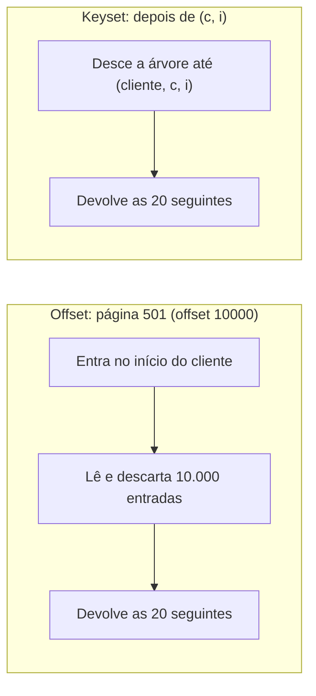
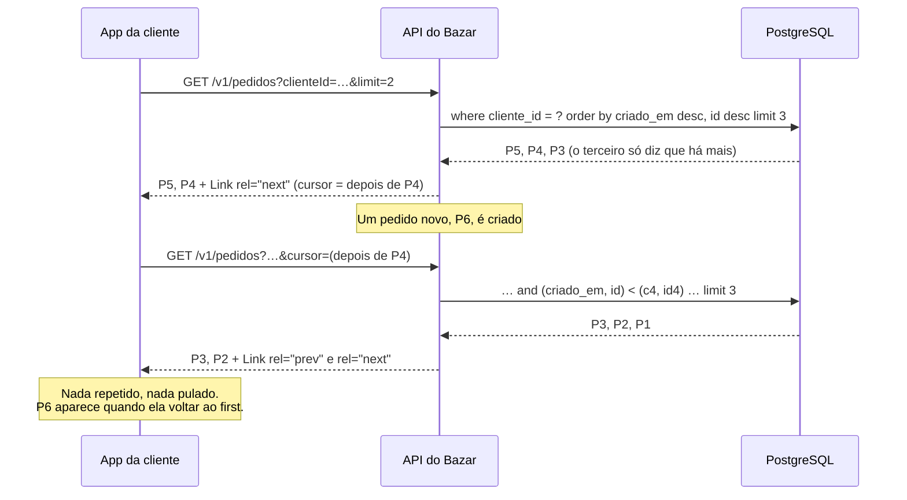

## O problema

A [13.03](/design-de-apis-profissional/paginacao-por-offset) terminou com duas falhas do *offset*, e as duas aparecem nos pedidos do Bazar:

- **Pedidos chegam o tempo todo.** Uma cliente rola a lista de pedidos no app. Enquanto ela lê a primeira página, um pedido novo entra no topo, e a segunda página começa repetindo o último pedido da primeira.
- **Clientes antigos têm muitos pedidos.** Para mostrar a página 500, o banco lê e descarta 10.000 linhas. Com 150 mil pedidos de um cliente, medimos 150 ms para uma página que deveria custar menos de um milissegundo.

As duas falhas vêm da mesma escolha: o *offset* identifica uma página pela **posição** ("a partir do 40º"), e a posição muda quando os dados mudam. A paginação por cursor identifica a página pelo **último item visto** ("depois do pedido X"). Um item novo no topo não muda o que vem depois de X, e o banco consegue ir direto até X por um índice.

É o modelo da Stripe (`starting_after`), do Slack (`cursor`), do Google (`page_token`) e o que a Zalando prefere (regra [160]). E é onde mais aparecem implementações que parecem certas e não são: nesta página, a implementação mais natural com o Spring Data foi tão lenta quanto o *offset*, e só uma medição mostrou isso.

É a diferença entre anotar o número da página e usar um marcador. O número muda quando alguém insere páginas antes; o marcador continua exatamente onde você parou.

> **A pergunta desta página:** como funciona a paginação por cursor, como implementá-la com uma consulta que o índice atende, e como confirmar com números que ela é mesmo rápida?

## O conceito

### Keyset: "depois deste item", em SQL

A listagem de pedidos é ordenada por `criado_em desc, id desc`: os mais recentes primeiro e, entre pedidos do mesmo instante, o id desempata ([13.02](/design-de-apis-profissional/ordenacao)). O último pedido da página 1 tem `criado_em = c` e `id = i`. A página 2 é:

```sql
select ... from pedido
where cliente_id = ?
  and (criado_em, id) < (c, i)          -- tudo o que vem depois de (c, i) nesta ordem
order by criado_em desc, id desc
fetch first 21 rows only                -- o limite + 1 (já explico o porquê)
```

Essa é a <Term id="paginacao-cursor">paginação por cursor</Term>, também chamada de **keyset** ou **seek method**: em vez de "pule N", a consulta diz "comece depois desta chave". `(criado_em, id) < (c, i)` é uma <Term id="comparacao-de-linhas">comparação de linhas</Term> (*row value comparison*), do padrão SQL: compara o primeiro campo e, se empatar, o segundo, como a ordem alfabética compara letra a letra. É exatamente a condição "vem depois na ordem `criado_em desc, id desc`".

Três requisitos, e a página inteira gira em torno deles:

1. **Uma ordem total.** A chave da ordenação precisa ser única, senão "depois deste item" é ambíguo. Por isso o id entra como desempate.
2. **Campos não nulos.** `null < x` não é verdadeiro nem falso, e o item some da paginação. A documentação do Spring Data avisa: *"Keyset-Filtering on nullable properties will lead to unexpected results."* `criado_em`, `nome`, `preco_valor` e `sku` são `not null` no Bazar.
3. **Um índice na mesma ordem.** Sem ele, o banco ainda precisa ordenar tudo para achar "o que vem depois", e o ganho desaparece.

### Por que fica rápido: o índice

Um índice B-tree guarda as chaves **ordenadas**. Para a consulta acima, o Bazar cria:

```sql
create index pedido_cliente_criado_em_id_idx on pedido (cliente_id, criado_em desc, id desc);
```

Com ele, o banco desce pela árvore até a posição `(cliente, c, i)`, como quem abre um dicionário direto na letra certa, e lê as 21 entradas seguintes. O custo não depende de quantas páginas já passaram. O *offset* entra pelo começo do cliente e anda entrada por entrada até a 10.000ª.



### O cursor: a chave, embrulhada

O cliente não precisa saber que a posição é `(criado_em, id)`. Ele recebe um <Term id="cursor-opaco">cursor opaco</Term>, um texto que só a API interpreta, e o devolve para pedir a próxima página. No Bazar, o cursor é um JSON em Base64 próprio para URLs:

```text noCopy
eyJjbGllbnRlSWQiOiI4NjIy...ZmFsc2V9
   ↓ Base64 → JSON
{"clienteId":"8622f2e1-…","criadoEm":"2026-10-25T14:41:19.880742Z","id":"ebe3ccdb-…","paraTras":false}
```

Por que não expor os valores crus, como `?depoisDe=2026-10-25T14:41:19.880742Z,ebe3ccdb-…`?

- **O formato vira contrato.** Se o cliente monta a posição, a API não pode mais mudar a ordenação, acrescentar um campo de desempate ou trocar o banco sem quebrá-lo. Com um cursor opaco, o formato muda quando a API quiser, e os cursores antigos recebem `400` com "recomece a listagem".
- **Os valores podem ser internos.** Um cursor pode guardar uma chave que a API não expõe, como um número de sequência ou um id de partição.
- **Clientes inventam posições.** Com valores crus, alguém escreve `?depoisDe=2020-01-01` e passa a depender disso. Se esse caso de uso existe, ele merece um filtro documentado (`criadoAntesDe`), e não um efeito colateral da paginação.

**Base64 não é segredo.** Qualquer pessoa decodifica o cursor do Bazar e lê o JSON. O Google é explícito (AIP-158): os tokens *"must be opaque (but URL-safe) strings, and must not be user-parseable"*, e *"Base-64 encoding an otherwise-transparent page token is not a sufficient obfuscation mechanism"*. Há três níveis possíveis:

| Cursor | O cliente consegue ler? | Consegue alterar sem ser pego? | Custo |
|---|---|---|---|
| JSON em Base64 (Bazar) | Sim | Sim, mas valores inválidos dão `400` | Nenhum |
| Assinado (HMAC) | Sim | Não: a assinatura não confere | Uma chave secreta para guardar e trocar |
| Cifrado (AES-GCM) | Não | Não | Uma chave, e o cursor fica maior |

O Bazar fica no primeiro nível, e isso é uma decisão. Um cursor alterado só muda **de onde** a listagem começa, dentro da mesma consulta, que continua filtrada pelo cliente. Não dá acesso a nada que a consulta sem cursor já não daria. Se um dia o cursor carregar algo sensível, ou se clientes começarem a depender do formato, a assinatura é o próximo passo. A segurança da API é tratada na Parte 11 e na [documentação de segurança](https://security-doc-beta.vercel.app/).

**Um cursor vale para uma consulta.** O cursor de pedidos guarda o `clienteId`, e o de produtos guarda um resumo (SHA-256) dos filtros e da ordenação. Usado em outra consulta, ele dá `400`. O Google pede o mesmo: se outros parâmetros mudam, *"the API should send an INVALID_ARGUMENT error"*. Isso importa ainda mais com ordenação dinâmica: os valores de um cursor emitido em `sort=precoEmCentavos` são preços, e na ordem por nome eles não significam nada. A exceção é o `limit`, que pode mudar entre páginas (a AIP-158 exige que a API respeite o novo tamanho).

### Próxima e anterior: `next` e `prev`

O cursor leva também uma **direção**. Para a frente, a condição é "depois de". Para a página anterior, a consulta inverte a ordem, busca "antes de" a partir do **primeiro** item da página atual e desinverte o resultado:

```sql
-- página anterior: os 20 imediatamente antes de (c, i), do mais próximo para o mais distante
where cliente_id = ? and (criado_em, id) > (c, i)
order by criado_em, id          -- a ordem inversa
fetch first 21 rows only
-- a aplicação devolve esses 20 na ordem da listagem
```

Para saber se existe uma próxima página, a consulta pede **um item a mais** que o limite: se ele vier, há mais. Isso dispensa o `count` da 13.03.

A resposta usa o mesmo `Link` da 13.03, com uma diferença:

| Relação | Offset (13.03) | Cursor |
|---|---|---|
| `first` | `page=1` | Sem cursor |
| `prev` | `page=N-1` | Cursor do primeiro item, para trás |
| `next` | `page=N+1` | Cursor do último item, para a frente |
| `last` | `page=` total | **Não existe**: o cursor não sabe quantas páginas há |

Os outros guias põem o cursor no corpo: `next_page_token` (Google), `next_cursor` em `response_metadata` (Slack), `has_more` e o id do último item (Stripe). O Bazar mantém a decisão da 13.03: a navegação vai no header, que também funciona na listagem de produtos em CSV.

### O que o cursor não faz

- **Pular para a página 50.** Não existe "página 50", só "depois deste item". Telas com páginas numeradas continuam com *offset* (13.03).
- **Total de páginas.** Pela mesma razão. Se o total for necessário, ele é um `count` à parte, com o custo da 13.03.
- **Ordenações quaisquer de graça.** Cada ordenação precisa dos seus campos no cursor, de uma ordem total e, para ser rápida, de um índice. Ordenar por um campo que admite nulo exige tratar o nulo como um valor (ou não oferecer essa ordenação).
- **Uma "fotografia" da coleção.** O cursor não repete nem pula itens quando os dados mudam, mas um item **criado antes da posição** depois que o cliente passou por ela não aparece. Um pedido novo entra no topo: quem está rolando para baixo não o vê, e precisa voltar ao `first`. Para sincronizar mudanças, o mecanismo é outro (eventos, `ETag`, *webhooks*, nas Partes 9 e 15).

### Spring Data: `Window`, `ScrollPosition` e `KeysetScrollPosition`

Desde a versão 3.1, o Spring Data tem uma API de *scrolling*. Um método de repositório recebe uma `ScrollPosition` e devolve um `Window<T>`:

```java
Window<Pedido> findFirst20ByClienteIdOrderByCriadoEmDescIdDesc(UUID clienteId, ScrollPosition posicao);
```

- `ScrollPosition.keyset()` é o início. O `KeysetScrollPosition` guarda as chaves de um item (um `Map` com `criadoEm` e `id`) e a direção (`forward()` ou `backward()`).
- O `Window` traz os itens, `hasNext()` e `positionAt(i)`, a posição de cada item. A documentação ensina a pedir a próxima janela com `positionAt(size() - 1)`.
- Para trás, o `Window` devolve os itens **na ordem da listagem**, e `hasNext()` passa a significar "há mais itens antes". Verificamos esse comportamento no Spring Data 4.1, porque a documentação não o descreve.
- Também há `OffsetScrollPosition` e o `WindowIterator`, para percorrer tudo dentro da aplicação.

É uma API bem desenhada, e o Bazar usa os tipos dela: o serviço recebe um `KeysetScrollPosition` e devolve um `Window`. Mas **não** usa a consulta que o Spring Data gera.

### A medição: a condição que o Spring Data escreve

Com o método derivado acima, o Hibernate gerou (trecho):

```sql
where (p1_0.cliente_id=?) and (p1_0.criado_em<? or p1_0.criado_em=? and p1_0.id<?)
order by p1_0.criado_em desc,p1_0.id desc
```

`a < x or (a = x and b < y)` é logicamente igual a `(a, b) < (x, y)`. Para o PostgreSQL, não é a mesma coisa. Inserimos 2 milhões de pedidos, 200 mil deles de um mesmo cliente, e pedimos a página que começa na posição 150.000:

| Condição | Plano | Linhas descartadas | Tempo |
|---|---|---|---|
| `criado_em < c or (criado_em = c and id < i)` | `Index Cond: cliente_id = ?`, o resto em `Filter` | 150.001 | 70 ms |
| `(criado_em, id) < (c, i)` | `Index Cond: cliente_id = ? AND ROW(criado_em, id) < ROW(c, i)` | 0 | 0,035 ms |
| `offset 150000` (13.03) | Lê 200 mil linhas e ordena em disco | 150.000 | 150 ms |

Com o `or`, o PostgreSQL usa o índice só para achar o cliente. Depois, percorre o índice desde o pedido mais recente, testando a condição linha a linha, e descarta 150 mil pedidos antes de achar o primeiro que serve. **É um offset disfarçado**: a página fica estável, mas o custo volta a crescer com a posição. A comparação de linhas vira um limite **dentro** do índice, e o banco começa exatamente na posição.

Num teste com 20 pedidos, as duas versões levam o mesmo tempo. A diferença só aparece com volume, e é por isso que essa armadilha passa pelos testes e chega à produção.

**Quando dá para comparar uma linha.** `(a, b) < (x, y)` só serve quando todos os campos vão na mesma direção, como `criado_em desc, id desc`. Para `preco desc, id asc`, a condição precisa ser expandida com `or`. A técnica para manter o índice útil, explicada por Markus Winand em *Use The Index, Luke*, é acrescentar um termo **redundante** com o primeiro campo:

```sql
-- sort=nome (crescente), desempate pelo id: depois de ('Livro C', i)
where nome >= 'Livro C'                                   -- redundante, mas vira o limite no índice
  and (nome > 'Livro C' or nome = 'Livro C' and id > i)   -- a condição de verdade
```

Medimos com 500 mil produtos e o índice `produto (nome, id)`, na posição 400.000: sem o termo redundante, 210 ms e 400.001 linhas descartadas. Com ele, 0,05 ms. É o que o Bazar faz nos produtos, onde o cliente escolhe a ordenação.

### Google, Microsoft, Zalando, Stripe

| | Parâmetros | Onde vai o próximo | Fim da lista |
|---|---|---|---|
| Google (AIP-158) | `page_size`, `page_token` | `next_page_token` no corpo | Token vazio |
| Microsoft (Azure) | `maxpagesize`; o resto vem no link | `nextLink` no corpo, uma URL completa | Sem `nextLink` |
| Zalando | `limit`, `cursor` ([137]) | `next` no corpo ([161], [248]) | Sem `next` |
| Stripe | `limit`, `starting_after`, `ending_before` | `has_more` + o id do último item | `has_more: false` |
| Bazar | `limit`, `cursor` | `rel="next"` no header `Link` | Sem `next` |

A Stripe é o caso mais próximo do keyset "cru": o cursor é o id do último objeto, e a ordem é fixa (mais recentes primeiro). É simples e explícito, mas amarra a API a uma só ordenação. A Microsoft vai para o outro extremo: o cliente nem vê um cursor, só segue a URL do `nextLink`, que pode carregar qualquer coisa. O Bazar fica no meio, com o par `limit`/`cursor` da Zalando e a navegação por links.

## Diagrama



## Na prática

### O contrato

| Parâmetro | Regras |
|---|---|
| `limit` | Como na 13.03: padrão 20, máximo 100, menor que 1 é `422`. Pode mudar de uma página para outra |
| `cursor` | Opaco. Ausente ou vazio: começa do início. Inválido, alterado ou de outra consulta: `400 cursor-invalido` |

`GET /v1/pedidos` ordena sempre por `criadoEm` decrescente. `GET /v1/produtos` e `POST /v1/produtos/buscas` aceitam o `sort` da 13.02. O corpo continua sendo o envelope `Lista` (`itens`), o mesmo de antes da paginação: só o header `Link` é novo.

### O índice

```sql title="src/main/resources/db/migration/V10__indices_da_paginacao_por_cursor.sql"
-- Paginação por cursor (13.04): cada listagem tem um índice na ordem dela, para que o banco vá direto à posição
-- do cursor e leia só a página.

-- Os pedidos de um cliente, dos mais recentes para os mais antigos.
create index pedido_cliente_criado_em_id_idx on pedido (cliente_id, criado_em desc, id desc);

-- Os produtos na ordenação padrão (sort=nome). As outras ordenações usam o índice do sku (unique), ou ordenam o
-- resultado dos filtros; um índice para cada combinação custaria mais nas escritas do que economizaria.
create index produto_nome_id_idx on produto (nome, id);
```

O `cliente_id` vem **antes** da ordenação: o índice agrupa os pedidos por cliente e, dentro de cada cliente, os ordena. Com `(criado_em, id, cliente_id)`, os pedidos de todos os clientes estariam misturados na ordem de criação.

### Os pedidos: comparação de linhas

```java title="src/main/java/com/bazar/pedidos/dominio/PedidoRepository.java (trecho)"
// Paginação por cursor (13.04): a primeira página, e as seguintes e anteriores a partir do (criadoEm, id) de um
// pedido já visto. A comparação de linhas, (a, b) < (x, y), vira um limite no índice
// (cliente_id, criado_em desc, id desc): o banco começa na posição e lê só a página. O Window do Spring Data
// escreve a mesma condição como "a < x or (a = x and b < y)", e o PostgreSQL percorre o índice desde o início
// do cliente, descartando cada linha antes da posição, como um offset.
@EntityGraph(attributePaths = "itens")
List<Pedido> findComItensByClienteIdOrderByCriadoEmDescIdDesc(UUID clienteId, Limit limite);

@EntityGraph(attributePaths = "itens")
@Query("""
        select p from Pedido p
        where p.clienteId = :clienteId and (p.criadoEm, p.id) < (:criadoEm, :id)
        order by p.criadoEm desc, p.id desc
        """)
List<Pedido> buscarDepoisDe(UUID clienteId, Instant criadoEm, UUID id, Limit limite);

// Os anteriores, do mais próximo da posição para o mais distante: a ordem inversa da listagem.
@EntityGraph(attributePaths = "itens")
@Query("""
        select p from Pedido p
        where p.clienteId = :clienteId and (p.criadoEm, p.id) > (:criadoEm, :id)
        order by p.criadoEm, p.id
        """)
List<Pedido> buscarAntesDe(UUID clienteId, Instant criadoEm, UUID id, Limit limite);
```

O HQL aceita a comparação de linhas, e o Hibernate a escreve como está: `(p1_0.criado_em,p1_0.id)<(?,?)`. O `@EntityGraph` traz os itens de cada pedido na mesma consulta (10.04), e o Hibernate 7.4 aplica o limite numa subconsulta, antes do `join` com os itens.

O serviço escolhe a consulta pela posição e monta o `Window`:

```java title="src/main/java/com/bazar/pedidos/dominio/PedidoService.java (trecho)"
@Transactional(readOnly = true)
public Window<Pedido> listarDoCliente(UUID clienteId, KeysetScrollPosition posicao, int limite) {
    // Um a mais que o limite: se ele vier, há outra página na mesma direção, sem precisar de um count.
    var umAMais = Limit.of(limite + 1);
    List<Pedido> encontrados;
    if (posicao.isInitial()) {
        encontrados = pedidos.findComItensByClienteIdOrderByCriadoEmDescIdDesc(clienteId, umAMais);
    } else {
        var criadoEm = (Instant) posicao.getKeys().get("criadoEm");
        var id = (UUID) posicao.getKeys().get("id");
        encontrados = posicao.scrollsBackward()
                ? pedidos.buscarAntesDe(clienteId, criadoEm, id, umAMais)
                : pedidos.buscarDepoisDe(clienteId, criadoEm, id, umAMais);
    }
    return Janelas.de(encontrados, limite, posicao.scrollsBackward(),
            pedido -> Map.of("criadoEm", pedido.getCriadoEm(), "id", pedido.getId()));
}
```

```java title="src/main/java/com/bazar/compartilhado/Janelas.java (trecho)"
public static <T> Window<T> de(List<T> encontrados, int limite, boolean paraTras,
        Function<T, Map<String, ?>> chaves) {
    var itens = new ArrayList<>(encontrados.subList(0, Math.min(limite, encontrados.size())));
    if (paraTras) {
        Collections.reverse(itens);
    }
    return Window.from(itens, i -> ScrollPosition.forward(chaves.apply(itens.get(i))),
            encontrados.size() > limite);
}
```

`Window.from` monta um `Window` com os itens, a posição de cada um e o `hasNext`. É a mesma semântica do Spring Data, inclusive para trás.

### Os produtos: qualquer ordenação

Nos produtos, a ordenação vem do cliente (13.02), e `preco desc, id asc` mistura direções. A condição é montada a partir do `Sort`, com o termo redundante no começo:

```java title="src/main/java/com/bazar/compartilhado/Keyset.java (trecho)"
public static <T> PredicateSpecification<T> alemDe(Sort ordenacao, KeysetScrollPosition posicao) {
    return (raiz, cb) -> {
        var chaves = posicao.getKeys();
        var alternativas = new ArrayList<Predicate>();
        var iguaisAte = new ArrayList<Predicate>();
        Predicate limite = null;
        for (var ordem : ordenacao) {
            var campo = caminho(raiz, ordem.getProperty());
            var valor = (Comparable<Object>) chaves.get(ordem.getProperty());
            // Para trás, cada direção se inverte.
            var crescente = ordem.isAscending() != posicao.scrollsBackward();
            // (iguais nos campos anteriores) e (adiante neste)
            var adiante = new ArrayList<>(iguaisAte);
            adiante.add(crescente ? cb.greaterThan(campo, valor) : cb.lessThan(campo, valor));
            alternativas.add(cb.and(adiante.toArray(Predicate[]::new)));
            iguaisAte.add(cb.equal(campo, valor));
            if (limite == null) {
                limite = crescente ? cb.greaterThanOrEqualTo(campo, valor) : cb.lessThanOrEqualTo(campo, valor);
            }
        }
        return cb.and(limite, cb.or(alternativas.toArray(Predicate[]::new)));
    };
}
```

O serviço junta essa condição aos filtros da 13.01 e inverte o `Sort` para trás (`Sort.reverse()`):

```java title="src/main/java/com/bazar/catalogo/dominio/ProdutoService.java (trecho)"
var condicao = ProdutoSpecifications.filtradoPor(filtro);
if (!posicao.isInitial()) {
    condicao = condicao.and(Keyset.alemDe(ordenacao, posicao));
}
var ordem = posicao.scrollsBackward() ? ordenacao.reverse() : ordenacao;
var encontrados = produtos.findBy(condicao,
        consulta -> consulta.as(ProdutoResumo.class).sortBy(ordem).limit(limite + 1).all());
return Janelas.de(encontrados, limite, posicao.scrollsBackward(), produto -> produto.chaves(ordenacao));
```

Um detalhe que a documentação do Spring Data também aponta: *"Scroll queries applying Keyset-Filtering require to the properties used in the sort order to be returned by the query"*. A projeção `ProdutoResumo` não tinha `criadoEm`, e com `sort=criadoEm` não haveria de onde tirar o valor para o cursor. O campo entrou na projeção, mas não na resposta.

### O cursor na API

```java title="src/main/java/com/bazar/pedidos/api/CursorDePedidos.java (trecho)"
record CursorDePedidos(UUID clienteId, Instant criadoEm, UUID id, boolean paraTras) {

    static KeysetScrollPosition posicao(@Nullable String cursor, UUID clienteId) {
        if (cursor == null) {
            return ScrollPosition.keyset();
        }
        var lido = CodificadorDeCursor.decodificar(cursor, CursorDePedidos.class);
        if (!lido.clienteId().equals(clienteId)) {
            throw new CursorInvalidoException();
        }
        var chaves = Map.of("criadoEm", lido.criadoEm(), "id", lido.id());
        return lido.paraTras() ? ScrollPosition.backward(chaves) : ScrollPosition.forward(chaves);
    }

    static String de(UUID clienteId, Map<String, ?> chaves, boolean paraTras) {
        return CodificadorDeCursor.codificar(new CursorDePedidos(clienteId, (Instant) chaves.get("criadoEm"),
                (UUID) chaves.get("id"), paraTras));
    }
}
```

```java title="src/main/java/com/bazar/compartilhado/web/CodificadorDeCursor.java (trecho)"
// Um mapper próprio, e não o da API: o formato do cursor é interno e não deve mudar quando a configuração do
// JSON das respostas muda. E estrito: um campo a mais ou a menos é um cursor que a API não emitiu.
private static final JsonMapper JSON = JsonMapper.builder()
        .enable(DeserializationFeature.FAIL_ON_UNKNOWN_PROPERTIES)
        .enable(DeserializationFeature.FAIL_ON_NULL_CREATOR_PROPERTIES)
        .build();

public static String codificar(Object posicao) {
    return Base64.getUrlEncoder().withoutPadding().encodeToString(JSON.writeValueAsBytes(posicao));
}

public static <T> T decodificar(String cursor, Class<T> tipo) {
    try {
        var json = Base64.getUrlDecoder().decode(cursor.getBytes(StandardCharsets.US_ASCII));
        return JSON.readValue(json, tipo);
    } catch (IllegalArgumentException | JacksonException ex) {
        throw new CursorInvalidoException();
    }
}
```

O Jackson 3 ignora campos desconhecidos por padrão ([06.03](/construindo-apis-com-spring-boot/jackson-3-no-spring-boot-4)), o que é bom para um corpo de requisição e ruim para um cursor: aqui, o *mapper* é estrito de propósito. `getUrlEncoder` usa `-` e `_` em vez de `+` e `/`, e `withoutPadding` tira o `=`: o cursor vai na URL sem precisar de *percent-encoding*.

O cursor de produtos guarda os valores como texto, um por campo da ordenação, e o resumo da consulta:

```java title="src/main/java/com/bazar/catalogo/api/CursorDeProdutos.java (trecho)"
record CursorDeProdutos(String consulta, List<String> valores, boolean paraTras) {

    // O tipo de cada propriedade ordenável: o JSON do cursor só tem texto.
    private static Object valor(String propriedade, String texto) {
        return switch (propriedade) {
            case "id" -> UUID.fromString(texto);
            case "preco.valor" -> new BigDecimal(texto);
            case "criadoEm" -> Instant.parse(texto);
            case "nome", "sku" -> texto;
            default -> throw new IllegalArgumentException(propriedade);
        };
    }
    // ...
}
```

### Os links

```java title="src/main/java/com/bazar/compartilhado/web/LinksDeCursor.java (trecho)"
public static HttpHeaders de(Window<?> janela, KeysetScrollPosition pedida,
        BiFunction<Map<String, ?>, Boolean, String> cursor) {
    var links = new ArrayList<String>();
    links.add(link(null, "first"));
    if (!janela.isEmpty()) {
        // Para trás, o hasNext diz se há mais itens antes; para a frente, só a primeira página não tem anterior.
        var haAnterior = pedida.scrollsBackward() ? janela.hasNext() : !pedida.isInitial();
        // Para trás, sempre há próxima: a janela terminou antes do item de onde a requisição partiu.
        var haProximo = pedida.scrollsBackward() || janela.hasNext();
        if (haAnterior) {
            links.add(link(cursor.apply(chaves(janela, 0), true), "prev"));
        }
        if (haProximo) {
            links.add(link(cursor.apply(chaves(janela, janela.size() - 1), false), "next"));
        }
    }
    // ...
}
```

### O controller

```java title="src/main/java/com/bazar/pedidos/api/PedidoController.java (trecho)"
// Paginada por cursor (13.04): ?limit=20&cursor=..., com first, prev e next no header Link.
@GetMapping
public ResponseEntity<Lista<PedidoResponse>> listar(@RequestParam UUID clienteId,
        @Valid @ModelAttribute JanelaPedida janela) {
    var posicao = CursorDePedidos.posicao(janela.cursor(), clienteId);
    var pedidos = servico.listarDoCliente(clienteId, posicao, janela.tamanho());
    return ResponseEntity.ok()
            .headers(LinksDeCursor.de(pedidos, posicao,
                    (chaves, paraTras) -> CursorDePedidos.de(clienteId, chaves, paraTras)))
            .body(new Lista<>(pedidos.stream().map(PedidoResponse::de).toList()));
}
```

`JanelaPedida(limit, cursor)` é o par da `PaginaPedida` da 13.03, com as mesmas regras para o `limit`. Por ser um *record* com `@ModelAttribute`, o interceptor da 12.02 passa a aceitar `limit` e `cursor` sem nenhuma mudança.

### Na prática, pela API

<HttpExchange
  title="A primeira página: dois pedidos e o link para a próxima"
  request={{ method: 'GET', url: '/v1/pedidos?clienteId=8622f2e1-3f02-46ca-bb53-4cc447f6135d&limit=2' }}
  response={{ status: 200, headers: { Link: '<http://localhost:8080/v1/pedidos?clienteId=8622f2e1-…&limit=2>; rel="first", <http://localhost:8080/v1/pedidos?clienteId=8622f2e1-…&limit=2&cursor=eyJjbGllbnRlSWQiOiI4NjIy…ZmFsc2V9>; rel="next"', 'Content-Type': 'application/json' }, body: { itens: [
    { id: '6ff9bfc4-eece-4f53-96b5-4b930ba68d85', status: 'CRIADO', itens: ['…'], valorTotal: { valor: '649.50', moeda: 'BRL' }, criadoEm: '2026-10-25T14:41:19.908658Z' },
    { id: 'ebe3ccdb-f76b-4bc4-ae1b-f62a183ab7bf', status: 'CRIADO', itens: ['…'], valorTotal: { valor: '519.60', moeda: 'BRL' }, criadoEm: '2026-10-25T14:41:19.880742Z' } ] } }}
>
Não há `prev` na primeira página. O cursor do `next` aponta para depois do último pedido (`ebe3ccdb…`).
</HttpExchange>

<HttpExchange
  title="Seguindo o next"
  request={{ method: 'GET', url: '/v1/pedidos?clienteId=8622f2e1-…&limit=2&cursor=eyJjbGllbnRlSWQiOiI4NjIy…ZmFsc2V9' }}
  response={{ status: 200, headers: { Link: '<…&limit=2>; rel="first", <…&limit=2&cursor=eyJjbGllbnRlSWQiOiI4NjIy…cnVlfQ>; rel="prev", <…&limit=2&cursor=eyJjbGllbnRlSWQiOiI4NjIy…ZmFsc2V9>; rel="next"' }, body: { itens: [
    { id: '0fc61c10-6850-4083-86bb-d6e6239a3041', criadoEm: '2026-10-25T14:41:19.851127Z' },
    { id: '963f8937-eea4-43a9-b687-dd3e523de4ee', criadoEm: '2026-10-25T14:41:19.821604Z' } ] } }}
>
O cursor do `prev` termina em `cnVlfQ` (`"paraTras":true}`) e o do `next`, em `ZmFsc2V9` (`"paraTras":false}`).
</HttpExchange>

<HttpExchange
  title="Um cursor que a API não emitiu"
  request={{ method: 'GET', url: '/v1/pedidos?clienteId=8622f2e1-…&cursor=abc', headers: { 'Accept-Language': 'pt-BR' } }}
  response={{ status: 400, headers: { 'Content-Type': 'application/problem+json' }, body: { type: 'https://api.bazar.example/problemas/cursor-invalido', title: 'Cursor inválido', status: 400, detail: 'O cursor não é válido para esta consulta. Recomece a listagem sem o parâmetro cursor.', instance: '/v1/pedidos', codigo: 'CURSOR_INVALIDO', traceId: '763b9409…' } }}
>
`400`, e não `422`: o problema não é um valor fora da regra, e sim um parâmetro que a API não reconhece como seu. O `detail` diz ao cliente o que fazer.
</HttpExchange>

### Os testes

O teste que mais importa percorre a listagem inteira, nas duas direções, para cada ordenação:

```java title="src/test/java/com/bazar/catalogo/api/PaginacaoDeProdutosTest.java (trecho)"
@ParameterizedTest
@ValueSource(strings = { "", "&sort=precoEmCentavos,desc", "&sort=sku", "&sort=criadoEm,desc",
        "&sort=precoEmCentavos&sort=nome,desc" })
void percorreTodasAsPaginasNasDuasDirecoesEmQualquerOrdenacao(String ordenacao) {
    var todos = ids(mvc.get().uri(URI.create("/v1/produtos?limit=100" + ordenacao)).exchange());

    // Para a frente, pelo next, até o fim.
    var paraFrente = new ArrayList<UUID>();
    MvcTestResult ultima = null;
    for (var pagina = URI.create("/v1/produtos?limit=2" + ordenacao); pagina != null; pagina = link(ultima, "next")) {
        ultima = mvc.get().uri(pagina).exchange();
        assertThat(ultima).hasStatusOk();
        paraFrente.addAll(ids(ultima));
    }
    // E de volta, pelo prev, até o começo.
    var paraTras = new ArrayList<>(ids(ultima));
    for (var pagina = link(ultima, "prev"); pagina != null; pagina = link(ultima, "prev")) {
        ultima = mvc.get().uri(pagina).exchange();
        paraTras.addAll(0, ids(ultima));
    }

    assertThat(todos).hasSize(7);
    assertThat(paraFrente).isEqualTo(todos);
    assertThat(paraTras).isEqualTo(todos);
}
```

Os sete produtos têm preços repetidos, para que o desempate pelo id seja exercitado. Outros testes provam que um pedido novo entre duas páginas não repete nem pula nada e que um cursor de outra consulta dá `400`. Dois testes conferem o **formato do SQL** no log: a comparação de linhas nos pedidos e o termo redundante nos produtos. Eles não medem desempenho, que um teste com poucas linhas não mede, mas impedem que alguém volte, sem perceber, para a forma lenta.

```java title="src/test/java/com/bazar/pedidos/api/PedidoControllerTest.java (trecho)"
// Com "criado_em < ? or (criado_em = ? and id < ?)", que é o que o Window do Spring Data gera, o PostgreSQL
// não limita a busca no índice: lê e descarta cada pedido antes da posição, como um offset.
@Test
void comparaAPosicaoComoUmaLinhaParaOIndiceComecarNela(CapturedOutput saida) {
    // ... pede a primeira página e segue o next com o log de SQL ligado
    assertThat(saida).contains(
            "where p1_0.cliente_id=? and (p1_0.criado_em,p1_0.id)<(?,?) order by p1_0.criado_em desc,p1_0.id desc");
}
```

## Erros comuns

<BadVsGood title="Confiar na condição gerada sem olhar o plano" why="a < x or (a = x and b < y) é logicamente igual a (a, b) < (x, y), mas o PostgreSQL só usa a segunda como limite no índice. Com a primeira, a página fica estável, e o custo continua crescendo com a posição, como num offset.">
<Bad title="Método derivado com ScrollPosition">

```java
Window<Pedido> findFirst20ByClienteIdOrderByCriadoEmDescIdDesc(UUID clienteId, ScrollPosition posicao);
// where cliente_id=? and (criado_em<? or criado_em=? and id<?)
// 150.001 linhas descartadas na posição 150.000: 70 ms
```

</Bad>
<Good title="Comparação de linhas">

```java
@Query("""
        select p from Pedido p
        where p.clienteId = :clienteId and (p.criadoEm, p.id) < (:criadoEm, :id)
        order by p.criadoEm desc, p.id desc
        """)
List<Pedido> buscarDepoisDe(UUID clienteId, Instant criadoEm, UUID id, Limit limite);
// Index Cond: ROW(criado_em, id) < ROW(?, ?): 0,035 ms
```

</Good>
</BadVsGood>

<BadVsGood title="Cursor só com a data" why="Dois pedidos criados no mesmo instante têm a mesma posição. Com criado_em < c, o segundo deles é pulado; com criado_em <= c, o primeiro se repete. O desempate pelo id torna a chave única.">
<Bad title="Chave que admite empate">

```sql
where cliente_id = ? and criado_em < :c
order by criado_em desc
```

</Bad>
<Good title="Chave única">

```sql
where cliente_id = ? and (criado_em, id) < (:c, :i)
order by criado_em desc, id desc
```

</Good>
</BadVsGood>

Outros erros frequentes:

- **Expor a posição crua** (`?depoisDe=2026-10-25T14:41:19Z`) e transformar o formato interno em contrato.
- **Aceitar um cursor em outra consulta.** Um cursor de `sort=preco` usado com `sort=nome` compara nomes com preços.
- **Ordenar por um campo que admite nulo** sem tratar o nulo, e perder itens.
- **Esquecer o índice,** ou criá-lo na ordem errada: `(criado_em, cliente_id)` não serve para os pedidos de um cliente.
- **Calcular `hasNext` com um `count`.** Buscar um item a mais resolve, sem outra consulta.
- **Esperar que o cursor mostre o que entrou antes da posição.** Ele não repete nem pula, mas também não volta atrás para buscar itens novos.

## Boas práticas

- **Use cursor nas coleções grandes ou com escrita constante:** pedidos, eventos, mensagens, logs, catálogos.
- **Ordene por uma chave única e não nula,** com o id como desempate.
- **Crie o índice na ordem da listagem,** com os filtros de igualdade (como `cliente_id`) na frente.
- **Confira o plano com volume** (`explain (analyze, buffers)`), e não só o resultado. Prefira a comparação de linhas quando as direções são iguais e o termo redundante quando não são.
- **Mantenha o cursor opaco,** amarrado à consulta e com uma versão implícita no formato: um cursor que não confere é `400` com "recomece".
- **Busque um item a mais** para saber se há outra página.
- **Ofereça `prev` só se o caso de uso pedir.** *Scroll* infinito precisa só do `next`, e o `prev` dobra as consultas a manter e testar.
- **Respeite um `limit` diferente entre as páginas,** como pede a AIP-158.

## No projeto Bazar

<ProjectStep title="Pedidos e produtos paginados por cursor" module="pedidos, catalogo" tag="pagina-13.04" files={[
  { path: 'src/main/resources/db/migration/V10__indices_da_paginacao_por_cursor.sql', change: 'novo' },
  { path: 'src/main/java/com/bazar/compartilhado/Janelas.java', change: 'novo' },
  { path: 'src/main/java/com/bazar/compartilhado/Keyset.java', change: 'novo' },
  { path: 'src/main/java/com/bazar/compartilhado/web/JanelaPedida.java', change: 'novo' },
  { path: 'src/main/java/com/bazar/compartilhado/web/CodificadorDeCursor.java', change: 'novo' },
  { path: 'src/main/java/com/bazar/compartilhado/web/LinksDeCursor.java', change: 'novo' },
  { path: 'src/main/java/com/bazar/compartilhado/erros/CursorInvalidoException.java', change: 'novo' },
  { path: 'src/main/java/com/bazar/pedidos/api/CursorDePedidos.java', change: 'novo' },
  { path: 'src/main/java/com/bazar/catalogo/api/CursorDeProdutos.java', change: 'novo' },
  { path: 'src/main/java/com/bazar/pedidos/dominio/PedidoRepository.java', change: 'alterado' },
  { path: 'src/main/java/com/bazar/pedidos/dominio/PedidoService.java', change: 'alterado' },
  { path: 'src/main/java/com/bazar/pedidos/api/PedidoController.java', change: 'alterado' },
  { path: 'src/main/java/com/bazar/catalogo/dominio/ProdutoService.java', change: 'alterado' },
  { path: 'src/main/java/com/bazar/catalogo/dominio/ProdutoResumo.java', change: 'alterado' },
  { path: 'src/main/java/com/bazar/catalogo/api/ProdutoController.java', change: 'alterado' },
  { path: 'src/main/java/com/bazar/compartilhado/erros/TratadorGlobalDeErros.java', change: 'alterado' },
  { path: 'src/main/resources/messages.properties', change: 'alterado' },
  { path: 'src/main/resources/messages_pt.properties', change: 'alterado' },
  { path: 'src/test/java/com/bazar/catalogo/api/PaginacaoDeProdutosTest.java', change: 'novo' },
  { path: 'src/test/java/com/bazar/pedidos/api/PedidoControllerTest.java', change: 'alterado' },
  { path: 'src/test/java/com/bazar/catalogo/api/ProdutoControllerTest.java', change: 'alterado' },
  { path: 'src/test/java/com/bazar/catalogo/dominio/ProdutoServiceTest.java', change: 'alterado' },
]}>
`GET /v1/pedidos` deixa de devolver só os 20 mais recentes e passa a paginar por cursor, com a comparação de linhas e o índice `(cliente_id, criado_em desc, id desc)`. `GET /v1/produtos` e `POST /v1/produtos/buscas` também paginam por cursor, em qualquer ordenação da 13.02, com o termo redundante e o índice `(nome, id)`. O corpo continua sendo `Lista`; a navegação vai no header `Link` (`first`, `prev`, `next`). Um cursor inválido ou de outra consulta recebe `400 cursor-invalido`. A suíte tem 203 testes e continua com 5 contextos.
</ProjectStep>

## Resumo

- A paginação por cursor identifica a página pelo último item visto, e não pela posição: não repete nem pula itens quando os dados mudam, e o custo não cresce com a página.
- Ela exige uma ordem total (o id como desempate), campos não nulos e um índice na ordem da listagem.
- O cursor é opaco para o cliente e amarrado à consulta. Base64 não é segredo: o Google exige tokens que o cliente não consiga ler, e assinar ou cifrar é o próximo passo quando isso importar.
- `next` vem do último item; `prev`, do primeiro, com a ordem invertida. Um item a mais na busca diz se há outra página. Não existe `last`, nem pular para a página N.
- O Spring Data oferece `Window`, `ScrollPosition` e `KeysetScrollPosition`, mas a condição que ele gera (`a < x or (a = x and b < y)`) não limita a busca no índice do PostgreSQL. Medimos 70 ms contra 0,035 ms com a comparação de linhas.
- Com direções misturadas, a condição precisa do `or`. Um termo redundante no primeiro campo (`nome >= x`) devolve ao índice o papel de começar na posição.

<Exercise title="O feed de avaliações" difficulty="medio">
O Bazar vai ganhar avaliações de produtos: `GET /v1/produtos/{id}/avaliacoes`, das mais úteis para as menos úteis. A tabela é:

```sql
create table avaliacao (
    id          uuid primary key,
    produto_id  uuid not null references produto (id),
    nota        integer not null,
    votos_uteis integer not null default 0,   -- muda o tempo todo
    criada_em   timestamptz not null
);
```

1. Qual a chave da ordenação, e qual o índice?
2. Escreva a condição da página seguinte.
3. `votos_uteis` muda enquanto o cliente pagina. O que acontece com uma avaliação que ganha votos e "sobe" para antes da posição do cursor? Isso é um problema?

<Hint>Pense em qual coluna desempata e em que direção vai cada uma. Para o item 3, lembre o que o cursor promete e o que ele não promete.</Hint>

<Solution>

1. **Chave:** `votos_uteis desc, id desc`. `votos_uteis` sozinho tem muitos empates (quase todas começam com 0), e o id desempata. As duas colunas vão na mesma direção, então dá para comparar uma linha. **Índice:** `(produto_id, votos_uteis desc, id desc)`, com o filtro de igualdade na frente.

2. A partir do último item visto, com `votos_uteis = v` e `id = i`:

   ```sql
   where produto_id = ? and (votos_uteis, id) < (:v, :i)
   order by votos_uteis desc, id desc
   fetch first 21 rows only
   ```

3. A avaliação que ganhou votos e passou para antes da posição **não aparece** nas próximas páginas: para o cursor, ela já ficou para trás. Uma avaliação que **perdeu** votos e caiu para depois da posição pode aparecer **de novo**. É o efeito do *offset* da 13.03, só que agora causado por uma mudança na **chave da ordenação**, e não por inserções.

   Para um feed de avaliações, isso é aceitável: o cliente vê as mais úteis primeiro, e uma ou outra fora de lugar não causa dano. Se não fosse aceitável, as opções seriam ordenar por uma chave que não muda (`criada_em`), ou congelar a ordem: calcular a "utilidade" periodicamente numa coluna separada, que só muda fora do horário de pico. A regra geral: **o keyset é estável para inserções e remoções, mas não para mudanças nos campos da ordenação.**
</Solution>
</Exercise>

<Quiz questions={[
  {
    question: 'Por que a paginação por cursor não repete itens quando um pedido novo é criado entre duas páginas?',
    options: [
      'Porque o cursor guarda uma cópia dos itens já vistos',
      'Porque a próxima página é "depois do último item visto", e um item novo no topo não muda o que vem depois dele',
      'Porque a API bloqueia inserções enquanto alguém pagina',
      'Porque o cursor usa um count para corrigir o offset',
    ],
    answer: 1,
    explanation: 'O offset identifica a página pela posição, que muda quando um item entra antes. O cursor identifica a página pela chave do último item visto: a condição (criado_em, id) < (c, i) devolve os mesmos itens, haja ou não um pedido novo no topo.',
  },
  {
    question: 'O Spring Data gera "criado_em < ? or (criado_em = ? and id < ?)". Qual o problema no PostgreSQL?',
    options: [
      'A condição está errada e pula itens',
      'O PostgreSQL não usa a condição como limite no índice: percorre o índice desde o início do cliente e descarta cada linha antes da posição, e o custo cresce como num offset',
      'Nenhum: é a mesma coisa que (criado_em, id) < (?, ?)',
      'O PostgreSQL não aceita or numa consulta paginada',
    ],
    answer: 1,
    explanation: 'As duas condições são logicamente iguais, mas só a comparação de linhas vira Index Cond. Com o or, medimos 150.001 linhas descartadas e 70 ms na posição 150.000; com (criado_em, id) < (?, ?), 0,035 ms. Com direções misturadas, um termo redundante (criado_em <= ?) cumpre o mesmo papel.',
  },
  {
    question: 'O cursor do Bazar é um JSON em Base64. Segundo a AIP-158 do Google, isso é suficiente?',
    options: [
      'Sim: Base64 torna o token opaco',
      'Não: o Google exige tokens que o cliente não consiga ler, e diz que Base64 de um token legível não é ofuscação suficiente',
      'Sim, desde que o cursor não tenha números',
      'O Google não trata do formato do token',
    ],
    answer: 1,
    explanation: 'A AIP-158 pede tokens "opaque (but URL-safe)" que "must not be user-parseable", e diz que Base64 não basta. O Bazar aceita a divergência porque um cursor alterado só muda de onde a mesma consulta começa; assinar (HMAC) ou cifrar é o próximo passo se o cursor passar a carregar algo sensível ou se clientes começarem a depender do formato.',
  },
  {
    question: 'Qual destas coisas a paginação por cursor NÃO oferece?',
    options: [
      'Uma página seguinte estável com inserções',
      'Custo constante por página, com o índice certo',
      'Pular direto para a página 50 e mostrar o total de páginas',
      'Uma página anterior',
    ],
    answer: 2,
    explanation: 'Não existe "página 50", só "depois deste item", e o total exige um count à parte. Por isso não há link last. Para telas com páginas numeradas em coleções pequenas, o offset da 13.03 continua sendo a escolha.',
  },
]} />

## Referências

<References />
