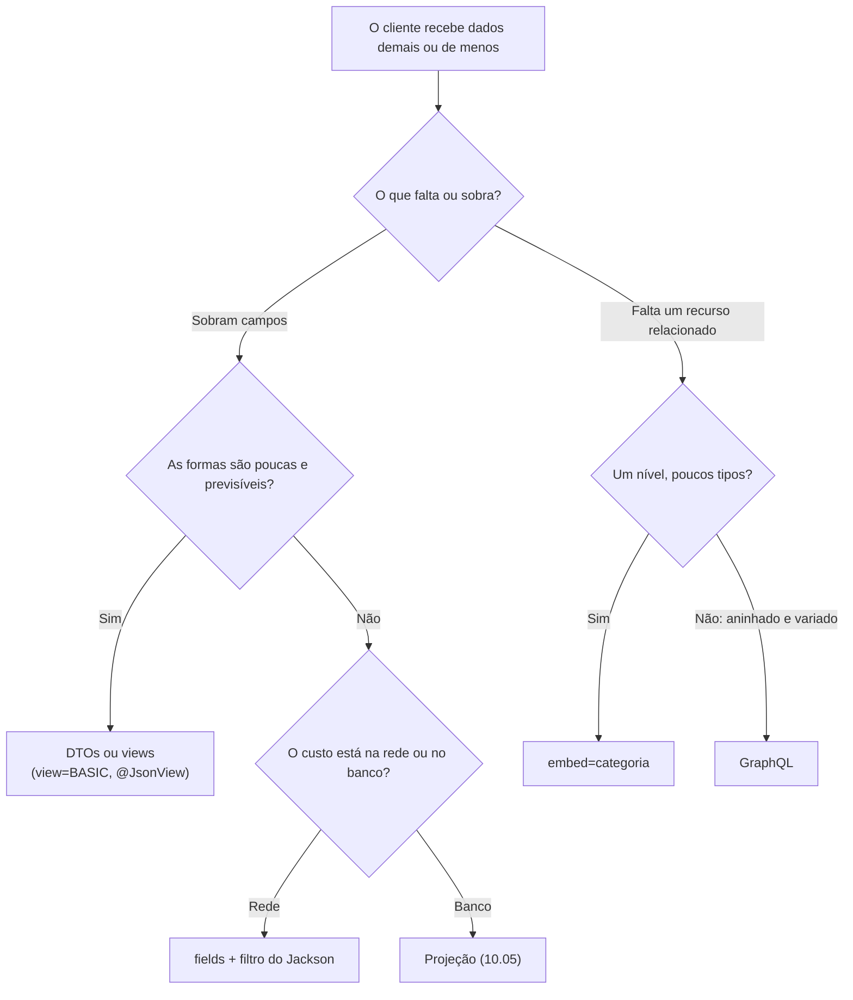

## O problema

O app do Bazar tem uma tela de busca que mostra, para cada produto, só o nome e o preço. A listagem devolve seis campos por item, e o app joga quatro fora. Numa rede móvel ruim, com 100 itens por página, isso é tráfego desperdiçado.

Já a tela de detalhe do produto mostra o nome da categoria. A resposta traz só o `categoriaId`, e o app faz uma segunda chamada, `GET /v1/categorias/{id}`, antes de conseguir desenhar a tela. São duas idas e voltas na rede onde uma bastaria.

Os dois problemas têm soluções conhecidas:

- **Respostas parciais:** o cliente diz quais campos quer (`?fields=nome,precoEmCentavos`).
- **Expansão:** o cliente pede que um recurso relacionado venha dentro da resposta (`?embed=categoria`).

Os dois parecem ganhos sem custo, e não são. Cada combinação de campos vira uma resposta diferente para o *cache*, o OpenAPI não consegue descrever o que sai, e o servidor ganha um pequeno interpretador de consultas para manter. Esta página mostra como implementar as duas coisas e, principalmente, quando **não** implementar.

## O conceito

### Respostas parciais (*sparse fieldsets*)

Uma <Term id="resposta-parcial">resposta parcial</Term> devolve só os campos que o cliente pediu. Os guias usam sintaxes parecidas:

| Quem | Sintaxe | Exemplo |
|---|---|---|
| Zalando ([157]) | `fields`, com parênteses para objetos aninhados | `fields=(name,friends(name))` |
| Google Cloud (parâmetro de sistema) | `fields`, com parênteses e `/` | `fields=items(id,name)` |
| JSON:API | `fields[tipo]`, uma lista por tipo de recurso | `fields[articles]=title,body` |
| Bazar | `fields`, uma lista simples | `fields=id,nome,precoEmCentavos` |

A Zalando define uma gramática (em BNF) que permite descer em objetos aninhados e negar campos (`!`). O Bazar usa uma lista simples porque o item da listagem é plano: não há objeto aninhado para filtrar. Se um dia houver, a gramática da Zalando é o caminho natural, e `fields=id,nome` continua válido dentro dela como `fields=(id,nome)`.

Três decisões de contrato:

1. **Sem `fields`, a resposta sai completa.** A Zalando é explícita: não dê um valor padrão para `fields`, porque *"the result is counter-intuitive and very likely not anticipated by the consumer"*. O Google (AIP-157) também: *"If the field mask is not provided, all fields must be returned."*
2. **Um campo que não existe é `400`.** O Google permite ignorar, nas leituras, caminhos que não existem (AIP-161: *"field masks may ignore entries that point to a value that can not exist"*). O Bazar recusa, pela mesma razão da [13.01](/design-de-apis-profissional/filtros-e-busca) e da [13.02](/design-de-apis-profissional/ordenacao): `fields=preco` (em vez de `precoEmCentavos`) devolveria um objeto **sem preço**, e o app mostraria "R$ 0,00" sem que ninguém percebesse o erro de digitação.
3. **O `id` não é obrigatório.** Um cliente que pede `fields=nome` recebe só o nome. Muitas APIs forçam o `id` em toda resposta, e é uma escolha razoável. O Bazar preferiu a regra mais simples: sai o que foi pedido.

### O Google mudou de ideia: *views* em vez de máscaras

O Google é a origem das <Term id="mascara-de-campos">máscaras de campos</Term> (*field masks*, AIP-161): listas de caminhos como `title,author.given_name` que dizem quais campos ler ou atualizar. Elas continuam sendo o padrão para **atualizações parciais** (o `update_mask` de um PATCH, tema da [12.05](/design-de-apis-profissional/put-patch-json-merge-patch-e-json-patch)). Para **leituras**, o Google hoje desaconselha a máscara no pedido. A AIP-157 diz que o `read_mask` como campo da requisição está *"DEPRECATED"*, e recomenda outra coisa:

> *"When partial responses are needed, APIs should use view enumerations as the primary pattern."*

Uma *view* é um conjunto **fixo e nomeado** de campos: `view=BASIC` ou `view=FULL`. O cliente escolhe entre poucas formas previsíveis, em vez de montar a sua. A AIP-157 justifica com um argumento que vale para qualquer API: respostas parciais como padrão *"can degrade the effectiveness of declarative clients"*. Um cliente gerado a partir do contrato espera um tipo, e um objeto com campos faltando quebra esse tipo.

| | `fields` livre | *Views* nomeadas |
|---|---|---|
| Combinações possíveis | 2ⁿ (64 com 6 campos) | 2 ou 3 |
| *Cache* | Uma entrada por combinação | Uma por *view* |
| Contrato (OpenAPI) | Um *schema* com tudo opcional | Um *schema* por *view* |
| Flexibilidade para o cliente | Total | Só o que o servidor previu |
| No Spring | Filtro do Jackson | `@JsonView` ou um DTO por *view* |

O Bazar, na prática, já tem *views*: `ProdutoResumoResponse` na listagem e `ProdutoResponse` no detalhe ([10.05](/persistencia-para-apis/projecoes-e-consultas-para-leitura)). O `fields` é uma camada a mais, só na listagem, para o caso do app móvel.

### Expansão (*embed*)

A <Term id="expansao-de-recursos">expansão</Term> (*resource expansion*) inverte a pergunta: em vez de tirar campos, acrescenta um recurso relacionado. A Zalando ([158]) chama o parâmetro de `embed`, a Stripe de `expand[]`, o JSON:API de `include`:

```http
GET /v1/produtos/0192f3a1-…?embed=categoria
```

```json
{
  "id": "0192f3a1-…",
  "nome": "Clean Code",
  "categoriaId": "0192f3a0-5555-7000-8000-000000000003",
  "categoria": { "id": "0192f3a0-5555-7000-8000-000000000003", "nome": "Programação", "slug": "programacao", "categoriaPaiId": null },
  "…": "…"
}
```

Decisões do Bazar:

- **O `categoriaId` continua.** A expansão **acrescenta** o objeto, não troca o id por ele. Assim, a resposta sem `embed` é a mesma de sempre, e um cliente que ignora o campo novo não quebra. A Stripe faz o contrário: o campo `customer` deixa de ser um id e vira um objeto, e o cliente precisa tratar os dois tipos no mesmo campo.
- **Sem `embed`, o campo `categoria` nem aparece.** Um `"categoria": null` diria "este produto não tem categoria", o que é falso.
- **Só o que foi oferecido.** `embed=estoque` é `400` com a lista do que pode ser incorporado. A Zalando avisa no [137]: *"Implementing embed correctly is difficult, so do it with care."*
- **No detalhe, e não na lista.** Na listagem, expandir a categoria de 100 produtos significa buscar até 100 categorias. Dá para fazer com uma consulta só (`findAllById` com os ids distintos), mas é uma decisão a tomar com números, e o app ainda não precisa.

O HAL, que o Bazar usa nos pedidos (03.04), tem um lugar padrão para isso: o objeto `_embedded`. O produto não é HAL, então a categoria entra como um campo comum.

### Três formas de implementar no Spring

| Técnica | O que reduz | Quando usar |
|---|---|---|
| **Filtro do Jackson** (`@JsonFilter` + `FilterProvider`) | Só o JSON: o banco lê tudo, o Jackson omite campos | `fields` livre, quando o gargalo é a rede |
| **`@JsonView`** | Só o JSON, em formas fixas | *Views* nomeadas sobre o mesmo DTO |
| **Projeção dinâmica do Spring Data** | O SQL: só as colunas pedidas | Quando o custo está no banco (colunas grandes, `jsonb`, *joins*) |

A diferença entre as duas primeiras e a terceira é a mais importante da tabela. Um filtro do Jackson **não economiza nada no banco**: a consulta lê as seis colunas, o objeto é montado inteiro, e só na serialização os campos são descartados. Ele economiza **rede**, que é o problema do app móvel. Se o problema fosse uma coluna `descricao` com 2.000 caracteres em cada linha, a solução seria uma projeção (10.05), e não um filtro.

**No Spring 7 com Jackson 3, o mecanismo mudou.** O `MappingJacksonValue`, que embrulhava o valor de retorno com uma *view* ou um filtro, está **depreciado para remoção** no Spring Framework 7.0. Verificamos no `spring-web` 7.0.10: o conversor do Jackson 3 (`JacksonJsonHttpMessageConverter`) chega a recusar um `MappingJacksonValue` com a mensagem *"MappingJacksonValue is not supported, use hints instead"*. Os *hints* são um `Map` que acompanha a escrita. O conversor procura duas chaves:

- `JsonView.class.getName()`, com a classe da *view*. É assim que o `@JsonView` no método continua funcionando;
- `FilterProvider.class.getName()`, com o filtro.

Quem fornece os *hints* é um `ResponseBodyAdvice`, pelo método `determineWriteHints`, que é novo no Spring 7. É o caminho que o Bazar usa.

### O custo: *cache*, documentação e complexidade

**Cache.** Para um *cache* HTTP ([20.01](/padroes-avancados-de-http/cache-http-rfc-9111)), a URL faz parte da chave. `?fields=id,nome`, `?fields=nome,id` e `?fields=nome,id,sku` são três entradas diferentes para quase os mesmos dados, e cada uma expira e é invalidada separadamente. Com *views* fixas, são duas ou três entradas. O mesmo vale para o `ETag` ([20.02](/padroes-avancados-de-http/etag-e-requisicoes-condicionais)): cada representação tem o seu.

**Documentação.** A Zalando reconhece: *"OpenAPI doesn't support you in formally specifying different return object schemes depending on a parameter."* O *schema* da listagem continua dizendo que o item tem seis campos, e um cliente gerado a partir dele não sabe que, com `fields`, quatro podem faltar. A recomendação da Zalando é descrever o parâmetro com um texto que aponte para a regra [157]. O `embed` tem o mesmo problema, mais brando: o campo `categoria` aparece no *schema* como opcional.

**Complexidade.** Cada formato de saída precisa respeitar o `fields`. No Bazar, a listagem de produtos também sai em CSV (09.03), e o conversor de CSV não lê o filtro do Jackson: hoje, `fields` só vale para JSON. É o tipo de inconsistência que aparece quando um recurso transversal é acrescentado a um caminho só.

### Quando GraphQL é a resposta melhor

`fields` e `embed` são, no fundo, uma linguagem de consulta pequena dentro de uma API REST. Quando ela começa a crescer, ou seja, quando os clientes pedem campos aninhados, expansões dentro de expansões, filtros dentro das expansões e combinações diferentes para cada tela, a API está reinventando o GraphQL, e sem o ecossistema dele (*schema* tipado, ferramentas, validação de consultas).

O GraphQL ([04.01](/rest-e-estilos-de-api/rest-rpc-graphql-grpc-websocket-sse-e-webhooks-quando-usar), [30.07](/arquitetura/graphql-com-spring-for-graphql)) foi desenhado exatamente para isso: o cliente declara a forma da resposta, e o *schema* diz o que é possível. O custo é perder o que a REST tem de graça: *cache* HTTP por URL, códigos de status por recurso, a simplicidade de um `curl`.

Uma regra prática:

- **Poucas telas, formas previsíveis:** DTOs diferentes ou *views* (`view=BASIC`). É o que resolve a maioria das APIs.
- **Um cliente com limite de banda e uma lista grande:** `fields` simples, como o Bazar faz.
- **Muitos clientes, cada um com uma forma, e grafos de recursos relacionados:** GraphQL, ao lado da API REST ou no lugar dela, para esses clientes.

## Diagrama



## Na prática

### O contrato

| Endpoint | Parâmetro | Valores aceitos | Sem o parâmetro |
|---|---|---|---|
| `GET /v1/produtos`, `POST /v1/produtos/buscas` | `fields` | `id`, `sku`, `nome`, `precoEmCentavos`, `categoriaId`, `status` | Item completo |
| `GET /v1/produtos/{id}` | `embed` | `categoria` | Sem o campo `categoria` |

Um valor fora da lista é `400 valor-nao-aceito`, com os recusados e os aceitos no corpo.

### Ler a lista de nomes

```java title="src/main/java/com/bazar/compartilhado/web/ValoresDeParametro.java"
/**
 * Lê um parâmetro com uma lista de nomes separados por vírgula, como fields=id,nome ou embed=categoria (13.05).
 * Um nome fora da lista é recusado (400), e não ignorado: o cliente receberia outra coisa sem saber.
 */
public final class ValoresDeParametro {

    private ValoresDeParametro() {
    }

    /**
     * @return os nomes pedidos, na ordem em que vieram; vazio se o parâmetro não veio
     */
    public static Set<String> ler(String parametro, @Nullable String valor, SortedSet<String> aceitos) {
        if (valor == null || valor.isBlank()) {
            return Set.of();
        }
        var pedidos = new LinkedHashSet<String>();
        Arrays.stream(valor.split(",", -1)).map(String::strip).forEach(pedidos::add);
        var recusados = new TreeSet<>(pedidos);
        recusados.removeAll(aceitos);
        if (!recusados.isEmpty()) {
            throw new ValorNaoAceitoException(parametro, recusados, aceitos);
        }
        return pedidos;
    }
}
```

`split(",", -1)` mantém os itens vazios: `fields=id,,nome` gera um nome vazio, que não está na lista e dá `400`, em vez de passar em silêncio.

### `fields`: o filtro do Jackson

O item da listagem é marcado com o filtro:

```java title="src/main/java/com/bazar/catalogo/api/ProdutoResumoResponse.java (trecho)"
@JsonFilter(CamposDaResposta.FILTRO)
public record ProdutoResumoResponse(UUID id, String sku, String nome, long precoEmCentavos, UUID categoriaId,
        StatusProduto status) {
}
```

Um tipo com `@JsonFilter` precisa de um filtro registrado com aquele nome **em toda serialização**, ou o Jackson falha. Por isso, o `JsonMapper` da aplicação ganha um provedor padrão que, sem filtro registrado, não filtra nada:

```java title="src/main/java/com/bazar/compartilhado/web/ConfiguracaoWeb.java (trecho)"
// Um filtro padrão que não filtra nada: um tipo com @JsonFilter (ProdutoResumoResponse) sai completo quando a
// requisição não pede fields. Sem isso, o Jackson falha ao não achar o filtro (13.05).
@Bean
JsonMapperBuilderCustomizer filtroDeCamposPadrao() {
    return builder -> builder.filterProvider(new SimpleFilterProvider().setFailOnUnknownId(false));
}
```

O controller valida o `fields` contra os componentes do *record* e guarda o filtro na requisição:

```java title="src/main/java/com/bazar/compartilhado/web/CamposDaResposta.java (trecho)"
public static void selecionar(@Nullable String fields, Class<? extends Record> tipo) {
    var aceitos = Arrays.stream(tipo.getRecordComponents())
            .map(RecordComponent::getName)
            .collect(Collectors.toCollection(TreeSet::new));
    var pedidos = ValoresDeParametro.ler("fields", fields, aceitos);
    if (!pedidos.isEmpty()) {
        RequestContextHolder.currentRequestAttributes().setAttribute(ATRIBUTO,
                new SimpleFilterProvider().addFilter(FILTRO, SimpleBeanPropertyFilter.filterOutAllExcept(pedidos)),
                RequestAttributes.SCOPE_REQUEST);
    }
}
```

Os nomes aceitos vêm do próprio *record*. Um campo novo na resposta passa a ser aceito em `fields` sem nenhuma mudança aqui. Isso funciona porque, no Bazar, o nome do componente é o nome no JSON. Com um `@JsonProperty` renomeando um campo, seria preciso ler os nomes do Jackson.

E o `ResponseBodyAdvice` entrega o filtro ao conversor como um *hint*:

```java title="src/main/java/com/bazar/compartilhado/web/FiltroDeCamposAdvice.java (trecho)"
/**
 * Entrega ao conversor do Jackson 3 o filtro de ?fields= (13.05). No Spring 7, o conversor recebe o filtro como um
 * hint com a chave FilterProvider.class.getName(); o MappingJacksonValue, que fazia isso antes, está depreciado.
 */
@ControllerAdvice
class FiltroDeCamposAdvice implements ResponseBodyAdvice<Object> {

    @Override
    public boolean supports(MethodParameter tipoDeRetorno, Class<? extends HttpMessageConverter<?>> conversor) {
        return AbstractJacksonHttpMessageConverter.class.isAssignableFrom(conversor);
    }

    // beforeBodyWrite devolve o corpo sem mudar nada

    @Override
    public @Nullable Map<String, Object> determineWriteHints(@Nullable Object corpo, MethodParameter tipoDeRetorno,
            MediaType tipo, Class<? extends HttpMessageConverter<?>> conversor) {
        var filtro = CamposDaResposta.selecionado();
        return filtro == null ? null : Map.of(FilterProvider.class.getName(), filtro);
    }
}
```

<DeepDive title="O jeito antigo: MappingJacksonValue">

Com o Jackson 2 (Spring 6 e anteriores), o controller embrulhava o retorno:

```java
var valor = new MappingJacksonValue(lista);
valor.setFilters(new SimpleFilterProvider().addFilter("campos", SimpleBeanPropertyFilter.filterOutAllExcept(campos)));
return valor;
```

Funcionava, mas o tipo de retorno do método deixava de dizer o que a API devolve: `MappingJacksonValue`, em vez de `Lista<ProdutoResumoResponse>`. No Spring 7, a classe está depreciada para remoção, e o conversor do Jackson 3 a recusa. Se você encontrar esse código numa migração para o Spring Boot 4, a troca é pelo *hint*, como acima.

</DeepDive>

### `embed`: a categoria dentro do produto

```java title="src/main/java/com/bazar/catalogo/api/ProdutoResponse.java (trecho)"
public record ProdutoResponse(
        // ... os campos de sempre, inclusive categoriaId
        Instant atualizadoEm,
        // Só com ?embed=categoria (13.05); sem ele, o campo não aparece.
        @JsonInclude(JsonInclude.Include.NON_NULL) @Nullable CategoriaResponse categoria) {

    ProdutoResponse comCategoria(CategoriaResponse categoria) {
        return new ProdutoResponse(id, sku, nome, descricao, precoEmCentavos, categoriaId, status, atributos, criadoEm,
                atualizadoEm, categoria);
    }
}
```

```java title="src/main/java/com/bazar/catalogo/api/ProdutoController.java (trecho)"
private static final SortedSet<String> INCORPORAVEIS = new TreeSet<>(Set.of("categoria"));

// ?embed=categoria traz a categoria dentro do produto, em vez de só o categoriaId (13.05).
@GetMapping("/{id}")
public ProdutoResponse detalhar(@PathVariable UUID id, @RequestParam(required = false) @Nullable String embed) {
    var incorporar = ValoresDeParametro.ler("embed", embed, INCORPORAVEIS);
    var produto = servico.detalhar(id);
    var resposta = mapper.paraResponse(produto);
    return incorporar.contains("categoria")
            ? resposta.comCategoria(CategoriaResponse.de(servico.categoriaDe(produto)))
            : resposta;
}
```

O `@JsonInclude(NON_NULL)` vale só para esse componente: a `descricao` continua saindo como `null` quando não existe, como o contrato da v1 sempre fez. O teste de contrato do JSON (`ProdutoJsonTest`, com `isStrictlyEqualToJson`) confirma que a resposta sem `embed` não mudou nenhum caractere.

Os parâmetros `fields` e `embed` são `@RequestParam` declarados no método, e por isso o interceptor de parâmetros da 12.02 passa a aceitá-los. Em qualquer outro endpoint, `?fields=` continua sendo `400 parametro-desconhecido`.

### Na prática, pela API

<HttpExchange
  title="Só o nome e o preço de cada produto"
  request={{ method: 'GET', url: '/v1/produtos?fields=id,nome,precoEmCentavos&limit=2' }}
  response={{ status: 200, headers: { 'Content-Type': 'application/json' }, body: { itens: [
    { id: '0192f39f-2222-7000-8000-000000000042', nome: 'Clean Code', precoEmCentavos: 12990 },
    { id: '0192f39f-2222-7000-8000-000000000043', nome: 'Refactoring', precoEmCentavos: 15900 } ] } }}
>
O envelope (`itens`) e o header `Link` da 13.04 não mudam: o filtro vale só para cada item.
</HttpExchange>

<HttpExchange
  title="Um campo que o item não tem"
  request={{ method: 'GET', url: '/v1/produtos?fields=nome,preco', headers: { 'Accept-Language': 'pt-BR' } }}
  response={{ status: 400, headers: { 'Content-Type': 'application/problem+json' }, body: { type: 'https://api.bazar.example/problemas/valor-nao-aceito', title: 'Valor não aceito', status: 400, detail: 'O parâmetro fields não aceita: preco. Valores aceitos: categoriaId, id, nome, precoEmCentavos, sku, status.', instance: '/v1/produtos', parametro: 'fields', recusados: ['preco'], aceitos: ['categoriaId', 'id', 'nome', 'precoEmCentavos', 'sku', 'status'], codigo: 'VALOR_NAO_ACEITO' } }}
>
Se o Bazar ignorasse `preco`, o app receberia produtos sem preço e não saberia por quê.
</HttpExchange>

### Os testes

```java title="src/test/java/com/bazar/catalogo/api/ProdutoControllerTest.java (trecho)"
@Test
void fieldsDevolveSoOsCamposPedidosDeCadaItem() {
    assertThat(mvc.get().uri("/v1/produtos?fields=id,nome,precoEmCentavos")).hasStatusOk()
            .bodyJson().isStrictlyEqualTo("""
                    { "itens": [ { "id": "0192f39f-2222-7000-8000-000000000042", "nome": "Clean Code",
                                   "precoEmCentavos": 12990 } ] }
                    """);
}

@Test
void semFieldsAListaSaiCompleta() {
    assertThat(mvc.get().uri("/v1/produtos")).hasStatusOk()
            .bodyJson().extractingPath("$.itens[0]").asMap()
            .containsOnlyKeys("id", "sku", "nome", "precoEmCentavos", "categoriaId", "status");
}

@Test
void embedCategoriaTrazACategoriaDentroDoProduto() {
    // ... o serviço (um dublê) devolve o produto e a categoria
    assertThat(mvc.get().uri("/v1/produtos/{id}?embed=categoria", cleanCode.getId())).hasStatusOk()
            .bodyJson().isLenientlyEqualTo("""
                    { "categoriaId": "0192f3a0-5555-7000-8000-000000000003",
                      "categoria": { "id": "0192f3a0-5555-7000-8000-000000000003", "nome": "Programação",
                                     "slug": "programacao" } }
                    """);
    // Sem embed, o campo nem aparece.
    assertThat(mvc.get().uri("/v1/produtos/{id}", cleanCode.getId()))
            .bodyJson().doesNotHavePath("$.categoria");
}
```

`isStrictlyEqualTo` é o que prova o filtro: um campo a mais na resposta faria o teste falhar. `semFieldsAListaSaiCompleta` protege o outro lado, o filtro padrão que não filtra nada. Sem ele, a listagem inteira quebraria com um erro do Jackson.

## Erros comuns

<BadVsGood title="Ignorar um campo desconhecido em fields" why="O cliente erra o nome de um campo e recebe um objeto sem ele, sem nenhum aviso. Com um campo de preço, o app mostra um valor zerado. Recusar com a lista dos aceitos transforma o erro em algo que se corrige na hora.">
<Bad title="Filtra pelo que existir">

```java
var campos = Set.of(fields.split(","));
var filtro = SimpleBeanPropertyFilter.filterOutAllExcept(campos);   // "preco" some em silêncio
```

</Bad>
<Good title="Valida contra os campos do tipo">

```java
CamposDaResposta.selecionar(fields, ProdutoResumoResponse.class);   // fields=preco → 400 com os aceitos
```

</Good>
</BadVsGood>

<BadVsGood title="Trocar o id pelo objeto na expansão" why="Um campo que às vezes é um texto e às vezes é um objeto obriga todo cliente a tratar os dois tipos, e quebra os clientes gerados a partir do contrato. Acrescentar um campo novo mantém a resposta sem embed idêntica.">
<Bad title="O mesmo campo muda de tipo">

```json
{ "categoria": "0192f3a0-…" }                                   // sem embed
{ "categoria": { "id": "0192f3a0-…", "nome": "Programação" } }  // com embed
```

</Bad>
<Good title="Um campo a mais">

```json
{ "categoriaId": "0192f3a0-…" }
{ "categoriaId": "0192f3a0-…", "categoria": { "id": "0192f3a0-…", "nome": "Programação" } }
```

</Good>
</BadVsGood>

Outros erros frequentes:

- **Achar que `fields` economiza banco.** O filtro do Jackson age depois da consulta. Para economizar banco, use uma projeção.
- **Dar um valor padrão a `fields`,** que o cliente não espera.
- **Expandir em listas sem olhar as consultas.** `embed` numa lista de 100 itens pode virar 100 consultas (o problema N+1 da 10.04).
- **Expansões aninhadas e ilimitadas** (`embed=categoria.pai.pai`): cada nível multiplica o custo e o risco de ciclos.
- **Esquecer os outros formatos.** Um `fields` que vale no JSON e é ignorado no CSV é uma inconsistência.
- **Usar `MappingJacksonValue` no Spring 7.** Está depreciado para remoção e é recusado pelo conversor do Jackson 3. Use *hints* com um `ResponseBodyAdvice`.

## Boas práticas

- **Comece por DTOs bem desenhados.** Resumo na listagem e detalhe no detalhe resolvem a maioria dos casos sem nenhum parâmetro novo.
- **Prefira *views* nomeadas a `fields` livre** quando as formas forem poucas, como recomenda o Google.
- **Sem o parâmetro, devolva tudo,** e recuse nomes desconhecidos com a lista dos aceitos.
- **Na expansão, acrescente; não substitua.** O id continua, o objeto vem num campo à parte, e só aparece quando pedido.
- **Ofereça só expansões de um nível,** com uma lista fechada do que pode ser incorporado.
- **Documente no OpenAPI** que o endpoint aceita `fields` e `embed`, já que o *schema* não consegue expressar a resposta filtrada.
- **Quando a linguagem de consulta começar a crescer,** considere GraphQL.

## No projeto Bazar

<ProjectStep title="fields na listagem e embed=categoria no detalhe" module="catalogo" tag="pagina-13.05" files={[
  { path: 'src/main/java/com/bazar/compartilhado/web/ValoresDeParametro.java', change: 'novo' },
  { path: 'src/main/java/com/bazar/compartilhado/web/CamposDaResposta.java', change: 'novo' },
  { path: 'src/main/java/com/bazar/compartilhado/web/FiltroDeCamposAdvice.java', change: 'novo' },
  { path: 'src/main/java/com/bazar/compartilhado/erros/ValorNaoAceitoException.java', change: 'novo' },
  { path: 'src/main/java/com/bazar/compartilhado/web/ConfiguracaoWeb.java', change: 'alterado' },
  { path: 'src/main/java/com/bazar/compartilhado/erros/TratadorGlobalDeErros.java', change: 'alterado' },
  { path: 'src/main/java/com/bazar/catalogo/api/ProdutoResumoResponse.java', change: 'alterado' },
  { path: 'src/main/java/com/bazar/catalogo/api/ProdutoResponse.java', change: 'alterado' },
  { path: 'src/main/java/com/bazar/catalogo/api/ProdutoMapper.java', change: 'alterado' },
  { path: 'src/main/java/com/bazar/catalogo/api/ProdutoController.java', change: 'alterado' },
  { path: 'src/main/java/com/bazar/catalogo/dominio/ProdutoService.java', change: 'alterado' },
  { path: 'src/main/resources/messages.properties', change: 'alterado' },
  { path: 'src/main/resources/messages_pt.properties', change: 'alterado' },
  { path: 'src/test/java/com/bazar/catalogo/api/ProdutoControllerTest.java', change: 'alterado' },
  { path: 'src/test/java/com/bazar/catalogo/api/ProdutoJsonTest.java', change: 'alterado' },
]}>
A listagem e a busca de produtos aceitam `fields`, aplicado por um filtro do Jackson 3 que um `ResponseBodyAdvice` entrega ao conversor como *hint*. O detalhe do produto aceita `embed=categoria`, que acrescenta o campo `categoria` sem tirar o `categoriaId`. Nomes desconhecidos nos dois parâmetros recebem `400 valor-nao-aceito`. A resposta sem os parâmetros não mudou, e o teste de contrato do JSON confirma isso. A suíte tem 208 testes e continua com 5 contextos.
</ProjectStep>

## Resumo

- Respostas parciais (`fields`) cortam campos; a expansão (`embed`) acrescenta recursos relacionados. As duas economizam rede e idas e voltas, e as duas custam em *cache*, documentação e complexidade.
- Sem o parâmetro, a resposta sai completa. Nomes desconhecidos são `400` no Bazar, embora o Google permita ignorá-los nas leituras.
- O Google hoje recomenda *views* nomeadas (`BASIC`, `FULL`) em vez de máscaras livres nas leituras. No Spring, *views* são DTOs diferentes ou `@JsonView`.
- O filtro do Jackson economiza rede, e não banco. Para economizar banco, use projeções.
- No Spring 7 com Jackson 3, filtros e *views* chegam ao conversor como *hints*, por um `ResponseBodyAdvice`. O `MappingJacksonValue` está depreciado para remoção.
- Na expansão, mantenha o id e acrescente o objeto num campo que só aparece quando pedido.
- Quando os clientes precisam de formas muito variadas e aninhadas, a API está reinventando o GraphQL.

<Exercise title="O app quer tudo numa chamada" difficulty="medio">
O time do app propõe três mudanças na API do Bazar:

1. `GET /v1/pedidos?clienteId=…&embed=itens.produto.categoria`, para mostrar a lista de pedidos com a foto e a categoria de cada produto comprado.
2. `GET /v1/produtos?fields=nome,descricao`, para uma tela de busca que mostra o começo da descrição.
3. `GET /v1/produtos?view=CARTAO`, uma forma fixa com `id`, `nome`, `precoEmCentavos` e a URL da foto, usada em todos os cartões de produto do app.

Para cada uma, diga se você aceitaria, como implementaria e qual o custo principal.

<Hint>Pense em quantas consultas cada pedido gera, em onde está o custo (rede ou banco) e em quantas formas diferentes de resposta cada proposta cria.</Hint>

<Solution>

1. **Recusaria como proposto.** São três níveis de expansão numa **lista**: pedidos → itens → produto → categoria. Cada nível multiplica as consultas e o tamanho da resposta, e uma página de 20 pedidos com 5 itens cada exige 100 produtos e suas categorias. Se a tela realmente precisa disso, o caminho mais honesto é um endpoint pensado para ela (um resumo de pedido que já traga o nome e a foto do produto, guardados no item no momento da compra, como o Bazar já faz com o `nomeProduto`) ou GraphQL, se houver muitas telas assim.
2. **Recusaria com `fields`, e resolveria de outro jeito.** `descricao` não está no resumo da listagem, e de propósito: ela pode ter 2.000 caracteres, e lê-la para 100 produtos custa no **banco**, não só na rede. O filtro do Jackson não ajuda, porque age depois da consulta. Se a tela precisa de um trecho, o melhor é um campo novo no resumo, `descricaoCurta` (os primeiros 150 caracteres), calculado na projeção.
3. **Aceitaria.** É uma *view* nomeada, como recomenda a AIP-157: uma forma fixa, documentável num *schema* próprio, com uma entrada de *cache* a mais, e não 2ⁿ. A implementação é um DTO `ProdutoCartaoResponse` e uma projeção que leia só essas colunas. O custo é decidir quais *views* existem e mantê-las estáveis: `view=CARTAO` vira contrato.
</Solution>
</Exercise>

<Quiz questions={[
  {
    question: 'O que um filtro do Jackson (@JsonFilter) aplicado a partir de ?fields= economiza?',
    options: [
      'A consulta ao banco, que passa a ler só as colunas pedidas',
      'Só o tamanho da resposta: o banco lê tudo, o objeto é montado inteiro e o Jackson omite os campos na serialização',
      'O cache do servidor',
      'Nada: o Jackson serializa tudo e o cliente descarta',
    ],
    answer: 1,
    explanation: 'O filtro age na serialização. Para reduzir o que o banco lê, a ferramenta é a projeção do Spring Data (10.05). O fields com filtro resolve o problema da rede, como o de um app móvel com conexão lenta.',
  },
  {
    question: 'No Spring Framework 7 com Jackson 3, como um filtro por requisição chega ao conversor de JSON?',
    options: [
      'Embrulhando o retorno em MappingJacksonValue',
      'Como um hint com a chave FilterProvider.class.getName(), devolvido pelo determineWriteHints de um ResponseBodyAdvice',
      'Configurando um ObjectMapper novo a cada requisição',
      'Com @JsonView no controller',
    ],
    answer: 1,
    explanation: 'O MappingJacksonValue está depreciado para remoção no Spring 7, e o conversor do Jackson 3 o recusa ("use hints instead"). O ResponseBodyAdvice ganhou o método determineWriteHints, e o conversor lê os hints JsonView e FilterProvider.',
  },
  {
    question: 'O que a AIP-157 do Google recomenda hoje como padrão principal para respostas parciais?',
    options: [
      'Um campo read_mask em toda requisição',
      'Enumerações de views (BASIC, FULL): poucas formas fixas e previsíveis',
      'GraphQL',
      'Devolver sempre a resposta completa',
    ],
    answer: 1,
    explanation: 'A AIP-157 diz que APIs "should use view enumerations as the primary pattern" e considera o read_mask como campo da requisição depreciado nas APIs do Google. Views são poucas formas fixas, fáceis de cachear e de documentar.',
  },
  {
    question: 'Por que o Bazar acrescenta o campo categoria em ?embed=categoria, em vez de trocar o categoriaId pelo objeto?',
    options: [
      'Porque o Jackson não consegue trocar o tipo de um campo',
      'Para que a resposta sem embed continue idêntica e nenhum campo mude de tipo conforme o parâmetro',
      'Porque o categoriaId é a chave primária',
      'Por desempenho',
    ],
    answer: 1,
    explanation: 'Um campo que às vezes é texto e às vezes é objeto obriga os clientes a tratar os dois tipos e quebra clientes gerados a partir do contrato. Acrescentar um campo opcional, que só aparece quando pedido, mantém a resposta original intacta.',
  },
]} />

## Referências

<References />
