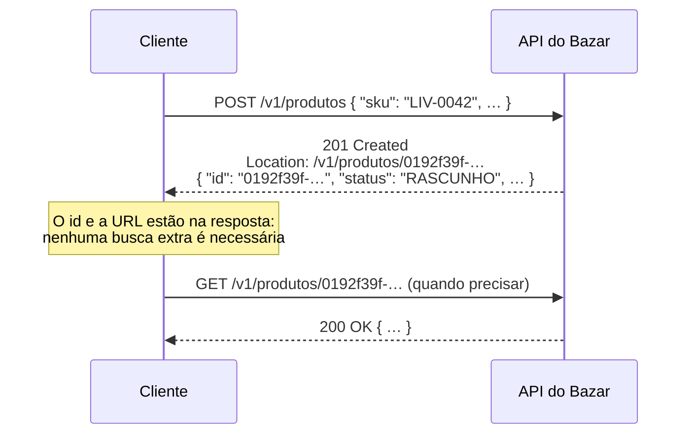

## O problema

Criar um recurso parece a operação mais simples de uma API: `POST`, salvar, devolver. Os detalhes é que separam uma API confortável de uma que obriga o cliente a adivinhar:

- O cliente precisa do **id** que o servidor gerou. Ele vem no corpo, num header, nos dois?
- O app que cadastra 500 produtos de uma planilha não quer receber 500 representações completas de volta. Dá para pedir uma resposta menor?
- O cliente manda `"status": "ATIVO"` no cadastro. O produto nasce ativo, a API recusa, ou o campo é ignorado?
- A rede cai depois do envio. O cliente reenvia, e agora existem **dois** produtos iguais?
- Dois operadores cadastram o mesmo SKU no mesmo segundo. Um recebe `201` e o outro… `500`.

Este último caso está no Bazar desde a [11.04](/testes-de-api/testes-de-integracao-com-springboottest-e-testcontainers). Aquela página corrigiu o `500` do SKU repetido com uma consulta antes do `INSERT` e deixou registrado que dois cadastros simultâneos ainda escapavam. Esta página fecha essa janela e trata cada uma das outras perguntas.

## O conceito

### POST cria, e o servidor escolhe o id

A RFC 9110 define o `POST` como um pedido para que o recurso de destino *"process the representation enclosed in the request according to the resource's own specific semantics"*. Numa coleção, isso significa "crie um item novo aqui, e você escolhe onde". Quando um recurso é criado, a resposta é **`201 Created`**, e a RFC diz o que ela leva: o servidor *"SHOULD send a 201 (Created) response containing a Location header field that provides an identifier for the primary resource created"*.



O `Location` é a URL **do recurso criado**, e não da coleção. É o único lugar padronizado pelo HTTP para dizer "seu recurso está aqui", e qualquer cliente HTTP sabe lê-lo. O corpo, por convenção, traz a representação completa, com tudo o que o servidor preencheu: o id, o status inicial, as datas. O Google (AIP-133) é taxativo: a resposta do *create* *"must be the resource itself"* e *"should include the fully-populated resource"*.

### `Prefer: return=minimal`: quando o cliente não quer o corpo

Uma integração que cadastra milhares de produtos não precisa da representação de cada um. O header `Prefer` (RFC 7240) permite que o cliente diga isso:

| Preferência | O que o cliente pede |
|---|---|
| `Prefer: return=representation` | O estado atual do recurso no corpo |
| `Prefer: return=minimal` | *"only a minimal response"*: no Bazar, `201` com `Location` e **sem corpo** |

É uma **preferência**, e não uma ordem: o servidor pode ignorá-la. A RFC é clara nos dois sentidos:

- Preferências desconhecidas ou que o servidor não atende devem ser ignoradas: *"MUST ignore those tokens and continue processing instead of signaling an error"*.
- Como o cliente não teria como saber se a preferência foi atendida, o servidor informa com **`Preference-Applied: return=minimal`**.

Três detalhes que costumam passar despercebidos:

- **`return=minimal` e `return=representation` juntos valem como nenhum dos dois** (a RFC diz que são mutuamente exclusivos).
- **O nome da preferência não diferencia maiúsculas; o valor diferencia.** `RETURN=minimal` vale, `return=MINIMAL` não.
- **Se a resposta pode ser guardada em *cache*, ela precisa de `Vary: Prefer`.** Uma resposta a `POST` raramente é cacheada, e por isso o Bazar não manda o `Vary` aqui. Num `GET` que respeitasse `Prefer`, ele seria obrigatório.

Para o Bazar, o padrão continua sendo a representação completa: é o que o Google recomenda e o que um cliente que não conhece o `Prefer` espera.

### Campos somente leitura: ignorar, e não recusar

O produto tem campos que só o servidor controla: `id`, `status`, `criadoEm`, `atualizadoEm`. O que fazer quando o cliente os envia no `POST`?

| Opção | Efeito | Quem faz assim |
|---|---|---|
| Ignorar | O produto nasce com os valores do servidor, sem erro | Google (AIP-203): o serviço *"must clear out any value in this field"* e *"must not throw an error"* |
| Recusar com `400` | O cliente descobre que mandou algo inútil | APIs muito estritas |
| Aceitar | O cliente escolhe o status e as datas | Ninguém deveria |

O Bazar ignora, e de graça: o `CriarProdutoRequest` simplesmente **não tem** esses campos, e o Jackson 3 ignora propriedades desconhecidas por padrão, o *tolerant reader* da [06.03](/construindo-apis-com-spring-boot/jackson-3-no-spring-boot-4). O argumento do Google é prático: um cliente que lê um produto, muda um campo e devolve o objeto inteiro manda junto o `id` e as datas, e recusá-lo por isso tornaria a API hostil.

Isso não contradiz a busca da [13.01](/design-de-apis-profissional/filtros-e-busca), que recusa campos desconhecidos. Lá, um critério ignorado devolve **mais** do que o cliente pediu, sem aviso. Aqui, um campo somente leitura ignorado não muda nada do que o cliente queria. A regra é: **recuse quando ignorar muda o resultado**.

E o contrato deve dizer quais campos são somente leitura. No OpenAPI, isso é `readOnly: true` ([Parte 7](/contratos-documentacao-e-ciclo-de-vida/a-especificacao-openapi)).

### Valores padrão

Tudo o que o cliente pode omitir precisa de um padrão **documentado**:

- `status` nasce `RASCUNHO`: um produto recém-cadastrado não aparece na loja até alguém ativá-lo.
- `descricao` nasce `null`, e `atributos`, `{}`.
- O estoque nasce zerado, na mesma transação ([10.03](/persistencia-para-apis/transacoes-na-camada-de-servico)).

O padrão é parte do contrato. Mudar o status inicial para `ATIVO` numa versão futura faria produtos incompletos aparecerem na loja para clientes que nunca mudaram uma linha: é uma quebra de contrato, mesmo sem nenhum campo novo.

### SKU repetido: `409`, e a corrida que a consulta não pega

O SKU é único. Cadastrar um repetido é um conflito com o estado atual do servidor: `409 Conflict` (08.02). O Google usa `ALREADY_EXISTS`, o equivalente gRPC.

A correção da 11.04 consulta antes de inserir:

```java
if (produtos.existsBySku(produto.getSku())) {
    throw new SkuDuplicadoException(produto.getSku());   // 409
}
produtos.save(produto);
```

A consulta e o `INSERT` não são atômicos. Dois cadastros simultâneos passam os dois pela consulta, porque nenhum vê o produto do outro antes do *commit*. O segundo `INSERT` é recusado pela *constraint* `unique` do banco, e o banco fica correto. A resposta, não: a violação acontece no *commit*, depois que o método do serviço já terminou, e vira um `DataIntegrityViolationException` que nenhum tratador conhece. Resultado: `500`.

A solução é deixar a *constraint* ser a fonte da verdade e **traduzir** a violação:

1. `saveAndFlush`, em vez de `save`: o `INSERT` acontece **dentro** do método, e a violação também.
2. A exceção do Spring traz a do Hibernate, que traz o **nome da constraint** que o PostgreSQL violou (`produto_sku_key`).
3. Se for a *constraint* do SKU, vira `SkuDuplicadoException`, e o `409` de sempre.

A consulta prévia continua, e por um motivo concreto: ela resolve o caso comum (o mesmo SKU cadastrado duas vezes, com minutos de diferença) sem uma escrita que falha. Um `INSERT` recusado gera uma mensagem de erro no log do PostgreSQL e no do Hibernate, e erros de negócio esperados não deveriam poluir os logs. A tradução cobre só a corrida.

### `PUT` com o id escolhido pelo cliente

O `PUT` tem outra semântica: *"the state of the target resource be created or replaced with the state defined by the representation"* (RFC 9110 §9.3.4). O cliente diz **onde** o recurso fica:

```http
PUT /v1/produtos/0192f39f-2222-7000-8000-000000000042
Content-Type: application/json

{ "sku": "LIV-0042", "nome": "Clean Code", … }
```

- Se não existe, o servidor cria e responde `201 Created`.
- Se existe, substitui e responde `200 OK` (ou `204`).

Isso é um <Term id="upsert">*upsert*</Term>, e ele resolve o problema da rede que cai: o `PUT` é **idempotente**. Repetido dez vezes, deixa o servidor no mesmo estado que uma vez só ([02.02](/comecando-e-fundamentos-de-http/metodos-http-semantica-seguranca-e-idempotencia)). Um `POST` repetido cria dez produtos.

| | `POST /produtos` | `PUT /produtos/{id}` |
|---|---|---|
| Quem escolhe o id | O servidor | O cliente |
| Repetir a requisição | Cria outro (sem proteção extra) | Mesmo resultado |
| Resposta | `201` sempre | `201` na criação, `200`/`204` na substituição |
| Exige do cliente | Nada | Gerar ids únicos (UUID) |
| Risco | Duplicatas em reenvios | Um cliente sobrescrever, sem querer, o recurso de outro |

O Google vai na mesma direção por outro caminho: no plano de gerenciamento, a API *"must allow a user to specify the ID"* na criação (`book_id` no `CreateBook`), e no plano de dados *"should"*.

**O Bazar não usa `PUT` para criar produtos**, e a decisão tem três razões:

1. Os ids do Bazar são UUIDs gerados pelo servidor, e passarão a ser UUID v7 na [15.03](/design-de-apis-profissional/identificadores-sequenciais-uuid-v7-e-ulid), com a ordem de criação embutida. Um id escolhido pelo cliente não teria essa garantia.
2. `PUT /v1/produtos/{id}` já existe com outro significado: substituir um produto **existente**, com `404` se ele não existir ([05.04](/construindo-apis-com-spring-boot/um-crud-com-status-corretos)). Mudar isso para *upsert* mudaria o contrato: um `PUT` com um id errado, que hoje dá `404`, passaria a criar um produto.
3. O problema do reenvio tem uma solução que não exige mudar quem escolhe o id: a **chave de idempotência** (`Idempotency-Key`, [21.01](/padroes-avancados-de-http/idempotency-keys)). O cliente gera uma chave por operação, e o servidor devolve a mesma resposta para a mesma chave.

Quando o *upsert* é a escolha certa? Quando o id **já existe fora da API**: sincronizar um cadastro com um sistema externo (o código do produto no ERP do lojista), ou recursos de configuração com nome fixo (`PUT /v1/configuracoes/frete`).

## Na prática

### Traduzir a constraint

```java title="src/main/java/com/bazar/compartilhado/Constraints.java"
/**
 * Identifica qual constraint do banco uma escrita violou (14.01). O nome vem do PostgreSQL (produto_sku_key é o
 * nome que ele dá ao unique da coluna sku) e chega pela exceção do Hibernate, dentro da exceção do Spring.
 */
public final class Constraints {

    private Constraints() {
    }

    public static boolean violou(DataIntegrityViolationException ex, String constraint) {
        for (Throwable causa = ex; causa != null; causa = causa.getCause()) {
            if (causa instanceof ConstraintViolationException violacao) {
                return constraint.equalsIgnoreCase(violacao.getConstraintName());
            }
        }
        return false;
    }
}
```

`produto_sku_key` é o nome que o PostgreSQL deu à *constraint* da `V1` (`sku varchar(8) not null unique`), porque a migration não deu um nome. Nomear as *constraints* nas migrations (`constraint produto_sku_unico unique (sku)`) deixa esse acoplamento explícito, e é uma boa prática para quando houver mais de uma.

```java title="src/main/java/com/bazar/catalogo/dominio/ProdutoService.java (trecho)"
// O produto e o seu estoque (zerado) nascem juntos, ou nenhum dos dois.
@Transactional
public Produto criar(Produto produto) {
    exigirCategoria(produto.getCategoriaId());
    // A consulta resolve o caso comum sem uma escrita que falha (e sem o erro no log do banco).
    if (produtos.existsBySku(produto.getSku())) {
        throw new SkuDuplicadoException(produto.getSku());
    }
    // Dois cadastros simultâneos passam os dois pela consulta; quem decide é a constraint unique. O flush aqui
    // faz a violação acontecer dentro do método, e não no commit, onde ela viraria um 500 (14.01).
    try {
        produtos.saveAndFlush(produto);
    } catch (DataIntegrityViolationException ex) {
        if (Constraints.violou(ex, "produto_sku_key")) {
            throw new SkuDuplicadoException(produto.getSku());
        }
        throw ex;
    }
    estoques.save(new Estoque(produto.getId()));
    return produto;
}
```

Qualquer outra violação (uma chave estrangeira, por exemplo) continua saindo como erro: só a *constraint* conhecida tem tradução. Traduzir **toda** `DataIntegrityViolationException` em `409` esconderia bugs.

### `Prefer` no controller

```java title="src/main/java/com/bazar/compartilhado/web/PreferenciaDeRetorno.java (trecho)"
public static boolean minima(@Nullable String prefer) {
    if (prefer == null) {
        return false;
    }
    var retornos = Arrays.stream(prefer.split(","))
            .map(preferencia -> preferencia.split(";")[0].strip().split("=", 2))
            // O nome da preferência não diferencia maiúsculas; o valor diferencia.
            .filter(par -> par.length == 2 && par[0].strip().equalsIgnoreCase("return"))
            .map(par -> par[1].strip())
            .distinct()
            .toList();
    return retornos.equals(List.of("minimal"));
}
```

`retornos.equals(List.of("minimal"))` cobre as regras da RFC de uma vez: sem `return`, a lista é vazia; com `minimal` e `representation`, tem dois itens. Nos dois casos, o resultado é `false`, e o servidor segue o padrão.

```java title="src/main/java/com/bazar/catalogo/api/ProdutoController.java (trecho)"
// 201 com Location e a representação; com Prefer: return=minimal, 201 sem corpo (14.01).
@PostMapping
public ResponseEntity<ProdutoResponse> criar(@Valid @RequestBody CriarProdutoRequest request,
        @RequestHeader(name = "Prefer", required = false) @Nullable String prefer) {
    var produto = servico.criar(mapper.paraProduto(request));
    var location = ServletUriComponentsBuilder.fromCurrentRequest()
            .path("/{id}")
            .buildAndExpand(produto.getId())
            .toUri();
    if (PreferenciaDeRetorno.minima(prefer)) {
        return ResponseEntity.created(location)
                .header(PreferenciaDeRetorno.APLICADA, "return=minimal")
                .build();
    }
    return ResponseEntity.created(location).body(mapper.paraResponse(produto));
}
```

### Na prática, pela API

<HttpExchange
  title="Criação com a representação (o padrão)"
  request={{ method: 'POST', url: '/v1/produtos', headers: { 'Content-Type': 'application/json' }, body: { sku: 'LIV-0042', nome: 'Clean Code', precoEmCentavos: 12990, categoriaId: '0192f3a0-5555-7000-8000-000000000003', atributos: { autor: 'Robert C. Martin' } } }}
  response={{ status: 201, headers: { Location: 'http://localhost:8080/v1/produtos/0192f39f-2222-7000-8000-000000000042', 'Content-Type': 'application/json' }, body: { id: '0192f39f-2222-7000-8000-000000000042', sku: 'LIV-0042', nome: 'Clean Code', descricao: null, precoEmCentavos: 12990, categoriaId: '0192f3a0-5555-7000-8000-000000000003', status: 'RASCUNHO', atributos: { autor: 'Robert C. Martin' }, criadoEm: '2026-10-25T18:05:40.112233Z', atualizadoEm: '2026-10-25T18:05:40.112233Z' } }}
>
`status`, `descricao`, as datas e o id foram preenchidos pelo servidor.
</HttpExchange>

<HttpExchange
  title="Criação com Prefer: return=minimal"
  request={{ method: 'POST', url: '/v1/produtos', headers: { 'Content-Type': 'application/json', Prefer: 'return=minimal' }, body: { sku: 'LIV-0043', nome: 'Refactoring', precoEmCentavos: 15900, categoriaId: '0192f3a0-5555-7000-8000-000000000003' } }}
  response={{ status: 201, headers: { Location: 'http://localhost:8080/v1/produtos/0192f39f-2222-7000-8000-000000000043', 'Preference-Applied': 'return=minimal' } }}
>
Sem corpo. O id está no `Location`, e o `Preference-Applied` confirma que a preferência foi atendida.
</HttpExchange>

<HttpExchange
  title="SKU repetido, mesmo numa corrida"
  request={{ method: 'POST', url: '/v1/produtos', headers: { 'Content-Type': 'application/json', 'Accept-Language': 'pt-BR' }, body: { sku: 'LIV-0042', nome: 'Clean Code', precoEmCentavos: 12990, categoriaId: '0192f3a0-5555-7000-8000-000000000003' } }}
  response={{ status: 409, headers: { 'Content-Type': 'application/problem+json' }, body: { type: 'https://api.bazar.example/problemas/sku-duplicado', title: 'SKU já cadastrado', status: 409, detail: 'Já existe um produto com o SKU LIV-0042.', instance: '/v1/produtos', codigo: 'SKU_DUPLICADO', sku: 'LIV-0042', traceId: '4b1c…' } }}
/>

### O teste da corrida

Testar uma condição de corrida com `Thread.sleep` gera um teste que às vezes passa. Este força a ordem dos eventos:

```java title="src/test/java/com/bazar/catalogo/ProdutoIntegracaoTest.java (trecho)"
// A janela que a 11.04 deixou aberta: os dois cadastros passam pela consulta existsBySku, e só a constraint
// decide. A transação do "outro" insere o SKU e fica aberta; o INSERT da API espera pelo índice unique e falha
// quando o outro confirma. Sem a tradução da constraint, a resposta seria 500.
@Test
void doisCadastrosSimultaneosComOMesmoSkuDao409ParaOSegundo() throws Exception {
    var inseriu = new CountDownLatch(1);
    var confirmar = new CountDownLatch(1);
    try (var threads = Executors.newFixedThreadPool(2)) {
        var outro = threads.submit(() -> transacao.executeWithoutResult(status -> {
            jdbc.sql("insert into produto (…) values (gen_random_uuid(), 'LIV-0042', …)").update();
            inseriu.countDown();
            aguardar(confirmar);
        }));
        inseriu.await();
        var api = threads.submit(() -> cliente.post().uri("/v1/produtos")
                .contentType(MediaType.APPLICATION_JSON).body(CLEAN_CODE)
                .exchange().returnResult());
        // Espera o INSERT da API ficar bloqueado no índice, e só então deixa o outro confirmar.
        while (jdbc.sql("select count(*) from pg_stat_activity where wait_event_type = 'Lock'")
                .query(Integer.class).single() == 0) {
            Thread.onSpinWait();
        }
        confirmar.countDown();
        outro.get(10, TimeUnit.SECONDS);

        assertThat(api.get(10, TimeUnit.SECONDS).getStatus()).isEqualTo(HttpStatus.CONFLICT);
    }
    assertThat(jdbc.sql("select count(*) from produto").query(Integer.class).single()).isEqualTo(1);
}
```

A sequência:

1. O "outro" insere o SKU numa transação que **não confirma**.
2. A API recebe o cadastro. O `existsBySku` não vê o produto do outro (ele ainda não foi confirmado) e deixa passar.
3. O `INSERT` da API **espera**: o PostgreSQL não sabe se o outro vai confirmar ou desfazer, e segura o novo registro no índice `unique`. O teste espera até ver essa espera em `pg_stat_activity`.
4. O outro confirma. O `INSERT` da API falha com a violação, que vira `409`.

Para ter certeza de que o teste prova a tradução, desligamos a tradução e rodamos de novo: *"expected: 409 CONFLICT but was: 500 INTERNAL_SERVER_ERROR"*. Um teste que passaria com ou sem a correção não protegeria nada.

Outros dois testes cobrem o `Prefer` (`201`, `Preference-Applied`, corpo vazio) e os campos somente leitura: um `POST` com `"id"`, `"status": "ATIVO"` e `"criadoEm": "2020-01-01T00:00:00Z"` cria um produto com outro id, `RASCUNHO` e a data de agora.

## Erros comuns

<BadVsGood title="Responder 200 sem Location" why="O 201 diz que algo foi criado, e o Location diz onde. Sem ele, o cliente precisa extrair o id do corpo e montar a URL sozinho, o que acopla o cliente ao formato das URLs.">
<Bad title="200 e só o corpo">

```java
@PostMapping
public ProdutoResponse criar(@RequestBody CriarProdutoRequest request) {
    return mapper.paraResponse(servico.criar(mapper.paraProduto(request)));   // 200 OK
}
```

</Bad>
<Good title="201, Location e o corpo">

```java
return ResponseEntity.created(location).body(mapper.paraResponse(produto));
```

</Good>
</BadVsGood>

<BadVsGood title="Traduzir qualquer violação de integridade em 409" why="Uma chave estrangeira violada ou uma coluna not null nula são bugs, e não conflitos do cliente. Só a constraint conhecida, com um significado de negócio, vira 409.">
<Bad title="Tudo vira conflito">

```java
@ExceptionHandler(DataIntegrityViolationException.class)
ResponseEntity<?> conflito() {
    return ResponseEntity.status(409).build();
}
```

</Bad>
<Good title="Só a constraint do SKU">

```java
if (Constraints.violou(ex, "produto_sku_key")) {
    throw new SkuDuplicadoException(produto.getSku());
}
throw ex;
```

</Good>
</BadVsGood>

Outros erros frequentes:

- **Confiar só na consulta antes do `INSERT`** para garantir unicidade. Só a *constraint* garante.
- **`save` em vez de `saveAndFlush`** quando a violação precisa ser tratada no método: com `save`, ela só aparece no *commit*.
- **Aceitar campos somente leitura** e deixar o cliente escolher o status inicial ou as datas.
- **Recusar o `Prefer`** desconhecido com erro. A RFC manda ignorar.
- **Mudar o valor padrão** de um campo sem tratar como mudança de contrato.
- **Usar `PUT` para criar** num endpoint em que `PUT` já significa "substituir um existente".

## Boas práticas

- **`201 Created` com `Location`** apontando para o recurso criado, e a representação completa no corpo.
- **Ofereça `Prefer: return=minimal`** para clientes que criam em volume, e confirme com `Preference-Applied`.
- **Ignore campos somente leitura** enviados pelo cliente e marque-os como `readOnly` no contrato.
- **Documente os valores padrão.** Eles são contrato.
- **A *constraint* do banco é a garantia de unicidade;** a consulta prévia é uma otimização para o caso comum. Traduza a violação da *constraint* conhecida para o erro de domínio.
- **Teste a corrida de forma determinística,** e confira que o teste falha sem a correção.
- **`PUT` com id do cliente** quando o id já existe fora da API; **`Idempotency-Key`** quando o problema é só o reenvio.

## No projeto Bazar

<ProjectStep title="A corrida do SKU fechada e Prefer: return=minimal" module="catalogo" tag="pagina-14.01" files={[
  { path: 'src/main/java/com/bazar/compartilhado/Constraints.java', change: 'novo' },
  { path: 'src/main/java/com/bazar/compartilhado/web/PreferenciaDeRetorno.java', change: 'novo' },
  { path: 'src/main/java/com/bazar/catalogo/dominio/ProdutoService.java', change: 'alterado' },
  { path: 'src/main/java/com/bazar/catalogo/api/ProdutoController.java', change: 'alterado' },
  { path: 'src/test/java/com/bazar/catalogo/ProdutoIntegracaoTest.java', change: 'alterado' },
]}>
O cadastro de produtos usa `saveAndFlush` e traduz a violação da *constraint* `produto_sku_key` em `409 sku-duplicado`, fechando a corrida que a 11.04 deixou aberta. `POST /v1/produtos` aceita `Prefer: return=minimal` e responde `201` sem corpo, com `Preference-Applied`. Três testes de integração novos: a corrida determinística, o `Prefer` e os campos somente leitura ignorados. A suíte tem 211 testes e continua com 5 contextos.
</ProjectStep>

## Resumo

- `POST` numa coleção cria um recurso com id escolhido pelo servidor: `201 Created`, `Location` com a URL do recurso e a representação completa no corpo.
- `Prefer: return=minimal` (RFC 7240) pede uma resposta sem corpo. É uma preferência: o servidor pode ignorar, e confirma com `Preference-Applied` quando atende.
- Campos somente leitura enviados pelo cliente são ignorados, como recomenda o Google. Recuse só quando ignorar mudaria o resultado.
- Valores padrão são parte do contrato.
- A unicidade é garantida pela *constraint* do banco. Traduza a violação conhecida (`produto_sku_key`) em `409`, e use `saveAndFlush` para que ela aconteça dentro do método.
- `PUT` com id do cliente é um *upsert* idempotente. O Bazar não o usa para produtos: o servidor gera os ids, `PUT` já significa substituir, e o reenvio é resolvido com `Idempotency-Key`.

<Exercise title="O cadastro de clientes" difficulty="medio">
O cadastro de clientes (`POST /v1/clientes`) tem o CPF como campo único. A tabela vai ganhar `constraint cliente_cpf_unico unique (cpf)` quando os clientes forem para o banco.

1. Que resposta um CPF repetido deve receber? O corpo deve dizer **qual** cliente já tem esse CPF?
2. Um app de cadastro reenvia o `POST` quando a resposta demora mais de 10 segundos. Que problema isso causa e como resolver sem mudar quem gera o id?
3. Um parceiro sugere `PUT /v1/clientes/{cpf}`, com o CPF como id. Quais as vantagens e por que isso é uma má ideia?

<Hint>Para o item 1, pense em quem pode ver aquele dado. Para o 3, pense no que acontece quando um CPF é digitado errado e em dados pessoais em URLs.</Hint>

<Solution>

1. **`409 Conflict`**, com um tipo próprio (`cpf-ja-cadastrado`), mas **sem** o id ou o nome do cliente existente. O CPF é um dado pessoal: dizer "este CPF pertence ao cliente X" permitiria descobrir quem tem cada CPF tentando cadastros. O Google prevê exatamente isso na AIP-133: se o chamador não pode ver o recurso que já existe, a resposta deve ser `PERMISSION_DENIED`, e não `ALREADY_EXISTS`. Para o Bazar, o `409` sem detalhes do outro cliente é o meio-termo, e o tratamento é o mesmo do SKU: consulta prévia, mais a tradução da *constraint* `cliente_cpf_unico`.

2. Com o CPF único, o reenvio não cria um cliente duplicado: o segundo `POST` recebe `409`. Mas o app, que nunca viu o `201` do primeiro, interpreta o `409` como "este CPF já tem cadastro" e mostra um erro a quem acabou de se cadastrar. A solução é a **chave de idempotência** ([21.01](/padroes-avancados-de-http/idempotency-keys)): o app gera um `Idempotency-Key` por tentativa de cadastro, e o servidor devolve o **mesmo `201`** para o reenvio.

3. Vantagens: o `PUT` é idempotente, e o reenvio deixa de ser um problema. Desvantagens, que pesam mais:
   - **O CPF vai para a URL**, e URLs ficam em logs de servidor, de proxy e no histórico do navegador. É um dado pessoal exposto em lugares que ninguém protege como o banco (LGPD, [Parte 11](/seguranca-essencial-para-apis/panorama-owasp-api-security-top-10)).
   - **Um CPF digitado errado vira um cliente** com o CPF de outra pessoa, e corrigir exige mudar o id do recurso.
   - **O id deixa de ser estável:** um id não deveria carregar significado de negócio que pode mudar ou estar errado. A [15.03](/design-de-apis-profissional/identificadores-sequenciais-uuid-v7-e-ulid) volta a isso.
</Solution>
</Exercise>

<Quiz questions={[
  {
    question: 'O que a RFC 9110 recomenda para a resposta de um POST que criou um recurso?',
    options: [
      '200 OK com o recurso no corpo',
      '201 Created com um header Location que identifica o recurso criado',
      '204 No Content',
      '202 Accepted',
    ],
    answer: 1,
    explanation: 'A RFC diz que o servidor SHOULD responder 201 com Location. O corpo com a representação completa é a convenção (e a recomendação do Google), e o Prefer: return=minimal permite ao cliente dispensá-lo.',
  },
  {
    question: 'Um cliente manda "Prefer: return=minimal, return=representation". O que o servidor deve fazer, segundo a RFC 7240?',
    options: [
      'Responder 400',
      'Aplicar a primeira',
      'Tratar como se nenhuma das duas tivesse sido enviada e seguir o padrão',
      'Aplicar a última',
    ],
    answer: 2,
    explanation: 'As duas preferências são mutuamente exclusivas, e a RFC diz que um pedido com as duas deve ser tratado como se nenhuma tivesse sido especificada. Preferências que o servidor não atende são ignoradas, nunca um erro.',
  },
  {
    question: 'Por que a consulta existsBySku antes do INSERT não basta para responder 409 em todos os casos?',
    options: [
      'Porque a consulta é lenta',
      'Porque dois cadastros simultâneos passam os dois pela consulta, e só a constraint unique do banco recusa o segundo, no INSERT',
      'Porque o PostgreSQL não tem constraint unique',
      'Porque existsBySku ignora maiúsculas',
    ],
    answer: 1,
    explanation: 'A consulta e o INSERT não são atômicos, e uma transação não vê o que a outra ainda não confirmou. A constraint é a garantia; a violação precisa ser traduzida para 409 (com saveAndFlush, para acontecer dentro do método).',
  },
  {
    question: 'Quando PUT com id escolhido pelo cliente (upsert) é uma boa escolha para criar recursos?',
    options: [
      'Sempre: é mais RESTful que POST',
      'Quando o id já existe fora da API, como o código de um produto no ERP de um lojista que sincroniza o catálogo',
      'Nunca: PUT não pode criar',
      'Quando o servidor gera UUIDs',
    ],
    answer: 1,
    explanation: 'O PUT pode criar ("created or replaced", RFC 9110) e é idempotente. Ele faz sentido quando o cliente já tem um identificador estável. Quando o problema é só o reenvio de um POST, a Idempotency-Key resolve sem mudar quem escolhe o id.',
  },
]} />

## Referências

<References />
